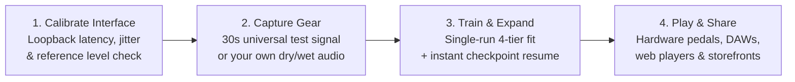

# Dynamic Neural Audio Modeler (DNAM)

**Dynamic Neural Audio Modeler (DNAM)** is an open, real-time audio modeling platform for capturing and playing amplifiers, pedals, speaker cabinets, studio processors, time-based effects, and complete multi-unit rigs.

Most neural amp modelers capture a single static snapshot of a dry preamp or drive pedal with its knobs glued in place. DNAM is built for how musicians, producers, and sound designers actually use their gear:

- **Turn the knobs and flip the switches:** Capture a single setting for a quick snapshot, or capture multiple settings so you can adjust gain, EQ, filter sweep, mix, and mode switches smoothly in real time.
- **Model time, space, and modulation—not just distortion:** Capture chorus, flangers, phasers, envelope filters, tape and BBD delays, spring and hall reverbs, pitch shimmer, and hardware freeze in true stereo.
- **Sync to your song's tempo:** Lock modeled LFOs and delay repeats to host BPM or MIDI Clock (`20–400 BPM` across 12 rhythmic subdivisions), complete with natural delay and reverb spillover trails when bypassed.
- **One file, four quality tiers:** Every `.dnam` file contains four nested quality levels (`Lite` ⊂ `Full` ⊂ `Pro` ⊂ `Ultra`) trained in a single run—so the exact same model file can run 10+ simultaneous instances on a compact hardware pedalboard, track at zero latency in a DAW, and render at maximum `4×` oversampled quality when bouncing a mix.

---

## 1. What You Can Capture & Play

DNAM models individual pieces of gear or an entire signal chain as a single `.dnam` file:

| Gear Category | Examples | What DNAM Preserves |
| :--- | :--- | :--- |
| **Preamps, Amplifiers, Drives & Compressors** | Tube amp heads, overdrive and distortion pedals, octave and wavefolder fuzzes, optical/FET compressors, analog tape | Touch-sensitive breakup, guitar volume-knob cleanup, power-amp sag, asymmetric clipping, and natural compression dynamics |
| **Speaker Cabinets, EQs & Studio Rooms** | Ported bass cabs (`1x15`), guitar stacks (`4x12`), multi-mic setups, studio EQs, chambers, plates, and live rooms | Deep cabinet thump, speaker cone breakup, multi-mic phase interaction, and full room decay at zero sample latency |
| **Sweeping Filters & Modulation** | Wah and envelope filters, resonant synth filters, phasers, Uni-Vibe, and optical or harmonic tremolo | Smooth frequency and envelope sweeps that keep their vocal resonance peak (`Q`) and modulation depth across the entire sweep |
| **Delays, Reverbs, Shimmer & Freeze** | Through-zero flangers, stereo chorus, rotary speakers, tape/BBD echoes, spring/hall reverbs, granular pitch shimmer, and freeze pedals | Click-free delay time changes, stereo diffusion, natural bypass trails, tempo sync, and captured hardware freeze/hold |
| **Complete End-to-End Rigs** | Multi-pedal boards into amp + cab + stereo rack effects, parallel wet/dry rigs, frequency-split bass rigs, 4-Cable Method (`4CM`), and Wet-Dry-Wet (`WDW`) setups | The full interaction between every unit in your chain—captured either as a quick **knobless snapshot** (`0` controls) or with **live knobs and switches** across the rig |

---

## 2. How DNAM Compares

| Feature | Static Snapshot Profilers (`NAM A2`, Kemper, IRs) | `GuitarML Proteus` | `NAM ParametricOD` | **DNAM** |
| :--- | :--- | :--- | :--- | :--- |
| **What It Models** | Amps, drives, or static IRs (no modulation, delay, or reverb tails) | Amps and drives (short memory; no long delays or reverbs) | Overdrive pedals | **Amps, drives, zero-latency cabs, sweeping filters, stereo chorus/delay/reverb/shimmer/freeze, and complete full rigs** |
| **Knobs & Switches** | None (1 static snapshot per file) | 1–2 continuous knobs | Fixed 3-knob layout (`Gain`, `Tone`, `Level`) | **Any number of continuous knobs and discrete switches (`0` controls for a snapshot, or full panel controls)** |
| **CPU Cost of Stationary Knobs** | None | Extra per-sample CPU cost for every knob | Extra per-sample CPU cost for every knob | **Zero extra audio-rate CPU cost when knobs are not moving** |
| **Tempo Sync, Trails & Freeze** | No | No | No | **Host BPM & MIDI Clock sync (`20–400 BPM`, 12 subdivisions), bypass spillover trails, and captured freeze** |
| **Adding Knob Settings Later** | Capture a separate file | Retrain from scratch | Retrain from scratch | **Incremental checkpoint resume (`.dnam-ckpt`)—add new knob or switch captures in seconds without altering existing tones** |
| **Uncaptured Knob Range Safety** | N/A | Can become unstable outside captured range | Manual `[0, 1]` UI limits | **Automatic 3-Phase safety clamping keeps uncaptured knob ranges, switches, and extreme multi-knob corners stable** |
| **Quality Scaling** | Separate model files per size (`Lite` vs. `Standard`) | Single fixed size | Single fixed size per export | **4 nested tiers (`Lite ⊂ Full ⊂ Pro ⊂ Ultra`) in one `.dnam` file, plus automatic `4×` oversampled `Ultra` DAW bounce** |
| **Sample Rates & Routing** | Fixed training sample rate; mono | Fixed training sample rate; mono | Fixed training sample rate; mono | **Automatic `44.1–192 kHz` adaptation; Mono (`1→1`, `2→1`), True Stereo (`1→2`, `2→2`), `4CM`, and `WDW`** |
| **File Format & Creator Attribution** | Large text JSON `.nam` or `.wav` | Text JSON `.json` | JSON or Python `.pt` | **Compact binary `.dnam` (`< 50 µs` load), cryptographic creator signatures, `.dnam-prev` audition files, and buyer watermarking** |

For a deeper technical comparison of the underlying DSP and training architecture, see the [TORA Architecture Overview](docs/specs/architecture/tora_architecture.md) and [System Goals & Requirements](docs/requirements/system_goals_and_requirements.md).

---

## 3. One File, Four Quality Tiers (`Lite` ⊂ `Full` ⊂ `Pro` ⊂ `Ultra`)

Instead of forcing tone creators to train and distribute separate "feather", "lite", and "standard" files, DNAM trains all four tiers together in a single run and packs them into one `.dnam` file:

| Tier | Where It Shines | Perceptual Quality Target (`bESR`) | Typical CPU / Instance Budget (`48 kHz` Stereo) |
| :--- | :--- | :--- | :--- |
| **`Lite`** | High-density live pedalboards & instant web browser previews | `≤ -18 dB` (`≤ 0.75 dB` EQ tilt) | **10+ instances** on a single embedded ARM64 core (`< 0.7%` single-core CPU on M-series / modern desktop) |
| **`Full`** | Default stage performance & zero-latency DAW tracking | `≤ -23 dB` (`≤ 0.35 dB` EQ tilt) | **6+ instances** on a single embedded ARM64 core (`< 0.8%` single-core desktop CPU) |
| **`Pro`** | Critical studio mixing, solo stems & reference monitoring | `≤ -30 dB` (`≤ 0.15 dB` EQ tilt) | **2+ instances** on a single embedded ARM64 core (`< 0.9%` single-core desktop CPU) |
| **`Ultra`** | Archival studio reference & automatic `4×` oversampled DAW offline bounce | `≤ -34 dB` (`≤ 0.10 dB` EQ tilt) | Track live in `Full`, then automatically promote to **`Ultra` at `4×` oversampling** when exporting your mix |

- **Perceptual Quality Certification:** Every model is verified across Low (`20–250 Hz`), Mid (`250 Hz–2.5 kHz`), and High (`2.5–18 kHz`) frequency bands against your audio interface's measured noise floor so upper-harmonic detail and quiet decay tails are never masked by low-end energy. See the [Psychoacoustic Quality Standard](docs/specs/architecture/psychoacoustic_quality_and_tiers.md).
- **Consistent Volume & Phase:** Models are automatically calibrated to unity gain at their default knob positions, maintain `0.00 dB` loudness matching when switching between `Lite`, `Full`, `Pro`, and `Ultra`, and automatically correct phase-inverting hardware circuits when blending wet/dry signals in parallel.

---

## 4. How Capturing, Training & Playing Works

> [!NOTE]
> **Project Status:** The real-time Rust engine (`dnam-engine`), Python SDK (`dnam`), TypeScript/WebAudio SDK (`@dnam-project/dnam`), and Two-Sweep PyTorch trainer (`dnam-trainer`) are implemented and verified. The **DNAM Desktop Studio** app, unified **`dnam` CLI**, and **Creator Marketplace** are currently in active development.

1. **Calibrate Your Audio Interface:** A guided two-step check measures your interface's loopback latency (down to sub-sample accuracy), noise floor, and analog reference level so your captured model responds to input levels just like the real hardware.
2. **Capture One Setting or a Full Panel:** Send DNAM's 30-second universal test signal through your pedal, amp, or full rig (recording automatically extends if a long reverb or delay tail is still ringing out), or bring your own custom dry/wet recordings of any length. DNAM does not rely on knob-name guesswork, so unmarked gear and black-box full rigs work out of the box.
3. **Train Once, Add More Knobs Anytime:** Training produces both a ready-to-play `.dnam` model (with all four tiers included) and a `.dnam-ckpt` checkpoint. If you decide later to capture a `Bright` switch or a few more `Gain` positions, you can resume from the checkpoint in seconds without retraining from scratch or shifting your already-captured tones.
4. **Play, Audition & Publish:** Load `.dnam` models into compatible hardware pedalboards, desktop apps, or browser players. Tone creators can sign their models for verifiable attribution, generate lightweight `.dnam-prev` audition files for web storefronts, and optionally enable buyer watermarking and hardware device authorization.

---

## 5. Ecosystem, SDKs & Hardware Integration

DNAM is designed to run anywhere audio lives—from bare-metal embedded DSP boards to desktop DAWs, Python research notebooks, and web browsers:

| Component | Package | What It Provides | Documentation |
| :--- | :--- | :--- | :--- |
| **Embedded & Native DSP Engine** | `dnam-engine` (Rust / C ABI) | Zero-allocation `#![no_std]` real-time engine with `ARM64 NEON`, `ARM SME`, `x86_64 AVX2`, and `WASM SIMD128` backends (`~142–179 ns` per stereo frame at `48 kHz`) for hardware pedalboards (such as Rockchip RK3582 / Darkglass Anagram) and native C/C++/Rust hosts. | [`packages/engine/README.md`](packages/engine/README.md) |
| **WebAudio & Node.js SDK** | `@dnam-project/dnam` | TypeScript SDK providing a real-time browser `AudioWorklet` (`WASM SIMD128`) and native Node.js `N-API` runtime for web tone previews, cloud rendering, and Electron/Tauri apps. | [`packages/js/README.md`](packages/js/README.md) |
| **Python SDK** | `dnam` | Python 3.14 SDK wrapping the Rust engine for zero-copy NumPy audio rendering, `.dnam` / `.dnam-ckpt` inspection, control-space clamping, and creator provenance signing. | [`packages/python/README.md`](packages/python/README.md) |
| **PyTorch Trainer** | `dnam-trainer` | Two-Sweep Block-Coordinate Cholesky training pipeline, incremental `.dnam-ckpt` stem expansion, and automatic 3-Phase control-space safety auditing. | [`packages/trainer/README.md`](packages/trainer/README.md) |
| **Desktop Studio & CLI** *(In Progress)* | `@dnam-project/studio` | Unified `dnam` CLI (`init`, `model`, `capture`, `train`, `inspect`, `studio`) and native Tauri v2 Desktop Studio for hardware calibration, capture, training, and live playing. | [`packages/studio/README.md`](packages/studio/README.md) |
| **Audio UI Design System** | `@dnam-project/ui` | Shared React 19 component library featuring rotary knobs, switches, and real-time spectrum, transfer-curve, and `bESR` visualizers. | [`packages/ui/README.md`](packages/ui/README.md) |
| **Specifications & Architecture** | `docs/` | Complete system requirements, psychoacoustic quality standards, TORA DSP specifications, `.dnam` binary container format, and security/provenance architecture. | [`docs/index.md`](docs/index.md) |

---

## 6. Contributing & License

Interested in building DNAM from source or contributing to the engine, trainer, SDKs, or Desktop Studio?
- **Developer Setup & Tooling (`mise` + `moon`):** See [`CONTRIBUTING.md`](CONTRIBUTING.md) for toolchain installation, CLI/Studio dev server commands, and test/benchmark workflows.
- **Specification & Documentation Guide:** See [`docs/index.md`](docs/index.md) and [`docs/CONTRIBUTING.md`](docs/CONTRIBUTING.md).
- **Contributor License Agreement:** All commits must be signed off (`git commit -s`) under [`CLA.md`](CLA.md).

Licensed under the [DNAM Source-Available & Branding License 1.0.0 (`LICENSE`)](LICENSE):
- **Free for Musicians & Tone Creators:** Capture, train, play, and share `.dnam` models freely. Creators retain full ownership of the `.dnam` models they train and may freely publish or sell their own first-party models directly (for example via their own website, Gumroad, Shopify, Bandcamp, or Patreon, or bundled with compliant hardware/plugins).
- **Hardware & Closed-Source Plugin Linking Allowed:** Hardware manufacturers and plugin developers may link `dnam-engine` (`packages/engine`, `packages/python`, `packages/js`) into commercial hardware firmware and closed-source audio plugins without open-sourcing their own host or plugin code.
- **Mandatory DNAM Branding, Format & Provenance Integrity:** Products linking `dnam-engine` or loading `.dnam` models must retain user-facing **"DNAM"** ("Dynamic Neural Audio Modeler" / **"Powered by DNAM"**) branding, unmodified `.dnam` container compatibility, and intact `Ed25519` signatures, device authorization, and buyer watermarks (no white-labeling or DRM/watermark circumvention).
- **No Unlicensed Marketplaces, Hosted Cloud Training, or Bulk Distillation:** Repackaging the standalone Desktop Studio (`packages/studio`), UI library (`packages/ui`), or trainer (`packages/trainer`), offering third-party hosted cloud training-as-a-service, operating an unlicensed multi-vendor `.dnam` model marketplace or aggregation hub, or bulk-distilling third-party `.dnam` models into competing formats is prohibited without a commercial license.

For bespoke OEM, marketplace, cloud-training, or commercial licensing inquiries, contact **Peter Nguyen** (<peter@phn.dev>).

