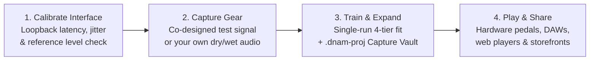

# Dynamic Neural Audio Modeler (DNAM)

**Dynamic Neural Audio Modeler (DNAM)** is an open, real-time audio modeling platform for capturing and playing amplifiers, pedals, speaker cabinets, studio processors, time-based effects, and complete multi-unit rigs.

Most neural amp modelers capture a single static snapshot of a dry preamp or drive pedal with its knobs glued in place. DNAM is built for how musicians, producers, and sound designers actually use their gear:

- **Turn the knobs and flip the switches:** Capture a single setting for a quick snapshot, or capture multiple settings so you can adjust gain, EQ, filter sweep, mix, and mode switches smoothly in real time.
- **Model time, space, and modulation—not just distortion:** Capture chorus, flangers, phasers, envelope filters, tape and BBD delays, spring and hall reverbs, pitch shimmer, octave synths, and hardware freeze in true stereo.
- **Capture real hardware or distill offline circuit simulations:** Profile physical amps, pedals, and studio racks—or distill heavy offline SPICE/WDF circuit solvers and multi-plugin DAW chains into a single constant-time `.dnam` model.
- **Sync to your song's tempo:** Lock modeled LFOs and delay repeats to host BPM or MIDI Clock (`20–400 BPM` across 12 rhythmic subdivisions), complete with natural delay and reverb spillover trails when bypassed.
- **One file, four quality tiers:** Every `.dnam` file contains four nested quality levels (`Lite` ⊂ `Full` ⊂ `Pro` ⊂ `Ultra`) trained in a single run—so the exact same model file can run 10+ simultaneous instances on a compact hardware pedalboard, track at zero latency in a DAW, and render at maximum `4×` oversampled quality when bouncing a mix.

---

## 1. What You Can Capture & Play

DNAM models individual pieces of gear, offline circuit simulations, or an entire signal chain as a single `.dnam` file:

| Gear Category | Examples | What DNAM Preserves |
| :--- | :--- | :--- |
| **Preamps, Amplifiers, Drives & Compressors** | Tube amp heads, overdrive and distortion pedals, octave and wavefolder fuzzes, optical/FET compressors, analog tape | Touch-sensitive breakup, guitar volume-knob cleanup, power-amp sag, asymmetric clipping, and natural compression dynamics |
| **Speaker Cabinets, EQs & Studio Rooms** | Ported bass cabs (`1x15`), guitar stacks (`4x12`), multi-mic setups, studio EQs, chambers, plates, and live rooms | Deep cabinet thump, speaker cone breakup, multi-mic phase interaction, and full room decay at zero sample latency |
| **Sweeping Filters, Pitch & Synth Effects** | Wah and envelope filters, resonant synth filters, phasers, Uni-Vibe, harmonic tremolo, octave dividers, ring mods, and pitch shifters | Smooth frequency and envelope sweeps that keep their vocal resonance peak (`Q`), sub-octave tracking, and pitch clarity across the sweep |
| **Delays, Reverbs, Shimmer & Freeze** | Through-zero flangers, stereo chorus, rotary speakers, tape/BBD echoes, spring/hall reverbs, granular pitch shimmer, and freeze pedals | Click-free delay time changes, stereo diffusion, natural bypass trails, tempo sync, and captured hardware freeze/hold |
| **Complete End-to-End Rigs & Offline Distillations** | Multi-pedal boards into amp + cab + stereo rack effects, parallel wet/dry or frequency-split bass rigs, `4CM`/`WDW` setups, and offline SPICE/DAW chains | The full cross-stage interaction between every unit in your chain—captured as a quick **knobless snapshot** (`0` controls) or with **live knobs and switches** across the rig |

---

## 2. How DNAM Compares

| Feature | Factory Multi-FX Blocks (Line 6 Helix, Quad Cortex, Fractal, Darkglass) | Static Snapshot Profilers (`NAM A2`, Kemper, QC Capture, IRs) | `GuitarML Proteus` / `NAM ParametricOD` | **DNAM** |
| :--- | :--- | :--- | :--- | :--- |
| **How Effects Are Created** | Hand-coded C/C++ by vendor engineers (users cannot capture their own modulation, pitch, delay, or reverb gear) | User-capturable, but limited to static mono amps/drives or linear cab IRs | User-capturable, but limited to mono amps and overdrive pedals | **User-capturable from any physical gear OR distilled from offline SPICE/WDF solvers and studio plugin chains** |
| **What It Models** | Vendor-selected factory effects | Amps, drives, or static IRs (no modulation, delay, or reverb tails) | Amps and drives (short memory; no long delays or reverbs) | **Amps, drives, zero-latency cabs, sweeping filters, pitch/synths, stereo chorus/delay/reverb/shimmer/freeze, and full rigs** |
| **Circuit Coupling Accuracy** | Manually decoupled stages (`1D`/`2D` lookup tables & `1`-step oversampled approximations) | Captures static single-setting nonlinearities only | Captures short-memory drive nonlinearities only | **Jointly captures multi-stage loading, 2D hysteresis, power-amp sag, speaker modes, and spatial tails across the full rig** |
| **Knobs & Switches** | Vendor-defined parameters per block | None (1 static snapshot per file) | 1–3 continuous knobs (`Proteus` / `ParametricOD`) | **Any number of continuous knobs and discrete switches (`0` controls for a snapshot, or full panel controls)** |
| **CPU Cost of Stationary Knobs** | Low (control-rate biquad/SVF updates) | None | Extra per-sample `48 kHz` CPU cost for every knob | **Zero extra audio-rate CPU cost when knobs are not moving (`3 kHz` dual-rate control bus)** |
| **Tempo Sync, Trails & Freeze** | Yes (on factory time/mod blocks only) | No | No | **Host BPM & MIDI Clock sync (`20–400 BPM`, 12 subdivisions), bypass spillover trails, and captured freeze on any model** |
| **Adding Knob Settings Later** | Requires vendor firmware update | Capture a separate file | Retrain from scratch | **Single-file Capture Vault (`.dnam-proj`)—add, toggle, replace, or remove knob/switch captures in milliseconds without altering existing tones** |
| **Uncaptured Knob Range Safety** | Hand-tuned per factory block | N/A | Manual `[0, 1]` UI limits; can become unstable | **Automatic 3-Phase safety clamping keeps uncaptured knob ranges, switches, and extreme multi-knob corners stable** |
| **Quality Scaling** | Fixed per block (or separate "Legacy/Eco" blocks) | Separate model files per size (`Lite` vs. `Standard`) | Single fixed size per export | **4 nested tiers (`Lite ⊂ Full ⊂ Pro ⊂ Ultra`) in one `.dnam` file, plus automatic `4×` oversampled `Ultra` DAW bounce** |
| **Est. Max LV2 Instances at Equivalent Quality (`1× RK3582 Cortex-A76` @ 80% Cap, incl. LV2 Overhead)** | Scales as `O(N blocks)`: `4–7×` chained blocks per rig (`~3–6×` full stereo rigs per core) | **Studio (`Standard`):** `3–5×` mono LV2s (`1–2×` stereo pairs / full rigs) **Live (`Lite`):** `8–12×` mono LV2s (`4–6×` stereo pairs) | **`Proteus` (`LSTM-40`):** `4–6×` mono LV2s (`2–3×` stereo pairs / full rigs) **`ParametricOD`:** `3–4×` mono LV2s (`1–2×` stereo pairs) | **Studio (`Full`):** **`13–19×` true-stereo LV2s / full rigs** (`26–38×` on `2× A76`) **Live (`Lite`):** **`21–30×` true-stereo LV2s / full rigs** (`42–60×` on `2× A76`) |
| **Sample Rates & Routing** | Fixed internal rate; per-block mono/stereo | Fixed training sample rate; mono | Fixed training sample rate; mono | **Automatic `44.1–192 kHz` adaptation; Mono (`1→1`, `2→1`), True Stereo (`1→2`, `2→2`), `4CM`, and `WDW`** |
| **Shipping New Effects & Attribution** | Requires compiling & shipping new firmware / native `.so` code | Large text JSON `.nam` or `.wav` | Text JSON `.json` or Python `.pt` | **Pure data `.dnam` (`< 50 µs` load, zero executable code), cryptographic creator signatures, `.dnam-prev` previews, and buyer watermarking** |

### 2.1 Beyond Factory "Grey-Box" Multi-FX & Static Neural Snapshots

Commercial digital multi-effects pedals cannot run full white-box circuit simulators (like SPICE) in real time because iterative differential-algebraic equation solvers are too slow and non-deterministic for live audio. Instead, factory pedals rely on **hand-crafted "grey-box" approximations**—manually slicing schematics into isolated stages, baking local diode/tube loops into `1D`/`2D` lookup tables, and running `1`-step Newton–Raphson approximations at `2×–8×` oversampling—while limiting user captures to static mono amp snapshots.

DNAM bridges both worlds through its [Tri-Operator Recurrent Architecture (`TORA`)](docs/specs/architecture/tora_architecture.md):
- **Unified Real-Time Physical & Digital Basis:** Instead of generic black-box neural layers or per-pedal C++ code, DNAM spans analog and digital audio hardware using three zero-division SIMD operator kernels—**`Op-N`** (commuted multi-drive `PolyADAA`, `C²` wavefolders, 2D hysteresis, power-amp sag, and ZOH bitcrushers), **`Op-M`** (symplectic complex filters, Hilbert single-sideband shifters, sub-octave flip-flop dividers, and zero-latency Kautz cabinet resonators), and **`Op-T`** (4-tap Catmull-Rom delay lines, granular pitch shifters, barberpole sweeps, and unitary reverb tanks).
- **Distill Heavy Offline SPICE & Studio Chains into Constant-Time Models:** Tone creators and OEM engineers can run an uncompromised offline SPICE/WDF circuit solver or a `10`-plugin DAW mastering/effect chain against DNAM's test signal and distill the entire system—knobs, switches, and cross-stage loading included—into a single `.dnam` file that runs in **`~162–257 ns` per stereo frame** (`O(1)` runtime cost instead of `O(N)` chained blocks) with **zero firmware code changes**.

For the complete technical breakdown—including how per-plugin LV2 dispatch, `2×` mono-to-stereo duplication, `4–6×` multi-plugin full-rig chaining, and `64 KB` L1D / `512 KB` L2 cache spills are modeled on the Rockchip RK3582—see [ADR-0002 §1.1](docs/adr/0002-tri-operator-recurrent-architecture.md#11-why-tora-outperforms-grey-box-multi-fx-approximations--enables-offline-spice-distillation), the [TORA Architecture Overview](docs/specs/architecture/tora_architecture.md#22-hardware--dsp-benchmark-summary), and [System Goals & Requirements](docs/requirements/system_goals_and_requirements.md).

---

## 3. One File, Four Quality Tiers (`Lite` ⊂ `Full` ⊂ `Pro` ⊂ `Ultra`)

Instead of forcing tone creators to train and distribute separate "feather", "lite", and "standard" files, DNAM trains all four tiers together in a single run and packs them into one `.dnam` file:

| Tier | Where It Shines | Perceptual Quality Target (`bESR`) | Est. Embedded CPU & Safe Instances (`1× RK3582 Cortex-A76` + LV2 @ 80% RT Cap) | Desktop CPU (`48 kHz` Stereo) & Normative Floor |
| :--- | :--- | :--- | :--- | :--- |
| **`Lite`** | High-density live pedalboards & instant web browser previews | `≤ -18 dB` (`≤ 0.75 dB` EQ tilt) | **`~2.6% – 3.7%` CPU** (`21–30×` on `1× A76` / `42–60×` on `2× A76`) | `0.78%` desktop CPU (`161.59 ns`/frame; `REQ-6.1` floor: `≥ 10×` / core) |
| **`Full`** | Default stage performance & zero-latency DAW tracking | `≤ -23 dB` (`≤ 0.35 dB` EQ tilt) | **`~4.2% – 5.9%` CPU** (`13–19×` on `1× A76` / `26–38×` on `2× A76`) | `0.91%` desktop CPU (`189.30 ns`/frame; `REQ-6.1` floor: `≥ 6×` / core) |
| **`Pro`** | Critical studio mixing, solo stems & reference monitoring | `≤ -30 dB` (`≤ 0.15 dB` EQ tilt) | **`~6.8% – 9.5%` CPU** (`8–11×` on `1× A76` / `16–22×` on `2× A76`) | `1.03%` desktop CPU (`215.07 ns`/frame; `REQ-6.1` floor: `≥ 2×` / core) |
| **`Ultra`** | Archival studio reference & automatic `4×` oversampled DAW offline bounce | `≤ -34 dB` (`≤ 0.10 dB` EQ tilt) | **`~10.5% – 14.6%` CPU** (`5–7×` on `1× A76` / `10–14×` on `2× A76`) | `1.24%` live desktop (`257.41 ns`/frame; `~5.0%` at `4×` oversampled bounce) |

- **Embedded Pedalboard Sizing (`Rockchip RK3582 / Cortex-A76`):** Embedded estimates above include LV2 plugin host dispatch, atom/tempo port parsing, multi-instance L1D $\to$ L2 cache pressure across `64–128` sample buffers, and a `20%` real-time OS/interrupt safety reserve (`80%` audio utilization cap). See [Hardware & DSP Benchmark Summary](docs/specs/architecture/tora_architecture.md#22-hardware--dsp-benchmark-summary) for the full estimation model.
- **Perceptual Quality Certification:** Every model is verified across Low (`20–250 Hz`), Mid (`250 Hz–2.5 kHz`), and High (`2.5–18 kHz`) frequency bands against your audio interface's measured noise floor so upper-harmonic detail and quiet decay tails are never masked by low-end energy. See the [Psychoacoustic Quality Standard](docs/specs/architecture/psychoacoustic_quality_and_tiers.md).
- **Consistent Volume & Phase:** Models are automatically calibrated to unity gain at their default knob positions, maintain `0.00 dB` loudness matching when switching between `Lite`, `Full`, `Pro`, and `Ultra`, and automatically correct phase-inverting hardware circuits when blending wet/dry signals in parallel.

---

## 4. How Capturing, Training & Playing Works

> [!NOTE]
> **Project Status:** The real-time Rust engine (`dnam-engine`), TypeScript/WebAudio SDK (`@dnam-project/dnam`), and pure-Rust Capture & 5-Stage `VarPro` solver (`dnam-capture` + `.dnam-proj` Capture Vault) are implemented and verified. **DNAM Web Studio**, **DAW Plugins**, **Desktop Studio**, and the **Creator Marketplace** are currently in active development.

1. **Calibrate Your Audio Interface:** A guided two-step check measures your interface's loopback latency (down to sub-sample accuracy), noise floor, and analog reference level so your captured model responds to input levels just like the real hardware.
2. **Capture One Setting or a Full Panel:** Send DNAM's co-designed excitation signal through your pedal, amp, or full rig (recording automatically extends if a long reverb or delay tail is still ringing out), or bring your own custom dry/wet recordings. DNAM does not rely on knob-name guesswork, so unmarked gear and black-box full rigs work out of the box.
3. **Train Once, Edit Your Capture Vault Anytime:** Training produces a portable `.dnam-proj` Capture Vault alongside a ready-to-play `.dnam` model (with all four tiers included). If you decide later to capture a `Bright` switch or add more `Gain` positions, you can add, toggle, or replace captures directly inside `.dnam-proj` in milliseconds—locally or in the cloud—without retraining from scratch or shifting your already-captured tones.
4. **Play, Audition & Publish:** Load `.dnam` models into compatible hardware pedalboards, desktop apps, or browser players. Tone creators can sign their models for verifiable attribution, generate lightweight `.dnam-prev` audition files for web storefronts, and optionally enable buyer watermarking and hardware device authorization.

---

## 5. Ecosystem, SDKs & Hardware Integration

DNAM is designed to run anywhere audio lives—from bare-metal embedded DSP boards to desktop DAWs, studio tools, and web browsers:

| Component | Package | What It Provides | Documentation |
| :--- | :--- | :--- | :--- |
| **Embedded & Native DSP Engine** | `dnam-engine` (Rust / C ABI) | Zero-allocation `#![no_std]` real-time engine with `ARM64 NEON`, `ARM SVE2`, `ARM SME`, `x86_64 SSE2/SSE4.2/AVX2`, and `WASM SIMD128` backends (`~162–257 ns` per stereo frame at `48 kHz`) for hardware pedalboards (such as Rockchip RK3582 / Darkglass Anagram) and native C/C++/Rust hosts. | [`packages/engine/README.md`](packages/engine/README.md) |
| **WebAudio & Node.js SDK** | `@dnam-project/dnam` | TypeScript SDK providing a real-time browser `AudioWorklet` (`WASM SIMD128`) and native Node.js `N-API` runtime for web tone previews, cloud rendering, and Electron/Tauri apps. | [`packages/js/README.md`](packages/js/README.md) |
| **Capture, Solver & `.dnam-proj` Vault** | `dnam-capture` | Pure-Rust 5-Stage `VarPro` / Cholesky solver, sub-sample alignment, 5-bit-depth WAV I/O, non-destructive `.dnam-proj` (`DNPJ`) Capture Vault editing, and automatic 3-Phase control-space safety auditing. | [`packages/capture/README.md`](packages/capture/README.md) |
| **Desktop Studio** *(In Progress)* | `@dnam-project/studio` | Native Tauri v2 Desktop Studio for hardware calibration, `.dnam-proj` Capture Vault workflows, container auditing, offline bounce rendering, and live playing. | [`packages/studio/README.md`](packages/studio/README.md) |
| **Audio UI Design System** | `@dnam-project/ui` | Shared React 19 component library featuring rotary knobs, switches, and real-time spectrum, transfer-curve, and `bESR` visualizers. | [`packages/ui/README.md`](packages/ui/README.md) |
| **Specifications & Architecture** | `docs/` | Complete system requirements, psychoacoustic quality standards, TORA DSP specifications, `.dnam` / `.dnam-proj` binary container formats, and security/provenance architecture. | [`docs/index.md`](docs/index.md) |

---

## 6. Contributing & License

Interested in building DNAM from source or contributing to the engine, capture engine, SDKs, or Studio?
- **Developer Setup & Tooling (`mise` + `moon`):** See [`CONTRIBUTING.md`](CONTRIBUTING.md) for toolchain installation, Studio dev server commands, and test/benchmark workflows.
- **Specification & Documentation Guide:** See [`docs/index.md`](docs/index.md) and [`docs/CONTRIBUTING.md`](docs/CONTRIBUTING.md).
- **Contributor License Agreement:** All commits must be signed off (`git commit -s`) under [`CLA.md`](CLA.md).

Licensed under the [DNAM Source-Available & Branding License 1.0.0 (`LICENSE`)](LICENSE):
- **Free for Musicians & Tone Creators:** Capture, train, play, and share `.dnam` models freely. Creators retain full ownership of the `.dnam` models they train and may freely publish or sell their own first-party models directly (for example via their own website, Gumroad, Shopify, Bandcamp, or Patreon, or bundled with compliant hardware/plugins).
- **Hardware & Closed-Source Plugin Linking Allowed:** Hardware manufacturers and plugin developers may link `dnam-engine` (`packages/engine`, `packages/js`) into commercial hardware firmware and closed-source audio plugins without open-sourcing their own host or plugin code.
- **Mandatory DNAM Branding, Format & Provenance Integrity:** Products linking `dnam-engine` or loading `.dnam` models must retain user-facing **"DNAM"** ("Dynamic Neural Audio Modeler" / **"Powered by DNAM"**) branding, unmodified `.dnam` container compatibility, and intact `Ed25519` signatures, device authorization, and buyer watermarks (no white-labeling or DRM/watermark circumvention).
- **No Unlicensed Marketplaces, Hosted Cloud Training, or Bulk Distillation:** Repackaging the standalone Desktop Studio (`packages/studio`), UI library (`packages/ui`), or capture/training engine (`packages/capture`), offering third-party hosted cloud training-as-a-service, operating an unlicensed multi-vendor `.dnam` model marketplace or aggregation hub, or bulk-distilling third-party `.dnam` models into competing formats is prohibited without a commercial license.

For bespoke OEM, marketplace, cloud-training, or commercial licensing inquiries, contact **Peter Nguyen** (<peter@phn.dev>).

