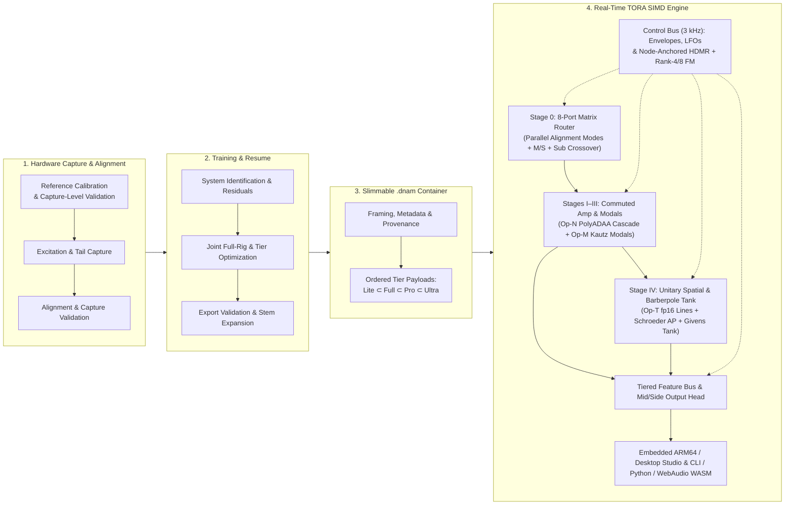

# Dynamic Neural Audio Modeler (DNAM)

**Dynamic Neural Audio Modeler (DNAM)** is a real-time true-stereo neural audio modeling, differentiable DSP, and parametric system-identification platform co-designed for **embedded ARMv8.2-A NEON pedalboards** (such as the **Rockchip RK3582 / Darkglass Anagram**), **desktop DAWs & Tauri v2 Studio workstations**, **Python/PyTorch research pipelines**, and **browser/Node.js WebAssembly (`AudioWorklet` SIMD128)** runtimes.

The project models **nonlinear distortion, linear acoustic spaces, resonant filters, modulated delay networks, and end-to-end multi-block rigs** with one slimmable model containing four nested tiers: `Lite` $\subset$ `Full` $\subset$ `Pro` $\subset$ `Ultra`. See the [TORA architecture](docs/overview/tora_architecture.md), [quality standard](docs/overview/psychoacoustic_quality_and_tiers.md), and [verification suites](docs/verification/verification_and_guardrails.md).

---

## 1. Modeling Architecture



| Capability Pillar | Architectural Realization | Canonical Specification |
| :--- | :--- | :--- |
| **1. Nonlinear Preamps, Amps & Drives (`REQ-1.1`)** | Tube heads, solid-state/JFET drives, `C²` cubic-envelope wavefolder/octave fuzzes, compressors, and tape saturation using `Op-N` and division-free `1×` B-spline `PolyADAA`. | [`docs/dsp/op_n_commuted_cascade.md`](docs/dsp/op_n_commuted_cascade.md) |
| **2. LTI Cabinets, EQs & Acoustic Spaces (`REQ-1.2`)** | Ported bass/guitar speaker cabinets (`1x15`, `4x12`), multi-mic phase interactions, passive/active EQs, studio rooms, chambers, plates, and halls via Stage III early SIMD FIR taps + shared Kautz modal banks. | [`docs/overview/system_goals_and_requirements.md`](docs/overview/system_goals_and_requirements.md) |
| **3. Selective State-Space Filters (`REQ-1.3`)** | Envelope filters, high-`Q` filters, phasers, Uni-Vibe, and harmonic tremolo using `Op-M` symplectic resonators and Kautz modal banks. | [`docs/dsp/op_m_modal_kautz.md`](docs/dsp/op_m_modal_kautz.md) |
| **4. Modulated & Time-Warped Delay Networks (`REQ-1.4`)** | Flangers, stereo chorus, rotary Doppler, echoes, reverbs, granular effects, pitch shimmer, and captured hardware freeze via `Op-T`. | [`docs/dsp/op_t_transport.md`](docs/dsp/op_t_transport.md) |
| **5. Complex End-to-End Full Rigs (`REQ-1.5`)** | Multi-unit series, parallel, and 4CM/7CM/WDW signal chains modeled in a single container with knobless or parametric captures. | [`docs/overview/system_goals_and_requirements.md`](docs/overview/system_goals_and_requirements.md#2-goal-1--universal-instrument-system--flexible-input-coverage-nonlinear--lti--full-rigs) |
| **6. Controls, Tempo & Clamping (`REQ-2.4`, `REQ-2.5`)** | Packed tier-local `CP1` continuous and discrete controls (`8-D` Rank-4 in `Lite..Pro`, `16-D` Rank-8 in `Ultra`), `20–400 BPM` tempo sync across 12 subdivisions, and non-stop 3-phase safety clamping (`0` extra audio-rate MACs when static). | [`docs/dsp/parametric_control_bus.md`](docs/dsp/parametric_control_bus.md), [`docs/training/clamp_and_audit_registry.md`](docs/training/clamp_and_audit_registry.md) |
| **7. Slimmable Tiers & Stem Resume (`REQ-3`, `REQ-5`)** | Single-run joint training across the four nested tiers (`Lite ⊂ Full ⊂ Pro ⊂ Ultra`) and tier-bundled `.dnam-ckpt` incremental stem expansion. | [`docs/training/four_stage_pipeline.md`](docs/training/four_stage_pipeline.md), [`docs/training/iterative_resume_and_caching.md`](docs/training/iterative_resume_and_caching.md) |
| **8. Provenance & Marketplace Security (`REQ-8`)** | RFC 8785 JCS + `Ed25519` creator/marketplace provenance, RFC 9180 HPKE device authorization, dual-mechanism buyer watermarking, 3-stage anti-cloning gate, and `.dnam-prev` storefront auditioning. | [`docs/security/provenance_and_enclave_drm.md`](docs/security/provenance_and_enclave_drm.md), [`docs/security/watermarking_and_marketplace.md`](docs/security/watermarking_and_marketplace.md) |

---

## 2. Monorepo Structure & Packages

DNAM is organized as a polyglot monorepo orchestrated by [`moon`](.moon/workspace.yml) and [`mise`](mise.toml) across Rust (`cargo`), Python 3.14 (`uv`), and TypeScript/React 19 (`pnpm`):

| Workspace Path | Package / Target | Role & Key Capabilities | Documentation & Guides |
| :--- | :--- | :--- | :--- |
| **[`docs/`](docs/index.md)** | Specification Manual | Canonical 6-part Single-Source-of-Truth (SSOT) specifications: system goals (`REQ-1`–`REQ-8`), `bESR` quality tiers, TORA DSP math, Two-Sweep Cholesky trainer, `.dnam` containers, security, and `CL-01`–`CL-20` registry. | [`docs/index.md`](docs/index.md) · [`docs/CONTRIBUTING.md`](docs/CONTRIBUTING.md) |
| **[`packages/engine/`](packages/engine/README.md)** | `dnam-engine` (Rust) | `#![no_std]`, `#![forbid(unsafe_code)]` real-time Rust SIMD DSP engine (`Op-T`, `Op-M`, `Op-N`, 8-Port Router, `3 kHz` Control Bus, `.dnam` zero-copy loader, and `Ed25519`/HPKE provenance). | [`README.md`](packages/engine/README.md) · [`CONTRIBUTING.md`](packages/engine/CONTRIBUTING.md) · [`AGENTS.md`](packages/engine/AGENTS.md) |
| **[`packages/python/`](packages/python/README.md)** | `dnam-engine` (`dnam_engine`) | `PyO3` / `maturin` Python 3.14 wheel wrapping `packages/engine` for zero-copy NumPy audio inference, `.dnam` / `.dnam-seal` container validation, 3-Phase control clamping, and reference DSP primitives. | [`README.md`](packages/python/README.md) · [`CONTRIBUTING.md`](packages/python/CONTRIBUTING.md) · [`AGENTS.md`](packages/python/AGENTS.md) |
| **[`packages/js/`](packages/js/README.md)** | `@dnam-project/engine` | TypeScript / npm SDK wrapping `packages/engine` via WebAssembly (`SIMD128`) bindings and a zero-allocation WebAudio `DnamAudioWorkletProcessor` for browsers, Electron/Tauri, and Node.js. | [`README.md`](packages/js/README.md) · [`CONTRIBUTING.md`](packages/js/CONTRIBUTING.md) · [`AGENTS.md`](packages/js/AGENTS.md) |
| **[`packages/ui/`](packages/ui/README.md)** | `@dnam-project/ui` | Shared React 19, Tailwind CSS v4, and Base UI design system: parametric rotary knobs, discrete switches, `bESR` / spectrum / transfer-curve visualizers, and the `DnamAudioHost` abstraction. | [`README.md`](packages/ui/README.md) · [`CONTRIBUTING.md`](packages/ui/CONTRIBUTING.md) · [`AGENTS.md`](packages/ui/AGENTS.md) |
| **[`packages/studio/`](packages/studio/README.md)** | `@dnam-project/studio` (`dnam`) | Unified `dnam` CLI (`init`, `model`, `capture`, `train`, `inspect`, `studio`) and native **Tauri v2 Desktop Studio** app for 2-step hardware calibration, re-amp capture, training, and live auditioning. | [`README.md`](packages/studio/README.md) · [`CONTRIBUTING.md`](packages/studio/CONTRIBUTING.md) · [`AGENTS.md`](packages/studio/AGENTS.md) |
| **[`packages/trainer/`](packages/trainer/README.md)** | `dnam-trainer` (`dnam_trainer`) | PyTorch Two-Sweep Block-Coordinate Cholesky training pipeline, `.dnam-ckpt` stem expansion, and 3-Phase control-audit worker. | [`README.md`](packages/trainer/README.md) · [`CONTRIBUTING.md`](packages/trainer/CONTRIBUTING.md) · [`AGENTS.md`](packages/trainer/AGENTS.md) |
| **[`tests/`](tests/AGENTS.md)** | `dnam-tests` | Top-level project guardrail suite (`G-02`–`G-05`, `G-08`) and specification reference tests verifying `AGENTS.md` byte budgets, `CL-01`–`CL-20` and `REQ-1.1`–`REQ-8.8` registries, GitHub MathJax/Mermaid syntax, and Markdown link integrity. | [`tests/AGENTS.md`](tests/AGENTS.md) · [`docs/CONTRIBUTING.md`](docs/CONTRIBUTING.md) |

---

## 3. Quickstart & Developer Commands

```bash
# 1. Install pinned toolchains (moon, uv, node, pnpm, python 3.14, rust)
mise install

# 2. Run the unified `dnam` CLI (`init`, `model`, `capture`, `train`, `inspect`, `studio`)
moon run studio:cli -- --help

# 3. Run the headless Two-Sweep PyTorch trainer CLI (`dnam-train`)
moon run trainer:cli -- --help

# 4. Launch the Desktop Studio UI (Vite HMR at http://localhost:1420 or native Tauri v2 app)
moon run studio:dev
moon run studio:tauri-dev

# 5. Launch the interactive UI & DSP visualizer workbench (React Cosmos at http://localhost:5000)
moon run ui:dev

# 6. Run all monorepo quality gates (format-check, lint, typecheck, build, and test across all projects)
moon check --all
```

---

## 4. Quality & Hardware Benchmarks

The [psychoacoustic quality specification](docs/overview/psychoacoustic_quality_and_tiers.md) defines the four tier acceptance thresholds (`Lite`, `Full`, `Pro`, `Ultra`), per-output `bESR` / `MR-STFT` / `LTAS` / `SegESR` metrics, noise-floor qualification rules, and adjacent-tier non-regression requirements. The [system requirements](docs/overview/system_goals_and_requirements.md#7-goal-6--real-time-commodity-hardware-budget--execution-constraints) and [state audit](docs/overview/tora_architecture.md#23-state-ram-audit-lite-budget) specify the embedded instance budgets (`≥ 10× Lite`, `≥ 6× Full`, `≥ 2× Pro` at `48 kHz` on `1×` Cortex-A76) and zero-`FDIV`/`FSQRT`/`libm` real-time loop invariants.

---

## 5. Canonical Specification Manual (`docs/`)

Start with [`docs/index.md`](docs/index.md), [`docs/CONTRIBUTING.md`](docs/CONTRIBUTING.md), and [`AGENTS.md`](AGENTS.md):

| Part | Specification Files | Scope |
| :--- | :--- | :--- |
| **Part I: Overview (`docs/overview/`)** | [`system_goals_and_requirements.md`](docs/overview/system_goals_and_requirements.md) · [`psychoacoustic_quality_and_tiers.md`](docs/overview/psychoacoustic_quality_and_tiers.md) · [`tora_architecture.md`](docs/overview/tora_architecture.md) | 8 implementation-agnostic system goals & 40 requirements (`REQ-1.1`–`REQ-8.8`), `bESR` quality tiers, and TORA architecture & signal flow |
| **Part II: Real-Time DSP (`docs/dsp/`)** | [`op_t_transport.md`](docs/dsp/op_t_transport.md) · [`op_m_modal_kautz.md`](docs/dsp/op_m_modal_kautz.md) · [`op_n_commuted_cascade.md`](docs/dsp/op_n_commuted_cascade.md) · [`router_and_stages_topology.md`](docs/dsp/router_and_stages_topology.md) · [`parametric_control_bus.md`](docs/dsp/parametric_control_bus.md) | Op-T transport, Op-M modal bank/Kautz, Op-N commuted cascade, 8-Port Matrix Router & rig topology, and `3 kHz` Parametric Control Bus (`CL-01`–`CL-16`) |
| **Part III: Capture & Training (`docs/training/`)** | [`capture_and_alignment.md`](docs/training/capture_and_alignment.md) · [`four_stage_pipeline.md`](docs/training/four_stage_pipeline.md) · [`iterative_resume_and_caching.md`](docs/training/iterative_resume_and_caching.md) · [`clamp_and_audit_registry.md`](docs/training/clamp_and_audit_registry.md) | Calibration, 30 s universal excitation, two-sweep training, stem-expansion resume, and the `CL-01`–`CL-20` Clamp Registry |
| **Part IV: Containers (`docs/containers/`)** | [`dnam_binary_format.md`](docs/containers/dnam_binary_format.md) · [`checkpoint_and_cache_format.md`](docs/containers/checkpoint_and_cache_format.md) | 64B-aligned `.dnam` and `.dnam-ckpt` framing, tier-local tensor slices, `uplo='U'` statistics, and ZOH sample-rate conversion |
| **Part V: Security & DRM (`docs/security/`)** | [`provenance_and_enclave_drm.md`](docs/security/provenance_and_enclave_drm.md) · [`watermarking_and_marketplace.md`](docs/security/watermarking_and_marketplace.md) | `Ed25519` provenance, device-authorization profiles, buyer watermarking, anti-cloning gates, and `.dnam-prev` storefront previews |
| **Part VI: Verification (`docs/verification/`)** | [`verification_and_guardrails.md`](docs/verification/verification_and_guardrails.md) | Empirical verification suites (`Tests 1–8I`) and automated repository/container guardrails (`G-01`–`G-08`) |
| **Appendix: R&D (`docs/rnd/`)** | [`tora_phase1_decisions.md`](docs/rnd/tora_phase1_decisions.md) · [`tri_physics_architecture.md`](docs/rnd/tri_physics_architecture.md) | Phase 1 design decisions & counterexamples and the early Tri-Physics R&D prototype reference |

---

## 6. Contributing & License

We welcome contributions! All commits must be signed off (`git commit -s`) under our [Contributor License Agreement (`CLA.md`)](CLA.md). See [`CONTRIBUTING.md`](CONTRIBUTING.md) for workspace development standards, [`docs/CONTRIBUTING.md`](docs/CONTRIBUTING.md) for specification authoring and GitHub MathJax/Mermaid formatting rules, and [`AGENTS.md`](AGENTS.md) for AI agent discovery guidelines.

Licensed under the [DNAM Source-Available & Branding License 1.0.0 (`LICENSE`)](LICENSE):
- **Hardware & Closed-Source Plugin Linking Allowed:** Hardware manufacturers and software developers may link `dnam-engine` (`packages/engine`, `packages/python`, `packages/js`) into commercial hardware firmware and closed-source audio plugins without open-sourcing their own host or plugin code.
- **Individual Creator Publishing & Direct Sales Allowed:** Creators retain full ownership of their trained `.dnam` models (trained locally or on their own rented cloud GPUs) and may freely publish or commercially sell their own first-party models individually (e.g., via their own website, Shopify/Gumroad/Bandcamp/Patreon storefront, or bundled with compliant hardware/plugins).
- **Mandatory DNAM Branding, Format & Provenance Integrity:** Products linking `dnam-engine` or loading `.dnam` models must retain user-facing **"DNAM"** ("Dynamic Neural Audio Modeler" / **"Powered by DNAM"**) branding, unmodified `.dnam` container compatibility, and intact `Ed25519` signatures, device authorization, and buyer watermarks (no white-labeling or DRM/watermark circumvention).
- **No Unlicensed Marketplaces, Hosted Cloud Training, or Bulk Distillation:** Repackaging the standalone Desktop Studio (`packages/studio`), UI library (`packages/ui`), or trainer (`packages/trainer`), offering third-party hosted cloud training-as-a-service, operating an unlicensed multi-vendor `.dnam` model marketplace or aggregation hub, or bulk-distilling third-party `.dnam` models into competing formats is prohibited without a commercial license.

For bespoke OEM, marketplace, cloud-training, or commercial licensing inquiries, contact **Peter Nguyen** (<peter@phn.dev>).
