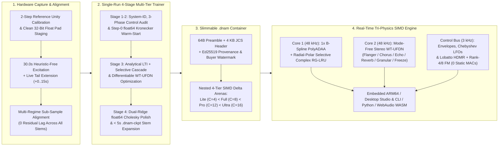

# Dynamic Neural Audio Modeler (DNAM)

**Dynamic Neural Audio Modeler (DNAM / "Tri-Physics")** is a real-time true-stereo neural audio modeling, differentiable DSP, and parametric system-identification platform co-designed for **embedded ARMv8.2-A NEON pedalboards** (such as the **Rockchip RK3582 / Darkglass Anagram**), **desktop DAWs & Tauri v2 Studio workstations**, **Python/PyTorch research pipelines**, and **browser/Node.js WebAssembly (`AudioWorklet` SIMD128)** runtimes.

Rather than restricting modeling to static snapshots of isolated mono preamps, DNAM unifies **nonlinear distortion, linear acoustic spaces, resonant state-space filters, modulated & time-warped feedback delay networks, and complex end-to-end multi-block full rigs** inside a single **slimmable 4-tier container (`Lite` $\subset$ `Full` $\subset$ `Pro` $\subset$ `Ultra`)** trained in **one pass**—running **$2.6\times$ faster than NAM A2** in `Full` (`C=8`, ~4,625 MACs/sample vs. 12,146 MACs/sample) with **`0` extra `48 kHz` MACs/sample when user controls are static**.

---

## 1. What DNAM Models & Unifies



| Capability Pillar | What DNAM Unifies | Canonical Specification |
| :--- | :--- | :--- |
| **1. Nonlinear Preamps, Amps & Drives (`REQ-1.1`)** | Tube heads (`Preamp → Tone Stack → Push-Pull Power/OT`), solid-state/JFET drives, wavefolder/octave fuzzes, optical/FET compressors, and tape saturation via division-free **`1× B-Spline PolyADAA`** (`38.87 dB` aliasing suppression, `0 FDIV`). | [`docs/dsp/core1_polyadaa_and_rglru.md`](docs/dsp/core1_polyadaa_and_rglru.md) |
| **2. LTI Cabinets, EQs & Acoustic Spaces (`REQ-1.2`)** | Ported bass/guitar speaker cabinets (`1x15`, `4x12`), multi-mic phase interactions, passive/active EQs, studio rooms, chambers, plates, and halls with infinite-horizon IIR + FDN modal decay. | [`docs/overview/system_goals_and_requirements.md`](docs/overview/system_goals_and_requirements.md) |
| **3. Selective State-Space Filters (`REQ-1.3`)** | Envelope filters / auto-wahs, high-`Q` self-oscillating `LP`/`BP`/`HP` filters, phasers, Uni-Vibe, and harmonic tremolo via **Radial-Polar Selective Complex RG-LRU** (`99.8%` mid-sweep `Q` preservation, `0 libm`). | [`docs/dsp/core1_polyadaa_and_rglru.md`](docs/dsp/core1_polyadaa_and_rglru.md) |
| **4. Modulated & Time-Warped Delay Networks (`REQ-1.4`)** | Through-zero flangers, stereo chorus, rotary Doppler, BBD/tape echoes, spring reverb drip, lush hall reverbs, Hermite-Hann granular clouds, pitch shimmer, and lossless spectral freeze via **Core 2 `WT-UFDN`**. | [`docs/dsp/core2_modulated_ufdn.md`](docs/dsp/core2_modulated_ufdn.md) |
| **5. Complex End-to-End Full Rigs (`REQ-1.5`)** | Complete multi-unit studio and stage signal chains (`Compressor → Wah/Filter → Fuzz/Drive → Amp → Cab + Mic → Stereo Chorus/Delay → Reverb`, or parallel frequency-split bass rigs) captured as a single unified model—either knobless (`0` controls) or with arbitrary parametric `range` & `switch` controls. | [`docs/overview/system_goals_and_requirements.md`](docs/overview/system_goals_and_requirements.md#2-goal-1--universal-instrument-system--flexible-input-coverage-nonlinear--lti--full-rigs) |
| **6. Parametric Controls, Tempo Sync & Non-Stop Clamping (`REQ-2.4`, `REQ-2.5`)** | Unlimited user-defined continuous `range` and discrete `switch` controls evaluated at `3 kHz` via Lobatto HDMR + Rank-4/8 FM (`0` extra `48 kHz` MACs when static), native MIDI/host `BPM` tempo sync across 12 rhythmic subdivisions (`1/2.`–`1/16T`), and automatic non-blocking safety clamping (`CL-01`–`CL-20`). | [`docs/dsp/parametric_control_bus.md`](docs/dsp/parametric_control_bus.md), [`docs/training/clamp_and_audit_registry.md`](docs/training/clamp_and_audit_registry.md) |
| **7. Single-Run Slimmable Tiers & `< 5 s` Stem Resume (`REQ-3`, `REQ-5`)** | One training run simultaneously calibrates nested `Lite` ⊂ `Full` ⊂ `Pro` ⊂ `Ultra` prefixes inside a single `.dnam` container, and `.dnam-ckpt` Kronecker sufficient statistics enable `< 5 s` incremental stem addition with `0.00` old-stem drift. | [`docs/training/four_stage_pipeline.md`](docs/training/four_stage_pipeline.md), [`docs/training/iterative_resume_and_caching.md`](docs/training/iterative_resume_and_caching.md) |
| **8. Provenance, Enclave DRM & Traitor Tracing (`REQ-8`)** | Preset-safe `Ed25519` creator/marketplace signatures, `Open` / `DeviceAllowlisted` / `EnclaveSealed` (`.dnam-seal`) hardware profiles (`0` real-time DSP flops), `0.00 dB` isometric gauge + Coupled Tardos buyer watermarking, and a `< 50 ms` 3-stage anti-cloning gate. | [`docs/security/provenance_and_enclave_drm.md`](docs/security/provenance_and_enclave_drm.md), [`docs/security/watermarking_and_marketplace.md`](docs/security/watermarking_and_marketplace.md) |

---

## 2. Monorepo Structure & Packages

DNAM is organized as a polyglot monorepo orchestrated by [`moon`](.moon/workspace.yml) and [`mise`](mise.toml) across Rust (`cargo`), Python 3.14 (`uv`), and TypeScript/React 19 (`pnpm`):

| Workspace Path | Package / Target | Role & Key Capabilities | Documentation & Guides |
| :--- | :--- | :--- | :--- |
| **[`docs/`](docs/index.md)** | Specification Manual | Canonical 6-part Single-Source-of-Truth (SSOT) specifications: system goals (`REQ-1`–`REQ-8`), `bESR` quality tiers, Tri-Physics DSP math, 4-stage trainer, `.dnam` containers, security, and `CL-01`–`CL-20` registry. | [`docs/index.md`](docs/index.md) · [`docs/CONTRIBUTING.md`](docs/CONTRIBUTING.md) |
| **[`packages/engine/`](packages/engine/README.md)** | `dnam-engine` (Rust) | Zero-allocation, `#[forbid(unsafe_code)]`, 64-byte SIMD-aligned (`Lite` / `Full` / `Pro` / `Ultra`), `FTZ`/`DAZ`-enabled real-time Rust DSP engine with zero `FSQRT` or `FDIV` instructions at `48 kHz` and `3 kHz`. | [`README.md`](packages/engine/README.md) · [`CONTRIBUTING.md`](packages/engine/CONTRIBUTING.md) · [`AGENTS.md`](packages/engine/AGENTS.md) |
| **[`packages/python/`](packages/python/README.md)** | `dnam-engine` (`dnam_engine`) | `PyO3` / `maturin` Python 3.14 wheel wrapping `packages/engine` for zero-copy NumPy audio inference, `.dnam` / `.dnam-seal` container validation, 3-Phase control clamping, and reference DSP primitives. | [`README.md`](packages/python/README.md) · [`CONTRIBUTING.md`](packages/python/CONTRIBUTING.md) · [`AGENTS.md`](packages/python/AGENTS.md) |
| **[`packages/js/`](packages/js/README.md)** | `@dnam-project/engine` | TypeScript / npm SDK wrapping `packages/engine` via WebAssembly (`SIMD128`) bindings and a zero-allocation WebAudio `DnamAudioWorkletProcessor` for browsers, Electron/Tauri, and Node.js. | [`README.md`](packages/js/README.md) · [`CONTRIBUTING.md`](packages/js/CONTRIBUTING.md) · [`AGENTS.md`](packages/js/AGENTS.md) |
| **[`packages/ui/`](packages/ui/README.md)** | `@dnam-project/ui` | Shared React 19, Tailwind CSS v4, and Base UI design system: parametric rotary knobs, discrete switches, `bESR` / spectrum / transfer-curve visualizers, and the `DnamAudioHost` abstraction. | [`README.md`](packages/ui/README.md) · [`CONTRIBUTING.md`](packages/ui/CONTRIBUTING.md) · [`AGENTS.md`](packages/ui/AGENTS.md) |
| **[`packages/studio/`](packages/studio/README.md)** | `@dnam-project/studio` (`dnam`) | Unified `dnam` CLI (`init`, `model`, `capture`, `train`, `inspect`, `studio`) and native **Tauri v2 Desktop Studio** app for 2-step hardware calibration, re-amp capture, training, and live auditioning. | [`README.md`](packages/studio/README.md) · [`CONTRIBUTING.md`](packages/studio/CONTRIBUTING.md) · [`AGENTS.md`](packages/studio/AGENTS.md) |
| **[`packages/trainer/`](packages/trainer/README.md)** | `dnam-trainer` (`dnam_trainer`) | PyTorch 4-stage deterministic multi-tier trainer, analytical LTI + 3-stage selective cascade solver, 72-bit `ExactGramAccumulator`, `.dnam-ckpt` Kronecker stem expansion, and 3-Phase Control Audit (`dnam-train`). | [`README.md`](packages/trainer/README.md) · [`CONTRIBUTING.md`](packages/trainer/CONTRIBUTING.md) · [`AGENTS.md`](packages/trainer/AGENTS.md) |
| **[`tests/`](tests/AGENTS.md)** | `dnam-tests` | Top-level project guardrail suite (`G-02`–`G-05`, `G-08`) verifying `AGENTS.md` byte budgets, `CL-01`–`CL-20` and `REQ-1.1`–`REQ-8.8` registry completeness, GitHub MathJax/Mermaid syntax, and Markdown link integrity. | [`tests/AGENTS.md`](tests/AGENTS.md) · [`docs/CONTRIBUTING.md`](docs/CONTRIBUTING.md) |

---

## 3. Quickstart & Developer Commands

```bash
# 1. Install pinned toolchains (moon, uv, node, pnpm, python 3.14, rust)
mise install

# 2. Run the unified `dnam` CLI (`init`, `model`, `capture`, `train`, `inspect`, `studio`)
moon run studio:cli -- --help

# 3. Run the headless 4-stage PyTorch trainer CLI (`dnam-train`)
moon run trainer:cli -- --help

# 4. Launch the Desktop Studio UI (Vite HMR at http://localhost:1420 or native Tauri v2 app)
moon run studio:dev
moon run studio:tauri-dev

# 5. Launch the interactive UI & DSP visualizer workbench (React Cosmos at http://localhost:5000)
moon run ui:dev

# 6. Run all monorepo quality gates (format-check, lint, typecheck, build, and test across all projects)
moon check --all
```

---

## 4. Single-Run Slimmable 4-Tier Quality (`bESR`) & Hardware Benchmarks

### 4.1 Perceptual Band-Balanced `bESR` Tiers (`Lite` $\subset$ `Full` $\subset$ `Pro` $\subset$ `Ultra`)

DNAM evaluates models using **Floor-Regularized, Noise-Adjusted Band-Balanced ESR (`bESR`)** across **Low (`20–250 Hz`)**, **Mid (`250 Hz–2.5 kHz`)**, and **High (`2.5–18 kHz`)** bands (see [`docs/overview/psychoacoustic_quality_and_tiers.md`](docs/overview/psychoacoustic_quality_and_tiers.md)). By measuring each stem's stationary silent-input thermal noise floor per band and evaluating noise-limited bands relative to their physical SNR ceiling ($\text{Residual}_{\text{dBFS},b} \le \text{NoiseFloor}_{\text{dBFS},b} + 1.0\text{ dB}$), **one single device-agnostic threshold per tier** applies across clean preamps, high-gain tube heads, fuzzes, reverbs, and complex full rigs:

| DNAM Tier | Target Grade | Noise-Adjusted Composite `bESR` | Per-Band Requirement (`LF` / `MF` / `HF` or `≤ NoiseFloor + 1.0 dB`) | Max Spectral Tilt (`ΔEQ_dB`) | Multi-Control Unseen `bESR` | Embedded Budget (`1×` Cortex-A76 @ `48 kHz`) |
| :--- | :--- | :---: | :---: | :---: | :---: | :---: |
| **`Lite` (`C=4, M=4, D_h=4`)** | **Mix-Ready / Live Grade** | **`≤ -18 dB`** (`-18` to `-23 dB`) | `LF ≤ -23 dB`, `MF ≤ -20 dB`, `HF ≤ -15 dB` | **`≤ 0.75 dB`** | **`≤ -16 dB`** (`≤ 4` controls) | **`≥ 10×` instances** (`≤ 2,083 ns/sample`) |
| **`Full` (`C=8, M=8, D_h=4`)** | **True Studio Quality** | **`≤ -23 dB`** (`-23` to `-30 dB`) | `LF ≤ -27 dB`, `MF ≤ -25 dB`, **`HF ≤ -20 dB`** | **`≤ 0.35 dB`** | **`≤ -21 dB`** (`≤ 4` controls) | **`≥ 6×` instances** (`≤ 3,472 ns/sample`) |
| **`Pro` (`C=12, M=8, D_h=4`)** | **Mastering / Reference Grade** | **`≤ -30 dB`** (`-30` to `-34 dB`) | `LF ≤ -34 dB`, `MF ≤ -31 dB`, `HF ≤ -26 dB` | **`≤ 0.15 dB`** | **`≤ -27 dB`** (`≤ 4` controls) | **`≥ 2×` instances** (`≤ 10,416 ns/sample`) |
| **`Ultra` (`C=16, M=16, D_h=8`)** | **Unconstrained Workstation Max** | **`≤ -34 dB`** | `LF ≤ -38 dB`, `MF ≤ -35 dB`, `HF ≤ -30 dB` | **`≤ 0.10 dB`** | **`≤ -32 dB`** (`> 4` controls, `D_h=8`) | **Desktop Real-Time & `4×` Offline Bounce** |

### 4.2 Hardware & DSP Benchmark (`NAM A2` vs. `DNAM`)

| Hardware / DSP Metric | NAM A2 Lite (Mono) | **DNAM Lite (Stereo)** | NAM A2 Full (Mono) | **DNAM Full (Stereo)** | **DNAM Pro (Stereo)** | **DNAM Ultra (Stereo)** |
| :--- | :---: | :---: | :---: | :---: | :---: | :---: |
| **Channels (`C`) / FDN Lines (`M`)** | `C = 3` (Unaligned) | **`C = 4` (1 NEON reg), `M = 4`** | `C = 8`, No FDN | **`C = 8` (2 NEON regs), `M = 8`** | **`C = 12` (3 NEON regs), `M = 8`** | **`C = 16` (4 NEON / 2 AVX regs), `M = 16`** |
| **Core 1 Architecture** | 23 Dilated Conv | **8 Conv + 4 Selective RG-LRU** | 23 Dilated Conv | **8 Conv + 4 Selective RG-LRU** | **8 Conv + 4 Selective RG-LRU** | **8 Conv + 4 Selective RG-LRU** |
| **Core 2 Architecture** | None | **Mode-Free `WT-UFDN` + 4-Tier Pre-Head Routing** | None | **Mode-Free `WT-UFDN` + 4-Tier Pre-Head Routing** | **Mode-Free `WT-UFDN` + 4-Tier Pre-Head Routing** | **16-Line `WT-UFDN` + 8-Givens + 16 Coprime Diffusers** |
| **Control Bus & Head SVD Rank** | None (Static Snapshot) | **Rank-4 FM, `D_h=4` (`0` MACs static)** | None (Static Snapshot) | **Rank-4 FM, `D_h=4` (`0` MACs static)** | **Rank-4 FM, `D_h=4` (`0` MACs static)** | **Rank-8 FM, `D_h=8` (`0` MACs static)** |
| **Granular, Pitch Shimmer & Freeze** | None | **Hermite-Hann `WT-UFDN` + Sound-on-Sound Freeze** | None | **Hermite-Hann `WT-UFDN` + Sound-on-Sound Freeze** | **Hermite-Hann `WT-UFDN` + Sound-on-Sound Freeze** | **Hermite-Hann `WT-UFDN` + Sound-on-Sound Freeze** |
| **Auto-Unity, Blend & Tempo Sync** | None | **Gated `rms_dbfs` (`u=0`), `Trails` & 12-Sub Sync** | None | **Gated `rms_dbfs` (`u=0`), `Trails` & 12-Sub Sync** | **Gated `rms_dbfs` (`u=0`), `Trails` & 12-Sub Sync** | **Gated `rms_dbfs` (`u=0`), `Trails` & 12-Sub Sync** |
| **48 kHz `FSQRT` / `FDIV` Instructions** | 0 | **0 (100% `FMAX`/`FMIN`/`FMLA`)** | 0 | **0 (100% `FMAX`/`FMIN`/`FMLA`)** | **0 (100% `FMAX`/`FMIN`/`FMLA`)** | **0 (100% `FMAX`/`FMIN`/`FMLA`)** |
| **NEON / AVX SIMD Lane Utilization** | 75% (3/4 lanes) | **100% (4/4 lanes)** | 100% (8/8 lanes) | **100% (8/8 lanes)** | **100% (12/12 lanes, `8+4` tiled)** | **100% (16/16 lanes, `2×8` AVX2 / `4×4` NEON)** |
| **Core 1 L1 Cache State RAM** | 76.2 KB | **3.7 KB (-95%)** | 203.1 KB | **7.5 KB (-96%)** | **11.2 KB (-94%)** | **15.0 KB (-93%)** |
| **Core 2 Delay Ring Buffer RAM** | 0 KB | **`0 KB` (Amp) / `16 KB–2.0 MB` (`fp16`, ≤ 5.46 s)** | 0 KB | **`0 KB` (Amp) / `32 KB–4.0 MB` (`fp16`, ≤ 5.46 s)** | **`0 KB` (Amp) / `32 KB–4.0 MB` (`fp16`, ≤ 5.46 s)** | **`0 KB` (Amp) / `64 KB–8.0 MB` (`fp16`, ≤ 5.46 s)** |
| **Effective Receptive Field** | 132.2 ms (Hard cutoff) | **∞ (Core 1 SSM + Core 2 `WT-UFDN` + Freeze)** | 132.2 ms (Hard cutoff) | **∞ (Core 1 SSM + Core 2 `WT-UFDN` + Freeze)** | **∞ (Core 1 SSM + Core 2 `WT-UFDN` + Freeze)** | **∞ (Core 1 SSM + Core 2 `WT-UFDN` + Freeze)** |
| **Total Compute (MACs / Sample)** | 1,871 MACs | **~1,245 MACs (1.5× faster + 33% wider)** | 12,146 MACs | **~4,625 MACs (2.6× faster)** | **~9,950 MACs (1.22× faster + 50% wider)** | **~16,950 MACs (1×) / 4× Offline Bounce** |
| **Sample-Rate Support** | Fixed 48 kHz | **Native 44.1–96 kHz (ZOH)** | Fixed 48 kHz | **Native 44.1–96 kHz (ZOH)** | **Native 44.1–96 kHz (ZOH)** | **Native 44.1–96 kHz (ZOH) + 4× Bounce** |
| **Audio I/O Topology (`REQ-7.4`)** | Mono (1 → 1) | **Mono (`1 → 1`, `2 → 1`) & True Stereo (`1 → 2`, `2 → 2`)** | Mono (1 → 1) | **Mono (`1 → 1`, `2 → 1`) & True Stereo (`1 → 2`, `2 → 2`)** | **Mono (`1 → 1`, `2 → 1`) & True Stereo (`1 → 2`, `2 → 2`)** | **Mono (`1 → 1`, `2 → 1`) & True Stereo (`1 → 2`, `2 → 2`)** |

### 4.3 Comparison with `GuitarML PROTEUS` & `NAM ParametricOD`

See [`docs/overview/tri_physics_architecture.md` §2.3](docs/overview/tri_physics_architecture.md#23-prior-art-architectural--capability-comparison-nam-a2-guitarml-proteus-nam-parametricod-vs-dnam) for the full technical comparison:

| Capability | **GuitarML PROTEUS** | **NAM ParametricOD** | **DNAM ("Tri-Physics")** |
| :--- | :---: | :---: | :---: |
| **Backbone** | 1-layer LSTM (`hidden=40`) | Conditional WaveNet / LSTM | **Core 1 (`PolyADAA` + Selective RG-LRU) + Core 2 (`WT-UFDN` + 4-Tier Pre-Head Routing)** |
| **System & Full-Rig Scope** | Single drive/amp pedal | Single overdrive pedal | **Isolated pedals/amps, LTI cabs/rooms, modulated delays/reverbs & complex end-to-end full rigs (`REQ-1.1`–`REQ-1.5`)** |
| **Control Schema** | 1–2 continuous knobs | Hardcoded pedal layout | **Zero controls (knobless capture) or unlimited user-defined `range` knobs & `switch` selectors** |
| **Control Rate & Static Overhead** | 48 kHz (∝ `P` MACs/sample) | 48 kHz (∝ `P` MACs/sample) | **3 kHz Lobatto HDMR-FM (0 MACs/sample @ 48 kHz when static)** |
| **Anti-Aliasing** | None (`tanh` at 1× rate) | None (`tanh`/`ReLU` at 1× rate) | **1× B-Spline Division-Free Algebraic `PolyADAA` (38.87 dB reduction)** |
| **Time-Varying Delay / Reverb / LFOs** | No (double-echo ghosting) | No (FIR < 30 ms) | **Yes (Autonomous Chebyshev LFO + Order-Statistic Transport + 12-Subdivision Tempo Sync)** |
| **Granular, Pitch Shimmer & Freeze** | No | No | **Yes (Self-Activating Hermite-Hann `WT-UFDN` + Sound-on-Sound Unitary Freeze)** |
| **Auto-Unity, Blend & Spillover `Trails`** | None | None | **Yes (Gated `rms_dbfs` Auto-Unity at `u=0`, Polarity-Corrected Blend & `Trails`)** |
| **Control-Space Safety & Clamping** | None | Hardcoded plugin bounds | **Non-Stop 3-Phase Clamping (`RANGE`, `SWITCH`, `STABILITY`, `DYNAMIC`)** |
| **Iterative Stem Addition** | Retrain from scratch | Retrain from scratch | **Single `.dnam-ckpt` Factorized-Kronecker Resume (< 5 s, 0.00 old-stem drift)** |

---

## 5. Canonical Specification Manual (`docs/`)

Start with [`docs/index.md`](docs/index.md), [`docs/CONTRIBUTING.md`](docs/CONTRIBUTING.md), and [`AGENTS.md`](AGENTS.md):

| Part | Specification Files | Scope |
| :--- | :--- | :--- |
| **Part I: Overview (`docs/overview/`)** | [`system_goals_and_requirements.md`](docs/overview/system_goals_and_requirements.md) · [`psychoacoustic_quality_and_tiers.md`](docs/overview/psychoacoustic_quality_and_tiers.md) · [`tri_physics_architecture.md`](docs/overview/tri_physics_architecture.md) · [`u_pra_architecture.md`](docs/overview/u_pra_architecture.md) | 8 implementation-agnostic system goals & 40 requirements (`REQ-1.1`–`REQ-8.8`), `bESR` quality tiers, Tri-Physics & `U-PRA` topology, and 18 engineering breakthroughs |
| **Part II: Real-Time DSP (`docs/dsp/`)** | [`core1_polyadaa_and_rglru.md`](docs/dsp/core1_polyadaa_and_rglru.md) · [`core2_modulated_ufdn.md`](docs/dsp/core2_modulated_ufdn.md) · [`parametric_control_bus.md`](docs/dsp/parametric_control_bus.md) | Core 1 (`1× B-Spline PolyADAA` + Selective RG-LRU), Core 2 (`WT-UFDN`), and `3 kHz` Parametric Control Bus (`CL-01`–`CL-14`) |
| **Part III: Capture & Training (`docs/training/`)** | [`capture_and_alignment.md`](docs/training/capture_and_alignment.md) · [`four_stage_pipeline.md`](docs/training/four_stage_pipeline.md) · [`iterative_resume_and_caching.md`](docs/training/iterative_resume_and_caching.md) · [`clamp_and_audit_registry.md`](docs/training/clamp_and_audit_registry.md) | 2-step calibration, 30s universal excitation, 4-stage trainer, `< 5 s` `.dnam-ckpt` stem expansion, and the `CL-01`–`CL-20` Clamp Registry |
| **Part IV: Containers (`docs/containers/`)** | [`dnam_binary_format.md`](docs/containers/dnam_binary_format.md) · [`checkpoint_and_cache_format.md`](docs/containers/checkpoint_and_cache_format.md) | 64B-aligned `.dnam` and `.dnam-ckpt` (`DNCK`) wire layouts, `uplo='U'` `Arena 4`, `DNCA` calibration cache, and ZOH sample-rate rescaling |
| **Part V: Security & DRM (`docs/security/`)** | [`provenance_and_enclave_drm.md`](docs/security/provenance_and_enclave_drm.md) · [`watermarking_and_marketplace.md`](docs/security/watermarking_and_marketplace.md) | `Ed25519` provenance, `DistributionPolicy`, `.dnam-seal` (`DNSL`) enclave DRM, `0.00 dB` gauge + Tardos buyer watermarking, and anti-cloning gates |
| **Part VI: Verification (`docs/verification/`)** | [`verification_and_guardrails.md`](docs/verification/verification_and_guardrails.md) | Empirical verification suites (`Tests 1–8I`) and automated repository/container guardrails (`G-01`–`G-08`) |

---

## 6. Contributing & License

We welcome contributions! All commits must be signed off (`git commit -s`) under our [Contributor License Agreement (`CLA.md`)](CLA.md). See [`CONTRIBUTING.md`](CONTRIBUTING.md) for workspace development standards, [`docs/CONTRIBUTING.md`](docs/CONTRIBUTING.md) for specification authoring and GitHub MathJax/Mermaid formatting rules, and [`AGENTS.md`](AGENTS.md) for AI agent discovery guidelines.

Licensed under the [DNAM Source-Available & Branding License 1.0.0 (`LICENSE`)](LICENSE):
- **Hardware & Closed-Source Plugin Linking Allowed:** Hardware manufacturers and software developers may link `dnam-engine` (`packages/engine`, `packages/python`, `packages/js`) into commercial hardware firmware and closed-source audio plugins without open-sourcing their own host or plugin code.
- **Individual Creator Publishing & Direct Sales Allowed:** Creators retain full ownership of their trained `.dnam` models (trained locally or on their own rented cloud GPUs) and may freely publish or commercially sell their own first-party models individually (e.g., via their own website, Shopify/Gumroad/Bandcamp/Patreon storefront, or bundled with compliant hardware/plugins).
- **Mandatory DNAM Branding, Format & Provenance Integrity:** Products linking `dnam-engine` or loading `.dnam` models must retain user-facing **"DNAM"** ("Dynamic Neural Audio Modeler" / **"Powered by DNAM"**) branding, unmodified `.dnam` container compatibility, and intact `Ed25519` signatures, device authorization, and buyer watermarks (no white-labeling or DRM/watermark circumvention).
- **No Unlicensed Marketplaces, Hosted Cloud Training, or Bulk Distillation:** Repackaging the standalone Desktop Studio (`packages/studio`), UI library (`packages/ui`), or trainer (`packages/trainer`), offering third-party hosted cloud training-as-a-service, operating an unlicensed multi-vendor `.dnam` model marketplace or aggregation hub, or bulk-distilling third-party `.dnam` models into competing formats is prohibited without a commercial license.

For bespoke OEM, marketplace, cloud-training, or commercial licensing inquiries, contact **Peter Nguyen** (<peter@phn.dev>).
