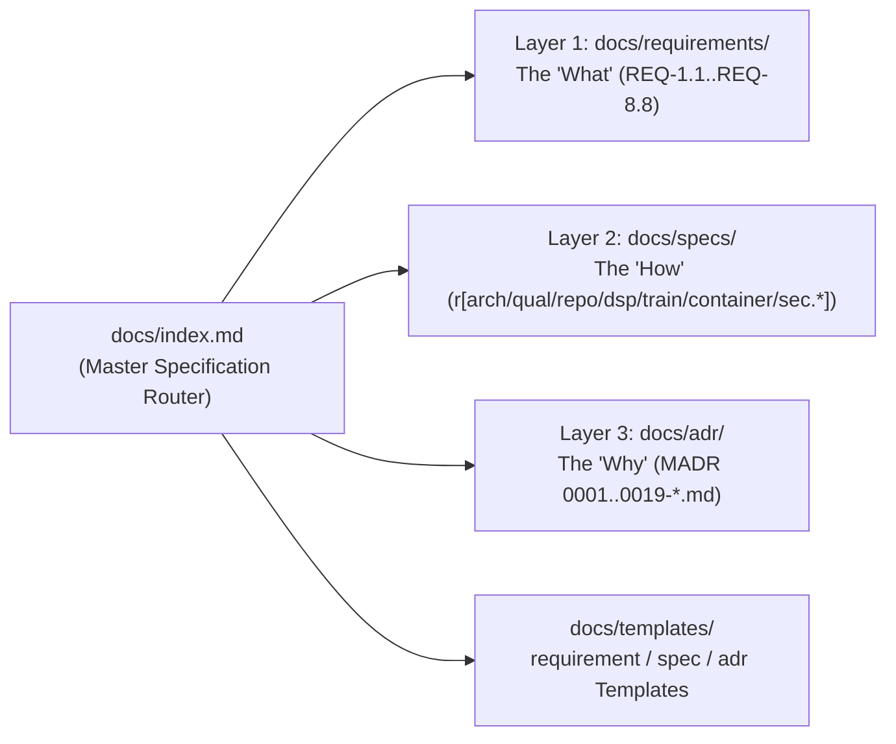

# Contributing to the DNAM Specification Manual (`docs/`)

This guide defines the authoring standards, 3-layer directory architecture (`requirements/`, `specs/`, `adr/`), Rust Reference-style `r[...]` / `ref[...]` / `verify[...]` specification rule identifiers, MADR conventions, and mathematical formatting rules specified in [`specs/architecture/project_and_documentation_quality.md`](specs/architecture/project_and_documentation_quality.md) (`ref[repo.docs.spec-rules-and-adrs]`) that govern the canonical **Dynamic Neural Audio Modeler (DNAM)** specification manual under [`docs/`](index.md).

For monorepo-wide code, licensing, and `AGENTS.md` progressive-disclosure rules, see the root [`CONTRIBUTING.md`](../CONTRIBUTING.md) and [`AGENTS.md`](../AGENTS.md).

---

## 1. Purpose, Core Principles & Specification Prose Style

Every document in [`docs/`](index.md) has a strict engineering role separating **What (`requirements/`)**, **How (`specs/`)**, and **Why (`adr/`)**:

| Principle | Rule & Authoring Requirement |
| :--- | :--- |
| **1. Strict Separation of What, How & Why** | • **Requirements (`docs/requirements/`, `REQ-1.1`–`REQ-8.8`):** Define **what** the system must achieve (implementation-agnostic goals, physical coverage, hardware budgets, and security guarantees).<br/>• **Normative Specifications (`docs/specs/`, `r[...]`):** Define **how** the TORA architecture implements those requirements (equations, algorithms, wire layouts, state machines, stability bounds, and repo quality rules). Never clog `docs/specs/` with narrative "Why Naive X Fails" essays.<br/>• **Architectural Decision Records (`docs/adr/NNNN-*.md`):** Define **why** a formulation or layout was chosen over alternative candidates, including counterexamples and superseded prototypes. |
| **2. Distinct `r[...]` Definitions, `ref[...]` Cross-References & `verify[...]` Test Citations (`ref[repo.docs.spec-rules-and-adrs]`)** | • **Rule Definition (`` `r[<domain>.<subdomain>.<rule>]` ``):** Appears **exactly once** across the entire repository, exclusively inside `docs/specs/**/*.md` at the rule's authoritative definition site.<br/>• **Rule Cross-Reference (`ref[<domain>.<subdomain>.<rule>]`):** Used for cross-references to that rule across ADRs (`docs/adr/`), docs, and implementation code (`packages/`).<br/>• **Test Verification Citation (`verify[<domain>.<subdomain>.<rule>]`):** Used in test suites (`tests/`, `packages/**/tests/`) to declare that a test verifies that specification rule. Every `ref[<id>]` and `verify[<id>]` must resolve to an existing `r[<id>]` definition, and `test_spec_rules_verified_in_tests` reports any `r[<id>]` rules in `docs/specs/` not yet cited by a test. |
| **3. Zero Spec-Text Parsing in Unit / Reference Tests (`ref[repo.docs.spec-rules-and-adrs]`)** | Unit, integration, and arithmetic reference tests must **never** read or parse Markdown text blocks from `docs/`. Only the guardrail suite ([`tests/test_guardrails.test.ts`](../tests/test_guardrails.test.ts)) may read `docs/` files to validate registries, `r[...]` rule uniqueness, math syntax, and link integrity. |
| **4. Zero Duplication Across `AGENTS.md` & `README.md` (`ref[repo.docs.agents-md-budgets]`)** | Never copy equations, clamp tables, or JSON schemas into `AGENTS.md` routing maps or package `README.md` files. Place normative specifications in `docs/specs/` and link to the exact section anchor or cite the `r[...]` rule ID. |
| **5. Crisp Engineering-Manual Prose & Visual Communication** | Write in a direct, normative engineering voice—never narrative essays or dense walls of text. Use **Mermaid diagrams (`flowchart`, `sequenceDiagram`, `stateDiagram-v2`)** for signal topologies and lifecycles, and **monospaced ASCII diagrams (`text` code blocks)** whenever fixed-width spatial alignment displays binary/cache-line layouts, SIMD lanes, or parameter budgets more clearly than a Markdown table. |

---

## 2. 3-Layer Directory Architecture, Rule Prefixes & Authoring Templates



| Layer & Directory | Canonical Files | Rule / ID Prefix | Authoring Template |
| :--- | :--- | :---: | :--- |
| **Layer 1: Requirements (`docs/requirements/`)** | [`system_goals_and_requirements.md`](requirements/system_goals_and_requirements.md) | `REQ-1.1`–`REQ-8.8` | [`templates/requirement_template.md`](templates/requirement_template.md) |
| **Layer 2A: Architecture, Perceptual & Repo Quality (`docs/specs/architecture/`)** | [`tora_architecture.md`](specs/architecture/tora_architecture.md), [`psychoacoustic_quality_and_tiers.md`](specs/architecture/psychoacoustic_quality_and_tiers.md), [`project_and_documentation_quality.md`](specs/architecture/project_and_documentation_quality.md) | `r[arch.*]`, `r[qual.*]`, `r[repo.*]` | [`templates/spec_template.md`](templates/spec_template.md) |
| **Layer 2B: Real-Time DSP (`docs/specs/dsp/`)** | [`op_t_transport.md`](specs/dsp/op_t_transport.md), [`op_m_modal_kautz.md`](specs/dsp/op_m_modal_kautz.md), [`op_n_commuted_cascade.md`](specs/dsp/op_n_commuted_cascade.md), [`router_and_stages_topology.md`](specs/dsp/router_and_stages_topology.md), [`parametric_control_bus.md`](specs/dsp/parametric_control_bus.md) | `r[dsp.op-t.*]`, `r[dsp.op-m.*]`, `r[dsp.op-n.*]`, `r[dsp.router.*]`, `r[dsp.stage1..4.*]`, `r[dsp.head.*]`, `r[dsp.zoh.*]`, `r[dsp.ctrl.*]`, `r[dsp.tempo.*]` | [`templates/spec_template.md`](templates/spec_template.md) |
| **Layer 2C: Capture, Training & Audit (`docs/specs/training/`)** | [`capture_and_alignment.md`](specs/training/capture_and_alignment.md), [`four_stage_pipeline.md`](specs/training/four_stage_pipeline.md), [`iterative_resume_and_caching.md`](specs/training/iterative_resume_and_caching.md), [`control_space_audit.md`](specs/training/control_space_audit.md) | `r[train.capture.*]`, `r[train.pipeline.*]`, `r[train.gram.*]`, `r[train.resume.*]`, `r[train.cache.*]`, `r[train.cloud.*]`, `r[train.audit.*]` | [`templates/spec_template.md`](templates/spec_template.md) |
| **Layer 2D: Containers & Security (`docs/specs/containers/`, `docs/specs/security/`)** | [`dnam_binary_format.md`](specs/containers/dnam_binary_format.md), [`checkpoint_and_cache_format.md`](specs/containers/checkpoint_and_cache_format.md), [`provenance_and_enclave_drm.md`](specs/security/provenance_and_enclave_drm.md), [`watermarking_and_marketplace.md`](specs/security/watermarking_and_marketplace.md) | `r[container.dnam.*]`, `r[container.ckpt.*]`, `r[container.dnca.*]`, `r[sec.taxonomy.*]`, `r[sec.jcs.*]`, `r[sec.policy.*]`, `r[sec.sig.*]`, `r[sec.drm.*]`, `r[sec.watermark.*]`, `r[sec.anticlone.*]`, `r[sec.preview.*]`, `r[sec.edge.*]` | [`templates/spec_template.md`](templates/spec_template.md) |
| **Layer 3: ADRs (`docs/adr/`)** | [`0001-superseded-tri-physics-prototype.md`](adr/0001-superseded-tri-physics-prototype.md) .. [`0019-simd-kernel-architecture-and-realtime-execution-optimizations.md`](adr/0019-simd-kernel-architecture-and-realtime-execution-optimizations.md) | `ADR-0001`–`ADR-0019` | [`templates/adr_template.md`](templates/adr_template.md) |

---

## 3. Implementation-Agnostic Requirements vs. Normative Specs (`ref[repo.docs.requirements-layer]`, `ref[repo.docs.spec-rules-and-adrs]`)

1. **[`requirements/system_goals_and_requirements.md`](requirements/system_goals_and_requirements.md) (`REQ-1.1`–`REQ-8.8`) Must Remain Implementation-Agnostic (`ref[repo.docs.requirements-layer]`):**
   - Normative requirement prose states functional capabilities, physical coverage, perceptual quality (`bESR`), slimmable tier behavior, hardware budgets, and security guarantees **without** tying them to internal file extensions or JSON schema field names.
   - [`tests/test_guardrails.test.ts`](../tests/test_guardrails.test.ts) strips Markdown link targets `](...)` and verifies that zero implementation-specific tokens (`.dnam`, `.dnam-ckpt`, `.dnam-cache`, `.dnam-seal`, `.dnce`, `max_supported_tier`, `user_metadata`, `royalty_splits`, `allowed_protection_profiles`, `allowed_oem_vendors`) appear in the prose of `system_goals_and_requirements.md`.
2. **Rust Reference `r[...]` Definitions, `ref[...]` References & `verify[...]` Test Citations (`ref[repo.docs.spec-rules-and-adrs]`):**
   - **Definitions (`r[<id>]`):** Every normative specification under `docs/specs/**/*.md` must annotate each normative section and sub-rule with a backtick-wrapped rule definition matching `` `r[<domain>.<subdomain>.<rule>]` `` (lowercase ASCII letters, digits, hyphens, and dot-separated segments, minimum 3 segments). Concrete `r[<id>]` definitions are forbidden outside `docs/specs/` and `docs/templates/spec_template.md`.
   - **Cross-References (`ref[<id>]`):** Any citation to a rule in ADRs (`docs/adr/`), other docs, or implementation code (`packages/`) must use `ref[<domain>.<subdomain>.<rule>]`.
   - **Test Verification Citations (`verify[<id>]`):** Test files (`tests/`, `packages/**/tests/`) use `verify[<domain>.<subdomain>.<rule>]` to declare which specification rules are verified. [`tests/test_guardrails.test.ts`](../tests/test_guardrails.test.ts) verifies that every `ref[<id>]` and `verify[<id>]` resolves to a defined `r[<id>]`, and `test_spec_rules_verified_in_tests` reports any `r[<id>]` rules in `docs/specs/` missing a `verify[<id>]` citation in tests.
   - Rule identifiers are decoupled from Markdown section numbers (`1.1`, `1.2`) so re-ordering headings never invalidates code or test citations.
   - Every `##` / `###` / `####` leaf normative section in `docs/specs/**/*.md` must contain at least one `r[...]` rule definition, and all `r[...]` rule definitions across the repository must be globally unique.
3. **MADR Architectural Decision Records (`docs/adr/NNNN-kebab-case.md`) & YAML Frontmatter (`ref[repo.docs.spec-rules-and-adrs]`):**
   - Every file in `docs/requirements/`, `docs/specs/`, `docs/adr/`, and `docs/templates/` must begin at line 1 with a YAML frontmatter block (`--- ... ---`).
   - Follow [`templates/adr_template.md`](templates/adr_template.md): ADR filenames must match `NNNN-kebab-case.md`, frontmatter must declare `id: ADR-NNNN`, `title`, `status: proposed | accepted | superseded`, `supersedes`, `superseded_by`, `specs`, and `requirements`.
   - **Zero Superseded ADR References in Specs/Requirements (`ref[repo.docs.spec-rules-and-adrs]`):** Normative specifications (`docs/specs/**/*.md`) and requirements (`docs/requirements/**/*.md`) must **never** reference a superseded ADR (`status: superseded`) in either frontmatter `adrs:` or Markdown body links.

---

## 4. Formatting, Mermaid Diagrams, ASCII Layouts & GitHub MathJax LaTeX Rules (`ref[repo.docs.markdown-table-math]`, `ref[repo.docs.github-latex-and-mermaid]`, `ref[repo.docs.relative-links-and-anchors]`)

All Markdown files across the repository are validated on every test run by [`tests/test_guardrails.test.ts`](../tests/test_guardrails.test.ts). Follow these formatting rules to ensure clean rendering on GitHub and zero guardrail failures:

### 4.1 Mermaid Diagrams (`ref[repo.docs.github-latex-and-mermaid]`)

Every major specification section that describes a system architecture, signal chain, multi-stage pipeline, execution protocol, or state transition should open with a **Mermaid diagram** rather than a lengthy text explanation:

| Subject Matter | Preferred Mermaid Diagram Type | Canonical Example |
| :--- | :--- | :--- |
| **DSP signal flow, multi-block cascades, training pipelines, high-level container arena flows, or directory graphs** | `flowchart TD` or `flowchart LR` with labeled `subgraph` blocks | [`tora_architecture.md` §1.2](specs/architecture/tora_architecture.md#12-the-tora-architectural-breakthrough), [`dnam_binary_format.md` §1](specs/containers/dnam_binary_format.md#1-hybrid-binary-container-wire-framing---50-ns-zero-json-hardware-fast-path) |
| **Dual-rate (`48 kHz` / `3 kHz`) execution loops, calibration handshakes, TrustZone unsealing, or storefront APIs** | `sequenceDiagram` with `autonumber`, `alt`/`else`, and `loop` blocks | [`tora_architecture.md` §1.2](specs/architecture/tora_architecture.md#dual-rate-48-khz-audio-vs-3-khz-control-tora-execution-lifecycle), [`provenance_and_enclave_drm.md` §3.2](specs/security/provenance_and_enclave_drm.md#32-end-to-end-dnam-seal-bdnsl-sealing--hardware-trustzone-unsealing-flow) |
| **Bypass spillover (`Trails`), dual-mode delay transitions, or lifecycle state machines** | `stateDiagram-v2` with explicit transition guards | [`tora_architecture.md` §3.4](specs/architecture/tora_architecture.md#34-spillover-trails-state-machine) |

- **Quote Node Labels Containing Special Characters:** Always wrap node labels that contain parentheses `( )`, brackets `[ ]`, colons `:`, or mathematical operators in double quotes (e.g., `NodeA["Op-N: 1x B-Spline PolyADAA (48 kHz)"]`).
- **Zero Semicolons in `sequenceDiagram` Blocks (`ref[repo.docs.github-latex-and-mermaid]`):** Never use semicolons (`;`) inside a Mermaid `sequenceDiagram` block, as Mermaid's sequence parser treats `;` as a statement terminator and fails to render the diagram.

### 4.2 Zero Inline LaTeX Math in Markdown Tables (`ref[repo.docs.markdown-table-math]`)

> [!IMPORTANT]
> GitHub's MathJax renderer wraps inline math (`$...$`) inside Markdown table cells (`<th>` / `<td>`) in scrollable containers that trigger unsightly horizontal scrollbars and pipe (`|`) parsing collisions.

- **Rule (`ref[repo.docs.markdown-table-math]`):** No line starting with `|` in any `.md` file may contain a raw `$` character outside backtick code spans (`` `...` ``).
- **What to Use Instead Inside Table Cells:**
  - Use Unicode mathematical symbols: `≤`, `≥`, `×`, `÷`, `→`, `↔`, `⊂`, `∈`, `⊕`, `∞`, `Δ`, `σ`, `λ`, `τ`, `ψ`, `φ`, `₀`–`₉`, `⁰`–`⁹`.
  - Or wrap expressions in inline code spans: `` `C = 8` ``, `` `O(log₂ L)` ``, `` `uplo = 'U'` ``, `` `bESR ≤ -23 dB` ``.

### 4.3 GitHub CommonMark + MathJax LaTeX Compatibility (`ref[repo.docs.github-latex-and-mermaid]`)

When writing inline math (`$...$`) in prose paragraphs or display equations (`$$...$$`), CommonMark parses backslash escapes **before** handing the string to MathJax. To prevent silent rendering corruption:

| Forbidden Pattern in Math (`ref[repo.docs.github-latex-and-mermaid]`) | Why It Fails on GitHub | Required Replacement |
| :--- | :--- | :--- |
| Punctuation escapes: `\_`, `\;`, `\,`, `\!`, `\{`, `\}`, `\|`, `\%`, `\\` | CommonMark strips the leading backslash before MathJax sees it | Avoid spacing escapes; use `\lbrace` and `\rbrace` for sets, `\Vert` for norms, and split multi-line equations into separate `$$...$$` blocks |
| Disallowed macros: `\operatorname`, `\multicolumn`, `\texttt`, `\text{--` | Unsupported or mangled by GitHub's MathJax configuration | Use `\mathrm{...}` or `\text{...}` with standard ASCII hyphens `-` |
| Underscores inside `\text{...}` or `\mathrm{...}` (e.g., `\text{send_gain}`) | Treated as an unescaped subscript inside text mode | Use hyphens or spaces inside text macros (e.g., `\text{send-gain}`) or place subscripts outside (`g_{\text{send}}`) |
| Unbalanced braces `{` vs. `}` | Breaks the entire math block render | Ensure every `{` has a matching `}` inside every `$...$` and `$$...$$` block |

### 4.4 Relative Markdown Links & Heading Anchors (`ref[repo.docs.relative-links-and-anchors]`)

- Every relative file link and `#section-anchor` fragment across `README.md`, `AGENTS.md`, `CONTRIBUTING.md`, `CLA.md`, `docs/**/*.md`, `tests/**/*.md`, and `packages/**/*.md` is checked against the filesystem and GitHub's heading slug algorithm by `test_relative_markdown_links_resolve()`.
- When renaming a section heading in `docs/`, always search for `#old-heading-slug` across the repository and update all incoming links.

### 4.5 Preferring Monospaced ASCII Diagrams Over Markdown Tables & Prose

While Mermaid diagrams handle topological graphs and state flows, **monospaced ASCII diagrams (`text` code blocks) should be preferred over Markdown tables or prose whenever fixed-width spatial alignment displays information more clearly**:

| Use Case | Why ASCII (`text`) Beats Markdown Tables / Prose | Canonical Example |
| :--- | :--- | :--- |
| **Multi-arena parameter budget maps & binary container directories** | Provides full-width title banners, horizontal `+---+---+` dividers between arenas and subtotals, and zero mid-token line wrapping of tensor shapes (`[3, 16, 4, 4]`) or byte offsets (`10,752..22,336`) | [`dnam_binary_format.md` §1](specs/containers/dnam_binary_format.md#1-hybrid-binary-container-wire-framing---50-ns-zero-json-hardware-fast-path), [`tora_architecture.md` §2](specs/architecture/tora_architecture.md#2-4-tier-slimmable-simd-hierarchy-lite--full--pro--ultra) |
| **Cache-line (`64B`) & binary struct field breakdowns** | Preserves multi-line indented struct field lists and byte ranges inside visually separated cache-line blocks without `<br/>` clutter | [`dnam_binary_format.md` §1](specs/containers/dnam_binary_format.md#1-hybrid-binary-container-wire-framing---50-ns-zero-json-hardware-fast-path), [`provenance_and_enclave_drm.md` §3.2](specs/security/provenance_and_enclave_drm.md#32-end-to-end-dnam-seal-bdnsl-sealing--hardware-trustzone-unsealing-flow) |
| **Hierarchical MAC / compute accounting ledgers** | Aligns nested stage sub-items, dashed summation bars (`---`), and right-justified operation totals into a scannable engineering ledger | [`tora_architecture.md` §2.2](specs/architecture/tora_architecture.md#22-hardware--dsp-benchmark-summary) |
| **SIMD vector lane grids, ring-buffer memory bars & 2D block matrices** | Directly visualizes 2D register lanes (`NEON 128-bit`), contiguous memory partitions (`[Main Delay ∣ All-Pass Ring]`), and block-matrix quadrants (`W_(L->L)`, `W_(L->R)`) | [`op_m_modal_kautz.md` §1](specs/dsp/op_m_modal_kautz.md#1-4-lane-simd-symplectic-complex-recurrence--algebraic-rotor) |

Use standard **Markdown tables** when presenting flat registries (`REQ-1.1`–`REQ-8.8`) or compact 3–6 column property comparisons where cells are short and do not require horizontal section dividers or multi-line nested field lists.

---

## 5. Maintaining Requirements (`REQ-*`), Specifications (`r[...]`), Verification (`verify[...]`) & ADRs (`ref[repo.docs.requirements-layer]`, `ref[repo.docs.spec-rules-and-adrs]`)

1. **System Requirements Registry ([`requirements/system_goals_and_requirements.md`](requirements/system_goals_and_requirements.md)):**
   - Every requirement must appear as a canonical Markdown table row beginning with `| **\`REQ-X.Y\`** |` under its respective Goal (`40` total requirements). Use [`templates/requirement_template.md`](templates/requirement_template.md).
2. **Normative Specifications (`docs/specs/**/*.md`) & Verification (`verify[...]`):**
   - Every normative specification section must include at least one unique `` `r[<domain>.<subdomain>.<rule>]` `` definition, and every `r[...]` rule in `docs/specs/` is tracked for `verify[...]` test coverage. Use [`templates/spec_template.md`](templates/spec_template.md).
3. **Architectural Decision Records (`docs/adr/NNNN-*.md`):**
   - When introducing a new architectural trade-off or mathematical counterexample, create an atomic MADR file under `docs/adr/` using [`templates/adr_template.md`](templates/adr_template.md).

---

## 6. Verification Commands

Run the project-scoped documentation and specification guardrail suite from the repository root after any documentation change:

```bash
# Run formatting, linting, typechecking, and all documentation/specification guardrails
moon check tests

# Or invoke the guardrail test task directly
moon run tests:test
```
