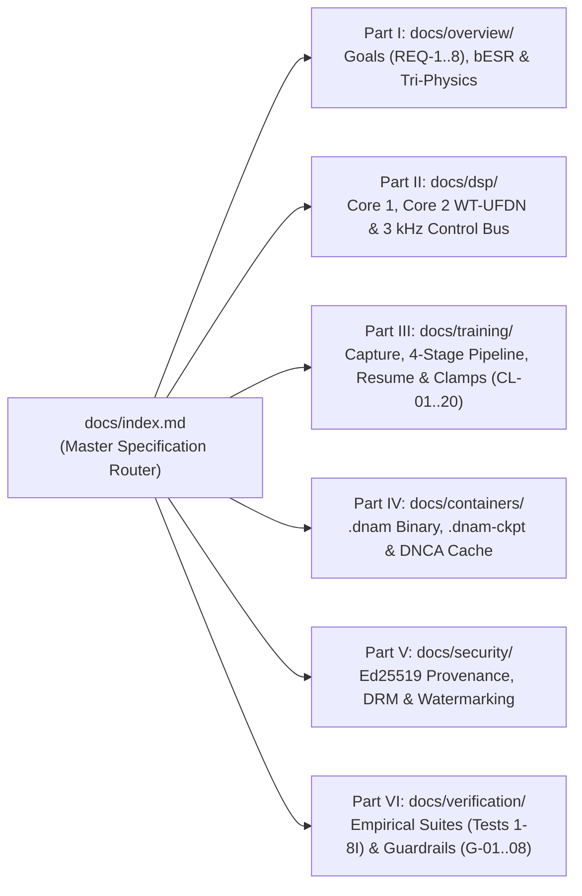

# Contributing to the DNAM Specification Manual (`docs/`)

This guide defines the authoring standards, modular directory organization, mathematical formatting rules, and automated guardrail checks (`G-02`–`G-05`, `G-08`) that govern the canonical **Dynamic Neural Audio Modeler (DNAM / "Tri-Physics")** specification manual under [`docs/`](index.md).

For monorepo-wide code, licensing, and `AGENTS.md` progressive-disclosure rules, see the root [`CONTRIBUTING.md`](../CONTRIBUTING.md) and [`AGENTS.md`](../AGENTS.md).

---

## 1. Purpose, Core Principles & Specification Prose Style

Every document in [`docs/`](index.md) is part of an authoritative engineering specification manual. Contributors must uphold five core authoring principles:

| Principle | Rule & Authoring Requirement |
| :--- | :--- |
| **1. Single Source of Truth (SSOT)** | Every mathematical derivation, psychoacoustic metric (`bESR`), stability clamp (`CL-01`–`CL-20`), binary wire layout (`.dnam`, `.dnam-ckpt`, `.dnam-seal`), and functional requirement (`REQ-1.1`–`REQ-8.8`) is defined **exactly once** in its canonical `docs/` file and referenced via relative Markdown links elsewhere. |
| **2. Zero Duplication Across `AGENTS.md` & `README.md`** | Never copy equations, clamp tables, or JSON schemas into `AGENTS.md` routing maps or package `README.md` files. Place normative specifications in `docs/` and link to the exact section anchor. |
| **3. Progressive Disclosure** | Readers enter through [`docs/index.md`](index.md) and navigate from implementation-agnostic goals (`overview/`) to concrete subsystem specifications (`dsp/`, `training/`, `containers/`, `security/`, `verification/`). |
| **4. Crisp Engineering-Manual Prose Style** | Write in a direct, normative engineering-specification voice—**never** narrative essays or dense walls of text. Decompose multi-faceted concepts into structured Markdown comparison/property tables, numbered execution lifecycles, concise invariant lists, numbered display equations, and GitHub callout alerts (`> [!NOTE]`, `> [!IMPORTANT]`, `> [!WARNING]`). |
| **5. Diagram-First Visual Communication** | **Strongly prefer Mermaid diagrams (`flowchart`, `sequenceDiagram`, `stateDiagram-v2`) over text-heavy descriptions** whenever specifying signal-flow topologies, dual-rate (`48 kHz` / `3 kHz`) execution lifecycles, training stages, state machines, binary container layouts, or security/marketplace protocols. Pair every diagram with a concise reference table rather than repeating the flow in long prose paragraphs. |

> [!TIP]
> **Rule of Thumb for Prose Density:** If a paragraph exceeds 4–5 lines or enumerates more than three parallel items (such as tiers, regimes, stages, binary fields, or failure modes), refactor it into a **Mermaid diagram + structured Markdown table**.

---

## 2. 6-Part Modular Directory Architecture & Routing Table

The `docs/` directory is organized into six non-overlapping domain subdirectories routed by [`docs/index.md`](index.md):



| Part & Subdirectory | Canonical Specifications | What Belongs Here |
| :--- | :--- | :--- |
| **Part I: [`overview/`](overview/system_goals_and_requirements.md)** | [`system_goals_and_requirements.md`](overview/system_goals_and_requirements.md), [`psychoacoustic_quality_and_tiers.md`](overview/psychoacoustic_quality_and_tiers.md), [`tri_physics_architecture.md`](overview/tri_physics_architecture.md) | Implementation-agnostic requirements (`REQ-1.1`–`REQ-8.8`), hardware budgets, `bESR` psychoacoustic metric & 4-tier thresholds (`Lite`, `Full`, `Pro`, `Ultra`), end-to-end Tri-Physics signal flow, and prior-art comparisons. |
| **Part II: [`dsp/`](dsp/core1_polyadaa_and_rglru.md)** | [`core1_polyadaa_and_rglru.md`](dsp/core1_polyadaa_and_rglru.md), [`core2_modulated_ufdn.md`](dsp/core2_modulated_ufdn.md), [`parametric_control_bus.md`](dsp/parametric_control_bus.md) | Real-time `48 kHz` audio and `3 kHz` control equations: `1× B-Spline PolyADAA`, Radial-Polar Selective Complex RG-LRU, Mode-Free `WT-UFDN`, Givens/Householder matrices, Lyapunov saturation, and Lobatto HDMR + Rank-4/8 FM control bus. |
| **Part III: [`training/`](training/four_stage_pipeline.md)** | [`capture_and_alignment.md`](training/capture_and_alignment.md), [`four_stage_pipeline.md`](training/four_stage_pipeline.md), [`iterative_resume_and_caching.md`](training/iterative_resume_and_caching.md), [`clamp_and_audit_registry.md`](training/clamp_and_audit_registry.md) | 2-step hardware calibration, 30s universal excitation, multi-regime sub-sample alignment, 4-stage training pipeline, 72-bit `ExactGramAccumulator`, `< 5 s` Kronecker stem expansion, and the `CL-01`–`CL-20` Clamp & Audit Registry. |
| **Part IV: [`containers/`](containers/dnam_binary_format.md)** | [`dnam_binary_format.md`](containers/dnam_binary_format.md), [`checkpoint_and_cache_format.md`](containers/checkpoint_and_cache_format.md) | 64-byte aligned `.dnam` and `.dnam-ckpt` binary framing, `Arena 0..5` layouts, `uplo='U'` upper-triangular Gram packing, `.dnam-cache/*.dnce` sidecars, and Continuous-Time ZOH sample-rate rescaling. |
| **Part V: [`security/`](security/provenance_and_enclave_drm.md)** | [`provenance_and_enclave_drm.md`](security/provenance_and_enclave_drm.md), [`watermarking_and_marketplace.md`](security/watermarking_and_marketplace.md) | RFC 8785 JCS canonical digests, `Ed25519` creator/marketplace signatures, `DistributionPolicy`, `OemDeviceCertificate`, `.dnam-seal` (`DNSL`) enclave DRM, `0.00 dB` isometric gauge + Coupled Tardos buyer watermarking, and anti-cloning gates. |
| **Part VI: [`verification/`](verification/verification_and_guardrails.md)** | [`verification_and_guardrails.md`](verification/verification_and_guardrails.md) | Formal stimuli, mathematical pass criteria, and reference test links for the 8 empirical verification suites (`Tests 1–8I`) and 8 automated repository guardrails (`G-01`–`G-08`). |

---

## 3. Implementation-Agnostic vs. Implementation-Specific Boundaries (`G-03`)

DNAM strictly separates **what the system must achieve** from **how the Tri-Physics architecture implements it**:

1. **[`overview/system_goals_and_requirements.md`](overview/system_goals_and_requirements.md) (`REQ-1.1`–`REQ-8.8`) Must Remain Implementation-Agnostic:**
   - Normative requirement prose in `system_goals_and_requirements.md` states functional capabilities, physical coverage (including single units and complex end-to-end full rigs), perceptual quality (`bESR`), slimmable tier behavior, hardware budgets, and security guarantees **without** tying them to internal file extensions or JSON schema field names.
   - Guardrail **`G-03`** ([`tests/test_guardrails.py`](../tests/test_guardrails.py)) strips Markdown link targets `](...)` and verifies that zero implementation-specific tokens (`.dnam`, `.dnam-ckpt`, `.dnam-cache`, `.dnam-seal`, `.dnce`, `max_supported_tier`, `user_metadata`, `royalty_splits`, `allowed_protection_profiles`, `allowed_oem_vendors`) appear in the prose of `system_goals_and_requirements.md`.
   - Cross-references from `system_goals_and_requirements.md` to concrete specifications are encouraged, provided implementation-specific filenames appear **only inside link targets** or generic link labels (e.g., linking to [`containers/dnam_binary_format.md` §2](containers/dnam_binary_format.md#2-five-hardware-loading-optimizations--50-ns-zero-allocation-load)).
2. **[`overview/tri_physics_architecture.md`](overview/tri_physics_architecture.md) and Parts II–VI Document Concrete Implementations:**
   - Concrete DSP equations, `.dnam` / `.dnam-ckpt` / `.dnam-seal` binary offsets, JSON header fields, and Rust/Python module paths belong in `tri_physics_architecture.md` and Parts II–VI.

---

## 4. Formatting, Mermaid Diagrams & GitHub MathJax LaTeX Rules (`G-04`, `G-05`, `G-08`)

All Markdown files across the repository are validated on every test run by [`tests/test_guardrails.py`](../tests/test_guardrails.py). Follow these formatting rules to ensure clean rendering on GitHub and zero guardrail failures:

### 4.1 Mermaid Diagrams (`G-05`)

Every major specification section that describes a system architecture, signal chain, multi-stage pipeline, execution protocol, or state transition should open with a **Mermaid diagram** rather than a lengthy text explanation:

| Subject Matter | Preferred Mermaid Diagram Type | Canonical Example |
| :--- | :--- | :--- |
| **DSP signal flow, multi-block cascades, training pipelines, container arena layouts, or directory graphs** | `flowchart TD` or `flowchart LR` with labeled `subgraph` blocks | [`tri_physics_architecture.md` §1.1](overview/tri_physics_architecture.md#11-system-signal-flow-diagram), [`dnam_binary_format.md` §1](containers/dnam_binary_format.md#1-hybrid-binary-container-wire-framing---50-ns-zero-json-hardware-fast-path) |
| **Dual-rate (`48 kHz` / `3 kHz`) execution loops, calibration handshakes, TrustZone unsealing, or storefront APIs** | `sequenceDiagram` with `autonumber`, `alt`/`else`, and `loop` blocks | [`tri_physics_architecture.md` §1.2](overview/tri_physics_architecture.md#12-dual-rate-48-khz-audio-vs-3-khz-control-execution-lifecycle), [`provenance_and_enclave_drm.md` §3.2](security/provenance_and_enclave_drm.md#32-end-to-end-dnam-seal-bdnsl-sealing--hardware-trustzone-unsealing-flow) |
| **Bypass spillover (`Trails`), dual-mode delay transitions, or lifecycle state machines** | `stateDiagram-v2` with explicit transition guards | [`tri_physics_architecture.md` §3.3](overview/tri_physics_architecture.md#33-polarity-corrected-host-parallel-blend--spillover-trails-state-machine) |

- **Quote Node Labels Containing Special Characters:** Always wrap node labels that contain parentheses `( )`, brackets `[ ]`, colons `:`, or mathematical operators in double quotes (e.g., `NodeA["Core 1: 1x B-Spline PolyADAA (48 kHz)"]`).
- **Zero Semicolons in `sequenceDiagram` Blocks (`G-05`):** Never use semicolons (`;`) inside a Mermaid `sequenceDiagram` block, as Mermaid's sequence parser treats `;` as a statement terminator and fails to render the diagram.

### 4.2 Zero Inline LaTeX Math in Markdown Tables (`G-04`)

> [!IMPORTANT]
> GitHub's MathJax renderer wraps inline math (`$...$`) inside Markdown table cells (`<th>` / `<td>`) in scrollable containers that trigger unsightly horizontal scrollbars and pipe (`|`) parsing collisions.

- **Rule (`G-04`):** No line starting with `|` in any `.md` file may contain a raw `$` character outside backtick code spans (`` `...` ``).
- **What to Use Instead Inside Table Cells:**
  - Use Unicode mathematical symbols: `≤`, `≥`, `×`, `÷`, `→`, `↔`, `⊂`, `∈`, `⊕`, `∞`, `Δ`, `σ`, `λ`, `τ`, `ψ`, `φ`, `₀`–`₉`, `⁰`–`⁹`.
  - Or wrap expressions in inline code spans: `` `C = 8` ``, `` `O(log₂ L)` ``, `` `uplo = 'U'` ``, `` `bESR ≤ -23 dB` ``.

### 4.3 GitHub CommonMark + MathJax LaTeX Compatibility (`G-05`)

When writing inline math (`$...$`) in prose paragraphs or display equations (`$$...$$`), CommonMark parses backslash escapes **before** handing the string to MathJax. To prevent silent rendering corruption:

| Forbidden Pattern in Math (`G-05`) | Why It Fails on GitHub | Required Replacement |
| :--- | :--- | :--- |
| Punctuation escapes: `\_`, `\;`, `\,`, `\!`, `\{`, `\}`, `\|`, `\%`, `\\` | CommonMark strips the leading backslash before MathJax sees it | Avoid spacing escapes; use `\lbrace` and `\rbrace` for sets, `\Vert` for norms, and split multi-line equations into separate `$$...$$` blocks |
| Disallowed macros: `\operatorname`, `\multicolumn`, `\texttt`, `\text{--` | Unsupported or mangled by GitHub's MathJax configuration | Use `\mathrm{...}` or `\text{...}` with standard ASCII hyphens `-` |
| Underscores inside `\text{...}` or `\mathrm{...}` (e.g., `\text{send_gain}`) | Treated as an unescaped subscript inside text mode | Use hyphens or spaces inside text macros (e.g., `\text{send-gain}`) or place subscripts outside (`g_{\text{send}}`) |
| Unbalanced braces `{` vs. `}` | Breaks the entire math block render | Ensure every `{` has a matching `}` inside every `$...$` and `$$...$$` block |

### 4.4 Relative Markdown Links & Heading Anchors (`G-08`)

- Every relative file link and `#section-anchor` fragment across `README.md`, `AGENTS.md`, `CONTRIBUTING.md`, `CLA.md`, `docs/**/*.md`, `tests/**/*.md`, and `packages/**/*.md` is checked against the filesystem and GitHub's heading slug algorithm by `test_relative_markdown_links_resolve()`.
- When renaming a section heading in `docs/`, always search for `#old-heading-slug` across the repository and update all incoming links.

---

## 5. Maintaining the Requirement (`REQ-1.1`–`REQ-8.8`) & Clamp (`CL-01`–`CL-20`) Registries (`G-03`)

1. **System Requirements Registry ([`overview/system_goals_and_requirements.md`](overview/system_goals_and_requirements.md)):**
   - Every requirement must appear as a canonical Markdown table row beginning with `| **\`REQ-X.Y\`** |` under its respective Goal (`REQ-1.1`–`REQ-1.8`, `REQ-2.1`–`REQ-2.5`, `REQ-3.1`–`REQ-3.3`, `REQ-4.1`–`REQ-4.3`, `REQ-5.1`–`REQ-5.6`, `REQ-6.1`–`REQ-6.3`, `REQ-7.1`–`REQ-7.4`, `REQ-8.1`–`REQ-8.8`; 40 total requirements).
   - If a new requirement is added or renumbered, update `expected_counts` in [`tests/test_guardrails.py`](../tests/test_guardrails.py) and update cross-references in [`docs/index.md`](index.md) and [`verification/verification_and_guardrails.md`](verification/verification_and_guardrails.md).
2. **Clamp & Audit Registry ([`training/clamp_and_audit_registry.md`](training/clamp_and_audit_registry.md)):**
   - Every clamp (`CL-01` through `CL-20`) must appear as a canonical Markdown table row beginning with `| **\`CL-XX\`** |` and must specify at least one backtick-quoted target Python module path `` `packages/.../*.py` `` that exists on disk, alongside its corresponding Rust engine module path.

---

## 6. Verification Commands

Run the project-scoped documentation and specification guardrail suite from the repository root after any documentation change:

```bash
# Run formatting, linting, typechecking, and all documentation/registry guardrails (G-02..G-05, G-08)
moon check tests

# Or invoke pytest directly on the top-level guardrail suite
uv run --no-sync pytest tests/test_guardrails.py
```
