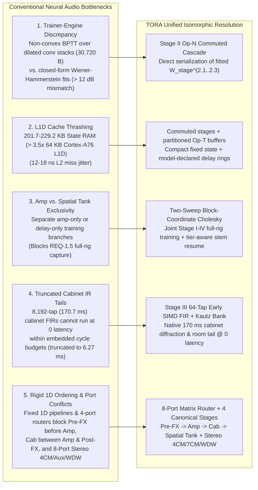

# ADR-0002: Tri-Operator Recurrent Architecture (`TORA`) & 4-Tier Slimmable Hierarchy

This record (superseding [`ADR-0001`](0001-superseded-tri-physics-prototype.md)) justifies the canonical [`tora_architecture.md`](../specs/architecture/tora_architecture.md) and [`router_and_stages_topology.md`](../specs/dsp/router_and_stages_topology.md) specifications.

## 1. Context: Five Structural Bottlenecks in Conventional Neural Audio

Conventional neural audio architectures that pair deep dilated-convolution stacks with unsegmented feedback delay networks encounter five structural bottlenecks when deployed on embedded hardware (`ARM Cortex-A76`, `64 KB` L1D cache) and full-rig studio captures ([`ADR-0001`](0001-superseded-tri-physics-prototype.md)):

| Challenge | Traditional Bottleneck Mechanism | TORA Architectural Resolution |
| :--- | :--- | :--- |
| **1. Trainer–Engine Isomorphism** | Multi-layer dilated convolutions (`K=6`, `d ∈ {1, 3, 7, 19}`) consume `30,720 B` (`48.00%` of a `64,000 B` container) and `65,536 B` (`64.0 KB`) of convolution history RAM, yet are non-convex under BPTT on `1/f²` audio (`κ(H) > 10¹⁰`) with only a `301`-sample (`6.27 ms`) sparse receptive field. | **Stage II Commuted Nonlinear Cascade (`Op-N`):** Serializes fitted stage matrices directly and enforces identical project-then-filter ordering in training and runtime. |
| **2. Embedded L1D Cache Residency** | ARM Cortex-A76 cores (Rockchip RK3582 on Darkglass Anagram) have a **`64 KB` L1 Data (L1D) Cache**. Uncommuted convolution histories (`65,536 B`), multi-tap head histories (`16,384 B`), and unsegmented diffuser rings (`131,072 B`) reach **`229,184 B` (`> 3.5×` L1D)**. | **Commuted Stage II + Partitioned Op-T Histories:** Eliminates `conv_hist` and `head_tap_hist` while cold-allocating exact 64B-aligned model-declared delay histories. |
| **3. Joint Full-Rig Capture (`REQ-1.5`)** | Treating nonlinear amp modeling and time-warped spatial delay/reverb tanks as mutually exclusive pipelines prevents single-pass capture of complete rigs (Pre-FX + tube amp + speaker cabinet + stereo post-FX). | **Two-Sweep Block-Coordinate Cholesky Pipeline:** Solves Stage I–IV sequentially on forward residuals in Sweep 1 and polishes the joint head in Sweep 2. |
| **4. Zero-Latency `170 ms` Speaker Cabinets (`REQ-1.2`)** | An `8,192`-tap (`170.7 ms` at `48 kHz`) direct FIR filter for speaker cabinet diffraction and room decay cannot execute at zero latency within embedded cycle budgets. | **Stage III Hybrid Cabinet (`Op-M`):** Combines tier-specific early FIR taps (`16/32/48/64` taps/ch) with a shared Kautz modal bank (`4/8/16/32` pairs) beginning at sample 16 (`0.33 ms` at `48 kHz`). |
| **5. Canonical Signal Routing & 8-Port I/O (`REQ-1.3`, `REQ-1.5`)** | A rigid 1D pipeline cannot place Pre-FX before amp clipping, cabinets between amp and stereo post-FX, or represent 4CM/7CM/WDW modes. | **Stage 0 8-Port Matrix Router + 4 Canonical Stages:** Provides four physical inputs and four outputs with return-to-send isolation, `200 Hz` LR4 split, and parallel sub-sample alignment. |

---

## 2. Decision: Core Product & System Topology Choices

| Domain | Canonical Decision | Superseded / Rejected R&D Alternative | Normative Spec & Test |
| :--- | :--- | :--- | :--- |
| **Slimmable Tier Hierarchy (`REQ-5.1`)** | Four nested tiers (`Lite ⊂ Full ⊂ Pro ⊂ Ultra`). `Lite..Pro` use `8-D` static control (`4` head + `4` stage, Rank-4 FM); `Ultra` adds an `8-D` delta (`+4` head + `+4` stage, Rank-8 FM) and a `16 × 4` stage-dispatch delta in `Arena 3`. | Capping `Ultra` at `4` stage coordinates (creates a rank-4 bottleneck across the 8 physical stage mechanisms) or baking `16-D` into `Lite..Pro`. | [`parametric_control_bus.md` §2.3](../specs/dsp/parametric_control_bus.md#23-o1-additive-latent-sufficient-statistic-control-scaling) |
| **Stage III Cabinet Layout (`REQ-1.2`, `REQ-5.6`)** | Separate 64B-aligned per-tier slices for independent L/R early FIR taps (`16 / 32 / 48 / 64` taps/ch) and shared-pole Kautz modal pairs (`4 / 8 / 16 / 32` pairs) with independent L/R readouts. Fixed 16-sample reference modal onset (`x[n-16]`). Both channels advance in all I/O topologies. | Single unpartitioned `384 B` Stage III slot per tier (which collided `stage3_early_fir` with `stage2_filter_params` and assumed 16 poles/tier). | [`op_m_modal_kautz.md` §4.1](../specs/dsp/op_m_modal_kautz.md#41-stage-iii-architecture--tier-allocation), [`dnam_binary_format.md` §2.4](../specs/containers/dnam_binary_format.md#24-tier-local-projection--stage-iii-slice-layout) |
| **Hardware Freeze (`REQ-1.4`)** | Freeze is modeled only when present and captured on the target hardware; unobserved options remain clamped. Stage IV freeze stops tank input injection while Stages I–III continue processing live play-over input. | Post-head synthetic native freeze with a separate `4,096 B` snapshot buffer and artificial visibility/blending rules. | [`router_and_stages_topology.md` §6.1](../specs/dsp/router_and_stages_topology.md#61-captured-freeze-and-modeled-controls) |

## 3. Companion Subsystem ADRs

- [`ADR-0003: Floor-Regularized Band-Balanced bESR & Rectangular Noise Qualification`](0003-band-balanced-besr-and-noise-qualification.md)
- [`ADR-0004: Unclamped 6-Step PolyADAA Rail Crossing, C² Wavefolder & Fixed-Hertz ZOH Bitcrusher`](0004-division-free-polyadaa-and-c2-wavefolder.md)
- [`ADR-0005: Quadrant-Reduced Contractive Rotor, H1 Hilbert Lattice, T1 Tracker & Stage III ZOH`](0005-contractive-rotor-hilbert-and-t1-tracker.md)
- [`ADR-0006: Model-Declared fp16 Delay Histories, Centered Granular Pitch & Stage IV Feedback Guard`](0006-model-declared-delays-and-tank-feedback-guard.md)
- [`ADR-0007: Centered ANOVA + Rank-R FM Control Bus, Exact-Integer Accumulator & Physical Tempo Inversion`](0007-exact-integer-control-bus-and-tempo-inversion.md)
- [`ADR-0008: Per-Stem uplo='U' Kronecker Statistics & 192-Bit Wide-Significand Gram Contraction`](0008-per-stem-kronecker-statistics-and-wide-gram.md)
- [`ADR-0009: RFC 8785 JCS Header Digest, Prefix-Composable Signatures, RFC 9180 HPKE & Rank-r Preview Containment`](0009-jcs-prefix-signing-hpke-and-preview-containment.md)

