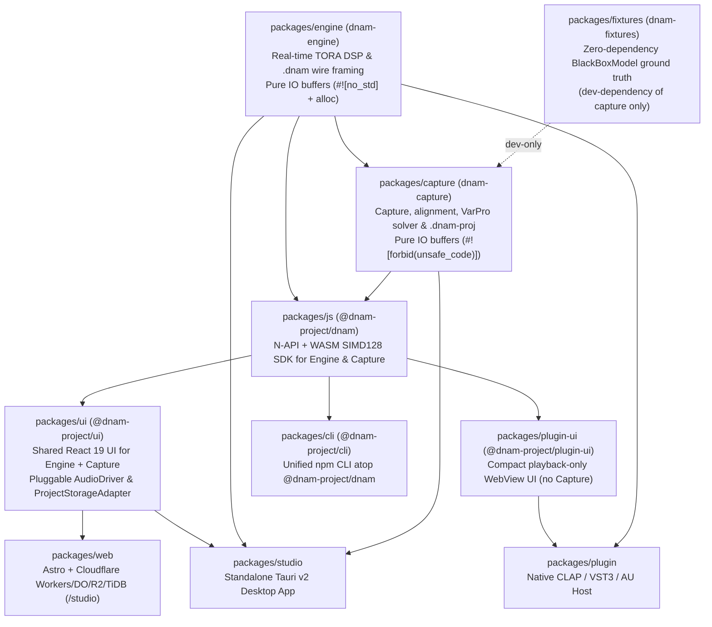

# ADR-0020: 10-Package Pure-IO Monorepo DAG & Single-File Cloud-Ready `.dnam-proj` (`DNPJ`) Container

## 1. Context & Problem Statement

Following [`ADR-0017`](0017-pure-rust-analytical-varpro-solver-and-planar-decoupling.md) and [`ADR-0018`](0018-signal-chain-fixtures-crate-and-whitebox-distillation.md), DNAM unified real-time DSP execution and analytical `VarPro` training in pure Rust. However, two legacy architectural artifacts prevented seamless execution across WebAudio browsers, Cloudflare Workers / Durable Objects / R2 / TiDB cloud storage, DAW plugins (`CLAP`/`VST3`/`AU`), native desktop Studio, and npm CLI workflows (`REQ-1.7`, `REQ-3.1`–`REQ-3.3`, `REQ-4.1`, `REQ-5.3`, `REQ-8.8`):

1. **Filesystem-Coupled Workspace Artifacts (`dnam.toml`, `.dnam-ckpt`, `.dnam-cache/*.dnce`):** Splitting a capture session across a loose workspace directory (`dnam.toml` + `stems/*.wav`), a separate `.dnam-ckpt` (`DNCK`) checkpoint file, and a `.dnam-cache/*.dnce` (`DNCE`) sidecar directory broke single-file portability, prevented `HTTP Range` header inspection in object storage (`R2`/`S3`), and complicated non-destructive capture vault editing (adding, toggling, replacing, or deleting individual knob/switch stems).
2. **Mixed Host I/O & Core Capture Boundaries (`packages/trainer` + CLI inside `packages/studio`):** Embedding CLI binaries (`clap`), filesystem workspace scaffolding, and OS audio assumptions inside core libraries obstructed clean `WASM` / `N-API` SDK bindings and forced DAW plugin builds to pull in capture/training dependencies they do not use.

---

## 2. Considered Options

| Candidate | Monorepo Package Topology | Project / Session Persistence | Cloud `HTTP Range` & Non-Destructive Vault Editing | Failure Mode / Trade-Off |
| :--- | :--- | :--- | :--- | :--- |
| **A. Multi-File Workspace Folders (`dnam.toml` + `.dnam-ckpt` + `.dnam-cache/*.dnce`)** | Coupled CLI/trainer crates (`trainer` + `studio` CLI) | Loose TOML manifests + WAV folders + `DNCK` checkpoint + `DNCE` sidecars | Requires downloading multi-file archives; deleting or toggling an old stem requires full folder bookkeeping | Breaks single-file browser drag-and-drop, R2/DO object-storage range reads, and pure IO-buffer WASM execution |
| **B. SQLite Application File Wrapper** | Pure-IO Rust crates + SQLite VFS | Single `.sqlite` database file | Page-table indirection breaks `64 B` cache-line alignment and zero-copy `WGHT` `.dnam` slicing | Adds C library / VFS complexity in `#![forbid(unsafe_code)]` Rust and WASM workers; cannot slice runtime `.dnam` in `< 0.2 ms` |
| **C. 10-Package Pure-IO Monorepo DAG + Single-File `64 B`-Aligned `.dnam-proj` (`DNPJ`, `v2.0`-Only) Container (Selected)** | **Pure IO-buffer `engine` & `capture` -> `js` -> `ui` / `plugin-ui` -> `web`, `plugin`, `studio`, `cli`** | **Single `64 B`-aligned `.dnam-proj` (`DNPJ`) container (`CALB`, `SPCM`, `INPC`, `STMC`, `STAT`, `WGHT`, `AUTH`)** | **`HTTP Range: bytes=0-65535` front-loaded directory + JCS manifest; `< 5–25 ms` Two-Path Vault editing; `< 0.2 ms` `.dnam` export** | Zero identified failure modes; 100% `#![forbid(unsafe_code)]` Rust, zero `v1` legacy baggage, and unified local/cloud storage |

---

## 3. Decision Outcome

We adopt **Candidate C**, standardizing on the **10-Package Pure-IO Monorepo DAG** and the **Single-File Cloud-Ready `.dnam-proj` (`DNPJ`, `v2.0`-Only) Project & Capture Vault Container**:

1. **10-Package Pure-IO Monorepo Architecture (`ref[repo.code.type-safety-and-imports]`):**
   - **`packages/engine` (`dnam-engine`):** Zero-allocation real-time `.dnam` execution and wire validation over pure audio/control IO buffers (`dependsOn: []`).
   - **`packages/fixtures` (`dnam-fixtures`):** Zero-dependency black-box ground-truth audio fixtures (`BlackBoxModel`), linked exclusively via `fixtures <- capture` `[dev-dependencies]` (`scope: "development"`).
   - **`packages/capture` (`dnam-capture`, replacing `packages/trainer`):** Pure IO-buffer hardware calibration, excitation planning, multi-regime sub-sample alignment, 5-bit-depth WAV codec (`Int12`/`Int16`/`Int24`/`Int32`/`Float32`), 5-Stage analytical `VarPro` solver, `DNWB` white-box distillation, 4-metric certification (`bESR`, `MR-IIR`, `LTAS`, `SegESR`), and the `.dnam-proj` (`DNPJ`) container—with **zero** CLI (`clap`), **zero** OS audio (`cpal`), and **zero** loose `dnam.toml` workspace files.
   - **Host & SDK Rollout Order:** `packages/js` (Engine + Capture SDK) and `packages/ui` (pluggable WebAudio/Native I/O + Local/Cloud storage) power prioritized delivery across **`packages/web`** (Astro + WebAudio + Cloudflare DO/R2/TiDB), **`packages/plugin-ui` + `packages/plugin`** (playback-only DAW plugins without Capture bloat), **`packages/studio`** (standalone Tauri v2 desktop app), and **`packages/cli`** (`@dnam-project/cli`).
2. **Single-File Cloud-Ready `.dnam-proj` (`DNPJ`, `v2.0`-Only) Container (`ref[container.proj.preamble-and-directory]`, `ref[container.proj.jcs-manifest]`, `ref[container.proj.lifecycle-states]`):**
   - Retires `v1` containers, `.dnam-ckpt` (`DNCK`), `.dnam-cache/*.dnce` (`DNCE`), and `dnam.toml`. Every runtime `.dnam` and project `.dnam-proj` container is strictly `v2.0`.
   - **Front-Loaded Cloud Framing (`HTTP Range: bytes=0-65535`):** Byte `0..64` holds `DnamProjPreamble` (`magic = b"DNPJ"`, `version = 2.0`), followed immediately by `N * 64 B` content-addressed `ProjChunkDirEntry` records (`kind`, `chunk_id`, `flags`, `offset`, `length`, `crc32c`, `sha256`) and the `64 B`-padded RFC 8785 JCS `DnamProjManifest`. Cloud backends (`Cloudflare R2` + `Durable Objects` + `TiDB`) inspect project metadata, controls, stem registries, and per-chunk `SHA-256` digests in a single `64 KB` range read and upload/download only missing or mutated chunks.
   - **Lifecycle Chunks & `< 1 ms` Capsule Compaction (`ref[container.proj.inpc-capsule]`, `ref[container.proj.stmc-capsule]`, `ref[container.proj.stat-uplo-u]`, `ref[container.proj.wght-and-export]`, `ref[container.proj.auth-signature]`):**
     - `CALB` (`64 B` loopback latency, converter gain, noise floor) + optional raw `SPCM` stems during active recording;
     - `INPC` (`24,640 B` mono / `48,640 B` stereo shared `fp16` dry coreset) + per-stem `STMC` (`28,800 B` mono / `52,800 B` stereo: `128 B` header + `R <= 36` `16 B` `StmcTrajectoryWindow` records + `4,096 B` spectral summary + wet `fp16` coreset);
     - `STAT` (`267,264 B` `StarCenter` `256-D` `uplo='U'` `f64` Gram + cross-correlation anchor);
     - `WGHT` (complete canonical `v2.0` `.dnam` runtime model with `[STAB-ZERO-DC]` enforced, exported in `< 0.2 ms` with zero solver work via `export_runtime_dnam`);
     - `AUTH` (`128 B` `Ed25519` creator signature over domain `"DNPJ-PROJECT-MANIFEST-V2"` + immutable manifest JCS `SHA-256` + ordered directory entries, with `DistributionPolicy` enforcement before export).
   - **Two-Path Non-Destructive Capture Vault (`ref[train.cache.proj-vault]`, `ref[train.resume.two-tier-execution]`):** Adding, removing, replacing, or toggling stems (`add_capture`, `remove_capture`, `replace_capture`, `set_capture_enabled`) takes the `< 5–10 ms` Fast-Path (`CP1` Newton/Lobatto + head Cholesky update with frozen `Stage A` poles) when upstream poles remain unaltered, or automatically escalates to `< 15–25 ms` Full Re-Pool over compact `INPC` + `STMC` capsules when `StarCenter` or pole-bearing stems change—never requiring original multi-megabyte WAV files once compacted via `compact_to_capsules`.

---

## 4. Consequences & Verification

- **Positive:** Eliminates multi-file workspace fragility; enables zero-copy `< 0.2 ms` `.dnam` extraction, single-request `64 KB` cloud metadata inspection, content-addressed `SHA-256` chunk sync, and `< 25 ms` WAV-free capture vault editing across desktop, browser `WASM`, and Cloudflare Workers.
- **Canonical Specifications:** [`../specs/containers/project_container_format.md`](../specs/containers/project_container_format.md), [`../specs/training/capture_and_alignment.md`](../specs/training/capture_and_alignment.md), [`../specs/training/four_stage_pipeline.md`](../specs/training/four_stage_pipeline.md), [`../specs/training/iterative_resume_and_caching.md`](../specs/training/iterative_resume_and_caching.md), [`../specs/architecture/project_and_documentation_quality.md`](../specs/architecture/project_and_documentation_quality.md).
