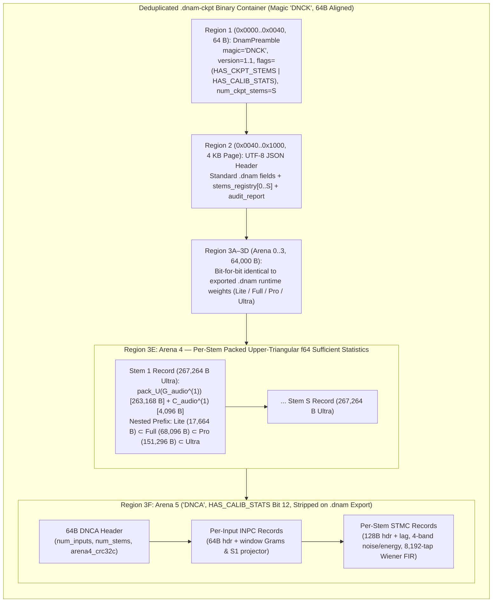

# `.dnam-ckpt` Checkpoint Schema, `uplo='U'` Packing, `Arena 5` (`DNCA`) & `.dnam-cache`

Complementing the real-time `.dnam` deployment container ([`dnam_binary_format.md`](dnam_binary_format.md)), **`.dnam-ckpt` (Magic `b"DNCK"`, Version `1.1`)** is DNAM's deduplicated, `pickle`-free single-file iterative training checkpoint (`1.1` when `Arena 5` calibration stats are present, `1.0` otherwise):
- Its leading tensor arenas (`Arena 0..3`, `64,000 B`) are **bit-for-bit identical** to the exported `.dnam` model.
- `Arena 4` contains the tier-ordered **Column-Major Upper-Triangular (`uplo='U'`) `float64` audio sufficient statistics** $\lbrace \mathrm{pack}_{\text{U}}\big(\mathbf{G}_{\text{audio}}^{(s)}\big), \mathbf{C}_{\text{audio}}^{(s)} \rbrace$ (**$17.25\text{ KB/stem}$ `Lite` / $66.50\text{ KB/stem}$ `Full` / $147.75\text{ KB/stem}$ `Pro` / $261.00\text{ KB/stem}$ `Ultra`**—nearly $2\times$ smaller than full matrix storage and 100% 64-byte aligned).
- Optional `Arena 5` (`HAS_CALIB_STATS` bit `12`, magic `b"DNCA"`) contains portable per-input (`INPC`) and per-stem (`STMC`) calibration statistics (`~3.6 MB` at 30 stems $\times$ 30 s, stripped on `.dnam` export).



---

## 1. Zero Weight Duplication & Zero `pickle` Vulnerability

To satisfy [`../overview/system_goals_and_requirements.md` §6 (`REQ-5.1`)](../overview/system_goals_and_requirements.md#6-goal-5--single-run-slimmable-multi-tier-architecture-lite--full--pro--ultra) and [`§9 (`REQ-8.8`)](../overview/system_goals_and_requirements.md#9-goal-8--model-provenance-hardware-drm-forensic-watermarking--marketplace-security), unlike legacy checkpoints that store both an exported model dictionary and a redundant PyTorch `state_dict` via `torch.save` (`pickle`), `.dnam-ckpt` (`magic = b"DNCK"`):
1. **Stores Model Weights Exactly Once (`Arena 0..3`):** The first `arena_offset_ultra_end` (`64,000`) bytes of the `.dnam-ckpt` tensor arena ARE the exact `Arena 0..3` runtime tensors of the `.dnam` model. Exporting a `.dnam` after a Tier-1 Kronecker stem addition ([`../training/iterative_resume_and_caching.md`](../training/iterative_resume_and_caching.md)) updates the SVD head tensors in `Arena 0..3` and writes the prefix directly.
2. **Eliminates Python `pickle`:** `.dnam-ckpt` is a pure Hybrid Binary Container (`DNCK` preamble + JSON metadata + `f32`/`f64` IEEE-754 arrays) that is 100% safe against arbitrary code execution and directly readable from Rust, Python, and TypeScript/WASM.

---

## 2. Tier-Ordered Column-Major Upper-Triangular Packing (`uplo='U'`) for $\mathbf{G}_{\text{audio}}^{(s)}$

To fulfill [`../overview/system_goals_and_requirements.md` §6 (`REQ-5.3`)](../overview/system_goals_and_requirements.md#6-goal-5--single-run-slimmable-multi-tier-architecture-lite--full--pro--ultra), for each recorded training stem $s \in \lbrace 1, \dots, S \rbrace$, let $\mathbf{\Phi}_s \in \mathbb{R}^{L_s \times N}$ ($N = 16C \in \lbrace 64, 128, 192, 256 \rbrace$) be the 16-tap unfolded Core 1 feature matrix, ordered by **Slimmable Tier**:
- Indices `0..63`: `Lite` channels (`ch 0..3` $\times$ 16 taps)
- Indices `64..127`: `Full` delta channels (`ch 4..7` $\times$ 16 taps)
- Indices `128..191`: `Pro` delta channels (`ch 8..11` $\times$ 16 taps)
- Indices `192..255`: `Ultra` delta channels (`ch 12..15` $\times$ 16 taps)

Because the per-stem audio Gram matrix $\mathbf{G}_{\text{audio}}^{(s)} = \mathbf{\Phi}_s^\top \mathbf{\Phi}_s \in \mathbb{R}^{N \times N}$ is **symmetric positive semi-definite** ($\mathbf{G}_{i,j}^{(s)} = \mathbf{G}_{j,i}^{(s)}$), storing the full $N \times N$ matrix wastes $\frac{N(N-1)}{2}$ redundant `float64` entries (49.8% of the matrix). Instead, `Arena 4` packs the upper triangle ($0 \le i \le j < N$) in **Column-Major Order (`LAPACK uplo='U'`)**:

$$\mathrm{pack}_{\text{U}}\big(\mathbf{G}_{\text{audio}}^{(s)}\big)\left[i + \frac{j(j + 1)}{2}\right] = \mathbf{G}_{\text{audio}}^{(s)}[i, j], \qquad 0 \le i \le j < N$$

> [!IMPORTANT]
> **The Nested Principal Submatrix Prefix Theorem & Exact 64-Byte Cache Alignment:**
> Because column-major upper-triangular index mapping $\text{idx}(i, j) = i + \frac{j(j+1)}{2}$ depends only on $i \le j$, the packed upper triangle of any leading principal submatrix of dimension $N_{\text{tier}} \in \lbrace 64, 128, 192, 256 \rbrace$ occupies the **exact contiguous prefix** $\big[0 \dots \frac{N_{\text{tier}}(N_{\text{tier}} + 1)}{2} - 1\big]$ of the `Ultra` packed array! Furthermore, every tier's packed $\mathrm{pack}_{\text{U}}(\mathbf{G}_{\text{audio}}^{(s)})$ and tier-ordered $\mathbf{C}_{\text{audio}}^{(s)} \in \mathbb{R}^{N \times 2}$ are **exact integer multiples of 64 bytes** with zero padding overhead:

| Slimmable Tier | Feature Dim `N = 16C` | Unpacked `G_audio^(s)` (`f64`) | Packed `pack_U(G_audio^(s))` (`f64`) | Cross-Corr `C_audio^(s)` (`f64`) | Total Per-Stem `Arena 4` Record | 64-Byte Cache Lines |
| :--- | :---: | :---: | :---: | :---: | :---: | :---: |
| **`Lite` (`C=4`)** | `N = 64` | `32,768 B` | `2,080 f64` = **`16,640 B`** | `128 f64` = **`1,024 B`** | **`17,664 B` (`17.25 KB/stem`)** | Exact `276 × 64 B` |
| **`Full` (`C=8`)** | `N = 128` | `131,072 B` | `8,256 f64` = **`66,048 B`** | `256 f64` = **`2,048 B`** | **`68,096 B` (`66.50 KB/stem`)** | Exact `1,064 × 64 B` |
| **`Pro` (`C=12`)** | `N = 192` | `294,912 B` | `18,528 f64` = **`148,224 B`** | `384 f64` = **`3,072 B`** | **`151,296 B` (`147.75 KB/stem`)** | Exact `2,364 × 64 B` |
| **`Ultra` (`C=16`)** | `N = 256` | `524,288 B` | `32,896 f64` = **`263,168 B`** | `512 f64` = **`4,096 B`** | **`267,264 B` (`261.00 KB/stem`)** | Exact `4,176 × 64 B` |

---

## 3. `.dnam-ckpt` JSON Header Extensions (`stems_registry` with Per-Stem PCM Provenance & `Arena 4` `CRC32C`)

In addition to all standard `.dnam` JSON fields (`metadata`, `user_metadata`, `controls_schema`, `presets`, `tensor_directory`), a `.dnam-ckpt` JSON header sets `"container_kind": "dnam-ckpt"` and appends `stems_registry` and `audit_report`, recording each stem's **platform-agnostic IEEE-754 PCM SHA-256 digests** (`input_pcm_sha256`, `target_pcm_sha256`), per-stem `stem_arena3_crc32c` (`u32`, Castagnoli `CRC32C` over that stem's $267,264\text{ B}$ `Arena 4` record so individual stem replacements only recompute 1 stem's checksum), optional `user_metadata`, and 64-byte aligned slice inside `Arena 4`:

```json
{
  "container_kind": "dnam-ckpt",
  "stems_registry": [
    {
      "stem_id": "stem_00_noon",
      "controls_meta": { "gain": 5.0, "feedback": 5.0, "boost": "off" },
      "provenance": {
        "input_pcm_sha256": "4b227777d4dd1fc61c6f884f48641d02b4d121d3fd328cb08b5531fcacdabf8a",
        "target_pcm_sha256": "ef2d127de37b942baad06145e54b0c619a1f22327b2ebbcfbec78f5564afe39d",
        "num_frames": 1440000
      },
      "stem_arena3_crc32c": 3194827105,
      "user_metadata": {},
      "extracted_physics": {
        "delays_ms": [12.4, 19.8, 31.2, 47.5, 73.1, 112.0, 168.4, 245.0],
        "lfo_freqs_hz": [0.85, 3.40],
        "decay_gains_lin": [0.82, 0.81, 0.79, 0.78, 0.76, 0.75, 0.73, 0.70],
        "detected_grain_size_ms": 0.0,
        "detected_pitch_shift_semitones": 0.0
      },
      "g_audio_uplo_u_f64": {
        "arena": 4,
        "dtype": "f64",
        "packing": "uplo_upper_col_major_tier_ordered",
        "feature_dim": 256,
        "packed_len": 32896,
        "byte_offset": 64000,
        "byte_length": 263168
      },
      "c_audio_tier_f64": {
        "arena": 4,
        "dtype": "f64",
        "shape": [4, 64, 2],
        "byte_offset": 327168,
        "byte_length": 4096
      }
    }
  ],
  "audit_report": {
    "phase1_clamps": ["CLAMP-RANGE", "CLAMP-SWITCH", "CLAMP-STABILITY"],
    "phase2_rail_warnings": [],
    "phase3_clamps": ["CLAMP-DYNAMIC"],
    "prescriptions": [
      "Add stems at gain=0.0 and gain=10.0 to lift [CLAMP-RANGE] on 'gain'",
      "Add >= 1 stem with boost='ultra' to lift [CLAMP-SWITCH] on 'boost'",
      "Add corner stem (feedback=10.0, boost='on') to lift [CLAMP-STABILITY] on 'feedback'"
    ]
  }
}
```

---

## 4. `Arena 5` (`DNCA`, `HAS_CALIB_STATS` Bit 12) & Workspace `.dnam-cache` Sidecar

When `HAS_CALIB_STATS` (Bit `12` = `0x1000`) is set in a `.dnam-ckpt` preamble (`version_major = 1, version_minor = 1`), `Arena 5` immediately follows `Arena 4` at 64-byte alignment and stores compact, portable calibration statistics (`magic = b"DNCA"`):

1. **`DNCA` Arena Header (`64 B`, `align(64)`):**
   - `magic = b"DNCA"`, `schema_version = 1`, `num_inputs` (`u16`), `num_stems` (`u16`), `total_byte_len` (`u64`, `% 64 == 0`), and `arena4_crc32c` (`u32`, Castagnoli `CRC32C` over the entire `DNCA` calibration payload with the checksum field zeroed).
2. **Per-Input Calibration Record (`INPC`, `64 B` Header + 64B-Padded Payload):**
   - Keyed by `input_pcm_sha256` (`32 B`), `sample_rate_hz` (`u32`), `num_samples` (`u32`), `num_seg_windows` (`u16`), `seg_feat_dim` (`u16`), `s1_in_dim` (`u16`), and `s1_out_dim` (`u16`).
   - Stores per-window segmentation Gram matrices (`uplo='U'` `float32`) and Stage-1 orthonormal projector weights (`float32`), enabling instant DP regime segmentation (`segment_regimes_dp`) and Stage-1 basis projection on resume without re-evaluating full-length nonlinear sweeps.
3. **Per-Stem Calibration Record (`STMC`, `128 B` Header + 64B-Padded Payload):**
   - Keyed by `input_pcm_sha256` (`32 B`) and `target_pcm_sha256` (`32 B`), storing `measured_lag_samples` (`f32`), `silent_stem_flag` (`u8`), per-band silent-frame noise floors (`noise_floor_dbfs_broadband`, `noise_floor_dbfs_lf`, `noise_floor_dbfs_mf`, `noise_floor_dbfs_hf` in `f32`), per-band active body energies (`band_energy_broadband/lf/mf/hf` in `f32`), per-window segmentation cross-correlations (`float32`), and the `8,192`-tap causal Wiener LTI impulse response (`float32`).
   - Automatically stripped when exporting a runtime `.dnam` container (`version_major = 1, version_minor = 0`, `HAS_CALIB_STATS = 0`).
4. **Workspace Sidecar (`models/<id>/.dnam-cache/*.dnce`):**
   - Paired with a local, gitignored, 64-byte aligned memory-mappable sidecar cache (managed via `dnam cache status` and `dnam cache clear`) that uses a measured read-vs-regenerate bandwidth cost model, supports stage-level crash resume, enforces a `16 GB` default workspace quota (`~3 GB` floor), and cleans up intermediate stage entries automatically upon training completion (see [`../training/iterative_resume_and_caching.md` §2](../training/iterative_resume_and_caching.md#2-two-tier-calibration-persistence-arena-5-dnca--workspace-dnam-cache)).
