# `.dnam-ckpt` Checkpoint Schema, `uplo='U'` Packing, `Arena 5` (`DNCA`) & `.dnam-cache`

The `.dnam-ckpt` container (`magic = b"DNCK"`, Version `2.0`) stores runtime weights, per-stem `uplo='U'` `Arena 4` sufficient statistics, and `DNCA` `Arena 5` calibration records in **64-byte-aligned tier bundles** (`Lite ⊂ Full ⊂ Pro ⊂ Ultra`), enabling signature-preserving whole-checkpoint tier stripping and zero-copy `.dnam` runtime export.

```mermaid
flowchart LR
    P["Preamble (64 B) & Directory (128 B)<br/>+ JCS Checkpoint Header"] --> S["Shared Checkpoint Binary:<br/>Open .dnam Export Template + Shared DNCA"]
    S --> A["DCA1 Writer Authentication Envelope"]
    A --> B0["Lite Bundle:<br/>Arena 0 Runtime + Arena 4.0 Stats + Lite DNCA"]
    B0 --> B1["Full Bundle:<br/>Arena 1 Delta + Arena 4.1 Stats + Full DNCA"]
    B1 --> B2["Pro Bundle:<br/>Arena 2 Delta + Arena 4.2 Stats + Pro DNCA"]
    B2 --> B3["Ultra Bundle:<br/>Arena 3 Delta + Arena 4.3 Stats + Ultra DNCA"]
    B3 --> M["Growable DMU1 + DMUE Mutable Suffix"]
```



### Open Checkpoint Framing and Signature

1. **Preamble, Directory & `DCA1` Envelope ([`test_checkpoint_wire_spec_references.py`](../../tests/test_checkpoint_wire_spec_references.py), [`test_checkpoint_bundle_spec_references.py`](../../tests/test_checkpoint_bundle_spec_references.py)):** Uses the `64 B` preamble (`magic = "DNCK"`, `version = 2.0`) and `128 B` directory layout of [`dnam_binary_format.md` §1.2](dnam_binary_format.md#12-open-dnam-structural-layout), where `tier_start` and `original_tier_ends[0..3]` delimit complete `64 B`-aligned **checkpoint tier bundles**.
2. **Prefix Commitments & Writer Signature (`DCA1`, [`signed_prefix_spec_references.rs`](../../packages/engine/tests/signed_prefix_spec_references.rs)):** Using the domain-separated field framing `F` and ordered prefix-list encoding `L` ([`../security/provenance_and_enclave_drm.md` §2.3](../security/provenance_and_enclave_drm.md#23-two-certificate-ed25519-delegation-chain--4-tier-cumulative-arena-digests)), compute each tier's SHA-256 prefix commitment and sign the manifest with pure `Ed25519`:

```text
Prefix Commitment Transcript ("DNCK-CHECKPOINT-PREFIX-V1"):
  F("domain", ASCII("DNCK-CHECKPOINT-PREFIX-V1"))
  || F("checkpoint_header_sha256", checkpoint_header_sha256[32])
  || F("preamble", exact_checkpoint_preamble[64])
  || F("directory", exact_checkpoint_directory[128])
  || F("shared_checkpoint_binary", exact_shared_binary)
  || F("bundle_lite", exact_lite_bundle)
  || F("bundle_full", exact_full_bundle)    # only if tier >= Full
  || F("bundle_pro", exact_pro_bundle)      # only if tier >= Pro
  || F("bundle_ultra", exact_ultra_bundle)  # only if tier == Ultra

DCA1 Authentication Envelope (106 + 33 * count bytes):
  ASCII("DCA1") || 00 00 00 00
  || checkpoint_writer_pubkey_ed25519[32]
  || u8(original_maximum_tier)
  || checkpoint_prefix_list
  || checkpoint_writer_signature[64]

Writer Signing Message ("DNCK-CHECKPOINT-MANIFEST-V1"):
  F("domain", ASCII("DNCK-CHECKPOINT-MANIFEST-V1"))
  || F("checkpoint_writer_pubkey_ed25519", checkpoint_writer_pubkey[32])
  || F("checkpoint_header_sha256", checkpoint_header_sha256[32])
  || F("issued_max_tier", u8(original_maximum_tier))
  || F("checkpoint_prefix_sha256", checkpoint_prefix_list)
```
3. **Zero-Copy `.dnam` Runtime Export Template:** The shared checkpoint binary begins with the exact `.dnam` prefix bytes `0..runtime_tier_start` (runtime preamble, directory, immutable header, shared descriptors, and `DAU1` envelope), and each checkpoint bundle begins with that tier's exact `.dnam` runtime payload slice. Exporting tier `T` concatenates the runtime template, the runtime slice at the start of bundles `0..T`, and the `DMU1`/`DMUE` suffix, then verifies the exported `.dnam` signature chain.

---

## 1. Zero Weight Duplication & Zero `pickle` Vulnerability

To satisfy [`../overview/system_goals_and_requirements.md` §6 (`REQ-5.1`)](../overview/system_goals_and_requirements.md#6-goal-5--single-run-slimmable-multi-tier-architecture-lite--full--pro--ultra) and [`§9 (`REQ-8.8`)](../overview/system_goals_and_requirements.md#9-goal-8--model-provenance-hardware-drm-forensic-watermarking--marketplace-security):
1. **Single Copy of Runtime Weights (`Arena 0..3`):** Each tier bundle stores its runtime weight slice once at the bundle start, matching the exported `.dnam` arena bytes bit-for-bit.
2. **Zero `pickle` Execution:** `.dnam-ckpt` contains only declarative JSON metadata and IEEE-754 `f32`/`f64` binary arrays validated before use.

---

## 2. Tier-Ordered Column-Major Upper-Triangular Packing (`uplo='U'`) for $\mathbf{G}_{\text{audio}}^{(s)}$

For stem $s$ and effective tier $T$ with feature bus width $N_T \in \lbrace 64, 128, 192, 256 \rbrace$, `Arena 4` packs the symmetric `f64` Gram matrix $\mathbf{G}_{s,T}$ in **Column-Major Upper-Triangular Order (`LAPACK uplo='U'`)** (`0 <= i <= j < N_T`):
$$\mathrm{pack}_{\text{U}}\big(\mathbf{G}_{\text{audio}}^{(s)}\big)\left[i + \frac{j(j + 1)}{2}\right] = \mathbf{G}_{\text{audio}}^{(s)}[i, j], \qquad 0 \le i \le j < N_T$$

```text
+-----------------------------------------------------------------------------------+
| ARENA 4 TIER-MAJOR SUB-ARENAS & SLICE MODES (StandaloneFull vs. PrefixDelta)      |
+-----------------------------------------------------------------------------------+
|  Arena 4.0 ( inside Lite Bundle ):  [stem 0] [stem 1] ... [stem S-1]              |
|  Arena 4.1 ( inside Full Bundle ):  [stem 0] [stem 1] ... [stem S-1]              |
|  Arena 4.2 ( inside Pro Bundle  ):  [stem 0] [stem 1] ... [stem S-1]              |
|  Arena 4.3 ( inside Ultra Bundle):  [stem 0] [stem 1] ... [stem S-1]              |
+-----------------------------------------------------------------------------------+
|  G fragment bytes = 8 * (N_t*(N_t + 1)/2 - N_prev*(N_prev + 1)/2)                 |
|  C fragment bytes = 16 * (N_t - N_prev)  (feature-major [N_t - N_prev, 2] f64)    |
+-----------------------------------------------------------------------------------+
```

1. **`StandaloneFull` Mode (`N_prev = 0`, `t_base = t`):** Stores the complete tier Gram and feature-major two-output cross-correlation (`Lite` always uses `StandaloneFull`, as does any tier whose leading feature prefix or statistics dependencies differ from tier `t - 1`).
2. **`PrefixDelta` Mode (`N_prev = N_{t-1}`, `t_base = t_base(t - 1)`):** When tier `t` shares an identical leading feature prefix and dependencies with tier `t - 1`, stores only the newly added upper-triangular Gram columns and cross-correlation rows:

| Slimmable Tier | Feature Dim `N_T` | `StandaloneFull` `pack_U(G)` | `StandaloneFull` `C` | `StandaloneFull` Total | `PrefixDelta` Slice Total |
| :--- | :---: | :---: | :---: | :---: | :---: |
| **`Lite` (`64-D`)** | `64` | `16,640 B` | `1,024 B` | **`17,664 B` (`276 CL`)** | N/A (`StandaloneFull` base) |
| **`Full` (`128-D`)** | `128` | `66,048 B` | `2,048 B` | **`68,096 B` (`1,064 CL`)** | **`50,432 B` (`788 CL`)** |
| **`Pro` (`192-D`)** | `192` | `148,224 B` | `3,072 B` | **`151,296 B` (`2,364 CL`)** | **`83,200 B` (`1,300 CL`)** |
| **`Ultra` (`256-D`)** | `256` | `263,168 B` | `4,096 B` | **`267,264 B` (`4,176 CL`)** | **`115,968 B` (`1,812 CL`)** |

### 2.1 Tier-Major Objective Records
Alongside the audio pair, each `(stem, tier)` slice indexes 64B-aligned constant-factor or time-varying objective records (`G`, `C`, and scalar target energy $e = \sum_n w_n y_n^2$ per band/output role, including WDW `PreSpatialCore`/`DirectDry` targets when configured), ordered with append-only tier-introduced columns so each record independently supports `StandaloneFull` or `PrefixDelta` chaining ([`../training/iterative_resume_and_caching.md` §1.1](../training/iterative_resume_and_caching.md#11-mathematical-proof-why-pre-summed-kronecker-matrices-fail-on-stem-additions)).

---

## 3. `.dnam-ckpt` JSON Header Extensions (`stems_registry` with Per-Stem PCM Provenance & `Arena 4` `CRC32C`)

Each stem entry in `stems_registry` records its input/target PCM hashes, control/switch event timelines, alignment/crossover/tracker provenance, and per-tier `tier_stats` metadata (`mode`, `t_base`, `trajectory_group`, separate trajectory, Gram, and cross-correlation dependency digests, fragment offsets/lengths, objective-record directory, and Castagnoli `CRC32C` over all local `G`/`C`/energy fragments).

### 3.1 Gram-Input Fingerprint

Every logical Gram stores a streaming SHA-256 fingerprint over the exact ordered feature rows, nonnegative sample weights, and aligned frame indices contracted into that Gram:

```text
"DNAM-GRAM-INPUT-v1" || 00
|| u32le(feature_dimension) || u8(feature_type: 1=f32, 2=f64) || u8(weight_type: 1=f32, 2=f64)
|| for each selected frame in strictly increasing aligned-frame order:
     01 || u64le(frame_index) || weight || feature[0] || ... || feature[N-1]
|| 00 || u64le(selected_frame_count)
```

On a target-only `C` refresh ([`../training/iterative_resume_and_caching.md` §1.4](../training/iterative_resume_and_caching.md#14-windowed-statistics-refresh)), the replayed feature/weight stream must reproduce the stored Gram-input fingerprint before committing updated `C` statistics.

---

## 4. Portable Calibration Data (`DNCA`) & Workspace `.dnam-cache` Sidecar

1. **Per-Input Calibration Records (`INPC`):** Keyed by input PCM and sample rate; store input segmentation and Stage II basis Grams.
2. **Per-Stem Calibration Records (`STMC`):** Keyed by paired input/target PCM; store sub-sample alignment, noise-floor evidence, band energies, and Stage III independent L/R FIR + shared-pole modal extractions.
3. **Workspace Sidecars (`models/<id>/.dnam-cache/*.dnce`):** Gitignored, 64-byte-aligned memory-mappable local cache files (`16 GB` default quota, zero persisted full-length feature trajectories).
