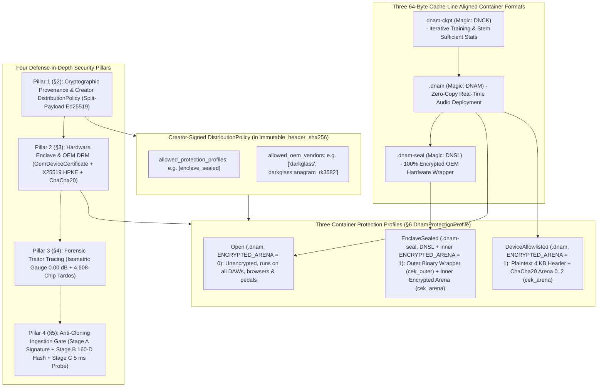
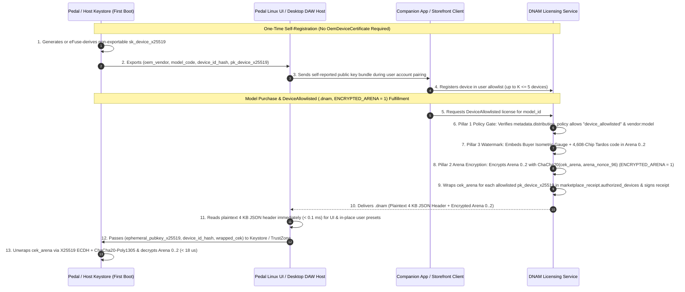
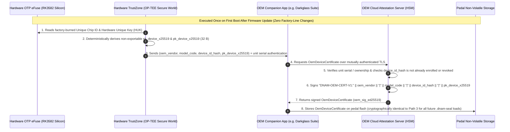
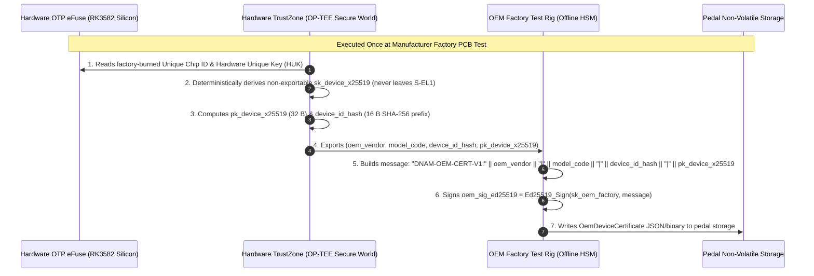
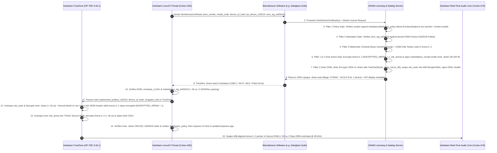
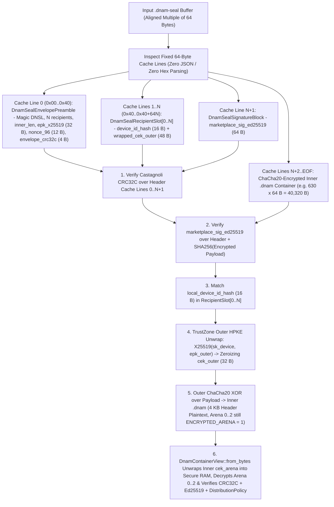
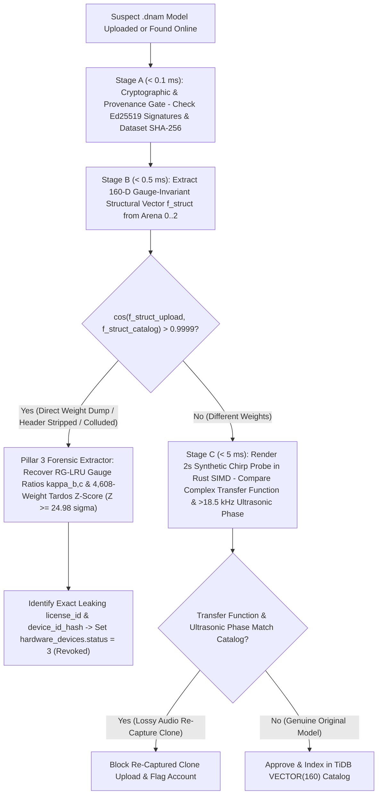
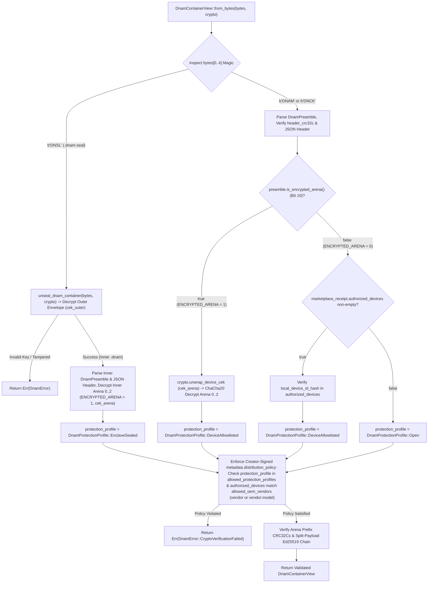
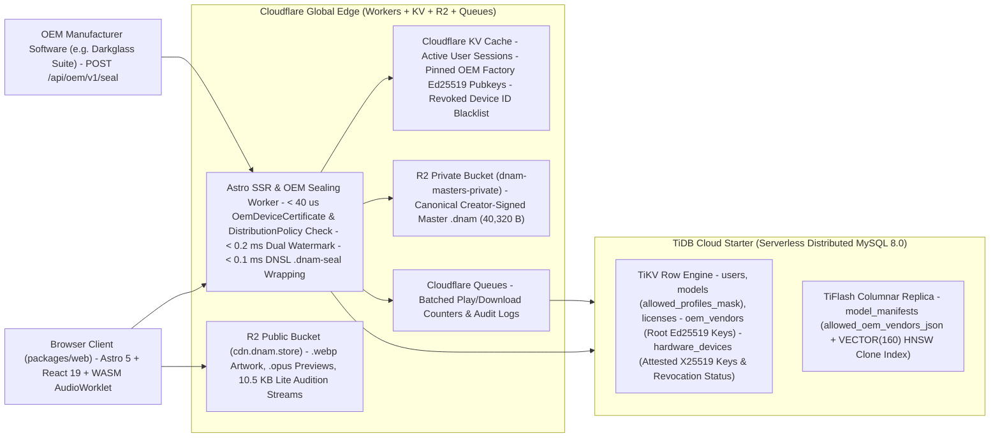
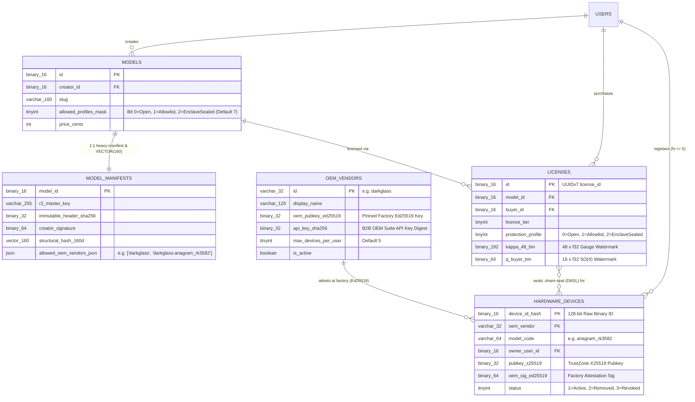

# Digital Marketplace, 4-Pillar Security Architecture, `.dnam-seal` (`DNSL`) Hardware DRM & Cloud Infrastructure

This specification defines the **4-pillar defense-in-depth security architecture, 3 container protection profiles, creator-signed `DistributionPolicy`, `.dnam-seal` (`b"DNSL"`) hardware TrustZone wrapper, commercial storefront, and Cloud/TiDB edge infrastructure** for **Dynamic Neural Audio Modeler (`.dnam`)**.

It is engineered so independent creators, studios, and OEM hardware manufacturers (e.g., **Darkglass Electronics** on the **Rockchip RK3582-based Anagram**) can distribute `.dnam` models across **desktop DAW plugins (`VST3`/`CLAP`), browser studios (`WebAssembly`), Python/Node.js SDKs, and hardware pedalboards**—with **zero internet dependency on stage** and **$0\text{ flops}$ of real-time $48\text{ kHz}$ DSP overhead**.

---

## 1. Taxonomy Overview: 4 Security Pillars, 3 Protection Profiles & 3 Container Formats

Instead of conflating cryptographic provenance, hardware enclave encryption, forensic watermarking, anti-cloning, and cloud database infrastructure into a single flat list, DNAM separates the ecosystem into **Four Defense-in-Depth Security Pillars**, **Three Container Protection Profiles (`DnamProtectionProfile`)**, and **Two Platform Subsystems (`§7` Storefront & `§8` Cloud Edge Infrastructure)**:



---

## 2. Pillar 1: Cryptographic Provenance (`Ed25519` Split-Payload Chain) & Creator-Signed `DistributionPolicy`

### 2.1 Preset-Safe `immutable_header_sha256` & Creator `DistributionPolicy`

To ensure that user preset creation and third-party storefront tagging never break cryptographic signatures on `.dnam` files (`Open` and `DeviceAllowlisted`), the JSON header at byte offset `0x40` is partitioned into **Immutable Authoritative Fields** and **Mutable User/Platform Fields**:

| JSON Header Path | Included in `immutable_header_sha256`? | Rationale |
| :--- | :---: | :--- |
| `version`, `container_kind`, `architecture`, `sample_rate_train_hz` | **Yes (Signed)** | Locks core model architecture and training sample rate |
| `metadata.{name, author, description, license, created_at, input_reference_dbfs, provenance}` | **Yes (Signed)** | Protects creator attribution, license terms, and PCM dataset provenance |
| **`metadata.distribution_policy`** (`allowed_protection_profiles`, `allowed_oem_vendors`) | **Yes (Signed)** | Cryptographically locks which protection profiles and OEM hardware vendors/models may license or run the model |
| `io_config`, `controls_schema` (including `safe_clamped_range`, `conditional_max`, `ui_hints`) | **Yes (Signed)** | Prevents tampering with control safety clamps or UI layout |
| `control_bus`, `core1_hybrid_ssm`, `core2_mufdn`, `tensor_directory` | **Yes (Signed)** | Locks DSP hyperparameters and binary arena offsets |
| `slimmable_tiers.*.{channels, fdn_lines, early_taps, head_svd_rank, loudness_lufs, output_trim_db, validation_esr_db, arena_end_byte_offset}` | **Yes (Signed)** | Locks per-tier calibration and byte boundaries (`prefix_crc32c` excluded as it updates on watermarking) |
| **`presets`** | **No (Mutable)** | Allows buyers on desktop/DAW plugins to add/edit custom presets in-place (`0x40..0x1000`) |
| **`user_metadata`** (top-level & nested) | **No (Mutable)** | Allows licensed marketplaces (`dnam.store`) and hosts to attach custom tags in-place |
| **`metadata.signatures`** | **No (Envelope)** | Holds the signature certificates themselves |

The digest `immutable_header_sha256` is the SHA-256 hash of the RFC 8785 JSON Canonicalization Scheme (JCS) UTF-8 bytes of the signed subset above.

### 2.2 Creator-Controlled `DistributionPolicy` (`vendor` & `vendor:model_code` Granularity)

Creators can restrict their `.dnam` models to specific protection profiles (e.g., `"enclave_sealed"` only, prohibiting open desktop downloads) and/or specific OEM hardware vendors or hardware models inside `metadata.distribution_policy`:

```json
{
  "metadata": {
    "name": "Darkglass Exclusive B7K Ultra Rig",
    "author": "Darkglass Electronics",
    "distribution_policy": {
      "allowed_protection_profiles": ["enclave_sealed"],
      "allowed_oem_vendors": ["darkglass:anagram_rk3582"]
    }
  }
}
```

1. **Protection Profile Gate (`allowed_protection_profiles`):**
   - When omitted or empty, all protection profiles (`"open"`, `"device_allowlisted"`, `"enclave_sealed"`) are permitted.
   - When non-empty, both the sealing service (`seal_dnam_container`) and the runtime container loader (`DnamContainerView::from_bytes`) reject any container whose active `DnamProtectionProfile` is not listed in `allowed_protection_profiles`.
2. **Granular OEM Vendor & Model Matching (`allowed_oem_vendors`):**
   - When omitted or empty, any OEM vendor and hardware model is permitted.
   - Each entry in `allowed_oem_vendors` may be either:
     - **Vendor-Wide (`"<oem_vendor>"`, e.g., `"darkglass"`):** Permits any hardware model from that manufacturer (`oem_vendor == "darkglass"`).
     - **Model-Specific (`"<oem_vendor>:<model_code>"`, e.g., `"darkglass:anagram_rk3582"`):** Permits only that exact manufacturer and hardware model (`oem_vendor == "darkglass" && model_code == "anagram_rk3582"`).
   - Because `metadata.distribution_policy` is covered by `immutable_header_sha256` and signed by `creator_signature`, neither a buyer nor the marketplace can strip or widen a creator's hardware exclusivity policy without invalidating the creator's `Ed25519` signature.

### 2.3 Two-Certificate Delegation Chain (`creator_signature` $\to$ `marketplace_receipt`)

1. **Creator Master Signature (`creator_signature`):**
   - Let `master_arena_sha256 = SHA256(master_arena_bytes[0..arena_offset_ultra_end])`.
   - The creator signs the 64-byte concatenation `immutable_header_sha256 || master_arena_sha256` offline using `Ed25519`:
     $$\sigma_{\text{creator}} = \mathrm{Ed25519-Sign}\Big(\text{sk}_{\text{creator}}, \text{immutable-header-sha256} \Vert \text{master-arena-sha256}\Big)$$
2. **Marketplace Counter-Signature (`marketplace_receipt`):**
   - Upon licensing, the marketplace generates the buyer-watermarked arena (`buyer_arena_sha256 = SHA256(Plaintext_Buyer_Arena[0..arena_offset_ultra_end])`), optionally encrypts `Arena 0..2` (`ENCRYPTED_ARENA = 1`), updates the binary preamble's `arena_crc32c_{lite,full,ultra}` and `header_crc32c`, and signs the receipt payload:
     $$\sigma_{\text{market}} = \mathrm{Ed25519-Sign}\Big(\text{sk}_{\text{market}}, \text{immutable-header-sha256} \Vert \text{master-arena-sha256} \Vert \text{buyer-arena-sha256} \Vert \text{receipt-meta}\Big)$$

---

## 3. Pillar 2: Hardware Enclave & OEM DRM (`OemDeviceCertificate` Attestation & `.dnam-seal` `b"DNSL"` Wrapper)

### 3.1 Three OEM Hardware Integration & Key Provisioning Paths

Hardware manufacturers can integrate DNAM DRM at three progressive levels of factory/cloud effort depending on whether they want to skip factory hardware key attestation entirely (`DeviceAllowlisted`), upgrade already-shipped pedals in the field via a firmware update (`EnclaveSealed` via OTA Companion-App Enrollment), or provision certificates on the assembly line (`EnclaveSealed` via Factory HSM):

| OEM Integration Path | Protection Profile | Factory Assembly-Line Changes? | Protects Against Casual File Sharing? | Cryptographically Proves Genuine Hardware Silicon? |
| :--- | :--- | :--- | :--- | :--- |
| **Path 1: Self-Registered Device Key** | `DeviceAllowlisted` (`.dnam`, `ENCRYPTED_ARENA = 1`) | **None** (zero OEM attestation infrastructure) | **Yes** (`X25519` + `ChaCha20` bound to `K ≤ 5` devices) | **No** (client self-reports `pubkey_x25519`; protected by Pillar 3 buyer watermark) |
| **Path 2: Companion-App / OTA Cert Enrollment** | `EnclaveSealed` (`.dnam-seal`, `b"DNSL"`) | **None** (works on already-shipped pedals via firmware update) | **Yes** (double-encrypted `.dnam-seal` + TrustZone) | **Yes** (OEM cloud verifies unit serial/challenge & signs `OemDeviceCertificate`) |
| **Path 3: Factory-Line HSM Provisioning** | `EnclaveSealed` (`.dnam-seal`, `b"DNSL"`) | **Yes** (bed-of-nails / JTAG station signs cert at PCB test) | **Yes** (double-encrypted `.dnam-seal` + TrustZone) | **Yes** (highest assurance; zero post-factory enrollment needed) |

#### Path 1 — Self-Registered `DeviceAllowlisted` Profile (Skipping Factory Attestation)

When a hardware manufacturer (or desktop/mobile plugin host) wants per-device `ChaCha20` weight encryption **without** setting up factory or cloud `OemDeviceCertificate` attestation, they use **`DnamProtectionProfile::DeviceAllowlisted`** (`.dnam`, `ENCRYPTED_ARENA = 1`). The device derives or generates its `X25519` keypair locally on first boot and registers its public key directly with the Marketplace:



#### Path 2 — Post-Factory / Companion-App OTA Certificate Enrollment (`EnclaveSealed` Without Factory-Floor Changes)

If an OEM wants full **`EnclaveSealed` (`.dnam-seal`)** protection—or wants to enable `EnclaveSealed` on **existing pedals already shipped to customers** via a firmware update—without running an HSM signing station on the physical factory floor, the pedal can obtain its `OemDeviceCertificate` during a one-time companion-app enrollment:



#### Path 3 — Factory-Line Offline HSM Attestation (`EnclaveSealed` Highest Assurance)

For new hardware production runs, the OEM provisions each unit on the assembly line with an **`OemDeviceCertificate`** signed by the manufacturer's offline `Ed25519` root key:



In both **Path 2** and **Path 3**, the canonical attestation signing message (`|`-delimited with `"DNAM-OEM-CERT-V1:"` domain prefix) is identical:
$$\text{msg}_{\text{oem-cert}} = \text{prefix}_{\text{V1}} \Vert \text{oem-vendor} \Vert \text{model-code} \Vert \text{device-id-hash-ascii} \Vert \text{pk}_{\text{device-x25519-bytes}}$$

Before sealing any `.dnam-seal` container for a target hardware unit, `seal_dnam_container` verifies `oem_sig_ed25519` against the manufacturer's pinned `oem_pubkey_ed25519` and checks `DistributionPolicy::allows_oem_device(oem_vendor, model_code)`.

### 3.2 End-to-End `.dnam-seal` (`b"DNSL"`) Sealing & Hardware TrustZone Unsealing Flow



### 3.3 `.dnam-seal` (`b"DNSL"`) 64-Byte Cache-Line Binary Envelope Specification

For `DnamProtectionProfile::EnclaveSealed`, DNAM wraps the entire inner `.dnam` container (which itself has `ENCRYPTED_ARENA = 1` on `Arena 0..2`) inside a **100% opaque, immutable 64-byte cache-line aligned binary envelope (`.dnam-seal`, Magic `b"DNSL"` / `0x4C534E44`)**.

This nested double-encryption design solves two hardware requirements simultaneously:
1. **Zero JSON or Hex Parsing in TrustZone Secure World (`< 1 µs` Slot Lookup):** All outer recipient slots (`DnamSealRecipientSlot[0..N]`) are fixed 64-byte `#[repr(C, align(64))]` structs (`16 B` raw binary `device_id_hash` + `48 B` raw `wrapped_cek`).
2. **Safe Normal-World UI vs. Secure-World DSP Split:** When the pedal unseals the outer `.dnam-seal` layer (`cek_outer`), the Normal World Linux UI thread (`EL0`/`EL1`) can read the inner `4 KB` JSON header (`controls_schema`, `presets`, `ui_hints`) to render touchscreen controls, while **`Arena 0..2` inside that inner `.dnam` remains 100% `ChaCha20`-encrypted (`ENCRYPTED_ARENA = 1`, `cek_arena`)** until unwrapped inside `TZASC` Secure RAM (`S-EL1`). Custom user presets on hardware pedals are stored natively in the pedal's own patch/rig database, keeping `.dnam-seal` files 100% immutable on disk.

```text
+=======================================================================+ 0x0000 (Cache Line 0: 64 Bytes)
| CL 0: DnamSealEnvelopePreamble (#[repr(C, align(64))], Little-Endian) |
|   0x00..0x04: magic = b"DNSL" (0x4C534E44)                            |
|   0x04..0x06: version_major = 1 (u16)                                 |
|   0x06..0x08: version_minor = 0 (u16)                                 |
|   0x08..0x0A: flags (u16: Bit 0 = CHACHA20_FULL_CONTAINER)            |
|   0x0A..0x0B: num_recipients = N (u8, 1..=16 registered pedals)       |
|   0x0B..0x0C: reserved_0 = 0 (u8)                                     |
|   0x0C..0x10: inner_dnam_byte_len (u32, % 64 == 0, e.g. 40,320 B)     |
|   0x10..0x30: ephemeral_pubkey_x25519 ([u8; 32], raw binary)          |
|   0x30..0x3C: chacha20_nonce_96 ([u8; 12], raw binary)                |
|   0x3C..0x40: envelope_crc32c (u32 over CL 0..=N+1 with 0x3C..0x40=0) |
+-----------------------------------------------------------------------+ 0x0040 (Cache Lines 1..=N: N * 64 Bytes)
| CL 1..=N: DnamSealRecipientSlot[0..N] (64 Bytes per Hardware Device)  |
|   0x00..0x10: device_id_hash ([u8; 16], raw 128-bit binary ID)        |
|   0x10..0x40: wrapped_cek ([u8; 48], X25519-HKDF-ChaCha20Poly1305)    |
+-----------------------------------------------------------------------+ 0x0040 + N*64 (Cache Line N+1: 64 Bytes)
| CL N+1: DnamSealSignatureBlock (64 Bytes)                             |
|   0x00..0x40: marketplace_sig_ed25519 ([u8; 64])                      |
|               Signed over: b"DNAM-SEAL-V1:" || CL_0_zero_crc          |
|                            || CL_1..=N || SHA256(encrypted_payload)   |
+=======================================================================+ (2 + N) * 64 (64-Byte Aligned Offset)
| Encrypted Inner .dnam Container (inner_dnam_byte_len, % 64 == 0)      |
|   • 100% ChaCha20-encrypted (cek_outer, chacha20_nonce_96, ctr=0):    |
|     - Inner 64B DnamPreamble (ENCRYPTED_ARENA = 1)                    |
|     - Inner 4,032B JSON Header (with signed marketplace_receipt)      |
|     - Inner Arena 0..2 (36,224B, also encrypted under cek_arena)      |
+=======================================================================+ EOF (Exact Multiple of 64 Bytes)
```



---

## 4. Pillar 3: Forensic Traitor Tracing (`< 0.2 ms` Dual-Mechanism Buyer Watermarking)

Even if an adversary physically decapitates a chip or dumps process memory on a desktop machine, every licensed container carries two orthogonal, un-removable watermarks embedded directly in `Arena 0` (`Lite`), `Arena 1` (`Full Delta`), and `Arena 2` (`Ultra Delta`):

### 4.1 Mechanism A — Exact Isometric Gauge-Space Watermarking ($0.0000\text{ dB}$ Audio Difference)

1. **48-Channel RG-LRU Reciprocal Scaling Gauge ($\boldsymbol{\kappa} \in [0.985, 1.015]^{48}$):**
   In Core 1B ([`core1_hybrid_ssm_and_polyadaa.md` §2.3](core1_hybrid_ssm_and_polyadaa.md#23-log-octave-pole-initialization--mathcalh_2-norm-input-scaling-cl-04-cl-05)), scaling each resonator channel's input normalizer $b_{\gamma,b,c}$ by $\kappa_{b,c}$ and its output projection $(c_{\text{real},b,c}, c_{\text{imag},b,c})$ by $\kappa_{b,c}^{-1}$:
   $$b_{\gamma,b,c}^{(\text{buyer})} = \kappa_{b,c} b_{\gamma,b,c}^{(\text{master})}, \qquad \big(c_{\text{real},b,c}^{(\text{buyer})}, c_{\text{imag},b,c}^{(\text{buyer})}\big) = \frac{1}{\kappa_{b,c}} \big(c_{\text{real},b,c}^{(\text{master})}, c_{\text{imag},b,c}^{(\text{master})}\big)$$
   cancels out identically ($\kappa_{b,c} \cdot \kappa_{b,c}^{-1} \equiv 1.0$, **$4.00 \times 10^{-15}$ exactness in `Test 8H`**) while preserving all pole radii, angles, selectivity gates, and `CL-01`..`CL-18` stability invariants.
2. **SVD Control Subspace Orthogonal Rotation Gauge ($\mathbf{Q}_{\text{buyer}} \in SO(D_h)$):**
   In the Parametric Control Bus ([`training_and_iterative_resume.md` §1](training_and_iterative_resume.md#stage-2--step-0-svd-orthonormal-kronecker-float64-wiener-hopf-warm-start-cl-18)), rotating the SVD control projector $\mathbf{P}_{\text{svd}} \in \mathbb{R}^{D_{\text{basis}} \times D_h}$ and the 16-tap SVD stereo head basis $\mathbf{W}_{\text{head},1..D_h}$ by $\mathbf{Q}_{\text{buyer}} \in SO(D_h)$:
   $$\mathbf{P}_{\text{svd}}^{(\text{buyer})} = \mathbf{P}_{\text{svd}}^{(\text{master})} \mathbf{Q}_{\text{buyer}}, \qquad \mathbf{W}_{\text{head},1..D_h}^{(\text{buyer})} = \mathbf{Q}_{\text{buyer}}^\top \mathbf{W}_{\text{head},1..D_h}^{(\text{master})}$$
   modifies every floating-point weight in the SVD head and control projector while canceling out identically ($\mathbf{Q}_{\text{buyer}} \mathbf{Q}_{\text{buyer}}^\top \equiv \mathbf{I}_{D_h}$) at $3\text{ kHz}$.

### 4.2 Mechanism B — Non-Invertible Coupled Spread-Spectrum Tardos Watermarking ($+36.6\text{ dB}$ Matched-Filter Gain)

To defeat gauge canonicalization or multi-buyer collusion averaging, the marketplace embeds a **Tardos Collusion-Resistant Spread-Spectrum Code** $\mathbf{c}^{(\text{buyer})} \in \lbrace -1, +1 \rbrace^{4608}$ (seeded via `HMAC-SHA256(marketplace_secret, model_id || license_id)`) across all $N_{\text{conv}} = 4,608$ nonlinear dilated convolution weights (`768` in `Arena 0 Lite`, `1,536` in `Arena 1 Full`, `2,304` in `Arena 2 Ultra`):

$$W_{\text{conv},i}^{(\text{buyer})} = W_{\text{conv},i}^{(\text{master})} + \epsilon \sigma_{W,i} c_i^{(\text{buyer})}$$

| Attack Vector Attempted by Pirate | Why the Dual-Mechanism Watermark Survives | Verified Margin (`Test 8H`) |
| :--- | :--- | :---: |
| **Strip JSON header / forge new `.dnam` wrapper** | Watermark lives entirely inside the binary `f32` weights of `Arena 0..2` | **100% intact** |
| **Truncate `Ultra` / `Full` down to `Lite`-only (`10.5 KB`)** | `Arena 0 (Lite)` alone carries `16` gauge ratios `κ_{0..3,0..3}` + `768` Tardos conv weights (`+28.85 dB` gain) | **`Z > 10σ`** |
| **Canonicalize RG-LRU `(b_γ, c)` gauge** | Cannot invert the `4,608` nonlinear `PolyADAA`-coupled convolution weights without `W_conv^(master)` | **`Z ≥ 24.98σ`** |
| **Quantize weights `f32 -> fp16 -> f32` + 4-buyer collusion average** | Spread-spectrum matched filter over `N = 4,608` weights provides `+36.63 dB` processing gain | **`24.98σ` vs. `2.53σ` innocent max** |

---

## 5. Pillar 4: 3-Stage Anti-Cloning Ingestion Gate (`< 50 ms` Clone & Re-Capture Prevention)

Whenever a user uploads a `.dnam` model to the marketplace, a **$< 50\text{ ms}$ 3-Stage Ingestion Pipeline** screens the upload against the commercial catalog and triggers automated hardware revocation if a leaked dump is detected:



1. **Stage A — Cryptographic & Provenance Gate (`< 0.1 ms`):** Verifies `creator_signature`, `marketplace_receipt`, and `metadata.provenance.dataset_manifest_sha256`.
2. **Stage B — 160-D Gauge-Invariant Structural Hash & Traitor Extraction (`< 0.5 ms`):** Extracts $\mathbf{f}_{\text{struct}} \in \mathbb{R}^{160}$ (`48` sorted RG-LRU pole bounds/angles, `96` gauge-invariant products $I_{\text{real},b,c} = b_{\gamma,b,c} c_{\text{real},b,c}$ and $I_{\text{imag},b,c} = b_{\gamma,b,c} c_{\text{imag},b,c}$, `8` sorted `M-UFDN` base delays, and `8` head singular values). If $\cos(\mathbf{f}_{\text{struct}}^{(\text{upload})}, \mathbf{f}_{\text{struct}}^{(\text{catalog})}) > 0.9999$, Stage B extracts the leaking `license_id` via Pillar 3 and sets `hardware_devices.status = 3 (Revoked)`.
3. **Stage C — $5\text{ ms}$ Synthetic Probe Transfer-Function & Ultrasonic Phase Check:** Renders a $2\text{-second}$ synthetic chirp/burst probe in Rust SIMD (`< 5 ms`) and compares the complex transfer function and $> 18.5\text{ kHz}$ ultrasonic phase constellation against the catalog—blocking even lossy analog/digital re-captures re-trained from audio output.

---

## 6. Three Container Protection Profiles (`DnamProtectionProfile`) & Loader Auto-Detection

Every validated container resolves to one of three canonical **`DnamProtectionProfile`** tiers, each with a strict cryptographic posture:

| Protection Profile (`DnamProtectionProfile`) | Wire Format & Magic | Outer `.dnam-seal` (`b"DNSL"`) | Inner `.dnam` `ENCRYPTED_ARENA` | Header (`0x0000..0x1000`) | Weights (`Arena 0..2`) | Primary Target & Security Posture |
| :--- | :--- | :---: | :---: | :--- | :--- | :--- |
| **`Open` (`"open"`)** | `.dnam` (`b"DNAM"`) | No | `0` | Plaintext | Plaintext (`mmap` zero-copy) | Community models & open commercial packs; protected by Pillar 1 `Ed25519` + Pillar 3 watermark. |
| **`DeviceAllowlisted` (`"device_allowlisted"`)** | `.dnam` (`b"DNAM"`) | No | **`1`** | **Plaintext** (DAW/OS browsers index metadata & save presets in-place in `< 0.1 ms`) | **`ChaCha20`-Encrypted** (`cek_arena` in JSON `authorized_devices`) | Desktop/mobile DAW plugins & multi-platform licenses; bound to OS Keychain / Apple SEP / TPM 2.0 `X25519` keys. |
| **`EnclaveSealed` (`"enclave_sealed"`)** | `.dnam-seal` (`b"DNSL"`) | **Yes (`b"DNSL"`)** | **`1`** | **Encrypted** under outer `cek_outer` | **Double-Encrypted** (outer `cek_outer` + inner `cek_arena` for Secure RAM only) | Exclusive OEM hardware pedals (`OP-TEE` TrustZone + `OemDeviceCertificate`); `0` JSON parsing in Secure World. |



---

## 7. Commercial Storefront Platform: Auditioning, Royalty Splits & Storefront Metadata

### 7.1 Zero-Leak Browser Auditioning (`packages/web` + `@dnam-project/engine`)
- Prospective buyers can audition commercial `.dnam` models directly in the browser using either **built-in multi-genre DI stems** or **their own live guitar/bass/synth via WebAudio (`AudioWorklet` WASM SIMD128)**.
- To prevent un-purchased extraction of commercial `Ultra` masters (especially when a creator restricts a model to `allowed_protection_profiles: ["enclave_sealed"]`), the marketplace serves either:
  1. **Ephemeral Session-Watermarked `Lite` (`10.5 KB`) Preview Streams** (with a periodic gentle audition marker every 45 seconds), or
  2. **Server-Rendered Custom DI Previews** where the user uploads a short dry clip and hears the rendered `Ultra` output in $< 200\text{ ms}$ without the model weights ever leaving the server.

### 7.2 Standardized `license_tier` Values & Automated Split Royalties (`royalty_splits`)
Inside `metadata.signatures.marketplace_receipt` (see [`dnam_container_schema.md` §7.1](dnam_container_schema.md#71-preset-safe-split-payload-ed25519-certificate-chain--80-s-offline-verification)):
- **`license_tier`:** `"free"`, `"personal"`, `"commercial_studio"`, or `"oem_bundle"`.
- **`royalty_splits`:** Array of `{ "recipient_id": str, "role": str, "share_bps": int }` entries (summing to `10000` basis points = 100%) enabling automatic marketplace revenue splits across collaborative packs.

### 7.3 Clean Storefront Taxonomy Isolation via `user_metadata`
Digital marketplaces store rich storefront discovery attributes inside a namespaced key in `user_metadata` (editable in $< 0.1\text{ ms}$ in-place on `.dnam` containers without invalidating `creator_signature` or `marketplace_receipt`):

```json
{
  "user_metadata": {
    "dnam.store": {
      "product_slug": "vintage-tape-echo-tube-preamp",
      "category": "delay_and_preamp",
      "gear_modeled": {
        "preamp": "1964 Push-Pull 12AX7/6V6 Tube Preamp",
        "echo": "Multi-Head Magnetic Tape Echo",
        "cabinet": "2x12 Alnico Blue Open-Back",
        "mics": ["Royer R-121", "Shure SM57"]
      },
      "tags": ["tape-echo", "tube-drive", "true-stereo", "self-oscillating"],
      "artwork_url": "https://cdn.dnam.store/packs/vintage-tape-echo/cover.webp",
      "demo_audio_urls": [
        "https://cdn.dnam.store/packs/vintage-tape-echo/demo_slapback.opus",
        "https://cdn.dnam.store/packs/vintage-tape-echo/demo_dub_swell.opus"
      ]
    }
  }
}
```

---

## 8. Cloud Edge Infrastructure, `TiDB Cloud Starter` Schema & OEM Sealing Service

The commercial marketplace, B2B/B2C OEM sealing API (`POST /api/oem/v1/seal`), interactive documentation, and WASM studio in `packages/web` run on a unified **Cloudflare Workers + Cloudflare KV + Cloudflare R2 + Cloudflare Queues + TiDB Cloud Starter** edge architecture.

### 8.1 Edge Compute, OEM Sealing Worker, Two-Bucket R2 Storage & KV Cache



1. **Unified Frontend & Edge Backend (`packages/web`):**
   - **Framework:** **`Astro 5` + `@astrojs/cloudflare` + `@astrojs/starlight` + `@astrojs/react` (React 19)** with **`Tailwind CSS v4`**, **`shadcn/ui`** (`@base-ui/react`), **`lucide-react`**, and `<ClientRouter />` (`transition:persist="dnam-audio-engine"` + `nanostores`).
   - **Per-Route `COOP` / `COEP` Isolation:** Middleware (`src/middleware.ts`) applies `Cross-Origin-Opener-Policy: same-origin` and `Cross-Origin-Embedder-Policy: credentialless` on `/playground` and `/explore` so [`DnamWorkletNode`](monorepo_implementation_guide.md#42-packaged-nodejs--webaudio-engine-library-packagesjs--phase-2b) unlocks `SharedArrayBuffer` atomics and $60\text{ fps}$ `Seqlock` telemetry.
2. **Stateless Edge `.dnam-seal` (`b"DNSL"`) Generation (`POST /api/oem/v1/seal`, `0` R2 Storage Multiplication):**
   - Rather than pre-storing encrypted copies per device, `dnam-masters-private` stores only **1 canonical creator-signed Master `.dnam` (`40,320 B`) per model**.
   - When Darkglass Suite or a user requests an `EnclaveSealed` download (`POST /api/oem/v1/seal`), the Cloudflare Worker:
     1. Verifies the model's `allowed_profiles_mask` and `allowed_oem_vendors_json` (`DistributionPolicy`).
     2. Verifies each device's `OemDeviceCertificate` (`oem_sig_ed25519`) against the OEM's pinned `oem_pubkey_ed25519` in **Cloudflare KV** and ensures `hardware_devices.status == 1 (Active)` (not `3 = Revoked`).
     3. Applies the deterministic buyer watermark (`kappa_48_bin`, `q_buyer_bin`, Tardos code), encrypts inner `Arena 0..2` (`ENCRYPTED_ARENA = 1`, `cek_arena`), signs `marketplace_receipt`, and wraps the entire `.dnam` into `.dnam-seal` (`b"DNSL"`, `cek_outer`) in **$< 0.35\text{ ms}$ total CPU time**.

### 8.2 Horizontally Scalable `TiDB Cloud Starter` Entity-Relationship & Production SQL Schema



```sql
-- 1. USERS / CREATORS (Clustered on 16-byte UUID)
CREATE TABLE users (
  id              BINARY(16) NOT NULL,
  handle          VARCHAR(64) NOT NULL,
  display_name    VARCHAR(120) NOT NULL,
  avatar_url      VARCHAR(512),
  is_verified     BOOLEAN NOT NULL DEFAULT FALSE,
  creator_pubkey  BINARY(32),                           -- 32-byte Ed25519 public key
  model_count     INT UNSIGNED NOT NULL DEFAULT 0,
  follower_count  INT UNSIGNED NOT NULL DEFAULT 0,
  created_at      DATETIME(3) NOT NULL DEFAULT CURRENT_TIMESTAMP(3),
  PRIMARY KEY (id),
  UNIQUE KEY uq_users_handle (handle)
);

-- 2. SKINNY CATALOG TABLE (Scanned on /explore — < 300 B/row, O(log N) cursor pagination)
CREATE TABLE models (
  id                    BINARY(16) NOT NULL,
  creator_id            BINARY(16) NOT NULL,
  slug                  VARCHAR(160) NOT NULL,
  title                 VARCHAR(200) NOT NULL,
  subtitle              VARCHAR(200),

  -- Fast 1-byte integer facets for category pills, protection policy & sidebar filters
  format_kind           TINYINT UNSIGNED NOT NULL,          -- 1 = DNAM, 2 = NAM, 3 = IR
  category_kind         TINYINT UNSIGNED NOT NULL,          -- 1 = Amp+Cab, 2 = Head, 3 = Cab, 4 = Pedal, 5 = Outboard, 6 = Spaces
  capability_mask       SMALLINT UNSIGNED NOT NULL DEFAULT 0,
  allowed_profiles_mask TINYINT UNSIGNED NOT NULL DEFAULT 7,-- Bit 0 (1)=Open, Bit 1 (2)=DeviceAllowlisted, Bit 2 (4)=EnclaveSealed
  license_tier          TINYINT UNSIGNED NOT NULL DEFAULT 0,
  price_cents           INT UNSIGNED NOT NULL DEFAULT 0,
  tag_ids               JSON NOT NULL,                      -- Indexed via Multi-Valued B+Tree array index

  -- Public R2 CDN URLs (cdn.dnam.store)
  artwork_url           VARCHAR(512),
  preview_audio_url     VARCHAR(512),
  lite_wasm_url         VARCHAR(512),

  -- Pre-computed counters (flushed asynchronously via Cloudflare Queues)
  download_count        BIGINT UNSIGNED NOT NULL DEFAULT 0,
  capture_count         SMALLINT UNSIGNED NOT NULL DEFAULT 1,
  comment_count         INT UNSIGNED NOT NULL DEFAULT 0,
  rating_count          INT UNSIGNED NOT NULL DEFAULT 0,
  rating_sum            BIGINT UNSIGNED NOT NULL DEFAULT 0,
  trending_score        DOUBLE NOT NULL DEFAULT 0,

  search_text           TEXT NOT NULL,
  is_published          BOOLEAN NOT NULL DEFAULT TRUE,
  created_at            DATETIME(3) NOT NULL DEFAULT CURRENT_TIMESTAMP(3),

  PRIMARY KEY (id),
  UNIQUE KEY uq_models_slug (slug),
  KEY idx_models_trending (is_published, category_kind, format_kind, trending_score DESC, id DESC),
  KEY idx_models_downloads (is_published, category_kind, format_kind, download_count DESC, id DESC),
  KEY idx_models_newest (is_published, category_kind, format_kind, created_at DESC, id DESC),
  KEY idx_models_creator (creator_id, is_published, created_at DESC, id DESC),
  INDEX idx_models_tags ((CAST(tag_ids AS UNSIGNED ARRAY))),
  FULLTEXT KEY idx_models_ft (title, subtitle, search_text)
);

-- 3. HEAVY MANIFEST & TIFLASH 160-D VECTOR TABLE (1:1 — Fetched on /models/[slug] & Stage B Ingestion)
CREATE TABLE model_manifests (
  model_id                 BINARY(16) NOT NULL,
  r2_master_key            VARCHAR(255) NOT NULL,
  immutable_header_sha256  BINARY(32) NOT NULL,
  master_arena_sha256      BINARY(32) NOT NULL,
  dataset_manifest_sha256  BINARY(32) NOT NULL,
  creator_signature        BINARY(64) NOT NULL,
  structural_hash_160d     VECTOR(160) NOT NULL,         -- Stage B 160-D gauge-invariant vector
  controls_schema_json     JSON NOT NULL,
  gear_modeled_json        JSON NOT NULL,
  royalty_splits_json      JSON NOT NULL,
  allowed_oem_vendors_json JSON,                         -- NULL = all OEMs; e.g. ["darkglass", "darkglass:anagram_rk3582"]
  PRIMARY KEY (model_id),
  VECTOR INDEX idx_structural ((VEC_COSINE_DISTANCE(structural_hash_160d)))
);
ALTER TABLE model_manifests SET TIFLASH REPLICA 1;

-- 4. OEM HARDWARE VENDORS & FACTORY-ATTESTED HARDWARE DEVICES
CREATE TABLE oem_vendors (
  id                   VARCHAR(32) NOT NULL,             -- e.g. 'darkglass', 'neural_dsp', 'fender'
  display_name         VARCHAR(120) NOT NULL,
  oem_pubkey_ed25519   BINARY(32) NOT NULL,              -- Pinned 32-byte OEM Factory Attestation Public Key
  api_key_sha256       BINARY(32) NOT NULL,              -- B2B API key digest for OEM companion software
  max_devices_per_user TINYINT UNSIGNED NOT NULL DEFAULT 5,
  is_active            BOOLEAN NOT NULL DEFAULT TRUE,
  created_at           DATETIME(3) NOT NULL DEFAULT CURRENT_TIMESTAMP(3),
  PRIMARY KEY (id)
);

CREATE TABLE hardware_devices (
  device_id_hash       BINARY(16) NOT NULL,              -- Raw 16-byte SHA-256("dnam-device-v1:" || OTP)[:16]
  oem_vendor           VARCHAR(32) NOT NULL,             -- FK -> oem_vendors.id
  model_code           VARCHAR(64) NOT NULL,             -- e.g. 'anagram_rk3582'
  owner_user_id        BINARY(16) NOT NULL,              -- FK -> users.id
  device_label         VARCHAR(120) NOT NULL,            -- e.g. 'Main Touring Anagram'
  pubkey_x25519        BINARY(32) NOT NULL,              -- Non-exportable TrustZone X25519 Public Key
  oem_sig_ed25519      BINARY(64) NOT NULL,              -- Factory Ed25519 signature over OemDeviceCertificate
  status               TINYINT UNSIGNED NOT NULL DEFAULT 1, -- 1 = Active, 2 = User-Deactivated, 3 = Revoked (Traitor Traced)
  registered_at        DATETIME(3) NOT NULL DEFAULT CURRENT_TIMESTAMP(3),
  last_sealed_at       DATETIME(3),
  PRIMARY KEY (device_id_hash),
  KEY idx_devices_owner (owner_user_id, status),
  KEY idx_devices_vendor (oem_vendor, model_code)
);

-- 5. RATINGS, COMMENTS & BUYER LICENSES (Auto-sharded across TiKV regions)
CREATE TABLE model_ratings (
  model_id    BINARY(16) NOT NULL,
  user_id     BINARY(16) NOT NULL,
  stars       TINYINT UNSIGNED NOT NULL,
  created_at  DATETIME(3) NOT NULL DEFAULT CURRENT_TIMESTAMP(3),
  PRIMARY KEY (model_id, user_id)
);

CREATE TABLE model_comments (
  model_id    BINARY(16) NOT NULL,
  id          BINARY(16) NOT NULL,
  parent_id   BINARY(16),
  user_id     BINARY(16) NOT NULL,
  body        TEXT NOT NULL,
  upvotes     INT UNSIGNED NOT NULL DEFAULT 0,
  created_at  DATETIME(3) NOT NULL DEFAULT CURRENT_TIMESTAMP(3),
  PRIMARY KEY (model_id, id),
  KEY idx_comments_parent (model_id, parent_id, created_at ASC, id ASC)
);

CREATE TABLE licenses (
  id                 BINARY(16) NOT NULL,               -- license_id embedded in Tardos watermark
  model_id           BINARY(16) NOT NULL,
  buyer_id           BINARY(16) NOT NULL,
  license_tier       TINYINT UNSIGNED NOT NULL,
  protection_profile TINYINT UNSIGNED NOT NULL DEFAULT 0, -- 0 = Open, 1 = DeviceAllowlisted, 2 = EnclaveSealed
  kappa_48_bin       BINARY(192) NOT NULL,              -- 48 x float32 (zero-parse Float32Array)
  q_buyer_bin        BINARY(64) NOT NULL,               -- 16 x float32 (zero-parse Float32Array)
  created_at         DATETIME(3) NOT NULL DEFAULT CURRENT_TIMESTAMP(3),
  PRIMARY KEY (id),
  UNIQUE KEY uq_license_buyer (model_id, buyer_id),
  KEY idx_licenses_model (model_id)
);

-- 6. PAID CLOUD TRAINER WALLETS & SERVERLESS GPU JOBS (See training_and_iterative_resume.md §3)
CREATE TABLE credit_wallets (
  user_id           BINARY(16) NOT NULL PRIMARY KEY,
  balance_credits   INT UNSIGNED NOT NULL DEFAULT 0,
  reserved_credits  INT UNSIGNED NOT NULL DEFAULT 0,    -- Held atomically while training_jobs run
  plan_tier         TINYINT UNSIGNED NOT NULL DEFAULT 0,-- 0 = Free, 1 = Creator Pro, 2 = Studio
  updated_at        DATETIME(3) NOT NULL DEFAULT CURRENT_TIMESTAMP(3) ON UPDATE CURRENT_TIMESTAMP(3)
);

CREATE TABLE training_jobs (
  id                  BINARY(16) NOT NULL PRIMARY KEY,  -- UUIDv7 job ID
  user_id             BINARY(16) NOT NULL,
  parent_job_id       BINARY(16),                       -- Set when resuming from an existing .dnam-ckpt
  job_kind            TINYINT UNSIGNED NOT NULL,        -- 1 = Static, 2 = Full Multi-Stem, 3 = Tier-1 Resume, 4 = Tier-2 Resume
  status              TINYINT UNSIGNED NOT NULL,        -- 0 = Queued, 1 = Running, 2 = Completed, 3 = Failed
  credits_held        SMALLINT UNSIGNED NOT NULL DEFAULT 0,
  credits_charged     SMALLINT UNSIGNED NOT NULL DEFAULT 0,
  stem_count          SMALLINT UNSIGNED NOT NULL,
  esr_lite_db         FLOAT,
  esr_full_db         FLOAT,
  esr_ultra_db        FLOAT,
  r2_dnam_key         VARCHAR(255),                     -- Private R2 output: "vault/<user>/<job>.dnam"
  r2_ckpt_key         VARCHAR(255),                     -- Private R2 checkpoint: "vault/<user>/<job>.dnam-ckpt"
  audit_report_json   JSON,                             -- Final 3-Phase Audit & Stem Prescription Report
  gpu_duration_ms     INT UNSIGNED NOT NULL DEFAULT 0,
  created_at          DATETIME(3) NOT NULL DEFAULT CURRENT_TIMESTAMP(3),
  completed_at        DATETIME(3),
  KEY idx_jobs_user (user_id, created_at DESC, id DESC)
);
```
