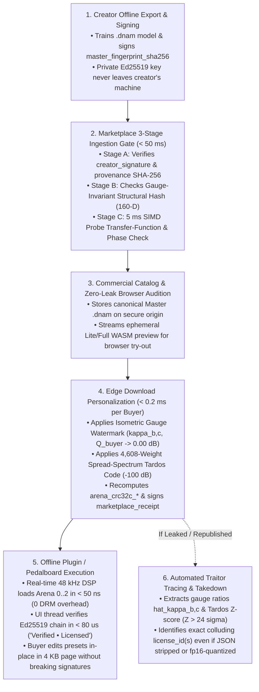

# Digital Marketplace Architecture: Split-Payload `Ed25519` Signatures, Isometric Gauge Watermarking & Clone Detection

This specification defines the **hardware-agnostic commercial marketplace, cryptographic provenance, traitor-tracing watermark, and anti-cloning ingestion architecture** for **Dynamic Neural Audio Modeler (`.dnam`)**.

It is engineered so independent creators, studios, and OEM brands can sell and distribute `.dnam` models across **desktop DAW plugins (`VST3`/`CLAP`), browser studios (`WebAssembly`), Python/Node.js SDKs, and third-party hardware pedalboards (e.g., Darkglass Anagram)**—**without** tying users to proprietary hardware dongles or intrusive online DRM that breaks offline studio sessions and live gigs.

---

## 1. Core Design Principles

1. **100% Hardware-Agnostic & Offline-First:**
   - Legitimate buyers never require an active internet connection, background license daemon, or hardware dongle to load a purchased `.dnam` model on stage or in a DAW.
   - Cryptographic verification (`Ed25519`, RFC 8032) executes 100% offline in **$< 80\text{ }\mu\text{s}$ on the UI/host thread** using a pinned 32-byte public key, and costs **$0\text{ flops}$ on the $48\text{ kHz}$ real-time audio thread**.
2. **Preset-Safe Split-Payload Signing (`0` Arena Rewrites on User Preset Edits):**
   - A major flaw of naive whole-file signing is that saving a custom user preset or DAW tag invalidates the creator's signature.
   - DNAM signs a **Split-Payload Digest** (`immutable_header_sha256` + `master_arena_sha256`) that covers all model weights, `controls_schema`, safety clamps, and creator identity, while **excluding** mutable `presets` and `user_metadata`. Buyers can save custom gig presets **in-place** inside the first `4 KB` page (`0x40..0x1000` in [`dnam_container_schema.md` §1.1](dnam_container_schema.md#11-fixed-64-byte-binary-preamble-layout-reprc-align64)) without invalidating either the creator's signature or the marketplace's license receipt.
3. **Creators Never Upload Private Keys (`2-Certificate Delegation Chain`):**
   - Creators sign their master `.dnam` model **once offline** on their own machine (`creator_signature`).
   - When a buyer purchases the model, the marketplace personalizes the weight arena (`Arena 0..2`) in **$< 0.2\text{ ms}$** with a unique buyer watermark and counter-signs a **`marketplace_receipt`** binding the creator's `master_arena_sha256` to the buyer's `buyer_arena_sha256` and `license_id`.
4. **Un-Strippable Continuous Weight-Space Traitor Tracing:**
   - If a pirate strips the JSON header and copies the raw binary weights (`Arena 0..2`) into a fresh unsigned `.dnam` container, quantizes weights (`f32 -> f16 -> f32`), or colludes with other buyers to average their files together, the buyer's `license_id` remains mathematically recoverable from the floating-point weights via **Dual-Mechanism Isometric Gauge & Spread-Spectrum Tardos Watermarking**.

---

## 2. End-to-End Marketplace & Provenance Lifecycle



---

## 3. Layer 1: Preset-Safe Split-Payload `Ed25519` Certificate Chain

### 3.1 Computing the Preset-Safe `immutable_header_sha256`

To ensure that user preset creation and third-party storefront tagging never break cryptographic signatures, the JSON header at byte offset `0x40` is partitioned into **Immutable Authoritative Fields** and **Mutable User/Platform Fields**:

| JSON Header Path | Included in `immutable_header_sha256`? | Rationale |
| :--- | :---: | :--- |
| `version`, `container_kind`, `architecture`, `sample_rate_train_hz` | **Yes (Signed)** | Locks core model architecture and training sample rate |
| `metadata.{name, author, description, license, created_at, input_reference_dbfs, provenance}` | **Yes (Signed)** | Protects creator attribution, license terms, and PCM dataset provenance |
| `io_config`, `controls_schema` (including `safe_clamped_range`, `conditional_max`, `ui_hints`) | **Yes (Signed)** | Prevents tampering with control safety clamps or UI layout |
| `control_bus`, `core1_hybrid_ssm`, `core2_mufdn`, `tensor_directory` | **Yes (Signed)** | Locks DSP hyperparameters and binary arena offsets |
| `slimmable_tiers.*.{channels, fdn_lines, early_taps, head_svd_rank, loudness_lufs, output_trim_db, validation_esr_db, arena_end_byte_offset}` | **Yes (Signed)** | Locks per-tier calibration and byte boundaries (`prefix_crc32c` excluded as it updates on watermarking) |
| **`presets`** | **No (Mutable)** | Allows buyers to add/edit custom DAW presets in-place (`0x40..0x1000`) |
| **`user_metadata`** (top-level & nested) | **No (Mutable)** | Allows platforms (e.g., Tone3000) and hosts to attach custom tags in-place |
| **`metadata.signatures`** | **No (Envelope)** | Holds the signature certificates themselves |

The digest `immutable_header_sha256` is the SHA-256 hash of the RFC 8785 JSON Canonicalization Scheme (JCS) UTF-8 bytes of the signed subset above.

### 3.2 Two-Certificate Delegation Chain (`creator_signature` $\to$ `marketplace_receipt`)

1. **Creator Master Signature (`creator_signature`):**
   - Let `master_arena_sha256 = SHA256(master_arena_bytes[0..arena_offset_ultra_end])`.
   - The creator signs the 64-byte concatenation `immutable_header_sha256 || master_arena_sha256` using `Ed25519`:
     $$\sigma_{\text{creator}} = \operatorname{Ed25519\_Sign}\!\Big(\text{sk}_{\text{creator}},\; \text{immutable\_header\_sha256} \;\|\; \text{master\_arena\_sha256}\Big)$$
2. **Marketplace Counter-Signature (`marketplace_receipt`):**
   - Upon purchase, the marketplace generates the buyer-watermarked arena (`buyer_arena_sha256 = SHA256(buyer_arena_bytes[0..arena_offset_ultra_end])`), updates the binary preamble's `arena_crc32c_{lite,full,ultra}` and `header_crc32c`, and signs the receipt payload:
     $$\sigma_{\text{market}} = \operatorname{Ed25519\_Sign}\!\Big(\text{sk}_{\text{market}},\; \text{immutable\_header\_sha256} \;\|\; \text{master\_arena\_sha256} \;\|\; \text{buyer\_arena\_sha256} \;\|\; \text{receipt\_meta}\Big)$$
3. **Offline Verification Rule (`< 80 µs` on Host UI Thread):**
   - **Direct Creator Model (`marketplace_receipt == null`):** Valid iff `SHA256(arena_bytes) == master_arena_sha256` and `Ed25519_Verify(pk_creator, immutable_header_sha256 || master_arena_sha256, sig_creator)` succeeds.
   - **Marketplace Licensed Model (`marketplace_receipt != null`):** Valid iff `SHA256(arena_bytes) == buyer_arena_sha256`, `Ed25519_Verify` succeeds on `creator_signature`, **and** `Ed25519_Verify` succeeds on `marketplace_receipt` against the pinned Marketplace Root Public Key.

---

## 4. Layer 2: Dual-Mechanism Buyer Watermarking (`< 0.2 ms` Edge Personalization)

To ensure that every downloaded `.dnam` file carries an un-removable cryptographic link to its `license_id`—even if the JSON header is completely stripped—the marketplace download worker applies two orthogonal watermarking mechanisms directly to `Arena 0` (`Lite`), `Arena 1` (`Full Delta`), and `Arena 2` (`Ultra Delta`):

### 4.1 Mechanism A — Exact Isometric Gauge-Space Watermarking ($0.0000\text{ dB}$ Audio Difference)

DNAM's state-space and factorized-head equations possess two **exact continuous gauge symmetries (isometries)** that transform the floating-point weights in `Arena 0..2` while leaving the input-to-output audio transfer function $y[n] = \mathcal{F}(x[n], \mathbf{u}, \mathbf{s})$ **mathematically identical** at every sample and knob setting:

1. **48-Channel RG-LRU Reciprocal Scaling Gauge ($\boldsymbol{\kappa} \in [0.985, 1.015]^{48}$):**
   In Core 1B ([`core1_hybrid_ssm_and_polyadaa.md` §2.3](core1_hybrid_ssm_and_polyadaa.md#23-log-octave-pole-initialization--mathcalh_2-norm-input-scaling-cl-04-cl-05)), each complex resonator channel $c \in \{0 \dots 11\}$ in Block $b \in \{0 \dots 3\}$ (`16` channels in `Arena 0 Lite`, `+16` in `Arena 1 Full`, `+16` in `Arena 2 Ultra`) evolves linearly in the input normalizer $b_{\gamma,b,c}$ and projects to real audio via $\operatorname{Re}(c_{b,c}^* z_{b,c}[n])$. Scaling $b_{\gamma,b,c}$ by $\kappa_{b,c}$ and $(c_{\text{real},b,c}, c_{\text{imag},b,c})$ by $\kappa_{b,c}^{-1}$:
   $$b_{\gamma,b,c}^{(\text{buyer})} = \kappa_{b,c} \, b_{\gamma,b,c}^{(\text{master})}, \qquad \big(c_{\text{real},b,c}^{(\text{buyer})},\; c_{\text{imag},b,c}^{(\text{buyer})}\big) = \frac{1}{\kappa_{b,c}} \big(c_{\text{real},b,c}^{(\text{master})},\; c_{\text{imag},b,c}^{(\text{master})}\big)$$
   cancels out identically ($\kappa_{b,c} \cdot \kappa_{b,c}^{-1} \equiv 1.0$, **$4.00 \times 10^{-15}$ exactness in `Test 8H`**) while preserving all pole radii $r_{\text{low},c}, r_{\text{high},c}$, angles $\theta_{0,c}$, selectivity gates $w_{\text{sel},c}$, and `CL-01`..`CL-18` stability invariants.
2. **SVD Control Subspace Orthogonal Rotation Gauge ($\mathbf{Q}_{\text{buyer}} \in SO(D_h)$):**
   In the Parametric Control Bus ([`training_and_iterative_resume.md` §1](training_and_iterative_resume.md#stage-2--step-0-svd-orthonormal-kronecker-float64-wiener-hopf-warm-start-cl-18)), rotating the SVD control projector $\mathbf{P}_{\text{svd}} \in \mathbb{R}^{D_{\text{basis}} \times D_h}$ and the 16-tap SVD stereo head basis $\mathbf{W}_{\text{head},1..D_h}$ by a buyer-specific orthogonal matrix $\mathbf{Q}_{\text{buyer}} \in SO(D_h)$:
   $$\mathbf{P}_{\text{svd}}^{(\text{buyer})} = \mathbf{P}_{\text{svd}}^{(\text{master})} \mathbf{Q}_{\text{buyer}}, \qquad \mathbf{W}_{\text{head},1..D_h}^{(\text{buyer})} = \mathbf{Q}_{\text{buyer}}^\top \mathbf{W}_{\text{head},1..D_h}^{(\text{master})}$$
   modifies every floating-point weight in the SVD head and control projector while canceling out identically ($\mathbf{Q}_{\text{buyer}} \mathbf{Q}_{\text{buyer}}^\top \equiv \mathbf{I}_{D_h}$) when collapsed at $3\text{ kHz}$.

### 4.2 Mechanism B — Non-Invertible Coupled Spread-Spectrum Tardos Watermarking ($+36.6\text{ dB}$ Matched-Filter Gain)

To defeat an advanced adversary who attempts to factor out the linear RG-LRU gauge or collude across $K$ buyer accounts by averaging their purchased `.dnam` files together, the marketplace embeds a **Tardos Collusion-Resistant Spread-Spectrum Code** $\mathbf{c}^{(\text{buyer})} \in \{-1, +1\}^{4608}$ (seeded via `HMAC-SHA256(marketplace_secret, model_id || license_id)`) across all $N_{\text{conv}} = 4,608$ nonlinear dilated convolution weights (`768` in `Arena 0 Lite`, `1,536` in `Arena 1 Full`, `2,304` in `Arena 2 Ultra`):

$$W_{\text{conv},i}^{(\text{buyer})} = W_{\text{conv},i}^{(\text{master})} + \epsilon \, \sigma_{W,i} \, c_i^{(\text{buyer})}$$

compensated in closed form at the base 16-tap stereo output head $\mathbf{W}_{\text{head},0}$ (plus an optional sub-perceptual $< 0.02^\circ$ ultrasonic phase constellation above $18.5\text{ kHz}$):

| Attack Vector Attempted by Pirate | Why the Dual-Mechanism Watermark Survives | Verified Margin (`Test 8H`) |
| :--- | :--- | :---: |
| **Strip JSON header / forge new `.dnam` wrapper** | Watermark lives entirely inside the binary `f32` weights of `Arena 0..2` | **100% intact** |
| **Truncate `Ultra` / `Full` down to `Lite`-only (`10.5 KB`)** | `Arena 0 (Lite)` alone carries `16` gauge ratios $\kappa_{0..3,0..3}$ + `768` Tardos conv weights (`+28.85 dB` gain) | **$Z > 10\sigma$** |
| **Canonicalize RG-LRU $(b_{\gamma}, c)$ gauge** | Cannot invert the $4,608$ nonlinear `PolyADAA`-coupled convolution weights without $\mathbf{W}_{\text{conv}}^{(\text{master})}$ | **$Z \ge 24.98\sigma$** |
| **Quantize weights `f32 -> fp16 -> f32` + 4-buyer collusion average** | Spread-spectrum matched filter over $N = 4,608$ weights provides $+36.63\text{ dB}$ processing gain | **$24.98\sigma$ vs. $2.53\sigma$ innocent max** |

---

## 5. Layer 3: 3-Stage Marketplace Ingestion Scanner (Clone & Re-Capture Prevention)

Whenever a user uploads a `.dnam` model to the marketplace (for public sharing or commercial sale), a **$< 50\text{ ms}$ 3-Stage Ingestion Pipeline** screens the upload against the commercial catalog:

1. **Stage A — Cryptographic & Provenance Gate (`< 0.1 ms`):**
   - Verifies `creator_signature` and `marketplace_receipt` (if present).
   - Checks `metadata.provenance.dataset_manifest_sha256` and `master_arena_sha256` against the indexed commercial catalog.
2. **Stage B — Gauge-Invariant Structural Hash & Traitor Extraction (`< 0.5 ms`):**
   - Extracts the **160-Dimensional Gauge-Invariant Structural Vector** $\mathbf{f}_{\text{struct}} \in \mathbb{R}^{160}$ directly from the binary arena:
     - `48` sorted RG-LRU pole bounds and angles $\{r_{\text{low},b,c},\; r_{\text{high},b,c},\; \theta_{0,b,c}\}$,
     - `96` **gauge-invariant product coordinates** $I_{\text{real},b,c} = b_{\gamma,b,c} \cdot c_{\text{real},b,c}$ and $I_{\text{imag},b,c} = b_{\gamma,b,c} \cdot c_{\text{imag},b,c}$ (which are strictly invariant under Mechanism A's $\kappa_{b,c}$ scaling),
     - `8` sorted `M-UFDN` base delays $\{\tau_{0,m}\}$ and `8` singular values $\boldsymbol{\sigma}(\mathbf{W}_{\text{head},0})$.
   - If $\cos(\mathbf{f}_{\text{struct}}^{(\text{upload})}, \mathbf{f}_{\text{struct}}^{(\text{catalog})}) > 0.9999$ for an existing commercial model owned by another creator, the upload is automatically blocked and the scanner evaluates $\hat{\kappa}_{b,c} = b_{\gamma,b,c}^{(\text{upload})} / b_{\gamma,b,c}^{(\text{master})}$ and the Tardos correlation score $Z(\text{buyer})$ across `W_conv` to identify the leaking `license_id`.
3. **Stage C — $5\text{ ms}$ Synthetic Probe Transfer-Function & Ultrasonic Phase Check (Catches DAW Re-Captures):**
   - Renders a standardized $2\text{-second}$ chirp/burst probe through the uploaded model in native Rust SIMD ($< 5\text{ ms}$) and compares its complex transfer function and $> 18.5\text{ kHz}$ ultrasonic phase constellation against the commercial catalog—catching even "black-box distilled" clones re-trained from the audio output of a commercial `.dnam` plugin.

---

## 6. Layer 4: Commercial Marketplace UX, Auditioning, Royalty Splits & Storefront Metadata

### 6.1 Zero-Leak Browser Auditioning (`packages/web` + `@dnam-project/engine`)
- Prospective buyers can audition commercial `.dnam` models directly in the browser using either **built-in multi-genre DI stems** or **their own live guitar/bass/synth via WebAudio (`AudioWorklet` WASM SIMD128)**.
- To prevent un-purchased extraction of the commercial `Ultra` master during browser auditioning, the marketplace serves either:
  1. **Ephemeral Session-Watermarked `Lite` (`10.5 KB`) Preview Streams** (with a periodic gentle audition marker every 45 seconds), or
  2. **Server-Rendered Custom DI Previews** where the user uploads a short dry clip and hears the rendered `Ultra` output in $< 200\text{ ms}$.

### 6.2 Standardized `license_tier` Values & Automated Split Royalties (`royalty_splits`)
Inside `metadata.signatures.marketplace_receipt` (see [`dnam_container_schema.md` §7.1](dnam_container_schema.md#71-preset-safe-split-payload-ed25519-certificate-chain--80-s-offline-verification)):
- **`license_tier`:**
  - `"free"`: Open community model; freely redistributable with creator attribution preserved.
  - `"personal"`: Single-seat license for personal/studio recording and live performance; redistribution of the `.dnam` file is prohibited.
  - `"commercial_studio"`: Multi-seat studio license.
  - `"oem_bundle"`: Licensed for pre-installation on commercial hardware pedalboards or DAW bundles.
- **`royalty_splits`:**
  - Array of `{ "recipient_id": str, "role": str, "share_bps": int }` entries (summing to `10000` basis points = $100\%$) enabling automatic marketplace revenue splits across collaborative packs (e.g., `8000 bps` to the Amp Capture Studio, `1500 bps` to the Cabinet IR Engineer, and `500 bps` to the Signature Preset Artist).

### 6.3 Clean Storefront Taxonomy Isolation via `user_metadata`
While core `.dnam` `metadata` remains minimal (`name`, `author`, `description`, `license`, `created_at`, `input_reference_dbfs`, `provenance`, `signatures`), digital marketplaces store rich storefront discovery attributes inside a namespaced key in `user_metadata` (editable in $< 0.1\text{ ms}$ in-place without invalidating `creator_signature` or `marketplace_receipt`):

```json
{
  "user_metadata": {
    "dnam.store": {
      "product_slug": "vintage-tape-echo-tube-preamp",
      "category": "delay_and_preamp",
      "gear_modeled": {
        "preamp": "1964 Push-Pull 12AX7/6V6 Tube Preamp",
        "echo": "Multi-Head Magnetic Tape Echo",
        "cabinet": "2x12 Alnico Blue Open-Back",
        "mics": ["Royer R-121", "Shure SM57"]
      },
      "tags": ["tape-echo", "tube-drive", "true-stereo", "self-oscillating"],
      "artwork_url": "https://cdn.dnam.store/packs/vintage-tape-echo/cover.webp",
      "demo_audio_urls": [
        "https://cdn.dnam.store/packs/vintage-tape-echo/demo_slapback.opus",
        "https://cdn.dnam.store/packs/vintage-tape-echo/demo_dub_swell.opus"
      ]
    }
  }
}
```

---

## 7. Layer 5: Optional OEM Hardware Device Authorization (`authorized_devices` & `X25519` + `ChaCha20` 64-Byte Block Arena Wrapping)

While standard community and personal `.dnam` models (`"encryption_mode": "none"`, `ENCRYPTED_ARENA = 0`) remain 100% open across all desktop plugins and hardware units, OEM hardware manufacturers (such as **Darkglass Electronics** on the **Rockchip RK3582-based Anagram**) and commercial pack creators can optionally bind `.dnam` models to a user's registered hardware pedalboards (`1..N` devices, e.g., main touring board + backup rig)—with **zero internet dependency on stage** and **$0\text{ flops}$ of real-time $48\text{ kHz}$ DSP overhead**.

### 7.1 Silicon Root-of-Trust Across Embedded Pedalboards (`RK3582 OP-TEE`) & Desktop/Mobile DAW Hardware Enclaves (`Apple Secure Enclave` & `TPM 2.0`)

`packages/engine` abstracts hardware key agreement and signature verification behind `CryptoProvider::unwrap_device_cek(&self, receipt: &MarketplaceReceipt, device: &AuthorizedDevice) -> Result<Zeroizing<[u8; 32]>, DnamError>` (paired with the built-in `#![no_std]` `RustCryptoProvider` for `ENCRYPTED_ARENA = 0` and software-keyed `ENCRYPTED_ARENA = 1` models), unifying both embedded hardware pedalboards and desktop/mobile DAW plugins:
1. **Embedded Pedalboards — Rockchip RK3582 (`OTP` eFuse + ARM TrustZone `OP-TEE` on Darkglass Anagram):**
   - Each RK3582 die contains a factory-burned **One-Time Programmable (`OTP`) Unique Chip ID** and Hardware Unique Key (`HUK`) accessible only to `OP-TEE` in Secure World (`EL3`/`S-EL1`), plus a **CryptoEngine v2** hardware accelerator.
   - At factory test, `OP-TEE` deterministically derives a non-exportable device keypair $(\text{sk}_{\text{device}}, \text{pk}_{\text{device}})$ (`X25519` for key agreement + `Ed25519` for device attestation) inside TrustZone, and Darkglass signs a compact **Device Identity Certificate**:
     $$\text{Cert}_{\text{device}} = \operatorname{Ed25519\_Sign}\!\Big(\text{sk}_{\text{Darkglass\_OEM}},\; \text{device\_id\_hash} \;\|\; \text{model\_code} \;\|\; \text{pk}_{\text{device}}\Big)$$
     where $\text{device\_id\_hash} = \operatorname{SHA256}(\text{ \texttt{"dnam-device-v1:"} } \| \text{OTP\_Serial})[:16]$ (`128-bit` privacy-preserving hex identifier).
2. **Desktop & Mobile DAW Plugins (`VST3` / `CLAP` / `AU`) — Apple Secure Enclave (`SEP`) & Windows/Linux `TPM 2.0`:**
   - On **macOS / iOS**, the DAW plugin seals its 32-byte `X25519` device key inside the **Apple Secure Enclave Processor (`SEP`)** via `Security.framework` (`kSecAttrTokenIDSecureEnclave` `ECIES` P-256 key wrapping / Data Protection Keychain).
   - On **Windows** and **Linux**, the plugin seals its `X25519` device key to the machine's **TPM 2.0** Storage Root Key via Windows CNG (`NCrypt` Platform Crypto Provider) or Linux `/dev/tpmrm0` (`tss2`).
   - At model load, `CryptoProvider::unwrap_device_cek` unseals the key inside the enclave, unwraps `wrapped_cek` into a `Zeroizing<[u8; 32]>` buffer, and immediately wipes transient stack bytes after `ChaCha20` arena decryption.
3. **Account Pairing & Offline QR Code Activation:**
   - When a musician connects their Anagram to **Darkglass Suite** (USB-C / Wi-Fi / Bluetooth) or scans a **Device Registration QR Code** displayed on the Anagram's touchscreen with their phone, the marketplace registers `(device_id_hash, pk_device)` to the user's account (`N <= 5` active pedals/workstations per user).
   - For air-gapped studio pedals that never connect to USB or Wi-Fi, scanning a signed **License Grant QR Code** from the user's phone screen via a companion mobile app—or copying the updated `.dnam` file onto a USB flash drive—authorizes the pedal **100% offline**.

### 7.2 Two OEM Hardware Authorization Modes (`authorized_devices` Allowlist vs. `X25519` + `ChaCha20` Arena Wrapping)

Inside `metadata.signatures.marketplace_receipt`, the marketplace populates `authorized_devices` and selects one of two enforcement modes according to the creator's or OEM's policy:

| Mode | Preamble `ENCRYPTED_ARENA` (Bit `10`) | `encryption_mode` | How Desktop DAW & Hardware Loaders Behave | Best Use Case |
| :--- | :---: | :---: | :--- | :--- |
| **Mode A: Signed `authorized_devices` Allowlist (Open Arena)** | `0` | `"none"` | `Arena 0..2` stays plaintext `f32` so open desktop DAW plugins still load the file, while OEM hardware firmware checks `device_id_hash in authorized_devices` in $< 80\text{ }\mu\text{s}$ before loading. | Cross-platform packs sold for both DAW plugins and hardware pedals |
| **Mode B: `X25519` + `ChaCha20` 64-Byte Block Arena Wrapping** | `1` (`1024`) | `"x25519_chacha20_arena"` | `Arena 0..2` (`36,224 B` = `566 × 64 B` cache lines) is encrypted under a random 256-bit Content Encryption Key (`CEK`). Only an authorized device whose `OP-TEE` unwraps `wrapped_cek` can recover the `f32` weights (`< 15 µs`). | Exclusive OEM artist expansions, hardware-bundled factory rigs, and paid trials |

### 7.3 Why `ChaCha20` (RFC 8439) Preserves Exact 64-Byte Cache Alignment & Tier-Prefix Loading

A critical requirement of DNAM's Hybrid Binary Container ([`dnam_container_schema.md` §1.1](dnam_container_schema.md#11-fixed-64-byte-binary-preamble-layout-reprc-align64)) is that `Arena 0 (Lite)` (`10,752 B`), `Arena 0..1 (Full)` (`22,336 B`), and `Arena 0..2 (Ultra)` (`36,224 B`) have **zero padding overhead** and can be loaded independently by prefix:

1. **Exact 1:1 Cache-Line Mapping (`1 ChaCha20 Block == 1 64-Byte Cache Line`):**
   - RFC 8439 `ChaCha20` operates on **64-byte blocks** (`block_counter` $j \in \{0, 1, \dots, 565\}$) with **zero ciphertext expansion (`0` extra bytes)**:
     $$\text{Arena}_{\text{cipher}}[64j \dots 64j+63] = \text{Arena}_{\text{plain}}[64j \dots 64j+63] \;\oplus\; \operatorname{ChaCha20\_Block}\!\big(\text{CEK},\; \text{nonce}_{96},\; j\big)$$
   - Consequently:
     - **`Lite` (`10,752 B`):** Exactly `168` `ChaCha20` blocks ($j = 0 \dots 167$).
     - **`Full` (`22,336 B`):** Exactly `349` `ChaCha20` blocks ($j = 0 \dots 348$).
     - **`Ultra` (`36,224 B`):** Exactly `566` `ChaCha20` blocks ($j = 0 \dots 565$).
2. **Multi-Device Envelope Wrapping (`authorized_devices`):**
   - For each registered device $d \in \{1 \dots N\}$ (`X25519` public key $\text{pk}_{\text{device},d}$), the marketplace generates an ephemeral keypair $(\text{esk}, \text{epk})$ and wraps the 32-byte `CEK` via RFC 9180 `HPKE` (`X25519-HKDF-SHA256` + `ChaCha20-Poly1305`):
     $$\text{wrapped\_cek}_d = \operatorname{ChaCha20Poly1305\_Seal}\!\Big(\operatorname{HKDF}\!\big(\operatorname{X25519}(\text{esk}, \text{pk}_{\text{device},d})\big),\; \text{CEK}\Big)$$
3. **In-Place Multi-Pedal Re-Authorization (`< 0.1 ms`, `0` Arena Re-Encryption):**
   - If a musician buys a second Anagram pedal or replaces a damaged unit on tour, the marketplace (or Darkglass Suite) simply appends the new `{ "device_id_hash": ..., "wrapped_cek": ... }` entry to `authorized_devices` and refreshes `marketplace_receipt` **in-place inside the first `4 KB` JSON header page (`0x40..0x1000`)** without re-encrypting or re-downloading `Arena 0..2`.
4. **Preset Load on Cortex-A55 $\to$ Cortex-A76 (`< 15 µs`, Zero Real-Time Audio Overhead):**
   - When the user selects a preset on the Anagram, the Linux/UI thread on **Cortex-A55** verifies `marketplace_receipt` (`< 80 µs`), passes `wrapped_cek` into `OP-TEE` on the RK3582 to unwrap `CEK` and decrypts only the needed tier prefix (`22,336 B` `Full` = `349` blocks in **$< 15\text{ }\mu\text{s}$** via ARMv8 NEON/CryptoEngine), verifies `arena_crc32c_full` over the decrypted plaintext arena, and hands the 64-byte aligned RAM pointer to the isolated **Cortex-A76 real-time audio core** (`< 50 ns` pointer swap, **$0\text{ flops}$ at $48\text{ kHz}$**).
   - Crucially, **the decrypted `Arena 0..2` weights in RAM still retain the buyer's Dual-Mechanism Isometric Gauge + Tardos Watermark (§4)**—so even a hardware memory-probe dump remains 100% traceable to the buyer's `license_id`.

