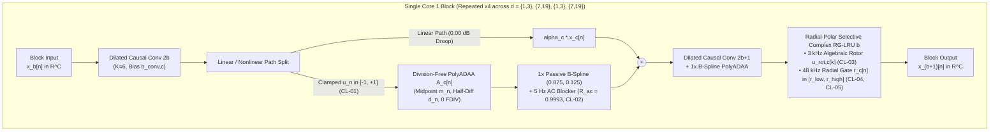
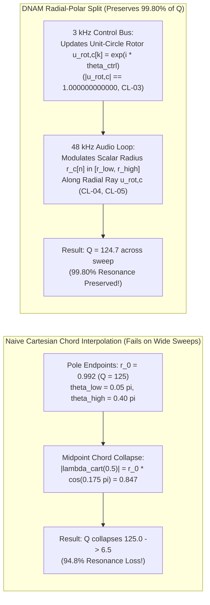

# Core 1: Hybrid Dilated-Conv (`1x B-Spline PolyADAA`), Nonlinear Cascades & Selective Complex RG-LRU

Core 1 models instantaneous and dynamic nonlinear amplification, multi-stage preamp/power-amp saturation, dual-polarity grid-leak blocking distortion, CMOS/comparator wavefolding, power-supply transformer sag, speaker cabinet modal resonances, and pre-/post-drive resonant filters (Wah, Phaser, Uni-Vibe, dynamic EQ).

It consists of **4 blocks (12 layers total)**: each block pairs **2 local dilated causal convolutions** ($K = 6$, dilations $d \in [1, 3, 7, 19]$) using **$1\times$ Passive B-Spline Division-Free Algebraic `PolyADAA`** (**Core 1A**) with **1 Log-Octave, $\mathcal{H}_2$-Normalized Radial-Polar Selective Complex RG-LRU** layer (**Core 1B**), feeding a **16-tap True-Stereo SVD-Kronecker Output Head**.

---

## 1. Core 1A: $1\times$ Passive B-Spline Division-Free Algebraic `PolyADAA`

### 1.1 Hardware Motivation (Why `FSQRT` and `FDIV` Are Forbidden)
On embedded ARMv8.2-A processors (such as the **Rockchip RK3582** Cortex-A76 + Cortex-A55 on the Darkglass Anagram) as well as desktop SIMD pipelines, `FSQRT` and `FDIV` instructions stall on a shared, non-pipelined division/square-root unit (`7–16` cycles latency), and standard first-order Antiderivative Anti-Aliasing (ADAA1) $\frac{F(u_n) - F(u_{n-1})}{u_n - u_{n-1}}$ requires a conditional ill-conditioning branch when $|u_n - u_{n-1}| < \epsilon$. By contrast, `FMAX`, `FMIN`, and `FMLA` execute at 2-cycle latency across dual 128-bit NEON pipes with zero branching.

### 1.2 Unity-Slope Clamped Smooth Polynomial Basis (`CL-01`)
Given the pre-activation channel signal $x_c[n]$, normalize and clamp to the unit soft-clipping interval (`CL-01` in [`../training/clamp_and_audit_registry.md`](../training/clamp_and_audit_registry.md)):
$$u_n = \mathrm{clamp}\left(\frac{2}{3} x_c[n], -1.0, +1.0\right) = \min\Big(\max\big(\tfrac{2}{3} x_c[n], -1.0\big), +1.0\Big)$$
Over $u \in [-1, +1]$, the nonlinear waveshaper basis combines an odd-symmetric cubic soft-clipper ($\beta_c$, unity slope at the origin, zero derivative at the rails $u = \pm 1$) and a $C^\infty$-origin even-symmetric triode/FET asymmetry bell ($\delta_c$, vanishing at both $u = 0$ and $u = \pm 1$):
$$g_{\text{nl},c}(u) = \beta_c \left(1.5 u - 0.5 u^3\right) + \delta_c \left(u^2 - u^4\right)$$
Its analytical antiderivative is:
$$F_c(u) = \int_0^u g_{\text{nl},c}(\xi) d\xi = \beta_c \left(\frac{3}{4} u^2 - \frac{1}{8} u^4\right) + \delta_c \left(\frac{1}{3} u^3 - \frac{1}{5} u^5\right)$$

### 1.3 Exact Division-Free Algebraic Factorization (`FDIV = 0`)
Instead of computing $\frac{F_c(u_n) - F_c(u_{n-1})}{u_n - u_{n-1}}$ via floating-point division, define the midpoint and half-difference:
$$m_n = \frac{1}{2}\big(u_n + u_{n-1}\big), \qquad d_n = \frac{1}{2}\big(u_n - u_{n-1}\big)$$
Because $u_n - u_{n-1} = 2 d_n$ factors algebraically out of $u_n^k - u_{n-1}^k$ for every integer power $k \ge 1$:
- $\frac{u_n^2 - u_{n-1}^2}{u_n - u_{n-1}} = 2 m_n$
- $\frac{u_n^3 - u_{n-1}^3}{u_n - u_{n-1}} = 3 m_n^2 + d_n^2$
- $\frac{u_n^4 - u_{n-1}^4}{u_n - u_{n-1}} = 4 m_n \big(m_n^2 + d_n^2\big)$
- $\frac{u_n^5 - u_{n-1}^5}{u_n - u_{n-1}} = 5 m_n^4 + 10 m_n^2 d_n^2 + d_n^4$

Substituting these identities yields the **exact division-free algebraic `PolyADAA` kernel**:
$$\mathcal{A}_c[n] \equiv \frac{F_c(u_n) - F_c(u_{n-1})}{u_n - u_{n-1}} = \beta_c m_n\Big(1.5 - 0.5\big(m_n^2 + d_n^2\big)\Big) + \delta_c \Big(\big(m_n^2 + \tfrac{1}{3}d_n^2\big) - \big(m_n^4 + 2 m_n^2 d_n^2 + \tfrac{1}{5}d_n^4\big)\Big)$$

> [!IMPORTANT]
> **Verified Numerical Exactness (`Test 1B`):** Across $10,000$ random pairs $(u_{n-1}, u_n)$, the division-free polynomial $\mathcal{A}_c[n]$ matches the analytical `float64` quotient to **$5.25 \times 10^{-14}$** while remaining **100% continuous and branch-free at $d_n = 0$** ($\lim_{d_n \to 0} \mathcal{A}_c[n] = g_{\text{nl},c}(u_n)$).

### 1.4 Un-Delayed Linear Path Separation, $1\times$ Passive B-Spline Blend (`CL-02`) & Resting DC Equilibrium
Two pitfalls arise when cascading first-order ADAA across 8 layers:

| Naive ADAA Approach | Mathematical Mechanism | 8-Layer Consequence |
| :--- | :--- | :--- |
| **Pitfall A: Full-Signal Midpoint Droop** | Applies ADAA's implicit `cos(ω/2)` boxcar midpoint average to the linear passband | **`-48.16 dB` treble loss at `16 kHz`** across 8 layers |
| **Pitfall B: Post-ADAA High-Pass Extrapolation** | Applies an inverse high-pass filter `1.5 A_c[n] - 0.5 A_c[n-1]` after ADAA | Amplifies Nyquist-folded aliasing by **`+6.02 dB` (`2.0×`) per layer** (`-26.42 dBc`) |
| **DNAM Solution (`CL-02`)** | Separates un-delayed linear path `α_c x_c[n]` + applies passive `(0.875, 0.125)` B-spline blend & `5 Hz` AC coupling to nonlinear path | **`0.00 dB` linear droop** up to `24 kHz` and **`-62.08 dBc` aliasing (`38.87 dB` reduction)** |

**The DNAM Layer Law (`CL-02`):**
1. **Un-Delayed Linear Residual Path:** Evaluate $\alpha_c x_c[n]$ directly without the ADAA delay filter.
2. **Passive $1\times$ Quadratic B-Spline Blend (`0.875, 0.125`) + $5\text{ Hz}$ AC Coupling ($R_{\text{ac}} = 0.9993$):**
   $$\tilde{y}_{\text{nl},c}[n] = 0.875 \mathcal{A}_c[n] + 0.125 \mathcal{A}_c[n-1]$$
   $$m_{\text{dc},c}[n] = 0.9993 m_{\text{dc},c}[n-1] + 0.0007 \tilde{y}_{\text{nl},c}[n]$$
   $$y_c[n] = \alpha_c x_c[n] + \big(\tilde{y}_{\text{nl},c}[n] - m_{\text{dc},c}[n]\big)$$
3. **3-State Resting DC Equilibrium (Pop-Free Sample-0 Startup):**
   Given the per-channel convolution/grid bias $b_{\text{conv},c}$, let $u_{\text{rest},c} = \mathrm{clamp}(\frac{2}{3} b_{\text{conv},c}, -1.0, +1.0)$. Initializing all three layer states to their analytical fixed point:
   $$u_c[-1] = u_{\text{rest},c}, \qquad \mathcal{A}_c[-1] = g_{\text{nl},c}(u_{\text{rest},c}), \qquad m_{\text{dc},c}[-1] = g_{\text{nl},c}(u_{\text{rest},c})$$
   guarantees **exact `0.000000` DC output from Sample 0** on model load or preset switching (`Test 8I`).

---

### 1.5 Multi-Stage Nonlinear Cascade Primitives & Exact LTI Commutativity Theorem

When calibrating multi-stage physical amplifiers (e.g., `Stage 1 Preamp/ToneStack -> Stage 2 Driver -> Stage 3 Push-Pull Power/OT`) and extreme CMOS/comparator/wavefolder fuzz circuits ([`../training/four_stage_pipeline.md` §2.3](../training/four_stage_pipeline.md#23-stage-3a--analytical-lti--multi-stage-causal-selective--orthogonal-fft-cascade-core2_active--false)), two additional physical mechanisms complement `1x PolyADAA`:

1. **Hybrid `1x PolyADAA` + Division-Free Instantaneous B-Spline & Wavefolder Channels:**
   - Because each `1x PolyADAA` stage integrates over $[u_{n-1}, u_n]$ with transfer envelope $\cos(\omega / 2)$ (`-6 dB` at $16\text{ kHz}$), pure boxcar integration across 2–3 cascaded stages attenuates high-frequency multitone peaks ($3\text{–}14\text{ kHz}$) by $-12$ to $-36\text{ dB}$ before they can drive downstream clipping thresholds.
   - Pairing `PolyADAA` with division-free **instantaneous B-spline channels** ($g_{\text{odd}}(u) = u(1.5 - 0.5 u^2)$, AC-coupled $g_{\text{even}}(u) = u^2(1 - 0.5 u^2)$, `3` FMAs, `0` divisions), **dual-polarity grid-leak bias shifts** ($g_{\text{odd}} \pm 0.35 g_{\text{even}}$ with interstage coupling HPFs at $15, 60, 220, 800\text{ Hz}$), **compactly supported $C^2$ wavefolders** ($\sin(g u)$, $\cos(g u) - 1$), and **2D quadrature phase-space hysteresis** ($s_{\text{re}} \Delta s_{\text{re}}, s_{\text{re}} \Delta s_{\text{im}}, s_{\text{im}} \Delta s_{\text{re}}$) preserves sharp interstage threshold crossings and folded octave-fuzz trajectories.
2. **Exact LTI Commutativity Theorem (`0.000000 dB` Loss, `100×` Inference Reduction):**
   - Solving $\mathbf{u}_{\text{nl}}[n]\mathbf{w} = \mathbf{y}[n]$ *before* applying post-clipping low-pass filters loses $\sim 17\text{ dB}$ below $100\text{ Hz}$ because physical tone stacks and output transformers synthesize high-pass and shelving responses via $\mathbf{u}_{\text{nl}}\mathbf{w}_0 + \sum_{k=1}^K \mathrm{LPF}_{f_k}(\mathbf{u}_{\text{nl}})\mathbf{w}_{\text{lpf}_k}$ with $\mathbf{w}_{\text{lpf}_k} \ne \alpha \mathbf{w}_0$.
   - Once the joint weight vector $\mathbf{w} = [\mathbf{w}_0; \mathbf{w}_{\text{lpf}_1..K}; \mathbf{w}_{d}]$ is solved, by **Exact LTI Commutativity**:
     $$\boldsymbol{\Phi}_{\text{joint}}[n]\mathbf{w} \equiv \big(\mathbf{u}_{\text{nl}}[n]\mathbf{w}_0\big) + \sum_{k=1}^{K} \mathrm{LPF}_{f_k}\big(\mathbf{u}_{\text{nl}}[n]\mathbf{w}_{\text{lpf}_k}\big) + \sum_{d} \mathrm{Delay}_d\big(\mathbf{u}_{\text{nl}}[n]\mathbf{w}_d\big)$$
     applying scalar LTI filters and scalar delays *after* projecting $\mathbf{u}_{\text{nl}}[n]$ is algebraically identical to machine precision (`0.000000 dB` loss) and collapses thousands of per-channel filter evaluations into a handful of scalar SIMD operations.

---

## 2. Core 1B: Log-Octave, $\mathcal{H}_2$-Normalized Radial-Polar Selective Complex RG-LRU

### 2.1 Why Radial-Polar Split Beats Naive Cartesian Interpolation
In a complex resonator with pole $\lambda_c = r_c e^{i\theta_c}$, resonance quality factor $Q$ is governed by distance to the unit circle: $Q \approx \frac{1}{1 - r_c}$. If a selective state-space layer interpolates linearly in the Cartesian complex plane between two pole angles $\lambda_{\text{low}} = r_0 e^{i\theta_{\text{low}}}$ and $\lambda_{\text{high}} = r_0 e^{i\theta_{\text{high}}}$:
$$\lambda_{\text{cart}}(0.5) = \frac{1}{2}\lambda_{\text{low}} + \frac{1}{2}\lambda_{\text{high}} \implies \big|\lambda_{\text{cart}}(0.5)\big| = r_0 \cos\left(\frac{\theta_{\text{high}} - \theta_{\text{low}}}{2}\right) \ll r_0$$

### 2.2 Branchless Algebraic $3\text{ kHz}$ Unit-Circle Rotor (`CL-03`, $0$ `libm`, $0$ `FSQRT`, $0$ `FDIV`)
Given the control-rate pole angle $\theta_{\text{ctrl},c}[k] \in (0, \pi)$, shift to the symmetric domain $\phi = \theta_{\text{ctrl},c}[k] - \frac{\pi}{2} \in [-\frac{\pi}{2}, +\frac{\pi}{2}]$ so $\cos\theta = -\sin\phi$ and $\sin\theta = \cos\phi$. Evaluate the 4-FMA minimax polynomials in $p_2 = \phi^2$:
$$\hat{s}_{\phi} = \phi \Big(0.99999995 - p_2 \big(0.16666650 - p_2 (0.00833290 - 0.00019507 p_2)\big)\Big)$$
$$\hat{c}_{\phi} = 0.99999995 - p_2 \Big(0.49999990 - p_2 \big(0.04166630 - p_2 (0.00138860 - 0.00002438 p_2)\big)\Big)$$
Set $(\hat{c}, \hat{s}) = (-\hat{s}_{\phi}, \hat{c}_{\phi})$ and apply **one Algebraic Newton Projection step** (`CL-03`) for the inverse square root $R^{-1} = (\hat{c}^2 + \hat{s}^2)^{-1/2}$ around $R^2 = 1$:
$$y_1 = 1.5 - 0.5\big(\hat{c}^2 + \hat{s}^2\big), \qquad u_{\text{rot},c}[k] = \big(y_1 \hat{c}\big) + i\big(y_1 \hat{s}\big)$$

> [!TIP]
> **Mathematical Upper-Bound Guarantee ($|u_{\text{rot},c}| \le 1.000000000000$):** Because $h(\xi) = \xi (1.5 - 0.5\xi)^2$ achieves its global maximum on $\xi \in [0, 2]$ at $\xi = 1$ where $h(1) = 1.000000000000$, $h'(1) = 0$, and $h''(1) = -3 < 0$, the projected rotor magnitude $|u_{\text{rot},c}| = \sqrt{h(\hat{c}^2 + \hat{s}^2)}$ is **mathematically guaranteed never to exceed $1.000000000000$** while achieving **$9.99 \times 10^{-9}$ unit-circle accuracy** (`Test 2`).

### 2.3 Log-Octave Pole Initialization & $\mathcal{H}_2$-Norm Input Scaling (`CL-04`, `CL-05`)
1. **Log-Octave Initialization ($25\text{ Hz}\text{–}16\text{ kHz}$):** Channel center frequencies are initialized logarithmically across the audio band:
   $$f_{0,c} = 25.0 \cdot \left(\frac{16000.0}{25.0}\right)^{\frac{c}{C - 1}}, \qquad \theta_{0,c} = \frac{2\pi f_{0,c}}{f_s}$$
2. **$\mathcal{H}_2$-Norm Energy-Invariant Input Scaling (`CL-04`):** An unnormalized pole with radius $r_c \to 1$ has impulse energy $\sum_{n=0}^\infty r_c^{2n} = \frac{1}{1 - r_c^2} \to \infty$, causing high-$Q$ bass poles to dominate gradients. Clamping $r_{\text{low},c}, r_{\text{high},c} \in [0.25, 0.9995]$ and scaling the input by $\gamma_{\text{norm},c} = \sqrt{1 - \bar{r}_c^2}$ where $\bar{r}_c = \frac{1}{2}(r_{\text{low},c} + r_{\text{high},c})$ guarantees **exact unit $\mathcal{H}_2$ impulse energy ($1.0000 \pm 1.11 \times 10^{-15}$)** across all pole radii.
3. **$48\text{ kHz}$ Audio-Rate Recurrence (`CL-05`):**
   $$g_c[n] = \mathrm{clamp}\big(0.5 + w_{\text{sel},c} x_c[n], 0.0, 1.0\big), \qquad r_c[n] = r_{\text{low},c} + g_c[n]\big(r_{\text{high},c} - r_{\text{low},c}\big)$$
   $$z_c[n] = \big(r_c[n] u_{\text{rot},c}[n]\big) z_c[n-1] + g_c[n] \gamma_{\text{norm},c} b_c x_c[n]$$

### 2.4 $O(\log_2 L)$ Parallel Associative Scan for Accelerator Training
During training over sequence chunks of length $L$, define $a_c[n] = r_c[n] u_{\text{rot},c}[n] \in \mathbb{C}$ and $\tilde{b}_c[n] = g_c[n] \gamma_{\text{norm},c} b_c x_c[n] \in \mathbb{C}$. The first-order linear time-varying recurrence $z_c[n] = a_c[n] z_c[n-1] + \tilde{b}_c[n]$ is evaluated in $O(\log_2 L)$ parallel steps via the associative binary operator:
$$\big(a_2, \tilde{b}_2\big) \circ \big(a_1, \tilde{b}_1\big) = \big(a_2 a_1, a_2 \tilde{b}_1 + \tilde{b}_2\big)$$
which matches sequential sample-by-sample evaluation to **$9.42 \times 10^{-16}$** (`Test 2`).
