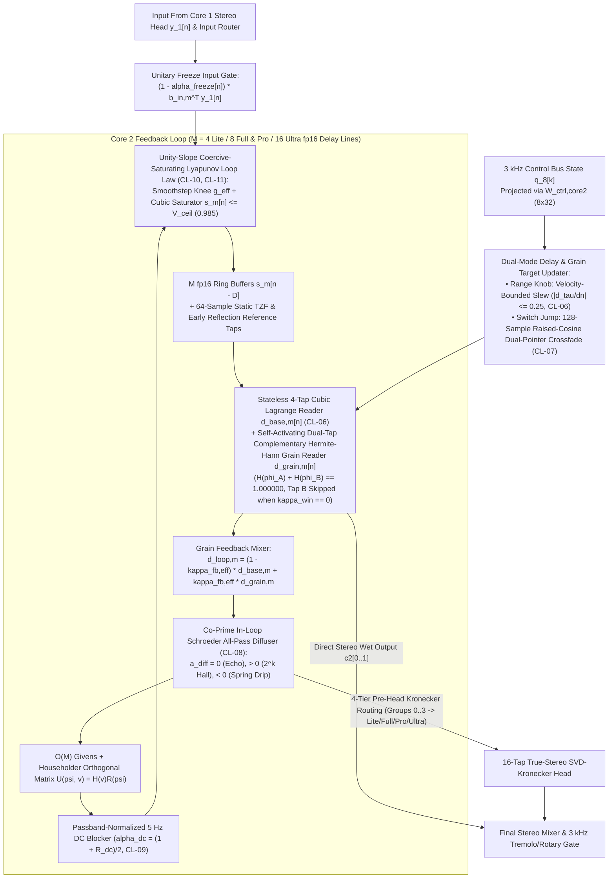

# Core 2: Mode-Free Windowed Time-Warped Unitary FDN (`M-UFDN` / `WT-UFDN`)

Core 2 models all time-varying delay, modulation, spatial diffusion, dispersion, reverberant, **granular synthesis / pitch-shimmer**, and **infinite spectral freeze** phenomena within a single mode-free **Windowed Time-Warped Modulated Unitary Feedback Delay Network (`M-UFDN` / `WT-UFDN`)** with $M = 4$ (`Lite`), $M = 8$ (`Full` & `Pro`), or $M = 16$ (`Ultra`) `fp16` delay lines and a shared-buffer 8-tap early reflection & 64-sample Through-Zero Flanger reference tap:

| Temporal Horizon | Delay Span | Modeled Physical & Acoustic Phenomena |
| :--- | :---: | :--- |
| **Micro Horizon** | `0.2–8 ms` | True Through-Zero Flanging (`Δτ = 0.0 ms`), Resonant Jet Flanging, Double-Tracking Comb Filters |
| **Short Horizon** | `8–45 ms` | Quadrature Stereo Chorus, 3D Leslie Rotary Doppler Pitch Shift, Vibrato, Slapback Doubling |
| **Long Horizon** | `45–5,000+ ms` | Analog BBD/Tape Echo (Wow/Flutter & Self-Oscillation), Ping-Pong Delay, Spring Reverb Drip, Lush Modulated Hall/Plate Reverb, Asynchronous Granular Clouds, Octave/Fifth Shimmer Pitch-Shifting, Reverse/Micro-Looper Grains, Infinite Unitary Spectral Freeze |

---

## 1. Stateless 4-Tap Cubic Lagrange Delay Readout & Dual-Mode Delay Transitions

### 1.1 Why Recursive Thiran All-Pass Filters Fail on Modulated Delay Lines
First-order recursive Thiran all-pass interpolators $y[n] = \eta (x[n - D_{\text{int}}] - y[n-1]) + x[n - D_{\text{int}} - 1]$ maintain internal filter state $y[n-1]$. Whenever an LFO or user knob sweeps the delay $\tau_m[n]$ across an integer sample boundary ($\lfloor \tau_m[n] \rfloor \ne \lfloor \tau_m[n-1] \rfloor$), the fractional offset $\mu_m$ jumps discontinuously between $1 \to 0$ (or $0 \to 1$), triggering an audible transient click spike (`0.04694` jerk in `Test 3`).

### 1.2 Stateless 4-Tap Cubic Lagrange Fractional Delay Reader (`CL-06`)
Enforcing the causal delay floor $\tau_m[n] \ge 4.0\text{ samples}$ (`CL-06`, see [`../training/clamp_and_audit_registry.md`](../training/clamp_and_audit_registry.md)), decompose $\tau_m[n] = D_{\text{int},m} + \mu_m$ where $D_{\text{int},m} = \lfloor \tau_m[n] \rfloor$ and $\mu_m = \tau_m[n] - D_{\text{int},m} \in [0, 1)$. Evaluate the 4-tap Cubic Lagrange basis weights (`1` `float32x4_t` NEON dot product):
$$c_{-1}(\mu_m) = -\frac{\mu_m(\mu_m - 1)(\mu_m - 2)}{6}, \qquad c_0(\mu_m) = \frac{(\mu_m + 1)(\mu_m - 1)(\mu_m - 2)}{2}$$
$$c_1(\mu_m) = -\frac{(\mu_m + 1)\mu_m(\mu_m - 2)}{2}, \qquad c_2(\mu_m) = \frac{(\mu_m + 1)\mu_m(\mu_m - 1)}{6}$$
$$d_m[n] = c_{-1}(\mu_m) s_m[n - D_{\text{int},m} + 1] + c_0(\mu_m) s_m[n - D_{\text{int},m}] + c_1(\mu_m) s_m[n - D_{\text{int},m} - 1] + c_2(\mu_m) s_m[n - D_{\text{int},m} - 2]$$
Because $c_{-1}(0) = 0, c_0(0) = 1, c_1(0) = 0, c_2(0) = 0$ and $\lim_{\mu_m \to 1^-} [c_{-1}, c_0, c_1, c_2] = [0, 0, 1, 0]$, the readout is **stateless and $C^1$-smooth across integer sample boundaries** (**$54\times$ lower boundary jerk** than Thiran in `Test 3`). An in-loop high-shelf compensation filter offsets the $\mu_m(1 - \mu_m)$ worst-case fractional high-frequency droop at $\mu_m = 0.5$.

### 1.3 Dual-Mode Runtime Delay Transitions (`Range` Slew vs. `Switch` Dual-Pointer Crossfade, `CL-06` & `CL-07`)
Physical pedals behave differently when turning a continuous `Time` knob versus flipping a discrete `Subdivision` (`1/4` $\to$ `Dotted 1/8`) or `Mode` switch:

| Control Event | Transition Law | Physical & Acoustic Behavior |
| :--- | :--- | :--- |
| **Continuous `range` Knob Sweep (`CL-06`)** | 1-pole exponential slew filter with velocity bound `|dτ_m / dn| ≤ 0.25 samples/sample` | Authentic analog BBD / magnetic tape pitch-bend Doppler sweep without buffer tearing |
| **Discrete `switch` Delay Jump (`> 16` samples, `CL-07`)** | Freezes old pointer `D_{old,m}`, spawns new pointer `D_{new,m}`, and crossfades over `L_{xfade} = 128 samples` (`2.67 ms`) | Eliminates switch teleport clicks (**`50.7×` lower jerk** in `Test 8C`) with **zero Doppler pitch warp** |

The discrete `switch` raised-cosine dual-pointer crossfade law (`CL-07`) is:
$$w[k] = \mathrm{clamp}\left(\frac{k}{L_{\text{xfade}}}, 0.0, 1.0\right), \qquad \alpha_{\text{xf}}[k] = \frac{1}{2}\big(1 - \cos(\pi w[k])\big)$$
$$d_m[n] = \big(1 - \alpha_{\text{xf}}[k]\big) d_m^{\text{old}}[n] + \alpha_{\text{xf}}[k] d_m^{\text{new}}[n]$$

### 1.4 Static 64-Sample Reference Tap for True Through-Zero Flanging (`TZF`)
To model analog tape **Through-Zero Flanging** (where the modulated variable reel crosses ahead of and behind the fixed reference reel, passing through $\Delta\tau = 0.00\text{ ms}$ with complete phase cancellation) on strictly causal buffers, the 8-tap shared-buffer early reader anchors tap 0 at a static delay $\tau_{\text{ref}} = 64.0\text{ samples}$ ($1.33\text{ ms}$) while line 1 sweeps across $\tau_1[n] \in [16.0, 112.0]\text{ samples}$.

---

## 2. Mode-Free $3\text{ kHz}$ Windowed Time-Warped Unitary FDN (`WT-UFDN`), Granular Shimmer & Spectral Freeze

Rather than branching on a discrete mode enum, `Core 2` unifies standard delay/reverb, granular clouds, pitch-shifted shimmer, and infinite spectral freeze into a **single continuous state-space law** modulated at $3\text{ kHz}$ (`16×` decimated) by the 8-element control-bus state $\mathbf{q}_8[k] = [z_{\text{head},0..3}, l_{\text{lfo},0}, l_{\text{lfo},1}, e_{\text{sustain}}, \Delta e_{\text{onset}}]^\top$ via the `8 × 32` (`1,024 B`) projection matrix $\mathbf{W}_{\text{ctrl,core2}}$:
$$\boldsymbol{\theta}_{\text{core2}}[k] = \boldsymbol{\theta}_{\text{core2},0} + \mathbf{W}_{\text{ctrl,core2}}^\top \mathbf{q}_8[k] \in \mathbb{R}^{32}$$

### 2.1 Self-Activating Dual-Tap Complementary Hermite-Hann Grain Reader (`0 FDIV`, `0 FSQRT`, `0 libm`)
Each FDN delay line $m \in \lbrace 0 \dots M-1 \rbrace$ maintains a wrapped grain phase $\phi_{A,m}[n] \in [0, 1)$ with half-period companion $\phi_{B,m}[n] = (\phi_{A,m}[n] + 0.5) - \lfloor \phi_{A,m}[n] + 0.5 \rfloor$:
$$\phi_{A,m}[n] = \mathrm{frac}\Big(\phi_{A,m}[n-1] + \Delta\phi_{\text{grain},m}[k]\Big), \qquad \Delta\phi_{\text{grain},m}[k] = \frac{\max(|\nu_m[k]|, 0.25)}{L_{\text{grain},m}[k]}$$
where $\nu_m[k] = 1 - 2^{\Delta p_m / 12} \in [-2, +2]$ is the time-warp / pitch-shift rate ($\nu_m = 0 \implies$ un-warped; $\nu_m = -1 \implies +12\text{ st}$ octave-up shimmer; $\nu_m = +0.5 \implies -12\text{ st}$ octave-down; $\nu_m = +2.0 \implies$ reverse grain).

1. **Exact Partition-of-Unity Algebraic Hermite-Hann Window ($H(\phi_A) + H(\phi_B) \equiv 1.000000$):**
   Let $u_{A,m} = 1 - |2\phi_{A,m}[n] - 1| \in [0, 1]$ be the symmetric triangle phase on $[0, 1]$. The cubic Hermite polynomial:
   $$H(\phi_{A,m}) = u_{A,m}^2\big(3 - 2u_{A,m}\big), \qquad H(\phi_{B,m}) \equiv 1.0 - H(\phi_{A,m})$$
   satisfies $H(0) = H(1) = 0$, $H(0.5) = 1$, $H'(0) = H'(0.5) = H'(1) = 0$, and **exact partition of unity $H(\phi_A) + H(\phi_B) \equiv 1.000000$ at every sample $n$** (`3` scalar `FMLA`s, `0` cosine LUTs).
2. **Self-Activating Continuous Window Depth ($\kappa_{\text{win},m}[k] \in [0, 1]$):**
   At each $3\text{ kHz}$ tick, line $m$'s window depth self-activates from the time-warp rate $|\nu_m[k]|$ and grain spray $\sigma_{\text{spray}}[k]$:
   $$\kappa_{\text{win},m}[k] = \mathrm{clamp}\Big(\max\big(\kappa_{\text{win,base}}[k], 64.0 |\nu_m[k]|, 0.25 \sigma_{\text{spray}}[k]\big), 0.0, 1.0\Big)$$
   $$w_{A,m}[n] = 1 - \kappa_{\text{win},m}[k]\big(1 - H(\phi_{A,m}[n])\big), \qquad w_{B,m}[n] = \kappa_{\text{win},m}[k]\big(1 - H(\phi_{A,m}[n])\big)$$
   - **Zero Overhead When Un-Warped ($\kappa_{\text{win},m}[k] \le 10^{-5}$):** When $\nu_m = 0$ and $\sigma_{\text{spray}} = 0$, $w_{A,m} \equiv 1$ and $w_{B,m} \equiv 0$, so **Tap B is completely skipped (`0` extra $48\text{ kHz}$ delay reads on standard delays/reverbs)**.
   - **Active Grain Crossfade ($|\nu_m[k]| > 0$ or $\sigma_{\text{spray}}[k] > 0$):** $\kappa_{\text{win},m}[k] \to 1.0$ smoothly crossfades Tap A ($\tau_{A,m}$) and Tap B ($\tau_{B,m}$, with per-wrap deterministic `xorshift32` spray jitter $\delta_{A/B,m} \in [-\sigma_{\text{spray}}, +\sigma_{\text{spray}}]$ updated when $H(\phi) < 10^{-4}$).

### 2.2 Continuous `grain_feedback_mix` ($\kappa_{\text{fb}} \in [0, 1]$) & Unitary Spectral Freeze ($\alpha_{\text{freeze}} \in [0, 1]$)
1. **Decoupling Tank Feedback from Warped Grain Readout ($\kappa_{\text{fb}} \in [0, 1]$):**
   Let $\kappa_{\text{fb,eff}}[n] = \kappa_{\text{fb}}[k]\cdot\big(1 - \alpha_{\text{freeze}}[n]\big)$. The signal entering the in-loop Schroeder all-pass and orthogonal feedback matrix $\mathbf{U}(\psi, \mathbf{v})$ is:
   $$d_{\text{loop},m}[n] = \big(1 - \kappa_{\text{fb,eff}}[n]\big) d_{\text{base},m}[n] + \kappa_{\text{fb,eff}}[n] d_{\text{grain},m}[n]$$
   - **$\kappa_{\text{fb}} = 0.0$:** The tank feedback loop remains un-warped while `d_grain` reads pitched/windowed grains from the tank, enabling clean pitch-shifting and **real-time grain size, pitch, and spray scrubbing over a frozen buffer** without runaway pitch compounding.
   - **$\kappa_{\text{fb}} > 0.0$:** Feeds warped grains back into the unitary tank for **recursive Shimmer Reverb cascades** ($+12\text{ st} \to +24\text{ st} \to \dots$), automatically scaled by $1 - \alpha_{\text{freeze}}[n]$ so engaging Freeze preserves a strictly unitary single-tap tank.
2. **Continuous & Latching Unitary Spectral Freeze ($\alpha_{\text{freeze}} \in [0, 1]$):**
   Driven by a `freeze_latch` control or host freeze command, $\alpha_{\text{freeze}}[n] \in [0, 1]$ slews input injection to $(1 - \alpha_{\text{freeze}}[n])\mathbf{u}_{\text{in}}[n]$ and interpolates the loop gain $g_{\text{lin},m}$ onto the coercive limit-cycle sphere (`1.0035`, bounded by $V_{\text{ceil},m} \le 0.985$, `CL-10`–`CL-11`). When `freeze_mutes_dry == false` (default **Sound-on-Sound** mode), live dry + `Core 1` solo notes continue playing over the infinite frozen `Core 2` pad.

---

## 3. In-Loop Schroeder All-Pass Diffusers & Givens + Householder Stereo Mixing

### 3.1 Co-Prime In-Loop Schroeder All-Pass Diffusers (`InLoopAP`, `CL-08`)
Each delay line $m$ includes a fixed-integer Schroeder all-pass filter with co-prime delay length $D_{\text{ap},m} \in \lbrace 19, 31, 47, 73, 103, 139, 179, 223 \rbrace$ (lines $0\dots 7$ for `Lite`/`Full`/`Pro`) and $\lbrace 29, 53, 83, 113, 151, 191, 233, 251 \rbrace$ (lines $8\dots 15$ for `Ultra`) and clamped all-pass coefficient $a_{\text{diff},m} \in [-0.75, +0.75]$ (`CL-08`):
$$v_{\text{ap},m}[n] = d_{\text{loop},m}[n] - a_{\text{diff},m} u_{\text{ap},m}[n - D_{\text{ap},m}], \qquad p_m[n] = a_{\text{diff},m} v_{\text{ap},m}[n] + u_{\text{ap},m}[n - D_{\text{ap},m}]$$
Because $|H_{\text{ap}}(e^{i\omega})| \equiv 1.0 \ \forall\omega$, the diffuser is strictly lossless across three physical regimes:
- **$a_{\text{diff},m} = 0.0$:** Pure delay line for **Crisp Digital / Analog Tape Echoes, Chorus, and Flangers**.
- **$a_{\text{diff},m} \in (0.0, +0.75]$:** Exponential $2^k$ echo density build-up for **Lush Hall, Plate, and Shimmer Reverbs**.
- **$a_{\text{diff},m} \in [-0.75, 0.0)$:** Frequency-dependent group-delay dispersion (chirp) for **Tank Spring Reverb "Drip"**.

### 3.2 $O(M)$ Givens + Householder Orthogonal Stereo Feedback Matrix $\mathbf{U}(\psi, \mathbf{v})$
Instead of a fixed permutation (which cannot smoothly interpolate between Dual-Mono and Ping-Pong) or a dense $M \times M$ matrix ($64\text{–}256\text{ MACs}$), DNAM pairs a block-diagonal $2\times 2$ **Givens Stereo Rotation** $\mathbf{R}(\psi)$ (evaluated at $3\text{ kHz}$ via the algebraic unit-circle rotor `CL-03`, with 8 pairwise Givens rotations in `Ultra` coupling lines $0\dots 7$ with lines $8\dots 15$) with a unit-norm **Householder Reflection** $\mathbf{H}(\mathbf{v}) = \mathbf{I}_M - 2\mathbf{v}\mathbf{v}^\top$ ($\Vert \mathbf{v}\Vert _2 = 1$, using exact $1/8 = 0.125$ Householder scale in `Ultra` $M = 16$):
$$\mathbf{U}(\psi, \mathbf{v}) = \mathbf{H}(\mathbf{v}) \mathbf{R}(\psi), \qquad \mathbf{q}[n] = \mathbf{U}(\psi, \mathbf{v}) \mathbf{p}[n]$$
In `Test 5`, $\mathbf{U}(\psi, \mathbf{v})$ satisfies $\Vert \mathbf{U}^\top \mathbf{U} - \mathbf{I}_M\Vert _\infty < 10^{-14}$ with all $|\lambda_i(\mathbf{U})| \equiv 1.000000000000$, smoothly spanning:
- **$\psi = 0, \mathbf{v} = \mathbf{0}$:** Independent **Dual-Mono** delay lines.
- **$\psi = \pi/4, \Vert \mathbf{v}\Vert _2 = 1$:** Isotropic **True-Stereo Hall/Plate Reverb** diffusion.
- **$\psi = \pi/2$:** Cross-coupled **Stereo Ping-Pong Delay**.

---

## 4. Passband-Normalized DC Blocker, Coercive Lyapunov Loop Law & Stereo Gate

### 4.1 Passband-Normalized $5\text{ Hz}$ In-Loop DC Blocker (`CL-09`)
In a self-oscillating feedback loop (e.g., dub tape delay repeats at `> 100%` feedback with asymmetric saturation), any unblocked DC component integrates to the saturation rail and locks up the delay line. However, an unnormalized high-pass filter $\frac{1 - z^{-1}}{1 - R_{\text{dc}} z^{-1}}$ has Nyquist gain $\frac{2}{1 + R_{\text{dc}}} > 1.0$, which violates loop passivity.

DNAM scales the numerator by the exact passband normalizer $\alpha_{\text{dc}} = \frac{1 + R_{\text{dc}}}{2}$ ($R_{\text{dc}} = 0.995$, `CL-09`):
$$H_{\text{dc}}(z) = \frac{1 + R_{\text{dc}}}{2} \cdot \frac{1 - z^{-1}}{1 - R_{\text{dc}} z^{-1}} \implies \tilde{q}_m[n] = \alpha_{\text{dc}}\big(q_m[n] - q_m[n-1]\big) + R_{\text{dc}} \tilde{q}_m[n-1]$$
This guarantees **exact $0.0000$ gain at $0\text{ Hz}$ (DC)** and **exact $1.0000$ ceiling at Nyquist** ($|H_{\text{dc}}(e^{i\omega})| \le 1.0000 \ \forall\omega$).

### 4.2 Unity-Slope Normalized Cubic Coercive-Saturating Lyapunov Loop Law (`CL-10`, `CL-11`)
To model both normal decaying echoes/reverbs and self-oscillating analog delay swells without an artificial on/off switch—while guaranteeing that background noise decays to silence when the player stops playing—each feedback line applies a smoothstep knee gain (`CL-10`) followed by a **unity-slope normalized cubic saturator** (`CL-11`):
$$v_{\text{knee},m}[n] = \mathrm{clamp}\left(\frac{|\tilde{q}_m[n]|}{\sigma_m}, 0.0, 1.0\right), \qquad g_{\text{eff},m}[n] = g_{\text{lin},m} + g_{\text{regen},m} v_{\text{knee},m}^2 \big(3 - 2 v_{\text{knee},m}\big)$$
$$u_{\text{loop},m}[n] = g_{\text{eff},m}[n] \tilde{q}_m[n] + \big(1 - \alpha_{\text{freeze}}[n]\big)\mathbf{b}_{\text{in},m}^\top \mathbf{y}_1[n]$$
$$v_{\text{sat},m}[n] = \mathrm{clamp}\left(\frac{2}{3 V_{\text{ceil},m}} u_{\text{loop},m}[n], -1.0, +1.0\right), \qquad s_m[n] = V_{\text{ceil},m} v_{\text{sat},m}[n] \Big(1.5 - 0.5 v_{\text{sat},m}^2[n]\Big)$$

> [!IMPORTANT]
> **Why the $\frac{2}{3 V_{\text{ceil},m}}$ Pre-Multiplier Is Essential (`CL-11`):** Because $\frac{d}{dv}[v(1.5 - 0.5 v^2)]\big|_{v=0} = 1.5$, omitting the $\frac{2}{3}$ factor would multiply small-signal loop gain by $1.5\times$, causing even a conservative $g_{\text{lin},m} = 0.70$ to explode ($1.5 \times 0.70 = 1.05 > 1.0$). Pre-scaling by $\frac{2}{3 V_{\text{ceil},m}}$ enforces **exact unity slope $S'(0) \equiv 1.0000$** at the origin so quiet tails ($|\tilde{q}_m| \ll \sigma_m$) decay monotonically at rate $g_{\text{lin},m} \le 0.9990$, while active self-oscillation ($g_{\text{lin},m} + g_{\text{regen},m} > 1.0$) saturates smoothly below $V_{\text{ceil},m} \le 0.9850$ (`Test 4`).

### 4.3 $3\text{ kHz}$ Control-Rate Stereo Tremolo & Leslie Rotary Beaming Gate
Before the final wet/dry stereo mixer, the $3\text{ kHz}$ Control Bus applies a multiplicative stereo amplitude modulator:
$$A_L[n] = \mathrm{clamp}\big(1.0 + \mathbf{w}_{\text{trem},L}^\top \mathbf{m}[n], 0.0, 2.0\big), \qquad A_R[n] = \mathrm{clamp}\big(1.0 + \mathbf{w}_{\text{trem},R}^\top \mathbf{m}[n], 0.0, 2.0\big)$$
When paired with Core 1B's crossover poles and Core 2's quadrature Doppler delay lines, this models **Optical/Bias Tremolo**, **Brownface Harmonic Tremolo**, **Stereo Auto-Panning**, and **3D Leslie Rotary Speaker Horn/Drum Beaming**.

---

## 5. 4-Tier (`Lite` / `Full` / `Pro` / `Ultra`) Pre-Head Kronecker Routing

Whenever `core2.active` is `true`, `Core 2` exposes 16 diffuser/grain channels across four 4-lane groups (`latest_ap_out: [[f32; 4]; 4]`):

| Diffuser Tap Group | Source Lines / Signals | Target Tier Head Buffer | Unfolded Feature Width |
| :--- | :--- | :--- | :---: |
| **Group 0 (`latest_ap_out[0]`)** | Diffuser lines `0..3` | `Lite` (`h0`, channels `0..3`) | `64` taps |
| **Group 1 (`latest_ap_out[1]`)** | Diffuser lines `4..7` | `Full` (`h1`, channels `4..7`) | `128` taps |
| **Group 2 (`latest_ap_out[2]`)** | Cross-diffused post-Givens + early-reflection/grain taps | `Pro` (`h2`, channels `8..11`) | `192` taps |
| **Group 3 (`latest_ap_out[3]`)** | Extended `Ultra` diffuser lines `8..15` (coupled via 8 Givens pairs) | `Ultra` (`h3`, channels `12..15`) | `256` taps |

Evaluating the existing 16-tap `64 / 128 / 192 / 256-D` SVD-Kronecker Head $\mathbf{W}_{\text{head}}(\mathbf{z}_{\text{head}})$ ($D_h = 4$ for `Lite`/`Full`/`Pro`, $D_h = 8$ for `Ultra`) on those combined features—summed with `Core 2`'s direct stereo wet output (`c2[0..1]`)—provides every `Core 2` line with a **learned 16-tap stereo FIR + Rank-4/Rank-8 control-dependent tone/post-filter** at **`0` extra $48\text{ kHz}$ MACs**.
