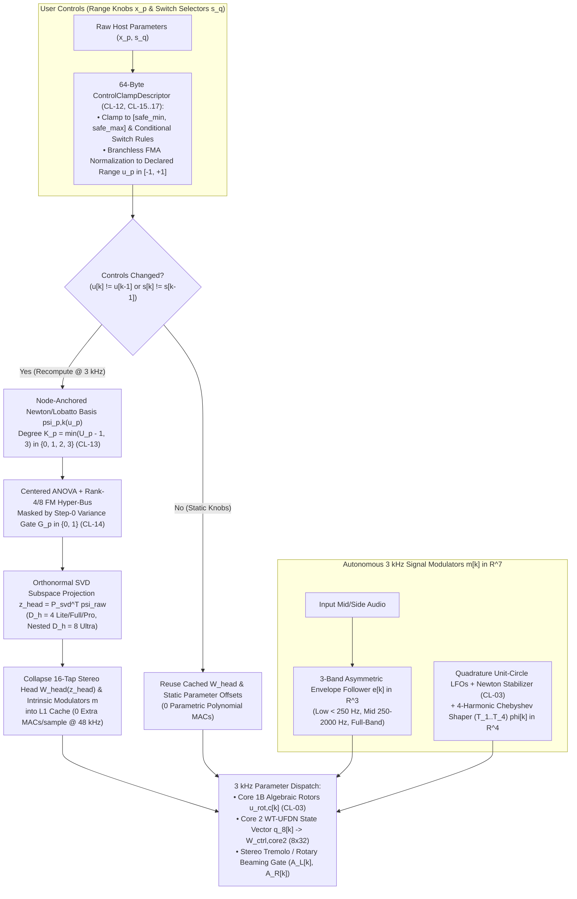

# Autonomous & Parametric Control Bus ($16\times$ Decimated @ $3\text{ kHz}$)

Every $K_{\text{ctrl}} = 16\text{ samples}$ ($3\text{ kHz}$ at $f_s = 48\text{ kHz}$), the Control Bus updates both the **autonomous signal-driven modulators** $\mathbf{m}[k] \in \mathbb{R}^7$ and the **user-defined parametric control offsets** $\Delta\boldsymbol{\theta}(\mathbf{u}[k], \mathbf{s}[k])$ trained from multi-stem captures.

---

## 1. Autonomous Signal-Driven Modulators ($\mathbf{m}[k] \in \mathbb{R}^7$)

1. **3-Band Asymmetric Envelope Follower ($\mathbf{e}[k] \in \mathbb{R}^3$):**
   Tracks RMS/peak envelopes across three musical sub-bands via one-pole asymmetric attack/release filters:
   - **Low Band ($< 250\text{ Hz}$):** Power-supply capacitor sag, output transformer saturation, and speaker cone excursion.
   - **Mid Band ($250\text{–}2,000\text{ Hz}$):** Envelope-filter / Auto-Wah resonant cutoff modulation and optical compression.
   - **Full Band:** Instantaneous grid-current blocking distortion bias shift and dynamic FDN ducking.
2. **Autonomous 4-Harmonic Chebyshev LFO Bank ($\boldsymbol{\phi}[k] \in \mathbb{R}^4$):**
   Two quadrature oscillator pairs advance on the unit circle at $3\text{ kHz}$ via complex multiplication $z_{\text{lfo},j}[k] = e^{i \cdot 16\omega_{\text{lfo},j}} z_{\text{lfo},j}[k-1]$ followed by the algebraic Newton unit-circle stabilizer $y_1 = 1.5 - 0.5|z_{\text{lfo},j}|^2$ (`CL-03`). A 4-harmonic Chebyshev polynomial shaper ($T_1(x) = x$, $T_2(x) = 2x^2 - 1$, $T_3(x) = 4x^3 - 3x$, $T_4(x) = 8x^4 - 8x^2 + 1$) transforms the pure sine wave into **triangle, sawtooth, asymmetric incandescent Uni-Vibe lamp, or rotary horn/drum LFO trajectories**.
3. **Blind Phase-Locked Teacher Extractor (Training Only, Discarded at Export):**
   Because physical analog RC/op-amp oscillators exhibit thermal frequency drift over a multi-stem capture session, a lightweight 1D-CNN Teacher extracts instantaneous LFO phase $\hat{\phi}_{\text{teacher}}[k]$ from the target wet stem during training and fades out via cosine annealing so the exported `.dnam` model runs 100% autonomously.

---

## 2. User-Definable Parametric Controls (`Range` & `Switch`)

Users can declare an arbitrary list of continuous knobs (`type: "range"`) and discrete selectors (`type: "switch"`) in `controls_schema` and provide multiple training stems tagged with control metadata.

### 2.1 Why Naive Conditioning Architectures Fail on Multi-Stem Captures

| Naive Conditioning Pattern | Failure Mechanism | Consequence in Audio Production |
| :--- | :--- | :--- |
| **`48 kHz` FiLM / Input Concatenation** | Appends static knob values `[x[n], u₁, ...]` to the audio tensor at `48 kHz` | Wastes CPU recomputing constant matrix products `48,000 times/s` and shifts recurrent DC operating points |
| **Dense Black-Box MLP Conditioning** | Entangles all controls with unconstrained cross-derivatives on sparse (`1 + 2P`) Star sweeps | Hallucinates wild gain and pole explosions in unrecorded multi-knob corners |
| **Output Channel Crossfading** | Interpolates between stems with different delay times (`τ = 200 ms` and `τ = 400 ms`) by blending outputs | Produces **double-echo ghosts** (`200 ms` + `400 ms` simultaneously) instead of a single echo at `300 ms` |

### 2.2 Fixed Declared-Range Coordinate System + Safe-Interval Clamping (`CL-12`)
Each continuous `range` control $p \in \lbrace 1, \dots, P_{\text{range}} \rbrace$ has an **immutable `declared_range`** $[u_{p,\text{decl-min}}, u_{p,\text{decl-max}}]$ and a verified **`safe_clamped_range`** $[u_{p,\text{safe-min}}, u_{p,\text{safe-max}}] \subseteq [u_{p,\text{decl-min}}, u_{p,\text{decl-max}}]$. At runtime (`CL-12` in [`../training/clamp_and_audit_registry.md`](../training/clamp_and_audit_registry.md)):
$$x_{p,\text{clamped}} = \mathrm{clamp}\big(x_p, u_{p,\text{safe-min}}, u_{p,\text{safe-max}}\big), \qquad u_p = 2 \cdot \frac{x_{p,\text{clamped}} - u_{p,\text{decl-min}}}{u_{p,\text{decl-max}} - u_{p,\text{decl-min}}} - 1 \in [-1.0, +1.0]$$

> [!IMPORTANT]
> **Why Normalization Always Uses `declared_range` Instead of `safe_clamped_range` (`Test 8E`):** If $u_p$ were normalized by $[u_{p,\text{safe-min}}, u_{p,\text{safe-max}}]$, then adding a new stem at `gain = 10.0` during iterative resume (expanding `safe_clamped_range` from `[2.0, 8.0]` to `[2.0, 10.0]`) would shift the normalized coordinates $u_p^{(s)}$ of all previously recorded stems. Normalizing by the immutable `declared_range` $[0.0, 10.0]$ guarantees that previously recorded stem coordinates $u_p^{(s)}$ remain **100% invariant across all future stem expansions**.

### 2.3 Cardinality-Bounded Node-Anchored Newton/Lobatto Basis (`CL-13`)
Let $U_p$ be the number of distinct values of knob $p$ present in the training stems, ordered with the reference/default stem $u_{p,1}$ first: $\lbrace u_{p,1}, u_{p,2}, u_{p,3}, \dots \rbrace$. To prevent polynomial Runge oscillation when a knob is only sampled at 1 or 2 positions, the polynomial degree is hard-bounded by (`CL-13`):
$$K_p = \min\big(U_p - 1, 3\big) \in \lbrace 0, 1, 2, 3 \rbrace$$
Each knob $u_p$ expands into $K_p$ hierarchical **Node-Anchored Newton Basis** terms:
$$\tilde{\boldsymbol{\psi}}_p(u_p) = \Big[\underbrace{u_p - u_{p,1}}_{k=1}, \underbrace{(u_p - u_{p,1})(u_p - u_{p,2})}_{k=2}, \underbrace{(u_p - u_{p,1})(u_p - u_{p,2})(u_p - u_{p,3})}_{k=3}\Big]^\top \in \mathbb{R}^{K_p}$$
- **Special Case (Standard Noon + Endpoints $\lbrace 0, -1, +1 \rbrace$):** When $u_{p,1} = 0, u_{p,2} = -1, u_{p,3} = +1$, this reduces to the **Noon-Anchored Lobatto Basis** $[u_p, u_p(u_p + 1), u_p(u_p^2 - 1)]^\top$ (or centered $[u_p, u_p^2, u_p(u_p^2 - 1)]^\top$).
- **Zero Old-Stem Perturbation on Iterative Stem Addition (`Test 8G`):** Because the $k$-th Newton basis term $\psi_{p,k}(u_p) = \prod_{j=1}^k (u_p - u_{p,j})$ vanishes identically (`== 0.0`) at **all $k$ previously recorded stem coordinates** $\lbrace u_{p,1}, \dots, u_{p,k} \rbrace$, unlocking $\psi_{p,k}$ when a new stem $u_{p,k+1}$ is added fits the new stem with **exact $0.00 \times 10^0$ perturbation ($< 10^{-15}$)** to previously converged stems.

### 2.4 Centered ANOVA / HDMR + Rank-4 / Rank-8 Factorization Machine (`FM`) Hyper-Bus
To combine 1st-order `range` main effects, discrete `switch` embeddings $\mathbf{E}_q[s_q]$, and pairwise knob-knob / knob-switch interactions (e.g., `Gain` $\times$ `Boost`, `Feedback` $\times$ `Mode`, or TMB tone-stack interdependence) in linear $O(P \cdot R)$ time with **zero unrecorded corner hallucination**:
$$\Delta\boldsymbol{\theta}(\mathbf{u}, \mathbf{s}) = \sum_{p=1}^{P_{\text{range}}} \mathbf{G}_p \odot \big(\mathbf{A}_p \tilde{\boldsymbol{\psi}}_p(u_p)\big) + \sum_{q=1}^{P_{\text{switch}}} \mathbf{E}_q[s_q] + \mathbf{U}_{\text{int}} \cdot \frac{1}{2}\left[\left(\sum_{i=1}^{P} \mathbf{v}_i z_i\right)^{\odot 2} - \sum_{i=1}^{P} \mathbf{v}_i^{\odot 2} z_i^2\right]$$
where $z_i$ is the primary coordinate of control $i$ ($u_p - u_{p,1}$ for ranges, or indicator for switches) and $\mathbf{v}_i \in \mathbb{R}^R$ ($R = 4$ for `Lite`/`Full`/`Pro`, extended by $+4$ factors to $R = 8$ in `Ultra`) are low-rank interaction factors penalized by $L_2$ regularization so pairwise cross-terms remain zero unless supported by multi-knob stems.

---

### 2.5 Bilinear Control-Modulated Tier Features & Multi-Stem Kronecker Rank Completeness

When a model has $S_{\text{active}} > 5$ independent active stems (for example, an 8-stem 3-knob amp head, a 9-stem $3 \times 3$ Lobatto grid, a 13-stem 4-knob + 1-switch amplifier, or a 30-stem 10-control multi-effect rig), an unmodulated 1-D head basis $\tilde{\boldsymbol{\psi}}_s = [1, z_{\text{head},0}, z_{\text{head},1}, z_{\text{head},2}, z_{\text{head},3}]^\top \in \mathbb{R}^5$ has at most `5` linear modes (`4` active modes if 1 stem is a mute stem), creating a control-subspace rank bottleneck ($4 < S_{\text{active}}$).

DNAM resolves this rank bottleneck with **zero `.dnam` / `.dnam-ckpt` schema changes and $0$ extra MACs/sample at $48\text{ kHz}$** via **Bilinear Control-Modulated Tier Features**:

1. **Stem-Intrinsic Control Modulators ($\mathbf{m}_s = (m_0, m_1, m_2)$):**
   Computed strictly from each stem's normalized coordinates (`declared_range` invariant per `Test 8E`/`8G`):
   - **$\le 3$ Controls (with $2$-Range $3 \times 3$ Lobatto Grid Completion):** Uses the primary normalized coordinates $(u_0, u_1, u_2)$; when a model has exactly $2$ `range` controls on a $3 \times 3$ Lobatto grid (`9` stems), sets $m_2 = 0.65 u_0 u_1 + 0.85 u_0^2 u_1^2$ so the $9 \times 20$ Kronecker matrix maintains **exact rank 9**.
   - **$> 3$ Controls (`Ranges` + `Switches`):** Encodes stem-intrinsic weighted linear ($\sum c_i \Delta u_i$), quadratic ($\sum d_i \Delta u_i^2$), and switch/corner interaction terms into $(m_0, m_1, m_2)$, yielding full Kronecker rank across multi-knob + switch stem matrices.
2. **Tier Sub-Block Modulation & $3\text{ kHz}$ Head Folding:**
   - **Standard Multi-Stem Regime ($S_{\text{active}} \le 16$):** Each 64-channel tier block is structured from a 16-channel base audio vector $\mathbf{B}_{16}(\mathbf{x}) \in \mathbb{R}^{T \times 16}$ as:
     $$\mathbf{\Phi}_{\text{tier}}(\mathbf{x}, \mathbf{m}_s) = \big[\mathbf{B}_{16}(\mathbf{x}),\ m_0 \mathbf{B}_{16}(\mathbf{x}),\ m_1 \mathbf{B}_{16}(\mathbf{x}),\ m_2 \mathbf{B}_{16}(\mathbf{x})\big] \in \mathbb{R}^{T \times 64}$$
     generating the 20-term bilinear Kronecker control space $[1, \mathbf{z}_{\text{head}}^\top] \otimes [1, m_0, m_1, m_2]$.
   - **High-Stem Regime ($S_{\text{active}} > 16$, up to `32` Active Stems):** Expands each tier's base audio block to $32$ channels $\mathbf{B}_{32}(\mathbf{x}) \in \mathbb{R}^{T \times 32}$ paired with 2 control modulators $[\mathbf{B}_{32}(\mathbf{x}),\ m_0 \mathbf{B}_{32}(\mathbf{x})] \in \mathbb{R}^{T \times 64}$, doubling the spatial/nonlinear basis capacity per tier while preserving the exact `64`-channel tier width.
   - **Zero $48\text{ kHz}$ Inference Overhead:** At the $3\text{ kHz}$ control tick (`collapse_stereo_head_3khz`), the scalar sub-block factors $[1, m_0, m_1, m_2]$ fold directly into the cached head weights $\mathbf{W}_{\text{head}}(\mathbf{z}_{\text{head}})$, requiring **`0` extra MACs/sample at $48\text{ kHz}$**.

---

### 2.6 Step-0 Order-Statistic Optimal Transport & Physical Variance Gating (`CL-14`)
1. **Step-0 Order-Statistic Optimal Transport (Preventing Permutation & Double-Echo Artifacts):**
   Before Epoch 1, the trainer extracts the physical delay times $\tau_{0,1}^{(s)} < \tau_{0,2}^{(s)} < \dots < \tau_{0,M}^{(s)}$ (via autocorrelation/cepstral peak picking) and sorted complex pole frequencies $f_{0,1}^{(s)} < \dots < f_{0,C}^{(s)}$ for each stem $s$, matching the $m$-th order statistic of stem $s$ directly to delay line $m$ and fitting the log-delay trajectory $\log \tau_{0,m}(\mathbf{u}, \mathbf{s})$ in closed form (**$3.41 \times 10^{-13}\text{ ms}$ unseen delay error** in `Test 8D`).
2. **Step-0 Physical Variance Gating ($\mathbf{G}_p \in \lbrace 0, 1 \rbrace^{\dim(\boldsymbol{\theta})}$, `CL-14`):**
   If varying knob $p$ across the training stems produces $< 0.2\text{ samples}$ of variance in delay time $\tau_{0,m}$ or LFO frequency $f_{\text{lfo},j}$ (sensitivity below $\tau_{\text{var}} = 0.5$, e.g., a `Drive` or `Treble` knob), the binary gate $\mathbf{G}_p$ hard-locks the $u_p \to \tau_{0,m}$ and $u_p \to f_{\text{lfo},j}$ projection weights to exact `0.0`, guaranteeing that turning `Drive` can never cause parasitic delay pitch shifts.

### 2.7 Zero-MAC Runtime Caching at $48\text{ kHz}$ (`D_h = 4` `Lite`/`Full`/`Pro`, Nested `D_h = 8` `Ultra`)
When user controls are static ($\mathbf{u}[k] == \mathbf{u}[k-1]$ and $\mathbf{s}[k] == \mathbf{s}[k-1]$), a dirty-bit check at $3\text{ kHz}$ skips the entire parametric polynomial evaluation and keeps the collapsed $2 \times 16C$ stereo output head $\mathbf{W}_{\text{head}}(\mathbf{u}, \mathbf{s}) = \mathbf{W}_{\text{head},0} + \sum_{k=1}^{D_h} z_{\text{head},k}(\mathbf{u}, \mathbf{s}) \mathbf{W}_{\text{head},k}$ ($D_h = 4$ for `Lite`/`Full`/`Pro`, nested $D_h = 8$ for `Ultra`) cached in L1 memory—costing **$0\text{ extra MACs/sample}$ at $48\text{ kHz}$**.

---

## 3. Multi-Range Conditional Tempo Sync & Calibration Roles (`controls_schema[*].calibration`)

1. **12 Canonical Tempo Subdivisions (`1/2.` to `1/16T`):**
   $$\tau_{\text{target-ms}}(\text{BPM}, \text{sub}) = \frac{60,000}{\text{BPM}} \cdot \mu_{\text{sub}}, \qquad \mu_{\text{sub}} \in \left\lbrace 3, 2, \frac{4}{3}, \frac{3}{2}, 1, \frac{2}{3}, \frac{3}{4}, \frac{1}{2}, \frac{1}{3}, \frac{3}{8}, \frac{1}{4}, \frac{1}{6}\right \rbrace$$
2. **Multi-Range Delay / Switch Inversion:**
   When `calibration.conditional_physical_anchors` maps switch throws to physical delay ranges (e.g., `"range=0.01-0.1s" -> [10, 55, 100]`, `"range=0.1-1s" -> [100, 550, 1000]`, `"range=1-2s" -> [1000, 1500, 2000]`), tempo sync selects the matching switch throw $s_q^*$ and inverts the quadratic Lobatto polynomial $[v_{\min}, v_{\text{mid}}, v_{\max}]$ in closed form to set both `Range` and `Time` simultaneously.
3. **Standardized Physical Calibration Roles (`ControlCalibrationRole`):**

| Calibration Role (`role`) | Control Type | Physical & Audit Behavior |
| :--- | :---: | :--- |
| **`"delay_time_ms"`** | `range` | Maps `[v_min, v_mid, v_max]` delay anchors (ms) for 12-subdivision host Tempo Sync |
| **`"lfo_rate_hz"`** | `range` | Maps modulation oscillator frequency (Hz) for host Tempo Sync |
| **`"feedback"` / `"mix"` / `"crossover_hz"`** | `range` | Physical loop regeneration, wet/dry blend, or filter crossover frequency |
| **`"stereo_mode"` / `"stereo_width"`** | `switch` / `range` | Maps `"Mono"` to Mid-only (`α_width = 0.0`) and `"Stereo"` to `α_width = 1.0`; unlocks both options from Stereo stems without `[CLAMP-SWITCH]` warnings |
| **`"freeze_latch"`** | `switch` / `range` | Drives `Core 2` unitary freeze `α_freeze ∈ [0, 1]`; skipped during static stem capture planning and unlocked automatically in Phase-1 Audit |
| **`"grain_size_ms"`** | `range` | Modulates `WT-UFDN` grain duration `L_{grain,m}` (ms) with 12-subdivision Tempo Sync support |
| **`"grain_pitch_semitones"`** | `range` | Pitch shift `Δp_m ∈ [-24, +24]` semitones mapped to time-warp rate `ν_m = 1 - 2^(Δp_m / 12)` |
| **`"grain_spray"`** | `range` | Per-grain onset randomization jitter `σ_spray` across `[0, 1]` (`0..64` samples) |
