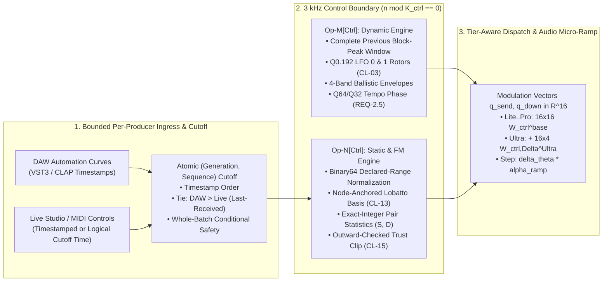

# Self-Similar 3 kHz Dual-Rate Control Plane & Parametric Control Bus

**Document Version:** `1.0.0`  
**Status:** Canonical DSP Specification (SSOT)  
**Parent Architecture:** [`docs/overview/tora_architecture.md`](../overview/tora_architecture.md)  
**Target Engine:** [`packages/engine/src/control/`](../../packages/engine/README.md)  
**Target Trainer:** [`packages/trainer/src/dnam_trainer/training/`](../../packages/trainer/README.md)  
**Canonical Compliance:** [`CL-12` (Declared-Range Clamping)](../training/clamp_and_audit_registry.md), [`CL-13` (Lobatto Degrees)](../training/clamp_and_audit_registry.md), [`CL-14` (Variance Gating)](../training/clamp_and_audit_registry.md), [`CL-15` (Trust-Region Bounds)](../training/clamp_and_audit_registry.md), [`REQ-2.5` (12-Subdivision Tempo Sync)](../overview/system_goals_and_requirements.md)

This specification defines the **nominal 3 kHz Dual-Rate Control Plane**, shared control descriptors and packed tier-local `CP1` `f32` projection slices, exact-integer sufficient-statistic accumulation, outward-checked trust-region clipping (`CL-15`), tier-aware `16 × 16` + `16 × 4` stage dispatch, division-free linear micro-ramping, and `20–400 BPM` tempo synchronization across 12 rhythmic subdivisions (`REQ-2.5`). For R&D counterexamples and derivations, see [`../rnd/tora_phase1_decisions.md` §2.4](../rnd/tora_phase1_decisions.md#24-3-khz-control-bus-exact-integer-accumulator-outward-trust-clip--tempo-inversion).

---

## 1. Dual-Rate Execution & Self-Similar Kernel Architecture



### 1.1 `Op-M[Ctrl]`: 3 kHz 4-Lane Symplectic Complex & Ballistic Engine

At each control boundary (decimation stride $K_{\text{ctrl}}(f_{s,\text{eff}}) = \max(8, \mathrm{round}(f_{s,\text{eff}} / 3000.0))$, equal to `16` samples at `48 kHz` and `15` samples / `2,940 Hz` at `44.1 kHz` with tick ratio $\rho_{\text{ctrl}} = \frac{48000 \cdot K_{\text{ctrl}}(f_{s,\text{eff}})}{16 \cdot f_{s,\text{eff}}}$), `Op-M[Ctrl]` completes the preceding detector block before applying new host control batches:

1. **Completed-Block 4-Band Asymmetric Ballistic Envelope Bank:** Collect rectified band peaks $|x_b[k]| = \max_{0 \le m < K_{\text{ctrl}}} |x_b[K_{\text{ctrl}}k + m]|$ over the completed block ($b \in \lbrace \text{Low}, \text{Mid}, \text{High}, \text{Aux Key} \rbrace$) and update:
   $$e_b[k] = \alpha_b[k] e_b[k-1] + (1 - \alpha_b[k]) |x_b[k]|, \qquad \alpha_b[k] = \mathrm{select}\big(|x_b[k]| > e_b[k-1],\ \alpha_{\text{att},b},\ \alpha_{\text{rel},b}\big)$$
2. **Quadrature LFO 0 & 1 Rotors (`CL-03`):** Advance the two independent `Q0.192` LFO phase accumulators by the previous window's effective increment and map their top 32 bits to unit phasors via the quadrant-reduced contractive rotor ([`op_m_modal_kautz.md` §1.2](op_m_modal_kautz.md#12-contractive-finite-precision-rotor-cl-03)). Zero increments hold oscillator state bit-for-bit.
3. **Single-Rate-Change Window Retiming:** On an admitted effective-rate transition from $(f_o, K_o)$ to $(f_n, K_n)$ after $c \in \lbrace 0, \dots, K_o - 1 \rbrace$ old-rate samples, retain partial band peaks, LFO phases, and envelope states, completing the first mixed window after $d = \mathrm{round}((K_o - c)K_n / K_o)$ new-rate samples with actual duration $\Delta t = c/f_o + d/f_n$ ([`test_control_tick_spec_references.py`](../../tests/test_control_tick_spec_references.py)).

#### Host Automation Timing

1. **Control-Boundary Eligibility:** Timestamped host parameter updates at frame $n = k K_{\text{ctrl}}$ apply at boundary $k$; updates strictly inside $(k K_{\text{ctrl}}, (k+1)K_{\text{ctrl}}]$ apply at boundary $k+1$ (maximum fixed-rate wait $K_{\text{ctrl}} - 1$ samples, `0.3125 ms` at `48 kHz`).
2. **Continuous Host Curves (`VST3 IParamValueQueue`):** Reconstruct piecewise-linear normalized curves in normalized space before mapping to physical coordinates ([`test_host_curve_spec_references.py`](../../tests/test_host_curve_spec_references.py)).
3. **Timestamp Arbitration & Tie Precedence:** Order eligible events by timestamp. At an exact timestamp tie for the same parameter, **DAW automation wins over live Studio/MIDI requests**; between live Studio and MIDI requests at an exact tie, **the most recently received accepted request wins**.
4. **Late, Stale & Untimestamped Requests:** Compare late ordinary requests against each control's last published ordering key `(timestamp, source_priority, receipt_order, sub_ordinal)` and apply at the next boundary only if not superseded ([`test_late_control_spec_references.py`](../../tests/test_late_control_spec_references.py)). Reject stale presets as a whole. Untimestamped live Studio/MIDI requests receive the first eligible cutoff's signal-time timestamp as their immutable logical scheduled time ([`test_untimed_control_spec_references.py`](../../tests/test_untimed_control_spec_references.py)).
5. **Bounded Per-Producer Ingress Protocol:** Preallocated SPSC lanes linearize acceptance and boundary cutoffs via a single sequentially consistent `u64` atomic (`high 48 bits = generation`, `low 16 bits = sequence`, total slots `< 65,536`; [`test_ingress_publication_spec_references.py`](../../tests/test_ingress_publication_spec_references.py)).

### 1.2 `Op-N[Ctrl]`: 3 kHz Algebraic Polynomial, Hysteresis & $O(1)$ Sufficient-Statistic Engine

At each control boundary, `Op-N[Ctrl]` evaluates:
1. **Node-Anchored Newton/Lobatto Basis (`CL-13`):** $\boldsymbol{\psi}_p[k] = [\psi_{p,1}(u_p[k]), \psi_{p,2}(u_p[k]), \psi_{p,3}(u_p[k]), s_{p,\mathrm{sw}}[k]]^\top \in \mathbb{R}^4$.
2. **Chebyshev LFO Waveshaping:** $T_1(x) = x$, $T_2(x) = 2x^2 - 1$, $T_3(x) = 4x^3 - 3x$, $T_4(x) = 8x^4 - 8x^2 + 1$.
3. **Rank-4 / Rank-8 Factorization Machine (FM) Interaction:** Evaluates cross-control bilinear interactions from scalar embeddings $z_p[k] = \mathbf{w}_{\text{proj},p}^\top \boldsymbol{\psi}_p(u_p[k])$.
4. **Groupwise Trust-Region Clipping (`CL-15`, `CL-17`):** Independently bounds $\mathbf{z}_{\mathrm{head}} \in \mathbb{R}^{D_h}$ and $\mathbf{z}_{\mathrm{stage}} \in \mathbb{R}^{D_s}$ ($D_h = D_s = 4$ in `Lite..Pro`, $D_h = D_s = 8$ in `Ultra`):
   $$\rho^2 = \Vert\mathbf{z}\Vert_2^2, \qquad \mathbf{z} \leftarrow \mathbf{z} \cdot \min\left(1.0\mathrm{f32},\ \frac{\rho_{\max}}{\sqrt{\rho^2 + \epsilon}}\right)$$

#### Outward-Checked Trust-Region Clip

To prevent `f32` rounding from placing clipped vectors outside the exact Euclidean ball $\Vert \mathbf{z} \Vert_2 \le \rho_{\max}$ or flushing subnormal coordinates under FTZ/DAZ ([`test_trust_clip_spec_references.py`](../../tests/test_trust_clip_spec_references.py), [`trust_clip_spec_references.rs`](../../packages/engine/tests/trust_clip_spec_references.rs)):
1. **Bit-Preserving `f32 <-> f64` Conversion:** Widen `f32` bit patterns (including subnormals via leading-zero shift `p + 874`) directly to IEEE-754 `f64` bits without executing hardware `f32` instructions subject to FTZ/DAZ, and round `f64` outputs back to `f32` bits using integer significand shifts (`M >> 29` for normals, `M >> (-E - 97)` for subnormals, ties-to-even).
2. **Outward-Rounded Energy & Output Check:** Using `nextup` (`bits + 1` on positive `f64`), form outward denominator bound $S = \mathrm{add-up}(\epsilon, \sum_i x_i^2)$ and exact $R^2 = \rho_{\max}^2$. Accept scale $t \in [0, 1]$ with rounded `f32` output $v_i = \mathrm{RN}_{32}(x_i t)$ only when both $\mathrm{mul-up}(\mathrm{mul-up}(t, t), S) \le R^2$ and $\sum_i v_i^2 \le R^2$.
3. **6-Step Newton Fast Path & 32-Step Bisection Fallback:** Seed $y_0 = 2^{-\lfloor (E_s + 2)/2 \rfloor}$ from the unbiased exponent $E_s$ of $S$, iterate $y_{k+1} = \mathrm{fl}_{64}(y_k(1.5 - 0.5 S y_k^2))$ six times, and test $t_{\text{fast}} = \min(1 - 2^{-20}, \rho_{\max} y_6 (1 - 2^{-20}))$. If accepted, return $v_i$; otherwise bisect `32` times over $[0, \min(1, 2^{E_r + 1 - E})]$. For normal radii, relative scale contraction is $< 9.57 \times 10^{-7}$ and vector error is $< 1.185 \times 10^{-6} \rho_{\max}$.

---

## 2. User-Definable Parametric Controls (`Range` & `Switch`)

### 2.1 Why Naive Conditioning Architectures Fail on Multi-Stem Captures

| Naive Conditioning Pattern | Failure Mechanism | Consequence in Audio Production |
| :--- | :--- | :--- |
| **`48 kHz` FiLM / Input Concatenation** | Appends static knob values `[x[n], u_1, ...]` to the audio tensor at `48 kHz` | Wastes CPU recomputing constant matrix products `48,000 times/s` and shifts recurrent DC operating points |
| **Dense Black-Box MLP Conditioning** | Entangles all controls with unconstrained cross-derivatives on sparse (`1 + 2P`) Star sweeps | Hallucinates wild gain and pole explosions in unrecorded multi-knob corners |
| **Output Channel Crossfading** | Interpolates between stems with different delay/phase trajectories | Severe comb filtering, destructive phase cancellation, and doubled transient echoes |
| **Unconstrained Polynomial Fits** | High-order global polynomial or spline fitting across sparse control points | Runge phenomenon: oscillations between anchor points and numerical explosion outside safe range |

### 2.2 Fixed Declared-Range Coordinate System & Safe-Interval Clamping (`CL-12`)

Clamp physical host values to the active safe interval and normalize against the declared endpoints $x_{\min,p} < x_{\max,p}$:
$$u_p = \mathrm{clamp}\left(2.0 \frac{x_p - x_{\min,p}}{x_{\max,p} - x_{\min,p}} - 1.0,\ -1.0,\ +1.0\right)$$
To prevent catastrophic cancellation on closely spaced `f32` endpoints (such as $2^{30}$ and $2^{30} + 128$) or overflow on wide spans ([`test_control_normalization_spec_references.py`](../../tests/test_control_normalization_spec_references.py)), widen endpoints to `binary64` on the cold path, precompute $d = x_{\max,p} - x_{\min,p}$ and $r = 1/d$ in `f64`, and evaluate $\mathrm{RN}_{32}(\mathrm{clamp}(2.0 \cdot ((x_p - x_{\min,p}) \cdot r) - 1.0, -1.0, 1.0))$ at the control boundary (absolute error $< 2^{-24}$).

#### Binary32 Physical-Coordinate Bounds

Intersect signed `binary64` safety bounds onto the ordered set of admissible `f32` physical knob values (`4,278,190,079` values under gradual underflow or `4,261,412,865` under FTZ/DAZ, with signed zero unified as `+0.0f32`) using inward integer rank bounds (`[L, U - 1]`, at most `32` binary-search comparisons on the cold path; [`test_control_bound_spec_references.py`](../../tests/test_control_bound_spec_references.py)). Map any out-of-range finite request to the nearest admissible physical value (ties toward zero).

### 2.3 Cardinality-Bounded Node-Anchored Newton/Lobatto Basis (`CL-13`)
For $U_p$ distinct observed normalized coordinates and active degree $K_p = \min(\max(U_p - 1, 0), 3)$ with persisted anchor nodes $a_{p,1}, a_{p,2}, a_{p,3}$:
$$\psi_{p,1}(u_p) = u_p - a_{p,1}, \qquad \psi_{p,2}(u_p) = \psi_{p,1}(u_p)(u_p - a_{p,2}), \qquad \psi_{p,3}(u_p) = \psi_{p,2}(u_p)(u_p - a_{p,3})$$
Lanes above $K_p$ are zero (`K_p = 0` emits no latent contributor).

### 2.4 Centered ANOVA / HDMR + Rank-4 / Rank-8 Factorization Machine (`FM`) Hyper-Bus
$$\hat{y}(\mathbf{u}) = w_0 + \sum_{p=1}^P \mathbf{w}_p^\top \boldsymbol{\psi}_p(u_p) + \frac{1}{2} \sum_{f=1}^R \left[ \left(\sum_{p=1}^P v_{p,f} z_p\right)^2 - \sum_{p=1}^P v_{p,f}^2 z_p^2 \right]$$

### 2.5 O(1) Additive Latent Sufficient-Statistic Control Scaling

```text
+---------------------------------------------------------------------------------------------------+
| TIER-LOCAL PREFIX-DELTA 16-D ULTRA CONTROL ARCHITECTURE (CP1 PACKED PROFILE)                      |
+---------------------------------------------------------------------------------------------------+
|  Arena 0 (Lite Base, Retained by Lite / Full / Pro / Ultra):                                      |
|    • Static Latent z_ctrl^base in R^8 = [z_head^(0..3), z_stage^(0..3)]^T, FM Rank R = 4          |
|    • Per Contributor (k active lanes): W_main[8,k] + w_proj[k] + v[4] = 4(9k + 4) B               |
|    • Global Matrices: U_int^base[8,4] (128 B) + W_ctrl^base[16,16] (1,024 B)                      |
+---------------------------------------------------------------------------------------------------+
|  Arena 3 (Ultra Delta, Truncated on Tier Stripping):                                              |
|    • Static Latent Delta z_ctrl,Delta^Ultra in R^8 = [z_head^(4..7), z_stage^(4..7)]^T, R = 8     |
|    • Per Contributor (k active lanes): W_main,Delta[8,k] + v_Delta[4] = 4(8k + 4) B               |
|    • Global Matrices: 3 x U_int,Delta[8,4] (384 B) + W_ctrl,Delta^Ultra[16,4] (256 B)             |
+---------------------------------------------------------------------------------------------------+
```

| Tier Profile | Head Coordinates (`D_h`) | Stage Coordinates (`D_s`) | Total Static Dim (`D`) | FM Rank (`R`) | Active Contributor Slice (`k` lanes) |
| :--- | :---: | :---: | :---: | :---: | :--- |
| **`Lite` / `Full` / `Pro`** | `4` (`0..3`) | `4` (`0..3`) | `8` | `4` | `4(9k + 4) B` (`124 B` for `k=3`, `52 B` for switch `k=1`) |
| **`Ultra` (`+ Arena 3` Delta)** | `8` (`0..7`) | `8` (`0..7`) | `16` | `8` | `+ 4(8k + 4) B` (`+112 B` for `k=3`, `+48 B` for switch `k=1`) |

#### 2.5.1 Multi-Option Switch Contributors & Conditional Batch Safety

For a discrete switch $q$ with declared reference option, each represented non-reference option $o$ is a separate `k = 1` contributor $\boldsymbol{\psi}_{q,o}(\sigma_q) = [0, 0, 0, \mathbf{1}(\sigma_q = o)]^\top$ ([`../containers/dnam_binary_format.md` §2.4](../containers/dnam_binary_format.md#packed-control-projection-profile)).

##### Conditional Batch Safety

1. **Whole-Candidate Preset & Event Evaluation ([`test_preset_spec_references.py`](../../tests/test_preset_spec_references.py)):** Loading a partial preset restores signed defaults for all omitted controls at the effective tier, overlays the preset's assignments, resolves `[CLAMP-SWITCH]` active masks, and intersects all matching structured conditional bounds ([`../containers/dnam_binary_format.md` §2.3](../containers/dnam_binary_format.md#conditional-control-rules)).
2. **Active-Fade Endpoint Protection:** Validate candidate switches against all still-live delay and transition reads; defer or reject the entire batch if a new bound would invalidate an active crossfade endpoint.
3. **Disjoint-Interval Two-Path Blend:** When a switch change moves a dependent continuous control between disjoint safe intervals, step isolated old and new paths under their respective safe states and crossfade their outputs $y = (1 - \alpha)y_{\text{old}} + \alpha y_{\text{new}}$ without feeding the blend back into either state.

#### 2.5.2 Mathematical Derivation & Conditions for O(1) Incremental Updates

##### 1. Why Naive Control Buses Hit a Hard $P \le 16$ Wall
Materializing a concatenated basis vector $\boldsymbol{\psi}_{\text{all}} \in \mathbb{R}^{3P}$ at every tick causes $\mathcal{O}(P)$ state growth and $\mathcal{O}(P)$ MACs per control tick.

##### 2. The Mathematical Solution: Centered ANOVA + Rank-$R$ Factorization Machine Latent Projection
$$\mathbf{z}_{\text{main}} = \sum_{p=0}^{P-1} \mathbf{W}_{\text{main},p} \boldsymbol{\psi}_p(u_p) \in \mathbb{R}^D, \qquad z_p = \mathbf{w}_{\text{proj},p}^\top \boldsymbol{\psi}_p(u_p) \in \mathbb{R}$$
$$\mathbf{s}_{vx} = \sum_{p=0}^{P-1} \mathbf{v}_p z_p \in \mathbb{R}^R, \qquad \mathbf{s}_{v2x2} = \sum_{p=0}^{P-1} (\mathbf{v}_p \odot \mathbf{v}_p) z_p^2 \in \mathbb{R}^R, \qquad \mathbf{z}_{\text{fm}} = \frac{1}{2} (\mathbf{s}_{vx} \odot \mathbf{s}_{vx} - \mathbf{s}_{v2x2}) \in \mathbb{R}^R$$
$$\mathbf{z}_{\text{raw}}^{(0..7)} = \mathbf{z}_{\text{main}}^{(0..7)} + \mathbf{U}_{\text{int}}^{\text{base}}\mathbf{z}_{\text{fm}}^{(0..3)} + \mathbf{U}_{\text{int},\Delta}^{(0..7,4..7)}\mathbf{z}_{\text{fm}}^{(4..7)}, \qquad \mathbf{z}_{\text{raw}}^{(8..15)} = \mathbf{z}_{\text{main}}^{(8..15)} + \mathbf{U}_{\text{int},\Delta}^{(8..15,0..3)}\mathbf{z}_{\text{fm}}^{(0..3)} + \mathbf{U}_{\text{int},\Delta}^{(8..15,4..7)}\mathbf{z}_{\text{fm}}^{(4..7)}$$
$$\mathbf{z}_{\text{ctrl}} = \mathrm{clip}_{\text{CL-15}}(\mathbf{z}_{\text{raw}})$$

##### 3. Exact-Integer Sufficient-Statistic Realization (Zero Drift & Zero Cancellation)
Because `f32` accumulation of $(\sum a_p)^2 - \sum a_p^2$ suffers catastrophic cancellation and accumulates drift over closed control cycles ([`test_control_accumulator_spec_references.py`](../../tests/test_control_accumulator_spec_references.py), [`control_accumulator_spec_references.rs`](../../packages/engine/tests/control_accumulator_spec_references.rs)):
- Decode each finite materialized `f32` factor contribution as $a_p = b_p 2^{-149}$ ($|b_p| < 2^{277}$) and maintain exact fixed-width signed integers $S = \sum_p b_p$ (9 `u32` words) and $D = S^2 - \sum_p b_p^2 = 2 \sum_{p<q} b_p b_q$ (18 `u32` words), along with 9-word exact main sums.
- When contributor $p$ changes from $b_o$ to $b_n$, update $D$ using two shifted 24-bit significand products without wide squaring:
  $$R = S - b_o, \qquad D_{\text{new}} = D - 2 b_o R + 2 b_n R, \qquad S_{\text{new}} = R + b_n, \qquad z_{\text{fm},f} = D_{\text{new}} \cdot 2^{-299}$$
- Feed the resulting exact-real mixed coordinates into the outward-checked `CL-15` trust-region clip before narrowing to `f32`.

---

## 3. Autonomous Signal-Driven Modulators ($\mathbf{m}_{\text{dyn}}[k] \in \mathbb{R}^8$)

At each control boundary, `Op-M[Ctrl]` and `Op-N[Ctrl]` emit the 8-D dynamic modulator vector $\mathbf{m}_{\text{dyn}}[k] = [z_{\mathrm{re},\text{lfo0}}, z_{\mathrm{im},\text{lfo0}}, T_{\text{shape}}(z_{\mathrm{re},\text{lfo0}}), T_{\text{shape}}(z_{\mathrm{re},\text{lfo1}}), e_{\text{low}}, e_{\text{mid}}, e_{\text{high}}, e_{\text{aux}}]^\top \in \mathbb{R}^8$. During training, a 1D-CNN blind phase-locked teacher extracts analog oscillator drift and anneals to zero before `.dnam` export.

### 3.1 Stage Parameter Dispatch Matrix $\mathbf{W}_{\text{ctrl}}$
With send-safe $\mathbf{q}_{\text{send}} = [\mathbf{z}_{\text{ctrl}}^{(0..7)}, \mathbf{m}_{\text{send}}^{(8)}]^\top \in \mathbb{R}^{16}$ driving rows `0..4` and downstream $\mathbf{q}_{\text{down}} = [\mathbf{z}_{\text{ctrl}}^{(0..7)}, \mathbf{m}_{\text{down}}^{(8)}]^\top \in \mathbb{R}^{16}$ driving rows `5..15`:
$$\boldsymbol{\theta}_{\text{stage}}^{\text{Lite..Pro}}[k+1] = \mathbf{W}_{\text{ctrl}}^{\text{base}} \mathbf{q}_{16}[k] \in \mathbb{R}^{16}, \qquad \boldsymbol{\theta}_{\text{stage}}^{\text{Ultra}}[k+1] = \mathbf{W}_{\text{ctrl}}^{\text{base}} \mathbf{q}_{16}[k] + \mathbf{W}_{\text{ctrl},\Delta}^{\text{Ultra}} \mathbf{z}_{\text{stage}}^{(4..7)}[k] \in \mathbb{R}^{16}$$

| Parameter Index | Target Stage | Physical Parameter Role |
| :--- | :--- | :--- |
| `θ_0, θ_1` | Stage 0 Router (Send-Safe) | External loop send gains `g_send,L`, `g_send,R` |
| `θ_2, θ_3` | Stage I Pre-FX (Send-Safe) | Micro-delay `τ_pre`, pitch shift grain ratio `ν_pitch` |
| `θ_4` | Stage I Pre-Drive (Send-Safe) | Pre-drive waveshaping boost gain |
| `θ_5, θ_6` | Stage II Preamp (2.1) | V1A drive scale, tone stack low/high balance |
| `θ_7, θ_8` | Stage II Power (2.3) | Power amp push-pull drive, supply sag depth |
| `θ_9, θ_10` | Stage III Cabinet | Kautz modal formant center frequency and shared radial gate `g[k]` |
| `θ_11` | Stage III Early FIR | Direct early reflection blend gain |
| `θ_12, θ_13` | Stage IV Spatial Tank | Master delay length `τ_tank`, loop feedback gain `g_loop` |
| `θ_14` | Stage IV Diffuser | In-buffer Schroeder all-pass diffusion coefficient `a_diff` |
| `θ_15` | Output Head | Master stereo width factor `α_width` |

### 3.2 Division-Free Linear Micro-Ramping (`0.0625f32` at $48\text{ kHz}$, $\alpha_{\text{ramp}} = 1 / K_{\text{ctrl}}$ under ZOH)
Using $\alpha_{\text{ramp}}(f_{s,\text{eff}}) = 1.0 / K_{\text{ctrl}}(f_{s,\text{eff}})$ precomputed in cold `set_sample_rate()`:
$$\Delta\boldsymbol{\theta}[k] = \big(\boldsymbol{\theta}_{\text{stage}}[k+1] - \boldsymbol{\theta}_{\text{stage}}[k]\big) \times \alpha_{\text{ramp}}(f_{s,\text{eff}}), \qquad \boldsymbol{\theta}_{\text{stage}}[n] = \boldsymbol{\theta}_{\text{stage}}[n-1] + \Delta\boldsymbol{\theta}[k]$$
Clamp each ramp within its endpoint interval and snap the final sample of the block to $\boldsymbol{\theta}_{\text{stage}}[k+1]$.

---

## 4. Step 0: Order-Statistic Optimal Transport & Physical Variance Gating (`CL-14`)

1. **Step-0 Order-Statistic Transport:** Extracts and sorts physical delay times $\tau_{0,m}$ and modal frequencies across stems before Epoch 1 to fit smooth control trajectories without double-echo crossfading.
2. **Step-0 Physical Variance Gating ($\mathbf{G}_p \in \lbrace 0, 1 \rbrace^{\dim(\boldsymbol{\theta})}$, `CL-14`):** Hard-locks $u_p \to \tau_{0,m}$ and $u_p \to f_{\text{lfo},j}$ weights to `0.0` whenever stem variance is $< 0.2\text{ samples}$ ($\tau_{\text{var}} = 0.5$).

| Calibration Role (`role`) | Control Type | Physical & Audit Behavior |
| :--- | :---: | :--- |
| **`"delay_time_ms"`** | `range` | Maps `[v_min, v_mid, v_max]` delay anchors (ms) for 12-subdivision Tempo Sync |
| **`"lfo_rate_hz"`** | `range` | Maps modulation oscillator frequency (Hz) for Tempo Sync |
| **`"feedback"` / `"mix"` / `"crossover_hz"`** | `range` | Loop regeneration, wet/dry blend, or filter crossover frequency |
| **`"stereo_mode"` / `"stereo_width"`** | `switch` / `range` | Stereo routing or width calibration |
| **`"freeze_latch"`** | `switch` / `range` | Modeled hardware freeze control (unobserved options remain clamped) |
| **`"grain_size_ms"` / `"grain_pitch_semitones"` / `"grain_spray"`** | `range` | Granular duration, pitch shift `[-24, +24]` st, and onset jitter |

---

## 5. Strict Zero-`FDIV`, Zero-`FSQRT` & Zero-`libm` Verification

#### Pitch-Ratio and Time-Warp Profile

For finite `f32` semitone shift $p \in [-24, 24]$, widen $p$ to `f64`, multiply by `0x3FAD9303FEA2F7EA` ($\ln(2)/12$), and evaluate the degree-14 Horner Taylor polynomial $d = x \sum_{j=1}^{14} x^{j-1}/j!$ in `RNE` `f64` ([`test_control_math_spec_references.py`](../../tests/test_control_math_spec_references.py)):
$$R = \mathrm{RNE}_{f32}(1 + d), \qquad \nu = \mathrm{RNE}_{f32}(-d)$$
Evaluating $\nu$ directly from $-d$ (rather than $1 - R$) preserves small nonzero warps (`relative ratio error < 6.2e-8`, `time-warp error < 1.2e-7`, exact at `-24, -12, 0, 12, 24` st).

#### Monotone `f32` Log-Envelope Lookup Profile

Use the 129-entry read-only `f32` lookup table $T_j = \mathrm{RNE}_{f32}(\log_2(1 + j/128))$ (`516 B`, SHA-256 `4d0d7c0ec194dd9d761bfe2982ca4847001f333c58a3f12f423ed2053de3a5f1`). Decompose positive finite $x = 2^E(1 + m/2^{23})$ (using leading-zero normalization on subnormals), set $j = m \gg 16$ and $a = \mathrm{f32}(m \mathbin{\mathrm{and}} \text{0xFFFF}) \cdot 2^{-16}$, and evaluate monotone interpolation (`error < 1.9e-5`):
$$d = \mathrm{RNE}_{f32}(T_{j+1} - T_j), \qquad p = \min\Big(T_{j+1},\ \mathrm{RNE}_{f32}\big(T_j + \mathrm{RNE}_{f32}(a d)\big)\Big), \qquad \widehat{\log_2(x)} = \mathrm{RNE}_{f32}(E + p)$$

---

## 6. Architectural Memory & Compute Ledgers (ASCII Diagrams)

```text
+---------------------------------------------------------------------------------------------------+
| CONTROL BUS TIER-LOCAL PAYLOAD & SUFFICIENT-STATISTIC LEDGER                                      |
+---------------------------------------------------------------------------------------------------+
|  Shared Control Descriptors: Normalization, safe bounds, conditional selectors & calibration      |
|  Arena 0 (Lite..Pro Base):   Per contributor 4(9k + 4) B | U_int^base 128 B | W_ctrl^base 1,024 B |
|  Arena 3 (Ultra Delta):      Per contributor 4(8k + 4) B | 3xU_int,D  384 B | W_ctrl,D      256 B |
|  Exact-Integer Accumulator:  9-word S + 18-word D per factor (`108 B/factor`) + 9-word main sums  |
+---------------------------------------------------------------------------------------------------+
```

---

## 7. Host, MIDI, and Tap Tempo Synchronization (`REQ-2.5`)

Synchronizes delay taps (`Op-T`), granular windows, and modulation LFOs (`Op-M`) across **20–400 BPM** inclusive (`144,000..7,200` samples per quarter note at `48 kHz`; `9 s` dotted-half to `25 ms` `1/16T`) for host DAW transport, `24 PPQN` MIDI clock (`0xF8`), and tap tempo across all **12 canonical rhythmic subdivisions**:

| Subdivision Index (`idx`) | `0` | `1` | `2` | `3` | `4` | `5` | `6` | `7` | `8` | `9` | `10` | `11` |
| :--- | :---: | :---: | :---: | :---: | :---: | :---: | :---: | :---: | :---: | :---: | :---: | :---: |
| **Musical Subdivision** | `1/2.` | `1/2` | `1/2T` | `1/4.` | `1/4` | `1/4T` | `1/8.` | `1/8` | `1/8T` | `1/16.` | `1/16` | `1/16T` |
| **Period Ratio `r_sub[idx] = a_s / b_s`** | `3/1` | `2/1` | `4/3` | `3/2` | `1/1` | `2/3` | `3/4` | `1/2` | `1/3` | `3/8` | `1/4` | `1/6` |
| **Rate Ratio `r_sub⁻¹[idx] = b_s / a_s`** | `1/3` | `1/2` | `3/4` | `2/3` | `1/1` | `3/2` | `4/3` | `2/1` | `3/1` | `8/3` | `4/1` | `6/1` |

1. **Division-Free `Q32` Subdivision Target & `Q64` Beat Accumulator ([`test_tempo_clock_spec_references.py`](../../tests/test_tempo_clock_spec_references.py), [`tempo_fixed_point_spec_references.rs`](../../packages/engine/tests/tempo_fixed_point_spec_references.rs)):** Maintain a `u64` fractional beat, `u64` increment, and modulo-12 beat counter $N \bmod 12$ (`< 4 ps` drift over 24 hours at `120 BPM`). With $Q = 2^{32}$, $F = \lfloor f Q \rfloor$, and offset $O = \lfloor \mathrm{frac}(\phi_0) Q \rfloor$:
   $$q = \left(\left\lfloor \frac{b_s((N \bmod a_s)Q + F)}{a_s} \right\rfloor + O\right) \bmod Q$$
   Evaluate $a_s = 3$ quotients without division via $p = r \cdot \mathtt{0x55555555} + (((\ell + r) \cdot \mathtt{0xAAAAAAAB}) \gg 33)$, and map $q$ into a unit phasor (`< 4e-7 rad` total error) by splitting quadrant `j = q >> 30` and residual `n = q & 0x3FFFFFFF`, multiplying by `0x30C90FDB` ($2\pi/Q$), and applying the contractive rotor.
2. **Rate-Independent `Q64` Host-Frame Timebase & Event-Rate-Aware Tracker:** Tag MIDI clock and tap events with the monotonic per-instance `Q64` seconds counter ($\Delta_h = \mathrm{round}_{\text{even}}(2^{64}/f_h)$ per host frame, with `4×` subframe offsets $\mathrm{round}_{\text{even}}(j\Delta_h/4)$) so sample-rate transitions never corrupt elapsed intervals. Track event period $P_p$ and event time $\hat t_p$ with rate-aware gain $g_p = 1 - e^{-P_{p-1}/\tau}$:
   $$P_p = P_{p-1} + g_p\big((t_p - t_{p-1}) - P_{p-1}\big), \qquad \hat t_p = \hat t_{p-1} + P_{p-1} + g_p\big(t_p - \hat t_{p-1} - P_{p-1}\big)$$
3. **Reachable Physical `f32` Calibration Inversion & Multi-Range Selection ([`test_tempo_physical_inversion_spec_references.py`](../../tests/test_tempo_physical_inversion_spec_references.py), [`test_tempo_selection_spec_references.py`](../../tests/test_tempo_selection_spec_references.py)):** Invert the 3-node calibration $v(u) = v_{\mathrm{mid}} + c_1 u + c_2 u^2$ over the admissible physical `f32` rank set $[L, U - 1]$ of each active, monotone switch option via 32-step rank binary search (ties to lower physical value), optionally octave-folding $v_{\mathrm{target}} \cdot 2^k$ when enabled.
4. **Co-Prime FDN Modal Ratios ($\alpha_m = P_m / P_{\mathrm{ref}}$):** Preserve distinct prime delay ratios across all 144 `(idx_L, idx_R)` stereo subdivision pairs (`Theorem 7.3`).

#### Transport Start and In-Play Jump Policy

| Transport Event | Required Phase & Delay Behavior |
| :--- | :--- |
| **Start from Stop / Offline Bounce Start** | Initialize each synchronized generator to target phase `ψ_s(P₀)` before frame `0`. |
| **In-Play Jump: `SmoothRelock` (Default)** | Apply bounded shortest-arc circular phase correction (negative tie-break at half-cycle) while preserving continuous `Op-T` delay histories. |
| **In-Play Jump: `ImmediatePhaseLock`** | Snap generator phase to `ψ_s(P₀)` at the control boundary and micro-ramp affected audio parameters via §3.2. |
