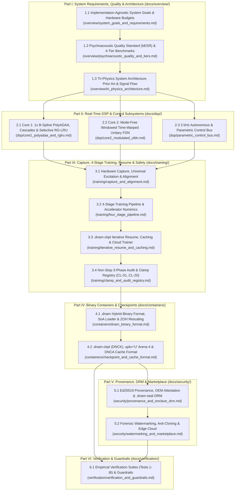

# Dynamic Neural Audio Modeler (DNAM) — Specification Manual

Welcome to the canonical Single-Source-of-Truth (SSOT) specification manual for **Dynamic Neural Audio Modeler (DNAM / "Tri-Physics" Architecture)**.

The specification manual is organized into **six modular parts (`overview/`, `dsp/`, `training/`, `containers/`, `security/`, `verification/`)**. Every document has a single, non-overlapping scope: equations, stability clamps (`CL-01`–`CL-20`), binary wire layouts, and quality benchmarks are defined once in their authoritative specification and referenced by relative link elsewhere. Before authoring or editing any specification in `docs/`, read the [**Specification Authoring & Documentation Guide (`docs/CONTRIBUTING.md`)**](CONTRIBUTING.md).

---

## 1. Specification Architecture & Reading Order

---

## 2. Canonical Specification Directory

### Part I — System Requirements, Quality Standards & Architecture (`docs/overview/`)

| Specification | Authoritative Scope |
| :--- | :--- |
| **[`overview/system_goals_and_requirements.md`](overview/system_goals_and_requirements.md)** | **Implementation-Agnostic System Goals, Hardware Budgets & Security Requirements (`REQ-1`–`REQ-8`, 40 Formal Requirements):** Formal specification of the 8 core DNAM goals: universal nonlinear/LTI/state-space/delay coverage, complex end-to-end full rigs & heuristic-free stems (`REQ-1.1`–`REQ-1.8`), device-agnostic `bESR` quality, non-stop control clamping & MIDI/host tempo sync with 12 rhythmic subdivisions (`REQ-2.1`–`REQ-2.5`), progressive single-checkpoint refinement & bounded caching (`REQ-3.1`–`REQ-3.3`), accelerator-first execution & bi-directional memory scaling (`REQ-4.1`–`REQ-4.3`), single-run joint slimmable multi-tier training & dynamic tier scaling (`REQ-5.1`–`REQ-5.6`), commodity embedded real-time budgets & loop constraints (`REQ-6.1`–`REQ-6.3`), unclipped 32-bit float `f32` I/O & Mono/True-Stereo channel topologies (`1 → 1`, `2 → 1`, `1 → 2`, `2 → 2`, `REQ-7.1`–`REQ-7.4`), and model provenance, hardware DRM, forensic watermarking & marketplace security (`REQ-8.1`–`REQ-8.8`). |
| **[`overview/psychoacoustic_quality_and_tiers.md`](overview/psychoacoustic_quality_and_tiers.md)** | **Psychoacoustic Quality Standard (`bESR`) & 4-Tier Benchmarks:** Why plain broadband `ESR` and fixed high-pass pre-emphasis fail; 4th-order Bezout complementary 3-band crossover (`LF` / `MF` / `HF`); Floor-Regularized, Noise-Adjusted Band-Balanced `bESR` and its `4.77 dB` worst-band bound; device-agnostic evaluation (sub-sample jitter floor, signal-measured thermal hiss floor, quiet tonal stems vs. muted stems); companion `MR-STFT`, `LTAS` spectral tilt, and `SegESR` metrics; and the `Lite` / `Full` / `Pro` / `Ultra` benchmark matrix. |
| **[`overview/tri_physics_architecture.md`](overview/tri_physics_architecture.md)** | **"Tri-Physics" System Architecture, Prior Art & Signal-Flow Design:** End-to-end signal topology, dual-rate (`48 kHz` audio / `3 kHz` control) execution lifecycle, 4-tier slimmable SIMD hierarchy (`C=4` Lite / `C=8` Full / `C=12` Pro / `C=16` Ultra), hardware benchmark table, prior-art architectural comparison (`NAM A2`, `GuitarML PROTEUS`, `NAM ParametricOD`), Mid/Side encoding, `FTZ`/`DAZ` denormal immunity, gated `rms_dbfs` Auto-Unity leveling, polarity-corrected parallel blend, spillover `Trails` state machine, `4×` ZOH offline bounce (`CL-19`, `CL-20`), and master index of the 18 engineering breakthroughs. |
| **[`overview/u_pra_architecture.md`](overview/u_pra_architecture.md)** | **Unified Isomorphic 3-Operator, 4-Stage Canonical Rig Architecture (`U-PRA`):** Next-generation unified engine & trainer architecture (`Op-T`, `Op-M`, `Op-N` across Stages I–IV with 8-Port Matrix Router and 256-D 4-Tier Kronecker Output Head) resolving all 7 missing Goal 1 hardware families and all 5 legacy pipeline gaps with `0.000000 dB` trainer–engine isomorphism, `8,656 B` (`8.45 KB`) L1D-resident `Lite` state RAM, `2.66×` MAC reduction (`532 Mono / 660 Stereo MACs/sample` in `Lite`), MIDI/host tempo sync across 12 subdivisions (`REQ-2.5`), and native Mono (`1 → 1`, `2 → 1`) & True Stereo (`1 → 2`, `2 → 2`) topologies (`REQ-7.4`). |

### Part II — Real-Time DSP & Control Subsystems (`docs/dsp/`)

| Specification | Authoritative Scope |
| :--- | :--- |
| **[`dsp/core1_polyadaa_and_rglru.md`](dsp/core1_polyadaa_and_rglru.md)** | **Core 1 (`CL-01`–`CL-05`):** `1×` Passive B-Spline Division-Free Algebraic `PolyADAA` (`(m_n, d_n)` polynomial factorization, un-delayed linear path separation, `5 Hz` AC coupling, 3-state resting DC equilibrium), multi-stage nonlinear cascade primitives (instantaneous B-spline, dual-polarity grid-leak bias, `C²` wavefolder, 2D quadrature hysteresis), Exact LTI Commutativity Theorem, and Log-Octave `H₂`-Normalized Radial-Polar Selective Complex RG-LRU (branchless `3 kHz` 4-FMA + Newton rotor, `48 kHz` radial selectivity, `O(log₂ L)` associative scan). |
| **[`dsp/core2_modulated_ufdn.md`](dsp/core2_modulated_ufdn.md)** | **Core 2 (`CL-06`–`CL-11`):** Mode-Free Windowed Time-Warped Modulated Unitary FDN (`M-UFDN` / `WT-UFDN`), stateless 4-tap Cubic Lagrange delay readout, Dual-Mode runtime delay transitions (`Range` velocity-bounded slew vs. `Switch` 128-sample dual-pointer crossfade), 64-sample Through-Zero Flanging reference tap, Self-Activating Dual-Tap Complementary Hermite-Hann Grain Reader (`H(φ_A)+H(φ_B)≡1`), Unitary Spectral Freeze, co-prime Schroeder all-pass diffusers, `O(M)` Givens + Householder stereo matrix `U(ψ, v)`, passband-normalized `5 Hz` DC blocker, Unity-Slope Coercive-Saturating Lyapunov Loop Law, `3 kHz` Stereo Tremolo/Rotary gate, and 4-Tier Pre-Head Kronecker Routing. |
| **[`dsp/parametric_control_bus.md`](dsp/parametric_control_bus.md)** | **3 kHz Control Bus (`CL-12`–`CL-14`):** Autonomous 3-band envelope follower & 4-harmonic Chebyshev LFO bank (with training-only Blind Phase-Locked Teacher), Fixed `declared_range` coordinate system, Cardinality-Bounded Node-Anchored Newton/Lobatto basis (`K_p = min(U_p-1, 3)`), Centered ANOVA + Rank-4/Rank-8 Factorization Machine, Bilinear Control-Modulated Tier Features & intrinsic control modulators (solving multi-stem Kronecker rank completeness at `0` extra `48 kHz` MACs), Step-0 Order-Statistic Optimal Transport, Physical Variance Gating `G_p`, and 12-subdivision Tempo Sync / calibration roles. |

### Part III — Hardware Capture, 4-Stage Training, Iterative Resume & Clamping (`docs/training/`)

| Specification | Authoritative Scope |
| :--- | :--- |
| **[`training/capture_and_alignment.md`](training/capture_and_alignment.md)** | **Hardware Capture, Universal Excitation & Latency Alignment:** Capture-first validation methodology across effect families, 2-step hardware calibration & clean 32-bit float pad staging (`--clean-pad-db`), Star/Switch/Corner capture matrix planner, heuristic-free 30.0-second 5-section universal excitation with live dynamic tail extension (`+0..15 s`), and multi-regime sub-sample hardware latency alignment (broadband parabolic, causal clipped-fuzz proxy, zero-phase `1.5 kHz` HP proxy, and `pulse1_onset_window` / `kill_dry_locked` delay alignment). |
| **[`training/four_stage_pipeline.md`](training/four_stage_pipeline.md)** | **4-Stage Deterministic Training Pipeline & Accelerator Numerics (`CL-18`):** Stage 1 (System-ID & Phase-1 Audit), Stage 2 (Partitioned SVD-Orthonormal Kronecker `float64` warm-start & 3-band Bezout `bESR` Gram integration), Stage 3A (Acausal-Calibrated Causal Wiener LTI solver, Parseval-commuted 3-band orthogonal FFT decoupled solver, 3-stage learned selective cascade with strictly monotonic B-spline state `e_cum[n]` & 2D quadrature hysteresis polish), Stage 3B (Differentiable `WT-UFDN` optimization, surrogate delay gradient & Group-Lasso pruning), Stage 4 (`float64` Cholesky export polish), and 32-bit accelerator streaming with 72-bit `ExactGramAccumulator` & batched host-`fp64` solves (`< 8 GiB` RAM). |
| **[`training/iterative_resume_and_caching.md`](training/iterative_resume_and_caching.md)** | **`.dnam-ckpt` Two-Tier Iterative Stem Expansion, Calibration Caching & Cloud Trainer:** Mathematical proof of Kronecker sufficient-statistic reassembly, PCM SHA-256 provenance deduplication, Tier-1 instant head update (`< 5 s`) & `< 15 ms`/stem quadratic-form `bESR` evaluation vs. Tier-2 warm backbone fine-tuning, portable `Arena 5` (`DNCA`) & gitignored `.dnam-cache` sidecar caching, and serverless cloud trainer architecture (`Job Kind 0..4`). |
| **[`training/clamp_and_audit_registry.md`](training/clamp_and_audit_registry.md)** | **Non-Stop 3-Phase Control-Space Audit & Clamp Registry (`CL-01`–`CL-20`):** Phase-1 Pre-Flight Audit (`[CLAMP-RANGE]`, `[CLAMP-SWITCH]`, `[CLAMP-STABILITY]`), Phase-2 During-Training Stop-Gradient Corner Barrier `L_barrier` & `[CLAMP-RAIL]`, Phase-3 Post-Polish Export Certification (`[CLAMP-DYNAMIC]`, `[CLAMP-HEAD-GAIN]`), Consolidated Stem Prescription Report, and the canonical **`CL-01`..`CL-20` Clamp & Limit Registry**. |

### Part IV — Binary Containers, Checkpoints & Sample-Rate Rescaling (`docs/containers/`)

| Specification | Authoritative Scope |
| :--- | :--- |
| **[`containers/dnam_binary_format.md`](containers/dnam_binary_format.md)** | **`.dnam` Hybrid Binary Container, Hardware Loader & ZOH Rescaling (`CL-19`, `CL-20`):** 64-byte binary preamble (`#[repr(C, align(64))]`) + `4 KB` page-aligned UTF-8 JSON header + 64-byte SIMD-aligned 4-Tier Delta Arenas (`Lite` `10,752 B` / `Full` `22,336 B` / `Pro` `36,224 B` / `Ultra` `64,000 B`), Execution-Order `Core1BlockSlice` interleaving, branchless 64-byte `ControlClampDescriptor`, zero-re-signing container tier stripping (`strip_container_to_tier`), `ui_hints` midpoint power-skew, `io_config.capabilities` & `leveling`, Continuous-Time ZOH sample-rate rescaling (`44.1–96 kHz`), and canonical `.dnam` JSON header schema. |
| **[`containers/checkpoint_and_cache_format.md`](containers/checkpoint_and_cache_format.md)** | **`.dnam-ckpt` (`DNCK`) Checkpoint, `uplo='U'` `Arena 4` & `DNCA` Calibration Format:** Zero-duplication shared `Arena 0..3` prefix, `pickle`-free binary safety, tier-ordered Column-Major Upper-Triangular (`LAPACK uplo='U'`) `float64` Gram packing & Nested Principal Submatrix Prefix Theorem, `.dnam-ckpt` JSON `stems_registry` & `audit_report`, and `Arena 5` (`DNCA`, `HAS_CALIB_STATS` bit `12`) `INPC`/`STMC` binary records + `.dnam-cache/*.dnce` sidecar layout. |

### Part V — Cryptographic Provenance, Hardware DRM & Marketplace (`docs/security/`)

| Specification | Authoritative Scope |
| :--- | :--- |
| **[`security/provenance_and_enclave_drm.md`](security/provenance_and_enclave_drm.md)** | **Cryptographic Provenance (`Ed25519`), `OemDeviceCertificate` Attestation & `.dnam-seal` (`DNSL`) Hardware DRM:** Pillar 1 (Preset-safe RFC 8785 JCS `immutable_header_sha256`, creator-signed `DistributionPolicy` with `vendor` & `vendor:model_code` granularity, 2-certificate `Ed25519` delegation chain & 4-tier `tier_arena_sha256`), Pillar 2 (3 OEM hardware integration paths: Self-Registered `DeviceAllowlisted`, OTA Companion-App `OemDeviceCertificate` Enrollment, and Factory-Line HSM Provisioning; `.dnam-seal` `b"DNSL"` 64-byte binary envelope & TrustZone unsealing), and 3 Protection Profiles (`Open`, `DeviceAllowlisted`, `EnclaveSealed`). |
| **[`security/watermarking_and_marketplace.md`](security/watermarking_and_marketplace.md)** | **Forensic Traitor Tracing, Anti-Cloning Gate & Marketplace Cloud Infrastructure:** Pillar 3 (`< 0.2 ms` Dual-Mechanism Buyer Watermarking: 64-channel RG-LRU reciprocal scaling gauge + `SO(4) ⊕ SO(4)` SVD rotation with `0.00 dB` audio difference, and 7,680-chip Coupled Tardos code with `Z ≥ 24.98σ`), Pillar 4 (`< 50 ms` 3-stage anti-cloning ingestion gate with `224-D` prefix-composable structural hash & automated device revocation), commercial storefront auditioning & royalty splits, and Cloudflare + `TiDB` (`VECTOR(224)`) edge data model. |

### Part VI — Empirical Verification & Automated Guardrails (`docs/verification/`)

| Specification | Authoritative Scope |
| :--- | :--- |
| **[`verification/verification_and_guardrails.md`](verification/verification_and_guardrails.md)** | **Empirical Verification Suites (`Tests 1–8I`) & Automated Guardrails (`G-01`–`G-08`):** Formal mathematical stimuli, numerical acceptance thresholds, and reference implementation links for all 8 empirical verification suites (`Test 1` through `Test 8I`) and the 8 automated repository & container guardrail checks (`G-01`–`G-08`). |

---

## 3. Monorepo Package & Developer Guides

For package-level module routing, build/test workflows (`moon check --all`), and public API references, consult the package guides:

| Scope / Package | Discovery Router (`AGENTS.md` / `index.md`) | Contributing & Architecture Guide | Package API & CLI Reference |
| :--- | :--- | :--- | :--- |
| **Monorepo Root** | [`AGENTS.md`](../AGENTS.md) | [`CONTRIBUTING.md`](../CONTRIBUTING.md) | [`README.md`](../README.md) |
| **Specification Manual (`docs/`)** | [`docs/index.md`](index.md) | [`docs/CONTRIBUTING.md`](CONTRIBUTING.md) | [`overview/system_goals_and_requirements.md`](overview/system_goals_and_requirements.md) |
| **Rust SIMD Engine (`packages/engine/`)** | [`packages/engine/AGENTS.md`](../packages/engine/AGENTS.md) | [`packages/engine/CONTRIBUTING.md`](../packages/engine/CONTRIBUTING.md) | [`packages/engine/README.md`](../packages/engine/README.md) |
| **Python Engine (`packages/python/`)** | [`packages/python/AGENTS.md`](../packages/python/AGENTS.md) | [`packages/python/CONTRIBUTING.md`](../packages/python/CONTRIBUTING.md) | [`packages/python/README.md`](../packages/python/README.md) |
| **JS / WebAudio SDK (`packages/js/`)** | [`packages/js/AGENTS.md`](../packages/js/AGENTS.md) | [`packages/js/CONTRIBUTING.md`](../packages/js/CONTRIBUTING.md) | [`packages/js/README.md`](../packages/js/README.md) |
| **Design System & Visualizers (`packages/ui/`)** | [`packages/ui/AGENTS.md`](../packages/ui/AGENTS.md) | [`packages/ui/CONTRIBUTING.md`](../packages/ui/CONTRIBUTING.md) | [`packages/ui/README.md`](../packages/ui/README.md) |
| **CLI & Desktop Studio (`packages/studio/`)** | [`packages/studio/AGENTS.md`](../packages/studio/AGENTS.md) | [`packages/studio/CONTRIBUTING.md`](../packages/studio/CONTRIBUTING.md) | [`packages/studio/README.md`](../packages/studio/README.md) |
| **PyTorch Trainer (`packages/trainer/`)** | [`packages/trainer/AGENTS.md`](../packages/trainer/AGENTS.md) | [`packages/trainer/CONTRIBUTING.md`](../packages/trainer/CONTRIBUTING.md) | [`packages/trainer/README.md`](../packages/trainer/README.md) |
| **Project Guardrails (`tests/`)** | [`tests/AGENTS.md`](../tests/AGENTS.md) | [`docs/CONTRIBUTING.md`](CONTRIBUTING.md) | [`tests/test_guardrails.py`](../tests/test_guardrails.py) |
