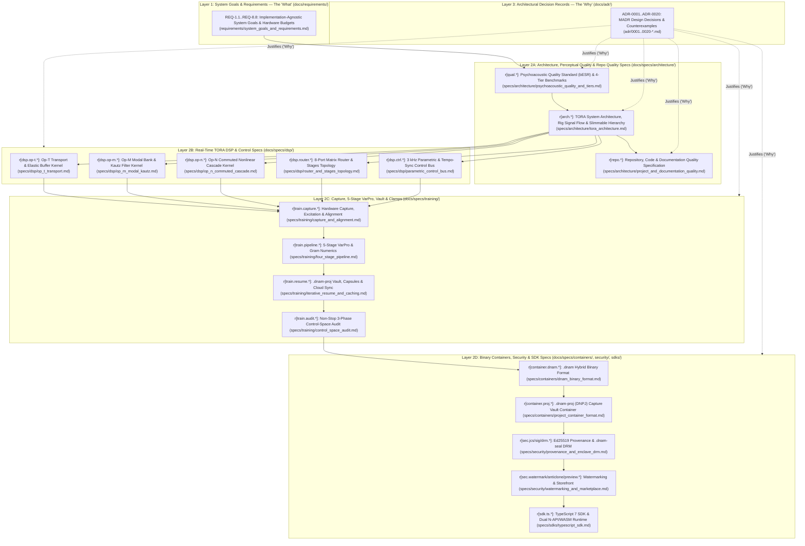

# Dynamic Neural Audio Modeler (DNAM) — Specification Manual

Welcome to the canonical Single-Source-of-Truth (SSOT) specification manual for **Dynamic Neural Audio Modeler (DNAM)**.

The manual is organized into **three distinct engineering layers (`requirements/`, `specs/`, `adr/`)** plus canonical authoring templates (`templates/`):
- **Requirements (`docs/requirements/`):** Implementation-agnostic system goals and functional requirements (`REQ-1.1`–`REQ-8.8`, **"the what"**).
- **Normative Specifications (`docs/specs/`):** Concrete architectural, mathematical, DSP, training, container, security, and repository quality contracts (**"the how"**), with every normative rule carrying a unique Rust Reference-style `r[<domain>.<subdomain>.<rule>]` identifier so implementation code (`ref[...]`) and tests (`verify[...]`) can cite every specification.
- **Architectural Decision Records (`docs/adr/`):** Atomic MADR decision records (`NNNN-kebab-case.md`) documenting design rationales, counterexamples, and rejected R&D alternatives (**"the why"**).

Before authoring or editing any document in `docs/`, read the [**Specification Authoring & Documentation Guide (`docs/CONTRIBUTING.md`)**](CONTRIBUTING.md), the [**Repository, Code & Documentation Quality Specification (`docs/specs/architecture/project_and_documentation_quality.md`)**](specs/architecture/project_and_documentation_quality.md), and use the templates in [`docs/templates/`](templates/spec_template.md).

---

## 1. Specification Architecture & Reading Order

---

## 2. Canonical Specification Directory

### Layer 1 — System Goals & Functional Requirements ("The What", `docs/requirements/`)

| Document | Rule / ID Prefix | Authoritative Scope |
| :--- | :---: | :--- |
| **[`requirements/system_goals_and_requirements.md`](requirements/system_goals_and_requirements.md)** | `REQ-1.1`–`REQ-8.8` | **Implementation-Agnostic System Goals, Hardware Budgets & Security Requirements (40 Formal Requirements):** Universal nonlinear/LTI/state-space/delay & full-rig coverage (`REQ-1.1`–`REQ-1.8`), device-agnostic `bESR` quality, non-stop clamping & 12-subdivision tempo sync (`REQ-2.1`–`REQ-2.5`), progressive single-project capture vault refinement & capsule persistence (`REQ-3.1`–`REQ-3.3`), accelerator-first execution & memory scaling (`REQ-4.1`–`REQ-4.3`), single-run slimmable multi-tier training & dynamic tier scaling (`REQ-5.1`–`REQ-5.6`), embedded real-time budgets & loop constraints (`REQ-6.1`–`REQ-6.3`), unclipped `f32` I/O & `1→1`/`2→1`/`1→2`/`2→2` topologies (`REQ-7.1`–`REQ-7.4`), and provenance, hardware DRM, watermarking & marketplace security (`REQ-8.1`–`REQ-8.8`). |

### Layer 2A — System Architecture & Psychoacoustic Quality Specifications (`docs/specs/architecture/`)

| Specification | Rule Prefix | Authoritative Scope |
| :--- | :---: | :--- |
| **[`specs/architecture/psychoacoustic_quality_and_tiers.md`](specs/architecture/psychoacoustic_quality_and_tiers.md)** | `r[qual.*]` | **Psychoacoustic Quality Standard (`bESR`) & 4-Tier Benchmarks:** 4th-order Bezout complementary 3-band crossover (`LF` / `MF` / `HF`), Floor-Regularized Noise-Adjusted `bESR` (`4.77 dB` worst-band bound), rectangular joint energy-interval bounds, companion `MR-IIR`, `LTAS` tilt, and `SegESR` metrics, and the `Lite` / `Full` / `Pro` / `Ultra` benchmark matrix. |
| **[`specs/architecture/tora_architecture.md`](specs/architecture/tora_architecture.md)** | `r[arch.*]` | **Modular TORA System Architecture, Rig Signal Flow & Slimmable Hierarchy:** Canonical 3-operator + 4-stage architecture (`Op-T`, `Op-M`, `Op-N` across Stage 0 8-Port Matrix Router, Stages I–IV, and 256-D Mid/Side Kronecker Head), 4-tier slimmable hierarchy (`Lite`/`Full`/`Pro`/`Ultra`), dual-rate lifecycle (`48 kHz` / `3 kHz`), `FtzDazGuard` callback environment, 7 hardware families, and 19 refinements. |
| **[`specs/architecture/project_and_documentation_quality.md`](specs/architecture/project_and_documentation_quality.md)** | `r[repo.*]` | **Repository, Code & Documentation Quality Specification:** Static type safety and package import boundaries, two-tier `AGENTS.md` progressive-disclosure budgets (`< 5,000 B` root, `< 2,500 B` scoped), implementation-agnostic requirements layer (`REQ-1.1`–`REQ-8.8`), `r[...]` / `ref[...]` / `verify[...]` rule traceability, MADR conventions, and GitHub CommonMark + MathJax / Mermaid rendering contracts. |

### Layer 2B — Real-Time TORA DSP & Control Subsystems (`docs/specs/dsp/`)

| Specification | Rule Prefix | Authoritative Scope |
| :--- | :---: | :--- |
| **[`specs/dsp/op_t_transport.md`](specs/dsp/op_t_transport.md)** | `r[dsp.op-t.*]` | **Op-T Transport & Elastic Buffer Kernel:** Model-declared 64B-aligned delay histories with branchless wrap, stateless 4-tap Catmull-Rom cubic Hermite fractional delay readout, Dual-Mode transitions (`Range` slew vs. `Switch` 128-sample crossfade), centered partition-of-unity pitch-shifting/freeze windowing, partitioned in-buffer Schroeder diffusers, bounded-history feedback guard, and 1-pole ballistic ducking VCA. |
| **[`specs/dsp/op_m_modal_kautz.md`](specs/dsp/op_m_modal_kautz.md)** | `r[dsp.op-m.*]` | **Op-M Modal & Filter Kernel:** 4-lane SIMD symplectic complex recurrence, quadrant-reduced contractive rotor & `Q0.192` LFO accumulator, rate-anchored `H1` Hilbert pair, bounded `T1` sub-harmonic tracker, shared-pole Stage III Kautz modal bank with independent L/R readouts, and `Op-M[Ctrl]` control engine. |
| **[`specs/dsp/op_n_commuted_cascade.md`](specs/dsp/op_n_commuted_cascade.md)** | `r[dsp.op-n.*]` | **Op-N Commuted Nonlinear Cascade Kernel:** Multi-drive `1×` B-spline `PolyADAA` bank with 6-step division-free rail crossing, `C²` cubic-envelope wavefolder with division-free ADAA, 2D quadrature hysteresis, fixed-hertz ZOH bitcrusher, Exact LTI Basis Commutativity Theorem (Theorem 1), Stage II 3-stage commuted cascade, resting DC equilibrium startup, and `Op-N[Ctrl]` engine. |
| **[`specs/dsp/router_and_stages_topology.md`](specs/dsp/router_and_stages_topology.md)** | `r[dsp.router.*]`, `r[dsp.stage1..4.*]`, `r[dsp.head.*]`, `r[dsp.zoh.*]` | **8-Port Matrix Router, Multi-Stage Rig Topology & Continuous-Time ZOH Rescaling:** Return-to-send isolation, `200 Hz` TPT LR4 clean/drive split, parallel sub-sample alignment (`FullBand64Tap`, `LowLatency16Tap`, `MinLatency4Tap`), `PreSpatialCore`/`DirectDry` WDW routing, voltage-normalized Mid/Side encoding, Stage I–IV integration, 256-D Mid/Side Kronecker head, and `44.1–96 kHz` / `4×` ZOH sample-rate conversion. |
| **[`specs/dsp/parametric_control_bus.md`](specs/dsp/parametric_control_bus.md)** | `r[dsp.ctrl.*]`, `r[dsp.tempo.*]` | **3 kHz Parametric & Autonomous Control Bus:** Shared control descriptors and packed tier-local `CP1` `f32` projections (`8-D` Rank-4 in `Lite..Pro`, `16-D` Rank-8 in `Ultra`); exact-integer additive sufficient-statistic accumulation; outward-checked trust-region clipping; tier-aware `16 × 16` + `16 × 4` stage dispatch and division-free micro-ramping; host, MIDI, and tap tempo-sync targets across 12 rhythmic subdivisions (`REQ-2.5`). |

### Layer 2C — Hardware Capture, 5-Stage `VarPro` Solver, Capture Vault & Clamping (`docs/specs/training/`)

| Specification | Rule Prefix | Authoritative Scope |
| :--- | :---: | :--- |
| **[`specs/training/capture_and_alignment.md`](specs/training/capture_and_alignment.md)** | `r[train.capture.*]` | **Hardware Capture, Universal Excitation & Latency Alignment:** Capture-first methodology across effect families, 2-step hardware calibration & clean 32-bit float pad staging, Star + commutator capture schedule with null-homing verification, co-designed disjoint-comb excitation with live tail extension & `DNWB` white-box distillation, and multi-regime sub-sample hardware latency alignment. |
| **[`specs/training/four_stage_pipeline.md`](specs/training/four_stage_pipeline.md)** | `r[train.pipeline.*]`, `r[train.gram.*]` | **Five-Stage Analytical `VarPro` & Cholesky Solver:** `Stage A` Steiglitz–McBride pole & delay ID, `Stage B` exact `256-D` feature harvesting & `INPC`/`STMC` coreset extraction, `Stage C` nested 4-tier Schur-complement `MM-Cholesky` & `33`-band `LTAS` KKT, `Stage D` triangular Newton `CP1` control projections, `Stage E` Kautz contraction & `[STAB-ZERO-DC]` packing, and 192-bit wide-significand Gram bounds. |
| **[`specs/training/iterative_resume_and_caching.md`](specs/training/iterative_resume_and_caching.md)** | `r[train.resume.*]`, `r[train.cache.*]`, `r[train.cloud.*]` | **`.dnam-proj` Capture Vault Editing, Capsule Persistence & Cloud Sync:** Non-destructive `add_capture` / `remove_capture` / `replace_capture` / `set_capture_enabled`, Two-Path (`< 5–10 ms` Fast-Path vs. `< 15–25 ms` Full Re-Pool) compositional re-solving, `SHA-256` dependency digests, compact capsule persistence, and `HTTP Range` cloud object-storage sync. |
| **[`specs/training/control_space_audit.md`](specs/training/control_space_audit.md)** | `r[train.audit.*]` | **Non-Stop 3-Phase Control-Space Audit & Automatic Clamping:** Phase-1 Pre-Flight Audit (`[CLAMP-RANGE]`, `[CLAMP-SWITCH]`, `[CLAMP-STABILITY]`), Phase-2 Stage D Stop-Gradient Corner Barrier `L_barrier` & `[CLAMP-RAIL]`, Phase-3 Post-Polish Export Certification (`[CLAMP-DYNAMIC]`, `[CLAMP-HEAD-GAIN]`, `[NUMERIC-ENVELOPE]`), and the Consolidated Stem Prescription Report. |

### Layer 2D — Binary Containers, Cryptographic Security & SDK (`docs/specs/containers/`, `docs/specs/security/` & `docs/specs/sdks/`)

| Specification | Rule Prefix | Authoritative Scope |
| :--- | :---: | :--- |
| **[`specs/containers/dnam_binary_format.md`](specs/containers/dnam_binary_format.md)** | `r[container.dnam.*]` | **`.dnam` Hybrid Binary Container:** 64-byte-aligned preamble and directory, four nested tier payloads (`Arena 0..3`), shared control descriptors, packed `CP1` tier-local projections, Stage III separate FIR/Kautz slices, authenticated prefix stripping, and growable `DMU1`/`DMUE` mutable suffix framing. |
| **[`specs/containers/project_container_format.md`](specs/containers/project_container_format.md)** | `r[container.proj.*]` | **`.dnam-proj` (`DNPJ`) Cloud-Ready Project & Capture Vault Container (`packages/capture`):** Front-loaded `64 B` preamble + `SHA-256` chunk directory + RFC 8785 JCS manifest for `HTTP Range` inspection, `CALB`, `SPCM`, `INPC`/`STMC` `fp16` coreset capsules, `STAT` `uplo='U'` sufficient statistics, `< 0.2 ms` `WGHT` `.dnam` export, and `AUTH` provenance. |
| **[`specs/security/provenance_and_enclave_drm.md`](specs/security/provenance_and_enclave_drm.md)** | `r[sec.taxonomy.*]`, `r[sec.jcs.*]`, `r[sec.policy.*]`, `r[sec.sig.*]`, `r[sec.drm.*]` | **Cryptographic Provenance (`Ed25519`), `OemDeviceCertificate` Attestation & `.dnam-seal` (`DNSL`) Hardware DRM:** Pillar 1 (Preset-safe RFC 8785 JCS `immutable_header_sha256`, creator-signed `DistributionPolicy`, 2-certificate `Ed25519` delegation chain & 4-tier prefix commitments), Pillar 2 (3 OEM hardware onboarding paths, RFC 9180 HPKE recipient slots, `.dnam-seal` `b"DNSL"` envelope & TrustZone unsealing), and 3 Protection Profiles (`Open`, `DeviceAllowlisted`, `EnclaveSealed`). |
| **[`specs/security/watermarking_and_marketplace.md`](specs/security/watermarking_and_marketplace.md)** | `r[sec.watermark.*]`, `r[sec.anticlone.*]`, `r[sec.preview.*]`, `r[sec.edge.*]` | **Forensic Traitor Tracing, Anti-Cloning Gate & Marketplace Cloud Infrastructure:** Dual-mechanism buyer watermarking (reciprocal-scaling gauge + Coupled Tardos code), tier-local Stage III structural fingerprinting, interactive `.dnam-prev` storefront auditioning with fixed-anchor rank-`r` containment, and edge fulfillment infrastructure. |
| **[`specs/sdks/typescript_sdk.md`](specs/sdks/typescript_sdk.md)** | `r[sdk.ts.*]` | **TypeScript 7 SDK (`@dnam-project/dnam`) & Dual-Target N-API v10 + WASM SIMD128 Runtime:** Feature-oriented layout, `AudioParam`-aligned `Parameter` API, camelCase schema codec with RFC 8785 JCS round-trip parity, zero-copy `Float32Array` & `processAsync`, WebAudio `DnamAudioNode` (`SharedArrayBuffer` + `Atomics`), v2 provenance/watermarking, and vectorized TORA reference kernels. |

### Layer 3 — Architectural Decision Records ("The Why", `docs/adr/`) & Authoring Templates (`docs/templates/`)

| ADR / Template | Status / Type | Scope |
| :--- | :---: | :--- |
| **[`adr/0001-superseded-tri-physics-prototype.md`](adr/0001-superseded-tri-physics-prototype.md)** | `Superseded by ADR-0002` | Early three-pillar R&D prototype (`Core 1`, `Core 2`, `q_8` control bus) and the 5 prototype findings resolved by TORA. |
| **[`adr/0002-tri-operator-recurrent-architecture.md`](adr/0002-tri-operator-recurrent-architecture.md)** | `Accepted` | TORA 3-operator + 4-stage architecture, 4-tier slimmable hierarchy, Stage III slice separation, and captured freeze. |
| **[`adr/0003-band-balanced-besr-and-noise-qualification.md`](adr/0003-band-balanced-besr-and-noise-qualification.md)** | `Accepted` | Why plain broadband `ESR` and fixed pre-emphasis fail; rectangular joint energy-interval bounds, `LTAS`, and `SegESR`. |
| **[`adr/0004-division-free-polyadaa-and-c2-wavefolder.md`](adr/0004-division-free-polyadaa-and-c2-wavefolder.md)** | `Accepted` | `Op-N` unclamped 6-step `f64` rail crossing, `C²` cubic-envelope wavefolder, and fixed-hertz ZOH bitcrusher counterexamples. |
| **[`adr/0005-contractive-rotor-hilbert-and-t1-tracker.md`](adr/0005-contractive-rotor-hilbert-and-t1-tracker.md)** | `Accepted` | `Op-M` quadrant-reduced contractive rotor, `Q0.192` LFO phase, `H1` ties-to-even interpolation, `T1` tracker, and Stage III ZOH. |
| **[`adr/0006-model-declared-delays-and-tank-feedback-guard.md`](adr/0006-model-declared-delays-and-tank-feedback-guard.md)** | `Accepted` | `Op-T` model-declared delay capacities, `Q0.32` delay pointers, centered `M=2` pitch grains, and Stage IV max-tree feedback guard. |
| **[`adr/0007-exact-integer-control-bus-and-tempo-inversion.md`](adr/0007-exact-integer-control-bus-and-tempo-inversion.md)** | `Accepted` | Why naive conditioning and `P ≤ 16` buses fail; `v2.0` `CP1` arbitrary-`P` control projections, `2` Hadamard diagonals, 4-D trust clip, and tempo inversion. |
| **[`adr/0008-per-stem-kronecker-statistics-and-wide-gram.md`](adr/0008-per-stem-kronecker-statistics-and-wide-gram.md)** | `Accepted` | Why pre-summed Kronecker matrices fail; `uplo='U'` `STAT` sufficient statistics with Rank-1 Kautz contraction `P_c`, `MM-Cholesky` + `LTAS` KKT polish, and `24 KB` / `48 KB` `fp16` `INPC`/`STMC` coresets. |
| **[`adr/0009-jcs-prefix-signing-hpke-and-preview-containment.md`](adr/0009-jcs-prefix-signing-hpke-and-preview-containment.md)** | `Accepted` | RFC 8785 JCS header digest, `DMU1`/`DME1` mutable suffix, RFC 9180 HPKE low-order key rejection, offline auth, and `.dnam-prev`. |
| **[`adr/0010-rust-reference-spec-rules-and-madr-decisions.md`](adr/0010-rust-reference-spec-rules-and-madr-decisions.md)** | `Accepted` | Three-layer `requirements`/`specs`/`adr` hierarchy, Rust Reference `r[...]` / `ref[...]` / `verify[...]` rules, MADR conventions, and documentation guardrails. |
| **[`adr/0011-end-to-end-stage-wiring-and-arena-slice-topology.md`](adr/0011-end-to-end-stage-wiring-and-arena-slice-topology.md)** | `Accepted` | End-to-end stage wiring, 256-D feature bus slot map (`0..255`), closed-form `theta_0..theta_15` stage modulation laws, and 64B-aligned `tensor_directory` slice schema. |
| **[`adr/0012-python-sdk-architecture-and-idiomatic-api.md`](adr/0012-python-sdk-architecture-and-idiomatic-api.md)** | `Superseded by ADR-0018` | Historical `dnam` Python SDK architecture superseded by the pure-Rust + TypeScript monorepo. |
| **[`adr/0013-typescript-sdk-architecture-and-dual-target-runtime.md`](adr/0013-typescript-sdk-architecture-and-dual-target-runtime.md)** | `Accepted` | Idiomatic `@dnam-project/dnam` TypeScript 7 SDK architecture, dual-target `N-API v10` + raw `WASM SIMD128` runtime, `AudioParam`-aligned parameters, and camelCase/JCS schema parity. |
| **[`adr/0014-python-3-15-free-threading-and-stable-abi-abi3t.md`](adr/0014-python-3-15-free-threading-and-stable-abi-abi3t.md)** | `Superseded by ADR-0018` | Historical Python 3.15 (`3.15t`) and PyO3 `abi3t` toolchain superseded by the pure-Rust trainer and TypeScript SDK. |
| **[`adr/0015-realtime-host-concurrency-spsc-and-telemetry-seqlock.md`](adr/0015-realtime-host-concurrency-spsc-and-telemetry-seqlock.md)** | `Accepted` | `dnam_engine::host` 3-Lane SPSC control ingress (`SpscControlRing`), `AcceptedStateShadow`, wait-free `AtomicU64` `TelemetryCell` seqlock, and safe ping-pong `RealtimeEngineSwap`. |
| **[`adr/0016-codesigned-disjoint-comb-stimulus-and-null-homing-capture.md`](adr/0016-codesigned-disjoint-comb-stimulus-and-null-homing-capture.md)** | `Accepted` | Closed-loop feedback-adaptive disjoint-comb excitation (`Laws 0.A–0.F`, `Laws 1–3`), sub-sample null-homing alignment, `Mode A/B` control capture with `< 0.05 dB` null homing, and `1.0s` live null-test auto-patch. |
| **[`adr/0017-pure-rust-analytical-varpro-solver-and-planar-decoupling.md`](adr/0017-pure-rust-analytical-varpro-solver-and-planar-decoupling.md)** | `Accepted` | 100% pure-Rust 5-Stage analytical `VarPro` & Cholesky solver (`< 25 ms` native + `WASM`), planar Stage I–IV decoupling, and `24 KB` / `48 KB` `fp16` `INPC`/`STMC` coreset storage. |
| **[`adr/0018-signal-chain-fixtures-crate-and-whitebox-distillation.md`](adr/0018-signal-chain-fixtures-crate-and-whitebox-distillation.md)** | `Accepted` | Pure-Rust black-box signal-chain fixtures crate (`dnam-fixtures`: `BlackBoxModel`, `FixtureDeviceMetadata`, `12` Archetypes, `14` Fault Decorators), `dnam_capture` dual-mode `DistillationTarget` / `DNWB` white-box runners / `MR-IIR` metrics, and Python retirement. |
| **[`adr/0019-simd-kernel-architecture-and-realtime-execution-optimizations.md`](adr/0019-simd-kernel-architecture-and-realtime-execution-optimizations.md)** | `Accepted` | Two-level SIMD trait hierarchy (`SimdVec4` / `MathBackend` + domain traits), single-library multi-ISA dispatch (`NEON`/`SVE2`/`SME`, `SSE2`/`SSE4.2`/`AVX2`, `WASM SIMD128`), stereo/pre-collapsed DSP kernels, and release disassembly CI gate. |
| **[`adr/0020-modular-monorepo-and-dnam-proj-container.md`](adr/0020-modular-monorepo-and-dnam-proj-container.md)** | `Accepted` | 10-package pure-IO monorepo DAG (`engine`, `fixtures`, `capture`, `js`, `ui`, `web`, `plugin-ui`, `plugin`, `studio`, `cli`) and single-file cloud-ready `v2.0` `.dnam-proj` (`DNPJ`) Capture Vault container (`HTTP Range` sync, `INPC`/`STMC` capsules, `< 0.2 ms` `.dnam` export). |
| **[`templates/requirement_template.md`](templates/requirement_template.md)** · **[`spec_template.md`](templates/spec_template.md)** · **[`adr_template.md`](templates/adr_template.md)** | `Templates` | Canonical authoring templates for `REQ-X.Y` requirements, `r[...]` normative specifications, and MADR `NNNN-*.md` records. |

---

## 3. Monorepo Package & Developer Guides

For package-level module routing, build/test workflows (`moon check --all`), and public API references, consult the package guides:

| Scope / Package | Discovery Router (`AGENTS.md` / `index.md`) | Contributing & Architecture Guide | Package API & CLI Reference |
| :--- | :--- | :--- | :--- |
| **Monorepo Root** | [`AGENTS.md`](../AGENTS.md) | [`CONTRIBUTING.md`](../CONTRIBUTING.md) | [`README.md`](../README.md) |
| **Specification Manual (`docs/`)** | [`docs/index.md`](index.md) | [`docs/CONTRIBUTING.md`](CONTRIBUTING.md) | [`requirements/system_goals_and_requirements.md`](requirements/system_goals_and_requirements.md) |
| **Rust SIMD Engine (`packages/engine/`)** | [`packages/engine/AGENTS.md`](../packages/engine/AGENTS.md) | [`packages/engine/CONTRIBUTING.md`](../packages/engine/CONTRIBUTING.md) | [`packages/engine/README.md`](../packages/engine/README.md) |
| **JS / WebAudio SDK (`packages/js/`)** | [`packages/js/AGENTS.md`](../packages/js/AGENTS.md) | [`packages/js/CONTRIBUTING.md`](../packages/js/CONTRIBUTING.md) | [`packages/js/README.md`](../packages/js/README.md) |
| **Design System & Visualizers (`packages/ui/`)** | [`packages/ui/AGENTS.md`](../packages/ui/AGENTS.md) | [`packages/ui/CONTRIBUTING.md`](../packages/ui/CONTRIBUTING.md) | [`packages/ui/README.md`](../packages/ui/README.md) |
| **Desktop Studio (`packages/studio/`)** | [`packages/studio/AGENTS.md`](../packages/studio/AGENTS.md) | [`packages/studio/CONTRIBUTING.md`](../packages/studio/CONTRIBUTING.md) | [`packages/studio/README.md`](../packages/studio/README.md) |
| **Capture, Solver & `.dnam-proj` (`packages/capture/`)** | [`packages/capture/AGENTS.md`](../packages/capture/AGENTS.md) | [`packages/capture/CONTRIBUTING.md`](../packages/capture/CONTRIBUTING.md) | [`packages/capture/README.md`](../packages/capture/README.md) |
| **Black-Box Audio Fixtures (`packages/fixtures/`)** | [`packages/fixtures/AGENTS.md`](../packages/fixtures/AGENTS.md) | [`packages/fixtures/CONTRIBUTING.md`](../packages/fixtures/CONTRIBUTING.md) | [`packages/fixtures/README.md`](../packages/fixtures/README.md) |
| **Project Guardrails (`tests/`)** | [`tests/AGENTS.md`](../tests/AGENTS.md) | [`docs/CONTRIBUTING.md`](CONTRIBUTING.md) | [`tests/test_guardrails.test.ts`](../tests/test_guardrails.test.ts) |
