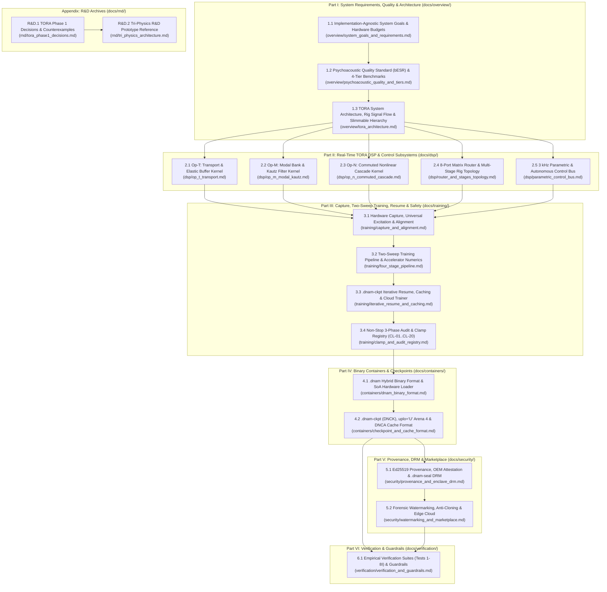

# Dynamic Neural Audio Modeler (DNAM) — Specification Manual

Welcome to the canonical Single-Source-of-Truth (SSOT) specification manual for **Dynamic Neural Audio Modeler (DNAM)**.

The specification manual is organized into **six modular parts (`overview/`, `dsp/`, `training/`, `containers/`, `security/`, `verification/`)**. Every document has a single, non-overlapping scope: equations, stability clamps (`CL-01`–`CL-20`), binary wire layouts, and quality benchmarks are defined once in their authoritative specification and referenced by relative link elsewhere. Before authoring or editing any specification in `docs/`, read the [**Specification Authoring & Documentation Guide (`docs/CONTRIBUTING.md`)**](CONTRIBUTING.md).

---

## 1. Specification Architecture & Reading Order

---

## 2. Canonical Specification Directory

### Part I — System Requirements, Quality Standards & Architecture (`docs/overview/`)

| Specification | Authoritative Scope |
| :--- | :--- |
| **[`overview/system_goals_and_requirements.md`](overview/system_goals_and_requirements.md)** | **Implementation-Agnostic System Goals, Hardware Budgets & Security Requirements (`REQ-1`–`REQ-8`, 40 Formal Requirements):** Formal specification of the 8 core DNAM goals: universal nonlinear/LTI/state-space/delay coverage, complex end-to-end full rigs & heuristic-free stems (`REQ-1.1`–`REQ-1.8`), device-agnostic `bESR` quality, non-stop control clamping & MIDI/host tempo sync with 12 rhythmic subdivisions (`REQ-2.1`–`REQ-2.5`), progressive single-checkpoint refinement & bounded caching (`REQ-3.1`–`REQ-3.3`), accelerator-first execution & bi-directional memory scaling (`REQ-4.1`–`REQ-4.3`), single-run joint slimmable multi-tier training & dynamic tier scaling (`REQ-5.1`–`REQ-5.6`), commodity embedded real-time budgets & loop constraints (`REQ-6.1`–`REQ-6.3`), unclipped 32-bit float `f32` I/O & Mono/True-Stereo channel topologies (`1 → 1`, `2 → 1`, `1 → 2`, `2 → 2`, `REQ-7.1`–`REQ-7.4`), and model provenance, hardware DRM, forensic watermarking & marketplace security (`REQ-8.1`–`REQ-8.8`). |
| **[`overview/psychoacoustic_quality_and_tiers.md`](overview/psychoacoustic_quality_and_tiers.md)** | **Psychoacoustic Quality Standard (`bESR`) & 4-Tier Benchmarks:** Why plain broadband `ESR` and fixed high-pass pre-emphasis fail; 4th-order Bezout complementary 3-band crossover (`LF` / `MF` / `HF`); Floor-Regularized, Noise-Adjusted Band-Balanced `bESR` and its `4.77 dB` worst-band bound; device-agnostic evaluation (sub-sample jitter floor, signal-measured thermal hiss floor, quiet tonal stems vs. muted stems); companion `MR-STFT`, `LTAS` spectral tilt, and `SegESR` metrics; and the `Lite` / `Full` / `Pro` / `Ultra` benchmark matrix. |
| **[`overview/tora_architecture.md`](overview/tora_architecture.md)** | **Modular TORA System Architecture, Rig Signal Flow & Slimmable Hierarchy:** Canonical 3-operator + 4-stage architecture (`Op-T`, `Op-M`, `Op-N` across Stage 0 8-Port Matrix Router, Stage I Pre-Dynamics, Stage II Commuted Cascade, Stage III Kautz Cabinets, and Stage IV Spatial Tank), 256-D Mid/Side Kronecker Head, 4-tier slimmable hierarchy (`Lite`/`Full`/`Pro`/`Ultra`), dual-rate execution lifecycle (`48 kHz` audio / `3 kHz` control), 7 hardware families summary, and 19 architectural refinements. |

### Part II — Real-Time TORA DSP & Control Subsystems (`docs/dsp/`)

| Specification | Authoritative Scope |
| :--- | :--- |
| **[`dsp/op_t_transport.md`](dsp/op_t_transport.md)** | **Op-T Transport & Elastic Buffer Kernel (`CL-06`–`CL-08`):** Model-declared 64B-aligned delay histories with branchless wrap, stateless 4-tap Catmull-Rom cubic Hermite fractional delay readout, Dual-Mode transitions (`Range` velocity-bounded slew vs. `Switch` 128-sample dual-pointer crossfade), centered partition-of-unity pitch-shifting/freeze windowing, partitioned in-buffer Schroeder diffusers, bounded-history feedback guard, and 1-pole ballistic ducking VCA (`Family 4`). |
| **[`dsp/op_m_modal_kautz.md`](dsp/op_m_modal_kautz.md)** | **Op-M Modal & Filter Kernel (`CL-03`–`CL-05`):** 4-lane SIMD symplectic complex recurrence and quadrant-reduced contractive rotor, rate-anchored `H1` Hilbert pair, bounded `T1` sub-harmonic tracker, shared-pole Stage III Kautz modal bank with independent L/R readouts, and `Op-M[Ctrl]` control engine. |
| **[`dsp/op_n_commuted_cascade.md`](dsp/op_n_commuted_cascade.md)** | **Op-N Commuted Nonlinear Cascade Kernel (`CL-01`, `CL-02`):** Multi-drive `1×` B-spline `PolyADAA` bank with six-step division-free rail crossing, `C²` cubic-envelope wavefolder with division-free ADAA, 2D quadrature hysteresis, fixed-hertz ZOH bitcrusher (`Family 5`), Exact LTI Basis Commutativity Theorem (Theorem 1), Stage II 3-stage commuted cascade with `[Direct, LPF_80, LPF_400, HPF_1200]` basis, resting DC equilibrium startup, and `Op-N[Ctrl]` `3 kHz` polynomial engine. |
| **[`dsp/router_and_stages_topology.md`](dsp/router_and_stages_topology.md)** | **8-Port Matrix Router, Multi-Stage Rig Topology & Continuous-Time ZOH Rescaling (`CL-10`, `CL-20`):** Return-to-send isolation, `200 Hz` TPT LR4 clean/drive split, parallel sub-sample alignment (`FullBand64Tap`, `Live16Tap`, `IntegerDelayOnly`), `PreSpatialCore`/`DirectDry` WDW routing, voltage-normalized Mid/Side encoding, Stage I–IV integration, 256-D Mid/Side Kronecker head, and `44.1–96 kHz` / `4×` ZOH sample-rate conversion. |
| **[`dsp/parametric_control_bus.md`](dsp/parametric_control_bus.md)** | **3 kHz Parametric & Autonomous Control Bus (`CL-12`–`CL-16`):** Shared control descriptors and packed tier-local `CP1` `f32` projections (`8-D` Rank-4 in `Lite..Pro`, `16-D` Rank-8 in `Ultra`); exact-integer additive sufficient-statistic accumulation; outward-checked trust-region clipping (`CL-15`); tier-aware `16 × 16` + `16 × 4` stage dispatch and division-free micro-ramping; host, MIDI, and tap tempo-sync targets across 12 rhythmic subdivisions (`REQ-2.5`). |

### Part III — Hardware Capture, Two-Sweep Training, Iterative Resume & Clamping (`docs/training/`)

| Specification | Authoritative Scope |
| :--- | :--- |
| **[`training/capture_and_alignment.md`](training/capture_and_alignment.md)** | **Hardware Capture, Universal Excitation & Latency Alignment:** Capture-first methodology across effect families, 2-step hardware calibration & clean 32-bit float pad staging (`--clean-pad-db`), Star/Switch/Corner capture matrix planner, heuristic-free 30.0-second 5-section universal excitation with live dynamic tail extension (`+0..15 s`), and multi-regime sub-sample hardware latency alignment. |
| **[`training/four_stage_pipeline.md`](training/four_stage_pipeline.md)** | **Two-Sweep Training & Accelerator Numerics (`CL-18`):** Upstream stage/control trajectory freeze prior to tier-specific statistics accumulation, Sweep 1 sequential stage fitting, Sweep 2 joint trajectory-invariant head and control polish, 32-bit accelerator Gram contraction bounds, and `CL-17` export certification. |
| **[`training/iterative_resume_and_caching.md`](training/iterative_resume_and_caching.md)** | **`.dnam-ckpt` Iterative Stem Expansion, Calibration Caching & Cloud Trainer:** Single-invocation multi-tier incremental refinement, selective per-tier Gram/cross-correlation reuse, SHA-256 Gram-input fingerprinting, windowed replay for target or weight changes, and old-stem non-regression verification. |
| **[`training/clamp_and_audit_registry.md`](training/clamp_and_audit_registry.md)** | **Non-Stop 3-Phase Control-Space Audit & Clamp Registry (`CL-01`–`CL-20`):** Phase-1 Pre-Flight Audit (`[CLAMP-RANGE]`, `[CLAMP-SWITCH]`, `[CLAMP-STABILITY]`), Phase-2 During-Training Stop-Gradient Corner Barrier `L_barrier` & `[CLAMP-RAIL]`, Phase-3 Post-Polish Export Certification (`[CLAMP-DYNAMIC]`, `[CLAMP-HEAD-GAIN]`), Consolidated Stem Prescription Report, and the canonical **`CL-01`..`CL-20` Clamp & Limit Registry**. |

### Part IV — Binary Containers & Checkpoints (`docs/containers/`)

| Specification | Authoritative Scope |
| :--- | :--- |
| **[`containers/dnam_binary_format.md`](containers/dnam_binary_format.md)** | **`.dnam` Hybrid Binary Container (`CL-19`):** 64-byte-aligned preamble and directory, four nested tier payloads (`Arena 0..3`), shared control descriptors, packed `CP1` tier-local projections, Stage III separate FIR/Kautz slices, authenticated prefix stripping, and growable `DMU1`/`DMUE` mutable suffix framing. |
| **[`containers/checkpoint_and_cache_format.md`](containers/checkpoint_and_cache_format.md)** | **`.dnam-ckpt` (`DNCK`) Checkpoint, `uplo='U'` `Arena 4` & `DNCA` Calibration Format:** Tier-bundled runtime weights, per-stem `uplo='U'` upper-triangular sufficient statistics, `DNCA` portable calibration records, prefix signatures, and `.dnam-cache/*.dnce` workspace sidecars. |

### Part V — Cryptographic Provenance, Hardware DRM & Marketplace (`docs/security/`)

| Specification | Authoritative Scope |
| :--- | :--- |
| **[`security/provenance_and_enclave_drm.md`](security/provenance_and_enclave_drm.md)** | **Cryptographic Provenance (`Ed25519`), `OemDeviceCertificate` Attestation & `.dnam-seal` (`DNSL`) Hardware DRM:** Pillar 1 (Preset-safe RFC 8785 JCS `immutable_header_sha256`, creator-signed `DistributionPolicy`, 2-certificate `Ed25519` delegation chain & 4-tier prefix commitments), Pillar 2 (3 OEM hardware onboarding paths, RFC 9180 HPKE recipient slots, `.dnam-seal` `b"DNSL"` envelope & TrustZone unsealing), and 3 Protection Profiles (`Open`, `DeviceAllowlisted`, `EnclaveSealed`). |
| **[`security/watermarking_and_marketplace.md`](security/watermarking_and_marketplace.md)** | **Forensic Traitor Tracing, Anti-Cloning Gate & Marketplace Cloud Infrastructure:** Dual-mechanism buyer watermarking (reciprocal-scaling gauge + Coupled Tardos code), tier-local Stage III structural fingerprinting, interactive `.dnam-prev` storefront auditioning with fixed-anchor rank-`r` containment, and edge fulfillment infrastructure. |

### Part VI — Empirical Verification & Automated Guardrails (`docs/verification/`)

| Specification | Authoritative Scope |
| :--- | :--- |
| **[`verification/verification_and_guardrails.md`](verification/verification_and_guardrails.md)** | **Empirical Verification Suites (`Tests 1–8I`) & Automated Guardrails (`G-01`–`G-08`):** Formal mathematical stimuli, numerical acceptance thresholds, and reference implementation links for all 8 empirical verification suites (`Test 1` through `Test 8I`) and the 8 automated repository & container guardrail checks (`G-01`–`G-08`). |

### Appendix — R&D Prototypes & Design Decision Archives (`docs/rnd/`)

| R&D Archive | Scope |
| :--- | :--- |
| **[`rnd/tora_phase1_decisions.md`](rnd/tora_phase1_decisions.md)** | **TORA Phase 1 Design Decisions & Counterexamples:** Archive of Phase 1 mathematical trade-offs, rejected R&D candidates, counterexamples, and reference-test mappings across operators, control bus, containers, quality metrics, and security. |
| **[`rnd/tri_physics_architecture.md`](rnd/tri_physics_architecture.md)** | **Tri-Physics R&D Prototype Reference:** Archive of the early three-pillar R&D prototype (`Core 1`, `Core 2`, `q_8` control bus), prior-art comparisons, and the 5 prototype findings resolved by TORA. |

---

## 3. Monorepo Package & Developer Guides

For package-level module routing, build/test workflows (`moon check --all`), and public API references, consult the package guides:

| Scope / Package | Discovery Router (`AGENTS.md` / `index.md`) | Contributing & Architecture Guide | Package API & CLI Reference |
| :--- | :--- | :--- | :--- |
| **Monorepo Root** | [`AGENTS.md`](../AGENTS.md) | [`CONTRIBUTING.md`](../CONTRIBUTING.md) | [`README.md`](../README.md) |
| **Specification Manual (`docs/`)** | [`docs/index.md`](index.md) | [`docs/CONTRIBUTING.md`](CONTRIBUTING.md) | [`overview/system_goals_and_requirements.md`](overview/system_goals_and_requirements.md) |
| **Rust SIMD Engine (`packages/engine/`)** | [`packages/engine/AGENTS.md`](../packages/engine/AGENTS.md) | [`packages/engine/CONTRIBUTING.md`](../packages/engine/CONTRIBUTING.md) | [`packages/engine/README.md`](../packages/engine/README.md) |
| **Python Engine (`packages/python/`)** | [`packages/python/AGENTS.md`](../packages/python/AGENTS.md) | [`packages/python/CONTRIBUTING.md`](../packages/python/CONTRIBUTING.md) | [`packages/python/README.md`](../packages/python/README.md) |
| **JS / WebAudio SDK (`packages/js/`)** | [`packages/js/AGENTS.md`](../packages/js/AGENTS.md) | [`packages/js/CONTRIBUTING.md`](../packages/js/CONTRIBUTING.md) | [`packages/js/README.md`](../packages/js/README.md) |
| **Design System & Visualizers (`packages/ui/`)** | [`packages/ui/AGENTS.md`](../packages/ui/AGENTS.md) | [`packages/ui/CONTRIBUTING.md`](../packages/ui/CONTRIBUTING.md) | [`packages/ui/README.md`](../packages/ui/README.md) |
| **CLI & Desktop Studio (`packages/studio/`)** | [`packages/studio/AGENTS.md`](../packages/studio/AGENTS.md) | [`packages/studio/CONTRIBUTING.md`](../packages/studio/CONTRIBUTING.md) | [`packages/studio/README.md`](../packages/studio/README.md) |
| **PyTorch Trainer (`packages/trainer/`)** | [`packages/trainer/AGENTS.md`](../packages/trainer/AGENTS.md) | [`packages/trainer/CONTRIBUTING.md`](../packages/trainer/CONTRIBUTING.md) | [`packages/trainer/README.md`](../packages/trainer/README.md) |
| **Project Guardrails (`tests/`)** | [`tests/AGENTS.md`](../tests/AGENTS.md) | [`docs/CONTRIBUTING.md`](CONTRIBUTING.md) | [`tests/test_guardrails.py`](../tests/test_guardrails.py) |
