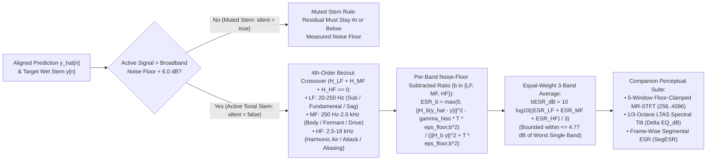

# Psychoacoustic Quality Standard (`bESR`) & 4-Tier Benchmarks

This specification defines the **perceptual quality evaluation framework (`bESR`, `MR-STFT`, `LTAS` spectral tilt, and `SegESR`), device-agnostic noise-floor rules, quiet vs. muted stem classification, and 4-tier (`Lite` / `Full` / `Pro` / `Ultra`) acceptance benchmarks** for **Dynamic Neural Audio Modeler (DNAM)**.

For the overarching system goals and hardware budgets, see [`system_goals_and_requirements.md`](system_goals_and_requirements.md). For how `bESR` folds directly into the Stage-2 and Stage-4 Kronecker normal equations at zero runtime cost, see [`../training/four_stage_pipeline.md` §2.2](../training/four_stage_pipeline.md#22-stage-2--partitioned-svd-orthonormal-kronecker-float64-wiener-hopf-warm-start-cl-18).

---

## 1. Why Plain Broadband `ESR` and Fixed High-Pass Pre-Emphasis Fail

Evaluating neural audio models with plain broadband Error-to-Signal Ratio ($\text{ESR} = \Vert \hat{y} - y\Vert _2^2 / \Vert y\Vert _2^2$) or fixed first-order high-pass pre-emphasis ($H_{\text{pre}}(z) = 1 - 0.95 z^{-1}$) fails across universal instruments for five physical reasons:

| Failure Mode | Physical Cause | Audible Consequence |
| :--- | :--- | :--- |
| **1. Broadband `ESR` Low-Frequency Dominance** | Musical instruments roll off at `-6` to `-12 dB/oct` above `400 Hz` (`1/f²` spectrum), concentrating `95–99%` of total energy below `1 kHz` while upper harmonics (`2.5–18 kHz`) carry `< 0.5%` of total energy. | A model that drops `> 2.5 kHz` harmonics by `-6 dB` or blankets pick attack still reports a deceptive `-25 dB` broadband `ESR`. |
| **2. Time-Domain MSE Phase-Mismatch Bias & Loud-Passage Masking** | Unweighted time-domain MSE penalizes slight high-frequency phase shifts (`2(1 - cos Δφ)`) more heavily than completely omitting the harmonic, and integrates energy over full files so loud passages mask quiet-passage errors. | Biases models toward low-passed high frequencies ("MSE low-pass bias") and hides cross-over/decay distortion during quiet tails. |
| **3. Fixed Pre-Emphasis Sub-Bass Starvation** | A fixed `+6 dB/oct` high-pass filter (`1 - 0.95 z⁻¹`) attenuates `40 Hz` by `-24 dB` relative to `4 kHz`. | Sacrifices sub-bass fundamental weight and phase coherence on bass amplifiers, `808`s, and sub-synths (`30–120 Hz`). |
| **4. Bright-Source Midrange Starvation** | Cymbals, drums, and bright synth leads already contain high `5–16 kHz` energy. | Fixed high-pass pre-emphasis over-weights HF and starves midrange body (`150–800 Hz`). |
| **5. Analog Thermal Hiss Amplification** | Clean or low-passed analog sources (e.g., bass cabs, warm Rhodes, steep low-pass filter sweeps) have no signal above `2.5 kHz` other than `-60` to `-75 dBFS` thermal hiss. | Blindly boosting HF forces the model to fit uncorrelated random Johnson-Nyquist thermal noise. |

---

## 2. Floor-Regularized, Noise-Adjusted Band-Balanced `bESR`

### 2.1 4th-Order-Flat Bezout Complementary 3-Band Crossover ($H_{\text{LF}} + H_{\text{MF}} + H_{\text{HF}} \equiv I$)

A 1st-order ($-6\text{ dB/oct}$) high-pass filter at $2.5\text{ kHz}$ attenuates $800\text{ Hz}$ by only $-10.3\text{ dB}$ and $110\text{ Hz}$ by $-27\text{ dB}$, allowing strong low/mid instrument fundamentals to leak into the `HF` band (`74%` of `tgt_hf` energy on $1/f^2$ guitar and bass signals).

DNAM partitions the spectrum using the causal **Binomial / Bezout identity** $(H_1 + (1 - H_1))^7 \equiv 1$, where $H_1(z)$ is a 1-pole low-pass filter at cutoff $f_c$:
$$\mathcal{L}_{f_c}(z) = H_1(z)^4 \Big(1 + 4\big(1 - H_1(z)\big) + 10\big(1 - H_1(z)\big)^2 + 20\big(1 - H_1(z)\big)^3\Big)$$
This yields a **$-80\text{ dB/decade}$ ($-24\text{ dB/oct}$) 4th-order stopband on BOTH sides** ($\mathcal{L}_{f_c}$ and $1 - \mathcal{L}_{f_c}$) with **zero FFTs** while preserving exact time-domain complementarity ($H_{\text{LF}}(z) + H_{\text{MF}}(z) + H_{\text{HF}}(z) \equiv 1$ to $10^{-15}$) across the three perceptual bands ($f_{c,1} = 250\text{ Hz}$, $f_{c,2} = 2.5\text{ kHz}$):
- **Low / Sub (`LF`, $20\text{–}250\text{ Hz}$):** $H_{\text{LF}}(z) = \mathcal{L}_{250}(z)$ — Fundamental weight, cabinet port resonance, and power-supply sag.
- **Mid / Body (`MF`, $250\text{ Hz}\text{–}2.5\text{ kHz}$):** $H_{\text{MF}}(z) = \mathcal{L}_{2500}(z) - \mathcal{L}_{250}(z)$ — Core note definition, formant structure, and primary distortion character.
- **High / Air (`HF`, $2.5\text{–}18\text{ kHz}$):** $H_{\text{HF}}(z) = 1 - \mathcal{L}_{2500}(z)$ — Harmonic overtone sheen, transient pick/slap attack, and fizz/aliasing control.

### 2.2 Per-Band Noise-Floor Subtraction & Worst-Band Mathematical Bound

Each band $b \in \lbrace \text{LF}, \text{MF}, \text{HF} \rbrace$ is normalized by its own floor-clamped target energy and adjusted for its stationary per-band noise floor $\epsilon_{\text{floor},b}^2$ measured directly from silent-input frames:
$$\text{ESR}_b = \frac{\max\Big(0,\ \big\Vert H_b(z)(\hat{y} - y) \big\Vert _2^2 - \gamma_{\text{hiss}} T \epsilon_{\text{floor},b}^2\Big)}{\big\Vert H_b(z) y \big\Vert _2^2 + T \cdot \epsilon_{\text{floor},b}^2}, \qquad \text{bESR}_{\text{dB}} = 10 \log_{10}\left(\frac{\text{ESR}_{\text{LF}} + \text{ESR}_{\text{MF}} + \text{ESR}_{\text{HF}}}{3}\right)$$

> [!IMPORTANT]
> **Mathematical Worst-Band Bound (`4.77 dB` Ceiling):** Because $\text{bESR}$ averages the three band ratios equally ($w_{\text{LF}} = w_{\text{MF}} = w_{\text{HF}} = \frac{1}{3}$), composite $\text{bESR}_{\text{dB}}$ can **never** be more than $10 \log_{10}(3) \approx 4.77\text{ dB}$ better than the single worst frequency band.

---

## 3. Device-Agnostic Quality Evaluation (Zero Subjective Carve-Outs)

DNAM applies **one single, objective, signal-measured standard per tier** across all hardware device classes (clean preamps, LTI cabinets, high-gain tube heads, self-oscillating filters, and extreme comparator fuzzes):

1. **Sub-Sample Clock Jitter Floor ($8\text{ kHz}$):** At $f_s = 48\text{ kHz}$, an uncompensated ADC/DAC clock drift or USB stream startup jitter of $0.05\text{ samples}$ ($1\ \mu\text{s}$) introduces a phase error $\Delta\phi = 2\pi \frac{8000}{48000}(0.05) = 0.052\text{ rad}$ ($3^\circ$) at $8\text{ kHz}$, setting a mathematical time-domain subtraction floor of $20 \log_{10}(0.052) = -25.6\text{ dB}$ unless sub-sample jitter is aligned during calibration ([`../training/capture_and_alignment.md` §1.5](../training/capture_and_alignment.md#15-multi-regime-sub-sample-hardware-latency-alignment)).
2. **Signal-Measured Thermal Hiss Floor (`Noise-Floor Limited` Criterion):** Deterministic models must not memorize random analog thermal noise. When a band's measured signal-to-noise ratio $\text{SNR}_b = \text{Signal}_{\text{dBFS},b} - \text{NoiseFloor}_{\text{dBFS},b}$ is smaller than $-\text{Goal}_{\text{dB},b}$ (e.g., the `HF` band of a bass stem with the treble or low-pass filter rolled off), the band requirement is objectively satisfied when the residual error reaches the measured noise floor ($\text{Residual}_{\text{dBFS},b} \le \text{NoiseFloor}_{\text{dBFS},b} + 1.0\text{ dB}$).
3. **Human Psychoacoustic JND:** $\text{ESR}_{\text{HF}} \le -20\text{ dB}$ (`Full`), $\le -26\text{ dB}$ (`Pro`), and $\le -30\text{ dB}$ (`Ultra`) correspond to maximum high-frequency amplitude deviations of $\le 0.35\text{ dB}$, $\le 0.15\text{ dB}$, and $\le 0.10\text{ dB}$—tighter than the `1%–5%` component tolerances between two physical analog units.
4. **Quiet Tonal Stems vs. Muted Stems:**
   - Any stem whose active signal exceeds its measured broadband noise floor by $> 6.0\text{ dB}$ (even if quiet in absolute dBFS, such as a minimum-volume stem that attenuates level without muting) is classified as an **active tonal stem** (`silent = false`) and must be fitted and evaluated to full tonal accuracy.
   - Only stems within $\le 6.0\text{ dB}$ of their measured noise floor are classified as **muted stems** (`silent = true`) and must remain at or below their measured noise floor.

---

## 4. Companion Perceptual Metrics (`MR-STFT`, `LTAS` Tilt & `SegESR`)

Alongside 3-band `bESR`, every trained model is certified across three complementary perceptual diagnostics:

| Diagnostic Metric | Mathematical Formulation | Perceptual & Physical Purpose |
| :--- | :--- | :--- |
| **Multi-Resolution Log-STFT (`MR-STFT`)** | Floor-clamped log-magnitude spectral distance across `N_fft ∈ {256, 512, 1024, 2048, 4096}` (`-60 dBFS` floor) | Short windows (`256, 512 ≈ 5–10 ms`) lock drum transients, slap-bass pops, and pick attacks; long windows (`2048, 4096 ≈ 42–85 ms`) give `11 Hz` resolution to separate low bass fundamentals (`31 Hz` vs. `41 Hz`) and cabinet resonances. |
| **1/3-Octave Spectral Tilt (`ΔEQ_dB`)** | Long-Term Average Spectrum (`LTAS`) deviation across 1/3-octave ISO bands (`RMS` and `HF` `2–18 kHz` tilt in dB) | Detects subtle high-frequency shelving droop or resonant filter tilt that could alter mix placement. |
| **Segmental Frame-Wise ESR (`SegESR`)** | Mean dB ESR across active `20 ms` (`960`-sample) frames above the silent gate | Prevents high-energy fortissimo passages from masking distortion errors during quiet clean decay tails. |

---

## 5. Canonical 4-Tier Quality Benchmark Matrix

| DNAM Tier | Target Grade | Noise-Adjusted Composite `bESR` | Per-Band Requirement (`LF` / `MF` / `HF` or `≤ NoiseFloor + 1.0 dB`) | Max Spectral Tilt (`ΔEQ_dB`) | Multi-Control Unseen `bESR` | Psychoacoustic Reality (Blind ABX Listening) |
| :--- | :--- | :---: | :---: | :---: | :---: | :--- |
| **`Lite` (`C=4, M=4, D_h=4`)** | **Mix-Ready / Live Grade** | **`≤ -18 dB`** (`-18 to -23 dB`) | `LF ≤ -23 dB`, `MF ≤ -20 dB`, `HF ≤ -15 dB` | **`≤ 0.75 dB`** | **`≤ -16 dB`** | Indistinguishable in a full mix; preserves dynamic feel and transient response on stage hardware. |
| **`Full` (`C=8, M=8, D_h=4`)** | **True Studio Quality** | **`≤ -23 dB`** (`-23 to -30 dB`) | `LF ≤ -27 dB`, `MF ≤ -25 dB`, **`HF ≤ -20 dB`** | **`≤ 0.35 dB`** | **`≤ -21 dB`** | Blind ABX transparent; residual error in every frequency band is below human JND. |
| **`Pro` (`C=12, M=8, D_h=4`)** | **Mastering / Reference Grade** | **`≤ -30 dB`** (`-30 to -34 dB`) | `LF ≤ -34 dB`, `MF ≤ -31 dB`, `HF ≤ -26 dB` | **`≤ 0.15 dB`** | **`≤ -27 dB`** | Null-test transparent in instant solo A/B switching on studio monitors and reference headphones. |
| **`Ultra` (`C=16, M=16, D_h=8`)** | **Unconstrained Workstation Max** | **`≤ -34 dB`** | `LF ≤ -38 dB`, `MF ≤ -35 dB`, `HF ≤ -30 dB` | **`≤ 0.10 dB`** | **`≤ -32 dB`** | Archival and offline-bounce reference across complex high-dimensional multi-control interactions. |
