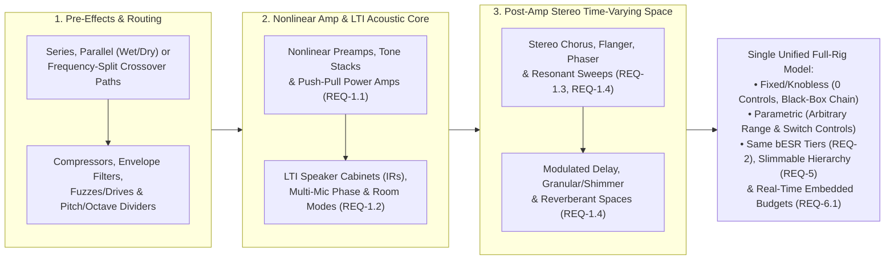
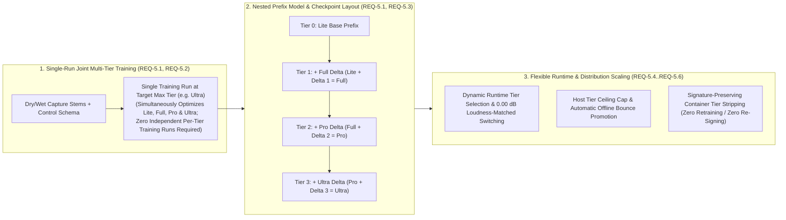

# System Goals, Functional Requirements & Hardware Budgets

This specification defines the **eight implementation-agnostic system goals, functional requirements (`REQ-1`–`REQ-8`), real-time commodity hardware budgets, and model/marketplace security guarantees** that govern **Dynamic Neural Audio Modeler (DNAM)**.

All requirements in this document are stated independently of internal model topology, cryptographic primitive, or solver implementation:
- For the perceptual quality metric (`bESR`) and 4-tier acceptance thresholds (`Lite`, `Full`, `Pro`, `Ultra`), see [`psychoacoustic_quality_and_tiers.md`](psychoacoustic_quality_and_tiers.md).
- For the concrete "Tri-Physics" DSP & training architecture that fulfills these goals (and how it compares to `NAM A2`, `GuitarML PROTEUS`, and `NAM ParametricOD`), see [`tri_physics_architecture.md`](tri_physics_architecture.md).
- For the concrete cryptographic provenance, hardware enclave DRM, forensic watermarking, and anti-cloning architecture that fulfills Goal 8, see [`../security/provenance_and_enclave_drm.md`](../security/provenance_and_enclave_drm.md) and [`../security/watermarking_and_marketplace.md`](../security/watermarking_and_marketplace.md).

---

## 1. End-to-End Requirement Architecture

```mermaid
flowchart LR
    subgraph Goal12 ["Goals 1 & 2: System Coverage & Perceptual Quality"]
        G1A["Goal 1 (REQ-1): Nonlinear, LTI, Resonant, Delay & Complex Full-Rig Systems"]
        G1B["Goal 1 (REQ-1): Heuristic-Free Universal Excitation & Arbitrary Stems"]
        G2A["Goal 2 (REQ-2): Device-Agnostic 3-Band Noise-Adjusted bESR Tiers"]
        G2B["Goal 2 (REQ-2): Quiet Stems, Parametric Control, Tempo Sync & Non-Stop Clamping"]
    end

    subgraph Goal34 ["Goals 3 & 4: Iterative Resume & Scalable Training"]
        G3A["Goal 3 (REQ-3): Single-Checkpoint Incremental Stem Refinement"]
        G3B["Goal 3 (REQ-3): Zero Old-Stem Drift & Bounded Workspace Cache"]
        G4A["Goal 4 (REQ-4): Accelerator-First (TPU / GPU / MPS) + float64 Accuracy"]
        G4B["Goal 4 (REQ-4): Bi-Directional Memory Scaling (< 8 GiB on 16 GB Host)"]
    end

    subgraph Goal56 ["Goals 5 & 6: Single-Run Slimmable Tiers & Real-Time Budgets"]
        G5A["Goal 5 (REQ-5): Nested Slimmable Hierarchy (Lite < Full < Pro < Ultra)"]
        G5B["Goal 5 (REQ-5): Single-Run Joint Multi-Tier Training (No Per-Tier Retraining)"]
        G5C["Goal 5 (REQ-5): Dynamic Tier Switching, Bounce Promotion & Tier Stripping"]
        G6A["Goal 6 (REQ-6): Embedded Budget (>= 10x Lite, >= 6x Full, >= 2x Pro @ 48 kHz)"]
    end

    subgraph Goal78 ["Goals 7 & 8: Unclipped f32 I/O, Channel Topologies & Marketplace Security"]
        G7A["Goal 7 (REQ-7): Unclipped f32 I/O, Mono/True-Stereo (1->1, 2->1, 1->2, 2->2) & Stability"]
        G8A["Goal 8 (REQ-8): Creator Provenance, Distribution Policy & 3 DRM Profiles"]
        G8B["Goal 8 (REQ-8): Zero-Degradation Buyer Watermarking & Collusion Resistance"]
        G8C["Goal 8 (REQ-8): Multi-Stage Anti-Cloning Gate & Automated Device Revocation"]
    end

    Goal12 --> Goal34 --> Goal56 --> Goal78
```

---

## 2. Goal 1 — Universal Instrument, System & Flexible Input Coverage (Nonlinear + LTI + Full Rigs)

A conforming system must accurately model four fundamental physical classes of audio equipment and acoustic spaces—both as isolated hardware units and combined into **complex, end-to-end full rigs**—across the full audible bandwidth ($20\text{ Hz}\text{–}20\text{ kHz}$) for any musical source (electric/acoustic guitar, bass, synthesizers, drums, vocals, acoustic instruments, and mastering gear):

| Requirement ID | Physical System Class | Representative Hardware & Acoustic Targets | Required Physical Phenomena |
| :--- | :--- | :--- | :--- |
| **`REQ-1.1`** | **Nonlinear Preamps, Amplifiers & Drives** | Tube heads (`Preamp → Tone Stack → Driver → Push-Pull Power/OT`), solid-state/CMOS/JFET drives, comparator/octave wavefolder fuzzes, optical/FET compressors, analog tape | Multi-stage soft/hard clipping, asymmetric conduction, dual-polarity interstage bias shift, power-supply sag, and folded phase-space hysteresis |
| **`REQ-1.2`** | **Linear, Time-Invariant (LTI) Systems** | Speaker cabinets (`1x15` ported flip-top cabs, `4x12` guitar cabs, multi-mic setups), passive/active EQs, studio rooms, early reflections, chambers, plates, halls | Multi-resonance impulse responses: bass-reflex port resonances (`40–110 Hz`), speaker cone breakup modes (`1.5–6 kHz`), mic phase/comb notches (`3–16 kHz`), and reverberant decay |
| **`REQ-1.3`** | **Selective State-Space & Resonant Filters** | Envelope filters / auto-wahs, analog resonant `LP`/`BP`/`HP` filters (including self-oscillating high-`Q` peaks), dynamic EQs, phasers, Uni-Vibe, harmonic tremolo | Signal-envelope, free-running LFO, and tempo-synced (`REQ-2.5`) resonant frequency and damping trajectories with preserved resonance `Q` across wide sweeps |
| **`REQ-1.4`** | **Modulated & Time-Warped Delay Networks** | Through-zero flangers, stereo chorus, rotary Doppler, BBD/tape echoes (with self-oscillation and rhythmic subdivisions), spring reverb drip, hall reverbs, granular clouds, pitch shimmer, spectral freeze | Click-free fractional delay modulation (both manual `ms`/`Hz` and host/MIDI tempo-synced subdivisions per `REQ-2.5`), dispersive all-pass chirp, stereo feedback diffusion, windowed time/pitch warping, and lossless infinite hold |
| **`REQ-1.5`** | **Complex Full-Rig & Multi-Block Signal Chains** | End-to-end multi-unit studio/stage rigs spanning pre-effects (compressors, envelope filters, fuzzes/drives, pitch/octave dividers), nonlinear preamps/amplifiers, LTI speaker cabinets (`IR`s) and microphones, and post-amp time-varying modulation, delay, granular/shimmer, and reverberant acoustic spaces (e.g., `Compressor → Envelope Filter → Drive/Fuzz → Tube Amp → Speaker Cab + Mic → Stereo Chorus/Delay → Hall Reverb`, or multi-path bass rigs combining sub-bass compression with high-pass distortion and cabinet simulation) | Single unified model capturing arbitrary series, parallel (wet/dry or frequency-split), and mono/stereo-routed (`1 → 1`, `2 → 1`, `1 → 2`, `2 → 2`, and 4-Cable-Method `4CM` per `REQ-7.4`) signal chains—supporting both fixed/knobless full-rig captures (`0` exposed controls, treating the entire multi-unit rig as a single black-box signal chain) and parametric/tempo-synced full-rig models (`range` & `switch` controls across the rig)—while jointly resolving compound cross-block interactions (`REQ-1.1`–`REQ-1.4`) within the same `bESR` quality tiers (`REQ-2.1`–`REQ-2.2`), single-run slimmable tier hierarchy (`REQ-5.1`–`REQ-5.2`), and real-time embedded hardware budgets (`REQ-6.1`) |

### Complex End-to-End Full-Rig & Multi-Block Signal Chain Coverage (`REQ-1.5`)

The system must not be limited to isolated single pedals or standalone amplifier heads; it must capture and model **complete, end-to-end multi-unit rigs as a single unified model**:

| Full-Rig Requirement Aspect | Normative Specification (`REQ-1.5`) |
| :--- | :--- |
| **Arbitrary Multi-Block Topologies** | Must model arbitrary series, parallel (wet/dry blend or frequency-split crossover, such as sub-bass compression combined with high-pass distortion and cabinet simulation), and mono (`1 → 1`, `2 → 1`) or true-stereo (`1 → 2`, `2 → 2`, `REQ-7.4`) chains spanning pre-effects, amplifiers, speaker cabinets (`IR`s) + microphones, and post-amp modulation/delay/granular/reverb units as one unified model. |
| **Fixed/Knobless vs. Parametric Full-Rig Modes** | Must support both **fixed/knobless full-rig captures** (`0` exposed controls, treating the entire multi-unit signal chain as a single black-box system) and **parametric full-rig models** exposing arbitrary user-selected continuous `range` knobs and discrete `switch` selectors across one or more units in the rig. |
| **Compound Cross-Block Physical Interactions** | Must jointly resolve inter-stage physical coupling—including nonlinear preamp/power-amp harmonics exciting speaker-cabinet and room resonances (`REQ-1.1` + `REQ-1.2`), envelope/LFO filter sweeps feeding or following nonlinear clipping (`REQ-1.3`), and stereo diffusive delay/reverb tails (`REQ-1.4`)—while meeting the same device-agnostic `bESR` quality tiers (`REQ-2.1`–`REQ-2.2`), single-run slimmable tier hierarchy (`REQ-5.1`–`REQ-5.2`), and real-time embedded hardware budgets (`REQ-6.1`). |

### Flexible Dry/Wet Stem & Excitation Requirements (`REQ-1.6`–`REQ-1.8`)

| Requirement ID | Requirement | Specification |
| :--- | :--- | :--- |
| **`REQ-1.6`** | **Zero Control-Name or Manifest Heuristics** | Capture excitation synthesis and model training must never rely on control names or manifest heuristics to infer circuit behavior, ensuring fixed/knobless rigs and multi-effect + amp + cab chains (`REQ-1.5`) are supported identically ([`../training/capture_and_alignment.md` §1.4](../training/capture_and_alignment.md#14-heuristic-free-300-second-5-section-universal-excitation--live-tail-extension)). |
| **`REQ-1.7`** | **Standard Universal Excitation + Dynamic Tail** | Must support a canonical 30.0-second full-bandwidth (`20 Hz–20 kHz`) universal excitation signal with automatic live recording extension when a stem's wet decay tail continues ringing above the pre-roll noise floor. |
| **`REQ-1.8`** | **Arbitrary User-Supplied Dry/Wet Stems** | Must support user-supplied dry/wet stems of any duration or musical content without relying on hardcoded excitation section boundaries. |

---

## 3. Goal 2 — Perceptual Studio Quality (`bESR`), Parametric Control & Quiet Stem Handling

| Requirement ID | Requirement | Specification |
| :--- | :--- | :--- |
| **`REQ-2.1`** | **Perceptual Band-Balanced Metric (`bESR`)** | Plain broadband `ESR` must not be used as a quality criterion because `1/f²` low-frequency dominance, time-domain MSE high-frequency phase-mismatch bias, and loud-passage masking hide upper-harmonic errors. Quality is governed by **Floor-Regularized, Noise-Adjusted Band-Balanced `bESR`**, which weights **Low (`20–250 Hz`)**, **Mid (`250 Hz–2.5 kHz`)**, and **High (`2.5–18 kHz`)** equally and can never be more than `4.77 dB` (`10 log₁₀ 3`) better than the worst single band ([`psychoacoustic_quality_and_tiers.md`](psychoacoustic_quality_and_tiers.md)). |
| **`REQ-2.2`** | **Device-Agnostic Quality Standard** | One identical, signal-measured quality standard per tier (`Lite`, `Full`, `Pro`, `Ultra`) applies across all device types—with zero subjective `"clean vs. high-gain"` carve-outs—by accounting for sub-sample clock jitter and each stem's measured per-band silent thermal noise floor ([`psychoacoustic_quality_and_tiers.md` §3](psychoacoustic_quality_and_tiers.md#3-device-agnostic-quality-evaluation-zero-subjective-carve-outs)). |
| **`REQ-2.3`** | **Quiet Tonal Stems vs. Muted Stems** | Quiet stems that contain active signal above their measured noise floor (e.g., a minimum-volume stem that reduces level without fully muting) must be fitted and evaluated as active tonal stems rather than discarded by a fixed level cutoff; only stems at their measured noise floor are treated as muted and must remain at or below their noise floor. |
| **`REQ-2.4`** | **Parametric Conditioning & Non-Stop Clamping** | Models must interpolate smoothly across intermediate continuous `range` and discrete `switch` control states while automatically clamping unobserved ranges, unrecorded switch options, and unstable multi-knob corners without pausing training for user confirmation ([`../training/clamp_and_audit_registry.md`](../training/clamp_and_audit_registry.md)). |
| **`REQ-2.5`** | **MIDI / Host Tempo Sync & Rhythmic Subdivision** | Time-based model parameters—including delay and echo repeat times, modulation rates (chorus, flanger, phaser, tremolo, rotary, auto-wah, and cyclic sweeps), granular/slicer periods, and rhythmic step trajectories—must natively support both **free-running manual mode (`Hz` / `ms`)** and **tempo-synchronized rhythmic mode (`BPM`)** locked to host transport tempo, external MIDI clock (`24 PPQN` beat clock), or tap tempo across all **12 canonical musical subdivisions** (`1/2.`, `1/2`, `1/2T`, `1/4.`, `1/4`, `1/4T`, `1/8.`, `1/8`, `1/8T`, `1/16.`, `1/16`, `1/16T`, spanning dotted `1.5×`, straight `1.0×`, and triplet `2/3×` note feels), including independent Left/Right polyrhythmic subdivisions (e.g., `1/4` + `1/8.` ping-pong). Tempo synchronization must preserve the modeled hardware's time-dependent tonal and spatial diffusion characteristics (including automatic range selection on multi-range units), reject external clock/tap jitter without pitch warble, and transition across continuous tempo ramps or discrete subdivision changes without clicks or pitch discontinuities while meeting all real-time execution constraints (`REQ-6.1`–`REQ-6.3`) ([`../dsp/parametric_control_bus.md` §3](../dsp/parametric_control_bus.md#3-multi-range-conditional-tempo-sync--calibration-roles-controls_schemacalibration), [`u_pra_architecture.md` §6.3](u_pra_architecture.md#63-strict-zero-fdiv-zero-fsqrt-and-zero-libm-verification)). |

### 3.1 MIDI / Host Tempo Sync & 12-Subdivision Rhythmic Grid (`REQ-2.5`)

To support studio DAW automation and live pedalboard performance without manual millisecond/Hertz conversion, any time-varying delay, modulation, granular, or sequenced model must support seamless switching between manual parameter control and musical tempo synchronization:

| Tempo Sync Aspect | Normative Requirement (`REQ-2.5`) |
| :--- | :--- |
| **Clock Sources & Jitter Rejection** | Must lock to (1) **Host DAW / Plugin Transport Tempo (`BPM` & musical beat/bar phase `PPQ`)**, (2) **External MIDI Beat Clock (`0xF8` at `24 PPQN` with `Start` `0xFA` / `Continue` `0xFB` / `Stop` `0xFC`)**, and (3) **Hardware Footswitch / UI Tap Tempo**, rejecting external clock arrival jitter and human tap variance so sustained repeats never exhibit pitch warble, with instant fallback to **Free-Running Manual Mode (`ms` / `Hz`)** when tempo sync is disabled. |
| **12 Canonical Subdivisions, Dual Polyrhythms & Spatial Preservation** | Must support all 12 rhythmic subdivisions relative to a quarter-note beat (`T_quarter = 60 / BPM` seconds): **`1/2.`** (`3.0×`), **`1/2`** (`2.0×`), **`1/2T`** (`4/3×`), **`1/4.`** (`1.5×`), **`1/4`** (`1.0×`), **`1/4T`** (`2/3×`), **`1/8.`** (`0.75×`), **`1/8`** (`0.5×`), **`1/8T`** (`1/3×`), **`1/16.`** (`0.375×`), **`1/16`** (`0.25×`), and **`1/16T`** (`1/6×`), supporting independent Left/Right dual subdivisions (e.g., `1/4` + `1/8.` ping-pong) while preserving the natural spatial diffusion of multi-tap and reverberant tails. |
| **Coupled Timbral Fidelity & Multi-Range Continuity** | Synchronizing a time-based control must preserve the hardware's time-dependent tonal behavior—such as analog clock/tape high-frequency rolloff, feedback damping, and automatic range selection (or octave folding) when a target subdivision spans multiple hardware time ranges—across both desktop and zero-allocation embedded runtimes. |
| **Musical Phase Alignment & Artifact-Free Transitions** | Musical bar/beat phase (`PPQ`) must align periodic modulation cycles and rhythmic/granular windows to downbeats without causing discontinuities in active delay repeats; continuous tempo ramps must glide smoothly, whereas large tempo jumps or discrete subdivision changes must transition without clicks or unnatural pitch jumps while satisfying `REQ-6.1`–`REQ-6.3`. |

---

## 4. Goal 3 — Progressive Model Refinement & Low-Memory Caching

| Requirement ID | Requirement | Specification |
| :--- | :--- | :--- |
| **`REQ-3.1`** | **Progressive Single-Checkpoint Refinement** | Models must support progressive refinement with additional or re-recorded control-state stems from a single training checkpoint without retraining unchanged stems from scratch whenever incremental refinement is faster than full retraining ([`../training/iterative_resume_and_caching.md` §1](../training/iterative_resume_and_caching.md#1-single-checkpoint-dnam-ckpt-two-tier-iterative-stem-expansion)). |
| **`REQ-3.2`** | **Zero Old-Stem Perturbation on Expansion** | Adding stems to expand a control's observed range or polynomial degree must preserve previously converged stem responses without degradation. |
| **`REQ-3.3`** | **Reusable Calibration & Bounded Workspace Cache** | Training checkpoints and a gitignored local workspace cache (with configurable size limits, a read-vs-regenerate cost model, and automatic cleanup) must persist reusable calibration and stem state across runs to avoid expensive recalculations on low-memory systems, while keeping exported runtime model containers stripped of training-only data ([`../training/iterative_resume_and_caching.md` §2](../training/iterative_resume_and_caching.md#2-two-tier-calibration-persistence-arena-5-dnca--workspace-dnam-cache)). |

---

## 5. Goal 4 — Accelerator-First Training & Bi-Directional Memory Scaling

| Requirement ID | Requirement | Specification |
| :--- | :--- | :--- |
| **`REQ-4.1`** | **Accelerator-First Execution & Fail-Fast Request** | Training must automatically prefer hardware accelerators (`TPU`, `CUDA`/`ROCm` GPU, Apple Silicon `MPS`) and fall back to `CPU` only when no accelerator is available (emitting a clear warning) or when `CPU` is explicitly requested; explicitly requested unavailable accelerators must fail fast. |
| **`REQ-4.2`** | **Unified Cross-Accelerator `float64`-Grade Accuracy** | Training must achieve `float64`-grade solver accuracy across accelerators that natively restrict device execution to 32-bit operations (`MPS`, `TPU`) as well as `CUDA`/`ROCm` and `CPU` ([`../training/four_stage_pipeline.md` §3](../training/four_stage_pipeline.md#3-accelerator-first-32-bit-execution-72-bit-gram-accumulation--memory-bounded-streaming)). |
| **`REQ-4.3`** | **Bi-Directional Memory Scaling (`16 GB` Host to Cloud TPU)** | Training must scale down cleanly to a commodity `16 GB` system (`~8 GiB` memory budget, zero OOMs, zero OS swap) even on 30-second, 30+ stem models, while scaling up without artificial caps to larger unified-memory systems, `16+ GB` GPUs, and high-memory Cloud TPUs for faster throughput. |

---

## 6. Goal 5 — Single-Run Slimmable Multi-Tier Architecture (`Lite` / `Full` / `Pro` / `Ultra`)

Rather than training, storing, and distributing separate disconnected models for different compute budgets (e.g., separate "Nano", "Feather", "Standard", and "Heavy" models that each require an independent training run), a conforming system must use a **nested slimmable multi-tier hierarchy (`Lite` $\subset$ `Full` $\subset$ `Pro` $\subset$ `Ultra`) where training at the highest target tier simultaneously trains all lower tiers in a single training run**:

| Requirement ID | Requirement | Specification |
| :--- | :--- | :--- |
| **`REQ-5.1`** | **Nested Slimmable Multi-Tier Hierarchy (`Lite` ⊂ `Full` ⊂ `Pro` ⊂ `Ultra`)** | Models and containers must organize capacity into a nested 4-tier hierarchy—**`Lite`** (Mix-Ready / Live Grade), **`Full`** (True Studio Quality), **`Pro`** (Mastering / Reference Grade), and **`Ultra`** (Unconstrained Workstation Max)—where each lower tier is an exact contiguous prefix/subset of every higher tier with zero duplicated parameters and zero structural padding zeros ([`tri_physics_architecture.md` §2.1](tri_physics_architecture.md#21-4-tier-lower-block-triangular-arena-hierarchy), [`../containers/dnam_binary_format.md` §2](../containers/dnam_binary_format.md#2-five-hardware-loading-optimizations--50-ns-zero-allocation-load)). |
| **`REQ-5.2`** | **Single-Run Joint Multi-Tier Training (Zero Independent Per-Tier Training)** | **Training a model at the highest tier (or any selected maximum target tier `t_max`) must simultaneously train and calibrate all lower tiers (`t ≤ t_max`) within that single training run.** Each tier must **not** need to be independently trained, captured, or distilled; a single training execution produces one unified container in which `Lite`, `Full`, `Pro`, and `Ultra` each independently meet their respective quality standards ([`psychoacoustic_quality_and_tiers.md` §5](psychoacoustic_quality_and_tiers.md#5-canonical-4-tier-quality-benchmark-matrix), [`../training/four_stage_pipeline.md` §2.5](../training/four_stage_pipeline.md#25-stage-4--step-n-float64-cholesky-export-polish-lambda_textpolish--10-6bartau--base-channel-band-caching)). |
| **`REQ-5.3`** | **Multi-Tier Incremental Checkpoint Refinement** | Training checkpoints must preserve per-stem state in a nested tier-prefix representation so that progressive stem refinement (`REQ-3.1`) updates all tiers (`Lite` through `t_max`) simultaneously in a single pass without independently recomputing or retraining lower tiers ([`../containers/checkpoint_and_cache_format.md` §2](../containers/checkpoint_and_cache_format.md#2-tier-ordered-column-major-upper-triangular-packing-uplou-for-mathbfg_textaudios)). |
| **`REQ-5.4`** | **Loudness-Matched Dynamic Runtime Tier Switching** | Runtime engines and hosts must be able to select or switch the active tier (`Lite`, `Full`, `Pro`, `Ultra`) dynamically from the same loaded container without file reloads or audible level jumps (`0.00 dB` calibrated per-tier loudness parity at default controls) ([`tri_physics_architecture.md` §3.2](tri_physics_architecture.md#32-gated-rms_dbfs-auto-unity-leveling--per-tier-loudness-parity)). |
| **`REQ-5.5`** | **Host Maximum Tier Ceiling & Automatic Offline Bounce Promotion** | Plugins and embedded hosts must be able to cap the maximum loaded tier (`t_eff = min(t_requested, t_host_ceiling, t_container_max)`) to bound memory and compute on resource-constrained hardware, while desktop DAWs must support optional automatic promotion to the highest available tier during offline bounce/rendering ([`tri_physics_architecture.md` §3.4](tri_physics_architecture.md#34-4times-zoh-polyphase-oversampling--automatic-tier-promotion-on-offline-bounce-cl-19-cl-20)). |
| **`REQ-5.6`** | **Signature-Preserving Container Tier Stripping** | Any multi-tier container must support lossless truncation/stripping of higher tier weights down to a target lower tier (`Pro`, `Full`, or `Lite`) for constrained storage or preview distribution **without retraining and without invalidating creator or marketplace cryptographic signatures** ([`../containers/dnam_binary_format.md` §1.1](../containers/dnam_binary_format.md#11-fixed-64-byte-binary-preamble-layout-reprc-align64), [`../security/provenance_and_enclave_drm.md` §2.3](../security/provenance_and_enclave_drm.md#23-two-certificate-ed25519-delegation-chain--4-tier-cumulative-arena-digests)). |

---

## 7. Goal 6 — Real-Time Commodity Hardware Budget & Execution Constraints

### 7.1 Target Embedded Platform & Per-Tier Instance Budgets (`REQ-6.1`)

The reference commodity embedded target is the **Rockchip RK3582** (as deployed on the **Darkglass Anagram**: $2\times$ Cortex-A76 @ $2.4\text{ GHz}$ + $4\times$ Cortex-A55 @ $1.8\text{ GHz}$ with ARM64 NEON SIMD, allocating $1\times$ Cortex-A76 core = **$20,833\text{ ns/sample}$ budget at $48\text{ kHz}$** for a series signal chain). A conforming runtime must sustain the following simultaneous real-time ($48\text{ kHz}$) instance counts (for achieved Rust benchmarks, see [`tri_physics_architecture.md` §2](tri_physics_architecture.md#2-4-tier-slimmable-simd-hierarchy-lite--full--pro--ultra--prior-art-comparison)):

| DNAM Tier | Target Grade | Minimum Simultaneous `48 kHz` Instances (`1×` Cortex-A76) | Maximum Per-Instance Sample Budget | Max Single-Core CPU Share | Primary Deployment Target |
| :--- | :--- | :---: | :---: | :---: | :--- |
| **`Lite`** | **Mix-Ready / Live Grade** | **`≥ 10×` instances** | `≤ 2,083 ns/sample` | `≤ 10.0%` | High-density embedded multi-block pedalboard chains & web previews |
| **`Full`** | **True Studio Quality** | **`≥ 6×` instances** | `≤ 3,472 ns/sample` | `≤ 16.7%` | Default studio & stage flagship block |
| **`Pro`** | **Mastering / Reference Grade** | **`≥ 2×` instances** | `≤ 10,416 ns/sample` | `≤ 50.0%` | Mastering / reference solo rig on embedded & desktop hosts |
| **`Ultra`** | **Unconstrained Workstation Max** | **Desktop Real-Time & `4×` Bounce** | Workstation / Offline | Workstation / Offline | Desktop DAWs & `4×` oversampled offline rendering (with optional automatic tier promotion on bounce) |

### 7.2 Real-Time Hardware Budget & Loop Execution Requirements (`REQ-6.1`–`REQ-6.3`)

| Requirement ID | Requirement | Specification |
| :--- | :--- | :--- |
| **`REQ-6.1`** | **Simultaneous Real-Time Tier Instance Budgets** | On a single reference embedded core (`1×` Cortex-A76 @ `2.4 GHz`, `20,833 ns/sample` at `48 kHz`), a conforming runtime must sustain `≥ 10×` simultaneous `Lite` instances (`≤ 2,083 ns/sample`), `≥ 6×` simultaneous `Full` instances (`≤ 3,472 ns/sample`), and `≥ 2×` simultaneous `Pro` instances (`≤ 10,416 ns/sample`), with `0` extra `48 kHz` MACs/sample when user controls are static ([`tri_physics_architecture.md` §2.2](tri_physics_architecture.md#22-hardware--dsp-benchmark-summary-nam-a2-vs-dnam)). |
| **`REQ-6.2`** | **Zero `FSQRT` / `FDIV` / `libm` in Real-Time Loops** | Real-time audio (`48 kHz`) and control (`3 kHz`) loops must execute zero hardware division (`FDIV`), square-root (`FSQRT`), or `libm` transcendental calls ([`../dsp/core1_polyadaa_and_rglru.md`](../dsp/core1_polyadaa_and_rglru.md)). |
| **`REQ-6.3`** | **Zero Real-Time Allocations & Denormal Immunity (`FTZ`/`DAZ`)** | Audio callbacks must execute with zero heap allocations, bounded L1 cache state, and hardware Flush-to-Zero / Denormals-Are-Zero (`FTZ`/`DAZ`) protection so decaying resonators and delay tails never trigger subnormal CPU stalls ([`tri_physics_architecture.md` §3.1](tri_physics_architecture.md#31-input-midside-encoding-unclipped-f32-headroom--hardware-denormal-immunity-ftzdaz)). |

---

## 8. Goal 7 — Unclipped 32-Bit IEEE-754 Float (`f32`) Signal Chain Input & Output

Modern embedded DSP pedalboards (such as the Darkglass Anagram) and desktop DAWs maintain a 32-bit IEEE-754 floating-point (`f32`) signal chain throughout the internal processing graph prior to final hardware DAC quantization:

| Requirement ID | Requirement | Specification |
| :--- | :--- | :--- |
| **`REQ-7.1`** | **Unclipped `f32` Signal Chain Input & Output** | Conforming engines, capture pipelines, and trainers must accept arbitrary finite 32-bit float (`f32`) inputs—including signals exceeding `0.0 dBFS` (`[-1.0, +1.0]`) from upstream boost/preamp blocks or self-oscillating resonant filters—and produce unclipped 32-bit float (`f32`) outputs without artificial hard-clamping at `0.0 dBFS`. |
| **`REQ-7.2`** | **Unconditional BIBO & Lyapunov Stability** | All internal recurrent state-space and feedback delay states must remain unconditionally BIBO and Lyapunov stable under arbitrary finite `f32` overdrive inputs ([`../training/clamp_and_audit_registry.md`](../training/clamp_and_audit_registry.md)). |
| **`REQ-7.3`** | **32-Bit IEEE-754 Float WAV I/O** | Capture and training WAV I/O must support unclipped 32-bit IEEE-754 float (`WAVE_FORMAT_IEEE_FLOAT`, `format_tag = 3`) alongside 16/24/32-bit integer PCM ([`../training/capture_and_alignment.md` §1.2](../training/capture_and_alignment.md#12-2-step-hardware-calibration--clean-32-bit-float-pad-staging)). |
| **`REQ-7.4`** | **Mono (`1 → 1`, `2 → 1`) & True Stereo (`1 → 2`, `2 → 2`) Channel Topologies** | Hardware capture, model training, and real-time inference must natively support all four audio channel I/O routing topologies with `0.00 dB` nonlinear drive and threshold parity between `1 → 2` and centered `2 → 2` inputs, zero unrequested mono-collapsing of stereo inputs, and zero right-channel loss when stereo models are deployed in mono outputs: (1) **Mono-In / Mono-Out (`1 → 1`)** for single-channel instrument/line chains (producing a phase-coherent mono mix without redundant right-channel output computation), (2) **Stereo-In / Mono-Out (`2 → 1`)** for dual-input, stereo-summed, or auxiliary sidechain-keyed mono processors (preserving dual-channel input interactions and sidechain keying without premature input summing), (3) **Mono-In / Stereo-Out (`1 → 2`)** for mono sources expanding into stereo modulation, ping-pong delay, rotary Doppler, dual-mic cabinets, or reverberant spaces, and (4) **True Stereo (`2 → 2`)** for independent stereo left/right (or 4-Cable-Method `Inst`/`Return` dual-path) input through true-stereo nonlinear, tonal, stereo-linked dynamics, and spatial processing to true stereo output ([`tri_physics_architecture.md` §3.1](tri_physics_architecture.md#31-input-midside-encoding-unclipped-f32-headroom--hardware-denormal-immunity-ftzdaz), [`u_pra_architecture.md` §4.2](u_pra_architecture.md#42-8-port-matrix-router-dual-amp-4cm7cmwdw--unified-engine-architecture)). |

### 8.1 Canonical Channel I/O Topologies (`1 → 1`, `2 → 1`, `1 → 2`, `2 → 2`, `REQ-7.4`)

A conforming system must treat channel topology as a first-class property across capture, training, container metadata, and runtime execution:

| I/O Topology | Channel Routing | Representative Hardware & Rig Targets | Capture, Training & Runtime Execution Requirement (`REQ-7.4`) |
| :--- | :---: | :--- | :--- |
| **Mono (`1 → 1`)** | `1 In → 1 Out` | Single-channel overdrive/fuzz pedals, mono compressors, envelope filters, standalone amp heads, single-mic speaker cabinets | Captures and trains 1-channel dry to 1-channel wet stems; at runtime, avoids redundant stereo output computation in mono signal chains while producing a phase-coherent mono output (preserving both channels of any stereo-captured ping-pong delay or dual-mic model rather than dropping the right channel). |
| **Stereo-to-Mono (`2 → 1`)** | `2 In → 1 Out` | Dual-input vintage tube amps (`Normal` + `Bright` jumpered inputs), stereo-in mono-summed stages, sidechain-keyed mono compressors/gates (`Main In` + `Aux Key In` → `Mono Out`) | Preserves both input channels (`[x_L, x_R]` or `[x_main, x_aux]` sidechain key) during capture, training, and internal nonlinear, tonal, and dynamics processing without prematurely collapsing the input to mono, then produces a single phase-coherent mono output without redundant second-channel output computation. |
| **Mono-to-Stereo (`1 → 2`)** | `1 In → 2 Out` | Mono guitar/synth into stereo chorus, through-zero flanger, rotary speaker, ping-pong delay, dual-mic speaker cabinet (`SM57` + `R121`), stereo hall/shimmer reverb, or mono-in stereo-out full rig | Captures 1-channel dry against 2-channel (`[y_L, y_R]`) wet stems; expands mono input across stereo tonal and spatial stages to synthesize phase-accurate stereo imaging with continuous stereo width control down to mono compatibility. |
| **True Stereo (`2 → 2`)** | `2 In → 2 Out` | True-stereo rack/pedal processors (stereo chorus/phaser/delay/reverb fed by a stereo source), dual-amp stereo rigs, stereo mastering bus gear, and 4-Cable-Method (`4CM`) `[Inst In, Loop Return] → [Loop Send, Main Out]` rigs | Captures and trains full 2-channel dry (`[x_L, x_R]` or `[x_inst, x_return]`) to 2-channel wet (`[y_L, y_R]`) stems without collapsing input channels to mono; preserves independent Left/Right nonlinear, tonal, and spatial separation (or isolated 4CM loop routing), stereo-linked dynamics imaging (`0.00 deg` pan wander under compression/gating), and exact `0.00 dB` drive-threshold parity with `1 → 2` mode when fed a centered mono signal. |

---

## 9. Goal 8 — Model Provenance, Hardware DRM, Forensic Watermarking & Marketplace Security

A conforming ecosystem must protect creator intellectual property, hardware OEM partnerships, and marketplace integrity across open community sharing, desktop/mobile DAWs, browser runtimes, and offline hardware pedalboards—**without requiring internet connectivity during live performance and without adding any overhead (`0 flops`) to real-time audio processing**:

```mermaid
flowchart LR
    subgraph Prov ["1. Provenance & Creator Policy (REQ-8.1, REQ-8.2)"]
        P1["Cryptographic Creator & Marketplace Signatures<br/>(Immutable Model/Tier Digests vs. Mutable Presets/Tags)"]
        P2["Creator-Signed Distribution Policy<br/>(Allowed Protection Profiles & Manufacturer/Model Exclusivity)"]
    end

    subgraph DRM ["2. Graduated DRM & Hardware Attestation (REQ-8.3, REQ-8.4)"]
        D1["3 Profiles: Open, DeviceAllowlisted & EnclaveSealed"]
        D2["Flexible OEM Onboarding: Self-Registered, OTA Companion Enrollment, or Factory HSM"]
        D3["100% Offline Stage Operation & 0 Real-Time Audio Flops"]
    end

    subgraph Trace ["3. Forensic Watermarking & Anti-Cloning (REQ-8.5, REQ-8.6)"]
        W1["Audible-Zero Buyer Watermark Across All Tiers<br/>(Survives Header Stripping, Collusion & Lite Truncation)"]
        W2["Multi-Stage Anti-Cloning Ingestion Gate<br/>(Signatures + Prefix-Composable Structural Fingerprint + Active Audio Probe)"]
        W3["Forensic Traitor Identification & Automatic Hardware Device Revocation"]
    end

    subgraph Market ["4. Storefront & Container Safety (REQ-8.7, REQ-8.8)"]
        M1["Zero-Leak Browser Auditioning, Stateless On-Demand Sealing & Multi-Creator Royalties"]
        M2["Declarative, Code-Execution-Free Binary Containers (Zero Arbitrary Code on Load)"]
    end

    Prov --> DRM --> Trace --> Market
```

| Requirement ID | Requirement | Specification |
| :--- | :--- | :--- |
| **`REQ-8.1`** | **Cryptographic Provenance & Preset-Safe Metadata Partitioning** | Containers must carry verifiable cryptographic signatures binding the creator's identity, training dataset provenance, model topology, control safety clamps, and all cumulative tier digests (`REQ-5.6`), plus a marketplace licensing counter-signature when commercially distributed. The container format must partition **immutable signed fields** from **mutable user and storefront fields** (user presets and platform catalog tags) so users can edit presets and marketplaces can attach discovery metadata in-place without invalidating signatures ([`../security/provenance_and_enclave_drm.md` §2.1](../security/provenance_and_enclave_drm.md#21-preset-safe-canonical-header-digest-rfc-8785-jcs)). |
| **`REQ-8.2`** | **Creator-Signed Distribution Policy & OEM Hardware Exclusivity** | Creators must be able to cryptographically restrict which protection profiles (`Open`, `DeviceAllowlisted`, `EnclaveSealed`) and which hardware OEM manufacturers—either manufacturer-wide or restricted to specific hardware device models—may license, seal, or execute a model. Neither a buyer nor a marketplace may strip or widen a creator's distribution policy without invalidating the creator's signature ([`../security/provenance_and_enclave_drm.md` §2.2](../security/provenance_and_enclave_drm.md#22-creator-signed-distributionpolicy--protection-profile-exclusivity)). |
| **`REQ-8.3`** | **Graduated Protection Profiles & Flexible OEM Hardware Integration** | The system must support three graduated container protection profiles: (1) **`Open`** (unencrypted weights for community and unrestricted cross-platform use), (2) **`DeviceAllowlisted`** (plaintext header for instant DAW browser indexing + encrypted weights bound to a user's allowlisted device keys, requiring zero factory attestation infrastructure), and (3) **`EnclaveSealed`** (opaque hardware-sealed container decrypted only inside secure hardware memory). OEM hardware must support self-registered keys, post-factory OTA companion-app certificate enrollment (for already-shipped units), and factory-line HSM provisioning ([`../security/provenance_and_enclave_drm.md` §3–§4](../security/provenance_and_enclave_drm.md#3-pillar-2-hardware-enclave--oem-drm-oemdevicecertificate-attestation--dnam-seal-bdnsl-wrapper)). |
| **`REQ-8.4`** | **Offline Stage Reliability & Zero Real-Time Audio Overhead (`0` DSP Flops)** | All signature verification, policy enforcement, key unwrapping, and weight decryption must complete at container load time with **zero runtime internet dependency** and **zero operations (`0 flops`)** added to the real-time `48 kHz` audio or `3 kHz` control loops ([`../security/provenance_and_enclave_drm.md` §3.2](../security/provenance_and_enclave_drm.md#32-end-to-end-dnam-seal-bdnsl-sealing--hardware-trustzone-unsealing-flow)). |
| **`REQ-8.5`** | **Perceptually Transparent, Collusion- & Truncation-Resistant Buyer Watermarking** | Every licensed commercial container must embed a deterministic, buyer-specific forensic watermark directly inside the model weights across all tiers (`Lite` through `Ultra`) that introduces zero audible degradation (`0.00 dB`), cannot be removed by stripping headers or applying weight-space equivalence/rescaling transforms, and survives weight quantization (`f32 → fp16`), multi-buyer collusion averaging, and tier stripping down to `Lite`-only (`REQ-5.6`) ([`../security/watermarking_and_marketplace.md` §1](../security/watermarking_and_marketplace.md#1-pillar-3-forensic-traitor-tracing--02-ms-dual-mechanism-buyer-watermarking)). |
| **`REQ-8.6`** | **Multi-Stage Anti-Cloning Ingestion Gate & Automated Device Revocation** | Marketplace uploads must be screened by a fast multi-stage anti-cloning pipeline that verifies: (A) cryptographic signature & dataset provenance, (B) rescaling-invariant, tier-prefix-composable structural parameter fingerprints (catching direct weight dumps, watermarked/colluded copies, and tier-stripped uploads), and (C) active synthetic probe transfer-function & phase responses (catching lossy audio re-captures re-trained from a commercial model's output). Confirmed weight leaks must trace the buyer watermark and automatically revoke the leaking device from future licensing ([`../security/watermarking_and_marketplace.md` §2](../security/watermarking_and_marketplace.md#2-pillar-4-3-stage-anti-cloning-ingestion-gate--50-ms-clone--re-capture-prevention)). |
| **`REQ-8.7`** | **Zero-Leak & Anti-Harvesting Interactive Auditioning, Stateless On-Demand Fulfillment & Royalty Splits** | Commercial storefronts must enable live, zero-latency browser auditioning across curated presets via dedicated, on-demand-generated (`< 1 ms`) preview containers that: (1) physically strip all higher-tier (`Full`, `Pro`, `Ultra`) weights, (2) anchor each preview around a target preset with optional bounded local control tweaking (restricting controls to a narrow neighborhood window or selected showcase controls, linearizing higher-order polynomial curvature, stripping cross-control interaction tensors, and projecting the control head onto a strictly rank-deficient tangent subspace), (3) fuse perceptually transparent static phase dispersion directly into the intrinsic stage and output projection weights (rather than a separable post-processing stage or runtime flag that could be stripped in a rebuilt engine), (4) dynamically poison synthetic black-box capture stimuli (sustained stationary sweeps, continuous noise, and impulse probes) while passing natural musical transients cleanly, and (5) embed session-bound white-box weight and black-box acoustic transfer-function watermarks. Storefronts must also store only a single canonical master per model with stateless on-demand per-buyer watermarking/sealing at fulfillment time (zero storage multiplication) and automated multi-creator revenue splits ([`../security/watermarking_and_marketplace.md` §3–§4](../security/watermarking_and_marketplace.md#3-commercial-storefront-platform-auditioning-royalty-splits--storefront-metadata)). |
| **`REQ-8.8`** | **Declarative, Code-Execution-Free Binary Containers** | All runtime model containers, preview containers, training checkpoints, calibration caches, and hardware-sealed envelopes must use strictly validated declarative metadata and non-executable binary layouts that never execute arbitrary code during deserialization (prohibiting executable serialization formats such as Python `pickle`) and fail fast on malformed headers, unaligned offsets, or checksum mismatches ([`../containers/checkpoint_and_cache_format.md` §1](../containers/checkpoint_and_cache_format.md#1-zero-weight-duplication--zero-pickle-vulnerability)). |

### 9.1 Interactive Storefront Auditioning & Anti-Harvesting Security Requirements (`REQ-8.7`)

To allow prospective buyers to interactively play their own instrument and feel live parameter responsiveness in the browser without risking white-box weight theft or black-box audio re-capture cloning, a conforming auditioning subsystem must satisfy six implementation-agnostic security and performance properties:

| Protection Layer | Implementation-Agnostic Requirement (`REQ-8.7`) | Threat Mitigated |
| :--- | :--- | :--- |
| **1. Dedicated Preview Container Type & High-Tier Omission** | Interactive previews must use a distinct container identifier that is rejected as a full production model by DAWs/hardware hosts and physically omits all higher-tier (`Full`, `Pro`, `Ultra`) parameter arenas, transmitting only the base `Lite` tier. | Prevents direct extraction of studio/mastering tier weights from browser memory or network caches and prevents confusion between preview and production files. |
| **2. Bounded Local-Tangent Control Window & Subspace Rank-Deficiency** | Each preview container must anchor at a single preset coordinate and optionally expose a **bounded local control neighborhood** (e.g., clamping continuous controls to a narrow `±δ` window around the preset or unlocking only 1–2 designated showcase controls while locking switches) by retaining only a first-order linearized local tangent of rank `D_demo < D_full` and zeroing all higher-order polynomial curvature and cross-control interaction tensors (enforced fail-fast on load). Across both single-file tangent modes and multiple published preset previews, the exposed subspace must remain strictly rank-deficient relative to the full control manifold. | Allows buyers to interactively turn knobs within a safe preview zone to experience live parametric responsiveness, while making global knob trajectories, extreme-rail nonlinearities, cross-knob interactions, and the full control subspace information-theoretically unrecoverable. |
| **3. Sub-Millisecond Stateless On-Demand Generation (`< 1 ms`)** | Preview containers must be synthesized on demand directly from the master container's base-tier prefix in `< 1 ms` of CPU time without executing audio rendering or neural network forward passes, requiring zero pre-generated per-session file storage. | Enables instant per-click preset switching and unique per-visitor session personalization at the CDN edge with zero storage multiplication. |
| **4. Stage-Fused Static Phase Dispersion (Rebuilt-Engine Resistance)** | Preview generation must fuse a perceptually transparent, flat-magnitude all-pass phase and state-selectivity perturbation directly into the model's intrinsic stage and output projection weights (rather than applying an external post-processing filter or runtime header flag). | Defeats adversaries who strip the preview container header or load the extracted weights into a custom/rebuilt engine; any attempt to remove or bypass the phase dispersion alters the model's stage weights and destroys its tonal transfer function, while preserving audible tone and decorrelating time-domain waveform MSE/ESR against the master model. |
| **5. Dynamic Synthetic-Sweep & Impulse Input Guard** | During real-time preview execution, the engine must monitor input excitation statistics in the control loop (with zero hardware division or square-root calls) to distinguish natural musical pick/attack transients from synthetic system-identification stimuli (sustained stationary sine sweeps, continuous white/pink noise bursts, and isolated Dirac impulses), smoothly engaging non-stationary phase/spectral poisoning when harvesting stimuli are detected. | Defeats automated black-box neural network cloning pipelines (chirp/noise capture scripts) without using an obvious hard mute that would reveal detector thresholds. |
| **6. Black-Box Acoustic Watermarking & Ephemeral Session Binding** | Preview containers must support keyed, psychoacoustically masked transfer-function watermarking (embedding a session-specific micro-echo/phase signature that transfers into the weights of any third-party model trained on the preview's audio output) alongside optional session expiration and origin metadata. | Enables forensic traitor attribution even if an adversary records real instrument DI performance through the preview and trains an external black-box clone using phase-insensitive spectral losses (`MR-STFT`). |

