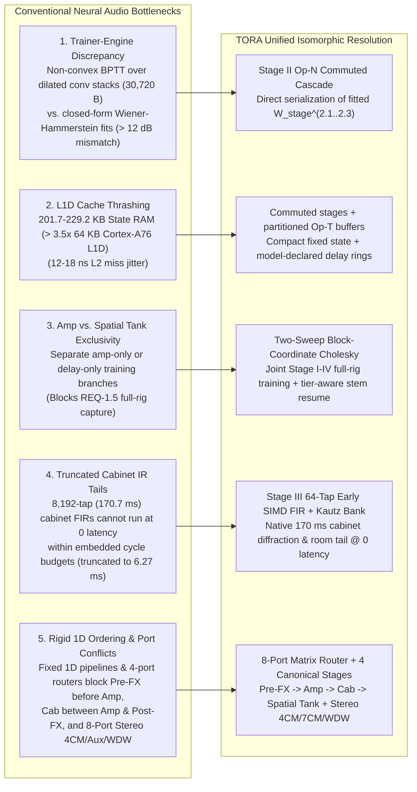
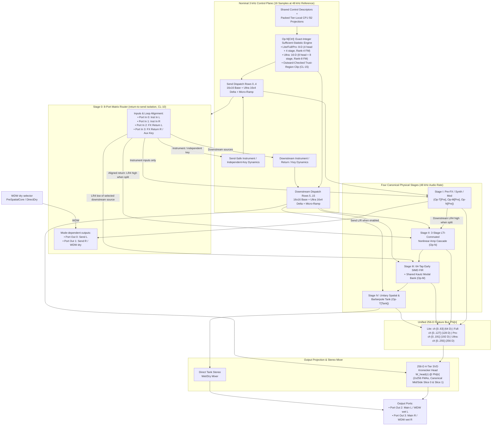
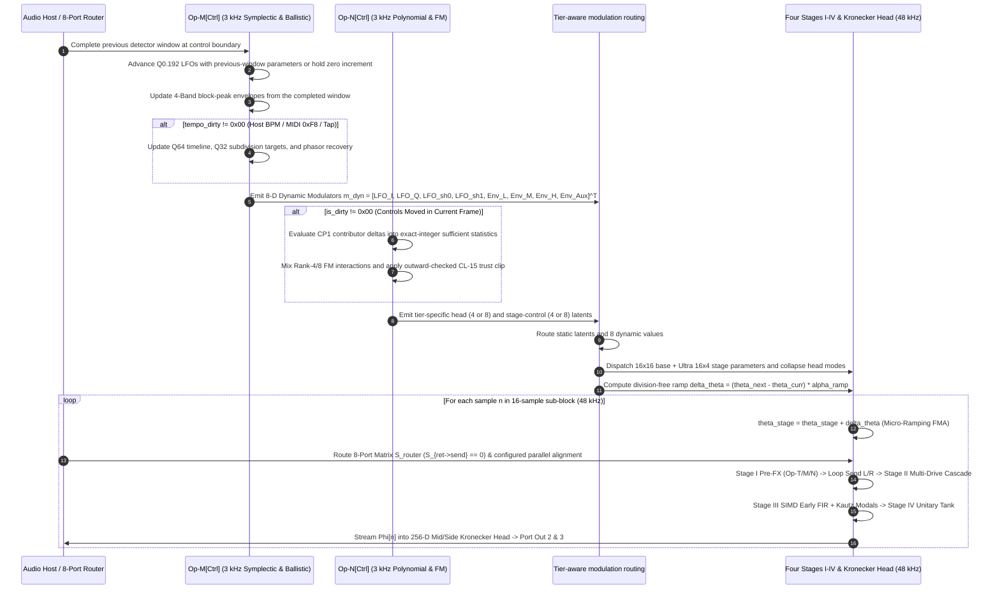
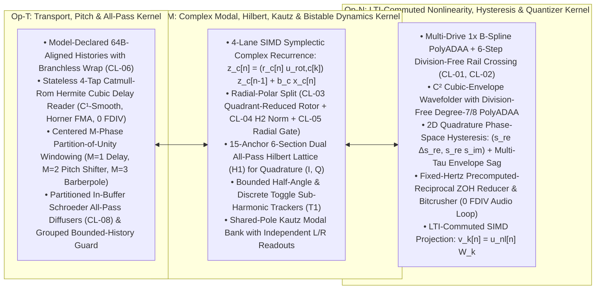
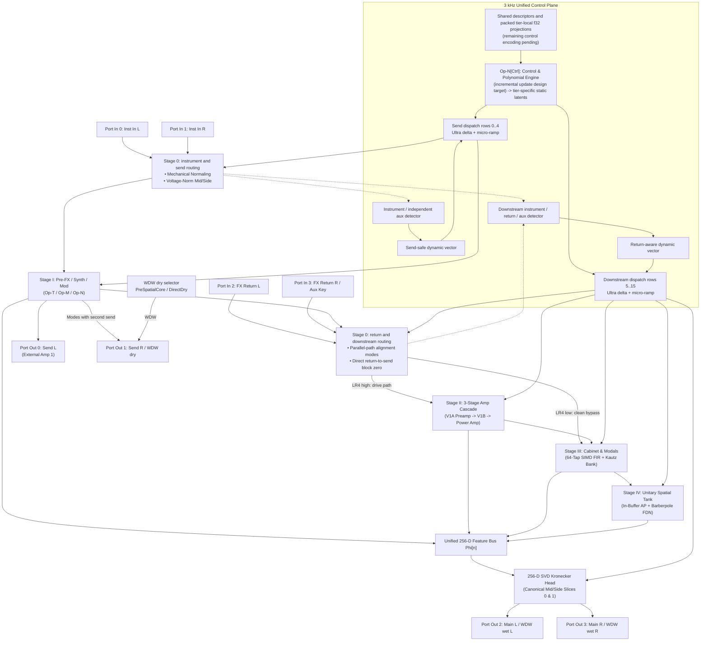
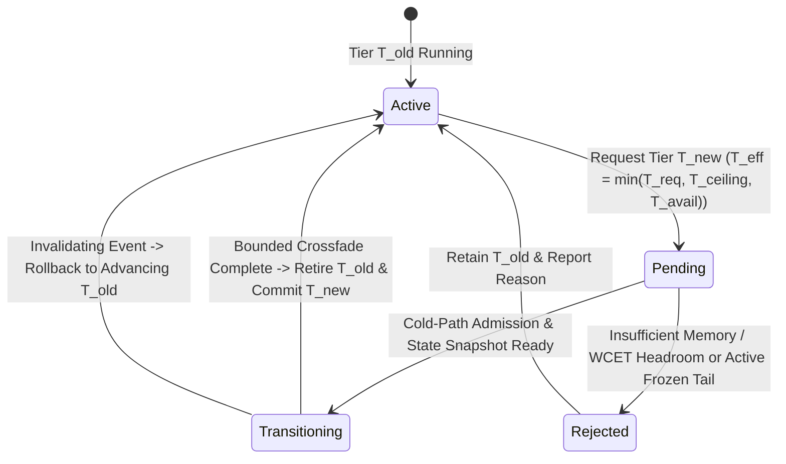
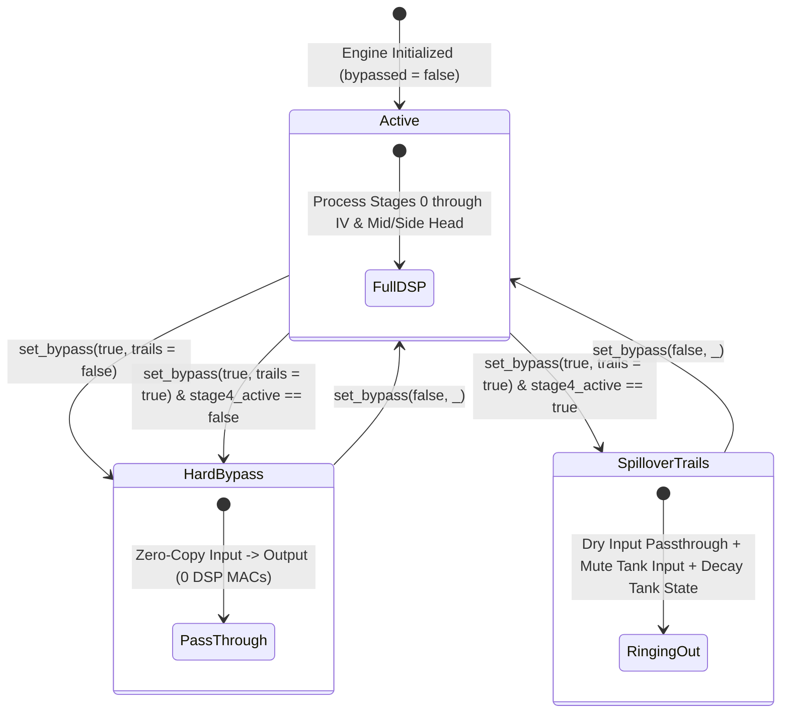
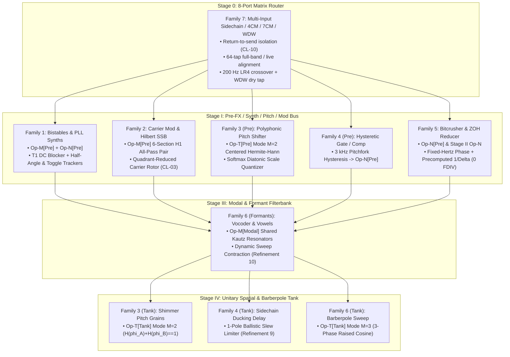

# Tri-Operator Recurrent Architecture (`TORA`) System Overview

**Document Version:** `1.0.0`  
**Status:** Canonical System Architecture Specification (SSOT)  
**Target Engine:** [`packages/engine/`](../../packages/engine/README.md) (Rust `#![no_std]`, `#![forbid(unsafe_code)]`, SIMD NEON / AVX2)  
**Target Trainer:** [`packages/trainer/`](../../packages/trainer/README.md) (PyTorch, NumPy)  
**Canonical Compliance:** [`REQ-1` through `REQ-8`](system_goals_and_requirements.md), [`CL-01` through `CL-20`](../training/clamp_and_audit_registry.md), [Binary Container](../containers/dnam_binary_format.md)

This specification defines the **Tri-Operator Recurrent Architecture (`TORA`)** for **Dynamic Neural Audio Modeler (DNAM)**. TORA unifies the modeling of all analog and digital audio gear across **three universal zero-`FDIV` SIMD operator kernels** (`Op-T`, `Op-M`, `Op-N`), four canonical physical stages, an **8-Port Matrix Router** (`Stage 0`), a **Self-Similar 3 kHz Dual-Rate Control Plane**, and a **256-D Mid/Side Kronecker Output Head**.

For implementation-agnostic requirements, see [`system_goals_and_requirements.md`](system_goals_and_requirements.md). For psychoacoustic quality tiers, see [`psychoacoustic_quality_and_tiers.md`](psychoacoustic_quality_and_tiers.md). For the R&D decision log and prototype archive, see [`../rnd/tora_phase1_decisions.md`](../rnd/tora_phase1_decisions.md) and [`../rnd/tri_physics_architecture.md`](../rnd/tri_physics_architecture.md).

---


## 1. Executive Summary & Architectural Motivation

### 1.1 Architectural Motivation: Five Structural Challenges in Real-Time Neural Audio

Conventional neural audio architectures that pair deep dilated-convolution stacks with unsegmented feedback delay networks encounter five structural bottlenecks when deployed on embedded hardware (`ARM Cortex-A76`, `64 KB` L1D cache) and full-rig studio captures (see [`../rnd/tri_physics_architecture.md`](../rnd/tri_physics_architecture.md)):



| Challenge | Traditional Bottleneck Mechanism | TORA Architectural Resolution |
| :--- | :--- | :--- |
| **1. Trainer–Engine Isomorphism** | Multi-layer dilated convolutions (`K=6`, `d ∈ {1, 3, 7, 19}`) consume `30,720 B` (`48.00%` of a `64,000 B` container) and `65,536 B` (`64.0 KB`) of convolution history RAM, yet are non-convex under BPTT on `1/f²` audio (`κ(H) > 10¹⁰`) with only a `301`-sample (`6.27 ms`) sparse receptive field. | **Stage II Commuted Nonlinear Cascade (`Op-N`):** Serializes fitted stage matrices directly and enforces identical project-then-filter ordering in training and runtime. |
| **2. Embedded L1D Cache Residency** | ARM Cortex-A76 cores (Rockchip RK3582 on Darkglass Anagram) have a **`64 KB` L1 Data (L1D) Cache**. Uncommuted convolution histories (`65,536 B`), multi-tap head histories (`16,384 B`), and unsegmented diffuser rings (`131,072 B`) reach **`229,184 B` (`> 3.5×` L1D)**. | **Commuted Stage II + Partitioned Op-T Histories:** Eliminates `conv_hist` and `head_tap_hist` while cold-allocating exact 64B-aligned model-declared delay histories. |
| **3. Joint Full-Rig Capture (`REQ-1.5`)** | Treating nonlinear amp modeling and time-warped spatial delay/reverb tanks as mutually exclusive pipelines prevents single-pass capture of complete rigs (Pre-FX + tube amp + speaker cabinet + stereo post-FX). | **Two-Sweep Block-Coordinate Cholesky Pipeline:** Solves Stage I–IV sequentially on forward residuals in Sweep 1 and polishes the joint head in Sweep 2. |
| **4. Zero-Latency `170 ms` Speaker Cabinets (`REQ-1.2`)** | An `8,192`-tap (`170.7 ms` at `48 kHz`) direct FIR filter for speaker cabinet diffraction and room decay cannot execute at zero latency within embedded cycle budgets. | **Stage III Hybrid Cabinet (`Op-M`):** Combines tier-specific early FIR taps (`16/32/48/64` taps/ch) with a shared Kautz modal bank (`4/8/16/32` pairs) beginning at sample 16 (`0.33 ms` at `48 kHz`). |
| **5. Canonical Signal Routing & 8-Port I/O (`REQ-1.3`, `REQ-1.5`)** | A rigid 1D pipeline cannot place Pre-FX before amp clipping, cabinets between amp and stereo post-FX, or represent 4CM/7CM/WDW modes. | **Stage 0 8-Port Matrix Router + 4 Canonical Stages:** Provides four physical inputs and four outputs with return-to-send isolation (`CL-10`), `200 Hz` LR4 split, and parallel sub-sample alignment. |

---

### 1.2 The TORA Architectural Breakthrough

The **Tri-Operator Recurrent Architecture (`TORA`)** unifies all physical audio hardware into **three universal zero-`FDIV` SIMD operator kernels** (`Op-T`, `Op-M`, `Op-N`) orchestrated across **four canonical physical stages**, an **8-Port Matrix Router**, and a **Unified Dual-Rate Self-Similar Control Plane**:

1. **Pillar 1: Dual-Space Factored Control Architecture:**  
   Factors kinematic controls and nonlinear drive to support progressive stem refinement ([`../training/iterative_resume_and_caching.md` §1.3](../training/iterative_resume_and_caching.md#13-conditions-for-old-stem-trajectory--arena-4-gram-reuse-on-stem-resume-req-3)).
2. **Pillar 2: Unified Self-Similar Dual-Rate Control Plane (`Op-M[Ctrl]` & `Op-N[Ctrl]`):**  
   Executes the control plane using the `Op-M` and `Op-N` kernels at a 16-sample stride at the `48 kHz` reference rate (`3 kHz`), and the rate-dependent stride $K_{\text{ctrl}}(f_{s,\text{eff}})$ at other effective rates ([router §9](../dsp/router_and_stages_topology.md#9-continuous-time-zero-order-hold-zoh-sample-rate-adaptability-44196-khz--cl-20-4-bounce)).
3. **Pillar 3: Shared Control Descriptors & Tier-Local `CP1` Projections:**  
   Supports $P \ge 0$ physical controls using shared descriptors and packed tier-local `f32` projection slices ([`../containers/dnam_binary_format.md` §2.4](../containers/dnam_binary_format.md#packed-control-projection-profile)). `Lite`, `Full`, and `Pro` use `8-D` static latents (`4` head + `4` stage, Rank-4 FM); `Ultra` adds an `8-D` delta (`+4` head + `+4` stage, Rank-8 FM) and a `16 × 4` stage-dispatch delta in `Arena 3` ([`parametric_control_bus.md` §2.5](../dsp/parametric_control_bus.md#25-o1-additive-latent-sufficient-statistic-control-scaling)).



#### Dual-Rate (`48 kHz` Audio vs. `3 kHz` Control) TORA Execution Lifecycle

Host parameter updates apply at the control boundary in timestamp order, with DAW automation taking precedence over live Studio/MIDI on exact-timestamp ties ([control bus §1.1](../dsp/parametric_control_bus.md#host-automation-timing)):



#### Floating-Point Environment at the Audio Callback

All block-processing entry points enforce round-to-nearest, ties-to-even (`RNE`) with non-trapping floating-point exceptions and subnormal state protection via `FtzDazGuard`:

| Target Architecture | Hardware Control Register Policy (`FtzDazGuard`) |
| :--- | :--- |
| **`aarch64`** | Save `FPCR`; clear `RMode` bits `23:22` and exception trap-enable bits `8:12, 15`; set `FZ` bit `24`; if `AH` bit `1` is set (`FEAT_AFP`), set `FIZ` bit `0`; restore saved `FPCR` on exit. |
| **`x86_64`** | Save `MXCSR`; clear `RC` bits `14:13` and sticky flags `0:5`; set `FTZ` (`15`), `DAZ` (`6`), and exception masks `7:12`; restore saved `MXCSR` on exit. |
| **WebAssembly / Portable** | Standard WASM enforces `RNE` with gradual underflow; apply branchless exponent-mask zeroing (`exp == 0 -> ±0.0f32`) to persistent recursive-state writebacks while preserving sign, normals, infinities, and `NaN` payloads. |

#### Finite-Precision Range and Saturation Policy

Every model and configuration guarantees an unclipped operating envelope of at least `±100.0` (`+40 dBFS` peak) simultaneously on all active audio inputs (`REQ-7.1`), and finite output/state safety for all finite `f32` inputs via the `±1e9` (`S = 1,000,000,000.0`) and `fp16` (`±65,504.0`) safety guards (`REQ-7.2`):

| Bit | Event Flag (`overflow_or_saturation_flags`) | Condition |
| :---: | :--- | :--- |
| `0` | `INPUT_SATURATED` | A processed audio input exceeded the `±1e9` safety ceiling. |
| `1` | `FP16_SATURATED` | A finite delay write exceeded `±65,504.0` (`0x7BFF` / `0xFBFF`). |
| `2` | `INTERNAL_SATURATED` | An intermediate or recursive-state safety guard clamped a value to `±1e9`. |
| `3` | `OUTPUT_SATURATED` | The processed output guard clamped a value to `±1e9`. |
| `4` | `OUTSIDE_CERTIFIED_INPUT` | An input exceeded the model's certified input envelope (`≥ ±100.0`). |
| `5` | `INVALID_NONFINITE` | A non-finite external sample, control, or parameter was detected and rejected. |

---

### 1.3 The 3 Universal Zero-FDIV SIMD Operator Kernels

Every analog, digital, and acoustic circuit in the audio production domain is spanned by three orthogonal mathematical operator kernels:



#### 2.0 Self-Similar Dual-Rate Kernel Architecture

| Universal Kernel | Audio-Rate Execution (`48 kHz`) | Control-Plane Execution (`3 kHz`, `f_s / K_ctrl`) | Shared SIMD Mechanism |
| :--- | :--- | :--- | :--- |
| **`Op-T` (Transport)** | Fractional delay ring buffer, pitch grains, all-pass diffusers | Integer-plus-`Q0.32` delay targets and inward `f32` reader bounds | Branchless wrap and Catmull-Rom Horner FMA |
| **`Op-M` (Symplectic Complex & Ballistics)** | Complex resonant filters, `H1` Hilbert SSB, Kautz modal bank | `Q0.192` quadrature LFO rotors (`CL-03`), `Q64`/`Q32` tempo phase, 4-Band block-peak envelopes | Quadrant-reduced contractive rotor and 1-pole ballistics |
| **`Op-N` (Polynomials & Nonlinearities)** | Multi-Drive `1×` B-Spline `PolyADAA`, `C²` wavefolder, bitcrushers | Packed `CP1` Lobatto/FM projections (`CL-13`), exact-integer accumulator, outward trust clip (`CL-15`) | Branchless polynomial FMA and straight-through bounding |

#### 2.4.1 SIMD Lane Packing (AVX2 & ARM NEON)
`TORA` organizes all multichannel state and parameter matrices in **4-lane blocks** (`float32x4_t` in NEON, half of `__m256` in AVX2) matching the nested tier hierarchy:

```text
NEON 128-Bit Vector Layout:
+-------------------+-------------------+-------------------+-------------------+
|  Lane 0: Ch 0     |  Lane 1: Ch 1     |  Lane 2: Ch 2     |  Lane 3: Ch 3     |  -> Tier 0: Lite
+-------------------+-------------------+-------------------+-------------------+
|  Lane 4: Ch 4     |  Lane 5: Ch 5     |  Lane 6: Ch 6     |  Lane 7: Ch 7     |  -> Tier 1: Full
+-------------------+-------------------+-------------------+-------------------+
|  Lane 8: Ch 8     |  Lane 9: Ch 9     |  Lane 10: Ch 10   |  Lane 11: Ch 11   |  -> Tier 2: Pro
+-------------------+-------------------+-------------------+-------------------+
|  Lane 12: Ch 12   |  Lane 13: Ch 13   |  Lane 14: Ch 14   |  Lane 15: Ch 15   |  -> Tier 3: Ultra
+-------------------+-------------------+-------------------+-------------------+
```

| Tier | Tier Index | Active Channels (`C_tier`) | NEON 128-Bit Vectors (`float32x4_t`) | AVX2 256-Bit Vectors (`__m256`) |
| :--- | :---: | :---: | :---: | :---: |
| **`Lite`** | Tier `0` | `4` channels (`Ch 0..3`) | `1×` SIMD vector | `0.5×` SIMD vector (`__m128`) |
| **`Full`** | Tier `1` | `8` channels (`Ch 0..7`) | `2×` SIMD vectors | `1×` SIMD vector |
| **`Pro`** | Tier `2` | `12` channels (`Ch 0..11`) | `3×` SIMD vectors | `1.5×` SIMD vectors (`8 + 4`) |
| **`Ultra`** | Tier `3` | `16` channels (`Ch 0..15`) | `4×` SIMD vectors | `2×` SIMD vectors |

#### 2.4.2 Differentiability and Gradient Dynamics

| Operator | Forward & Backward Mathematical Formulation |
| :--- | :--- |
| **1. `Op-T` (Continuous Fractional Delay)** | Horner Catmull-Rom derivative `∂d(τ)/∂μ = 3 c_3' μ² + 2 c_2' μ + c_1'` with coarse-to-fine Gaussian envelope surrogate gradient during delay identification. |
| **2. `Op-M` (Parallel Scan Recurrence)** | First-order complex recurrence admits an `O(log₂ L)` associative scan `(a₂, b̃₂) ∘ (a₁, b̃₁) = (a₂ a₁, a₂ b̃₁ + b̃₂)`. |
| **3. `Op-N` (Non-Smooth Surrogates & STE)** | Hard runtime forward `q̂(x) = sg[Q_B(x)] + (x - sg[x])` with grouped stop-gradient and optional 4-term Fourier backward surrogate ([Op-N §2.3](../dsp/op_n_commuted_cascade.md#23-family-5-precomputed-reciprocal-zoh-sample-rate-reducer--bitcrusher)). |

$$\frac{\partial d(\tau)}{\partial \mu} = 3 c_3' \mu^2 + 2 c_2' \mu + c_1', \qquad (a_2, \tilde{b}_2) \circ (a_1, \tilde{b}_1) = (a_2 a_1, a_2 \tilde{b}_1 + \tilde{b}_2), \qquad \hat q(x) = \mathrm{sg}[Q_B(x)] + \big(x - \mathrm{sg}[x]\big)$$

---

## 2. 4-Tier Slimmable SIMD Hierarchy (`Lite` / `Full` / `Pro` / `Ultra`)

### 2.1 Lower-Block-Triangular Arena Hierarchy

Weights use a four-tier lower-block-triangular delta layout (`Arena 0..3`) where lower-tier payloads are contiguous authenticated prefixes of higher-tier payloads:

| Parameter | `Lite` (`Arena 0`) | `Full` (`Arena 0..1`) | `Pro` (`Arena 0..2`) | `Ultra` (`Arena 0..3`) |
| :--- | :---: | :---: | :---: | :---: |
| **Feature Bus Width (`Phi[n]`)** | `64` channels | `128` channels | `192` channels | `256` channels |
| **Stage I Pre Delay Buffer** | Model-declared 64B-aligned | Model-declared 64B-aligned | Model-declared 64B-aligned | Model-declared 64B-aligned |
| **Stage II Nonlinear Basis** | `8L + 8R` multi-drive + fold/sag | Tier delta extension | Tier delta extension | Tier delta extension |
| **Stage III Early FIR Taps** | `16` per channel (`128 B` L/R) | `32` per channel (`256 B` L/R) | `48` per channel (`384 B` L/R) | `64` per channel (`512 B` L/R) |
| **Stage III Shared Kautz Pole Pairs** | `4` shared (`128 B` slice) | `8` shared (`256 B` cumulative) | `16` shared (`512 B` cumulative) | `32` shared (`1,024 B` cumulative) |
| **Stage IV Tank Delay Lines (`M`)** | `M = 4` lines (`fp16`) | `M = 8` lines (`fp16`) | `M = 8` lines (`fp16`) | `M = 16` lines (`fp16`) |
| **Control Bus Latent Dim (`z_ctrl`)**| `8-D` (`4` head + `4` stage, `R=4`) | `8-D` (`4` + `4`, `R=4`) | `8-D` (`4` + `4`, `R=4`) | `16-D` (`8` head + `8` stage, `R=8`) |

### 2.2 Hardware & DSP Benchmark Summary

Reference embedded instance budgets on `1×` ARM Cortex-A76 core (`2.4 GHz`, `20,833 ns/sample` at `48 kHz`, see [`system_goals_and_requirements.md` §7](system_goals_and_requirements.md#7-goal-6--real-time-commodity-hardware-budget--execution-constraints)):

| Requirement | Reference Budget |
| :--- | :--- |
| **`Lite` instances per embedded core** | `≥ 10×` at `48 kHz` (`≤ 2,083 ns/sample`) |
| **`Full` instances per embedded core** | `≥ 6×` at `48 kHz` (`≤ 3,472 ns/sample`) |
| **`Pro` instances per embedded core** | `≥ 2×` at `48 kHz` (`≤ 10,416 ns/sample`) |
| **Real-time loop instruction invariant** | Zero hardware `FDIV`, `FSQRT`, or `libm` transcendental calls (`REQ-6.2`) |

### 2.3 State RAM Audit: Lite Budget

| Raw State Component | `Lite` | `Full` | `Pro` | `Ultra` |
| :--- | :---: | :---: | :---: | :---: |
| **Stage III L/R FIR Histories (`f32`)** | `128 B` | `256 B` | `384 B` | `512 B` |
| **Stage III L/R Complex Modal States (`f32`)** | `64 B` | `128 B` | `256 B` | `512 B` |
| **Stage III Array Subtotal** | `192 B` | `384 B` | `640 B` | `1,024 B` |
| **Static-Control Sufficient-Statistic Accumulator** | `64 B` | `64 B` | `64 B` | `128 B` |
| **Stage I / IV Delay Ring Histories (`fp16`)** | Model-declared (admitted against host ceiling on cold path) | Model-declared | Model-declared | Model-declared |

### 2.4 Computational Efficiency & Verification

Both Stage III channel histories and modal states advance on every sample across all I/O topologies. Mono (`1 → 1`, `2 → 1`) output topologies evaluate only Slice 0 (`Mid`) of the Kronecker output head while retaining stereo-derived internal stage features. All inline and cold-allocated state is admitted against the host memory ceiling before activation with zero real-time heap allocation.

---

## 3. Canonical Signal Flow & 4-Stage Topology Overview

### 3.1 Detailed Signal Flow & Stage Boundaries
TORA organizes all real-time processing into four canonical physical stages coordinated by an 8-Port Matrix Router front-end, mirroring the physical topology of complete professional rig setups:



---

### 3.2 Stage 0: 8-Port Matrix Router & Voltage-Normalized Mid/Side
Stage 0 provides 4 input ports and 4 output ports:
- **Port In 0..1:** Instrument In Left / Right.
- **Port In 2..3:** FX Loop Return Left / Right (or Aux Key).
- **Port Out 0:** FX Loop Send Left / optional mono WDW send.
- **Port Out 1:** FX Loop Send Right, or center dry in WDW.
- **Port Out 2..3:** Main Out Left / Right; wet-only L/R in WDW.

In WDW mode (`PreSpatialCore` or `DirectDry`), Port Out 1 carries the center dry tap while Ports Out 2/3 carry the stereo wet output and Port Out 0 provides an optional mono send. A zero $\mathbf{S}_{\text{ret}\to\text{send}}$ matrix block and partitioned detector/dispatch routing isolate external sends from return-derived feedback (`CL-10`, see [router §1](../dsp/router_and_stages_topology.md#1-stage-0-8-port-matrix-router-cl-10-req-74)). Mid/Side channels are voltage-normalized ($x_{\text{mid}} = 0.5(L+R), x_{\text{side}} = 0.5(L-R)$) for unity-gain reconstruction.

### 3.3 Gated RMS Auto-Unity Leveling & Per-Tier Loudness Parity
Auto-unity leveling (`io_config.leveling`) anchors at the declared default control settings. Pre-stored linear tier gain trims (`tier_gain_trim_lin`) maintain calibrated per-tier loudness parity across `Lite`, `Full`, `Pro`, and `Ultra` without runtime division or transcendental calls.

#### On-Demand Tier Transition Contract

Runtime tier changes use **on-demand state transfer and a bounded parallel crossfade** rather than continuously stepping inactive tiers:



1. **Request & Admission:** Track the requested tier, effective target $\min(t_{\text{req}}, t_{\text{ceiling}}, t_{\text{avail}})$, active tier, and transition status (`pending`, `transitioning`, `completed`, `rejected`). Admit a transition only after verifying state compatibility, stable latency, prepared memory, and worst-case callback headroom.
2. **State Preparation:** Prepare target weights, transition buffers, and crossfade ramps off the audio thread, transferring compatible recursive, delay, control, and tempo state from a sample-aligned snapshot.
3. **Active Tail Preservation:** Never silently reset or drop an active delay, modal, autonomous, or frozen tail; defer or reject a down-tier request if the target tier cannot retain an active contribution.
4. **Parallel Render & Handoff:** Advance both old and target paths with time-aligned inputs and control events across a bounded precomputed crossfade, retiring the old path and committing the target tier only after the final fade sample.

### 3.4 Spillover Trails State Machine
When bypassing an active rig with `trails = true`, Stage IV Spatial Tank continues ringing out its tail while input injection is muted:



### 3.5 $4\times$ ZOH Polyphase Oversampling on Offline Bounce (`CL-19`, `CL-20`)
When a DAW host renders offline (`is_offline_bounce == true`):
1. **Tier Promotion (`CL-19`):** When `maximize_tier_on_bounce` is enabled, promote to $t_{\text{bounce}} = \min(t_{\text{avail}}, t_{\text{max-sup}})$.
2. **Polyphase Oversampling (`CL-20`):** Step the ZOH-rescaled engine at $4 f_s$ through a 2-stage linear-phase half-band polyphase upsampler/downsampler ($>95\text{ dB}$ stopband attenuation, `12` host samples oversampler PDC).
3. **Alignment Promotion:** Promote active parallel-alignment groups to `FullBand64Tap` (`31` host samples centering offset, `43` host samples combined nominal PDC with the oversampler; see [router §1](../dsp/router_and_stages_topology.md#parallel-path-sub-sample-alignment)).
4. **Live State Isolation:** Execute offline bounce on an isolated state or restore live monitoring state and tier upon completion without disturbing active histories.

---

## 4. Coverage of the 7 Goal 1 Hardware Families



| Family | Hardware Archetypes | TORA Stage & Operator Mapping | Core Zero-`FDIV` Audio-Rate Formulation | Differentiable Training Surrogate | Acceptance Criterion |
| :--- | :--- | :--- | :--- | :--- | :--- |
| **Family 1: Bistables & PLL Synths** | Boss OC-2, Mu-Tron Octave Divider, Schumann PLL | **Stage I:** `Op-M[Pre]` + `Op-N[Pre]` | `T1` `5 Hz` DC blocker, scaled `rsqrt`, half-angle (`cos`, `sin`) and toggle (`f/2`, `f/4`) trackers | Hard-forward tracker with surrogate gradient | Sub-octave frequency/amplitude tracking and zero DC offset |
| **Family 2: Carrier Mod & Hilbert SSB** | Moog MF-102 Ring Mod, Bode 735 Frequency Shifter | **Stage I:** `Op-M[Pre]` | 15-anchor 6-section `H1` all-pass pair + quadrant-reduced carrier rotor (`CL-03`) | Phase-insensitive demodulated STFT loss `L_carrier(ω_c)` | SSB rejection `≥ 42.0 dB` across `100 Hz–10 kHz` (`≤ 0.34°` quadrature error) |
| **Family 3: Polyphonic & Scale Pitch Shifters** | Eventide H3000, DigiTech Whammy, EHX POG | **Stage I** (`Op-T[Pre]`) & **Stage IV** (`Op-T[Tank]`) | Centered `M = 2` Hermite-Hann grains, 4-tap Catmull-Rom (`CL-06`), `±24` st pitch/warp profile | Continuous Softmax Diatonic Scale Quantizer + Catmull-Rom `∂d/∂μ` | Pitched chord THD+N `≤ -68 dB` and click-free sweep transitions |
| **Family 4: Hysteretic Dynamics & Ducking** | Boss NS-2, SG-1 Slow Gear, UREI 1176LN, SPL Transient, TC 2290 | **`3 kHz` Control Bus** → `Op-N[Pre]` & `Op-T[Tank]` VCA | Supercritical pitchfork hysteresis map `h[k]`, monotone `f32` `log₂`/`exp₂` lookup, 1-pole ballistic slew (`τ_att ≥ 0.5 ms`, `τ_rel ≥ 20 ms`) | Differentiable pitchfork derivative `∂h/∂e = (1/τ_h)σ'(u)` + `ln(x + ε)` | Silence noise floor reduction `≥ 72 dB`; zero gate chatter |
| **Family 5: Bitcrushers & ZOH Reducers** | E-mu SP-1200, WMD Geiger Counter | **Stage I** (`Op-N[Pre]`) & **Stage II** (`Op-N`) | Nearest-step quantizer (halfway ties to `+∞`) + fixed-hertz integer ZOH phase (`0 FDIV`) | Hard runtime forward + grouped STE / 4-term Fourier backward surrogate | Exact dyadic boundary rounding and full-rate/fractional latch parity |
| **Family 6: Vocoders, Formants & Barberpole** | EMS Vocoder 2000, EHX Talking Pedal, Maestro Stage Phaser | **Stage III** (`Op-M[Modal]`) & **Stage IV** (`Op-T[Tank]`) | Shared Kautz modal poles (`CL-04`), dynamic sweep contraction, `M = 3` barberpole and Givens/Householder mixing | Log-spectral formant envelope loss `L_formant` + continuous Catmull-Rom | Vowel formant peaks (`F₁, F₂, F₃`) within `±0.4 dB` |
| **Family 7: Multi-Input Sidechain / 4CM / 7CM / WDW** | Dual-amp 4CM/7CM loops, keyed gates/ducks, WDW center dry rigs | **Stage 0: 8-Port Matrix Router** + Stage I/IV Partition | Return-to-send isolation (`CL-10`), `200 Hz` TPT LR4 split, 64-tap sub-sample alignment, and WDW dry tap | Decoupled dual-target multi-task loss `L_4CM = λ_pre L_pre + λ_post L_post` | Crossover passband ripple `≤ 0.05 dB` and isolated send paths |

### 4.1 Family 1: Bistables & PLL Guitar Synthesizers
- **Analog Archetypes:** Boss OC-2, Mu-Tron Octave Divider, Schumann PLL (CMOS 4013 dual D-flip-flops generating $f_0/2, f_0/4$ sub-octaves and 4046 VCO PLL tracking).
- **TORA Realization (`Stage I` `Op-M[Pre]` + `Op-N[Pre]`):** Applies the tracker-only `5 Hz` `T1` DC blocker, scaled exponent-split envelope normalization, independent `prev_i_nonpositive` axis-crossing detection, smooth half-angle quadratures (`cos`, `sin`), and divider square features (`f/2`, `f/4`) routed into `Lite` feature bus slots `4..11` ([`op_m_modal_kautz.md` §3](../dsp/op_m_modal_kautz.md#3-family-1-sub-harmonic-synthesizers-bistable-dividers--pll-tracking), [router §7](../dsp/router_and_stages_topology.md#7-unified-256-d-4-tier-kronecker-output-head)).

### 4.2 Family 2: Audio-Rate Carrier Modulation & Hilbert SSB
- **Analog Archetypes:** Moog MF-102 Ring Modulator, Bode 735 Frequency Shifter (4-quadrant multiplier and Weaver dual $90^\circ$ dome filter).
- **TORA Realization (`Stage I` `Op-M[Pre]`):** Uses the 6-section all-pass pair with the 15-anchor `H1` rate table (`≤ 0.34°` quadrature phase error across `100 Hz–10 kHz`) and the quadrant-reduced contractive carrier rotor (`CL-03`, see [`op_m_modal_kautz.md` §2](../dsp/op_m_modal_kautz.md#2-family-2-hilbert-ssb-lattice--carrier-modulation)).

### 4.3 Family 3: Polyphonic Phase-Locked & Intelligent Scale Pitch Shifters
- **Analog Archetypes:** Eventide H3000, DigiTech Whammy, EHX POG.
- **TORA Realization (`Stage I` `Op-T[Pre]` & `Stage IV` `Op-T[Tank]`):** Uses the centered grain-duration construction with partition-of-unity cubic Hermite-Hann windows ($u = 1 - |2\phi - 1|$, $H(\phi) = u^2(3 - 2u)$, $H(\phi_A) + H(\phi_B) \equiv 1$), 4-tap Catmull-Rom delay reads (`CL-06`) with per-head causal floor $\tau_m \ge 4.0$, and the `-24..24` semitone control-rate pitch/warp profile ([control bus §1.2](../dsp/parametric_control_bus.md#pitch-ratio-and-time-warp-profile)).

### 4.4 Family 4: Hysteretic Dynamics, Noise Gates, Limiters & Ducking
- **Analog Archetypes:** Boss NS-2, Boss SG-1 Slow Gear, UREI 1176LN, SPL Transient Designer, TC 2290.
- **TORA Realization (`3 kHz` Control Bus → `Op-N[Pre]` & `Op-T[Tank]` VCA):** Evaluates the supercritical pitchfork bifurcation hysteresis map $h[k] = \sigma\big((e[k] - \theta_{\mathrm{mid}})/\tau_h + \kappa(2 h[k-1] - 1)\big)$, monotone `f32` $\log_2$ lookup ([control bus §1.1](../dsp/parametric_control_bus.md#monotone-f32-log-envelope-lookup-profile)), and 1-pole ballistic slew limiting ($\tau_{\mathrm{attack}} \ge 0.5\text{ ms}, \tau_{\mathrm{release}} \ge 20.0\text{ ms}$) with audio-rate linear gain micro-ramping.

### 4.5 Family 5: Sample-Rate Reducers, Bitcrushers & Non-Smooth Digital Quantizers
- **Analog Archetypes:** E-mu SP-1200, WMD Geiger Counter.
- **TORA Realization (`Stage I` `Op-N[Pre]` & `Stage II` `Op-N`):** Evaluates the uniform nearest-step quantizer $Q_B(x) = \lfloor x 2^{B-1} + 0.5 \rfloor 2^{-(B-1)}$ (halfway ties toward $+\infty$) and the fixed-hertz integer ZOH phase accumulator with pre-reduction carry detection and division-free `u128` reciprocal rate transfer ([Op-N §2.3](../dsp/op_n_commuted_cascade.md#23-family-5-precomputed-reciprocal-zoh-sample-rate-reducer--bitcrusher)).

### 4.6 Family 6: Multi-Band Vocoders, Formant Vowels & Barberpole Tank
- **Analog Archetypes:** EMS Vocoder 2000, EHX Talking Pedal, Maestro Stage Phaser.
- **TORA Realization (`Stage III` `Op-M[Modal]` & `Stage IV` `Op-T[Tank]`):** Combines shared-pole Kautz resonators (`CL-04`) with dynamic sweep contraction ([`op_m_modal_kautz.md` §4.3](../dsp/op_m_modal_kautz.md#43-dynamic-sweep-contraction-rule-refinement-10)), 3-phase raised-cosine barberpole phase wrapping ($M=3$), and Givens/Householder unitary tank mixing (`CL-10`).

### 4.7 Family 7: Multi-Input Sidechain / 4CM / 7CM / WDW Units
- **Analog Archetypes:** External amplifier loop insertion (4CM/7CM dual amps), auxiliary key sidechain detection, and Wet-Dry-Wet (WDW) rigs.
- **TORA Realization (`Stage 0: 8-Port Matrix Router`):** Enforces return-to-send isolation (`CL-10`), `FullBand64Tap` / `Live16Tap` / `IntegerDelayOnly` parallel path alignment ([router §1](../dsp/router_and_stages_topology.md#parallel-path-sub-sample-alignment)), the `200 Hz` TPT LR4 clean/drive crossover ([router §1](../dsp/router_and_stages_topology.md#stage-0-lr4-cleandrive-crossover)), and `PreSpatialCore` / `DirectDry` WDW routing ([router §1](../dsp/router_and_stages_topology.md#wdw-dry-tap-and-wet-output-contract)).

---

## 5. Five End-to-End Trainer–Engine Isomorphism & Pipeline Guarantees

TORA establishes five end-to-end trainer–engine isomorphism and pipeline guarantees across [`packages/trainer/`](../../packages/trainer/README.md) and [`packages/engine/`](../../packages/engine/README.md) (for R&D background, see [`../rnd/tri_physics_architecture.md` §5.6](../rnd/tri_physics_architecture.md#56-summary-of-the-5-rd-prototype-findings-findings-15)):

| Guarantee ID | Subsystem Scope | TORA Architectural Realization |
| :--- | :--- | :--- |
| **1. Direct Commuted Stage Serialization (§5.1)** | Stage II (`stage2_cascade.py` / `op_n.rs`) | Directly serializes fitted `W_stage^(2.1..2.3)` matrices into `Arena 0..3` using identical project-then-filter ordering in training and runtime. |
| **2. Joint Full-Rig Training (§5.2)** | Two-Sweep Pipeline (`sweep1_cascade.py`, `sweep2_tank.py`, `polish_head.py`) | Freezes upstream stage/control behavior before accumulating tier-specific sufficient statistics, solving Stages I–IV sequentially in Sweep 1 and polishing the joint head in Sweep 2. |
| **3. End-to-End 3-Phase Audit Wiring (§5.3)** | Step 0 & Audit Engine | Wires Step-0 order-statistic calibration, physical variance gates (`CL-14`), non-stop 3-phase clamping, and `CL-17` export certification into the training pipeline. |
| **4. True-Stereo Calibration & 8-Port Routing (§5.4)** | Stem Extractor & Router | Preserves 2-channel stem arrays `X ∈ R^(N×2)` (`[Left, Right]` or `[Main, Aux]`) with causal parallel alignment and return-to-send isolation. |
| **5. Nested 4-Tier Physical Hierarchy (§5.5)** | Feature Bus & Arenas (`Arena 0..3`, `head_kronecker.py`) | Extracts four nested physical feature definitions (`64 / 128 / 192 / 256 D`) and stores tier-bundled per-stem sufficient statistics in `.dnam-ckpt`. |

### 5.1 Direct Stage II Commuted Cascade Serialization & Runtime Parity
Stage II serializes the fitted commuted projection matrices $\mathbf{W}_{\mathrm{stage}}^{(2.1..2.3)}$ directly into `Arena 0..3` and models the runtime's project-then-filter ordering under control automation ([`../training/four_stage_pipeline.md` §4](../training/four_stage_pipeline.md#4-trainerengine-isomorphism-protocol--closed-form-normal-equations)).

### 5.2 Joint Stage I–IV Full-Rig Training via Two-Sweep Block-Coordinate Cholesky
The **Two-Sweep Block-Coordinate Cholesky Pipeline** ([`../training/four_stage_pipeline.md`](../training/four_stage_pipeline.md)) solves Stage III (Cabinet), Stage II (Amp Cascade), and Stage IV (`Op-T[Tank]`) sequentially on forward residuals in Sweep 1, and solves the joint 256-D Mid/Side Kronecker head across all 4 stages in Sweep 2, enabling single-run full-rig training (`REQ-1.5`).

### 5.3 Step-0 System-ID & Non-Stop 3-Phase Audit Wiring in `fit_job`
The pipeline combines Step-0 calibration, variance gates (`CL-14`), non-stop clamp phases (`[CLAMP-RANGE]`, `[CLAMP-SWITCH]`, `[CLAMP-STABILITY]`, `[CLAMP-RAIL]`, `[CLAMP-DYNAMIC]`), and `CL-17` head gain certification ([`../training/clamp_and_audit_registry.md`](../training/clamp_and_audit_registry.md)).

### 5.4 True-Stereo Input Preservation & 8-Port Matrix Router Execution
Stem extraction preserves 2-channel audio arrays $\mathbf{X} \in \mathbb{R}^{N \times 2}$ (`[Left, Right]` or `[Main, Aux]`) and enforces the physical port assignments, causal alignment, and send isolation of the 8-Port Matrix Router.

### 5.5 Nested 4-Tier Feature Bus Extraction (`Lite ⊂ Full ⊂ Pro ⊂ Ultra`)
TORA builds a nested 4-tier physical hierarchy matching `REQ-5`: `Lite` ($64\text{ D}$), `Full` ($128\text{ D}$), `Pro` ($192\text{ D}$), and `Ultra` ($256\text{ D}$), with tier-bundled runtime weights and sufficient statistics in `.dnam-ckpt` ([`../containers/checkpoint_and_cache_format.md` §2](../containers/checkpoint_and_cache_format.md#2-tier-ordered-column-major-upper-triangular-packing-uplou-for-mathbfg_textaudios)).

---

## 6. Summary of the 19 Architectural Refinements

| # | Architectural Refinement | Target Subsystem | Mathematical / Structural Specification |
| :- | :--- | :--- | :--- |
| **1** | **Partitioned Schroeder All-Pass Buffer Segmentation** | Stage IV `Op-T[Tank]` | Non-overlapping `[0..L_main-1 ∣ L_main..L_main+L_ap-1]` segments with independent logical wrap ([Op-T §1 & §3](../dsp/op_t_transport.md#11-exact-sized-delay-histories-and-branchless-wrap)). |
| **2** | **Strictly Causal Stage II Delays & Early FIR Fitting** | Stage II & Stage III | Causal offsets (`d ≥ 0`) in Stage II and Stage III early FIR taps ([Op-N §3.2](../dsp/op_n_commuted_cascade.md#32-causality-audit--elimination-of-acausal-lookahead)). |
| **3** | **4-Filter Tone Stack Basis (`Direct + 2 LPF + 1 HPF`)** | Sub-Stage 2.1 | Adds matched-pole `HPF_1200` alongside `Direct`, `LPF_80`, and `LPF_400` ([Op-N §4.1](../dsp/op_n_commuted_cascade.md#41-four-filter-tone-basis-refinement-3)). |
| **4** | **Two-Step Warped Laguerre/Kautz Modal Pole Extraction** | Stage III Trainer | Log-spaced initial eigenmodes (`40–4500 Hz`) with shared poles and independent L/R readouts ([`op_m_modal_kautz.md` §4.4](../dsp/op_m_modal_kautz.md#44-two-step-warped-laguerrekautz-modal-pole-extraction-refinement-4)). |
| **5** | **Slew-Rate Bounded Givens Rotation in Stage IV** | Stage IV `U(ψ, v)` | Bounds stereo rotation velocity to `∣Δψ∣ ≤ 0.05 rad/control tick` (`150 rad/s` at `3 kHz`). |
| **6** | **Topological Order Descriptors (`stage1_topology`)** | Stage I `Arena 0` | 4-bit bitfield selecting among the 4 canonical `Op-T`/`Op-M`/`Op-N` pre-chain permutations without buffer contention. |
| **7** | **LR4 Parallel Crossover & WDW Routing** | Stage 0 Router | `200 Hz` TPT LR4 clean/drive split and `PreSpatialCore`/`DirectDry` WDW output mapping ([router §1](../dsp/router_and_stages_topology.md#stage-0-lr4-cleandrive-crossover)). |
| **8** | **Stage I Sub-Harmonic DC Conditioning (`T1`)** | Family 1 → Stage I | Dedicated `5 Hz` TPT DC blocker before the analytic tracker pair ([`op_m_modal_kautz.md` §3](../dsp/op_m_modal_kautz.md#3-family-1-sub-harmonic-synthesizers-bistable-dividers--pll-tracking)). |
| **9** | **1-Pole Ballistic Slew Limiter on Sidechain Ducking Gains** | Family 4 Sidechain | `τ_attack ≥ 0.5 ms`, `τ_release ≥ 20.0 ms` eliminates zipper noise and transient chatter. |
| **10** | **Radial-Polar Rotor Contraction during Formant Sweeps** | Stage III Kautz | Dynamic sweep contraction `r_eff,m = min(r_m, max(0.25, 0.9950 - 0.15|Δθ_m|))` ([`op_m_modal_kautz.md` §4.3](../dsp/op_m_modal_kautz.md#43-dynamic-sweep-contraction-rule-refinement-10)). |
| **11** | **Block-Diagonal Lower-Triangular Kronecker Head Staging** | Output Head | Nested tier blocks with precomputed `tier_gain_trim_lin` loudness matching. |
| **12** | **Projected LTI Filtering `L(u[n] W[k])`** | Stage II Cascade | Projects the nonlinear basis by `W_k[n]` before stepping the tone-stack filters. |
| **13** | **Normalized Coupled-Form State-Space for Kautz Modals** | Stage III `Op-M[Modal]` | Coupled-form recurrence with forced-state bound `‖x[n]‖ ≤ r_max ‖x[n-1]‖ + ‖b_m‖ |u[n]|` ([`op_m_modal_kautz.md` §4.2](../dsp/op_m_modal_kautz.md#42-normalized-coupled-form-state-space-refinement-13)). |
| **14** | **Input Headroom Normalization & Denormal-Tail Handling** | Stage IV `Op-T[Tank]` | `-12 dB` tank input attenuation for `fp16` headroom plus `FtzDazGuard` denormal immunity ([audio-block policy](#floating-point-environment-at-the-audio-callback)). |
| **15** | **Per-Head Causal Floor Margin `τ_m ≥ 4.0` Samples** | `Op-T` Multi-Tap Reader | Enforces `τ_m[n] = max(4.0, τ_raw,m[n])` independently per granular/barberpole read head (`CL-06`). |
| **16** | **Return-to-Send Router Isolation (`CL-10`)** | Stage 0 8-Port Router | Enforces `S_{ret->send} == 0` and isolates send-path detectors/controls from returns. |
| **17** | **Parallel-Path Sub-Sample Alignment** | Stage 0 Router | `FullBand64Tap` (default/bounce), `Live16Tap`, and `IntegerDelayOnly` alignment modes ([router §1](../dsp/router_and_stages_topology.md#parallel-path-sub-sample-alignment)). |
| **18** | **Unified Self-Similar Dual-Rate Control Plane (`Op-M[Ctrl]` / `Op-N[Ctrl]`)** | Control Plane | Executes `3 kHz` control via 4-lane SIMD instances of `Op-M` and `Op-N`. |
| **19** | **Dual-Space Factored Control & `CP1` Additive Latent Scaling** | Parameter Bus | Shared descriptors + packed tier-local `CP1` `f32` projections (`8-D` Rank-4 base + `16-D` Rank-8 `Ultra`) with exact-integer sufficient statistics ([`parametric_control_bus.md` §2.5](../dsp/parametric_control_bus.md#25-o1-additive-latent-sufficient-statistic-control-scaling)). |

---

## 7. Verification & Guardrails Reference

For the **Canonical TORA Requirement Verification Matrix (`REQ-1`–`REQ-8.8`)**, the **8 Empirical Verification Suites (`Tests 1–8I`)**, and the **8 Automated Repository & Container Guardrails (`G-01`–`G-08`)**, see **[`../verification/verification_and_guardrails.md`](../verification/verification_and_guardrails.md#4-canonical-tora-requirement-verification-matrix-req-1req-88)**.

---

## 8. Subsystem Specification Index

- **Part II: Real-Time DSP Subsystems (`docs/dsp/`)**
  - [`op_t_transport.md`](../dsp/op_t_transport.md): Universal Transport, Windowing & Schroeder Diffusion Operator (`Op-T`).
  - [`op_m_modal_kautz.md`](../dsp/op_m_modal_kautz.md): Universal Symplectic Modal, Hilbert, Sub-Harmonic & Kautz Operator (`Op-M`).
  - [`op_n_commuted_cascade.md`](../dsp/op_n_commuted_cascade.md): Universal Nonlinear, Hysteretic & Commuted Cascade Operator (`Op-N`).
  - [`router_and_stages_topology.md`](../dsp/router_and_stages_topology.md): Stage 0 Router, Canonical Stages I–IV & 256-D Output Head.
  - [`parametric_control_bus.md`](../dsp/parametric_control_bus.md): Self-Similar 3 kHz Dual-Rate Control Plane & Modulation Bus.
- **Part III: Training Pipeline & Audit Registries (`docs/training/`)**
  - [`four_stage_pipeline.md`](../training/four_stage_pipeline.md): Two-Sweep Block-Coordinate Cholesky Training Pipeline.
  - [`iterative_resume_and_caching.md`](../training/iterative_resume_and_caching.md): Dual-Space Factored Control Stem Resume.
  - [`clamp_and_audit_registry.md`](../training/clamp_and_audit_registry.md): Mathematical Clamps & Monorepo Guardrails (`CL-01`–`CL-20`).
  - [`capture_and_alignment.md`](../training/capture_and_alignment.md): Hardware Excitation, Multi-Mic Calibration & Router Alignment.
- **Part IV: Container Binary Formats (`docs/containers/`)**
  - [`dnam_binary_format.md`](../containers/dnam_binary_format.md): 64B-Aligned Hybrid Binary Wire Format (`DNAM`).
  - [`checkpoint_and_cache_format.md`](../containers/checkpoint_and_cache_format.md): Checkpoint (`.dnam-ckpt`) & Sidecar Cache (`.dnam-cache`).
- **Part V: Security, Provenance & Marketplace (`docs/security/`)**
  - [`provenance_and_enclave_drm.md`](../security/provenance_and_enclave_drm.md): Ed25519 Signatures, Enclave DRM & Protection Profiles.
  - [`watermarking_and_marketplace.md`](../security/watermarking_and_marketplace.md): Buyer Watermarking, Structural Fingerprint & Storefront Previews.
- **Part VI: Verification & Guardrails (`docs/verification/`)**
  - [`verification_and_guardrails.md`](../verification/verification_and_guardrails.md): Empirical Verification Suites & Guardrails (`Tests 1–8I`, `G-01`–`G-08`).
- **Appendix: R&D Archives (`docs/rnd/`)**
  - [`tora_phase1_decisions.md`](../rnd/tora_phase1_decisions.md): TORA Phase 1 Design Decisions & R&D Counterexamples.
  - [`tri_physics_architecture.md`](../rnd/tri_physics_architecture.md): Tri-Physics R&D Prototype Reference.
