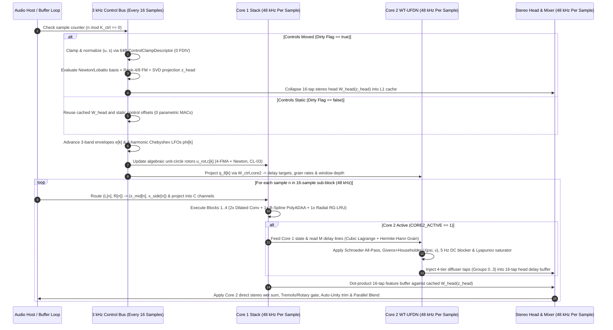
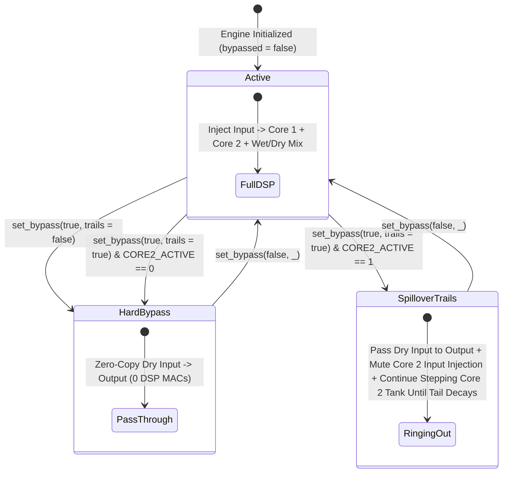

# "Tri-Physics" System Architecture & Signal-Flow Design

This specification defines the **system-level signal topology, dual-rate (`48 kHz` / `3 kHz`) execution lifecycle, 4-tier slimmable SIMD hierarchy (`Lite`, `Full`, `Pro`, `Ultra`), prior-art architectural comparison (`NAM A2`, `GuitarML PROTEUS`, `NAM ParametricOD`), gain staging, spillover bypass state machine, `4×` offline bounce architecture, and 18 engineering breakthroughs** of **Dynamic Neural Audio Modeler (DNAM)**.

For implementation-agnostic system requirements and hardware budgets, see [`system_goals_and_requirements.md`](system_goals_and_requirements.md). For psychoacoustic `bESR` quality tiers, see [`psychoacoustic_quality_and_tiers.md`](psychoacoustic_quality_and_tiers.md). For subsystem mathematical derivations, see [`../dsp/core1_polyadaa_and_rglru.md`](../dsp/core1_polyadaa_and_rglru.md), [`../dsp/core2_modulated_ufdn.md`](../dsp/core2_modulated_ufdn.md), and [`../dsp/parametric_control_bus.md`](../dsp/parametric_control_bus.md).

---

## 1. End-to-End "Tri-Physics" Signal Topology & Dual-Rate Clock Domains

### 1.1 System Signal-Flow Diagram

```mermaid
flowchart TD
    In["Input Audio (Unclipped f32):<br/>Mono x[n] or Stereo (L[n], R[n])"] --> MS["Input Mid/Side Router:<br/>x_mid[n] = 0.5(L+R), x_side[n] = 0.5(L-R)"]
    Knobs["User Controls:<br/>Continuous Ranges x_p & Discrete Switches s_q"] --> Clamp["Branchless Safe-Domain Clamper (CL-12, CL-15..17):<br/>64-Byte ControlClampDescriptor ([safe_min, safe_max], Active Switch Mask & Conditional Rules)"]
    Clamp --> Ctrl["Control Bus (16x Decimated @ 3 kHz):<br/>• Autonomous: 3-Band Envelope e[k] + 4-Harmonic Chebyshev LFO Bank<br/>• Parametric: Node-Anchored Newton/Lobatto + Rank-4/8 FM Hyper-Bus (0 MACs @ 48 kHz when static)<br/>• Algebraic Unit-Circle Rotors u_rot (CL-03), H2 Norms, WT-UFDN State q_8 & Tremolo Gates"]
    MS --> Ctrl
    Ctrl --> Core1
    Ctrl --> Core2
    Ctrl --> Mix

    subgraph Core1 ["Core 1: 12-Layer Hybrid Dilated-Conv (1x B-Spline PolyADAA) + Log-Octave Selective RG-LRU Stack"]
        direction TB
        B1["Block 1: 2x Conv (d=1, 3, 1x B-Spline PolyADAA) + 1x Selective Complex RG-LRU<br/>(Input Impedance, Acoustic/Piezo Body Modes & Pre-Drive Wah / Phaser / Uni-Vibe)"]
        B2["Block 2: 2x Conv (d=7, 19, 1x B-Spline PolyADAA) + 1x Selective Complex RG-LRU<br/>(Preamp Tube/FET Clipping, Instantaneous Blocking Distortion & Mid-Stack Tone Stack EQ)"]
        B3["Block 3: 2x Conv (d=1, 3, 1x B-Spline PolyADAA) + 1x Selective Complex RG-LRU<br/>(Power-Amp Push-Pull Saturation, Dynamic Inductor Shift, Transformer Sag & Optical Compression)"]
        B4["Block 4: 2x Conv (d=7, 19, 1x B-Spline PolyADAA) + 1x Selective Complex RG-LRU<br/>(Speaker Cabinet Modal Resonances, Post-Drive Phaser, Harmonic Tremolo & High-Freq Roll-Off)"]
        Head["16-Tap True-Stereo SVD-Kronecker Output Head<br/>(Collapsed @ 3 kHz over D_h=4 or D_h=8 modes -> y1_L[n], y1_R[n])"]
        B1 --> B2 --> B3 --> B4 --> Head
    end

    MS --> B1
    Head --> Core2

    subgraph Core2 ["Core 2: Mode-Free Windowed Time-Warped Modulated Unitary FDN (M-UFDN / WT-UFDN)"]
        direction TB
        Lines["M fp16 Delay Buffers (M=4 Lite / M=8 Full & Pro / M=16 Ultra) + 8-Tap Shared-Buffer Early & TZF Reference Reader<br/>• Micro (0.2-8 ms): Through-Zero / Resonant Jet Flanger & Comb Doubling<br/>• Short (8-45 ms): Quadrature Stereo Chorus, Leslie Doppler & Slapback<br/>• Long (45-5000+ ms): Tape Echo, Spring Drip, Lush Reverb, Granular Shimmer & Unitary Spectral Freeze"]
        Lagrange["Click-Free 4-Tap Cubic Lagrange + Self-Activating Dual-Tap Complementary Hermite-Hann Grain Reader"]
        InLoopAP["In-Loop Fixed-Integer Schroeder All-Pass Diffuser per Line (Crisp Echo / Spring Drip / 2^k Hall)"]
        House["O(M) Givens + Householder Orthogonal Stereo Matrix U(psi, v) + Passband-Normalized 5 Hz DC Blocker"]
        Law["Unity-Slope Normalized Cubic Coercive-Saturating Lyapunov Loop Law + Unitary Freeze Gate"]
        Lines --> Lagrange --> InLoopAP --> House --> Law --> Lines
    end

    MS --> Core2
    InLoopAP -->|"4-Tier Pre-Head Kronecker Tap (Groups 0..3 -> Lite/Full/Pro/Ultra)"| Head
    Head --> Mix["Final Stereo Mixer:<br/>Tremolo/Rotary Gate, Tier Loudness Trim, Auto-Unity Gain & Polarity-Corrected Parallel Blend"]
    Core2 --> Mix
    MS --> Mix
    Mix --> Out["True Stereo Output (Unclipped f32: y_hat_L[n], y_hat_R[n])"]
```

### 1.2 Dual-Rate (`48 kHz` Audio vs. `3 kHz` Control) Execution Lifecycle

DNAM decouples slowly varying control, envelope, LFO, and complex rotor updates ($3\text{ kHz}$, decimation stride $K_{\text{ctrl}} = 16$ at $f_s = 48\text{ kHz}$) from per-sample nonlinear waveshaping, radial state-space recurrence, and fractional delay readout ($48\text{ kHz}$):

---

## 2. 4-Tier Slimmable SIMD Hierarchy (`Lite` / `Full` / `Pro` / `Ultra`) & Prior-Art Comparison

### 2.1 4-Tier Lower-Block-Triangular Arena Hierarchy

To fulfill Goal 5 ([`system_goals_and_requirements.md` §6 (`REQ-5.1`–`REQ-5.6`)](system_goals_and_requirements.md#6-goal-5--single-run-slimmable-multi-tier-architecture-lite--full--pro--ultra)), every trained `.dnam` container stores weights in a **4-tier lower-block-triangular delta layout** (`Arena 0..3`, see [`../containers/dnam_binary_format.md` §2](../containers/dnam_binary_format.md#2-five-hardware-loading-optimizations--50-ns-zero-allocation-load)). Lower tiers are exact contiguous byte prefixes of higher tiers, allowing any host to select or switch tiers at runtime with zero structural zeros and zero loudness jump:

| Architectural Parameter | **`Lite` (`Arena 0`)** | **`Full` (`Arena 0..1`)** | **`Pro` (`Arena 0..2`)** | **`Ultra` (`Arena 0..3`)** |
| :--- | :---: | :---: | :---: | :---: |
| **Core 1 Channels (`C`)** | `C = 4` (`1×` 128-bit NEON reg) | `C = 8` (`2×` NEON / `1×` AVX2) | `C = 12` (`3×` NEON, `8+4` tiled) | `C = 16` (`4×` NEON / `2×` AVX2) |
| **16-Tap Unfolded Head Dim (`N = 16C`)** | `64` taps | `128` taps | `192` taps | `256` taps |
| **Core 2 `WT-UFDN` Delay Lines (`M`)** | `M = 4` lines (`fp16`) | `M = 8` lines (`fp16`) | `M = 8` lines (`fp16`) | `M = 16` lines (`fp16`, 8 Givens pairs) |
| **Core 2 Pre-Head Kronecker Injection** | Group `0` (`4` ch → `Lite`) | Groups `0..1` (`8` ch → `Full`) | Groups `0..2` (`12` ch → `Pro`) | Groups `0..3` (`16` ch → `Ultra`) |
| **Control Bus FM Rank (`R`) & SVD Rank (`D_h`)** | `R = 4`, `D_h = 4` | `R = 4`, `D_h = 4` | `R = 4`, `D_h = 4` | `R = 8`, `D_h = 8` (nested `+4` modes) |
| **Cumulative Binary Arena Footprint** | `10,752 B` (`168 CL`, `10.5 KB`) | `22,336 B` (`349 CL`, `21.8 KB`) | `36,224 B` (`566 CL`, `35.4 KB`) | `64,000 B` (`1,000 CL`, `62.5 KB`) |
| **Per-Stem `.dnam-ckpt` `Arena 4` Record** | `17,664 B` (`17.25 KB`) | `68,096 B` (`66.50 KB`) | `151,296 B` (`147.75 KB`) | `267,264 B` (`261.00 KB`) |

### 2.2 Hardware & DSP Benchmark Summary (`NAM A2` vs. `DNAM`)

| Hardware / DSP Metric | NAM A2 Lite (Mono) | **DNAM Lite (Stereo)** | NAM A2 Full (Mono) | **DNAM Full (Stereo)** | **DNAM Pro (Stereo)** | **DNAM Ultra (Stereo)** |
| :--- | :---: | :---: | :---: | :---: | :---: | :---: |
| **Channels (`C`) / FDN Lines (`M`)** | `C = 3` (Unaligned) | **`C = 4`, `M = 4`** | `C = 8`, No FDN | **`C = 8`, `M = 8`** | **`C = 12`, `M = 8`** | **`C = 16`, `M = 16`** |
| **Core 1 Architecture** | 23 Dilated Conv | **8 Conv + 4 Selective RG-LRU** | 23 Dilated Conv | **8 Conv + 4 Selective RG-LRU** | **8 Conv + 4 Selective RG-LRU** | **8 Conv + 4 Selective RG-LRU** |
| **Core 2 Architecture** | None | **Mode-Free `WT-UFDN` + 4-Tier Routing** | None | **Mode-Free `WT-UFDN` + 4-Tier Routing** | **Mode-Free `WT-UFDN` + 4-Tier Routing** | **16-Line `WT-UFDN` + 8-Givens + 16 Diffusers** |
| **User Controls (`range` & `switch`)** | None (Static) | **Unlimited (`0` MACs static)** | None (Static) | **Unlimited (`0` MACs static)** | **Unlimited (`0` MACs static)** | **Unlimited (`0` MACs static)** |
| **48 kHz `FSQRT` / `FDIV` / `libm`** | `0` | **`0` (`100%` `FMAX`/`FMIN`/`FMLA`)** | `0` | **`0` (`100%` `FMAX`/`FMIN`/`FMLA`)** | **`0` (`100%` `FMAX`/`FMIN`/`FMLA`)** | **`0` (`100%` `FMAX`/`FMIN`/`FMLA`)** |
| **SIMD Lane Utilization** | `75%` (`3/4` lanes) | **`100%` (`4/4` lanes)** | `100%` (`8/8` lanes) | **`100%` (`8/8` lanes)** | **`100%` (`12/12` lanes)** | **`100%` (`16/16` lanes)** |
| **Core 1 L1 Cache State RAM** | `76.2 KB` | **`3.7 KB` (`-95%`)** | `203.1 KB` | **`7.5 KB` (`-96%`)** | **`11.2 KB` (`-94%`)** | **`15.0 KB` (`-93%`)** |
| **Core 2 Delay Ring Buffer RAM** | `0 KB` | **`0 KB` (Amp) / `16 KB–2.0 MB`** | `0 KB` | **`0 KB` (Amp) / `32 KB–2.0 MB`** | **`0 KB` (Amp) / `32 KB–4.0 MB`** | **`0 KB` (Amp) / `64 KB–8.0 MB`** |
| **Effective Receptive Field** | `132.2 ms` | **`∞` (SSM + `WT-UFDN` + Freeze)** | `132.2 ms` | **`∞` (SSM + `WT-UFDN` + Freeze)** | **`∞` (SSM + `WT-UFDN` + Freeze)** | **`∞` (SSM + `WT-UFDN` + Freeze)** |
| **Total Compute (MACs / Sample)** | `1,871` MACs | **`~1,245` MACs (`1.5×` faster)** | `12,146` MACs | **`~4,625` MACs (`2.6×` faster)** | **`~9,950` MACs (`1.22×` faster)** | **`~16,950` MACs (`1×`) / `4×` Bounce** |
| **Reference `realtime_wcet` (`48 kHz`)** | — | **`318.0 ns/samp` (`1.53%` core)** | — | **`439.8 ns/samp` (`2.11%` core)** | **`516.3 ns/samp` (`2.48%` core)** | **`587.2 ns/samp` (`1×`) / `2,286.6 ns` (`4×`)** |

### 2.3 Prior-Art Architectural & Capability Comparison (`NAM A2`, `GuitarML PROTEUS`, `NAM ParametricOD` vs. `DNAM`)

| Dimension / Capability | **NAM A2 (`Lite` / `Full`)** | **GuitarML PROTEUS** | **NAM ParametricOD** | **DNAM ("Tri-Physics")** |
| :--- | :---: | :---: | :---: | :---: |
| **Primary DSP Backbone** | 23-layer Dilated Conv (`d` up to `239`) + `LeakyReLU(0.01)` | 1-layer LSTM (`hidden=40`) with input knob append | Conditional WaveNet / LSTM (`FiLM` / input concat) | **Core 1 (`8 Conv + PolyADAA + 4 Selective Complex RG-LRU`) + Core 2 (`WT-UFDN` + 4-Tier Pre-Head Routing)** |
| **Tier Hierarchy & SIMD Alignment** | 2 tiers (`C=3` unaligned `75%` SIMD, `C=8` `100%` SIMD) | Single fixed size (`hidden=40`) | Fixed per-architecture export | **4-Tier (`C=4` Lite / `C=8` Full / `C=12` Pro / `C=16` Ultra) at `100%` 128-bit NEON / 256-bit AVX2 utilization** |
| **User Controls (`range` & `switch`)** | None (Static snapshot only) | 1–2 continuous knobs (`[B, L, 1+P]`) | Hardcoded pedal layout (`Gain`, `Tone`, `Level`) | **Unlimited arbitrary `range` knobs & discrete `switch` selectors (`controls_schema`)** |
| **Control Rate & Static CPU Overhead** | `0` MACs (no controls) | `48 kHz` (`+40·P` MACs/sample even when knobs don't move) | `48 kHz` (`+2·C·P` MACs/sample per layer when static) | **`3 kHz` Node-Anchored Newton/Lobatto + Rank-4/8 FM (`0` MACs/sample @ `48 kHz` when static)** |
| **Anti-Aliasing at `1×` Sample Rate** | None (Hard kink `LeakyReLU` aliases above `3 kHz`) | None (`tanh` / `sigmoid` at `1×` rate) | None (`tanh` / `ReLU` at `1×` rate) | **`1×` Passive B-Spline Division-Free Algebraic `PolyADAA` (`38.87 dB` alias suppression, `0 FDIV`/`FSQRT`)** |
| **Resonant Sweeps (Wah / Phaser / Filter)** | Fails (Real poles; Cartesian fade drops `Q` by `90%`) | Fails (Real gate activations cannot rotate complex poles) | Fails (Audio crossfade creates comb-filtered double notch) | **Radial-Polar Split + Algebraic `3 kHz` Rotor (`99.80%` `Q` retention across octave sweeps)** |
| **Delay, Chorus, Spring, Reverb & Freeze** | No (`132.2 ms` FIR cutoff; `203 KB` L1 cache thrashing) | No (LSTM state vanishes past `~50 ms`) | No (Dilated FIR cannot interpolate delay length `τ(u)`) | **Mode-Free `WT-UFDN` (`0.2 ms` TZF to `5.46 s` Reverb/Echo, Spring Drip, Hermite-Hann Shimmer & Unitary Freeze)** |
| **Multi-Stem Interpolation Physics** | N/A | Black-box gate shift (double-echo ghosting on delays) | Linear FiLM across all layers (`O(2^P)` corner blowup) | **Step-0 Order-Statistic Optimal Transport (`3.41×10⁻¹³ ms` delay accuracy) + Physical Variance Gate (`CL-14`)** |
| **Control-Space Extrapolation Safety** | N/A | None (hallucinates outside recorded knob range) | Hardcoded `[0, 1]` plugin UI bounds | **Non-Stop 3-Phase Clamping (`[CLAMP-RANGE]`, `[CLAMP-SWITCH]`, `[CLAMP-STABILITY]`, `[CLAMP-DYNAMIC]`)** |
| **Iterative Stem Addition (`Resume`)** | Retrain from scratch | Retrain from scratch | Retrain from scratch | **Single `.dnam-ckpt` (`DNCK`) Factorized-Kronecker Resume (`< 5 s` Tier-1 head update, `0.00` old-stem drift)** |
| **Container Format & Load Time** | ASCII JSON `.nam` (`3.5×` text bloat, `37.5%` structural zeros) | JSON `.json` (`float32` text arrays) | JSON / PyTorch `.pt` (`pickle` security risk) | **64B-Aligned Binary `.dnam` (`< 50 ns` zero-alloc `mmap`, `Ed25519` signed, zero-re-sign tier stripping)** |
| **Sample-Rate & Offline Bounce Support** | Fixed `48 kHz` | Fixed training rate | Fixed training rate | **Continuous-Time ZOH Rescaling (`44.1–96 kHz`) + Automatic `4×` Polyphase Offline Bounce (`CL-20`)** |

---

## 3. System-Level Audio Routing, Gain Staging, Spillover & Offline Bounce

### 3.1 Input Mid/Side Encoding, Unclipped `f32` Headroom & Hardware Denormal Immunity (`FTZ`/`DAZ`)
Given stereo input samples $(L[n], R[n]) \in \mathbb{R}^2$ (or mono $L[n] = R[n] = x[n]$), the input router computes:
$$x_{\text{mid}}[n] = \frac{1}{2}\big(L[n] + R[n]\big), \qquad x_{\text{side}}[n] = \frac{1}{2}\big(L[n] - R[n]\big)$$
and projects $[x_{\text{mid}}[n], x_{\text{side}}[n], 0, 0]^\top$ into each active 4-channel tier block via its $4 \times 4$ input projection matrix. No hard input clipper is applied at `0.0 dBFS`, preserving unclipped 32-bit IEEE-754 float (`f32`) headroom from upstream blocks while `CL-01` bounds internal polynomial waveshaper inputs smoothly per layer. At the entry of every audio callback (`process_block`), the engine enables hardware **Flush-to-Zero (`FTZ`) and Denormals-Are-Zero (`DAZ`)** (`FPCR.FZ = 1` on ARM64 / `MXCSR` bits `6, 15` on x86_64) so decaying `RG-LRU` resonators, `WT-UFDN` delay tails, and 1-pole envelopes never trigger subnormal microcode traps.

### 3.2 Gated `rms_dbfs` Auto-Unity Leveling & Per-Tier Loudness Parity
1. **Default-Control Anchor ($\mathbf{u} = \mathbf{0}$):** Auto-Unity leveling (`io_config.leveling`) is anchored strictly at the model's default control state (`controls_schema[*].default`, where normalized coordinates satisfy $\mathbf{u} = \mathbf{0}$ and $\mathbf{z}_{\text{head}} = \mathbf{0}$)—never at an arbitrary user preset—so turning a modeled `Volume` or `Output` knob away from default behaves exactly like the physical hardware.
2. **Gated Electrical `Vrms` Calibration:** By default (`leveling_metric = "rms_dbfs"`), the trainer measures gated unweighted broadband RMS on active signal frames against `reference_input_level_db` and stores `calibrated_trim_db` so inserting the model at default settings maintains unity gain staging.
3. **Zero-`pow10f` Per-Tier Loudness Trim:** `Arena 0` pre-stores linear scale factors `tier_gain_trim_lin` ($10^{\text{output-trim-db}/20}$) so switching between `Lite`, `Full`, `Pro`, and `Ultra` in a `#[no_std]` audio callback maintains $0.00\text{ dB}$ loudness parity with zero transcendental calls.

### 3.3 Polarity-Corrected Host Parallel Blend & Spillover `Trails` State Machine
1. **Polarity-Corrected Parallel Blend (`wet_polarity_inverted`):**
   - Many physical single-/odd-stage tube and transistor circuits invert signal phase ($180^\circ$). If a host mixes raw dry and phase-inverted wet signals at `50%` blend, fundamental frequencies cancel out.
   - When `io_config.capabilities.wet_polarity_inverted == true`, the mixer inverts the wet gain sign ($g_{\text{wet}} = -b$, $g_{\text{dry}} = 1 - b$ for blend $b \in [0, 1]$) so $b = 0$ preserves bypass polarity and $b \in (0, 1)$ sums constructively without comb cancellation.
2. **Spillover `Trails` Bypass State Machine (`supports_trails`):**

### 3.4 $4\times$ ZOH Polyphase Oversampling & Automatic Tier Promotion on Offline Bounce (`CL-19`, `CL-20`)
1. **Effective Tier Resolution (`CL-19`):** Given the user-requested tier $t_{\text{req}}$, host ceiling $t_{\text{max-sup}}$, and container-available tier $t_{\text{avail}}$, the active runtime tier is resolved as:
   $$t_{\text{eff}} = \min\big(t_{\text{req}}, t_{\text{max-sup}}, t_{\text{avail}}\big)$$
2. **Offline Bounce Promotion & $4\times$ Oversampling (`CL-20`):** When a DAW host enters offline rendering (`is_offline_bounce == true`):
   - If `maximize_tier_on_bounce` is enabled, the engine promotes $t_{\text{bounce}} = \min(t_{\text{avail}}, t_{\text{max-sup}})$ (e.g., `Full` real-time monitoring $\to$ `Ultra` offline bounce).
   - When $4\times$ oversampling is active, input blocks pass through a 2-stage linear-phase half-band polyphase upsampler ($> 95\text{ dB}$ stopband attenuation), step the Continuous-Time ZOH-rescaled engine at $f_{s,\text{bounce}} = 4 f_s$, and decimate through the matched 2-stage half-band downsampler with exact plugin delay compensation ($L_{\text{PDC}} = 12\text{ host samples}$).

---

## 4. Index of the 18 Empirically Verified Engineering Breakthroughs

Each structural breakthrough is specified in full mathematical detail in its dedicated subsystem document and verified by the automated test suite ([`../verification/verification_and_guardrails.md`](../verification/verification_and_guardrails.md)):

| # | Architectural Breakthrough | What It Replaces | Verified Physical, Numerical & Hardware Benefit | Canonical Specification |
| :- | :--- | :--- | :--- | :--- |
| **1** | **Radial-Polar Split Selective Complex RG-LRU** | 15 outer dilated FIR layers (`d=41, 101, 239`) & Cartesian chord interpolation | Cuts MACs by `62%`, shrinks L1 state RAM by `96%`, and preserves **`99.80%` of resonance `Q`** across wide Wah/Phaser sweeps | [`../dsp/core1_polyadaa_and_rglru.md` §2.1](../dsp/core1_polyadaa_and_rglru.md#21-why-radial-polar-split-beats-naive-cartesian-interpolation) |
| **2** | **Algebraic 3 kHz Unit-Circle Rotor + `H₂`-Norm Scaling** | `libm` `sinf`/`cosf` calls & unnormalized high-`Q` pole gains | Evaluates `3 kHz` rotors via 4-FMA + Newton step `y₁ = 1.5 - 0.5(ĉ² + ŝ²)` (**`9.99 × 10⁻⁹` accuracy, `|u_rot| ≤ 1.0`**) and unit `H₂` norm (`CL-03`, `CL-04`) | [`../dsp/core1_polyadaa_and_rglru.md` §2.2](../dsp/core1_polyadaa_and_rglru.md#22-branchless-algebraic-3text-khz-unit-circle-rotor-cl-03-0-libm-0-fsqrt-0-fdiv) |
| **3** | **Exact Division-Free Algebraic Polynomial ADAA (`PolyADAA`)** | Hard-kink `LeakyReLU(0.01)` & stall-prone `FSQRT`/`FDIV` ADAA | Factors `(u_n - u_{n-1})` algebraically into midpoint/half-difference `(m_n, d_n)` (**`0 FDIV`, `0 FSQRT`, `0` branches, `5.25 × 10⁻¹⁴` exactness**, `CL-01`) | [`../dsp/core1_polyadaa_and_rglru.md` §1.3](../dsp/core1_polyadaa_and_rglru.md#13-exact-division-free-algebraic-factorization-fdiv--0) |
| **4** | **`1×` Passive B-Spline ADAA Blend + Linear Path Separation** | Full-signal ADAA (`-48.16 dB` droop) or post-ADAA HPF (`+6 dB` alias boost) | Direct linear residual `α_c x_c[n]` (`0.00 dB` droop) + passive `(7/8)A[n] + (1/8)A[n-1]` blend achieves **`-62.08 dBc` (`38.87 dB` less aliasing)** (`CL-02`) | [`../dsp/core1_polyadaa_and_rglru.md` §1.4](../dsp/core1_polyadaa_and_rglru.md#14-un-delayed-linear-path-separation-1times-passive-b-spline-blend-cl-02--resting-dc-equilibrium) |
| **5** | **128-Bit Aligned 4-Tier Slimmable Hierarchy (`Lite`/`Full`/`Pro`/`Ultra`)** | Unaligned `C=3` Lite and 2-tier ceiling in NAM A2 | `100%` SIMD lane utilization across `C = 4, 8, 12, 16` and `M = 4, 8, 8, 16` with `0` stack spills in ARM64 NEON `v0`–`v31` | [§2 above](#2-4-tier-slimmable-simd-hierarchy-lite--full--pro--ultra--prior-art-comparison) |
| **6** | **Click-Free 4-Tap Cubic Lagrange Delay Readout + HF Shelf** | Recursive Thiran All-Pass on sweeping delay lines | Stateless 4-tap Cubic Lagrange (`1` `float32x4_t` dot product) reduces integer-boundary click jerk by **`54×`** (`CL-06`) | [`../dsp/core2_modulated_ufdn.md` §1.2](../dsp/core2_modulated_ufdn.md#12-stateless-4-tap-cubic-lagrange-fractional-delay-reader-cl-06) |
| **7** | **Envelope-Guided Multi-Scale Surrogate Delay Gradient** | Myopic 4-sample Cubic Lagrange gradient during training | Coarse-to-fine Gaussian envelope derivative escapes carrier-cycle local minima (`54.52` samp error) and locks to **`0.0035` samples** | [`../training/four_stage_pipeline.md` §2.4](../training/four_stage_pipeline.md#24-stage-3b--differentiable-wt-ufdn-optimization--automatic-group-lasso-pruning-core2_active--true) |
| **8** | **Givens + Householder Orthogonal Stereo Matrix `U(ψ, v)`** | Fixed ping-pong permutation or dense `M × M` matrix | Pairs `2×2` Givens rotation `R(ψ)` with `O(M)` Householder reflection `H(v)` (`< 10⁻¹⁴` orthogonality error across Dual-Mono, Reverb & Ping-Pong) | [`../dsp/core2_modulated_ufdn.md` §3.2](../dsp/core2_modulated_ufdn.md#32-om-givens--householder-orthogonal-stereo-feedback-matrix-mathbfupsi-mathbfv) |
| **9** | **Passband-Normalized DC-Blocking Filter (`α_dc = (1 + R_dc)/2`)** | Unconstrained DC gain or unnormalized HPF (`> 1.0` at Nyquist) | Enforces strict passivity (`|H_dc(e^{iω})| ≤ 1.0000`) and **exact `0.0000` DC loop gain** (`1.03 × 10⁻⁶` DC under `+20 dBFS` overload, `CL-09`) | [`../dsp/core2_modulated_ufdn.md` §4.1](../dsp/core2_modulated_ufdn.md#41-passband-normalized-5text-hz-in-loop-dc-blocker-cl-09) |
| **10** | **Unity-Slope Normalized Coercive-Saturating Loop Law** | Artificial on/off switch or unnormalized `1.5×` cubic slope | Pre-scaling by `2 / (3 V_ceil)` enforces **exact unity slope `S'(0) ≡ 1.0000`** so quiet tails decay while swells saturate below `V_ceil ≤ 0.985` (`CL-10`, `CL-11`) | [`../dsp/core2_modulated_ufdn.md` §4.2](../dsp/core2_modulated_ufdn.md#42-unity-slope-normalized-cubic-coercive-saturating-lyapunov-loop-law-cl-10-cl-11) |
| **11** | **Mode-Free `WT-UFDN` with TZF, Spring Drip, Granular & Freeze** | Separate Chorus, Flanger, Spring, Reverb, Granular & Freeze modules | Unifies 64-sample TZF tap, negative all-pass dispersion (`CL-08`), **Self-Activating Hermite-Hann Grain Reader (`H(φ_A)+H(φ_B)≡1`)**, and **Unitary Freeze** | [`../dsp/core2_modulated_ufdn.md` §2](../dsp/core2_modulated_ufdn.md#2-mode-free-3text-khz-windowed-time-warped-unitary-fdn-wt-ufdn-granular-shimmer--spectral-freeze) |
| **12** | **Control-Rate Stereo Tremolo & Leslie Rotary Beaming Gate** | Static post-mix gains incapable of AM/Tremolo | `3 kHz` multiplicative stereo gate `1 + w_{trem,L/R}^T m[k]` (`1 FMUL/ch`) models Optical/Harmonic Tremolo, Auto-Pan, and Rotary Beaming | [`../dsp/core2_modulated_ufdn.md` §4.3](../dsp/core2_modulated_ufdn.md#43-3text-khz-control-rate-stereo-tremolo--leslie-rotary-beaming-gate) |
| **13** | **Blind Phase-Locked Teacher → 4-Harmonic Chebyshev LFO** | Naive fixed-frequency sine LFO during training | Tracks analog oscillator thermal drift during training (discarded at export) and shapes sine, triangle, saw, and asymmetric lamp LFOs | [`../dsp/parametric_control_bus.md` §1](../dsp/parametric_control_bus.md#1-autonomous-signal-driven-modulators-mathbfmk-in-mathbbr7) |
| **14** | **Node-Anchored Newton/Lobatto HDMR-FM & Bilinear Tier Features** | `48 kHz` FiLM concatenation, dense MLP corner hallucination & rank bottlenecks | Evaluates knobs/switches at `3 kHz` (`0` MACs @ `48 kHz` static, `CL-12`–`CL-13`) and folds bilinear control modulators `[1, m_0, m_1, m_2]` into `W_head` for full multi-stem rank | [`../dsp/parametric_control_bus.md` §2](../dsp/parametric_control_bus.md#2-user-definable-parametric-controls-range--switch) |
| **15** | **Order-Statistic Transport + Variance Gating + Switch Crossfade** | Double-echo channel crossfading, parasitic coupling & switch clicks | Matches sorted delays/poles (`3.41 × 10⁻¹³ ms` error), hard-gates invariant paths (`CL-14`), and crossfades discrete delay switches over 128 samples (`50.7×` smoother, `CL-07`) | [`../dsp/parametric_control_bus.md` §2.6](../dsp/parametric_control_bus.md#26-step-0-order-statistic-optimal-transport--physical-variance-gating-cl-14) |
| **16** | **Non-Stop 3-Phase Audit & Factorized-Kronecker `.dnam-ckpt` Resume** | Blocking prompts, stale pre-summed Grams, `pickle` risks & full retraining | Clamps unobserved ranges/switches/corners non-stop (`CL-15`–`CL-17`) and stores `uplo='U'` per-stem stats + `DNCA` calibration records for **`< 5 s` Tier-1 resume** | [`../training/clamp_and_audit_registry.md`](../training/clamp_and_audit_registry.md) & [`../training/iterative_resume_and_caching.md`](../training/iterative_resume_and_caching.md) |
| **17** | **32-Bit Device + 72-Bit Gram + Host `float64` Cascade & Polish** | Cold init, `float32` normal-equation overflow, band phase cancellation & OOMs | Pairs 32-bit device streaming, 72-bit `ExactGramAccumulator`, orthogonal FFT band projectors, LTI commutativity, and host `float64` Cholesky polish (`CL-18`, `< 8 GiB` RAM) | [`../training/four_stage_pipeline.md` §2–§3](../training/four_stage_pipeline.md#2-stage-by-stage-mathematical-specification) |
| **18** | **Zero-Copy Hybrid Binary Container (`DNAM`/`DNCK`/`DNSL`) & ZOH** | `3.5×` bloated ASCII JSON `.nam` weights, `37.5%` structural zeros & fixed `48 kHz` | `64 B` preamble + `4 KB` JSON header + `64 B`-aligned 4-Tier `SoA` arenas (`< 50 ns` load), zero-re-sign tier stripping (`CL-19`), and native `44.1–96 kHz` ZOH rescaling | [`../containers/dnam_binary_format.md`](../containers/dnam_binary_format.md) |
