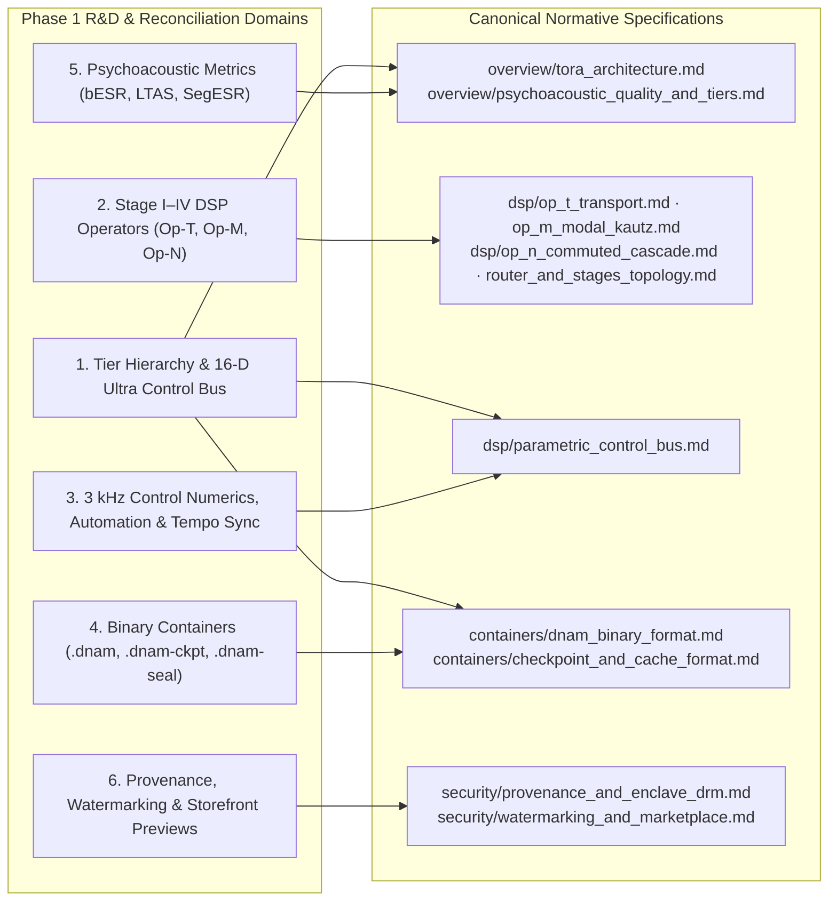

# TORA Phase 1 Design Decisions & R&D Counterexamples

This document archives the **Phase 1 architecture, DSP, container, control-bus, quality-metric, and security design decisions**, candidate evaluations, and mathematical counterexamples that shaped the canonical **Tri-Operator Recurrent Architecture (`TORA`)** specifications.

Normative specifications live in [`../overview/`](../overview/tora_architecture.md), [`../dsp/`](../dsp/op_t_transport.md), [`../training/`](../training/four_stage_pipeline.md), [`../containers/`](../containers/dnam_binary_format.md), [`../security/`](../security/provenance_and_enclave_drm.md), and [`../verification/`](../verification/verification_and_guardrails.md). This archive records **why** specific mathematical and structural choices were selected over alternative R&D candidates.

---

## 1. Core Product & Architectural Decisions

| Domain | Canonical Decision | Superseded / Rejected R&D Alternative | Reference Spec & Test |
| :--- | :--- | :--- | :--- |
| **Slimmable Tier Hierarchy (`REQ-5.1`)** | Four nested tiers (`Lite ⊂ Full ⊂ Pro ⊂ Ultra`). `Lite..Pro` use `8-D` static control (`4` head + `4` stage, Rank-4 FM); `Ultra` adds an `8-D` delta (`+4` head + `+4` stage, Rank-8 FM) and a `16 × 4` stage-dispatch delta in `Arena 3`. | Capping `Ultra` at `4` stage coordinates (creates a rank-4 bottleneck across the 8 physical stage mechanisms) or baking `16-D` into `Lite..Pro`. | [`parametric_control_bus.md` §2.5](../dsp/parametric_control_bus.md#25-o1-additive-latent-sufficient-statistic-control-scaling), [`test_control_projection_spec_references.py`](../../tests/test_control_projection_spec_references.py) |
| **Stage III Cabinet Layout (`REQ-1.2`, `REQ-5.6`)** | Separate 64B-aligned per-tier slices for independent L/R early FIR taps (`16 / 32 / 48 / 64` taps/ch) and shared-pole Kautz modal pairs (`4 / 8 / 16 / 32` pairs) with independent L/R readouts. Fixed 16-sample reference modal onset (`x[n-16]`). Both channels advance in all I/O topologies. | Single unpartitioned `384 B` Stage III slot per tier (which collided `stage3_early_fir` with `stage2_filter_params` and assumed 16 poles/tier). | [`op_m_modal_kautz.md` §4.1](../dsp/op_m_modal_kautz.md#41-stage-iii-architecture--tier-allocation), [`dnam_binary_format.md` §2.4](../containers/dnam_binary_format.md#24-tier-local-projection--stage-iii-slice-layout) |
| **Hardware Freeze (`REQ-1.4`)** | Freeze is modeled only when present and captured on the target hardware; unobserved options remain clamped. Stage IV freeze stops tank input injection while Stages I–III continue processing live play-over input. | Post-head synthetic native freeze with a separate `4,096 B` snapshot buffer and artificial visibility/blending rules. | [`router_and_stages_topology.md` §6.1](../dsp/router_and_stages_topology.md#61-captured-freeze-and-modeled-controls), [`test_captured_freeze_spec_references.py`](../../tests/test_captured_freeze_spec_references.py) |
| **Tempo Range & Transport Lock (`REQ-2.5`)** | Support `20–400 BPM` inclusive across host, MIDI (`24 PPQN`), and tap sources; report out-of-range sources explicitly. Initialize phase to `PPQ` at frame 0 on start-from-stop and offline bounce; in-play jumps default to bounded shortest-arc `SmoothRelock` with optional `ImmediatePhaseLock` + 16-sample micro-ramp. | Unbounded BPM claims, silent tempo clamping, or conflating the training `CL-16` stop-gradient barrier with runtime phase relocking. | [`parametric_control_bus.md` §7](../dsp/parametric_control_bus.md#7-host-midi-and-tap-tempo-synchronization-req-25), [`test_tempo_clock_spec_references.py`](../../tests/test_tempo_clock_spec_references.py) |
| **Automation Timing & Tie Precedence** | Apply host parameter updates at the `3 kHz` control boundary (`n mod K_ctrl == 0`), coalescing in timestamp order. On exact-timestamp ties: DAW automation wins over live Studio/MIDI; between live Studio and MIDI, last-received wins. Untimestamped live events schedule at the first eligible boundary using bounded per-producer lanes. | Sample-rate re-projection of `W_ctrl` on every host event or arbitrary array-order tie breaking. | [`parametric_control_bus.md` §1.1](../dsp/parametric_control_bus.md#host-automation-timing), [`test_control_tick_spec_references.py`](../../tests/test_control_tick_spec_references.py) |
| **Growable Presets & Container Framing (`REQ-8.1`)** | Open containers place a growable `DMU1` mutable JSON frame and `DMUE` footer after the retained tier boundary; protected containers use an HPKE-wrapped `DME1` frame. Partial presets restore signed defaults for omitted controls before atomic clamping. | Fixed 4 KB JSON header slack that requires re-signing when user presets outgrow the initial page. | [`dnam_binary_format.md` §1.2](../containers/dnam_binary_format.md#12-open-dnam-structural-layout), [`test_open_layout_spec_references.py`](../../tests/test_open_layout_spec_references.py) |
| **Offline Protected Authorization (`REQ-8.4`, `REQ-8.6`)** | Issued protected models remain usable offline indefinitely while local keys and authorization are intact; revocation applies only to future licensing and requires independent device-source evidence beyond a buyer watermark or transferred file. | Periodic online lease renewal or automatic hardware revocation from a leaked watermarked file alone. | [`provenance_and_enclave_drm.md` §2.2](../security/provenance_and_enclave_drm.md#offline-authorization-and-future-revocation) |
| **Storefront Previews (`REQ-8.7`)** | `.dnam-prev` physically omits `Full/Pro/Ultra` arenas, preserves natural musical playing, exposes a bounded responsive window on single-control models (`P = 1`), and enforces fixed-anchor rank-`r` (`r < D_cont`) containment across all published previews for multi-control models (`P ≥ 2`). | Claiming unconditional replay/cloning impossibility or applying continuous rank deficiency to 0-D / 1-D control spaces. | [`watermarking_and_marketplace.md` §3](../security/watermarking_and_marketplace.md#3-commercial-storefront-platform-auditioning-royalty-splits--storefront-metadata), [`test_preview_threat_spec_references.py`](../../tests/test_preview_threat_spec_references.py) |

---

## 2. Subsystem Mathematical Selections & Counterexamples

### 2.1 `Op-N`: PolyADAA Rail Crossing, Cubic-Envelope Wavefolder & Fixed-Hertz Bitcrusher

| Mechanism | Canonical Selection | Counterexample to Naive Formulation | Reference Test |
| :--- | :--- | :--- | :--- |
| **PolyADAA Rail Crossing (`CL-01`)** | Retain unclamped prior input history and evaluate the exact piecewise antiderivative across `±1` rail crossings using a 6-step division-free `f64` Newton reciprocal (`< 2^-44` error before and `< 2^-24 + 2^-44` after `f32` conversion). | Clamping endpoints to `[-1, 1]` before ADAA loses overshoot information (`0 → 1` and `0 → 2` yield identical clamped endpoints but distinct exact averages). | [`test_stage2_spec_references.py`](../../tests/test_stage2_spec_references.py), [`stage2_rail_spec_references.rs`](../../packages/engine/tests/stage2_rail_spec_references.rs) |
| **Smooth-Rail Wavefolder** | Cubed-envelope wavefolders `w_odd,3(u) = ū(1 - ū²)³` and `w_even,3(u) = ū²(1 - ū²)³` (`C²` at `±1` rails) with exact degree-7/8 midpoint-difference `PolyADAA` (`Q_1..Q_8`) and direct-linear split. | Squared-envelope folds `u(1 - u²)²` and `u²(1 - u²)²` have discontinuous second derivatives (`±8`) at the rails (`C¹`, not `C²`). | [`test_stage2_spec_references.py`](../../tests/test_stage2_spec_references.py), [`test_stage2_basis_fit_references.py`](../../tests/test_stage2_basis_fit_references.py) |
| **Family 5 ZOH Bitcrusher** | Nearest-step quantizer `Q_B(x) = floor(x 2^(B-1) + 0.5) 2^-(B-1)` (halfway ties toward `+∞`) + integer fixed-hertz phase (`D = round(2^32 f_s,eff)`, `I = round(2^32 f_target)`) with pre-reduction carry detection and division-free `u128` reciprocal rate transfer. | Adding `0.5f32` before truncating `f32 -> i32` rounds negative values wrong and rounds `0.5 - 2^-25` to `1.0`; modulo reduction before carry check prevents full-rate (`I = D`) latching. | [`test_bitcrusher_spec_references.py`](../../tests/test_bitcrusher_spec_references.py), `packages/engine/src/operators/op_n.rs` |

### 2.2 `Op-M`: Symplectic Rotor, `H1` Hilbert Lattice, `T1` Octave Tracker & Stage III ZOH

| Mechanism | Canonical Selection | Counterexample to Naive Formulation | Reference Test |
| :--- | :--- | :--- | :--- |
| **Contractive Rotor (`CL-03`) & LFO Phase** | Quadrant reduction to `[-π/4, π/4]`, degree-4 minimax `(ĉ, ŝ)`, Newton scaling with adaptive 1–2 ULP `f32` norm guard (`‖u_rot‖₂ ≤ 1`), exact zero-increment hold, and `Q0.192` fixed-point LFO phase accumulator. | Unreduced `[-π/2, π/2]` polynomial suffers cancellation near `π/2`; `f32` rounded rotor state update stalls into a fixed point for slow LFO increments (`Δθ = 2^-30 rad`). | [`test_op_m_spec_references.py`](../../tests/test_op_m_spec_references.py), [`test_control_math_spec_references.py`](../../tests/test_control_math_spec_references.py) |
| **Family 2 `H1` Hilbert Pair** | 6-section all-pass pair with 15-anchor rate table (`HILBERT-H1-ANCHORS`, `≤ 0.34°` quadrature error across `100 Hz–10 kHz`), exact ties-to-even interpolation, and history-consistent two-sample section state initialization on rate transitions. | Naive `f64` linear interpolation rounds halfway rates to the wrong `f32` neighbor; copying transposed state cells across rate changes breaks constant-input equilibrium. | [`test_op_m_spec_references.py`](../../tests/test_op_m_spec_references.py), [`test_op_m_profile_certified_bounds.py`](../../tests/test_op_m_profile_certified_bounds.py) |
| **Family 1 `T1` Sub-Octave Tracker** | Tracker-only `5 Hz` TPT DC blocker (`T1-COEFFICIENT-VECTORS`), scaled exponent-split normalization, independent `prev_i_nonpositive` crossing detector, smooth half-angle quadratures (`cos`, `sin`) + divider squares (`f/2`, `f/4`) in Lite slots `4..11`. | Testing crossings on the normalized sheet phasor misses or invents toggles when `I` flushes under FTZ; pausing tracker state during local mute loses divider phase parity. | [`test_stage1_tracker_coefficients.py`](../../tests/test_stage1_tracker_coefficients.py), [`stage1_conditioning_spec_references.rs`](../../packages/engine/tests/stage1_conditioning_spec_references.rs) |
| **Stage III Sample-Rate Conversion** | Integer multiples (`48, 96, 192, 384 kHz`) use exact sparse delay `H_ref(z^q)`; live `44.1–48 kHz` uses the 64-tap anchored difference family; `4×` (`176.4–384 kHz`) uses the 6-point Lagrange difference mapping; other non-integer rates fail fast. Up to `8` host samples common delay budget when needed. | 4-tap Catmull-Rom at `44.1 kHz` attenuates `20 kHz` by `4.51 dB`; forward `f32` summation of unit-DC taps yields `0x3F800002` without difference-form anchoring. | [`test_cabinet_modal_spec_references.py`](../../tests/test_cabinet_modal_spec_references.py), [`stage3_first_tap_spec_references.rs`](../../packages/engine/tests/stage3_first_tap_spec_references.rs) |

### 2.3 `Op-T` & Stage IV: Delay Histories, Granular Pitch, Blended Knee & Feedback Guard

| Mechanism | Canonical Selection | Counterexample to Naive Formulation | Reference Test |
| :--- | :--- | :--- | :--- |
| **Model-Declared Delay Histories (`CL-06`)** | Cold-allocated 64B-aligned `fp16` histories with arbitrary-length branchless wrap, integer-plus-`Q0.32` delay pointers, inward representable `f32` reader bounds, and host memory-ceiling admission. | Fixed power-of-two ring assumption wastes up to `50%` RAM or truncates `20 BPM` dotted-half (`9 s`) delays; unguarded `f32` fraction rounding can carry across fractional safe bounds. | [`test_op_t_buffer_spec_references.py`](../../tests/test_op_t_buffer_spec_references.py), [`test_passive_delay_spec_references.py`](../../tests/test_passive_delay_spec_references.py) |
| **Granular Pitch Shifter (`±24` st)** | Scope the `0.25` sample/sample slew limit (`CL-06`) to continuous base-delay changes; use the centered grain-duration construction (`D_center ≥ 7,204` samples for a `100 ms` grain at `48 kHz` and `+24` st) with per-head causal floor `τ_m ≥ 4.0`. | Applying `0.25` sample/sample slew to grain-head phase warp caps pitch shift well below `+24` semitones (`3.0` samples/sample warp rate). | [`test_op_t_buffer_spec_references.py`](../../tests/test_op_t_buffer_spec_references.py) |
| **Stage IV Blended Feedback Knee & History Guard (`CL-10`, `CL-11`)** | Per-line blended feedback knee `g_eff(u) = g_lin (u² + α ε_knee) / (u² + ε_knee)` (`α ∈ [0, 1]`), input + non-recirculating readout DC conditioning (`CL-09`), and grouped max-tree bounded-history feedback guard `clamp(v_i[n], -M_n, M_n)`. | Even within the `0.25` slew limit at `3 kHz` control rate, a time-varying Catmull-Rom loop at `g = 0.999` has a period multiplier in `(1.02, 1.03)` without the bounded-history feedback guard. | [`test_captured_freeze_spec_references.py`](../../tests/test_captured_freeze_spec_references.py), [`test_feedback_knee_spec_references.py`](../../tests/test_feedback_knee_spec_references.py) |

### 2.4 `3 kHz` Control Bus: Exact-Integer Accumulator, Outward Trust Clip & Tempo Inversion

| Mechanism | Canonical Selection | Counterexample to Naive Formulation | Reference Test |
| :--- | :--- | :--- | :--- |
| **Exact-Integer Sufficient-Statistic Accumulator** | Accumulate materialized finite `f32` main effects and Rank-`R` interaction pair statistics exactly in fixed-width integers (updating pair sums via two shifted 24-bit significand products) and feed the exact-real oracle into trust-region clipping before narrowing to `f32`. | Naive `f32` `(∑ v_p z_p)² - ∑ v_p² z_p²` suffers catastrophic cancellation and drifts by `> 0.001` after `10,000` closed three-step control cycles. | [`test_control_accumulator_spec_references.py`](../../tests/test_control_accumulator_spec_references.py), [`control_accumulator_spec_references.rs`](../../packages/engine/tests/control_accumulator_spec_references.rs) |
| **Outward-Checked Trust-Region Clip (`CL-15`)** | Bit-preserving `f32 -> f64` widening, outward-rounded `f64` norm/output verification with 6-step Newton fast path and 32-step bisection fallback, bounding normal-radius vector error below `1.185e-6 * radius`. | Naive `f32` `rsqrt` trust-region scaling can round outside the exact ball `‖z‖₂ ≤ ρ` or flush subnormal coordinates under FTZ/DAZ. | [`test_trust_clip_spec_references.py`](../../tests/test_trust_clip_spec_references.py), [`trust_clip_spec_references.rs`](../../packages/engine/tests/trust_clip_spec_references.rs) |
| **Reachable Physical Tempo Inversion & `Q64` Timeline** | Invert calibrated Lobatto polynomials over reachable `f32` physical knob coordinates (with inward `f32` rank intersection of `f64` safety bounds), optional octave folding, and a `Q64` host-frame elapsed-time accumulator + `Q32` subdivision phase target. | Solving quadratic roots in normalized real coordinates can select unreachable `f32` values or wrong branches; averaging raw frame counts across sample-rate changes corrupts BPM (`120 -> 160 BPM`). | [`test_tempo_physical_inversion_spec_references.py`](../../tests/test_tempo_physical_inversion_spec_references.py), [`tempo_fixed_point_spec_references.rs`](../../packages/engine/tests/tempo_fixed_point_spec_references.rs) |

### 2.5 Quality Metrics, Containers & Cryptographic Provenance

| Mechanism | Canonical Selection | Counterexample to Naive Formulation | Reference Test |
| :--- | :--- | :--- | :--- |
| **Noise-Adjusted `bESR`, `LTAS` & `SegESR`** | Per-output evaluation (`γ_hiss = 1.0`, sum denominator), 33-band base-10 1/3-octave `LTAS` (`20 Hz–20 kHz` preserving `2–18 kHz` HF), duration-weighted linear `SegESR` across rate runs, and rectangular joint energy-interval qualification bounds. | Pooled stereo `bESR` hides a missing quiet channel; arithmetic dB averaging of frame ESRs turns one `-180 dB` frame + one `0 dB` frame into `-90 dB`; target-only endpoint checks miss interior qualification jumps. | [`test_quality_floor_bounds_spec_references.py`](../../tests/test_quality_floor_bounds_spec_references.py), [`test_quality_bands_spec_references.py`](../../tests/test_quality_bands_spec_references.py), [`test_quality_frame_spec_references.py`](../../tests/test_quality_frame_spec_references.py) |
| **Authenticated `2.0` Containers (`DNAM`, `DNCK`, `DNSL`)** | 64B preamble + 128B directory, RFC 8785 JCS immutable-header projection, `DAU1`/`DAI1`/`DSA1` authentication envelopes, RFC 9180 HPKE recipient slots (rejecting non-contributory low-order X25519 keys), and tier-bundled `.dnam-ckpt` prefix signatures. | Custom non-HPKE X25519 wrapping allowed low-order public keys to leak the content key; delimiter-joined signing strings collided when vendor/model IDs contained colons. | [`test_signed_prefix_spec_references.py`](../../tests/test_signed_prefix_spec_references.py), [`test_encrypted_context_spec_references.py`](../../tests/test_encrypted_context_spec_references.py), [`test_checkpoint_bundle_spec_references.py`](../../tests/test_checkpoint_bundle_spec_references.py) |

---

## 3. R&D Candidate Formulations & Statistical Calibration Profiles

This section preserves the mathematical formulations of exploratory R&D candidates and statistical calibration bounds evaluated during Phase 1 ([`test_accelerator_rotor_candidate.py`](../../tests/test_accelerator_rotor_candidate.py), [`test_accelerator_pitch_candidate.py`](../../tests/test_accelerator_pitch_candidate.py)):

1. **Bounded Hermite Reader & Passive Projected-State Delay (`Op-T` R&D Candidates):**
   - *Bounded Hermite Slope Clamp:* For $d_0 = x_1 - x_0$ and raw centered differences $m_0 = (x_1 - x_{-1})/2$, $m_1 = (x_2 - x_0)/2$, the bounded slope clamp $T(a, b) = \frac{1}{2}\big(\mathrm{clamp}(a + b, -3|d_0|, 3|d_0|) + \mathrm{clamp}(a - b, -|d_0|, |d_0|)\big)$ enforces $p(\mu) \in [\min(x_0, x_1), \max(x_0, x_1)]$.
   - *Passive Projected-State Update:* Projects history into orthogonal legendre modes $z_m[n] = \langle \mathbf{x}_n, \mathbf{q}_m(\mu_{n-1}) \rangle$ so time-varying delay sweeps remain contractive ($\Vert \mathbf{z}[n] \Vert_2 \le \Vert \mathbf{x}_n \Vert_2$).
2. **32-Bit Fixed-Point Rotor & Pitch Table Candidates (`Op-M` / `Op-T` R&D Candidates):**
   - *Quarter-Wave Rotor Table ([`test_accelerator_rotor_candidate.py`](../../tests/test_accelerator_rotor_candidate.py)):* 513-entry `u32` table $T[m] = \lfloor \sin(m\pi/1024) \cdot 2^{30} + 0.5 \rfloor$ with linear interpolation $S(u) = (1 - 2s)\big(((2^{16}-f)T[idx] + f T[idx+1] + 2^{15}) \gg 16\big)2^{-30}$ and unit-circle correction $\delta = \big((3 \cdot 2^{29} - (\tilde{c}^2 + \tilde{s}^2)2^{-31}) \gg 1\big)2^{-30}$.
   - *Octave/Fractional Pitch Table ([`test_accelerator_pitch_candidate.py`](../../tests/test_accelerator_pitch_candidate.py)):* Decomposes $p_{\text{st}} = 12 q + r$ with 257-entry table $P[idx] = \lfloor 2^{idx/256} \cdot 2^{30} + 0.5 \rfloor$ and cubic correction, achieving $< 0.002$ cents error without runtime `exp2f`.
3. **Fixed-Tree Control Accumulator (`3 kHz` Control Bus R&D Candidate):**
   - Maintains a balanced binary tree over $P \le 32$ controls where internal nodes store $S_v = S_L + S_R$ and $I_v = I_L + I_R + S_L \odot S_R$, updating in $\mathcal{O}(\log_2 P)$ steps per control move without subtraction cancellation.
4. **Statistical Noise-Floor & Repeated-Window LFO Detection Bounds:**
   - *Quantizer & Empirical-Bernstein Noise Bounds:* For uniform step $\Delta = R_{\text{FS}} / 2^{B-1}$, quantizer variance is $\sigma_q^2 = \Delta^2 / 12$; finite-sample variance intervals use Gaussian, Hoeffding, or Empirical-Bernstein concentration bounds.
   - *Repeated-Window Cubic-Nuisance & Helmert LFO Detection:* Evaluates harmonic regression over $M$ repeated windows against a cubic drift baseline ($1, \tau, \tau^2, \tau^3$) via exact $F(2, \nu)$ variance ratios or orthonormal Helmert contrasts $z_k[n] = \big(\sum_{j=1}^k y^{(j)}[n] - k y^{(k+1)}[n]\big) / \sqrt{k(k+1)}$ ([`test_lfo_precision_spec_references.py`](../../tests/test_lfo_precision_spec_references.py)).

