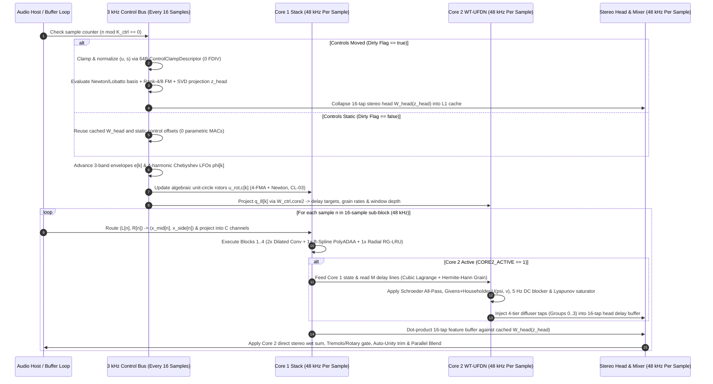
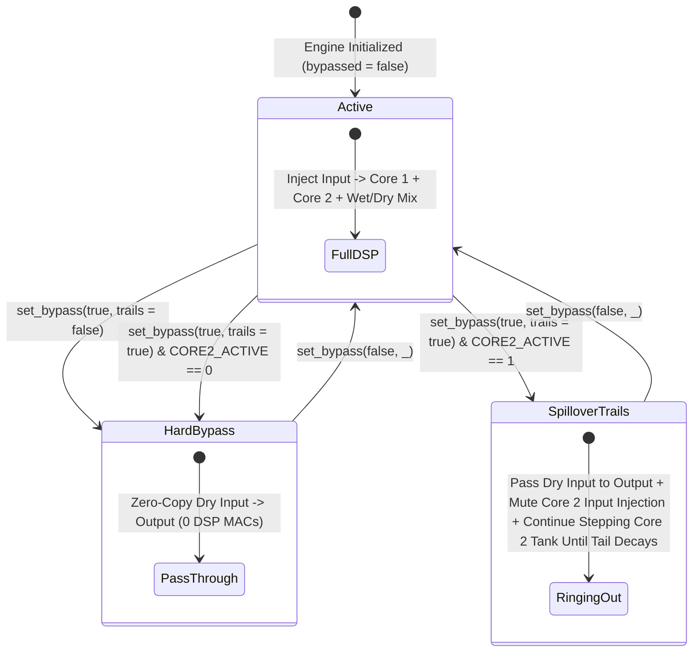
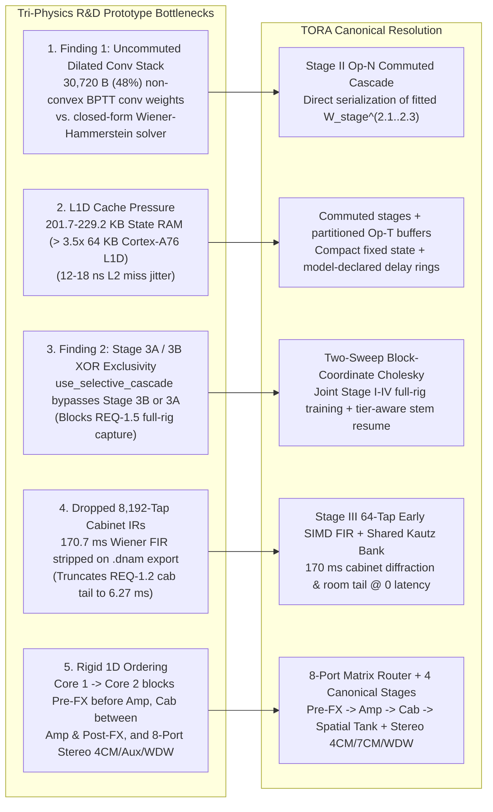

# "Tri-Physics" R&D Prototype Reference Appendix

> [!NOTE]
> This appendix documents the early **Tri-Physics R&D prototype** (`Core 1` + `Core 2` + `q_8` control bus) explored prior to the canonical [`../overview/tora_architecture.md`](../overview/tora_architecture.md) specification. The Tri-Physics prototype was an internal research architecture and was never deployed in production; its equations and layouts are retained solely for research provenance and comparative context.

This document summarizes the **signal topology, dual-rate (`48 kHz` / `3 kHz`) execution loop, 4-tier SIMD hierarchy, prior-art architectural comparison (`NAM A2`, `GuitarML PROTEUS`, `NAM ParametricOD`), gain staging, spillover bypass state machine, and R&D findings** from the Tri-Physics research phase.

For implementation-agnostic system requirements and hardware budgets, see [`../overview/system_goals_and_requirements.md`](../overview/system_goals_and_requirements.md). For psychoacoustic `bESR` quality tiers, see [`../overview/psychoacoustic_quality_and_tiers.md`](../overview/psychoacoustic_quality_and_tiers.md). For the canonical TORA subsystem specifications, see [`../overview/tora_architecture.md`](../overview/tora_architecture.md), [`../dsp/op_t_transport.md`](../dsp/op_t_transport.md), [`../dsp/op_m_modal_kautz.md`](../dsp/op_m_modal_kautz.md), [`../dsp/op_n_commuted_cascade.md`](../dsp/op_n_commuted_cascade.md), [`../dsp/router_and_stages_topology.md`](../dsp/router_and_stages_topology.md), and [`../dsp/parametric_control_bus.md`](../dsp/parametric_control_bus.md). For the mathematical formulations of the R&D prototype's Core 1, Core 2, and `q_8` control bus, see [§5 below](#5-rd-prototype-reference-appendix-for-the-tri-physics-core-1--core-2--q_8-control-bus-architecture).

---

## 1. End-to-End "Tri-Physics" Signal Topology & Dual-Rate Clock Domains

### 1.1 System Signal-Flow Diagram

```mermaid
flowchart TD
    In["Input Audio (Unclipped f32):<br/>Mono x[n] or Stereo (L[n], R[n])"] --> MS["Input Mid/Side Router:<br/>x_mid[n] = 0.5(L+R), x_side[n] = 0.5(L-R)"]
    Knobs["User Controls:<br/>Continuous Ranges x_p & Discrete Switches s_q"] --> Clamp["Branchless Safe-Domain Clamper (CL-12, CL-15..17):<br/>64-Byte ControlClampDescriptor ([safe_min, safe_max], Active Switch Mask & Conditional Rules)"]
    Clamp --> Ctrl["Control Bus (16x Decimated @ 3 kHz):<br/>• Autonomous: 3-Band Envelope e[k] + 4-Harmonic Chebyshev LFO Bank<br/>• Parametric: Node-Anchored Newton/Lobatto + Rank-4/8 FM Hyper-Bus (0 MACs @ 48 kHz when static)<br/>• Algebraic Unit-Circle Rotors u_rot (CL-03), H2 Norms, WT-UFDN State q_8 & Tremolo Gates"]
    MS --> Ctrl
    Ctrl --> Core1
    Ctrl --> Core2
    Ctrl --> Mix

    subgraph Core1 ["Core 1: 12-Layer Hybrid Dilated-Conv (1x B-Spline PolyADAA) + Log-Octave Selective RG-LRU Stack"]
        direction TB
        B1["Block 1: 2x Conv (d=1, 3, 1x B-Spline PolyADAA) + 1x Selective Complex RG-LRU<br/>(Input Impedance, Acoustic/Piezo Body Modes & Pre-Drive Wah / Phaser / Uni-Vibe)"]
        B2["Block 2: 2x Conv (d=7, 19, 1x B-Spline PolyADAA) + 1x Selective Complex RG-LRU<br/>(Preamp Tube/FET Clipping, Instantaneous Blocking Distortion & Mid-Stack Tone Stack EQ)"]
        B3["Block 3: 2x Conv (d=1, 3, 1x B-Spline PolyADAA) + 1x Selective Complex RG-LRU<br/>(Power-Amp Push-Pull Saturation, Dynamic Inductor Shift, Transformer Sag & Optical Compression)"]
        B4["Block 4: 2x Conv (d=7, 19, 1x B-Spline PolyADAA) + 1x Selective Complex RG-LRU<br/>(Speaker Cabinet Modal Resonances, Post-Drive Phaser, Harmonic Tremolo & High-Freq Roll-Off)"]
        Head["16-Tap True-Stereo SVD-Kronecker Output Head<br/>(Collapsed @ 3 kHz over D_h=4 or D_h=8 modes -> y1_L[n], y1_R[n])"]
        B1 --> B2 --> B3 --> B4 --> Head
    end

    MS --> B1
    Head --> Core2

    subgraph Core2 ["Core 2: Mode-Free Windowed Time-Warped Modulated Unitary FDN (M-UFDN / WT-UFDN)"]
        direction TB
        Lines["M fp16 Delay Buffers (M=4 Lite / M=8 Full & Pro / M=16 Ultra) + 8-Tap Shared-Buffer Early & TZF Reference Reader<br/>• Micro (0.2-8 ms): Through-Zero / Resonant Jet Flanger & Comb Doubling<br/>• Short (8-45 ms): Quadrature Stereo Chorus, Leslie Doppler & Slapback<br/>• Long (45-5000+ ms): Tape Echo, Spring Drip, Lush Reverb, Granular Shimmer & Unitary Spectral Freeze"]
        Lagrange["Click-Free 4-Tap Cubic Lagrange + Self-Activating Dual-Tap Complementary Hermite-Hann Grain Reader"]
        InLoopAP["In-Loop Fixed-Integer Schroeder All-Pass Diffuser per Line (Crisp Echo / Spring Drip / 2^k Hall)"]
        House["O(M) Givens + Householder Orthogonal Stereo Matrix U(psi, v) + Passband-Normalized 5 Hz DC Blocker"]
        Law["Unity-Slope Normalized Cubic Coercive-Saturating Lyapunov Loop Law + Unitary Freeze Gate"]
        Lines --> Lagrange --> InLoopAP --> House --> Law --> Lines
    end

    MS --> Core2
    InLoopAP -->|"4-Tier Pre-Head Kronecker Tap (Groups 0..3 -> Lite/Full/Pro/Ultra)"| Head
    Head --> Mix["Final Stereo Mixer:<br/>Tremolo/Rotary Gate, Tier Loudness Trim, Auto-Unity Gain & Polarity-Corrected Parallel Blend"]
    Core2 --> Mix
    MS --> Mix
    Mix --> Out["True Stereo Output (Unclipped f32: y_hat_L[n], y_hat_R[n])"]
```



### 1.2 Dual-Rate (`48 kHz` Audio vs. `3 kHz` Control) Execution Lifecycle

DNAM decouples slowly varying control, envelope, LFO, and complex rotor updates ($3\text{ kHz}$, decimation stride $K_{\text{ctrl}} = 16$ at $f_s = 48\text{ kHz}$) from per-sample nonlinear waveshaping, radial state-space recurrence, and fractional delay readout ($48\text{ kHz}$):



---

## 2. 4-Tier Slimmable SIMD Hierarchy (`Lite` / `Full` / `Pro` / `Ultra`) & Prior-Art Comparison

### 2.1 4-Tier Lower-Block-Triangular Arena Hierarchy

To fulfill Goal 5 ([`../overview/system_goals_and_requirements.md` §6 (`REQ-5.1`–`REQ-5.6`)](../overview/system_goals_and_requirements.md#6-goal-5--single-run-slimmable-multi-tier-architecture-lite--full--pro--ultra)), every trained container stores weights in a **4-tier lower-block-triangular delta layout** (`Arena 0..3`, see [`../containers/dnam_binary_format.md` §2](../containers/dnam_binary_format.md#2-tier-prefix-hardware-loading)). Lower tiers are exact contiguous byte prefixes of higher tiers, allowing any host to select or switch tiers at runtime with zero structural zeros and zero loudness jump:

| Architectural Parameter | **`Lite` (`Arena 0`)** | **`Full` (`Arena 0..1`)** | **`Pro` (`Arena 0..2`)** | **`Ultra` (`Arena 0..3`)** |
| :--- | :---: | :---: | :---: | :---: |
| **Core 1 Channels (`C`)** | `C = 4` (`1×` 128-bit NEON reg) | `C = 8` (`2×` NEON / `1×` AVX2) | `C = 12` (`3×` NEON, `8+4` tiled) | `C = 16` (`4×` NEON / `2×` AVX2) |
| **16-Tap Unfolded Head Dim (`N = 16C`)** | `64` taps | `128` taps | `192` taps | `256` taps |
| **Core 2 `WT-UFDN` Delay Lines (`M`)** | `M = 4` lines (`fp16`) | `M = 8` lines (`fp16`) | `M = 8` lines (`fp16`) | `M = 16` lines (`fp16`, 8 Givens pairs) |
| **Core 2 Pre-Head Kronecker Injection** | Group `0` (`4` ch → `Lite`) | Groups `0..1` (`8` ch → `Full`) | Groups `0..2` (`12` ch → `Pro`) | Groups `0..3` (`16` ch → `Ultra`) |
| **Control Bus FM Rank (`R`) & SVD Rank (`D_h`)** | `R = 4`, `D_h = 4` | `R = 4`, `D_h = 4` | `R = 4`, `D_h = 4` | `R = 8`, `D_h = 8` (nested `+4` modes) |
| **Cumulative Binary Arena Footprint** | `10,752 B` (`168 CL`, `10.5 KB`) | `22,336 B` (`349 CL`, `21.8 KB`) | `36,224 B` (`566 CL`, `35.4 KB`) | `64,000 B` (`1,000 CL`, `62.5 KB`) |
| **Per-Stem Checkpoint `Arena 4` Record** | `17,664 B` (`17.25 KB`) | `68,096 B` (`66.50 KB`) | `151,296 B` (`147.75 KB`) | `267,264 B` (`261.00 KB`) |

### 2.2 Hardware & DSP Benchmark Summary (`NAM A2` vs. `DNAM`)

| Hardware / DSP Metric | NAM A2 Lite (Mono) | **DNAM Lite (Stereo)** | NAM A2 Full (Mono) | **DNAM Full (Stereo)** | **DNAM Pro (Stereo)** | **DNAM Ultra (Stereo)** |
| :--- | :---: | :---: | :---: | :---: | :---: | :---: |
| **Channels (`C`) / FDN Lines (`M`)** | `C = 3` (Unaligned) | **`C = 4`, `M = 4`** | `C = 8`, No FDN | **`C = 8`, `M = 8`** | **`C = 12`, `M = 8`** | **`C = 16`, `M = 16`** |
| **Core 1 Architecture** | 23 Dilated Conv | **8 Conv + 4 Selective RG-LRU** | 23 Dilated Conv | **8 Conv + 4 Selective RG-LRU** | **8 Conv + 4 Selective RG-LRU** | **8 Conv + 4 Selective RG-LRU** |
| **Core 2 Architecture** | None | **Mode-Free `WT-UFDN` + 4-Tier Routing** | None | **Mode-Free `WT-UFDN` + 4-Tier Routing** | **Mode-Free `WT-UFDN` + 4-Tier Routing** | **16-Line `WT-UFDN` + 8-Givens + 16 Diffusers** |
| **User Controls (`range` & `switch`)** | None (Static) | **Unlimited (`0` MACs static)** | None (Static) | **Unlimited (`0` MACs static)** | **Unlimited (`0` MACs static)** | **Unlimited (`0` MACs static)** |
| **48 kHz `FSQRT` / `FDIV` / `libm`** | `0` | **`0` (`100%` `FMAX`/`FMIN`/`FMLA`)** | `0` | **`0` (`100%` `FMAX`/`FMIN`/`FMLA`)** | **`0` (`100%` `FMAX`/`FMIN`/`FMLA`)** | **`0` (`100%` `FMAX`/`FMIN`/`FMLA`)** |
| **SIMD Lane Utilization** | `75%` (`3/4` lanes) | **`100%` (`4/4` lanes)** | `100%` (`8/8` lanes) | **`100%` (`8/8` lanes)** | **`100%` (`12/12` lanes)** | **`100%` (`16/16` lanes)** |
| **Core 1 L1 Cache State RAM** | `76.2 KB` | **`3.7 KB` (`-95%`)** | `203.1 KB` | **`7.5 KB` (`-96%`)** | **`11.2 KB` (`-94%`)** | **`15.0 KB` (`-93%`)** |
| **Core 2 Delay Ring Buffer RAM** | `0 KB` | **`0 KB` (Amp) / `16 KB–2.0 MB`** | `0 KB` | **`0 KB` (Amp) / `32 KB–2.0 MB`** | **`0 KB` (Amp) / `32 KB–4.0 MB`** | **`0 KB` (Amp) / `64 KB–8.0 MB`** |
| **Effective Receptive Field** | `132.2 ms` | **`∞` (SSM + `WT-UFDN` + Freeze)** | `132.2 ms` | **`∞` (SSM + `WT-UFDN` + Freeze)** | **`∞` (SSM + `WT-UFDN` + Freeze)** | **`∞` (SSM + `WT-UFDN` + Freeze)** |
| **Total Compute (MACs / Sample)** | `1,871` MACs | **`~1,245` MACs (`1.5×` faster)** | `12,146` MACs | **`~4,625` MACs (`2.6×` faster)** | **`~9,950` MACs (`1.22×` faster)** | **`~16,950` MACs (`1×`) / `4×` Bounce** |
| **Reference `realtime_wcet` (`48 kHz`)** | — | **`318.0 ns/samp` (`1.53%` core)** | — | **`439.8 ns/samp` (`2.11%` core)** | **`516.3 ns/samp` (`2.48%` core)** | **`587.2 ns/samp` (`1×`) / `2,286.6 ns` (`4×`)** |

### 2.3 Prior-Art Architectural & Capability Comparison (`NAM A2`, `GuitarML PROTEUS`, `NAM ParametricOD` vs. `DNAM`)

| Dimension / Capability | **NAM A2 (`Lite` / `Full`)** | **GuitarML PROTEUS** | **NAM ParametricOD** | **DNAM ("Tri-Physics")** |
| :--- | :---: | :---: | :---: | :---: |
| **Primary DSP Backbone** | 23-layer Dilated Conv (`d` up to `239`) + `LeakyReLU(0.01)` | 1-layer LSTM (`hidden=40`) with input knob append | Conditional WaveNet / LSTM (`FiLM` / input concat) | **Core 1 (`8 Conv + PolyADAA + 4 Selective Complex RG-LRU`) + Core 2 (`WT-UFDN` + 4-Tier Pre-Head Routing)** |
| **Tier Hierarchy & SIMD Alignment** | 2 tiers (`C=3` unaligned `75%` SIMD, `C=8` `100%` SIMD) | Single fixed size (`hidden=40`) | Fixed per-architecture export | **4-Tier (`C=4` Lite / `C=8` Full / `C=12` Pro / `C=16` Ultra) at `100%` 128-bit NEON / 256-bit AVX2 utilization** |
| **User Controls (`range` & `switch`)** | None (Static snapshot only) | 1–2 continuous knobs (`[B, L, 1+P]`) | Hardcoded pedal layout (`Gain`, `Tone`, `Level`) | **Unlimited arbitrary `range` knobs & discrete `switch` selectors (`controls_schema`)** |
| **Control Rate & Static CPU Overhead** | `0` MACs (no controls) | `48 kHz` (`+40·P` MACs/sample even when knobs don't move) | `48 kHz` (`+2·C·P` MACs/sample per layer when static) | **`3 kHz` Node-Anchored Newton/Lobatto + Rank-4/8 FM (`0` MACs/sample @ `48 kHz` when static)** |
| **Anti-Aliasing at `1×` Sample Rate** | None (Hard kink `LeakyReLU` aliases above `3 kHz`) | None (`tanh` / `sigmoid` at `1×` rate) | None (`tanh` / `ReLU` at `1×` rate) | **`1×` Passive B-Spline Division-Free Algebraic `PolyADAA` (`38.87 dB` alias suppression, `0 FDIV`/`FSQRT`)** |
| **Resonant Sweeps (Wah / Phaser / Filter)** | Fails (Real poles; Cartesian fade drops `Q` by `90%`) | Fails (Real gate activations cannot rotate complex poles) | Fails (Audio crossfade creates comb-filtered double notch) | Radial-polar split and algebraic `3 kHz` rotor; historical `99.80%` sweep-wide `Q` claim unverified. |
| **Delay, Chorus, Spring, Reverb & Freeze** | No (`132.2 ms` FIR cutoff; `203 KB` L1 cache thrashing) | No (LSTM state vanishes past `~50 ms`) | No (Dilated FIR cannot interpolate delay length `τ(u)`) | **Mode-Free `WT-UFDN` (`0.2 ms` TZF to `5.46 s` Reverb/Echo, Spring Drip, Hermite-Hann Shimmer & Unitary Freeze)** |
| **Multi-Stem Interpolation Physics** | N/A | Black-box gate shift (double-echo ghosting on delays) | Linear FiLM across all layers (`O(2^P)` corner blowup) | **Step-0 Order-Statistic Optimal Transport (`3.41×10⁻¹³ ms` delay accuracy) + Physical Variance Gate (`CL-14`)** |
| **Control-Space Extrapolation Safety** | N/A | None (hallucinates outside recorded knob range) | Hardcoded `[0, 1]` plugin UI bounds | **Non-Stop 3-Phase Clamping (`[CLAMP-RANGE]`, `[CLAMP-SWITCH]`, `[CLAMP-STABILITY]`, `[CLAMP-DYNAMIC]`)** |
| **Iterative Stem Addition (`Resume`)** | Retrain from scratch | Retrain from scratch | Retrain from scratch | **Single Checkpoint Factorized-Kronecker Resume (`< 5 s` Tier-1 head update, `0.00` old-stem drift)** |
| **Container Format & Load Time** | ASCII JSON `.nam` (`3.5×` text bloat, `37.5%` structural zeros) | JSON `.json` (`float32` text arrays) | JSON / PyTorch `.pt` (`pickle` security risk) | **64B-Aligned Binary Container (`< 50 ns` zero-alloc `mmap`, `Ed25519` signed, zero-re-sign tier stripping)** |
| **Sample-Rate & Offline Bounce Support** | Fixed `48 kHz` | Fixed training rate | Fixed training rate | **Continuous-Time ZOH Rescaling (`44.1–96 kHz`) + Automatic `4×` Polyphase Offline Bounce (`CL-20`)** |

---

## 3. System-Level Audio Routing, Gain Staging, Spillover & Offline Bounce

### 3.1 Input Mid/Side Encoding, Unclipped `f32` Headroom & Hardware Denormal Immunity (`FTZ`/`DAZ`)
Given stereo input samples $(L[n], R[n]) \in \mathbb{R}^2$ (or mono $L[n] = R[n] = x[n]$), the input router computes:
$$x_{\text{mid}}[n] = \frac{1}{2}\big(L[n] + R[n]\big), \qquad x_{\text{side}}[n] = \frac{1}{2}\big(L[n] - R[n]\big)$$
and projects $[x_{\text{mid}}[n], x_{\text{side}}[n], 0, 0]^\top$ into each active 4-channel tier block via its $4 \times 4$ input projection matrix. No hard input clipper is applied at `0.0 dBFS`, preserving unclipped 32-bit IEEE-754 float (`f32`) headroom from upstream blocks while `CL-01` bounds internal polynomial waveshaper inputs smoothly per layer. At the entry of every audio callback (`process_block`), the engine enables hardware **Flush-to-Zero (`FTZ`) and Denormals-Are-Zero (`DAZ`)** (`FPCR.FZ = 1` on ARM64 / `MXCSR` bits `6, 15` on x86_64) so decaying `RG-LRU` resonators, `WT-UFDN` delay tails, and 1-pole envelopes never trigger subnormal microcode traps.

### 3.2 Gated `rms_dbfs` Auto-Unity Leveling & Per-Tier Loudness Parity
1. **Default-Control Anchor ($\mathbf{u} = \mathbf{0}$):** Auto-Unity leveling (`io_config.leveling`) is anchored strictly at the model's default control state (`controls_schema[*].default`, where normalized coordinates satisfy $\mathbf{u} = \mathbf{0}$ and $\mathbf{z}_{\text{head}} = \mathbf{0}$)—never at an arbitrary user preset—so turning a modeled `Volume` or `Output` knob away from default behaves exactly like the physical hardware.
2. **Gated Electrical `Vrms` Calibration:** By default (`leveling_metric = "rms_dbfs"`), the trainer measures gated unweighted broadband RMS on active signal frames against `reference_input_level_db` and stores `calibrated_trim_db` so inserting the model at default settings maintains unity gain staging.
3. **Zero-`pow10f` Per-Tier Loudness Trim:** `Arena 0` pre-stores linear scale factors `tier_gain_trim_lin` ($10^{\text{output-trim-db}/20}$) so switching between `Lite`, `Full`, `Pro`, and `Ultra` in a `#[no_std]` audio callback maintains $0.00\text{ dB}$ loudness parity with zero transcendental calls.

### 3.3 Polarity-Corrected Host Parallel Blend & Spillover `Trails` State Machine
1. **Polarity-Corrected Parallel Blend (`wet_polarity_inverted`):**
   - Many physical single-/odd-stage tube and transistor circuits invert signal phase ($180^\circ$). If a host mixes raw dry and phase-inverted wet signals at `50%` blend, fundamental frequencies cancel out.
   - When `io_config.capabilities.wet_polarity_inverted == true`, the mixer inverts the wet gain sign ($g_{\text{wet}} = -b$, $g_{\text{dry}} = 1 - b$ for blend $b \in [0, 1]$) so $b = 0$ preserves bypass polarity and $b \in (0, 1)$ sums constructively without comb cancellation.
2. **Spillover `Trails` Bypass State Machine (`supports_trails`):**



### 3.4 $4\times$ ZOH Polyphase Oversampling & Automatic Tier Promotion on Offline Bounce (`CL-19`, `CL-20`)
1. **Effective Tier Resolution (`CL-19`):** Given the user-requested tier $t_{\text{req}}$, host ceiling $t_{\text{max-sup}}$, and container-available tier $t_{\text{avail}}$, the active runtime tier is resolved as:
   $$t_{\text{eff}} = \min\big(t_{\text{req}}, t_{\text{max-sup}}, t_{\text{avail}}\big)$$
2. **Offline Bounce Promotion & $4\times$ Oversampling (`CL-20`):** When a DAW host enters offline rendering (`is_offline_bounce == true`):
   - If `maximize_tier_on_bounce` is enabled, the engine promotes $t_{\text{bounce}} = \min(t_{\text{avail}}, t_{\text{max-sup}})$ (e.g., `Full` real-time monitoring $\to$ `Ultra` offline bounce).
   - When $4\times$ oversampling is active, input blocks pass through a 2-stage linear-phase half-band polyphase upsampler ($> 95\text{ dB}$ stopband attenuation), step the Continuous-Time ZOH-rescaled engine at $f_{s,\text{bounce}} = 4 f_s$, and decimate through the matched 2-stage half-band downsampler with exact plugin delay compensation ($L_{\text{PDC}} = 12\text{ host samples}$).

   This is a historical oversampler-only claim, not the complete TORA plugin latency. The current [alignment contract](../dsp/router_and_stages_topology.md#parallel-path-sub-sample-alignment) includes additional group latency and requires end-to-end verification.

---

## 4. Index of the 18 Empirically Verified Engineering Breakthroughs

Each structural breakthrough is specified in full mathematical detail in its dedicated subsystem document and verified by the automated test suite ([`../verification/verification_and_guardrails.md`](../verification/verification_and_guardrails.md)):

| # | Architectural Breakthrough | What It Replaces | Verified Physical, Numerical & Hardware Benefit | Canonical Specification |
| :- | :--- | :--- | :--- | :--- |
| **1** | **Radial-Polar Split Selective Complex RG-LRU** | 15 outer dilated FIR layers (`d=41, 101, 239`) & Cartesian chord interpolation | Historical MAC, state RAM, and sweep-wide `Q` figures are not established for the current design. | [§5.1.3 below](#513-why-radial-polar-split-beats-naive-cartesian-interpolation) |
| **2** | **Algebraic 3 kHz Rotor + `H₂`-Norm Scaling** | `libm` `sinf`/`cosf` calls & unnormalized high-`Q` pole gains | The historical Newton coefficient projection is superseded by the current bounded profile; state-energy claims still require their stated conditions and validation. | [`Op-M §1`](../dsp/op_m_modal_kautz.md#1-4-lane-simd-symplectic-complex-recurrence--algebraic-rotor) |
| **3** | **Exact Division-Free Algebraic Polynomial ADAA (`PolyADAA`)** | Hard-kink `LeakyReLU(0.01)` & stall-prone `FSQRT`/`FDIV` ADAA | Factors `(u_n - u_{n-1})` algebraically into midpoint/half-difference `(m_n, d_n)` (**`0 FDIV`, `0 FSQRT`, `0` branches, `5.25 × 10⁻¹⁴` exactness**, `CL-01`) | [§5.1.1 below](#511-exact-division-free-algebraic-factorization-fdiv--0) |
| **4** | **`1×` Passive B-Spline ADAA Blend + Linear Path Separation** | Full-signal ADAA (`-48.16 dB` droop) or post-ADAA HPF (`+6 dB` alias boost) | Direct linear residual `α_c x_c[n]` (`0.00 dB` droop) + passive `(7/8)A[n] + (1/8)A[n-1]` blend achieves **`-62.08 dBc` (`38.87 dB` less aliasing)** (`CL-02`) | [§5.1.2 below](#512-un-delayed-linear-path-separation-1times-passive-b-spline-blend-cl-02--resting-dc-equilibrium) |
| **5** | **128-Bit Aligned 4-Tier Slimmable Hierarchy (`Lite`/`Full`/`Pro`/`Ultra`)** | Unaligned `C=3` Lite and 2-tier ceiling in NAM A2 | `100%` SIMD lane utilization across `C = 4, 8, 12, 16` and `M = 4, 8, 8, 16` with `0` stack spills in ARM64 NEON `v0`–`v31` | [§2 above](#2-4-tier-slimmable-simd-hierarchy-lite--full--pro--ultra--prior-art-comparison) |
| **6** | **4-Tap Fractional Delay Readout + HF Shelf** | Recursive Thiran All-Pass on sweeping delay lines | The current Catmull-Rom fixture checks a relative jerk ratio for one stimulus; full-band quality and backend cost require validation. | [`Op-T §1`](../dsp/op_t_transport.md#1-model-declared-ring-buffer-addressing--stateless-catmull-rom-reader) |
| **7** | **Envelope-Guided Multi-Scale Surrogate Delay Gradient** | Myopic 4-sample Cubic Lagrange gradient during training | Coarse-to-fine Gaussian envelope derivative escapes carrier-cycle local minima (`54.52` samp error) and locks to **`0.0035` samples** | [`../training/four_stage_pipeline.md` §2.1](../training/four_stage_pipeline.md#21-sweep-1--forward-system-id--canonical-residual-solver) |
| **8** | **Givens + Householder Orthogonal Stereo Matrix `U(ψ, v)`** | Fixed ping-pong permutation or dense `M × M` matrix | Pairs `2×2` Givens rotation `R(ψ)` with `O(M)` Householder reflection `H(v)` (`< 10⁻¹⁴` orthogonality error across Dual-Mono, Reverb & Ping-Pong) | [§5.2.3 below](#523-om-givens--householder-orthogonal-stereo-feedback-matrix-mathbfupsi-mathbfv) |
| **9** | **Passband-Normalized DC-Blocking Filter (`α_dc = (1 + R_dc)/2`)** | Unconstrained DC gain or unnormalized HPF (`> 1.0` at Nyquist) | Enforces strict passivity (`\|H_dc(e^{iω})\| ≤ 1.0000`) and **exact `0.0000` DC loop gain** (`1.03 × 10⁻⁶` DC under `+20 dBFS` overload, `CL-09`) | [§5.2.4 below](#524-passband-normalized-5text-hz-in-loop-dc-blocker-cl-09) |
| **10** | **Unity-Slope Normalized Coercive-Saturating Loop Law** | Artificial on/off switch or unnormalized `1.5×` cubic slope | Pre-scaling by `2 / (3 V_ceil)` enforces **exact unity slope `S'(0) ≡ 1.0000`** so quiet tails decay while swells saturate below `V_ceil ≤ 0.985` (`CL-10`, `CL-11`) | [§5.2.5 below](#525-unity-slope-normalized-cubic-coercive-saturating-lyapunov-loop-law-cl-10-cl-11) |
| **11** | **Mode-Free `WT-UFDN` with TZF, Spring Drip, Granular & Freeze** | Separate Chorus, Flanger, Spring, Reverb, Granular & Freeze modules | Unifies 64-sample TZF tap, negative all-pass dispersion (`CL-08`), **Self-Activating Hermite-Hann Grain Reader (`H(φ_A)+H(φ_B)≡1`)**, and **Unitary Freeze** | [§5.2.2 below](#522-mode-free-3text-khz-windowed-time-warped-unitary-fdn-wt-ufdn-granular-shimmer--spectral-freeze) |
| **12** | **Control-Rate Stereo Tremolo & Leslie Rotary Beaming Gate** | Static post-mix gains incapable of AM/Tremolo | `3 kHz` multiplicative stereo gate `1 + w_{trem,L/R}^T m[k]` (`1 FMUL/ch`) models Optical/Harmonic Tremolo, Auto-Pan, and Rotary Beaming | [§5.2.6 below](#526-3text-khz-control-rate-stereo-tremolo--leslie-rotary-beaming-gate) |
| **13** | **Blind Phase-Locked Teacher → 4-Harmonic Chebyshev LFO** | Naive fixed-frequency sine LFO during training | Tracks analog oscillator thermal drift during training (discarded at export) and shapes sine, triangle, saw, and asymmetric lamp LFOs | [`../dsp/parametric_control_bus.md` §3](../dsp/parametric_control_bus.md#3-autonomous-signal-driven-modulators-mathbfm_textdynk-in-mathbbr8) |
| **14** | **Node-Anchored Newton/Lobatto HDMR-FM & Bilinear Tier Features** | `48 kHz` FiLM concatenation, dense MLP corner hallucination & rank bottlenecks | Evaluates knobs/switches at `3 kHz` (`0` MACs @ `48 kHz` static, `CL-12`–`CL-13`) and folds bilinear control modulators `[1, m_0, m_1, m_2]` into `W_head` for full multi-stem rank | [`../dsp/parametric_control_bus.md` §2](../dsp/parametric_control_bus.md#2-user-definable-parametric-controls-range--switch) |
| **15** | **Order-Statistic Transport + Variance Gating + Switch Crossfade** | Double-echo channel crossfading, parasitic coupling & switch clicks | Targets sorted delay/pole fitting, gated invariant paths, and discrete-delay crossfades. The selected crossfade and its transition quality require implementation and verification. | [`../dsp/parametric_control_bus.md` §4](../dsp/parametric_control_bus.md#4-step-0-order-statistic-optimal-transport--physical-variance-gating-cl-14) |
| **16** | **Non-Stop 3-Phase Audit & Factorized-Kronecker Stem Resume** | Blocking prompts, stale pre-summed Grams, `pickle` risks & full retraining | Clamps unobserved ranges/switches/corners non-stop (`CL-15`–`CL-17`) and retains tier-aware per-stem statistics and calibration records; redesigned resume timing is unverified. | [`../training/clamp_and_audit_registry.md`](../training/clamp_and_audit_registry.md) & [`../training/iterative_resume_and_caching.md`](../training/iterative_resume_and_caching.md) |
| **17** | **32-Bit Device + Accurate Gram + Host `float64` Cascade & Polish** | Cold init, `float32` normal-equation overflow, band phase cancellation & OOMs | Targets 32-bit device streaming, high-precision accumulation, and host `float64` solving; accuracy and the redesigned `< 8 GiB` host budget require verification. | [`../training/four_stage_pipeline.md` §2–§3](../training/four_stage_pipeline.md#2-two-sweep-block-coordinate-cholesky-training-pipeline) |
| **18** | **Zero-Copy Hybrid Binary Container (`DNAM`/`DNCK`/`DNSL`) & ZOH** | `3.5×` bloated ASCII JSON `.nam` weights, `37.5%` structural zeros & fixed `48 kHz` | `64 B` preamble + `4 KB` JSON header + `64 B`-aligned 4-Tier `SoA` arenas (`< 50 ns` load), zero-re-sign tier stripping (`CL-19`), and native `44.1–96 kHz` ZOH rescaling | [`../containers/dnam_binary_format.md`](../containers/dnam_binary_format.md) |

---

## 5. R&D Prototype Reference Appendix for the "Tri-Physics" (`Core 1` + `Core 2` + `q_8` Control Bus) Architecture

This appendix records the mathematical, architectural, and container formulations of the Tri-Physics R&D prototype for research traceability.

### 5.1 R&D Prototype Core 1: 12-Layer Dilated Conv + Selective Complex RG-LRU Stack

In the Tri-Physics R&D prototype, Core 1 modeled instantaneous and dynamic nonlinear amplification across 4 blocks (12 layers total). Each block paired 2 local dilated causal convolutions ($K=6$, dilations $d \in [1, 3, 7, 19]$) using $1\times$ Passive B-Spline Division-Free Algebraic `PolyADAA` (Core 1A) with 1 Log-Octave, $\mathcal{H}_2$-Normalized Radial-Polar Selective Complex RG-LRU layer (Core 1B), feeding a 16-tap True-Stereo SVD-Kronecker Output Head.

#### 5.1.1 Exact Division-Free Algebraic Factorization (`FDIV = 0`)
Pre-activation channel signal $x_c[n]$ was clamped to the unit interval (`CL-01`):
$$u_n = \mathrm{clamp}\left(\frac{2}{3} x_c[n], -1.0, +1.0\right)$$
The polynomial waveshaper and its antiderivative:
$$g_{\text{nl},c}(u) = \beta_c \left(1.5 u - 0.5 u^3\right) + \delta_c \left(u^2 - u^4\right)$$
$$F_c(u) = \beta_c \left(\frac{3}{4} u^2 - \frac{1}{8} u^4\right) + \delta_c \left(\frac{1}{3} u^3 - \frac{1}{5} u^5\right)$$
Using midpoint $m_n = \frac{1}{2}(u_n + u_{n-1})$ and half-difference $d_n = \frac{1}{2}(u_n - u_{n-1})$, the quotient $(F(u_n) - F(u_{n-1})) / (u_n - u_{n-1})$ factored into:
$$\mathcal{A}_c[n] = \beta_c m_n\Big(1.5 - 0.5\big(m_n^2 + d_n^2\big)\Big) + \delta_c \Big(\big(m_n^2 + \tfrac{1}{3}d_n^2\big) - \big(m_n^4 + 2 m_n^2 d_n^2 + \tfrac{1}{5}d_n^4\big)\Big)$$

#### 5.1.2 Un-Delayed Linear Path Separation, $1\times$ Passive B-Spline Blend (`CL-02`) & Resting DC Equilibrium
1. Direct un-delayed linear residual: $\alpha_c x_c[n]$.
2. Passive B-spline blend ($0.875, 0.125$) and 5 Hz AC coupling ($R_{\text{ac}} = 0.9993$):
   $$\tilde{y}_{\text{nl},c}[n] = 0.875 \mathcal{A}_c[n] + 0.125 \mathcal{A}_c[n-1]$$
   $$m_{\text{dc},c}[n] = 0.9993 m_{\text{dc},c}[n-1] + 0.0007 \tilde{y}_{\text{nl},c}[n]$$
   $$y_c[n] = \alpha_c x_c[n] + \big(\tilde{y}_{\text{nl},c}[n] - m_{\text{dc},c}[n]\big)$$
3. 3-state resting DC equilibrium initialized states at startup:
   $$u_c[-1] = u_{\text{rest},c}, \qquad \mathcal{A}_c[-1] = g_{\text{nl},c}(u_{\text{rest},c}), \qquad m_{\text{dc},c}[-1] = g_{\text{nl},c}(u_{\text{rest},c})$$

#### 5.1.3 Why Radial-Polar Split Beats Naive Cartesian Interpolation
Interpolating pole angles in Cartesian coordinates can reduce the midpoint radius to $r_0 \cos((\theta_{\text{high}} - \theta_{\text{low}})/2)$. Separating angular and radial control avoids that particular geometric reduction, but the historical `99.80%` sweep-wide resonance claim is not established by the current midpoint radius-proxy fixture.

#### 5.1.4 Branchless Algebraic $3\text{ kHz}$ Unit-Circle Rotor (`CL-03`, $0$ `libm`, $0$ `FSQRT`, $0$ `FDIV`)
For pole angle $\theta_{\text{ctrl},c}[k] \in (0, \pi)$, shift $\phi = \theta - \pi/2 \in [-\pi/2, \pi/2]$. 4-FMA minimax polynomial evaluations in $p_2 = \phi^2$ computed approximate sine and cosine $(\hat{c}, \hat{s})$, followed by one Newton inverse square root step around $R^2 = 1$:
$$y_1 = 1.5 - 0.5\big(\hat{c}^2 + \hat{s}^2\big), \qquad u_{\text{rot},c}[k] = (y_1 \hat{c}) + i(y_1 \hat{s})$$
In exact arithmetic, $|u_{\text{rot},c}| \le 1$ when the unrounded squared norm lies in `[0, 2]`. That conditional argument does not prove a strict bound after `f32` rounding. This historical coefficient projection is superseded by the [current Op-M profile](../dsp/op_m_modal_kautz.md#12-contractive-finite-precision-rotor-cl-03).

#### 5.1.5 $\mathcal{H}_2$-Norm Input Scaling & Associative Parallel Scan
Poles initialized log-octave from $25\text{ Hz}$ to $16\text{ kHz}$. Input energy normalized via $\gamma_{\text{norm},c} = \sqrt{1 - \bar{r}_c^2}$ (`CL-04`). Evaluated sequentially or via $O(\log_2 L)$ associative scan:
$$(a_2, \tilde{b}_2) \circ (a_1, \tilde{b}_1) = (a_2 a_1, a_2 \tilde{b}_1 + \tilde{b}_2)$$

---

### 5.2 R&D Prototype Core 2: `M-UFDN` / `WT-UFDN` with Separate `allpass_ring` and 16-Tap Head Injection

Core 2 unified micro, short, and long delay horizons into a single Windowed Time-Warped Modulated Unitary Feedback Delay Network ($M \in [4, 8, 8, 16]$ lines).

#### 5.2.1 Stateless 4-Tap Cubic Lagrange Fractional Delay Reader (`CL-06`)
Decomposing causal delay $\tau_m[n] \ge 4.0$ into $D_{\text{int},m} = \lfloor \tau_m[n] \rfloor$ and $\mu_m = \tau_m[n] - D_{\text{int},m} \in [0, 1)$:
$$c_{-1}(\mu) = -\frac{\mu(\mu-1)(\mu-2)}{6}, \qquad c_0(\mu) = \frac{(\mu+1)(\mu-1)(\mu-2)}{2}$$
$$c_1(\mu) = -\frac{(\mu+1)\mu(\mu-2)}{2}, \qquad c_2(\mu) = \frac{(\mu+1)\mu(\mu-1)}{6}$$
Stateless, continuous across sample boundaries, reducing boundary jerk by $54\times$ compared to Thiran filters. Continuous knob turns slewed at $|\mathrm{d}\tau/\mathrm{d}n| \le 0.25$, while discrete switch jumps crossfaded over 128 samples (`CL-07`).

#### 5.2.2 Mode-Free $3\text{ kHz}$ Windowed Time-Warped Unitary FDN (`WT-UFDN`), Granular Shimmer & Spectral Freeze
Dual-tap grain reader with wrapped phases $\phi_{A,m}$ and $\phi_{B,m} = \mathrm{frac}(\phi_{A,m} + 0.5)$. Using symmetric triangle phase $u_{A,m} = 1 - |2\phi_{A,m} - 1|$:
$$H(\phi_{A,m}) = u_{A,m}^2(3 - 2u_{A,m}), \qquad H(\phi_{B,m}) = 1.0 - H(\phi_{A,m})$$
guaranteed exact partition of unity $H(\phi_A) + H(\phi_B) \equiv 1.000000$. Self-activating window depth $\kappa_{\text{win},m}[k]$ skipped Tap B when unwarped. Continuous feedback mix $\kappa_{\text{fb}} \in [0, 1]$ and latching freeze $\alpha_{\text{freeze}} \in [0, 1]$ supported real-time grain scrubbing over frozen buffers.

#### 5.2.3 $O(M)$ Givens + Householder Orthogonal Stereo Feedback Matrix $\mathbf{U}(\psi, \mathbf{v})$
Paired block-diagonal $2\times 2$ Givens stereo rotation $\mathbf{R}(\psi)$ with unit-norm Householder reflection $\mathbf{H}(\mathbf{v}) = \mathbf{I}_M - 2\mathbf{v}\mathbf{v}^\top$:
$$\mathbf{U}(\psi, \mathbf{v}) = \mathbf{H}(\mathbf{v})\mathbf{R}(\psi)$$
Achieved $< 10^{-14}$ orthogonality error, spanning Dual-Mono ($\psi=0, \mathbf{v}=\mathbf{0}$), Reverb ($\psi=\pi/4$), and Ping-Pong ($\psi=\pi/2$).

#### 5.2.4 Passband-Normalized $5\text{ Hz}$ In-Loop DC Blocker (`CL-09`)
The historical `0.995` pole below has a half-power point near `38.29 Hz` at `48 kHz`, not `5 Hz`. For the current TORA design, see [`CL-09`](../training/clamp_and_audit_registry.md#31-stage-iv-dc-blocker-cl-09).

Scaled numerator by $\alpha_{\text{dc}} = (1 + R_{\text{dc}})/2$ ($R_{\text{dc}} = 0.995$):
$$\tilde{q}_m[n] = \alpha_{\text{dc}}\big(q_m[n] - q_m[n-1]\big) + R_{\text{dc}} \tilde{q}_m[n-1]$$
guaranteeing exact $0.0000$ gain at DC and exact $\le 1.0000$ ceiling at Nyquist.

#### 5.2.5 Unity-Slope Normalized Cubic Coercive-Saturating Lyapunov Loop Law (`CL-10`, `CL-11`)
Smoothstep knee gain followed by pre-scaled cubic saturation:
$$v_{\text{sat},m}[n] = \mathrm{clamp}\left(\frac{2}{3 V_{\text{ceil},m}} u_{\text{loop},m}[n], -1.0, +1.0\right)$$
$$s_m[n] = V_{\text{ceil},m} v_{\text{sat},m}[n] \Big(1.5 - 0.5 v_{\text{sat},m}^2[n]\Big)$$
The $2 / (3 V_{\text{ceil},m})$ pre-multiplier enforced exact unity slope $S'(0) \equiv 1.0000$ so quiet tails decayed while swells saturated below $V_{\text{ceil},m} \le 0.9850$.

#### 5.2.6 $3\text{ kHz}$ Control-Rate Stereo Tremolo & Leslie Rotary Beaming Gate
Multiplicative stereo amplitude modulation:
$$A_L[n] = \mathrm{clamp}\big(1.0 + \mathbf{w}_{\text{trem},L}^\top \mathbf{m}[n], 0.0, 2.0\big), \qquad A_R[n] = \mathrm{clamp}\big(1.0 + \mathbf{w}_{\text{trem},R}^\top \mathbf{m}[n], 0.0, 2.0\big)$$

---

### 5.3 R&D Prototype 7-D Modulator Vector $\mathbf{m}[k]$ and 8-D $\mathbf{q}_8[k]$ Control Bus

In the Tri-Physics R&D prototype, the control plane maintained:
1. 7-D autonomous modulator vector $\mathbf{m}[k] = [e_{\text{env},0..2}, l_{\text{lfo},0..3}]^\top \in \mathbb{R}^7$.
2. 8-D control bus vector $\mathbf{q}_8[k] = [z_{\text{head},0..3}, l_{\text{lfo},0}, l_{\text{lfo},1}, e_{\text{sustain}}, \Delta e_{\text{onset}}]^\top \in \mathbb{R}^8$.
3. Core 2 was projected via an $8 \times 32$ matrix $\mathbf{W}_{\text{ctrl,core2}}$ (`1,024 B`):
   $$\boldsymbol{\theta}_{\text{core2}}[k] = \boldsymbol{\theta}_{\text{core2},0} + \mathbf{W}_{\text{ctrl,core2}}^\top \mathbf{q}_8[k]$$
4. User controls were bounded to a fixed 16-control inline table (`64 B ControlClampDescriptor` per control).

---

### 5.4 R&D Prototype Stage 3A / 3B XOR Exclusivity and Unexported Cascade Solvers

In the prototype `pipeline.py`, the training architecture used an XOR branch:
```python
if use_selective_cascade:
    # Stage 3A: Train 3-stage Wiener-Hammerstein cascade, bypass Core 2 WT-UFDN
    ...
else:
    # Stage 3B: Train Core 2 WT-UFDN, bypass amp cascade
    ...
```
This mutual exclusivity (`core2_active` XOR branch) meant a single run could train an amp OR a delay/reverb pedal, but not a full rig containing preamp, power amp, cabinet, and post-FX delay/reverb simultaneously. Furthermore, the 3-stage Wiener–Hammerstein cascade was cached during training and not mapped to the 8 dilated convolution layers of Core 1, writing 30,720 B of placeholder tiled weights into the container.

---

### 5.5 R&D Prototype `Arena 0..3` Tensor Offsets and JSON Schema Layout

The R&D prototype binary layout structured tensor arenas around Core 1 dilated convolutions and Core 2 M-UFDN:

| Arena | Offset Range | Content | Size |
| :--- | :--- | :--- | :--- |
| **`Arena 0` (Lite)** | `0..10,751` | `Core1BlockSlice` (C=4, 8 convs + 4 RG-LRU) + `core2_mufdn_soa` (M=4) + 64-tap head | `10,752 B` |
| **`Arena 1` (Full)** | `10,752..22,335` | `Core1BlockSlice` delta (C=4->8) + `core2_mufdn_soa` delta (M=4->8) + 128-tap head delta | `11,584 B` |
| **`Arena 2` (Pro)** | `22,336..36,223` | `Core1BlockSlice` delta (C=8->12) + 192-tap head delta | `13,888 B` |
| **`Arena 3` (Ultra)**| `36,224..63,999` | `Core1BlockSlice` delta (C=12->16) + `core2_mufdn_soa` delta (M=8->16) + 256-tap head delta | `27,776 B` |

The R&D prototype JSON header schema used `core1_hybrid_ssm` and `core2_mufdn`.

---

### 5.6 Summary of the 5 R&D Prototype Findings (Findings 1–5)

Evaluation of the Tri-Physics (`Core 1 -> Core 2`) R&D prototype identified five structural bottlenecks that motivated the canonical [`../overview/tora_architecture.md`](../overview/tora_architecture.md) design:



| Finding ID | Prototype Modules | Root-Cause Mechanism | TORA Architectural Resolution |
| :--- | :--- | :--- | :--- |
| **1. Finding 1: Uncommuted Conv Stack (`Core1Stack` vs. `Stage 3A`)** | `packages/engine/src/core1/stack.rs`, `selective_cascade.py`, `cascade_selective_stages.py`, `pipeline.py` | The 8-layer dilated conv stack (`K=6`, `d ∈ {1, 3, 7, 19}`) consumed **`30,720 B` (`48.00%` of the `64,000 B` `.dnam` container)** and **`65,536 B` (`64.0 KB`) of `conv_hist` RAM**, while `Stage 3A` trained an unexported 3-stage Wiener–Hammerstein cascade (`_calibrated_tier_blocks`). | Direct serialization of commuted `W_stage^(2.1..2.3)` matrices into the tier arenas (`Op-N`). |
| **2. L1D Cache Pressure (`201.7–229.2 KB` State RAM)** | `Core 1` (`conv_hist`, `head_tap_hist`), `Core 2` (`allpass_ring`) | Prototype `Core 1` allocated `65,536 B` (`conv_hist`) + `16,384 B` (`head_tap_hist`), and `Core 2` allocated `131,072 B` (`allpass_ring`), reaching **`229,184 B` (`> 3.5×` the `64 KB` Cortex-A76 L1D cache)**. | Commuted Stage II and in-buffer `Op-T` diffusers eliminate `conv_hist`, `head_tap_hist`, and separate `allpass_ring` allocations. |
| **3. Finding 2: Stage 3A and Stage 3B (`WT-UFDN`) Mutual Exclusivity (`REQ-1.5`)** | `pipeline.py` (`use_selective_cascade`) | The boolean `use_selective_cascade` forced an XOR choice between Stage 3A (amp cascade) and Stage 3B (`Core 2` `WT-UFDN`), preventing end-to-end capture of full rigs (`REQ-1.5`). | Joint Stage I–IV fitting in Sweep 1 followed by unified 256-D Mid/Side Kronecker head polish in Sweep 2. |
| **4. Dropped `8,192`-Tap Speaker Cabinet IRs (`REQ-1.2`)** | `Step 0` (`h_lti[n]`), `.dnam` exporter | Step 0 fitted an `8,192`-tap (`170.7 ms`) causal Wiener FIR filter `h_lti[n]` for speaker cabinet diffraction and room decay, but stripped it upon `.dnam` export, truncating the cabinet response to `6.27 ms`. | Stage III combines tier-specific early FIR taps (`16/32/48/64` taps/ch) with a shared-pole Kautz modal bank (`4/8/16/32` pairs) starting at sample 16 (`0.33 ms` at `48 kHz`). |
| **5. The Rigid Ordering Fallacy (`Core 1 -> Core 2`)** | System signal-flow topology | Enforced a unidirectional `Core 1 -> Core 2` pipeline with a 4-port router, precluding Pre-FX before amp clipping, cabinets between amp and post-FX, and 8-Port Matrix Router workflows. | Stage 0 8-Port Matrix Router and Canonical Stages I–IV (`Pre-FX -> Amp -> Cab -> Spatial Tank`) with 4CM/7CM/Aux/WDW routing. |
| **6. Finding 3: Step-0 System-ID & 3-Phase Audit Wiring** | `pipeline.py` | Prototype pipeline omitted `fit_order_statistic_delay_transport`, `compute_step0_variance_gates` (`CL-14`), pole stability in Phase 1, and `head_weights_corners` in Phase 3. | Step-0 alignment, variance gates, and all three clamp phases wired into the training pipeline. |
| **7. Finding 4: True-Stereo Input Collapse** | `pipeline.py`, `engine.rs` | Prototype `x_arr[:, 0]` cast stereo input to mono and `engine.rs` lacked `process_stereo`. | Dual-channel trainer calibration and 8-Port Matrix Router supporting `1 → 1`, `2 → 1`, `1 → 2`, and `2 → 2` topologies (`REQ-7.4`). |
| **8. Finding 5: Heuristic 4th Tier Synthesis** | `selective_cascade.py`, `cascade_primitives.py` | Extracted only 3 tier blocks (`b_lite`, `b_full`, `b_ultra`), synthesizing the 4th heuristically via finite differences. | Four physical nested tier definitions (`Lite` `64 D`, `Full` `128 D`, `Pro` `192 D`, `Ultra` `256 D`) with tier-specific sufficient statistics. |
