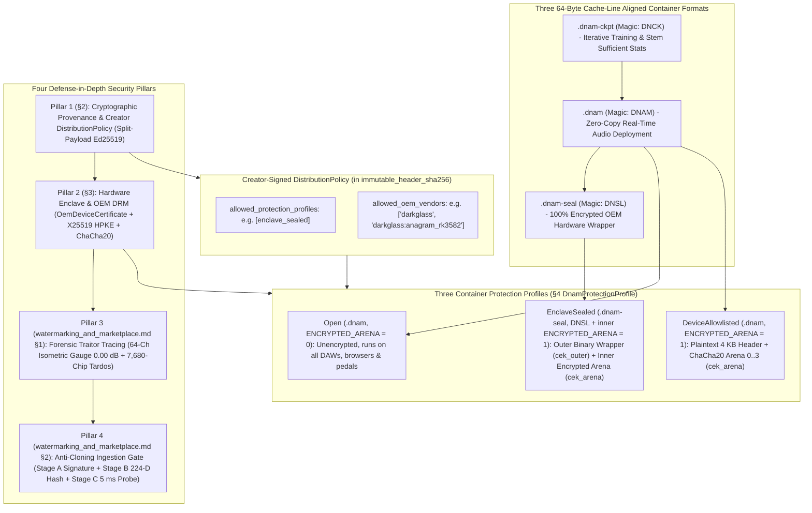
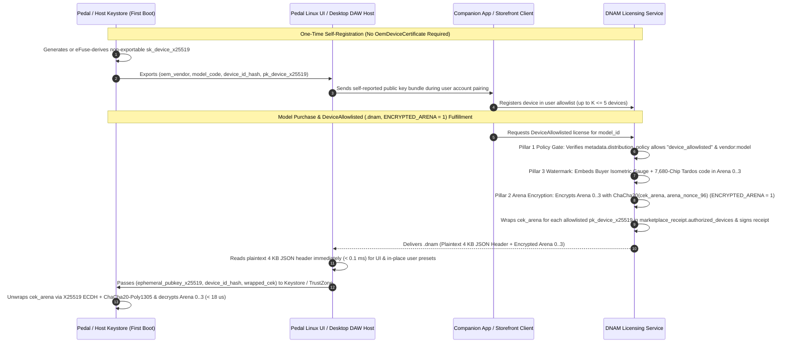
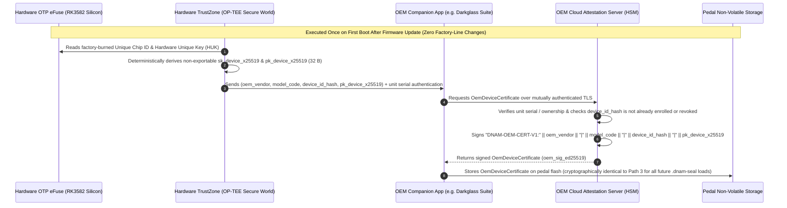
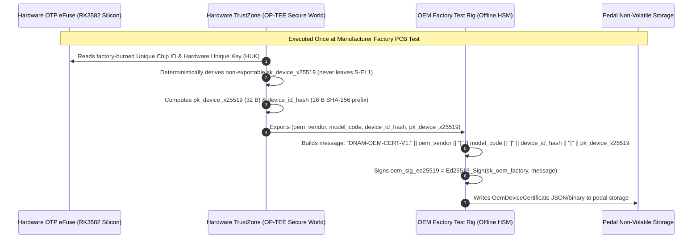
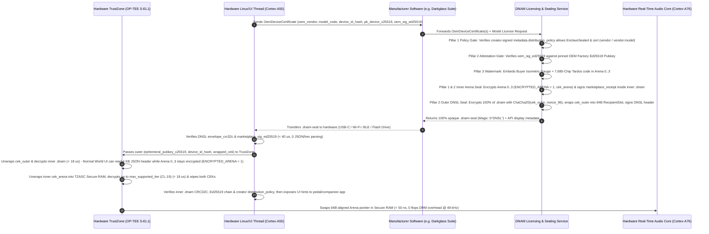
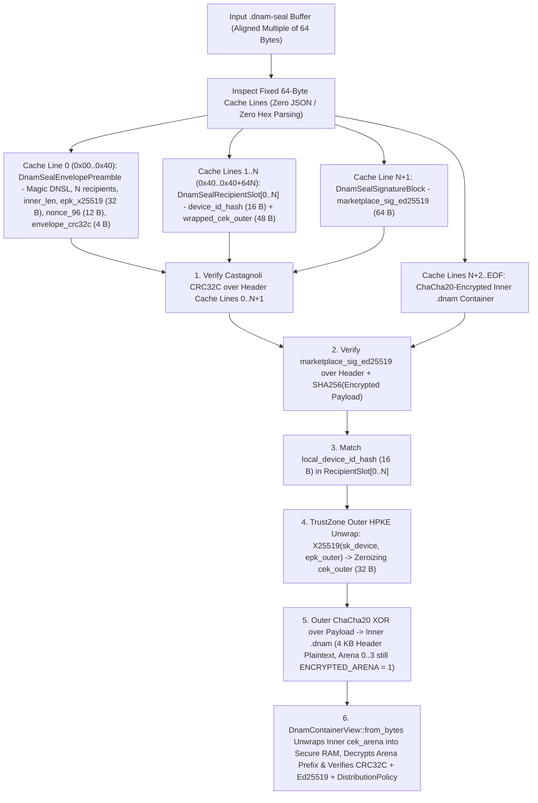
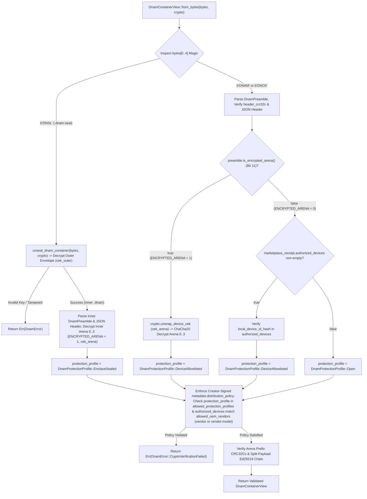

# Cryptographic Provenance (`Ed25519`), `DistributionPolicy`, `OemDeviceCertificate` & `.dnam-seal` (`DNSL`) Hardware DRM

This specification defines **Pillar 1 (Cryptographic Provenance & `DistributionPolicy`)**, **Pillar 2 (Hardware Enclave & OEM DRM via `OemDeviceCertificate` and `.dnam-seal` `b"DNSL"`)**, and the **Three Container Protection Profiles (`DnamProtectionProfile`)** of the DNAM 4-Pillar Security Architecture (paired with Pillars 3 & 4 in [`watermarking_and_marketplace.md`](watermarking_and_marketplace.md)), fulfilling the implementation-agnostic security requirements in [`../overview/system_goals_and_requirements.md` §9 (`REQ-8.1`–`REQ-8.8`)](../overview/system_goals_and_requirements.md#9-goal-8--model-provenance-hardware-drm-forensic-watermarking--marketplace-security).

It is engineered so independent creators, studios, and OEM hardware manufacturers (e.g., **Darkglass Electronics** on the **Rockchip RK3582-based Anagram**) can distribute `.dnam` models across **desktop DAW plugins (`VST3`/`CLAP`), browser studios (`WebAssembly`), Python/Node.js SDKs, and hardware pedalboards**—with **zero internet dependency on stage** and **$0\text{ flops}$ of real-time $48\text{ kHz}$ DSP overhead**.

---

## 1. Taxonomy Overview: 4 Security Pillars, 3 Protection Profiles & 3 Container Formats

Instead of conflating cryptographic provenance, hardware enclave encryption, forensic watermarking, anti-cloning, and cloud database infrastructure into a single flat list, DNAM separates the ecosystem into **Four Defense-in-Depth Security Pillars**, **Three Container Protection Profiles (`DnamProtectionProfile`)**, and **Two Platform Subsystems** (Storefront & Cloud Edge Infrastructure in [`watermarking_and_marketplace.md`](watermarking_and_marketplace.md)):



---

## 2. Pillar 1: Cryptographic Provenance (`Ed25519` Split-Payload Chain) & Creator-Signed `DistributionPolicy`

### 2.1 Preset-Safe Canonical Header Digest (RFC 8785 JCS)

To ensure that user preset creation and third-party storefront tagging never break cryptographic signatures on `.dnam` files (`Open` and `DeviceAllowlisted`), the JSON header at byte offset `0x40` ([`../containers/dnam_binary_format.md`](../containers/dnam_binary_format.md)) is partitioned into **Immutable Authoritative Fields** and **Mutable User/Platform Fields**:

| JSON Header Path | Included in `immutable_header_sha256`? | Rationale |
| :--- | :---: | :--- |
| `version`, `container_kind`, `architecture`, `sample_rate_train_hz` | **Yes (Signed)** | Locks core model architecture and training sample rate |
| `metadata.{name, author, description, license, created_at, input_reference_dbfs, provenance}` | **Yes (Signed)** | Protects creator attribution, license terms, and PCM dataset provenance |
| **`metadata.distribution_policy`** (`allowed_protection_profiles`, `allowed_oem_vendors`) | **Yes (Signed)** | Cryptographically locks which protection profiles and OEM hardware vendors/models may license or run the model |
| `io_config`, `controls_schema` (including `safe_clamped_range`, `conditional_max`, `ui_hints`) | **Yes (Signed)** | Prevents tampering with control safety clamps or UI layout |
| `control_bus`, `core1_hybrid_ssm`, `core2_mufdn`, `tensor_directory` | **Yes (Signed)** | Locks DSP hyperparameters and binary arena offsets |
| `slimmable_tiers.*.{channels, fdn_lines, early_taps, head_svd_rank, loudness_lufs, output_trim_db, validation_esr_db, arena_end_byte_offset}` | **Yes (Signed)** | Locks per-tier calibration and byte boundaries (`prefix_crc32c` excluded as it updates on watermarking) |
| **`presets`** | **No (Mutable)** | Allows buyers on desktop/DAW plugins to add/edit custom presets in-place (`0x40..0x1000`) |
| **`user_metadata`** (top-level & nested) | **No (Mutable)** | Allows licensed marketplaces (`dnam.store`) and hosts to attach custom tags in-place |
| **`metadata.signatures`** | **No (Envelope)** | Holds the signature certificates themselves |

The digest `immutable_header_sha256` is the SHA-256 hash of the RFC 8785 JSON Canonicalization Scheme (JCS) UTF-8 bytes of the signed subset above.

### 2.2 Creator-Signed `DistributionPolicy` & Protection Profile Exclusivity

Creators can restrict their `.dnam` models to specific protection profiles (e.g., `"enclave_sealed"` only, prohibiting open desktop downloads) and/or specific OEM hardware vendors or hardware models inside `metadata.distribution_policy`:

```json
{
  "metadata": {
    "name": "Darkglass Exclusive B7K Ultra Rig",
    "author": "Darkglass Electronics",
    "distribution_policy": {
      "allowed_protection_profiles": ["enclave_sealed"],
      "allowed_oem_vendors": ["darkglass:anagram_rk3582"]
    }
  }
}
```

1. **Protection Profile Gate (`allowed_protection_profiles`):**
   - When omitted or empty, all protection profiles (`"open"`, `"device_allowlisted"`, `"enclave_sealed"`) are permitted.
   - When non-empty, both the sealing service (`seal_dnam_container`) and the runtime container loader (`DnamContainerView::from_bytes`) reject any container whose active `DnamProtectionProfile` is not listed in `allowed_protection_profiles`.
2. **Granular OEM Vendor & Model Matching (`allowed_oem_vendors`):**
   - When omitted or empty, any OEM vendor and hardware model is permitted.
   - Each entry in `allowed_oem_vendors` may be either:
     - **Vendor-Wide (`"<oem_vendor>"`, e.g., `"darkglass"`):** Permits any hardware model from that manufacturer (`oem_vendor == "darkglass"`).
     - **Model-Specific (`"<oem_vendor>:<model_code>"`, e.g., `"darkglass:anagram_rk3582"`):** Permits only that exact manufacturer and hardware model (`oem_vendor == "darkglass" && model_code == "anagram_rk3582"`).
   - Because `metadata.distribution_policy` is covered by `immutable_header_sha256` and signed by `creator_signature`, neither a buyer nor the marketplace can strip or widen a creator's hardware exclusivity policy without invalidating the creator's `Ed25519` signature.

### 2.3 Two-Certificate `Ed25519` Delegation Chain & 4-Tier Cumulative Arena Digests

1. **Creator Master Signature (`creator_signature`):**
   - Let `master_arena_sha256 = SHA256(master_arena_bytes[0..arena_offset_ultra_end])` and `tier_arena_sha256 = [SHA256(arena[0..10752]), SHA256(arena[0..22336]), SHA256(arena[0..36224]), SHA256(arena[0..64000])]`.
   - The creator signs the concatenation of `immutable_header_sha256`, `master_arena_sha256`, and the 4 tier prefix SHA-256 digests offline using `Ed25519`:
     $$\sigma_{\text{creator}} = \mathrm{Ed25519-Sign}\Big(\text{sk}_{\text{creator}}, \text{immutable-header-sha256} \Vert \text{master-arena-sha256} \Vert \text{tier-arena-sha256}_{0..3}\Big)$$
2. **Marketplace Counter-Signature (`marketplace_receipt`):**
   - Upon licensing, the marketplace generates the buyer-watermarked arena (`buyer_arena_sha256 = SHA256(Plaintext_Buyer_Arena[0..arena_offset_ultra_end])`, `buyer_tier_arena_sha256`), optionally encrypts `Arena 0..3` (`ENCRYPTED_ARENA = 1`), updates the binary preamble's `arena_crc32c_{lite,full,pro,ultra}` and `header_crc32c`, and signs the receipt payload:
     $$\sigma_{\text{market}} = \mathrm{Ed25519-Sign}\Big(\text{sk}_{\text{market}}, \text{immutable-header-sha256} \Vert \text{master-arena-sha256} \Vert \text{buyer-arena-sha256} \Vert \text{receipt-meta}\Big)$$
   - Because all 4 cumulative tier SHA-256 digests are cryptographically committed in the JSON header, `strip_container_to_tier(bytes, max_tier)` can strip higher tier arenas (`Arena 1..3`) down to `Lite`, `Full`, or `Pro` **with zero re-signing required** (`CL-19`).

```json
{
  "immutable_header_sha256": "9f86d081884c7d659a2feaa0c55ad015a3bf4f1b2b0b822cd15d6c15b0f00a08",
  "master_arena_sha256": "60303ae22b998861bce3b28f33eec1be758a213c86c93c076dbe9f558c11c752",
  "creator_signature": {
    "signer_id": "did:web:studio-user.com",
    "pubkey_ed25519": "d75a980182b10ab7d54bfed3c964073a0ee172f3daa62325af021a68f707511a",
    "sig_ed25519": "e5564300c360ac729086e2cc806e828a84877f1eb8e5d974d873e065224901555fb8821590a33bacc61e39701cf9b46bd25bf5f0595bbe24655141438e7a100b"
  },
  "marketplace_receipt": {
    "marketplace_id": "dnam.store",
    "license_id": "0192b6c0-7e4a-7000-8000-1a2b3c4d5e6f",
    "buyer_hash": "3a7bd3e2360a3d29eea436fcfb7e44c735d117c42d1c1835420b6b9942dd4f1b",
    "license_tier": "personal",
    "issued_at": "2026-10-22T22:45:00Z",
    "buyer_arena_sha256": "4e07408562bedb8b60ce05c1decfe3ad16b72230967de01f640b7e4729b49fce",
    "encryption_mode": "none",
    "arena_nonce_96": null,
    "ephemeral_pubkey_x25519": null,
    "authorized_devices": [
      {
        "oem_vendor": "darkglass",
        "model_code": "anagram_rk3582",
        "device_id_hash": "9c1185a5c5e9fc54612808977ee8f548",
        "wrapped_cek": null
      }
    ],
    "royalty_splits": [
      { "recipient_id": "did:web:studio-user.com", "role": "amp_capture", "share_bps": 8000 },
      { "recipient_id": "did:web:cab-labs.io", "role": "ir_cabinet", "share_bps": 2000 }
    ],
    "receipt_sig_ed25519": "8a1b2c3d4e5f60718293a4b5c6d7e8f90112233445566778899aabbccddeeff00112233445566778899aabbccddeeff00112233445566778899aabbccddeeff00"
  }
}
```

---

## 3. Pillar 2: Hardware Enclave & OEM DRM (`OemDeviceCertificate` Attestation & `.dnam-seal` `b"DNSL"` Wrapper)

### 3.1 Three OEM Hardware Integration & Key Provisioning Paths

Hardware manufacturers can integrate DNAM DRM at three progressive levels of factory/cloud effort depending on whether they want to skip factory hardware key attestation entirely (`DeviceAllowlisted`), upgrade already-shipped pedals in the field via a firmware update (`EnclaveSealed` via OTA Companion-App Enrollment), or provision certificates on the assembly line (`EnclaveSealed` via Factory HSM):

| OEM Integration Path | Protection Profile | Factory Assembly-Line Changes? | Protects Against Casual File Sharing? | Cryptographically Proves Genuine Hardware Silicon? |
| :--- | :--- | :--- | :--- | :--- |
| **Path 1: Self-Registered Device Key** | `DeviceAllowlisted` (`.dnam`, `ENCRYPTED_ARENA = 1`) | **None** (zero OEM attestation infrastructure) | **Yes** (`X25519` + `ChaCha20` bound to `K ≤ 5` devices) | **No** (client self-reports `pubkey_x25519`; protected by Pillar 3 buyer watermark) |
| **Path 2: Companion-App / OTA Cert Enrollment** | `EnclaveSealed` (`.dnam-seal`, `b"DNSL"`) | **None** (works on already-shipped pedals via firmware update) | **Yes** (double-encrypted `.dnam-seal` + TrustZone) | **Yes** (OEM cloud verifies unit serial/challenge & signs `OemDeviceCertificate`) |
| **Path 3: Factory-Line HSM Provisioning** | `EnclaveSealed` (`.dnam-seal`, `b"DNSL"`) | **Yes** (bed-of-nails / JTAG station signs cert at PCB test) | **Yes** (double-encrypted `.dnam-seal` + TrustZone) | **Yes** (highest assurance; zero post-factory enrollment needed) |

#### Path 1 — Self-Registered `DeviceAllowlisted` Profile (Skipping Factory Attestation)

When a hardware manufacturer (or desktop/mobile plugin host) wants per-device `ChaCha20` weight encryption **without** setting up factory or cloud `OemDeviceCertificate` attestation, they use **`DnamProtectionProfile::DeviceAllowlisted`** (`.dnam`, `ENCRYPTED_ARENA = 1`). The device derives or generates its `X25519` keypair locally on first boot and registers its public key directly with the Marketplace:



#### Path 2 — Post-Factory / Companion-App OTA Certificate Enrollment (`EnclaveSealed` Without Factory-Floor Changes)

If an OEM wants full **`EnclaveSealed` (`.dnam-seal`)** protection—or wants to enable `EnclaveSealed` on **existing pedals already shipped to customers** via a firmware update—without running an HSM signing station on the physical factory floor, the pedal can obtain its `OemDeviceCertificate` during a one-time companion-app enrollment:



#### Path 3 — Factory-Line Offline HSM Attestation (`EnclaveSealed` Highest Assurance)

For new hardware production runs, the OEM provisions each unit on the assembly line with an **`OemDeviceCertificate`** signed by the manufacturer's offline `Ed25519` root key:



In both **Path 2** and **Path 3**, the canonical attestation signing message (`|`-delimited with `"DNAM-OEM-CERT-V1:"` domain prefix) is identical:
$$\text{msg}_{\text{oem-cert}} = \text{prefix}_{\text{V1}} \Vert \text{oem-vendor} \Vert \text{model-code} \Vert \text{device-id-hash-ascii} \Vert \text{pk}_{\text{device-x25519-bytes}}$$

Before sealing any `.dnam-seal` container for a target hardware unit, `seal_dnam_container` verifies `oem_sig_ed25519` against the manufacturer's pinned `oem_pubkey_ed25519` and checks `DistributionPolicy::allows_oem_device(oem_vendor, model_code)`.

### 3.2 End-to-End `.dnam-seal` (`b"DNSL"`) Sealing & Hardware TrustZone Unsealing Flow



### 3.3 `.dnam-seal` (`b"DNSL"`) 64-Byte Cache-Line Binary Envelope Specification

For `DnamProtectionProfile::EnclaveSealed`, DNAM wraps the entire inner `.dnam` container (which itself has `ENCRYPTED_ARENA = 1` on `Arena 0..3`, or `Arena 0..2` when stripped to `Pro` via `CL-19`) inside a **100% opaque, immutable 64-byte cache-line aligned binary envelope (`.dnam-seal`, Magic `b"DNSL"` / `0x4C534E44`)**.

This nested double-encryption design solves two hardware requirements simultaneously:
1. **Zero JSON or Hex Parsing in TrustZone Secure World (`< 1 µs` Slot Lookup):** All outer recipient slots (`DnamSealRecipientSlot[0..N]`) are fixed 64-byte `#[repr(C, align(64))]` structs (`16 B` raw binary `device_id_hash` + `48 B` raw `wrapped_cek`).
2. **Safe Normal-World UI vs. Secure-World DSP Split:** When the pedal unseals the outer `.dnam-seal` layer (`cek_outer`), the Normal World Linux UI thread (`EL0`/`EL1`) can read the inner `4 KB` JSON header (`controls_schema`, `presets`, `ui_hints`) to render touchscreen controls, while **`Arena 0..3` inside that inner `.dnam` remains 100% `ChaCha20`-encrypted (`ENCRYPTED_ARENA = 1`, `cek_arena`)** until unwrapped inside `TZASC` Secure RAM (`S-EL1`). Custom user presets on hardware pedals are stored natively in the pedal's own patch/rig database, keeping `.dnam-seal` files 100% immutable on disk.

```text
+=======================================================================+ 0x0000 (Cache Line 0: 64 Bytes)
| CL 0: DnamSealEnvelopePreamble (#[repr(C, align(64))], Little-Endian) |
|   0x00..0x04: magic = b"DNSL" (0x4C534E44)                            |
|   0x04..0x06: version_major = 1 (u16)                                 |
|   0x06..0x08: version_minor = 0 (u16)                                 |
|   0x08..0x0A: flags (u16: Bit 0 = CHACHA20_FULL_CONTAINER)            |
|   0x0A..0x0B: num_recipients = N (u8, 1..=16 registered pedals)       |
|   0x0B..0x0C: reserved_0 = 0 (u8)                                     |
|   0x0C..0x10: inner_dnam_byte_len (u32, % 64 == 0, e.g. 68,096 B)     |
|   0x10..0x30: ephemeral_pubkey_x25519 ([u8; 32], raw binary)          |
|   0x30..0x3C: chacha20_nonce_96 ([u8; 12], raw binary)                |
|   0x3C..0x40: envelope_crc32c (u32 over CL 0..=N+1 with 0x3C..0x40=0) |
+-----------------------------------------------------------------------+ 0x0040 (Cache Lines 1..=N: N * 64 Bytes)
| CL 1..=N: DnamSealRecipientSlot[0..N] (64 Bytes per Hardware Device)  |
|   0x00..0x10: device_id_hash ([u8; 16], raw 128-bit binary ID)        |
|   0x10..0x40: wrapped_cek ([u8; 48], X25519-HKDF-ChaCha20Poly1305)    |
+-----------------------------------------------------------------------+ 0x0040 + N*64 (Cache Line N+1: 64 Bytes)
| CL N+1: DnamSealSignatureBlock (64 Bytes)                             |
|   0x00..0x40: marketplace_sig_ed25519 ([u8; 64])                      |
|               Signed over: b"DNAM-SEAL-V1:" || CL_0_zero_crc          |
|                            || CL_1..=N || SHA256(encrypted_payload)   |
+=======================================================================+ (2 + N) * 64 (64-Byte Aligned Offset)
| Encrypted Inner .dnam Container (inner_dnam_byte_len, % 64 == 0)      |
|   • 100% ChaCha20-encrypted (cek_outer, chacha20_nonce_96, ctr=0):    |
|     - Inner 64B DnamPreamble (ENCRYPTED_ARENA = 1)                    |
|     - Inner 4,032B JSON Header (with signed marketplace_receipt)      |
|     - Inner Arena 0..3 (64,000B Ultra or 36,224B Pro, under cek_arena)|
+=======================================================================+ EOF (Exact Multiple of 64 Bytes)
```



---

## 4. Three Container Protection Profiles (`DnamProtectionProfile`) & Loader Auto-Detection

Every validated container resolves to one of three canonical **`DnamProtectionProfile`** tiers, each with a strict cryptographic posture:

| Protection Profile (`DnamProtectionProfile`) | Wire Format & Magic | Outer `.dnam-seal` (`b"DNSL"`) | Inner `.dnam` `ENCRYPTED_ARENA` | Header (`0x0000..0x1000`) | Weights (`Arena 0..3`) | Primary Target & Security Posture |
| :--- | :--- | :---: | :---: | :--- | :--- | :--- |
| **`Open` (`"open"`)** | `.dnam` (`b"DNAM"`) | No | `0` | Plaintext | Plaintext (`mmap` zero-copy) | Community models & open commercial packs; protected by Pillar 1 `Ed25519` + Pillar 3 watermark. |
| **`DeviceAllowlisted` (`"device_allowlisted"`)** | `.dnam` (`b"DNAM"`) | No | **`1`** | **Plaintext** (DAW/OS browsers index metadata & save presets in-place in `< 0.1 ms`) | **`ChaCha20`-Encrypted** (`cek_arena` in JSON `authorized_devices`) | Desktop/mobile DAW plugins & multi-platform licenses; bound to OS Keychain / Apple SEP / TPM 2.0 `X25519` keys. |
| **`EnclaveSealed` (`"enclave_sealed"`)** | `.dnam-seal` (`b"DNSL"`) | **Yes (`b"DNSL"`)** | **`1`** | **Encrypted** under outer `cek_outer` | **Double-Encrypted** (outer `cek_outer` + inner `cek_arena` for Secure RAM only) | Exclusive OEM hardware pedals (`OP-TEE` TrustZone + `OemDeviceCertificate`); `0` JSON parsing in Secure World. |


