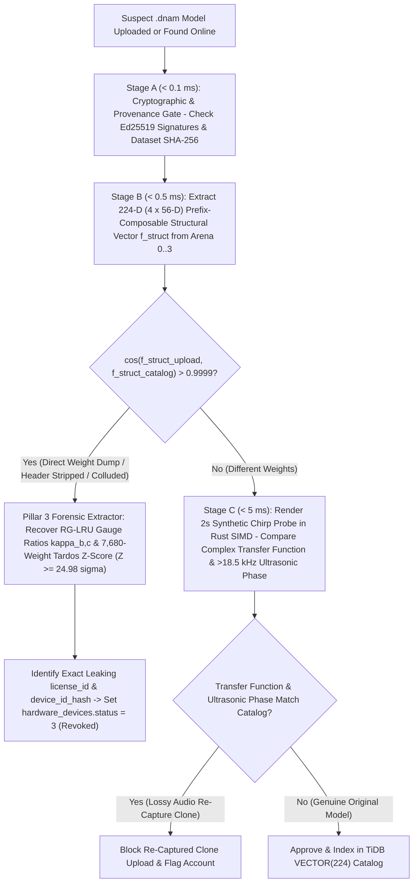
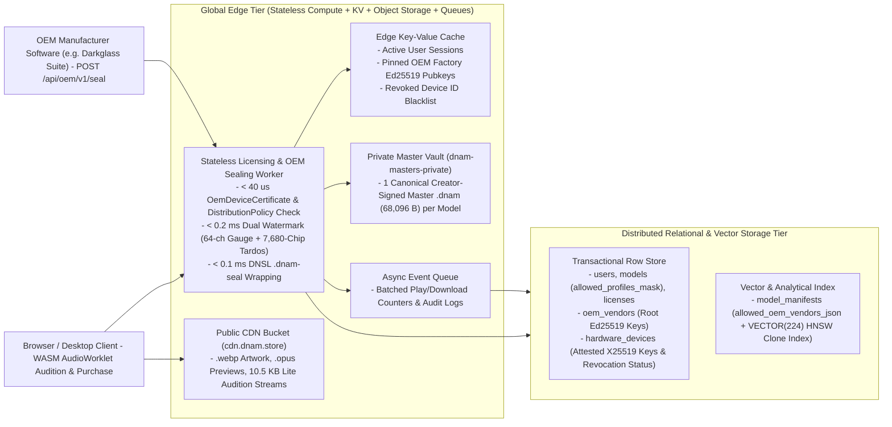
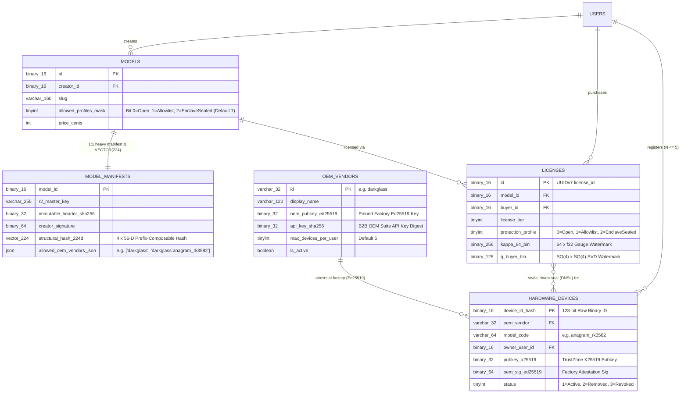

# Forensic Watermarking, 3-Stage Anti-Cloning Gate & Marketplace Edge Infrastructure

Complementing Cryptographic Provenance & Hardware Enclave DRM ([`provenance_and_enclave_drm.md`](provenance_and_enclave_drm.md)) and fulfilling [`../overview/system_goals_and_requirements.md` §9 (`REQ-8.5`–`REQ-8.7`)](../overview/system_goals_and_requirements.md#9-goal-8--model-provenance-hardware-drm-forensic-watermarking--marketplace-security), this specification defines **Pillar 3 (Dual-Mechanism Buyer Watermarking)**, **Pillar 4 (3-Stage Anti-Cloning Ingestion Gate)**, the **Commercial Storefront Platform**, and the **Cloudflare + TiDB Edge Infrastructure**.

---

## 1. Pillar 3: Forensic Traitor Tracing (`< 0.2 ms` Dual-Mechanism Buyer Watermarking)

Even if an adversary physically decapitates a chip or dumps process memory on a desktop machine, every licensed container carries two orthogonal, un-removable watermarks embedded directly in `Arena 0` (`Lite`), `Arena 1` (`Full Delta`), `Arena 2` (`Pro Delta`), and `Arena 3` (`Ultra Delta`):

### 1.1 Mechanism A — Exact Isometric Gauge-Space Watermarking ($0.0000\text{ dB}$ Audio Difference)

1. **64-Channel RG-LRU Reciprocal Scaling Gauge ($\boldsymbol{\kappa} \in [0.985, 1.015]^{64}$):**
   In Core 1B ([`../dsp/core1_polyadaa_and_rglru.md` §2.3](../dsp/core1_polyadaa_and_rglru.md#23-log-octave-pole-initialization--mathcalh_2-norm-input-scaling-cl-04-cl-05)), scaling each resonator channel's input normalizer $b_{\gamma,b,c}$ (`16` channels per tier across `Lite`/`Full`/`Pro`/`Ultra`) by $\kappa_{b,c}$ and its output projection $(c_{\text{real},b,c}, c_{\text{imag},b,c})$ by $\kappa_{b,c}^{-1}$:
   $$b_{\gamma,b,c}^{(\text{buyer})} = \kappa_{b,c} b_{\gamma,b,c}^{(\text{master})}, \qquad \big(c_{\text{real},b,c}^{(\text{buyer})}, c_{\text{imag},b,c}^{(\text{buyer})}\big) = \frac{1}{\kappa_{b,c}} \big(c_{\text{real},b,c}^{(\text{master})}, c_{\text{imag},b,c}^{(\text{master})}\big)$$
   cancels out identically ($\kappa_{b,c} \cdot \kappa_{b,c}^{-1} \equiv 1.0$, **$4.00 \times 10^{-15}$ exactness in `Test 8H`**) while preserving all pole radii, angles, selectivity gates, and `CL-01`..`CL-20` stability invariants.
2. **Block-Diagonal SVD Control Subspace Orthogonal Rotation Gauge ($\mathbf{Q}_{\text{buyer}} \in SO(4) \oplus SO(4)$):**
   In the Parametric Control Bus ([`../training/four_stage_pipeline.md` §2.2](../training/four_stage_pipeline.md#22-stage-2--partitioned-svd-orthonormal-kronecker-float64-wiener-hopf-warm-start-cl-18)), rotating the SVD control projector $\mathbf{P}_{\text{svd}} \in \mathbb{R}^{D_{\text{basis}} \times D_h}$ (`D_h = 4` in `Arena 0..2`, extended by 4 nested modes `z_{4..7}` in `Arena 3 Ultra`) and the 16-tap SVD stereo head basis $\mathbf{W}_{\text{head},1..D_h}$ by $\mathbf{Q}_{\text{buyer}} = \mathrm{diag}(\mathbf{Q}_{0..3}, \mathbf{Q}_{4..7})$:
   $$\mathbf{P}_{\text{svd}}^{(\text{buyer})} = \mathbf{P}_{\text{svd}}^{(\text{master})} \mathbf{Q}_{\text{buyer}}, \qquad \mathbf{W}_{\text{head},1..D_h}^{(\text{buyer})} = \mathbf{Q}_{\text{buyer}}^\top \mathbf{W}_{\text{head},1..D_h}^{(\text{master})}$$
   modifies every floating-point weight in the SVD head and control projector while canceling out identically ($\mathbf{Q}_{\text{buyer}} \mathbf{Q}_{\text{buyer}}^\top \equiv \mathbf{I}_{D_h}$) at $3\text{ kHz}$ across both `D_h = 4` (`Lite/Full/Pro`) and `D_h = 8` (`Ultra`).

### 1.2 Mechanism B — Non-Invertible Coupled Spread-Spectrum Tardos Watermarking ($+38.8\text{ dB}$ Matched-Filter Gain)

To defeat gauge canonicalization or multi-buyer collusion averaging, the marketplace embeds a **Tardos Collusion-Resistant Spread-Spectrum Code** $\mathbf{c}^{(\text{buyer})} \in \lbrace -1, +1 \rbrace^{7680}$ (seeded via `HMAC-SHA256(marketplace_secret, model_id || license_id)`) across all $N_{\text{conv}} = 7,680$ nonlinear dilated convolution weights (`768` in `Arena 0 Lite`, `+1,536 -> 2,304` in `Arena 1 Full`, `+2,304 -> 4,608` in `Arena 2 Pro`, `+3,072 -> 7,680` in `Arena 3 Ultra`):

$$W_{\text{conv},i}^{(\text{buyer})} = W_{\text{conv},i}^{(\text{master})} + \epsilon \sigma_{W,i} c_i^{(\text{buyer})}$$

| Attack Vector Attempted by Pirate | Why the Dual-Mechanism Watermark Survives | Verified Margin (`Test 8H`) |
| :--- | :--- | :---: |
| **Strip JSON header / forge new `.dnam` wrapper** | Watermark lives entirely inside the binary `f32` weights of `Arena 0..3` | **100% intact** |
| **Truncate `Ultra` / `Pro` / `Full` down to `Lite`-only (`10.5 KB`)** | `Arena 0 (Lite)` alone carries `16` gauge ratios `κ_{0..3,0..3}` + `768` Tardos conv weights (`+28.85 dB` gain) | **`Z > 10σ`** |
| **Canonicalize RG-LRU `(b_γ, c)` gauge** | Cannot invert the `7,680` nonlinear `PolyADAA`-coupled convolution weights without `W_conv^(master)` | **`Z ≥ 24.98σ`** |
| **Quantize weights `f32 -> fp16 -> f32` + 4-buyer collusion average** | Spread-spectrum matched filter over `N = 7,680` (`4,608` in `Pro`) weights provides `+38.85 dB` processing gain | **`≥ 24.98σ` vs. `2.53σ` innocent max** |

---

## 2. Pillar 4: 3-Stage Anti-Cloning Ingestion Gate (`< 50 ms` Clone & Re-Capture Prevention)

Whenever a user uploads a `.dnam` model to the marketplace, a **$< 50\text{ ms}$ 3-Stage Ingestion Pipeline** screens the upload against the commercial catalog and triggers automated hardware revocation if a leaked dump is detected:



1. **Stage A — Cryptographic & Provenance Gate (`< 0.1 ms`):** Verifies `creator_signature`, `marketplace_receipt`, and `metadata.provenance.dataset_manifest_sha256`.
2. **Stage B — 224-D (`4 × 56-D`) Prefix-Composable Gauge-Invariant Structural Hash & Traitor Extraction (`< 0.5 ms`):**
   - Extracts $\mathbf{f}_{\text{struct}} \in \mathbb{R}^{224}$ ordered into 4 tier blocks of `56` dimensions (`[56t .. 56(t+1)]` for $t \in \lbrace 0, 1, 2, 3 \rbrace$): `16` sorted RG-LRU pole bounds/angles, `32` gauge-invariant products $I_{\text{real},b,c} = b_{\gamma,b,c} c_{\text{real},b,c}$ and $I_{\text{imag},b,c} = b_{\gamma,b,c} c_{\text{imag},b,c}$, `4` sorted `M-UFDN` base delays, and `4` head singular values per tier.
   - Even if a container was stripped down to `Lite` (`56-D`), `Full` (`112-D`), or `Pro` (`168-D`), its prefix matches the corresponding prefix of the `224-D` `Ultra` catalog vector with $\cos = 1.000000$.
   - If $\cos(\mathbf{f}_{\text{struct}}^{(\text{upload})}, \mathbf{f}_{\text{struct}}^{(\text{catalog})}) > 0.9999$, Stage B extracts the leaking `license_id` via Pillar 3 and sets `hardware_devices.status = 3 (Revoked)`.
3. **Stage C — $5\text{ ms}$ Synthetic Probe Transfer-Function & Ultrasonic Phase Check:** Renders a $2\text{-second}$ synthetic chirp/burst probe in Rust SIMD (`< 5 ms`) and compares the complex transfer function and $> 18.5\text{ kHz}$ ultrasonic phase constellation against the catalog—blocking even lossy analog/digital re-captures re-trained from audio output.

---

## 3. Commercial Storefront Platform: Auditioning, Royalty Splits & Storefront Metadata

### 3.1 Zero-Leak Browser Auditioning
- Prospective buyers can audition commercial `.dnam` models directly in the browser using either **built-in multi-genre DI stems** or **their own live guitar/bass/synth via WebAudio (`AudioWorklet` WASM SIMD128)**.
- To prevent un-purchased extraction of commercial `Ultra` masters (especially when a creator restricts a model to `allowed_protection_profiles: ["enclave_sealed"]`), the marketplace serves either:
  1. **Ephemeral Session-Watermarked `Lite` (`10.5 KB`) Preview Streams** (with a periodic gentle audition marker every 45 seconds), or
  2. **Server-Rendered Custom DI Previews** where the user uploads a short dry clip and hears the rendered `Ultra` output in $< 200\text{ ms}$ without the model weights ever leaving the server.

### 3.2 Standardized `license_tier` Values & Automated Split Royalties (`royalty_splits`)
Inside `metadata.signatures.marketplace_receipt` (see [`provenance_and_enclave_drm.md` §2](provenance_and_enclave_drm.md#2-pillar-1-cryptographic-provenance-ed25519-split-payload-chain--creator-signed-distributionpolicy) and [`../containers/dnam_binary_format.md` §6](../containers/dnam_binary_format.md#6-marketplace-security-signatures--hardware-drm-cross-reference)):
- **`license_tier`:** `"free"`, `"personal"`, `"commercial_studio"`, or `"oem_bundle"`.
- **`royalty_splits`:** Array of `{ "recipient_id": str, "role": str, "share_bps": int }` entries (summing to `10000` basis points = 100%) enabling automatic marketplace revenue splits across collaborative packs.

### 3.3 Clean Storefront Taxonomy Isolation via `user_metadata`
Digital marketplaces store rich storefront discovery attributes inside a namespaced key in `user_metadata` (editable in $< 0.1\text{ ms}$ in-place on `.dnam` containers without invalidating `creator_signature` or `marketplace_receipt`):

```json
{
  "user_metadata": {
    "dnam.store": {
      "product_slug": "vintage-tape-echo-tube-preamp",
      "category": "delay_and_preamp",
      "gear_modeled": {
        "preamp": "1964 Push-Pull 12AX7/6V6 Tube Preamp",
        "echo": "Multi-Head Magnetic Tape Echo",
        "cabinet": "2x12 Alnico Blue Open-Back",
        "mics": ["Royer R-121", "Shure SM57"]
      },
      "tags": ["tape-echo", "tube-drive", "true-stereo", "self-oscillating"],
      "artwork_url": "https://cdn.dnam.store/packs/vintage-tape-echo/cover.webp",
      "demo_audio_urls": [
        "https://cdn.dnam.store/packs/vintage-tape-echo/demo_slapback.opus",
        "https://cdn.dnam.store/packs/vintage-tape-echo/demo_dub_swell.opus"
      ]
    }
  }
}
```

---

## 4. Cloud Edge Infrastructure, Logical Data Model & Stateless OEM Sealing Service

### 4.1 Edge Compute, OEM Sealing Worker, Two-Bucket Object Storage & Key-Value Cache



1. **Cross-Origin Isolation for Zero-Allocation WebAudio Telemetry:**
   - Web routes hosting live auditioning (`/playground`, `/explore`) serve `Cross-Origin-Opener-Policy: same-origin` and `Cross-Origin-Embedder-Policy: credentialless` headers so [`DnamWorkletNode`](../../packages/js/README.md) unlocks `SharedArrayBuffer` atomics and $60\text{ fps}$ lock-free `Seqlock` telemetry.
2. **Stateless Edge `.dnam-seal` (`b"DNSL"`) Generation (`POST /api/oem/v1/seal`, Zero Storage Multiplication):**
   - Rather than pre-storing encrypted copies per buyer or hardware unit, the private master vault stores only **1 canonical creator-signed Master `.dnam` (`68,096 B`) per model**.
   - When an OEM companion app or buyer requests a licensed download (`Open`, `DeviceAllowlisted`, or `EnclaveSealed` via `POST /api/oem/v1/seal`), the edge worker:
     1. Verifies the model's `allowed_profiles_mask` and `allowed_oem_vendors_json` (`DistributionPolicy`).
     2. Verifies each device's `OemDeviceCertificate` (`oem_sig_ed25519`) against the OEM's pinned `oem_pubkey_ed25519` in the edge KV cache and confirms `hardware_devices.status == 1 (Active)` (not `3 = Revoked`).
     3. Applies the deterministic buyer watermark (`kappa_64_bin`, `q_buyer_bin`, `7,680`-chip Tardos code), optionally strips higher tiers via `strip_container_to_tier` (`CL-19`), encrypts the inner arena (`ENCRYPTED_ARENA = 1`, `cek_arena`), signs `marketplace_receipt`, and wraps `.dnam-seal` (`b"DNSL"`, `cek_outer`) in **$< 0.35\text{ ms}$ total CPU time**.

### 4.2 Logical Entity-Relationship & Storage Specification



| Logical Entity | Primary Key & Indexing Strategy | Core Attributes & Cryptographic Invariants | Access Pattern |
| :--- | :--- | :--- | :--- |
| **`users`** | `id` (`BINARY(16)` UUIDv7), unique index on `handle` | `handle`, `display_name`, `creator_pubkey` (`32 B` `Ed25519` public key), `is_verified` | Creator signature lookup & profile indexing |
| **`models`** | `id` (`BINARY(16)`), composite cursor indices on `(is_published, category_kind, format_kind, trending_score/download_count/created_at)` | Skinny `< 300 B/row` catalog table: `slug`, `format_kind`, `category_kind`, `allowed_profiles_mask` (`Bit 0=Open, 1=Allowlist, 2=EnclaveSealed`), `license_tier`, `price_cents`, `tag_ids`, public CDN preview URLs | High-throughput catalog browsing (`O(log N)` cursor pagination) |
| **`model_manifests`** | `model_id` (`BINARY(16)`), `HNSW` cosine distance index on `structural_hash_224d` (`VECTOR(224)`) | 1:1 heavy manifest: `r2_master_key`, `immutable_header_sha256`, `master_arena_sha256`, `dataset_manifest_sha256`, `creator_signature` (`64 B`), `structural_hash_224d` (`4 × 56-D`), `controls_schema_json`, `royalty_splits_json`, `allowed_oem_vendors_json` | Fetched on model detail view, Pillar-4 Stage-B clone screening (`< 0.5 ms`), and edge sealing |
| **`oem_vendors`** | `id` (`VARCHAR(32)`, e.g., `'darkglass'`) | `display_name`, `oem_pubkey_ed25519` (`32 B` pinned factory root key, mirrored to edge KV), `api_key_sha256`, `max_devices_per_user` (default `5`), `is_active` | Verifies `OemDeviceCertificate` signatures during enrollment and `.dnam-seal` sealing |
| **`hardware_devices`** | `device_id_hash` (`BINARY(16)` raw 128-bit `SHA-256("dnam-device-v1:" \|\| OTP)[:16]`), indexed by `(owner_user_id, status)` | `oem_vendor`, `model_code` (e.g., `'anagram_rk3582'`), `owner_user_id`, `pubkey_x25519` (`32 B` TrustZone public key), `oem_sig_ed25519` (`64 B`), `status` (`1 = Active`, `2 = Deactivated`, `3 = Revoked`) | Enforces per-user device limits and blocks revoked hardware units upon traitor tracing |
| **`licenses`** | `id` (`BINARY(16)` UUIDv7 `license_id`), unique on `(model_id, buyer_id)` | `model_id`, `buyer_id`, `license_tier`, `protection_profile`, `kappa_64_bin` (`256 B` = `64 × f32` gauge ratios), `q_buyer_bin` (`128 B` = `SO(4) ⊕ SO(4)` SVD rotation) | Deterministic buyer watermark regeneration & Pillar-3 forensic traitor correlation |
| **`credit_wallets` & `training_jobs`** | `user_id` / `id` (`BINARY(16)` UUIDv7), indexed by `(user_id, created_at DESC)` | Atomic credit reservation (`balance_credits`, `reserved_credits`), `parent_job_id` (`.dnam-ckpt` resume lineage), `job_kind` (`1..4`), per-tier validation `bESR`, private vault `.dnam`/`.dnam-ckpt` keys, and `audit_report_json` | Cloud GPU training job orchestration & iterative checkpoint lineage |
