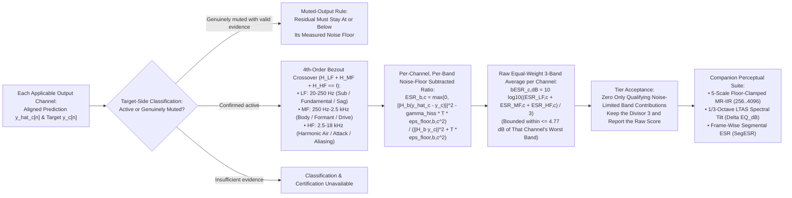

# Psychoacoustic Quality Standard (`bESR`) & 4-Tier Benchmarks

This specification defines the **perceptual quality evaluation framework (`bESR`, `MR-IIR`, `LTAS` spectral tilt, and `SegESR`), device-agnostic noise-floor rules, quiet vs. muted stem classification, and 4-tier (`Lite` / `Full` / `Pro` / `Ultra`) acceptance benchmarks** for **Dynamic Neural Audio Modeler (DNAM)**.

For the overarching system goals and hardware budgets, see [`../../requirements/system_goals_and_requirements.md`](../../requirements/system_goals_and_requirements.md). For why plain broadband `ESR` and fixed pre-emphasis fail, see [`../../adr/0003-band-balanced-besr-and-noise-qualification.md`](../../adr/0003-band-balanced-besr-and-noise-qualification.md). The relationship between band-specific fitting statistics, noise-floor clipping, and actual output certification is described in [`../training/four_stage_pipeline.md` §2.2](../training/four_stage_pipeline.md#22-sweep-2--joint-full-rig-kronecker-polish--export-certification).

---

## 1. Floor-Regularized, Noise-Adjusted Band-Balanced `bESR`



### 1.1 4th-Order-Flat Bezout Complementary 3-Band Crossover ($H_{\text{LF}} + H_{\text{MF}} + H_{\text{HF}} \equiv I$)

`r[qual.besr.bezout-crossover]`

DNAM partitions the spectrum using the causal **Binomial / Bezout identity** $(H_1 + (1 - H_1))^7 \equiv 1$, where $H_1(z) = (1-r)/(1-rz^{-1})$ and $r=e^{-2\pi f_c/f_s}$ is a 1-pole low-pass at cutoff $f_c$:
$$\mathcal{L}_{f_c}(z) = H_1(z)^4 \Big(1 + 4\big(1 - H_1(z)\big) + 10\big(1 - H_1(z)\big)^2 + 20\big(1 - H_1(z)\big)^3\Big)$$
With $q=1-H_1$, the complementary high-pass has a fourth-order zero at DC:
$$1-\mathcal{L}_{f_c}=q^4(35-84q+70q^2-20q^3)$$
The low-pass contains $H_1^4$; in the frequency range where the one-pole response follows its analog high-frequency asymptote, this yields a nominal `-80 dB/decade` low-pass slope. It does not imply that slope holds to digital Nyquist. The following three transfer functions sum to one in exact arithmetic; finite-precision reconstruction and filter state require separate validation:
- **Low / Sub (`LF`, $20\text{–}250\text{ Hz}$):** $H_{\text{LF}}(z) = \mathcal{L}_{250}(z)$ — Fundamental weight, cabinet port resonance, and power-supply sag.
- **Mid / Body (`MF`, $250\text{ Hz}\text{–}2.5\text{ kHz}$):** $H_{\text{MF}}(z) = \mathcal{L}_{2500}(z) - \mathcal{L}_{250}(z)$ — Core note definition, formant structure, and primary distortion character.
- **High / Air (`HF`, $2.5\text{–}18\text{ kHz}$):** $H_{\text{HF}}(z) = 1 - \mathcal{L}_{2500}(z)$ — Harmonic overtone sheen, transient pick/slap attack, and fizz/aliasing control.

#### Metric Filter Response

`r[qual.besr.filter-response]`

The frequency ranges are nominal descriptions, not brick-wall boundaries: the low band includes DC, the high band extends to Nyquist, and the responses overlap. Equal weighting applies to the three resulting **error ratios**, not to disjoint spectral energy.

> [!WARNING]
> Complementary summation does not bound the gain of the individual filters. For $H_1(z)=(1-r)/(1-rz^{-1})$, $r=e^{-2\pi f_c/f_s}$, at $f_s=48\text{ kHz}$ and $f_c=250\text{ Hz}$ the two branches have approximately `+9.33 dB` and `+9.19 dB` gain at the crossover; their complex responses cancel when recombined unchanged. Differently processed or misaligned paths need not cancel. This metric definition is not proof of a unity-gain audio crossover, and its effect on fitting and quality requires measurement. Changing it changes the metric and dependent statistics; do not silently reuse certificates or cached objectives from a different filter.

These filters define the `bESR` evaluation crossover; the Stage 0 [LR4 audio signal split](../dsp/router_and_stages_topology.md#stage-0-lr4-cleandrive-crossover) is a separate runtime audio-path crossover.

### 1.2 Per-Band Noise-Floor Subtraction & Worst-Band Mathematical Bound

`r[qual.besr.noise-subtracted]`

For each applicable output channel $c$ and band $b \in \lbrace \text{LF}, \text{MF}, \text{HF} \rbrace$, evaluate that channel's target and residual energies against its **selection-matched effective** band noise power $\epsilon_{\text{floor},b,c}^2$ over $T$ selected samples ($\gamma_{\text{hiss}} = 1.0$):
$$\text{ESR}_{b,c} = \frac{\max\Big(0,\ \big\Vert H_b(z)(\hat{y}_c - y_c) \big\Vert _2^2 - \gamma_{\text{hiss}} T \epsilon_{\text{floor},b,c}^2\Big)}{\big\Vert H_b(z) y_c \big\Vert _2^2 + T \cdot \epsilon_{\text{floor},b,c}^2}, \qquad \text{bESR}_{c,\text{dB}} = 10 \log_{10}\left(\frac{\text{ESR}_{\text{LF},c} + \text{ESR}_{\text{MF},c} + \text{ESR}_{\text{HF},c}}{3}\right)$$

1. **Noise-Floor Subtraction ($\gamma_{\text{hiss}} = 1.0$):** Subtract one expected filtered noise energy $F_{b,c} = T \epsilon_{\text{floor},b,c}^2$ before clamping at zero. Because zero-initialized band filters are non-stationary during startup, obtain $F_{b,c}$ using the matched finite-timeline protocol in §1.4 rather than a stationary scalar.
2. `r[qual.besr.zero-denominator]` **Sum-Denominator Convention & Zero-Denominator Rules:** For a nonempty selection with valid finite data and a validated floor:
   - If the denominator is positive, apply the formula directly; a zero clipped numerator yields a zero band ratio (`-∞ dB`).
   - If the denominator is zero, the band ratio is `0` when error energy is zero and `+∞` (failing band and composite criteria) when error energy is nonzero.
   - Missing noise evidence, empty selections, non-finite inputs, or underflow-erased nonzero energy render certification unavailable rather than passing.
3. `r[qual.besr.per-output]` **Per-Output Independent Evaluation:** Evaluate every applicable output channel $c$ independently against its tier's composite, per-band, and spectral-tilt (`LTAS`) acceptance thresholds, as well as its `MR-IIR` and `SegESR` companion diagnostics and monotone non-regression rules. Pooled stereo scores may be displayed for convenience, but every required output channel must pass on its own (since pooling can mask a silent or missing quieter channel).

> [!IMPORTANT]
> **Mathematical Worst-Band Bound (`4.77 dB` Ceiling):** Because the raw $\text{bESR}$ averages the three band ratios equally ($w_{\text{LF}} = w_{\text{MF}} = w_{\text{HF}} = \frac{1}{3}$), each channel's raw composite $\text{bESR}_{\text{dB}}$ can **never** be more than $10 \log_{10}(3) \approx 4.77\text{ dB}$ better than that channel's single worst frequency band.

### 1.3 Noise-Limited Composite Acceptance

`r[qual.besr.noise-qualified]`

For an **active** output channel $c$ and tier $t$ with per-band goal $g_{b,t}$ (in dB), let $F_{b,c} = T \epsilon_{\text{floor},b,c}^2$, $Y_{b,c} = \Vert H_b y_c \Vert _2^2$, and $R_{b,c} = \Vert H_b(\hat{y}_c-y_c) \Vert _2^2$. Band $b$ qualifies for the noise-limited exception if and only if all three conditions hold:

1. $F_{b,c} > 0$ and the channel, floor, selection, and raw metric are valid.
2. $Y_{b,c} / F_{b,c} < 10^{-g_{b,t}/10}$ (target-to-floor ratio is strictly below the required band SNR).
3. $R_{b,c} \le 10^{0.1} F_{b,c}$ (residual energy is within `1.0 dB` of the measured floor).

In the **noise-qualified composite acceptance** score, replace each qualifying band's ratio with `0`, retain non-qualifying band ratios unchanged, and divide their sum by **3** (preserving the three-band divisor). Report both the raw composite and the noise-qualified composite alongside the qualification mask.

### 1.4 Finite-Timeline Filtering and Matched Noise Floor

`r[qual.besr.finite-timeline]`

1. **Single Zero-State Start per Timeline:** Initialize the `bESR` band filters with zero state at the first sample of the aligned prediction/target timeline, including any aligned pre-roll context.
2. **Filter Before Selection:** Filter the complete available timeline in sample order and extract the declared sample selection only after filtering; never concatenate disjoint intervals or reset filter state at selection boundaries.
3. **Selection-Matched Noise Energy:** Compute expected filtered noise energy $F_{b,c}$ over the exact same selected indices, zero-state start, timeline context, filter, and sample rate, setting $\epsilon_{\text{floor},b,c}^2 = F_{b,c}/T$.
4. **Provenance Binding:** Bind the timeline origin, selected indices, output roles, sample rate, filter version, and matched floor energies into the certification metadata ([`../containers/checkpoint_and_cache_format.md` §3](../containers/checkpoint_and_cache_format.md#3-dnam-ckpt-json-header-extensions-stems_registry-with-per-stem-pcm-provenance--arena-4-crc32c)).

### 1.5 Conservative Decisions with Uncertain Noise Floors

`r[qual.besr.uncertain-floor]`

With fixed recorded energies $Y_{b,c}$ and $R_{b,c}$, both the raw band ratio and the noise-qualified contribution are monotonically nonincreasing functions of $F_{b,c}$. Given validated simultaneous bounds $0 \le L_{b,c} \le F_{b,c} \le U_{b,c}$:
- **Guaranteed Pass:** All required bands and the composite pass when evaluated at the lower floor bounds $L_{b,c}$.
- **Guaranteed Failure:** Any required band or the composite fails even when evaluated at the upper floor bounds $U_{b,c}$.
- **Unavailable (Ambiguous):** The upper-bound evaluation passes while the lower-bound evaluation fails.

#### Joint Energy-Interval Decisions

`r[qual.besr.joint-intervals]`

When target, residual, and matched-floor energies each lie in simultaneous intervals $Y \in [Y_-,Y_+]$, $R \in [R_-,R_+]$, and $F \in [F_-,F_+]$ with linear band goal $g = 10^{g_{b,t}/10} > 0$ and residual factor $q = 10^{0.1}$, the raw ratio $r(Y,R,F)$ is bounded by:
$$r_- = r(Y_+,R_-,F_+), \qquad r_+ = r(Y_-,R_+,F_-)$$

Because the qualified contribution $c(Y,R,F)$ jumps upward when $Y g$ crosses $F$, checking only the target endpoints $Y_-$ and $Y_+$ is insufficient. Evaluate its rectangular bounds at $(F_-, R_+)$ and $(F_+, R_-)$:

| Bound | Condition | Evaluation Point |
| :--- | :--- | :--- |
| **Upper Bound `c_+` at `(F_-, R_+)`** | `F_- = 0` or `R_+ > q F_-` | `c(Y_-, R_+, F_-)` |
| **Upper Bound `c_+` at `(F_-, R_+)`** | `F_- > 0`, `R_+ ≤ q F_-`, and `Y_+ g < F_-` | `0` (entire interval qualifies) |
| **Upper Bound `c_+` at `(F_-, R_+)`** | `F_- > 0`, `R_+ ≤ q F_-`, and `Y_+ g ≥ F_-` | `r(max(Y_-, F_-/g), R_+, F_-)` (interior boundary `Y = F_-/g` does not qualify) |
| **Lower Bound `c_-` at `(F_+, R_-)`** | `F_+ > 0`, `R_- ≤ q F_+`, and `Y_- g < F_+` | `0` |
| **Lower Bound `c_-` at `(F_+, R_-)`** | Otherwise | `c(Y_+, R_-, F_+)` |

> [!NOTE]
> **Exact Residual Comparison & Calibration Profiles:** In exact rational arithmetic, the residual qualification condition $R \le 10^{0.1} F$ is evaluated without irrational approximation via $R^{10} \le 10 F^{10}$. Statistical floor-bracketing profiles and R&D counterexamples are archived in [`../../adr/0003-band-balanced-besr-and-noise-qualification.md`](../../adr/0003-band-balanced-besr-and-noise-qualification.md).

---

## 2. Device-Agnostic Quality Evaluation (Zero Subjective Carve-Outs)

DNAM applies **one single, objective, signal-measured standard per tier** across all hardware device classes (clean preamps, LTI cabinets, high-gain tube heads, self-oscillating filters, and extreme comparator fuzzes):

1. `r[qual.eval.jitter-floor]` **Sub-Sample Clock Jitter Floor ($8\text{ kHz}$):** At $f_s = 48\text{ kHz}$, an uncompensated ADC/DAC clock drift or USB stream startup jitter of $0.05\text{ samples}$ ($1\ \mu\text{s}$) introduces a phase error $\Delta\phi = 2\pi \frac{8000}{48000}(0.05) = 0.052\text{ rad}$ ($3^\circ$) at $8\text{ kHz}$, setting a mathematical time-domain subtraction floor of $20 \log_{10}(0.052) = -25.6\text{ dB}$ unless sub-sample jitter is aligned during calibration ([`../training/capture_and_alignment.md` §1.5](../training/capture_and_alignment.md#15-multi-regime-sub-sample-hardware-latency-alignment)).
2. `r[qual.eval.thermal-hiss]` **Signal-Measured Thermal Hiss Floor (`Noise-Floor Limited` Criterion):** Deterministic models must not memorize random analog thermal noise. Apply the per-output, per-band qualification in §1.3 when a measured target-to-floor ratio is below the tier's required band SNR and the residual is within `1.0 dB` of that floor. A qualifying band satisfies its band requirement and contributes zero to composite acceptance, but remains present in the reported raw score.
3. `r[qual.eval.metric-scope]` **Interpreting the Quality Metrics:** The `HF` error-ratio thresholds and the independently measured `LTAS` tilt limits are distinct criteria. Band-averaged error does not bound the maximum deviation at each frequency or prove audibility or transparency. For a noiseless equal-frequency sinusoid with a constant gain error, the `-20`, `-26`, and `-30 dB` error ratios permit approximately `0.92`, `0.45`, and `0.28 dB` of attenuation respectively; these are not the `0.35`, `0.15`, and `0.10 dB` tier tilt limits. Perceptual claims require a separately defined and measured listening protocol.
4. `r[qual.eval.quiet-vs-muted]` **Quiet Signal, Autonomous Output & Muted Outputs:**
   - An output whose active signal exceeds its measured broadband noise floor by $> 6.0\text{ dB}$ (even if quiet in absolute dBFS, such as a minimum-volume stem that attenuates level without muting) is **active** and must be fitted and evaluated under the active-output rules. An independently confirmed nonzero signal in the evaluated selection is also active, even below that threshold; applicable noise-limited band and frame rules remain separate. A sustained tail or autonomous oscillator can be active even when the external inputs are silent.
   - Only an output within $\le 6.0\text{ dB}$ of its measured noise floor and supported by suitable target-side and noise evidence can be classified as **genuinely muted**. Being below this threshold alone does not establish a mute or override a confirmed active signal. A muted output's residual must remain at or below its measured noise floor. Another output's level or classification cannot establish this result.

Noise-floor evidence must account for all relevant input channels, returns, control settings, and output histories. A quiet input on one channel does not make another channel silent, and neither a silent input nor a fixed settling interval proves that an audible decay or self-oscillation is noise. If suitable noise-only data or independently validated calibration cannot establish the applicable floor, report the classification and noise-adjusted certification as unavailable rather than assuming a measured floor or declaring the stem muted. A broadband floor alone does not establish three equal per-band powers, especially with overlapping Bézout bands.

For an independently established exact zero floor and exact-silent target, the signal-to-floor ratio in dB is undefined; apply the muted-output rule in the linear domain (zero residual passes and nonzero residual fails).

---

## 3. Companion Perceptual Metrics (`MR-IIR`, `LTAS` Tilt & `SegESR`)

`r[qual.companion.suite]`

Three complementary perceptual metrics are evaluated per output channel alongside 3-band `bESR`:

| Diagnostic Metric | Mathematical Formulation | Perceptual & Physical Purpose |
| :--- | :--- | :--- |
| **Multi-Resolution Log-IIR (`MR-IIR`)** | Log-magnitude spectral distance across 5-scale multi-Q 2nd-order IIR resonator cascades `M ∈ {256, 512, 1024, 2048, 4096}` (`r_M = exp(-π / M)`, hop `H = M / 4`), clamped to a measured, scale-matched spectral floor | Short scales (`256, 512 ≈ 5–10 ms`) lock drum transients, slap-bass pops, and pick attacks; long scales (`2048, 4096 ≈ 42–85 ms`) give high-Q resolution to separate low bass fundamentals (`31 Hz` vs. `41 Hz`) and cabinet resonances. |
| **1/3-Octave Spectral Tilt (`ΔEQ_dB`)** | Maximum absolute noise-adjusted Long-Term Average Spectrum (`LTAS`) deviation over the 33-band base-10 one-third-octave grid (`20 Hz–20 kHz`, preserving `2–18 kHz` HF); report unadjusted tilt separately | Detects shelving droop or resonant filter tilt that could alter mix placement. |
| **Segmental Frame-Wise ESR (`SegESR`)** | Duration-weighted mean of noise-adjusted linear frame ESR ratios across active `20 ms` frames, converted to dB | Weights quiet decay frames equally with loud frames without arithmetic-dB distortion. |

### 3.1 Measured MR-IIR Noise Floor

`r[qual.companion.mr-iir]`

For each output channel $c$ at sample rate $f_s \ge 8{,}000\text{ Hz}$, evaluate 5 resonator time-scales $M \in \lbrace 256, 512, 1024, 2048, 4096 \rbrace$ (pole radius $r_M = \exp(-\pi / M)$, hop $H = M / 4$) across $K = 32$ log-spaced probe frequencies $f_k = 20 \cdot (f_{\max} / 20)^{k / (K - 1)}$ over $[20\text{ Hz}, f_{\max}]$ where $f_{\max} = \min(20{,}000\text{ Hz}, 0.45 f_s)$. Step each unity-peak-gain 2nd-order bandpass resonator from zero initial state across the complete aligned timeline before extracting the evaluated post-warmup slice (`ref[qual.besr.finite-timeline]`):
$$H_{M,k}(z) = \frac{\frac{1}{2}(1 - r_M^2)(1 - z^{-2})}{1 - 2 r_M \cos(2\pi f_k / f_s) z^{-1} + r_M^2 z^{-2}}$$
Over sliding length-$M$ windows hopped by $H = M / 4$ within the evaluated slice (including the final tail window, or a single partial window when the slice is shorter than $M$), compute target RMS $A_{M,k,h}$, prediction RMS $\hat{A}_{M,k,h}$, and scale-matched resonator-filtered noise floor RMS $\sigma_{M,k,h}$ (never a fixed `-60 dBFS` floor or target-peak-relative threshold). Clamp $\tilde{A}_{M,k,h} = \max(A_{M,k,h}, \sigma_{M,k,h})$ and $\tilde{\hat{A}}_{M,k,h} = \max(\hat{A}_{M,k,h}, \sigma_{M,k,h})$, keeping the floor, resonator normalization, and hop selection identical across compared models:
$$\mathcal{L}_M = \frac{\sqrt{\sum_{k,h} (\tilde{A}_{M,k,h} - \tilde{\hat{A}}_{M,k,h})^2}}{\sqrt{\sum_{k,h} \tilde{A}_{M,k,h}^2}} + \frac{1}{N_{M}} \sum_{k,h} \left\vert \ln \tilde{A}_{M,k,h} - \ln \tilde{\hat{A}}_{M,k,h} \right\vert, \qquad \mathrm{MR\text{-}IIR}_c = \frac{1}{5} \sum_{M} \mathcal{L}_M$$
For an exact zero floor ($\sigma_{M,k,h} = 0$), cell log-magnitude distance is `0` when both magnitudes are zero and `+∞` when only one is zero; likewise, the spectral-convergence ratio is `0` when both numerator and denominator are zero and `+∞` when only the denominator is zero. Because floor clamping ($\max(A_{M,k,h}, \sigma_{M,k,h})$) is not noise-power subtraction, finite target-noise realizations exceed $\sigma_{M,k,h}$ with positive expectation on noisy captures; accordingly, `MR-IIR` (and `SegESR`) are enforced via §4's monotone adjacent-tier and old-stem non-regression rules rather than fixed device-agnostic Benchmark Matrix cutoffs.

### 3.2 Noise-Adjusted LTAS

`r[qual.companion.ltas]`

For each output channel $c$ and 1/3-octave band $b \in \mathcal{B}_c$ with prediction band power $P_{\hat{y},b,c}$, target band power $P_{y,b,c}$, and matched expected target-noise power $F^{\text{LTAS}}_{b,c}$, the noise-adjusted band deviation and maximum-band tilt criterion are:
$$\Delta^{\text{adj}}_{b,c} = 10 \log_{10}\left(\frac{P_{\hat{y},b,c}}{P_{y,b,c} - F^{\text{LTAS}}_{b,c}}\right), \qquad D^{\text{adj}}_{\max,c} = \max_{b \in \mathcal{B}_c} \left\vert\Delta^{\text{adj}}_{b,c}\right\vert$$

```text
+---------------------------------------------------------------------------------------------------+
| 33-BAND BASE-10 ONE-THIRD-OCTAVE LTAS PARTITION (20 Hz .. 20,000 Hz, Anchored at 1,000 Hz)        |
| Ideal Band j in [-17..13]: [1000 * 10^((2j - 1)/20), 1000 * 10^((2j + 1)/20)] Hz                  |
+---------------------------------------------------------------------------------------------------+
|  • Sub/Low-Mid (21 intervals): [20 Hz .. 2,000 Hz)  (j = -17..3, clipped at 20 Hz & split @ 2 kHz)|
|  • HF Diagnostic (11 intervals): [2,000 Hz .. 18,000 Hz] (j = 3..13, 18,000 Hz included in last)  |
|  • Upper Air (1 interval):     (18,000 Hz .. 20,000 Hz] (j = 13 above 18 kHz, 20,000 Hz included) |
+---------------------------------------------------------------------------------------------------+
```

1. **Boundary Convention:** Round each shared interior boundary to `binary64` once and assign it to the higher-frequency interval (`[low, high)`), except `18,000 Hz` (included in the final HF interval) and `20,000 Hz` (included in the final interval). Requires Nyquist $\ge 20,000\text{ Hz}$.
2. **Noise-Limited Band Exception & Excluded-Band Guard:** Exclude band $b$ from $D^{\text{adj}}_{\max,c}$ only when (a) independent target-side evidence bounds target signal band power at or below $F^{\text{LTAS}}_{b,c}$, and (b) residual band power satisfies $R^{\text{LTAS}}_{b,c} \le 10^{0.1} F^{\text{LTAS}}_{b,c}$ (`+1.0 dB` guard). In adjacent-tier or old-stem comparisons, excluded bands must also have raw residual band power no larger than the baseline's.
3. **Zero-Power Edge Cases:** A non-excluded band with positive corrected target power and zero prediction power has deviation `-∞ dB` (`+∞` magnitude) and fails.

### 3.3 Segmental ESR Aggregation

`r[qual.companion.seg-esr]`

For each eligible active frame $f$ and output channel $c$ with residual energy $R_{f,c}$, target energy $Y_{f,c}$, matched broadband noise energy $F_{f,c}$, observed sample count $n_f$, and encoded sample rate $f_{s,f}$:
$$r_{f,c} = \frac{\max(0, R_{f,c} - F_{f,c})}{Y_{f,c} + F_{f,c}}, \qquad w_f = \frac{n_f}{f_{s,f}}, \qquad \overline{r}_c = \frac{\sum_f w_f r_{f,c}}{\sum_f w_f}, \qquad \mathrm{SegESR}_c = 10 \log_{10}\left(\overline{r}_c\right)$$

1. **Nominal `20 ms` Frame Grid:** Set full-frame length $L = \mathrm{round}(f_{s,f} / 50)$ (`960` samples at `48 kHz`). Retain eligible final partial frames weighted by their exact duration $w_f = n_f / f_{s,f}$; never zero-pad partial tails or average frame ratios in dB.
2. **Multi-Rate Segmentation:** Segment aligned timelines at sample-rate transitions so no frame spans a rate change; weight each frame by its exact encoded duration $n_f / f_{s,f}$.
3. **Noise-Aware Frame Gate & Excluded-Interval Guard:** Include all confirmed active frames (including signal $> 6.0\text{ dB}$ above the matched frame floor). Excluded noise-limited intervals must satisfy $R_{f,c} \le 10^{0.1} F_{f,c}$ under jointly valid bounds.

---

## 4. Canonical 4-Tier Quality Benchmark Matrix

`r[qual.tiers.benchmark-matrix]`

Each tier (`Lite`, `Full`, `Pro`, `Ultra`) and output channel is evaluated independently across captured and held-out control settings. In addition to the absolute thresholds below, adjacent retained tiers must satisfy **monotone per-output non-regression**: on identical aligned inputs, targets, controls, and initial state, a higher tier's raw composite and per-band `bESR`, `MR-IIR`, maximum absolute noise-adjusted `LTAS`, excluded-band `LTAS` residuals, and linear `SegESR` must be no worse than the lower tier's.

| DNAM Tier | Target Grade | Noise-Qualified Composite Acceptance | Per-Band Requirement (`LF` / `MF` / `HF` or `≤ NoiseFloor + 1.0 dB`) | Max Absolute Noise-Adjusted LTAS (`dB`) | Multi-Control Unseen Acceptance | Primary Application |
| :--- | :--- | :---: | :--- | :---: | :---: | :--- |
| **`Lite` (`64-D, C=4, K=4, M=4, D_h=4`)** | **Mix-Ready / Live Grade** | **`≤ -18 dB`** (`-18 to -23 dB`) | `LF ≤ -23 dB`, `MF ≤ -20 dB`, `HF ≤ -15 dB` | **`≤ 0.75 dB`** | **`≤ -16 dB`** | High-density live pedalboard chains & browser previews |
| **`Full` (`128-D, C=8, K=8, M=8, D_h=4`)** | **True Studio Quality** | **`≤ -23 dB`** (`-23 to -30 dB`) | `LF ≤ -27 dB`, `MF ≤ -25 dB`, **`HF ≤ -20 dB`** | **`≤ 0.35 dB`** | **`≤ -21 dB`** | Default studio & stage flagship block |
| **`Pro` (`192-D, C=12, K=16, M=8, D_h=4`)** | **Mastering / Reference Grade** | **`≤ -30 dB`** (`-30 to -34 dB`) | `LF ≤ -34 dB`, `MF ≤ -31 dB`, `HF ≤ -26 dB` | **`≤ 0.15 dB`** | **`≤ -27 dB`** | Mastering & critical solo reference rigs |
| **`Ultra` (`256-D, C=16, K=32, M=16, D_h=8`)** | **Unconstrained Workstation Max** | **`≤ -34 dB`** | `LF ≤ -38 dB`, `MF ≤ -35 dB`, `HF ≤ -30 dB` | **`≤ 0.10 dB`** | **`≤ -32 dB`** | Archival workstation & `4×` oversampled offline bounce |
