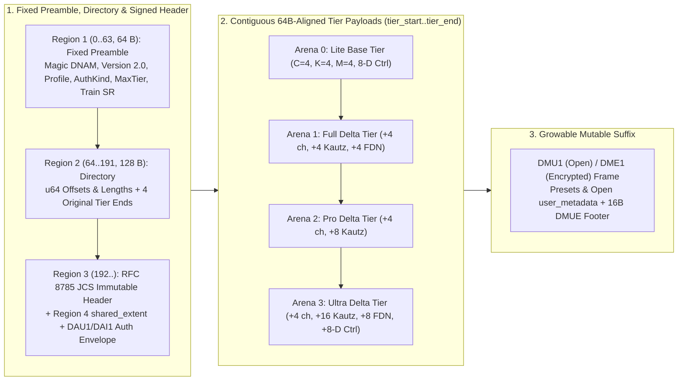

# `.dnam` Hybrid Binary Container & `< 50 ns` Zero-Copy Hardware Loader

DNAM defines four companion **64-byte cache-line and SIMD-aligned Hybrid Binary Container formats** engineered for zero-copy hardware loading ([`REQ-5.1`, `REQ-5.6`](../../requirements/system_goals_and_requirements.md#6-goal-5--single-run-slimmable-multi-tier-architecture-lite--full--pro--ultra), [`REQ-8.1`, `REQ-8.8`](../../requirements/system_goals_and_requirements.md#9-goal-8--model-provenance-hardware-drm-forensic-watermarking--marketplace-security), [`ADR-0009`](../../adr/0009-jcs-prefix-signing-hpke-and-preview-containment.md)):

1. `r[container.dnam.formats]` **`.dnam` (Magic `b"DNAM"`, Version `2.0`):** Runtime deployment model with a 64B preamble, 128B directory, RFC 8785 JCS immutable header, Region 4 `shared_extent` (`P * 64 B` `ControlClampDescriptor` table + overflow `CP1` contributor stream), `DAU1`/`DAI1` authentication envelope, four nested tier payloads (`Arena 0..3`: `Lite ⊂ Full ⊂ Pro ⊂ Ultra`), and a growable `DMU1`/`DME1` + `DMUE` mutable suffix.
2. **`.dnam-ckpt` (Magic `b"DNCK"`, Version `2.0`) & `.dnam-cache/*.dnce` (`v2.0`):** Single-file iterative training checkpoint organizing runtime weights, `uplo='U'` `Arena 4` sufficient statistics (`S1C1` + `DCA1`), and `DNCA` `Arena 5` calibration records (`24 KB` / `48 KB` `fp16` coresets) into truncatable tier bundles alongside workspace `.dnam-cache/*.dnce` (`v2.0`) sidecars ([`checkpoint_and_cache_format.md`](checkpoint_and_cache_format.md)).
3. **`.dnam-seal` (Magic `b"DNSL"`, Version `2.0`):** Opaque 64-byte-aligned OEM hardware-enclave wrapper (`DnamProtectionProfile::EnclaveSealed`, `DSA1` manifest; see [`../security/provenance_and_enclave_drm.md` §3](../security/provenance_and_enclave_drm.md#3-pillar-2-hardware-enclave--oem-drm-oemdevicecertificate-attestation--dnam-seal-bdnsl-wrapper)).
4. **`.dnam-prev`:** Dedicated `Lite`-only storefront auditioning container that physically omits `Full`, `Pro`, and `Ultra` payloads ([`../security/watermarking_and_marketplace.md` §3](../security/watermarking_and_marketplace.md#3-commercial-storefront-platform-auditioning-royalty-splits--storefront-metadata)).

---

## 1. Hybrid Binary Container Wire Framing & `< 50 ns` Zero-JSON Hardware Fast-Path

`r[container.dnam.wire-framing]`



```text
+-----------------------------------------------------------------------+ 0x0000 (Byte 0, 64B-aligned)
| 1. Fixed 64-Byte Binary Preamble (#[repr(C, align(64))], Little-End.) |
|    • 0..4:   magic = "DNAM" (or "DNCK" / "DNSL")                      |
|    • 4..8:   version_major = 2 (u16), version_minor = 0 (u16)         |
|    • 8..12:  protection_profile (u8), auth_kind (u8), max_tier (u8)   |
|    • 12..16: sample_rate_train_hz = 48000 (u32) | 16..64: zero (48 B) |
+-----------------------------------------------------------------------+ 0x0040 (Byte 64, 64B-aligned)
| 2. Fixed 128-Byte Directory (Bytes 64..191, Little-Endian u64)        |
|    • 0..16:  immutable_header_offset = 192, immutable_header_length   |
|    • 16..32: shared_binary_offset, shared_binary_length               |
|    • 32..48: authentication_envelope_offset, auth_envelope_length     |
|    • 64..104: tier_start (u64) + original_tier_ends[4] (Lite..Ultra)  |
+-----------------------------------------------------------------------+ 0x00C0 (Byte 192, 64B-aligned)
| 3. Canonical RFC 8785 JCS Immutable JSON Header + Zero Pad to 64 B    |
+-----------------------------------------------------------------------+ shared_binary_offset (64B-aligned)
| 4. Shared Binary Descriptors (shared_extent: P * 64B ControlClamp-    |
|    Descriptor Table + Overflow CP1 Stream) + Zero Pad to 64 B         |
+-----------------------------------------------------------------------+ authentication_envelope_offset (64B)
| 5. Authentication Envelope (DAU1 Open / DAI1 Protected) + Zero Pad    |
+=======================================================================+ tier_start (64B-aligned)
| 6A. Arena 0: Lite Base Tier Payload [tier_start .. lite_end]          | <- Lite strip boundary
+-----------------------------------------------------------------------+ original_tier_ends[0] (64B-aligned)
| 6B. Arena 1: Full Delta Tier Payload [lite_end .. full_end]           | <- Full strip boundary
+-----------------------------------------------------------------------+ original_tier_ends[1] (64B-aligned)
| 6C. Arena 2: Pro Delta Tier Payload [full_end .. pro_end]             | <- Pro strip boundary
+-----------------------------------------------------------------------+ original_tier_ends[2] (64B-aligned)
| 6D. Arena 3: Ultra Delta Tier Payload [pro_end .. ultra_end]          | <- Ultra strip boundary
+=======================================================================+ retained_tier_end (64B-aligned)
| 7. Growable Mutable Frame (DMU1 Open / DME1 HPKE) + 16-Byte DMUE      |
|    Footer (magic "DMUE" + u64 frame_len + u32 reserved=0)             |
+-----------------------------------------------------------------------+ EOF
```

### 1.1 Preamble & Directory Invariants

`r[container.dnam.preamble-directory]`

All integer fields are unsigned little-endian. Every binary region start (`shared_binary_offset`, `authentication_envelope_offset`, `tier_start`, and each issued `original_tier_ends[t]`) is `64 B`-aligned, strictly ordered, and checked against `u64` overflow before allocation (`validate_v2_dnam_layout_no_alloc`). Region 4 (`shared_extent`) packs the `P * 64 B` `ControlClampDescriptor` table followed by any overflow `CP1` contributor stream (`ADR-0007`). Header `slimmable_tiers.*.arena_end_byte_offset` and `tensor_directory.*.byte_offset` values are relative to `tier_start` so lower-tier buyer issuances retain the creator-signed immutable header unmodified.

### 1.2 Open `.dnam` Structural Layout

`r[container.dnam.open-layout]`

The fixed `64 B` preamble (`0..63`) and `128 B` directory (`64..191`) use the exact field offsets shown in the diagram above (`protection_profile = 0` for `Open`, `authentication_kind = 0` for creator-only and `1` for creator + buyer). Stripping a container to tier `T` retains the original preamble, directory, immutable header, shared binary, authentication envelope, and tier payloads through `original_tier_ends[T]`, placing the mutable frame and `DMUE` footer immediately after `original_tier_ends[T]` without re-signing.

#### Open Mutable Frame

`r[container.dnam.mutable-frame]`

Immediately after the retained tier boundary, every Open container places a growable `DMU1` frame followed by a `16 B` `DMUE` footer:

```text
Offset   Size     Field
  0        4      magic = ASCII "DMU1"
  4        4      Castagnoli CRC-32C over ("DMU1" || u64le(N) || JSON bytes)
                  (poly 0x82F63B78, init/XOR 0xFFFFFFFF; "{}" = 0xA1CCB48F, "123456789" = 0xE3069283)
  8        8      UTF-8 JSON byte length N (N >= 2)
 16        N      UTF-8 RFC 8259 JSON object (no BOM, no duplicate keys)
16+N      pad     Optional zero-filled padding
EOF-16    16      Footer: ASCII "DMUE" (4 B) || u64le(frame_len) || 0u32 (4 B)
```

Protected containers replace `DMU1` with the HPKE-wrapped `DME1` frame using the same `16 B` `DMUE` footer ([`../security/provenance_and_enclave_drm.md` §3.3](../security/provenance_and_enclave_drm.md#encrypted-mutable-suffix)).

#### Mutable JSON Members

`r[container.dnam.mutable-json]`

| Member | Type & Specification |
| :--- | :--- |
| `version` | Optional schema version (`1` when present; omitted defaults to `1`). |
| `presets` | Array of preset objects (`id`, `name`, `controls: dict[str, float \| str]`, optional `description`, `user_metadata`). |
| `user_metadata` | Open JSON object for model-level catalog tags and host data. |
| `control_user_metadata` | Object mapping signed `control_id` strings to open metadata objects. |
| `stem_user_metadata` | Object mapping signed checkpoint `stem_id` strings to open metadata objects. |

On container load, the loader validates the `DMU1`/`DME1` CRC-32C and `DMUE` footer and merges mutable `presets`, `user_metadata`, `control_user_metadata`, and `stem_user_metadata` over the signed immutable header view without modifying the authenticated prefix bytes. Loading a partial preset restores signed defaults for all omitted controls at the effective tier before overlaying the preset's assignments and applying whole-batch conditional clamping ([`../dsp/parametric_control_bus.md` §2.4.1](../dsp/parametric_control_bus.md#conditional-batch-safety)).

---

## 2. Tier-Prefix Hardware Loading

### 2.1 Lower-Block-Triangular Tier Payloads

`r[container.dnam.tier-prefix]`

`Arena 0` stores the `Lite` base parameters once; `Arena 1..3` store only the newly introduced `Full`, `Pro`, and `Ultra` delta slices. Every runtime path gates execution at its active effective tier `T`.

### 2.2 Model-Declared Delay Histories (`delay_histories`)

`r[container.dnam.delay-histories]`

The signed immutable JSON header declares all required `Op-T` delay and all-pass histories in `delay_histories`:

```json
{
  "id": "pre.left",
  "stage": "stage1_pre",
  "kind": "fractional",
  "introduced_tier": "lite",
  "sample_format": "fp16",
  "reference_samples": { "lite": "432000" }
}
```

Each `reference_samples` entry is canonical ASCII decimal text parsed as a nonzero `u64` (avoiding IEEE-754 `binary64` integer limits) and admitted against the host memory ceiling on the cold path ([`../dsp/op_t_transport.md` §1.1](../dsp/op_t_transport.md#11-exact-sized-delay-histories-and-branchless-wrap)).

### 2.3 Pre-Packed SIMD Data & Load-Time Validation

`r[container.dnam.load-validation]`

Loaders validate all tensor offsets, 64-byte alignments, shapes, finite coefficients, and signature commitments before exposing zero-copy tensor views, and initialize recursive stages to their resting DC equilibrium states ([`../dsp/op_n_commuted_cascade.md` §3.4](../dsp/op_n_commuted_cascade.md#34-boundary-conditions-resting-dc-equilibrium--pop-free-startup)).

`r[container.dnam.tensor-directory]` **Canonical 64B-Aligned Tier Arena Slice Directory (`ADR-0011`):**
Every slice declared in `tensor_directory` has a 64-byte-aligned `byte_offset` relative to `tier_start` (`byte_offset % 64 == 0`), a `byte_length` within its owning tier's prefix boundary `original_tier_ends[t] - tier_start`, and uses the canonical per-tier slice identifiers below:

| Slice Identifier | Owning Tier Arena | Element Shape & Layout | Aligned Size |
| :--- | :---: | :--- | :---: |
| `stage0_router` | `Arena 0` (`Lite`) | `S_router[4, 4]` (`S_ret->send == 0`) + alignment/crossover metadata (`16 x f32`) | `64 B` (`1 CL`) |
| `stage1_pre_{lite,full,pro,ultra}` | `Arena 0..3` | `Op-M[Pre]` 4-lane complex poles + `Op-T[Pre]` / `Op-N[Pre]` base scalars (`32 x f32`) | `128 B` (`2 CL`) |
| `stage2_commuted_{lite,full,pro,ultra}` | `Arena 0..3` | Commuted `W_k^(s)` base + `D_s` latent mode weights (`16 x f32` per tier block) | `64 B` (`1 CL`) |
| `stage3_early_fir_{lite,full,pro,ultra}` | `Arena 0..3` | `16` Left `f32` taps + `16` Right `f32` taps (`32 x f32`, `ref[container.dnam.stage3-slices]`) | `128 B` (`2 CL`) |
| `stage3_kautz_modals_{lite,full,pro,ultra}` | `Arena 0..3` | `1 / 1 / 2 / 4` blocks of 8-vector SoA Kautz poles (`ref[container.dnam.stage3-slices]`) | `128..512 B` |
| `stage4_tank_{lite,full,pro,ultra}` | `Arena 0..3` | Per-group delay lengths, `a_diff`, `g_lin`, `V_ceil`, `sigma_knee` & Householder `v` (`16 x f32`/group) | `64..128 B` |
| `head_kronecker_{lite,full,pro,ultra}` | `Arena 0..3` | Mid/Side Kronecker weights `W_head[1 + D_h, 2, 64]` + bias `b_head[1 + D_h, 2]` | `2,560..4,608 B` |
| `control_projection_lite` / `_ultra_delta` | `Arena 0` / `Arena 3` | Concatenated `CP1` contributor stream (`ref[container.dnam.cp1-profile]`, padded to `64 B`) | `64 B * ceil(...)` |
| `control_interaction_lite` / `_ultra_delta` | `Arena 0` / `Arena 3` | `[4, 8]` base (`128 B`) / `[3, 4, 8]` Ultra delta (`384 B`) FM matrices (`0 B` if `< 2` controls) | `0 / 128 / 384 B` |
| `control_dispatch_lite` / `_ultra_delta` | `Arena 0` / `Arena 3` | `W_ctrl^base[16, 16]` (`1,024 B`) / `W_ctrl,Delta^Ultra[4, 16]` (`256 B`) | `1,024 / 256 B` |

---

### 2.4 Tier-Local Projection & Stage III Slice Layout

#### Stage III Separate 64B-Aligned Early FIR & Kautz Modal Slices

`r[container.dnam.stage3-slices]`

Each tier stores its Stage III early FIR taps and shared-pole Kautz modal blocks in separate, non-overlapping 64-byte-aligned slices ([`../dsp/op_m_modal_kautz.md` §4.1](../dsp/op_m_modal_kautz.md#41-stage-iii-architecture--tier-allocation)):
- **Early FIR Slice (`stage3_early_fir`, `128 B = 2 CL` per tier):** 16 left `f32` taps followed by 16 right `f32` taps (`taps 0..15` in `Lite`, `16..31` in `Full`, `32..47` in `Pro`, `48..63` in `Ultra`; `512 B` cumulative).
- **Kautz Modal Slice (`stage3_kautz_modals`, `128 B = 2 CL` per 4-mode SoA block):** Packs 4 shared pole pairs per `128 B` block as eight consecutive `f32 × 4` SIMD vectors (`[r_low, dr, theta, b_gamma, c_re_l, c_im_l, c_re_r, c_im_r]`):

```text
+-----------------------------------------------------------------------------------+
| STAGE III 64B-ALIGNED SLICE LAYOUT ACROSS ARENA 0..3                              |
+-----------------------------------------------------------------------------------+
|  Tier    | New Pairs | Early FIR Slice | Kautz Modal Slice (8-Vec SoA) | Subtotal |
|  Lite    |     4     |  128 B (2 CL)   |  1 block  =   128 B (2 CL)    |   256 B  |
|  Full    |     4     |  128 B (2 CL)   |  1 block  =   128 B (2 CL)    |   256 B  |
|  Pro     |     8     |  128 B (2 CL)   |  2 blocks =   256 B (4 CL)    |   384 B  |
|  Ultra   |    16     |  128 B (2 CL)   |  4 blocks =   512 B (8 CL)    |   640 B  |
|  Total   |    32     |  512 B (8 CL)   |  8 blocks = 1,024 B (16 CL)   | 1,536 B  |
+-----------------------------------------------------------------------------------+
```

#### Packed Control Projection Profile

`r[container.dnam.cp1-profile]`

The `CP1` profile orders logical contributors by `controls_schema` order: each `range` with `lobatto_degree = k > 0` contributes one `k`-lane record (`k = 0` emits no record), and each switch option in `represented_switch_options` contributes one `1`-lane record:

```text
+-----------------------------------------------------------------------------------+
| CP1 CONTRIBUTOR RECORDS & GLOBAL CONTROL MATRICES                                 |
+-----------------------------------------------------------------------------------+
|  Per-Contributor Record (k active lanes, concatenated in contributor order):      |
|    • control_projection_lite (Arena 0):        main_base[k][8] + emb[k] + v[4]    |
|                                                = (9k + 4) f32 = 4(9k + 4) B       |
|    • control_projection_ultra_delta (Arena 3): main_delta[k][8] + v_delta[4]      |
|                                                = (8k + 4) f32 = 4(8k + 4) B       |
+-----------------------------------------------------------------------------------+
|  Global Control Tensors (64B-aligned):                                            |
|    • control_interaction_lite        (Arena 0, [4, 8],      128 B =  2 CL)        |
|    • control_interaction_ultra_delta (Arena 3, [3, 4, 8],   384 B =  6 CL)        |
|    • control_dispatch_lite           (Arena 0, [16, 16],  1,024 B = 16 CL)        |
|    • control_dispatch_ultra_delta    (Arena 3, [4, 16],     256 B =  4 CL)        |
+-----------------------------------------------------------------------------------+
```

When fewer than two distinct physical controls have contributors, both interaction tensors are omitted (`0 B`).

#### Conditional Control Rules

`r[container.dnam.conditional-rules]`

Conditional safety bounds (`conditional_bounds`) and multi-range physical calibration (`calibration.conditional_physical_anchors`) use structured switch conjunctions (`when: [{"control_id": "...", "option_id": "..."}]`) ordered by `controls_schema` rather than delimiter-joined `"switch=option"` strings:

```json
{
  "conditional_bounds": [
    {
      "when": [
        { "control_id": "range", "option_id": "long" },
        { "control_id": "voicing", "option_id": "lead" }
      ],
      "min": 0.2,
      "max": 0.8
    }
  ],
  "calibration": {
    "conditional_physical_anchors": [
      {
        "when": [{ "control_id": "range", "option_id": "long" }],
        "anchors": [10.0, 100.0, 1000.0]
      }
    ]
  }
}
```

All matching `conditional_bounds` entries are intersected (`[L, U - 1]` inward `f32` rank intersection); for calibration, the matching entry with the greatest selector specificity is selected (reporting any specificity tie as ambiguous).

---

## 3. Essential Metadata, Provenance, Presets, `ui_hints` & Open `user_metadata`

`r[container.dnam.metadata-ui-hints]`

1. **Minimal Standardized `metadata`:** `name`, `author`, `description`, `license`, `created_at`, `input_reference_dbfs`, per-tier `slimmable_tiers` (`loudness_lufs`, `output_trim_db`, `validation_esr_db`), and content-addressed `provenance` (`dataset_manifest_sha256`, `config_recipe_sha256`).
2. **Intrinsic Per-Control `ui_hints`:** `section`, `order`, `size` (`"sm" | "md" | "lg"`), `color_hex`, `widget` (`"knob" | "slider" | "trim"` or `"toggle" | "segmented" | "rotary_select" | "footswitch"`), `polarity`, `detents`, `step`, `decimals`, `scale_labels`, `option_labels`, and midpoint-anchored power-skew curve:
   $$\gamma_{\text{skew}} = \frac{\ln(0.5)}{\ln\left(\frac{x_{\text{mid}} - x_{\min}}{x_{\max} - x_{\min}}\right)}, \qquad x(t) = x_{\min} + (x_{\max} - x_{\min}) t^{1 / \gamma_{\text{skew}}}, \qquad t(x) = \left(\frac{x - x_{\min}}{x_{\max} - x_{\min}}\right)^{\gamma_{\text{skew}}}$$
3. **Per-Control Physical Calibration (`controls_schema[*].calibration`):** `role`, `lobatto_physical_anchors`, `conditional_physical_anchors`, and `tempo_sync_default_subdivision`.
4. **Model-Level `io_config.capabilities` & `io_config.leveling`:** `blend_mode`, `default_blend`, `wet_polarity_inverted`, `supports_trails`, `tempo_sync_capable`, `supports_freeze`, and default-control-anchored `rms_dbfs` / `k_weighted_lufs` auto-unity leveling.

---

## 4. Training Sample-Rate Anchoring & Continuous-Time ZOH Cross-Reference

`r[container.dnam.sample-rate-anchor]`

All `.dnam` models serialize discrete-time parameters at the canonical reference rate `sample_rate_train_hz = 48000` (including Stage III's 16-sample modal onset). Source captures at other sample rates are converted to aligned `48 kHz` working copies during training while preserving source PCM provenance. At runtime, hosts executing at $44.1\text{–}96\text{ kHz}$ or $4\times$ offline bounce apply the ZOH transformations in **[`../dsp/router_and_stages_topology.md` §9](../dsp/router_and_stages_topology.md#9-continuous-time-zero-order-hold-zoh-sample-rate-adaptability-44196-khz--4-bounce)**.

---

## 5. Canonical `.dnam` JSON Header Schema

`r[container.dnam.jcs-header-schema]`

The RFC 8785 JCS immutable header contains only signed structural, provenance, `io_config`, `controls_schema`, `delay_histories`, `slimmable_tiers`, and `tensor_directory` members; mutable presets and `*_user_metadata` reside in the `DMU1`/`DME1` suffix (`§1.2`), and cryptographic signatures reside in the authentication envelope (`§6`).

---

## 6. Marketplace Security, Signatures & Hardware DRM Cross-Reference

`r[container.dnam.security-crossref]`

| Container Security Mechanism | Wire / Envelope Realization | Canonical Specification |
| :--- | :--- | :--- |
| **Preset-Safe Canonical Digest** | SHA-256 of the projected RFC 8785 JCS immutable header (`immutable_header_sha256`). | [`../security/provenance_and_enclave_drm.md` §2.1](../security/provenance_and_enclave_drm.md#21-preset-safe-canonical-header-digest-rfc-8785-jcs) |
| **Creator Exclusivity Policy** | `metadata.distribution_policy` (`allowed_protection_profiles`, `allowed_oem_vendors`). | [`../security/provenance_and_enclave_drm.md` §2.2](../security/provenance_and_enclave_drm.md#22-creator-signed-distributionpolicy--protection-profile-exclusivity) |
| **2-Certificate `Ed25519` Delegation & 4-Tier Stripping** | `DAU1` (Open) and `DAI1` (Protected) envelopes binding creator and buyer 4-tier prefix-digest lists. | [`../security/provenance_and_enclave_drm.md` §2.3](../security/provenance_and_enclave_drm.md#23-two-certificate-ed25519-delegation-chain--4-tier-cumulative-arena-digests) |
| **OEM Hardware Enclave & `.dnam-seal` (`b"DNSL"`)** | `DSA1` outer manifest + RFC 9180 HPKE recipient slots + `ChaCha20-Poly1305` tier records. | [`../security/provenance_and_enclave_drm.md` §3](../security/provenance_and_enclave_drm.md#3-pillar-2-hardware-enclave--oem-drm-oemdevicecertificate-attestation--dnam-seal-bdnsl-wrapper) |
| **Dual-Mechanism Buyer Watermarking (`Arena 0..3`)** | Reciprocal-scaling gauge + Coupled Tardos buyer code across all tier slices. | [`../security/watermarking_and_marketplace.md` §1](../security/watermarking_and_marketplace.md#1-pillar-3-forensic-traitor-tracing--02-ms-dual-mechanism-buyer-watermarking) |
| **3 Container Protection Profiles** | `DnamProtectionProfile::{Open, DeviceAllowlisted, EnclaveSealed}`. | [`../security/provenance_and_enclave_drm.md` §4](../security/provenance_and_enclave_drm.md#4-three-container-protection-profiles-dnamprotectionprofile--loader-auto-detection) |
