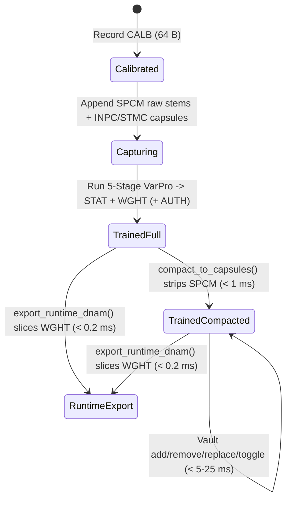

# Single-File Cloud-Ready Project & Capture Vault Container (`.dnam-proj` / `DNPJ`)

This specification defines the **`.dnam-proj` (`b"DNPJ"`, `v2.0`-Only) Project & Capture Vault Binary Format** owned by [`packages/capture/`](../../../packages/capture/README.md) (`dnam_capture::proj`), pairing with the runtime `.dnam` wire specification in [`dnam_binary_format.md`](dnam_binary_format.md) to fulfill [`REQ-3.1`–`REQ-3.3`, `REQ-5.3`, `REQ-8.1`, `REQ-8.2`, `REQ-8.8`](../../requirements/system_goals_and_requirements.md). For architectural trade-offs and cloud object-storage design rationales, see [`../../adr/0008-per-stem-kronecker-statistics-and-wide-gram.md`](../../adr/0008-per-stem-kronecker-statistics-and-wide-gram.md), [`../../adr/0017-pure-rust-analytical-varpro-solver-and-planar-decoupling.md`](../../adr/0017-pure-rust-analytical-varpro-solver-and-planar-decoupling.md), and [`../../adr/0020-modular-monorepo-and-dnam-proj-container.md`](../../adr/0020-modular-monorepo-and-dnam-proj-container.md).

---

## 1. Front-Loaded Cloud-Ready Wire Framing & Chunk Directory



```text
+===================================================================================================+
| .dnam-proj ("DNPJ", v2.0) FRONT-LOADED 64-BYTE-ALIGNED CLOUD WIRE LAYOUT                          |
+===================================================================================================+
| [0 .. 64)                  DnamProjPreamble (64 B = 1 Cache Line)                                 |
|   [0..4]    magic = b"DNPJ"           | [4..6]   version_major = 2    | [6..8]   version_minor = 0|
|   [8..12]   lifecycle_flags (u32 LE)  | [12..16] chunk_count (N)      | [16..24] chunk_dir_offset |
|   [24..32]  manifest_offset           | [32..40] manifest_len (exact) | [40..44] header_crc32c    |
|   [44..64]  reserved = [0u8; 20]      |                                                           |
+---------------------------------------------------------------------------------------------------+
| [64 .. 64 + 64*N)          Chunk Directory: N x ProjChunkDirEntry (64 B each, non-overlapping)    |
|   [0..4]    kind FourCC ("CALB"|"SPCM"|"INPC"|"STMC"|"STAT"|"WGHT"|"AUTH")                        |
|   [4..8]    chunk_id (u32 LE)         | [8..12]  flags (u32 LE)       | [12..16] crc32c (u32 LE)  |
|   [16..24]  offset (64 B aligned)     | [24..32] length (exact bytes) | [32..64] sha256 ([u8; 32])|
+---------------------------------------------------------------------------------------------------+
| [manifest_offset .. align64(manifest_offset + manifest_len))  RFC 8785 JCS Manifest + 0x00 pad    |
+---------------------------------------------------------------------------------------------------+
| [Payload Region: 64 B-aligned chunks in contiguous ascending file-offset order]                   |
|   • CALB (64 B)                        Loopback latency, converter gain, noise-floor profile      |
|   • SPCM (optional raw PCM stems)      Active-session lossless audio (stripped on compaction)     |
|   • INPC (24,640 B mono / 48,640 B st) Shared 250 ms fp16 dry excitation coreset                  |
|   • STMC (28,800 B mono / 52,800 B st) 128 B hdr + R<=36 16 B windows + 4,096 B spec + fp16 wet   |
|   • STAT (267,264 B at Ultra 256-D)    StarCenter uplo='U' f64 Gram + 2-ch cross-correlation      |
|   • WGHT (canonical v2.0 .dnam bytes)  Complete [STAB-ZERO-DC] runtime model (< 0.2 ms export)    |
|   • AUTH (128 B Ed25519 envelope)      Creator signature ("DNPJ-PROJECT-MANIFEST-V2")             |
+===================================================================================================+
```

### 1.1 64B Preamble & Content-Addressed Chunk Directory

`r[container.proj.preamble-and-directory]`

Every `.dnam-proj` container is a single declarative, code-execution-free binary file (`REQ-8.8`) starting with a `64 B` `DnamProjPreamble` at byte `0` (`magic = b"DNPJ"`, `version_major = 2`, `version_minor = 0`; prototype `v1` containers are rejected unconditionally):

1. **Front-Loaded `HTTP Range` Inspectability:** `chunk_dir_offset` must equal `64`, and `manifest_offset` must equal `64 + 64 * chunk_count`, placing the entire Preamble, Chunk Directory, and JCS Manifest at the front of the file so cloud storage clients (`HTTP Range: bytes=0-65535`) can parse all project metadata and chunk `SHA-256` digests in a single range read (`parse_proj_manifest_range`, or a second exact range read to `align64(manifest_offset + manifest_len)` if the header exceeds `64 KB`) without fetching payload chunks.
2. **Strict `64 B` Alignment & Bounds Validation:** The total file byte length, `manifest_offset`, `align64(manifest_offset + manifest_len)`, and every chunk `offset` must be exact multiples of `64 B`. `header_crc32c` (at bytes `40..44`) covers bytes `0..40` of the preamble concatenated with the `64 * chunk_count` directory bytes and the exact `manifest_len` unpadded JCS manifest bytes, while padding bytes `[manifest_offset + manifest_len .. align64(manifest_offset + manifest_len))` must be `0x00`. Every `ProjChunkDirEntry` must specify a known FourCC (`CALB`, `SPCM`, `INPC`, `STMC`, `STAT`, `WGHT`, or `AUTH`), contiguous non-overlapping ascending `64 B`-aligned file bounds, zeroed padding (`0x00`) between `offset + length` and the next `64 B` boundary, and matching `CRC32C` + `SHA-256` digests over its exact `length` bytes. Unknown `lifecycle_flags` bits, non-zero `reserved` bytes (`44..64`), truncated files, or digest mismatches fail fast with `DnamError`.

### 1.2 RFC 8785 JCS Project Manifest

`r[container.proj.jcs-manifest]`

The manifest slice at `[manifest_offset .. manifest_offset + manifest_len)` stores a strict UTF-8 **RFC 8785 JSON Canonicalization Scheme (`JCS`)** serialization of `DnamProjManifest` (zero-padded with `0x00` to the next `64 B` boundary), rejecting UTF-8 BOMs, duplicate JSON keys, unknown schema fields, and non-canonical key ordering:

| Manifest Section | Required Fields | Normative Invariant |
| :--- | :--- | :--- |
| **Envelope & Nested `base` Header** | `version = "2.0.0"`, `container_kind = "dnam-proj"`, `base` (`DnamJsonHeader` with `base.container_kind = "dnam"`) | Shares the exact validated runtime `DnamJsonHeader` schema with `dnam-engine` (`ref[container.dnam.jcs-header-schema]`). |
| **`project_meta`, `rig_routing` & `calibration_summary`** | `project_meta.{project_id, rig_notes, updated_at}`, `rig_routing.{sample_rate_device_hz, bit_depth, input_channels, output_channels, reamp_send_channel}`, `calibration_summary` | Tracks project identity, native hardware rate (`8..384 kHz`), bit depth (`int12`, `int16`, `int24`, `int32`, `float32`), and `CALB` telemetry. |
| **`stems_registry`** | Ordered `StemRegistryEntry` list (`stem_id`, `chunk_id`, `enabled`, `is_star_center`, `controls_meta`, `provenance`, `user_metadata`, `extracted_physics`) | Binds each stem's `chunk_id` (`u16` `STMC` `stem_index`), `SHA-256` dry/wet `<f4` PCM provenance, and `DNAM-GRAM-INPUT-v2` fingerprint (`REQ-3.2`). |
| **`audit_report` & `solver_telemetry`** | `audit_report` (`AuditReportSummary`), `solver_telemetry.{active_stem_count, total_solve_ms, tier_esr_db}` | Persists Phase-1 control-space audit clamps and 4-tier ESR certification metrics across incremental vault edits. |

### 1.3 Lifecycle States, Capsule Compaction & Cloud Range Sync

`r[container.proj.lifecycle-states]`

A `.dnam-proj` container transitions monotonically or non-destructively across valid flag-consistent lifecycle configurations (`PROJ_FLAG_HAS_CALIBRATION`, `PROJ_FLAG_HAS_RAW_STEMS`, `PROJ_FLAG_HAS_CAPSULES`, `PROJ_FLAG_COMPACTED_CAPSULES`, `PROJ_FLAG_HAS_STAT`, `PROJ_FLAG_HAS_WGHT`, `PROJ_FLAG_HAS_AUTH`, `PROJ_FLAG_STEREO_OUT`):

1. **Active Capture (`CALB` + `SPCM` + `INPC`/`STMC`):** Retains lossless raw `SPCM` audio stems alongside extracted `INPC`/`STMC` capsules during active hardware recording.
2. **Trained Full Project (`+ STAT + WGHT`):** Embeds `StarCenter` `uplo='U'` sufficient statistics (`STAT`) and the certified 4-tier `.dnam` runtime model (`WGHT`).
3. **Capsule Compaction (`compact_to_capsules`, `< 1 ms`):** Requires `INPC` and `STMC` capsules whenever `stems_registry` is non-empty, strips all raw `SPCM` chunks in place without re-running solver passes, preserves `PROJ_FLAG_COMPACTED_CAPSULES` across capsule-only vault edits, and shrinks multi-stem projects to compact capsules (`~0.8–2.5 MB`) that still support `< 25 ms` full re-pooling and `< 0.2 ms` runtime `.dnam` export (`REQ-3.1`, `REQ-3.3`).

---

## 2. Capture Capsules & Compositional Sufficient Statistics

### 2.1 Shared Input Coreset Capsule (`INPC`)

`r[container.proj.inpc-capsule]`

The `INPC` chunk (`chunk_id = 0`) stores the shared `250 ms` (`12,000`-frame at `48 kHz`) dry excitation coreset quantized to IEEE-754 binary16 (`fp16`, round-to-nearest-even with full 10-bit subnormals) inside a fixed `64 B`-aligned record (`24,640 B` for mono `C_in = 1`, or `48,640 B` for stereo `C_in = 2`), prefixed by a `640 B` `INPC` header (`magic = b"INPC"`, `version = 2`, `channels`, `coreset_frames = 12_000`, `header_crc32c` at `24..28`, `256 B` dry spectral envelope, and `320 B` transient/comb leverage index).

### 2.2 Per-Stem Response Coreset Capsule (`STMC`)

`r[container.proj.stmc-capsule]`

Each stem $s$ in `stems_registry` owns a dedicated `STMC` chunk (`chunk_id == stem_index`) of fixed `64 B`-aligned size (`28,800 B` for mono `C_out = 1`, or `52,800 B` for stereo `C_out = 2`) containing:
1. **`128 B` `STMC` Header (`magic = b"STMC"`, `version = 2`):** `stem_index` (`u16`, matching `StemRegistryEntry::chunk_id`), `flags` (`STMC_FLAG_ENABLED`, `STMC_FLAG_STAR_CENTER`, `STMC_FLAG_MODE_A_SWEEP`, `STMC_FLAG_STEREO`, verified in strict bijection with `stems_registry`), `window_count` (`1..=36`), `pad_gain_f32`, `fractional_lag_samples_f32`, `88 B` `uplo='U'` band-energy PSD summary (`24..112`), `n_comb_bins` (`112..116`), `coreset_frames = 12_000` (`116..120`), and `capsule_crc32c` (`120..124`).
2. **`576 B` Trajectory Window Table (`128..704`) & `4,096 B` Spectral Summary (`704..4,800`):** Up to `R <= 36` `16 B` `StmcTrajectoryWindow` records (`control_id`, `ctrl_kind`, `active_opt`, `u_phys`, `window_weight`, `emr_velocity`) driving Phase-1 range/switch unlocking and `CP1` Newton-Lobatto assembly, followed by a `4,096 B` harmonic/sideband/ballistic summary block.
3. **`24,000 B` (`C_out = 1`) / `48,000 B` (`C_out = 2`) `fp16` Aligned Wet Coreset (`4,800..`):** Exact `12,000`-frame phase-aligned wet response paired sample-for-sample with `INPC`.

### 2.3 Tier-Ordered Upper-Triangular `StarCenter` Statistics (`STAT`)

`r[container.proj.stat-uplo-u]`

The `STAT` chunk stores the `StarCenter` (`Mode-0`) feature-bus sufficient statistics in **tier-ordered column-major upper-triangular (`uplo = 'U'`) `IEEE-754 float64` layout** (`Lite` `64-D` $\subset$ `Full` `128-D` $\subset$ `Pro` `192-D` $\subset$ `Ultra` `256-D`, `REQ-5.3`):
$$\mathrm{idx}(i, j) = i + \frac{j(j + 1)}{2}, \qquad 0 \le i \le j < D_T$$
At tier dimension $D_T \in \lbrace 64, 128, 192, 256 \rbrace$, `STAT` packs $\frac{D_T(D_T + 1)}{2}$ upper-triangular `f64` Gram entries ($\mathbf{G}_0$, `263,168 B` at `D = 256`) followed immediately by $2 \times D_T$ `f64` two-channel cross-correlation entries ($\mathbf{C}_0$, `4,096 B` at `D = 256`, total `267,264 B` = `4,176` cache lines), verified on load for exact byte length, finite `f64` values, and non-negative diagonal entries $G_{ii} \ge 0$.

---

## 3. Embedded Runtime Model & Provenance Envelope

### 3.1 Embedded Runtime Weights & Zero-Solve `.dnam` Export (`WGHT`)

`r[container.proj.wght-and-export]`

Every trained `.dnam-proj` embeds a complete, self-contained `v2.0` `.dnam` container inside its `WGHT` chunk (`ref[container.dnam.open-layout]`):
1. **`[STAB-ZERO-DC]` Hard Invariant (`b_head == 0.0`):** Both container assembly (`build_dnam_proj_container_with_cp1`) and `DnamProjView::from_bytes` verify that all output-head DC bias slots across `Arena 0` (`Lite`) through `Arena 3` (`Ultra`) are strictly `0.0` (`b_head = 0`), rejecting non-zero DC bias payloads immediately.
2. **Zero-Solve Runtime Export (`export_runtime_dnam`, `< 0.2 ms`):** Exporting a deployable `.dnam` file at any target `max_tier` (`Lite`, `Full`, `Pro`, or `Ultra`) validates `DistributionPolicy`, merges mutable `presets`, `user_metadata`, and `controls_schema[*].user_metadata` into the `DMU1` suffix (automatically growing compact `48 B` `DMU1` frames up to the `4,096 B` `DMU1` + `DMUE` trailer ceiling), and applies lossless keyless prefix truncation (`strip_container_to_tier`, `ref[container.dnam.tier-prefix]`) with zero solver recomputation.

### 3.2 Cryptographic Provenance Envelope (`AUTH`)

`r[container.proj.auth-signature]`

When signed (`PROJ_FLAG_HAS_AUTH`), the `AUTH` chunk stores a `128 B` (`2`-cache-line) `ProjAuthRecord` (`magic = b"AUTH"`, `version = 2`, `signer_pubkey_ed25519: [u8; 32]` at `32..64`, `signature_ed25519: [u8; 64]` at `64..128`) containing an `Ed25519` signature over the domain-separated message (`b"DNPJ-PROJECT-MANIFEST-V2"` + immutable JCS `DnamProjManifest` `SHA-256` + ordered non-`AUTH` `ProjChunkDirEntry` `(kind, chunk_id, length, sha256)` tuples). Any tampering with the immutable manifest fields, chunk directory, `STMC` stem capsules, `STAT` Gram entries, or `WGHT` weights fails fast with `DnamError::CryptoVerificationFailed`.
