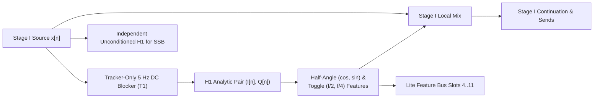

# Op-M: Universal Symplectic Modal, Hilbert, Sub-Harmonic & Kautz Operator

This specification defines **Op-M (Modal)** ([`packages/engine/src/operators/op_m.rs`](../../../packages/engine/README.md), [`packages/trainer/src/`](../../../packages/trainer/README.md)), the universal operator kernel governing 4-lane SIMD symplectic complex-state recurrence, quadrant-reduced contractive rotors, `H1` Hilbert single-sideband generation, `T1` bistable sub-harmonic synthesis, shared-pole Stage III Kautz modal cabinets, and the `3 kHz` ballistic control engine across **Dynamic Neural Audio Modeler (DNAM)** ([`tora_architecture.md`](../architecture/tora_architecture.md), [`REQ-1.2`, `REQ-2.5`](../../requirements/system_goals_and_requirements.md)). For R&D derivations and counterexamples, see [`../../adr/0005-contractive-rotor-hilbert-and-t1-tracker.md`](../../adr/0005-contractive-rotor-hilbert-and-t1-tracker.md).

---

## 1. 4-Lane SIMD Symplectic Complex Recurrence & Algebraic Rotor

### 1.1 Complex State Recurrence

`r[dsp.op-m.recurrence.symplectic]`

Op-M maintains 4 parallel complex state variables $z_c[n] = z_{\mathrm{re}, c}[n] + i z_{\mathrm{im}, c}[n] \in \mathbb{C}$ for $c \in [0, 1, 2, 3]$:
$$z_c[n] = a_c[n] z_c[n-1] + \tilde{b}_c[n] x_c[n], \qquad a_c[n] = r_c[n] \cdot u_{\mathrm{rot}, c}[k], \qquad |r_{c,\mathrm{ref}}[n]| \le 0.9995, \quad |u_{\mathrm{rot}, c}| \le 1.000000000000$$

In Cartesian components, with $u_{\mathrm{rot}, c} = c_{\mathrm{rot}, c} + i s_{\mathrm{rot}, c}$, $\alpha_{\mathrm{re}, c}[n] = r_c[n] c_{\mathrm{rot}, c}$, and $\alpha_{\mathrm{im}, c}[n] = r_c[n] s_{\mathrm{rot}, c}$ (matching $O(\log_2 L)$ associative parallel scan evaluation in `f64` within $< 10^{-13}$):
$$z_{\mathrm{re}, c}[n] = \alpha_{\mathrm{re}, c}[n] z_{\mathrm{re}, c}[n-1] - \alpha_{\mathrm{im}, c}[n] z_{\mathrm{im}, c}[n-1] + b_{\mathrm{re}, c} x_c[n]$$
$$z_{\mathrm{im}, c}[n] = \alpha_{\mathrm{im}, c}[n] z_{\mathrm{re}, c}[n-1] + \alpha_{\mathrm{re}, c}[n] z_{\mathrm{im}, c}[n-1] + b_{\mathrm{im}, c} x_c[n]$$

`r[dsp.op-m.recurrence.stereo-simd]` **4-Lane Stereo Symplectic & Kautz SIMD Recurrence ([`ADR-0019`](../../adr/0019-simd-kernel-architecture-and-realtime-execution-optimizations.md)):** In both Stage I (`SymplecticModal4Lane::step_4lane_stereo_simd` / `step_4lane_stereo_simd_with_readout`) and Stage III (`KautzModalBank<4>::step_4lane_stereo_simd_splatted` / `step_4lane_stereo_simd_unscaled`), Left and Right channel states `(z_re_l, z_im_l, z_re_r, z_im_r)` are stepped together in 4-pole `B::Vec4` SIMD blocks sharing the same loaded pole radii and rotor vectors `(r_c, cos_c, sin_c)`, halving parameter-load bandwidth and loop overhead relative to separate per-channel calls.

### 1.2 Contractive Finite-Precision Rotor

`r[dsp.op-m.rotor.contractive]`

To guarantee $|u_{\mathrm{rot}, c}| \le 1.0$ in IEEE-754 `f32` without `libm` calls, hardware `FDIV`, or `FSQRT`, evaluate signed `f32` angles $-\pi < \theta < \pi$ at the control boundary as follows:

```text
+---------------------------------------------------------------------------------------------------+
| QUADRANT-REDUCED CONTRACTIVE ROTOR & Q0.192 LFO PHASE ACCUMULATOR                         |
+---------------------------------------------------------------------------------------------------+
|  1. Zero-Increment Hold: If theta == ±0.0f32 -> return (1.0f32, 0.0f32) & hold oscillator state   |
|  2. Quadrant Reduction:  Widen |theta| to f64 -> fold across pi/2 and pi/4 into x in [0, pi/4]    |
|  3. Horner Evaluation:   z = x^2; evaluate degree-13 S(x) and degree-14 C(x) in RNE f64 -> (c, s) |
|  4. Adaptive ULP Guard:  If RNE_f64(c^2 + s^2) >= 1.0 -> decrement larger |c|,|s| by 1..2 f32 ULP |
+---------------------------------------------------------------------------------------------------+
```

1. `r[dsp.op-m.rotor.zero-hold]` **Exact Zero-Increment Hold:** For $\theta = \pm 0.0\text{f32}$, return `(1.0f32, 0.0f32)` and skip LFO state rotation/stabilization so zero-frequency LFOs hold their state bit-for-bit.
2. `r[dsp.op-m.rotor.quadrant-horner]` **Quadrant Reduction to $[0, \pi/4]$:** Using `pi64 = 0x400921FB54442D18`, `half_pi64 = 0x3FF921FB54442D18`, and `quarter_pi64 = 0x3FE921FB54442D18`, fold $|\theta|$ across $\pi/2$ (negating cosine) and $\pi/4$ (swapping sine/cosine) into $x \in [0, \pi/4]$. With $z = \mathrm{RNE}_{f64}(x \cdot x)$, evaluate in descending Horner order:
   $$S(x) = x \sum_{j=0}^{6} \frac{(-1)^j z^j}{(2j+1)!}, \qquad C(x) = \sum_{j=0}^{7} \frac{(-1)^j z^j}{(2j)!}$$
3. `r[dsp.op-m.rotor.ulp-guard]` **Adaptive 1–2 ULP Norm Guard:** Round signed outputs to `f32` $(c, s)$ and evaluate $q = \mathrm{RNE}_{f64}(c^2 + s^2)$. If $q \ge 1.0$, decrement the `f32` magnitude bits of $\max(|c|, |s|)$ (choosing $c$ on a tie) by 1 ULP, and by 1 more ULP if the recomputed $q \ge 1.0$. This guarantees $|u_{\mathrm{rot}}|_2 < 1$ with component error $< 1.6 \times 10^{-7}$ and angular error $< 2.3 \times 10^{-7}\text{ rad}$.
4. `r[dsp.op-m.rotor.q0-192-lfo]` **`Q0.192` Fixed-Point LFO Phase Accumulator:** To prevent slow LFO increments (such as $\Delta\theta = 2^{-30}\text{ rad/tick}$) from stalling at a rounded `f32` complex-state fixed point, represent LFO phase modulo $2^{192}$ and advance by the ties-to-even integer increment:
   $$K = \left\lfloor \frac{2^{256}}{2\pi} \right\rfloor = \text{0x28be60db9391054a7f09d5f47d4d377036d8a5664f10e4107f9458eaf7aef158}, \qquad \Delta P = \mathrm{round}_{\text{even}}\big(m K / 2^{64 - e}\big)$$
   for $|\Delta\theta| = m 2^e$, converting the top 32 phase bits directly into a unit phasor via the quadrant-reduced rotor.
5. `r[dsp.op-m.rotor.angle-wrap-and-retune]` **Division-Free `floor_f32` Angle Wrapping & Incremental `3 kHz` 4-Lane Pole Rotation ([`ADR-0019`](../../adr/0019-simd-kernel-architecture-and-realtime-execution-optimizations.md)):** Arbitrary `f32` angles wrap into $[-\pi, \pi)$ via `k = floor_f32((theta_rad + PI) * INV_TAU)` followed by `theta_rad - k * TAU` (`0 _fmodf`, `0 FDIV`, `0 while` loops). During `3 kHz` Stage I (`Stage1PreDynamics::retune_op_m_pre_3khz`) and Stage III (`StagePipeline::retune_kautz_formant_3khz`) formant/radial-gate modulation, each 4-pole block caches its host-rate `(host_op_m_cos, host_op_m_sin)` and `(kautz_host_cos, kautz_host_sin)` vectors, skips retuning when `|delta_theta - last_delta_theta| <= 1e-9 && |gate - last_gate| <= 1e-9`, and otherwise evaluates `algebraic_unit_rotor_op_m(delta_theta)` once per tick to rotate all 4 poles in `B::Vec4` via `cos_rot = host_cos * d_cos - host_sin * d_sin` and `sin_rot = host_sin * d_cos + host_cos * d_sin` with 1st-order Taylor renormalization `scale = min(1.0, 1.5 - 0.5 * (cos_rot^2 + sin_rot^2))`.

### 1.3 Log-Octave Initialization & $\mathcal{H}_2$-Norm Input Scaling

`r[dsp.op-m.init.log-octave-h2]`

Poles are initialized logarithmically across $25\text{ Hz}\text{–}16\text{ kHz}$, with cold-path $\mathcal{H}_2$ input normalization $\gamma_m = \sqrt{1 - r_{\mathrm{high},m}^2}$ (see §4.1).

---

## 2. Family 2: Hilbert SSB Lattice & Carrier Modulation

`r[dsp.op-m.hilbert.lattice]`

Analytic-signal generation for Single-Sideband (SSB) frequency shifting and ring modulation (`Family 2`) uses six real-coefficient second-order all-pass sections per branch (`Q/I` quadrature phase $-90^\circ \pm 0.34^\circ$ over $20\text{ Hz}\text{–}20\text{ kHz}$ across `1×` and `4×` rate bands):
$$H_I(z) = \prod_{k=0}^{5} \frac{\alpha_{I,k} - z^{-2}}{1 - \alpha_{I,k} z^{-2}}, \qquad H_Q(z) = z^{-1} \prod_{k=0}^{5} \frac{\alpha_{Q,k} - z^{-2}}{1 - \alpha_{Q,k} z^{-2}}$$
With $I[n] = H_I(x)[n]$, $Q[n] = H_Q(x)[n]$, and carrier $(c[n], s[n])$, SSB output is $y_{\mathrm{ssb}}[n] = I[n]c[n] \mp Q[n]s[n]$ and ring modulation is $x[n]c[n]$.

##### Hilbert Coefficient Profile `H1`

`r[dsp.op-m.hilbert.h1-anchors]`

The 15 rate anchors below store exact hexadecimal IEEE-754 `f32` bit patterns (six `I`-branch coefficients followed by six `Q`-branch coefficients; `780 B` little-endian table SHA-256 `bd236421110a57438536f20286ada3d2d16de8709f418f7322136d80c639c352`), partitioned into two independent interpolation bands (`44,100..96,000 Hz` for `1×` live and `176,400..384,000 Hz` for `4×` bounce):

```text
HILBERT-H1-ANCHORS
 44100 | 3D8EC459 3EE935E1 3F47659D 3F6CCEAA 3F7A0188 3F7E7297 | 3E7B1AD6 3F243369 3F5E97F2 3F752D7D 3F7CCA31 3F7F8A32
 48000 | 3D91BEE6 3EECB8E1 3F48DE0D 3F6D91C9 3F7A5939 3F7E8E9D | 3E80025F 3F25F6B0 3F5FADA1 3F75B332 3F7CFFA1 3F7F92D2
 64000 | 3DA2AF27 3EFE4625 3F4FBDA5 3F70B815 3F7B8289 3F7EE2C7 | 3E8C7CF3 3F2E9DD3 3F647F75 3F77A752 3F7DA785 3F7FAC3E
 80000 | 3DA88500 3F0212AF 3F523110 3F72069B 3F7C1032 3F7F0F58 | 3E90CC38 3F318514 3F665AC6 3F788657 3F7DFC4C 3F7FBA14
 96000 | 3DB073C5 3F05A9C4 3F54E508 3F7343B2 3F7C852B 3F7F30C7 | 3E963AF7 3F34F3ED 3F683FD9 3F794AFF 3F7E3E99 3F7FC438
176400 | 3E0D917D 3F216E28 3F624034 3F77D413 3F7DE528 3F7F8887 | 3ECDF9DC 3F49A494 3F703BD8 3F7BD39E 3F7EF730 3F7FDDFB
192000 | 3E1A79AD 3F2691E2 3F64674D 3F787EBC 3F7E12E1 3F7F9298 | 3ED99328 3F4D2EB7 3F717613 3F7C2D21 3F7F0DA9 3F7FE0D4
208000 | 3E2646E1 3F2A6E87 3F65C7A3 3F78E266 3F7E2EFD 3F7F99AA | 3EE33E4A 3F4F9D5A 3F723264 3F7C621C 3F7F1C5F 3F7FE2ED
224000 | 3E34BA6C 3F2F8A17 3F67DE51 3F798480 3F7E584A 3F7FA231 | 3EEF3412 3F53121B 3F736170 3F7CB521 3F7F3010 3F7FE547
240000 | 3E4151D9 3F33437E 3F693973 3F79E8DF 3F7E72F8 3F7FA845 | 3EF8BC96 3F556DD1 3F741F05 3F7CE93F 3F7F3D5F 3F7FE706
256000 | 3E4CBD88 3F363B81 3F6A3C44 3F7A3322 3F7E877C 3F7FAD32 | 3F006617 3F573C54 3F74AA8C 3F7D1079 3F7F47DE 3F7FE876
288000 | 3E64086E 3F3BDB10 3F6C20CB 3F7ABA23 3F7EABAF 3F7FB5AD | 3F083609 3F5AA15E 3F75ACD3 3F7D5697 3F7F5A2A 3F7FEAEB
320000 | 3E7D6662 3F41DCD7 3F6E3EDD 3F7B5343 3F7ED216 3F7FBDBA | 3F1068CD 3F5E589B 3F76D2C7 3F7DA41A 3F7F6C8B 3F7FED2A
352000 | 3E88E622 3F45A7EB 3F6F6903 3F7BA4C3 3F7EE847 3F7FC310 | 3F163553 3F6082FF 3F776EE6 3F7DCEB5 3F7F77E5 3F7FEEB9
384000 | 3E942913 3F49F3A3 3F70D45F 3F7C094D 3F7F0173 3F7FC869 | 3F1C84D4 3F631031 3F783122 3F7E017B 3F7F8401 3F7FF039
```

1. `r[dsp.op-m.hilbert.ties-to-even]` **Exact Rational Ties-to-Even Interpolation:** Each anchor coefficient is $A/2^{27}$ ($2^{23} \le A < 2^{27}$) and an in-band `binary64` rate is $R/2^k$ ($0 \le k \le 37$). For $\ell \le f \le h$ within the same band and integer anchors $A, B$, form `u128` integers $N < D < 2^{79}$ on the cold path:
   $$N = (h 2^k - R)A + (R - \ell 2^k)B, \qquad D = (h - \ell)2^{k+27}, \qquad \alpha_j(f) = \mathrm{round}_{32,\text{ties-even}}\left(\frac{N}{D}\right)$$
2. `r[dsp.op-m.hilbert.rate-remap]` **History-Consistent Rate Transitions:** For a transposed second-order all-pass section $y[n] = \alpha v[n] + s[n-2]$, $s[n] = \alpha y[n] - v[n]$, changing coefficient $\alpha \to \beta$ at sample $n$ remaps the two state cells from the retained prior outputs $y[n-1], y[n-2]$ (`96 B` raw per 12-section analytic pair) rather than copying $s$ unchanged:
   $$s'[n-i] = s[n-i] + (\beta - \alpha)y[n-i], \qquad i \in \lbrace 1, 2 \rbrace$$

---

## 3. Family 1: Sub-Harmonic Synthesizers, Bistable Dividers & PLL Tracking

#### Tracker Input Conditioning (`T1`)

`r[dsp.op-m.tracker.t1-dc-blocker]`



The tracker profile `T1` applies a local passband-normalized one-pole `5 Hz` DC blocker before its `H1` analytic pair (`0x3F7FD51F` pole and `0x3F7FEA90` gain at `48 kHz`):
$$d[n] = \alpha_{\mathrm{trk}}\big(x[n]-x[n-1]\big)+R_{\mathrm{trk}}d[n-1], \qquad R_{\mathrm{trk,eff}} = \mathrm{RN}_{32}\left(R_{\mathrm{trk,ref}}^{48000/f_{\mathrm{eff}}}\right), \qquad \alpha_{\mathrm{trk,eff}} = \mathrm{RN}_{32}\left(\frac{1+R_{\mathrm{trk,eff}}}{2}\right)$$

```text
T1-COEFFICIENT-VECTORS
 44100 | 3F7FD155 | 3F7FE8AA
 48000 | 3F7FD51F | 3F7FEA90
 48001 | 3F7FD51F | 3F7FEA90
 88200 | 3F7FE8A9 | 3F7FF454
 96000 | 3F7FEA8F | 3F7FF548
176400 | 3F7FF454 | 3F7FFA2A
192000 | 3F7FF547 | 3F7FFAA4
384000 | 3F7FFAA3 | 3F7FFD52
```

For cold-path integer midpoint binary search without `libm` calls (note that adjacent `f64` rates `0x40E77045FD955545` and `0x40E77045FD955546` double-round to `0x3F7FD520` if evaluated via `f64` `pow` instead of exact midpoint search), compare outward `160`-bit series bounds on $S(x) = -\frac{1}{2}\log(x) = \sum_{j=0}^{\infty} z^{2j+1}/(2j+1)$ ($z=(1-x)/(1+x)$) across the candidate `f32` significand ranges:

```text
T1-MIDPOINT-SEARCH
Effective rate (Hz) | First midpoint m | Last midpoint m | Maximum comparisons
    44100..96000    | 00FFD000         | 00FFEBFF        | 13
   176400..384000   | 00FFF400         | 00FFFBFF        | 11
```

### 3.1 Bounded Analytic Envelope & Normalization

`r[dsp.op-m.tracker.envelope-norm]`

1. **Exponent-Split Pre-Scaling:** For $m = \max(|I|, |Q|) > 0$, scale $(I, Q)$ by $2^{-\min(E, 126)}$ (where $E$ is the unbiased exponent of $m$, pre-multiplying subnormals by $2^{24}$ under gradual underflow) so the scaled squared norm $r^2$ lies in $[1, 32)$.
2. **Two-Step Newton `rsqrt` (`0 FSQRT`, `0 FDIV`):** Seed $\rho_0$ from `0x5F3759DF` and iterate $\rho_{j+1} = \rho_j(1.5 - (0.5 r^2 \rho_j)\rho_j)$ twice. Form $u_{\mathrm{re}} = \mathrm{clamp}(I_{\mathrm{sc}}\rho_2, -1, 1)$, $u_{\mathrm{im}} = \mathrm{clamp}(Q_{\mathrm{sc}}\rho_2, -1, 1)$, and envelope $\hat{A} = r^2 \rho_2 \cdot 2^{\min(E, 126)}$.
3. **Exact Zero Handling:** When $I = Q = 0$, emit zero sub-octave features, invalidate the previous phasor, and hold the toggle/sheet signs without inventing a crossing on resumption.
4. `r[dsp.op-m.tracker.stereo-batching]` **Interleaved Stereo `H1` Lattice & Batched `T1` `rsqrt_nr2_pair_f32` Execution ([`ADR-0019`](../../adr/0019-simd-kernel-architecture-and-realtime-execution-optimizations.md)):** `HilbertH1Lattice6Sec::step_stereo` packs the 4 real all-pass branches `[I_L, Q_L, I_R, Q_R]` into a single 4-lane `B::Vec4` register across all 6 cascaded sections (`1×` SIMD FMA chain per stereo frame instead of `4×` scalar loops), and `T1SubHarmonicTracker::step_analytic_stereo` batches Left and Right channel `rsqrt` evaluations into paired 2-lane SIMD calls `B::rsqrt_nr2_pair_f32([r2_l, r2_r])` and `B::rsqrt_nr2_pair_f32([h_l, h_r])`.

### 3.2 Discrete Toggle & Half-Angle Sheet

`r[dsp.op-m.tracker.toggle-sheet]`

1. **Unnormalized `I` Rising-Edge Dividers ($q_1, q_2 \in \lbrace -1, +1 \rbrace$):** Classify rising crossings $E_1[n] = \mathbb{I}(I[n-1] \le 0 < I[n])$ directly from the **unnormalized** `H1` $I[n]$ branch using a stored `prev_i_nonpositive` flag (preventing FTZ flush of normalized $u_{\mathrm{re}}$ from inventing or missing crossings). Toggle $q_1[n] = q_1[n-1] \cdot (1 - 2E_1[n])$ (`f₀/2` square) and toggle $q_2[n]$ when $q_1$ transitions `-1 -> +1` (`f₀/4` square).
2. **Half-Angle Sheet Sign ($s_{\mathrm{sheet}} \in \lbrace -1, +1 \rbrace$):** For consecutive normalized phasors $p, u$ with $D = p_{\mathrm{re}}u_{\mathrm{im}} - p_{\mathrm{im}}u_{\mathrm{re}}$, flip $s_{\mathrm{sheet}}$ when (`p_im >= 0`, `u_im < 0`, `D > 0`) or (`p_im < 0`, `u_im >= 0`, `D < 0`), holding $s_{\mathrm{sheet}}$ on near-origin chords ($p \cdot u < 0$ and $|D| \le 2^{-18}$).
3. **Smooth Half-Angle Quadratures & Square Features:** With $h = (1 + |u_{\mathrm{re}}|)/2$, $\rho = \mathrm{rsqrt}_{\mathrm{NR2}}(h)$, $v_{\mathrm{large}} = \mathrm{clamp}(h\rho, 0, 1)$, and $v_{\mathrm{small}} = \mathrm{clamp}(|u_{\mathrm{im}}|(0.5\rho), 0, 1)$, assign $(v_{\cos}, v_{\sin}) = (v_{\mathrm{large}}, v_{\mathrm{small}})$ for $u_{\mathrm{re}} \ge 0$ and swap otherwise:
   $$w_{\cos} = \hat{A} s_{\mathrm{sheet}} v_{\cos}, \qquad w_{\sin} = \hat{A} s_{\mathrm{sheet}} \sigma_+(u_{\mathrm{im}}) v_{\sin}, \qquad w_{\mathrm{square}} = \hat{A} q_1, \qquad w_{\mathrm{quarter}} = \hat{A} q_2$$
   Route these four features per channel into `Lite` feature bus slots `4..11` ([router §7](router_and_stages_topology.md#7-unified-256-d-4-tier-kronecker-output-head)) and into the Stage I local mix $y_a = g_{d,a}x_a + g_{c,a}w_{\cos,a} + g_{s,a}w_{\sin,a} + g_{1,a}w_{\mathrm{square},a} + g_{2,a}w_{\mathrm{quarter},a}$ without duplicating the direct source. Present trackers advance on every sample even when locally muted.

### 3.3 Forward-Faithful Training

`r[dsp.op-m.tracker.training]`

Training executes the exact runtime toggle, sheet, silence, and ambiguity rules in the forward pass, pairing hard forward outputs with a surrogate backward gradient.

---

## 4. Stage III & Family 6: Shared Kautz Modal Bank

### 4.1 Stage III Architecture & Tier Allocation

`r[dsp.op-m.stage3.kautz-allocation]`

Stage III models speaker cabinet early reflections and modal tails (`REQ-1.2`) using independent L/R early FIR filters ($K_{\mathrm{early}} = 16 / 32 / 48 / 64$ taps/ch) and a shared-pole Kautz modal bank ($M_{\mathrm{kautz}} = 4 / 8 / 16 / 32$ complex conjugate pole pairs) driven at fixed reference onset $K_{\mathrm{tail}} = 16$ samples ($x_a[n-16]$ at `48 kHz`):
$$s_{m,a}[n] = \lambda_m[n] s_{m,a}[n-1] + b_{\gamma,m} x_a[n - K_{\mathrm{tail}}], \qquad y_{\mathrm{tail},a}[n] = \sum_{m=1}^{M_{\mathrm{kautz}}} 2\mathrm{Re}\big(c_{m,a} s_{m,a}[n]\big)$$
$$H_{\mathrm{cab},a}(z) = \sum_{k=0}^{K_{\mathrm{early}}-1} b_{\mathrm{early},a}[k] z^{-k} + z^{-K_{\mathrm{tail}}} \sum_{m=1}^{M_{\mathrm{kautz}}} \left(\frac{b_{\gamma,m} c_{m,a}}{1 - \lambda_m z^{-1}} + \frac{b_{\gamma,m} \overline{c_{m,a}}}{1 - \overline{\lambda_m} z^{-1}}\right), \qquad K_{\mathrm{tail}} = 16$$

```text
+---------------------------------------------------------------------------------------------------+
| STAGE III SEPARATE 64B-ALIGNED EARLY FIR & SHARED-POLE KAUTZ MODAL SLICES                         |
+---------------------------------------------------------------------------------------------------+
|  Tier          | Early FIR (L/R Taps)        | Shared Kautz Poles (8-Vec SoA) | State RAM (L+R)   |
|  Lite (Arena 0)| +16 taps/ch = 128 B (2 CL)  | +4 pairs (1 blk) = 128 B (2 CL)| 128 B FIR + 64 B  |
|  Full (Arena 1)| +16 taps/ch = 128 B (2 CL)  | +4 pairs (1 blk) = 128 B (2 CL)| 256 B FIR + 128 B |
|  Pro  (Arena 2)| +16 taps/ch = 128 B (2 CL)  | +8 pairs (2 blk) = 256 B (4 CL)| 384 B FIR + 256 B |
|  Ultra(Arena 3)| +16 taps/ch = 128 B (2 CL)  | +16 pairs(4 blk) = 512 B (8 CL)| 512 B FIR + 512 B |
+---------------------------------------------------------------------------------------------------+
```

1. `r[dsp.op-m.stage3.dual-state]` **Always-Dual Channel State:** Both L/R FIR histories and L/R complex modal states advance on every sample in all I/O topologies (`1 → 1`, `2 → 1`, `1 → 2`, `2 → 2`).
2. `r[dsp.op-m.stage3.radial-gate]` **Shared Radial Gate & $\mathcal{H}_2$ Normalizer:** Validate serialized $0.85 \le r_{\mathrm{low},m} \le r_{\mathrm{high},m} = r_{\mathrm{low},m} + dr_m \le 0.9995$ and $\theta_m \in (0, \pi)$ at load. Dispatched damping coordinate $\theta_{10}[k]$ drives the shared radial gate:
   $$g[k] = \mathrm{clamp}\big(0.5 + \theta_{10}[k], 0, 1\big), \qquad r_{m,\mathrm{gate}}[n] = \mathrm{clamp}\big(r_{\mathrm{low},m} + g[n] dr_m, r_{\mathrm{low},m}, r_{\mathrm{high},m}\big)$$
   $$\gamma_m = \sqrt{1 - r_{\mathrm{high},m}^2}, \qquad b_{\gamma,m} = \kappa_m \gamma_m, \qquad 0.5 \le \kappa_m \le 2.0$$
3. `r[dsp.op-m.stage3.rate-convert]` **Effective-Rate Modal & FIR Conversion:** At rate ratio $\rho = 48000 / f_{s,\mathrm{eff}}$ ($f_{s,\mathrm{eff}} \ne 48000$), convert $r_{\mathrm{eff}} = r^{\rho}$ (using a 17-point precomputed gate table when automated), $\theta_1 = \mathrm{clamp}(\rho\theta, 10^{-4}, \pi - 10^{-4})$, and rescale each complex readout by $\frac{b_{\gamma}}{b_1} \frac{1 - \lambda_1}{1 - \lambda_0}$ at $g = 0.5$. For integer multiples $f_{s,\mathrm{eff}} = q \cdot 48000$ ($q \in \lbrace 1, 2, 4, 8 \rbrace$), evaluate sparse FIR delays $x_a[n - q(16t + j)]$ with modal onset $16q$; for live `44.1–48 kHz` and `4×` (`176.4–384 kHz`), use the difference-form mappings in [`router_and_stages_topology.md` §9](router_and_stages_topology.md#9-continuous-time-zero-order-hold-zoh-sample-rate-adaptability-44196-khz--4-bounce).

### 4.2 Normalized Coupled-Form State-Space (Refinement 13)

`r[dsp.op-m.stage3.coupled-form]`

Under time-varying parameter sweeps with $0 \le r_m[n] \le r_{\max} < 1$ and contractive rotor $|u_{\mathrm{rot},m}| \le 1$, the coupled-form recurrence and forced triangle-inequality norm bound are:
$$x_{\mathrm{re}}[n] = r_m[n] \big(\cos\theta_m[n] x_{\mathrm{re}}[n-1] - \sin\theta_m[n] x_{\mathrm{im}}[n-1]\big) + b_{\mathrm{re},m} u[n]$$
$$x_{\mathrm{im}}[n] = r_m[n] \big(\sin\theta_m[n] x_{\mathrm{re}}[n-1] + \cos\theta_m[n] x_{\mathrm{im}}[n-1]\big) + b_{\mathrm{im},m} u[n]$$
$$\Vert x[n] \Vert \le r_{\max} \Vert x[n-1] \Vert + \Vert b_m \Vert |u[n]|$$
For a prepared onset filter $u[n] = \sum_j h_j x[n-j]$ with $H_1 = \sum_j |h_j|$ and $|x[n]| \le A$, $|u[n]| \le H_1 A$ and $\Vert s_m[n] \Vert \le r_{\max}^{n+1}\Vert s_m[-1]\Vert + |b_{\gamma,m}| H_1 A \frac{1 - r_{\max}^{n+1}}{1 - r_{\max}}$.

### 4.3 Dynamic Sweep Contraction Rule (Refinement 10)

`r[dsp.op-m.stage3.sweep-contraction]`

During rapid formant sweeps ($\Delta\theta_m$ per control tick), radial-polar interpolation preserves `> 99%` of the uncontracted decay proxy $1/(1-r)$ at sweep midpoints while contracting the effective pole radius after the radial gate:
$$r_{\text{eff}, m} = \min\Big(r_m, \max\big(0.25, 0.9950 - 0.15 |\Delta\theta_m|\big)\Big)$$

### 4.4 Two-Step Warped Laguerre/Kautz Modal Pole Extraction (Refinement 4)

`r[dsp.op-m.stage3.pole-extraction]`

1. Logarithmically pre-allocate initial cabinet eigenmode frequencies across $40\text{–}4500\text{ Hz}$.
2. Fit shared pole dynamics against both channel targets and solve independent complex readouts $c_{m,L}, c_{m,R}$ while preserving lower-tier prefixes.

---

## 5. `Op-M[Ctrl]`: 3 kHz 4-Lane Symplectic Complex & Ballistic Engine

`r[dsp.op-m.ctrl.engine]`

At each control boundary, `Op-M[Ctrl]` advances the two quadrature LFO complex states (`float32x4_t` vector 0) and the 4-band block-peak ballistic envelope detector (`Low`, `Mid`, `High`, `Aux Key` in `float32x4_t` vector 1), while maintaining the `Q64`/`Q32` tempo-sync accumulator in dedicated state ([`parametric_control_bus.md` §1.1](parametric_control_bus.md#11-op-mctrl-3-khz-4-lane-symplectic-complex--ballistic-engine)).
