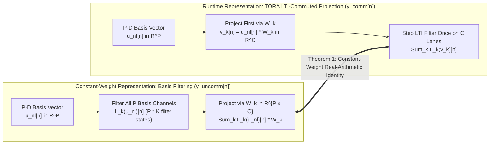

# Op-N: Universal Nonlinear, Hysteretic & Commuted Cascade Operator

This specification defines **Op-N (Nonlinear)** ([`packages/engine/src/operators/op_n.rs`](../../../packages/engine/README.md), [`packages/capture/src/`](../../../packages/capture/README.md)), the universal operator kernel governing division-free polynomial antiderivative anti-aliasing (`PolyADAA`), `C²` cubic-envelope wavefolding, 2D quadrature phase-space hysteresis, fixed-hertz ZOH sample-rate reduction and bitcrushing (`Family 5`), the **Exact LTI Basis Commutativity Theorem**, the Stage II 3-stage commuted amplifier cascade, and the `3 kHz` polynomial control engine across **Dynamic Neural Audio Modeler (DNAM)** ([`tora_architecture.md`](../architecture/tora_architecture.md)). For R&D counterexamples and derivations, see [`../../adr/0004-division-free-polyadaa-and-c2-wavefolder.md`](../../adr/0004-division-free-polyadaa-and-c2-wavefolder.md).

---

## 1. Multi-Drive $1\times$ B-Spline `PolyADAA` Bank

### 1.1 Pre-Activation Clamping

`r[dsp.op-n.polyadaa.clamp]`

Given pre-activation signal $x[n]$ and drive scale $d \in [0.25, 1.0, 4.0, 16.0]$, form the raw scaled input $r_n = \frac{2}{3} d \cdot x[n]$ and clamped coordinate $u_n = \mathrm{clamp}(r_n, -1.0, +1.0)$. Retain the unclamped previous sample $r_{n-1}$ so rail-crossing segments preserve overshoot weighting.

### 1.2 Exact Division-Free Algebraic Midpoint Factorization

`r[dsp.op-n.polyadaa.midpoint]`

For clamped endpoints $u_n, u_{n-1} \in [-1, 1]$ with midpoint $m_n = \frac{1}{2}(u_n + u_{n-1})$ and half-difference $d_n = \frac{1}{2}(u_n - u_{n-1})$, the interior antiderivative quotients factor without division (`0 FDIV`, matching `f64` difference quotients within $< 10^{-12}$ algebraic error):
$$\mathcal{A}_{\text{odd}}[n] = m_n \Big(1.5 - 0.5\big(m_n^2 + d_n^2\big)\Big), \qquad \mathcal{A}_{\text{even}}[n] = \left(m_n^2 + \frac{1}{3}d_n^2\right) - \left(m_n^4 + 2 m_n^2 d_n^2 + \frac{1}{5}d_n^4\right)$$

#### Saturated-Curve Rail Crossing (6-Step Division-Free Reciprocal)

`r[dsp.op-n.polyadaa.rail-crossing]`

When consecutive raw inputs $a = \min(r_{n-1}, r_n) < b = \max(r_{n-1}, r_n)$ strictly cross $\pm 1$, partition the interval length $b - a$ into interior length $\ell_0 = \max(0, \min(b, 1) - \max(a, -1))$ and rail-plateau lengths $\ell_- = \max(0, \min(b, -1) - a)$, $\ell_+ = \max(0, b - \max(a, 1))$:
$$A_{\text{odd,sat}} = \big(\ell_0 \mathcal{A}_{\text{odd}} + \ell_+ - \ell_-\big) \cdot y, \qquad A_{\text{even,sat}} = \big(\ell_0 \mathcal{A}_{\text{even}}\big) \cdot y$$
Compute $y \approx (b - a)^{-1}$ without hardware division (`0 FDIV`) by widening $a, b$ bit-preservingly to `f64`, seeding $y_0 = 2^{-E_d - 1}$ from the unbiased exponent $E_d$ of $d = \mathrm{fl}_{64}(b - a)$, and executing 6 Newton reciprocal steps $y_{k+1} = \mathrm{fl}_{64}(y_k \cdot \mathrm{fl}_{64}(2 - \mathrm{fl}_{64}(d \cdot y_k)))$, guaranteeing absolute error $< 2^{-44}$ in `f64` and $< 2^{-24} + 2^{-44}$ after `f32` rounding.

`r[dsp.op-n.polyadaa.stereo-and-rail-guard]` **Highest-Drive Rail-Crossing Fast Path & Packed Stereo `V1A`/`V1B` Execution ([`ADR-0019`](../../adr/0019-simd-kernel-architecture-and-realtime-execution-optimizations.md)):**
1. **Highest-Drive-Lane Rail Guard:** Because the drive bank $d_{\text{bank}} = [0.25\times, 1.0\times, 4.0\times, 16.0\times]$ is strictly increasing, if the highest active lane (`lane 3 = 16.0x` in `V1A` or `lane 2 = 4.0x` in `V1B`) satisfies $|r_{n-1}| \le 1.0$ and $|r_n| \le 1.0$, all lower-drive lanes are guaranteed interior and skip the `f64` 6-step Newton rail-crossing path with a single scalar comparison.
2. **Interleaved Stereo `V1A` & Packed 4-Lane `[l_1x, l_4x, r_1x, r_4x]` `V1B`:** Sub-Stage 2.1 (`step_stereo_pair`) interleaves Left and Right 4-drive `B::Vec4` registers to hide FMA latency, whereas Sub-Stage 2.2 (`step_stereo_lanes_1_2_lr`) packs only the two downstream-consumed `1.0x` and `4.0x` drive lanes (`lanes 1..3`) for Left and Right into a single 4-lane `B::Vec4` vector `[l_1x, l_4x, r_1x, r_4x]` and updates `left.{u_prev, a_prev, m_dc, last_a_even}[1..3]` and `right.{u_prev, a_prev, m_dc, last_a_even}[1..3]`, cutting `V1B` SIMD polynomial evaluations in half while preserving both channels' canonical 4-drive lane layout.

### 1.3 Un-Delayed Linear Separation & $1\times$ Passive B-Spline Blend

1. `r[dsp.op-n.polyadaa.linear-residual]` **Un-Delayed Linear Residual Path:** Evaluate $\alpha_c x_c[n]$ directly without ADAA filter delay, preserving unity passband gain within $< 10^{-12}\text{ dB}$ up to $22\text{ kHz}$ at $f_s = 48\text{ kHz}$.
2. `r[dsp.op-n.polyadaa.bspline-ac]` **Passive Quadratic B-Spline Blend ($0.875, 0.125$) + AC Coupling ($R_{\text{ac}} = 0.9993$ at $48\text{ kHz}$):**
   $$\tilde{y}_{\text{nl}}[n] = 0.875 \mathcal{A}[n] + 0.125 \mathcal{A}[n-1], \qquad m_{\text{dc}}[n] = 0.9993 m_{\text{dc}}[n-1] + 0.0007 \tilde{y}_{\text{nl}}[n]$$
   $$y[n] = \alpha_c x[n] + \big(\tilde{y}_{\text{nl}}[n] - m_{\text{dc}}[n]\big)$$
3. `r[dsp.op-n.polyadaa.drive-bank]` **Multi-Drive Bank (`last_a_odd` & `last_a_even`):** Evaluated in parallel over fixed drive scales $d_{\text{bank}} = [0.25\times, 1.0\times, 4.0\times, 16.0\times]$, caching both odd (`last_a_odd: [f32; 4]`) and even (`last_a_even: [f32; 4]`) interval-average antiderivative outputs per channel for downstream cascade and feature-bus projection.

---

## 2. Wavefolder, 2D Hysteresis & ZOH Bitcrusher

### 2.1 Wavefolder Rail Regularity and Candidates

`r[dsp.op-n.wavefolder.cubic-c2]`

To ensure $C^2$ continuity at the $\pm 1$ rails (vanishing value, first derivative, and second derivative at $\bar u = \pm 1$), `Op-N` uses the cubed-envelope odd and even wavefolders with $\bar u = \mathrm{clamp}(u, -1, 1)$:
$$w_{\text{odd},3}(u) = \bar u\big(1 - \bar u^2\big)^3, \qquad w_{\text{even},3}(u) = \bar u^2\big(1 - \bar u^2\big)^3$$

For consecutive clamped inputs $u_0, u_1 \in [-1, 1]$ with $m = (u_0 + u_1)/2$ and $d = (u_1 - u_0)/2$, define the division-free interval-average basis polynomials $Q_j(m, d)$ for $j \in [1, 8]$:
$$Q_j(m,d) = \sum_{k=0}^{\lfloor j/2\rfloor} \binom{j}{2k} m^{j-2k} d^{2k} (2k+1)^{-1}$$
$$A_{\text{odd},3} = Q_1 - 3Q_3 + 3Q_5 - Q_7, \qquad A_{\text{even},3} = Q_2 - 3Q_4 + 3Q_6 - Q_8, \qquad \hat w_{\text{odd},3}[n] = u_1 + A_{\text{odd},3} - m$$

### 2.2 2D Quadrature Phase-Space Hysteresis

`r[dsp.op-n.hysteresis.quadrature]`

Magnetic core transformer hysteresis and optocoupler memory are modeled via phase-space coordinates $(s_{\text{re}}[n], s_{\text{im}}[n])$:
$$h_{\text{hyst}}[n] = s_{\text{re}}[n] \cdot \big(s_{\text{re}}[n] - s_{\text{re}}[n-1]\big) + \kappa_{\text{quad}} \cdot s_{\text{re}}[n] s_{\text{im}}[n]$$

### 2.3 Family 5: Precomputed-Reciprocal ZOH Sample-Rate Reducer & Bitcrusher

1. `r[dsp.op-n.bitcrusher.quantizer]` **Uniform Nearest-Step Quantizer (Halfway Ties to $+\infty$):** For integer bit depth $B \in [2, 16]$, precompute $\Delta = 2^{-(B-1)}$ and $D = 2^{B-1}$ on the cold path:
   $$Q_B(x) = \lfloor xD + 0.5 \rfloor \Delta$$
   In `f32` over the certified `[-100, 100]` envelope, compute $v = xD$, truncate $v$ toward zero to `i32` $t$, form floor $k = t - \mathbf{1}[v < t]$ and residual $f = v - k$, and return $(k + \mathbf{1}[f \ge 0.5])\Delta$ (avoiding negative truncation errors and `0.5f32` pre-addition rounding overflow).
2. `r[dsp.op-n.bitcrusher.zoh-phase]` **Fixed-Hertz Integer ZOH Phase Profile (`0 FDIV`):** Using $F = 2^{32}$ units per Hz, prepare $D = \mathrm{round}_{\text{even}}(F f_s)$ and $I = \mathrm{round}_{\text{even}}(F f_{\text{target}})$ ($0 \le I \le D$). Advance unsigned 64-bit phase $P \in [0, D)$ per sample:
   $$A = P + I, \qquad b = \mathbf{1}[A \ge D], \qquad P \leftarrow A - bD$$
   When $b = 1$, latch $Q_B(x[n])$; at full rate ($I = D$), every sample latches ($b = 1$) while $P$ is unchanged; at zero rate ($I = 0$, exposed only when observed in the signed control domain), hold the last latched sample and phase.
3. `r[dsp.op-n.bitcrusher.rate-transfer]` **Division-Free Effective-Rate Phase Transfer:** Precompute $R = \lfloor 2^{104} / D_{\text{old}} \rfloor$ as a `u64` on the cold path. On a sample-rate change to $D_{\text{new}}$, form $N = P_{\text{old}} D_{\text{new}} < 2^{102}$ in `u128`, compute $q_0 = \lfloor N R / 2^{104} \rfloor$ via shifts, correct remainder $r_0 = N - q_0 D_{\text{old}}$, round ties-to-even, and clamp to $D_{\text{new}} - 1$ so imminent carries remain imminent:
   $$P_{\text{new}} = \min\left(\mathrm{round}_{\text{even}}\left(\frac{P_{\text{old}}D_{\text{new}}}{D_{\text{old}}}\right), D_{\text{new}}-1\right), \qquad q_0 = (h \mathbin{\mathrm{<<}} 24) \mathbin{\mathrm{or}} \big((m \mathbin{\mathrm{and}} M) \mathbin{\mathrm{>>}} 40\big)$$
   where $N = N_{\text{hi}}2^{64} + N_{\text{lo}}$, $a = N_{\text{lo}}R$, $c = N_{\text{hi}}R$, $M = 2^{64} - 1$, $m = (a \mathbin{\mathrm{>>}} 64) + (c \mathbin{\mathrm{and}} M)$, and $h = (c \mathbin{\mathrm{>>}} 64) + (m \mathbin{\mathrm{>>}} 64)$, bounding fixed-rate frequency error to $|f_s(I/D) - f_{\text{target}}| \le 2^{-32}\text{ Hz}$.
4. `r[dsp.op-n.bitcrusher.surrogate]` **Forward-Faithful Training Surrogate:** Return the hard runtime quantizer output in the forward pass with grouped stop-gradient $\hat q(x) = \mathrm{sg}[Q_B(x)] + (x - \mathrm{sg}[x])$, or use the 4-term Fourier backward surrogate during warmup:
   $$q_4(x) = x - \frac{\Delta}{\pi}\sum_{k=1}^{4}\frac{(-1)^{k-1}}{k}\sin\left(\frac{2\pi k x}{\Delta}\right)$$

---

## 3. Exact LTI Basis Commutativity Theorem (Theorem 1)

### 3.1 Formal Theorem Statement & Proof

`r[dsp.op-n.commuted.theorem1]`

**Theorem 1 (Exact LTI Basis Commutativity).**  
Let $\mathbf{u}_{\text{nl}}[n] \in \mathbb{R}^P$ be a sequence of $P$-dimensional nonlinear basis vectors bounded by $\sup_{n, p} |u_p[n]| \le U_{\max} < \infty$, $\lbrace \mathcal{L}_k \rbrace_{k=0}^{K-1}$ be $K$ causal, stable LTI filters with impulse responses $h_k \in \ell_1(\mathbb{Z})$, and $\lbrace \mathbf{W}_k \rbrace_{k=0}^{K-1} \subset \mathbb{R}^{P \times C}$ be constant real projection matrices. Then for every channel $c \in [0, C-1]$ and sample $n \in \mathbb{Z}$:
$$\sum_{k=0}^{K-1} \Big(\mathcal{L}_k\big(\mathbf{u}_{\text{nl}}\big)[n]\Big) \mathbf{W}_k \equiv \sum_{k=0}^{K-1} \mathcal{L}_k\Big(\mathbf{u}_{\text{nl}} \mathbf{W}_k\Big)[n]$$

*Proof.* Because $h_k \in \ell_1(\mathbb{Z})$ and $\mathbf{u}_{\text{nl}}$ is bounded, the double sum $\sum_{m=-\infty}^\infty \sum_{p=0}^{P-1} h_k[m] u_p[n-m] W_{k,p,c}$ converges absolutely, permitting summation interchange by Fubini's theorem so $v_{k,c}[n-m] = (\mathbf{u}_{\text{nl}}[n-m]\mathbf{W}_k)_c$ is filtered directly on $C$ lanes. $\blacksquare$

### 3.2 Causality Audit & Elimination of Acausal Lookahead

`r[dsp.op-n.commuted.causality]`

All delay offsets in Stage II are strictly causal ($d \ge 0$): $\mathbf{v}_{\text{delay},1}[n] = \mathbf{u}_{\text{nl}}[n-1]\mathbf{W}_{d=1}$ and $\mathbf{v}_{\text{delay},2}[n] = \mathbf{u}_{\text{nl}}[n-2]\mathbf{W}_{d=2}$.

### 3.3 Commutator Perturbation Under $3\text{ kHz}$ Control-Rate Modulation

`r[dsp.op-n.commuted.project-then-filter]`

When $\mathbf{W}_k[n]$ varies at $3\text{ kHz}$ with rate bound $\Vert \mathbf{W}_k[n] - \mathbf{W}_k[n-m] \Vert \le \nu_{\text{ctrl}} m / f_s$ and $\Vert \mathbf{u}_{\text{nl}}[n] \Vert \le B_u$, the commutator perturbation for a 1-pole filter $h_k[m] = (1 - r_k)r_k^m u[m]$ satisfies:
$$\Delta_{\text{comm}}[n] = \sum_{m=0}^\infty h_k[m] \mathbf{u}_{\text{nl}}[n - m] \Big(\mathbf{W}_k[n] - \mathbf{W}_k[n - m]\Big), \qquad \Vert \Delta_{\text{comm}}[n] \Vert \le \frac{B_u \nu_{\text{ctrl}}}{f_s} \cdot \frac{r_k}{1 - r_k}$$
Under time-varying control modulation $\mathbf{W}_k[n] = \sum_r z_r[n] \mathbf{U}_{k,r}$, the runtime projects first ($\mathbf{v}_k[n] = \mathbf{u}_{\text{nl}}[n]\mathbf{W}_k[n]$) and then steps $\mathcal{L}_k$. Training matches this exact project-then-filter order by filtering the product columns $\mathcal{L}_k(u_p z_r)[n]$ when solving for $\mathbf{U}_{k,r}$:
$$\mathcal{L}_k\left(\sum_p u_p W_{k,p,c}\right)[n] = \sum_{p,r} \mathcal{L}_k\left(u_p z_r\right)[n] U_{k,r,p,c}$$

### 3.4 Boundary Conditions, Resting DC Equilibrium & Pop-Free Startup

`r[dsp.op-n.commuted.dc-equilibrium]`

Given resting basis $\mathbf{u}_{\text{rest}}$ and projected filter input $\mathbf{v}_{\text{rest},k} = \mathbf{u}_{\text{rest}}\mathbf{W}_k$, initialize the four-filter tone basis (§4.1) and B-spline ADAA blend (§1.3) at sample `-1` for pop-free startup:
1. **Direct:** Stateless passthrough of $\mathbf{v}_{\text{rest},0}$.
2. **Low-Pass ($y[n] = p y[n-1] + (1-p)v[n]$):** Initialize $y[-1] = v_{\text{rest}}$.
3. **High-Pass ($y[n] = p y[n-1] + p(v[n] - v[n-1])$):** Initialize both $y[-1] = 0$ and previous input $v[-1] = v_{\text{rest}}$.
4. **ADAA & AC Blocker:** Initialize $\mathcal{A}[-1] = m_{\text{dc}}[-1] = g_{\text{nl}}(u_{\text{rest}})$.

---

## 4. Stage II 3-Stage Commuted Nonlinear Cascade Architecture

`r[dsp.op-n.stage2.sub-stages]`

Stage II models vacuum tube amplifier heads and high-gain drive pedals across three commuted sub-stages:
1. **Sub-Stage 2.1 (V1A Preamp):** Input grid impedance, initial triode clipping, and tone stack filtering.
2. **Sub-Stage 2.2 (V1B Driver):** Driver stage saturation, cathode bypass capacitor recovery, and `C²` cubic-envelope wavefolding (§2.1).
3. **Sub-Stage 2.3 (Power Amp / Sag / Hysteresis):** Push-pull power tubes, dynamic power supply $B^+$ sag, transformer core hysteresis (§2.2), and speaker back-EMF damping.

### 4.1 Four-Filter Tone Basis (Refinement 3)

`r[dsp.op-n.stage2.tone-basis]`

Sub-Stage 2.1 uses the four-filter tone basis with matched-pole coefficients $p_f = e^{-2\pi f / 48000}$ at `48 kHz` (rescaled at other rates via [router §9](router_and_stages_topology.md#9-continuous-time-zero-order-hold-zoh-sample-rate-adaptability-44196-khz--4-bounce)):
$$\mathcal{L} = \big[\text{Direct}, \ \text{LPF}_{80\text{ Hz}}, \ \text{LPF}_{400\text{ Hz}}, \ \text{HPF}_{1200\text{ Hz}}\big], \qquad L_f(z) = \frac{1-p_f}{1-p_f z^{-1}}, \qquad H_f(z) = \frac{p_f(1-z^{-1})}{1-p_f z^{-1}}$$

### 4.2 Stereo Basis, Role A Inter-Stage Coupling & Surjective Role B Feature-Bus Folding

`r[dsp.op-n.stage2.stereo-coupling]`

Each sub-stage couples Left and Right nonlinear drive/fold/sag basis vectors across $2 \times 2$ block coupling matrices:
$$\mathbf{u}_{\text{drive,stereo}}^{(s)}[n] = \big[\mathbf{u}_{\text{drive},L}^{(8)}[n], \ \mathbf{u}_{\text{drive},R}^{(8)}[n]\big]^\top \in \mathbb{R}^{16}$$
- **Diagonal Blocks ($\mathbf{W}_{L\to L}, \mathbf{W}_{R\to R}$):** Primary Left and Right channel amplification.
- **Off-Diagonal Blocks ($\mathbf{W}_{L\to R}, \mathbf{W}_{R\to L}$):** Shared power-supply $B^+$ sag coupling and transformer crosstalk ($-55\text{ to }-70\text{ dB}$).
- **Role A (`b = 0`) vs. Surjective Role B (`b = 1..K_t-1`) Partition:** Within each tier's `stage2_cascade_w` slice (`K_t = 48 / 96 / 144 / 192` blocks of `16 x f32`), Block `b = 0` (**Role A**) parameterizes the `4×4` inter-stage coupling matrix driving Sub-Stages 2.1 $\to$ 2.2 $\to$ 2.3 (held watermark-free so nonlinear trajectories remain invariant), while Blocks `b = 1..K_t-1` (**Role B**) fold surjectively via `slot = (b - 1) & 7` into the 8 Stage II feature-bus readout slots (`40..48` per tier) for linear output-head projection and exact Layer 1 Cascade-Head Gauge compensation.
- `r[dsp.op-n.stage2.conv6-simd]` **4-Accumulator `conv6_taps` Tiling & Stereo Filter Vectorization ([`ADR-0019`](../../adr/0019-simd-kernel-architecture-and-realtime-execution-optimizations.md)):** Multi-tap commuted projections execute via `Stage2Backend::conv6_taps_{1..4}groups` (`conv6_taps_{1..4}groups_vec4`) using 4 independent vector accumulators (`acc0..acc3`) and broadcast lane FMA (`SimdVec4::fma_lane::<0..3>`), paired with stereo-packed inter-stage biquads (`step_interstage_filter_stereo`) and branch shapers (`step_branch_shaper_stereo`).

### 4.3 $3\text{ kHz}$ Bilinear Rank-$R$ Stage Latent Folding

`r[dsp.op-n.stage2.latent-folding]`

At each $3\text{ kHz}$ control boundary, stage latents $\mathbf{z}_{\text{stage}} \in \mathbb{R}^{D_{\text{stage}}}$ ($D_{\text{stage}} = 4$ in `Lite/Full/Pro`, $8$ in `Ultra`) fold into $\mathbf{W}_k^{(s)}$ (`Ultra` modes $5..8$ reside in `Arena 3`):
$$\mathbf{W}_k^{(s)}(\mathbf{z}_{\text{stage}}) = \mathbf{W}_{k, 0}^{(s)} + \sum_{r=1}^{D_{\text{stage}}} z_{\text{stage}, r} \mathbf{W}_{k, r}^{(s)}$$

---

## 5. `Op-N[Ctrl]`: 3 kHz Algebraic Polynomial & $O(1)$ Sufficient-Statistic Engine

1. `r[dsp.op-n.ctrl.incremental-update]` **Incremental Sufficient-Statistic Update:** When contributor $p \in \mathcal{I}_{\text{moved}}$ changes from $u_{p,\text{old}}$ to $u_{p,\text{new}}$, update the exact-integer main-effect and Rank-$R$ pair-statistic accumulators (`64 B` in `Lite..Pro`, `128 B` in `Ultra`; see [`parametric_control_bus.md` §2.3](parametric_control_bus.md#23-o1-additive-latent-sufficient-statistic-control-scaling)):
   $$\Delta\mathbf{z}_{\text{main}} = \mathbf{W}_{\text{main}, p} \cdot \big(\boldsymbol{\psi}_p(u_{p, \text{new}}) - \boldsymbol{\psi}_p(u_{p, \text{old}})\big)$$
2. `r[dsp.op-n.ctrl.lobatto-basis]` **Node-Anchored Control Basis:** Evaluate the persisted observed anchor nodes and switch contributor slices ([`parametric_control_bus.md` §2.2](parametric_control_bus.md#22-cardinality-bounded-node-anchored-newtonlobatto-basis)).
3. `r[dsp.op-n.ctrl.chebyshev-lfo]` **Chebyshev LFO Waveshaping:** Shape quadrature rotor states via $T_1(x) = x$, $T_2(x) = 2x^2 - 1$, $T_3(x) = 4x^3 - 3x$, $T_4(x) = 8x^4 - 8x^2 + 1$.
4. `r[dsp.op-n.ctrl.fm-interaction]` **Rank-4/8 FM Bilinear Interaction:** Evaluate interaction factors from scalar embeddings $z_p = \mathbf{w}_{\text{proj},p}^\top\boldsymbol{\psi}_p(u_p)$ and mix via $\mathbf{U}_{\text{int}}$ (`8×4` base in `Arena 0` + three `8×4` `Ultra` delta blocks in `Arena 3`).
5. `r[dsp.op-n.ctrl.trust-clip]` **Groupwise Trust-Region Clipping:** Apply the outward-checked trust-region clip independently to $\mathbf{z}_{\text{head}}$ and $\mathbf{z}_{\text{stage}}$ ([`parametric_control_bus.md` §1.2](parametric_control_bus.md#outward-checked-trust-region-clip)).
