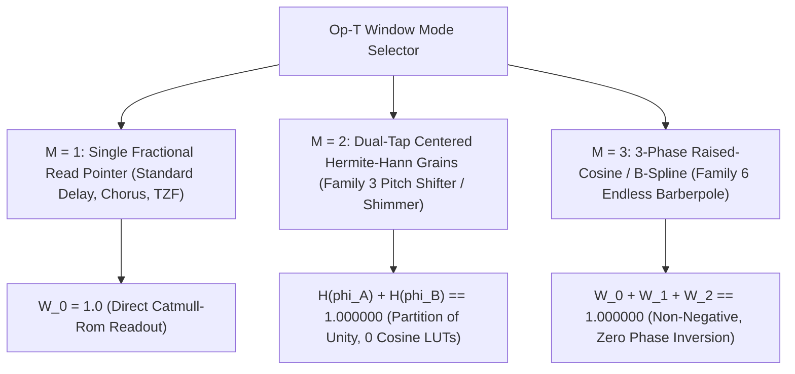

# Op-T: Universal Transport, Granular Windowing & All-Pass Diffusion Operator

This specification defines **Op-T (Transport)** ([`packages/engine/src/operators/op_t.rs`](../../../packages/engine/README.md), [`packages/trainer/src/`](../../../packages/trainer/README.md)), the universal operator kernel governing fractional delay transport, pitch shifting, time-warped granular grains, barberpole phase sweeps, bounded-history feedback guards, and in-buffer Schroeder all-pass diffusion across **Dynamic Neural Audio Modeler (DNAM)** ([`tora_architecture.md`](../architecture/tora_architecture.md)). For R&D counterexamples and candidate comparisons, see [`../../adr/0006-model-declared-delays-and-tank-feedback-guard.md`](../../adr/0006-model-declared-delays-and-tank-feedback-guard.md).

---

## 1. Model-Declared Ring Buffer Addressing & Stateless Catmull-Rom Reader

### 1.1 Exact-Sized Delay Histories and Branchless Wrap

`r[dsp.op-t.ring.declaration]`

Each active `Op-T` history declares its maximum reference-rate read delay $D_{\mathrm{ref}} \in \mathbb{N}^+$, storage scalar size $a$ (`2 B` for `fp16`, `4 B` for `f32`), tier ownership, and channel/line identity covering all admitted control, granular, and transition read paths.

```text
+---------------------------------------------------------------------------------------------------+
| OP-T 64-BYTE-ALIGNED PARTITIONED DELAY & DIFFUSER RING BUFFER                                     |
+---------------------------------------------------------------------------------------------------+
|  [0 .. L_main - 1]: Main Delay Ring (L_main = ceil(D_ref * f_eff / 48000) + 2 samples)            |
|  [L_main .. L_main + D_ap - 1]: Partitioned Schroeder All-Pass Segment (D_ap samples)             |
|  [.. B bytes]: 64-Byte Cache-Line Padding (B = 64 * ceil(a * L / 64), not ring state)             |
+---------------------------------------------------------------------------------------------------+
```

1. `r[dsp.op-t.ring.capacity]` **Cold-Path Capacity Sizing:** At effective rate $f_{\mathrm{eff}} = M 2^{e-52}$, compute exact integer ceiling $D_{\mathrm{eff}}$ in `u128` without floating-point rounding:
   $$D_{\mathrm{eff}} = \left\lceil D_{\mathrm{ref}} f_{\mathrm{eff}} / 48000 \right\rceil, \qquad L = D_{\mathrm{eff}} + 2, \qquad B = 64 \left\lceil aL / 64 \right\rceil$$
   The `+2` margin holds the oldest 4-tap Catmull-Rom neighbor while enforces $\tau[n] \ge 4.0$ samples. Read all heads before overwriting the oldest slot.
2. `r[dsp.op-t.ring.admission]` **Host Memory-Ceiling Admission:** Admit total instance and transition memory against the host ceiling on the cold path before activation; fail fast with an explicit error on overflow or ceiling exhaustion without truncating history or dropping active tails.
3. `r[dsp.op-t.ring.branchless-wrap]` **Branchless Arbitrary-Length Wrap:** For write index $0 \le w < L$, integer delay $4 \le d \le L-2$, and tap offset $o \in \lbrace 1, 0, -1, -2 \rbrace$ ($i = w - d + o \in [-L, L)$):
   $$r = i + \big(L \mathbin{\mathrm{AND}} -[i < 0]\big), \qquad w' = (w + 1) - \big(L \mathbin{\mathrm{AND}} -[w + 1 = L]\big)$$
4. `r[dsp.op-t.ring.q0-32-pointer]` **Integer-Plus-`Q0.32` Delay Pointer & Inward Reader Bounds:** Represent delay positions as an integer sample count $D_{\mathrm{int}}$ plus an unsigned `Q0.32` fraction (never a single `f32` total sample count, which loses `1/64`-sample resolution at `9 s` / `432,000` samples). Convert only the `Q0.32` fraction to `f32` ($\mu \in [0.0, 1.0)$), normalizing any `1.0f32` rounding carry to $(D_{\mathrm{int}} + 1, 0.0)$ and clamping inward to the nearest representable reader position inside all active physical and causal bounds.
5. `r[dsp.op-t.ring.fp16-saturation]` **`fp16` Write Saturation Telemetry:** Finite delay writes exceeding `±65,504.0` saturate to `±65,504.0` (`0x7BFF` / `0xFBFF`) and set `FP16_SATURATED` ([`tora_architecture.md` §1.2](../architecture/tora_architecture.md#finite-precision-range-and-saturation-policy)).

### 1.2 Stateless 4-Tap Catmull-Rom Hermite Cubic Delay Reader

`r[dsp.op-t.reader.catmull-rom]`

Decompose commanded delay $\tau[n] \ge 4.0$ into integer delay $D_{\mathrm{int}}[n] = \lfloor \tau[n] \rfloor$ and fractional offset $\mu[n] = \tau[n] - D_{\mathrm{int}}[n] \in [0.0, 1.0)$, and read the 4 neighboring history samples prior to writing sample $n$:
$$s[-1] = \mathrm{ring}\big[\mathrm{addr}(n - D_{\mathrm{int}}[n] + 1)\big], \qquad s[0] = \mathrm{ring}\big[\mathrm{addr}(n - D_{\mathrm{int}}[n])\big]$$
$$s[1] = \mathrm{ring}\big[\mathrm{addr}(n - D_{\mathrm{int}}[n] - 1)\big], \qquad s[2] = \mathrm{ring}\big[\mathrm{addr}(n - D_{\mathrm{int}}[n] - 2)\big]$$

Evaluate the cubic Catmull-Rom spline in **Horner form** (`0 FDIV`):
$$d(\tau[n]) = \big((c_3' \mu[n] + c_2') \mu[n] + c_1'\big) \mu[n] + c_0'$$
$$c_3' = -0.5 s[-1] + 1.5 s[0] - 1.5 s[1] + 0.5 s[2], \qquad c_2' = s[-1] - 2.5 s[0] + 2.0 s[1] - 0.5 s[2]$$
$$c_1' = -0.5 s[-1] + 0.5 s[1], \qquad c_0' = s[0]$$

| Invariant | Mathematical Property |
| :--- | :--- |
| **1. Endpoint Exactness** | At `μ = 0`, `d(τ) = c₀' = s[0]`; at `μ = 1`, `c₃' + c₂' + c₁' + c₀' = s[1]`. |
| **2. `C¹` Spline Continuity** | `lim_{μ→1⁻} (d/dμ) d(D_int + μ) = lim_{μ→0⁺} (d/dμ) d(D_int + 1 + μ) = 0.5(s[2] - s[0])` (`> 15×` lower 2nd-difference boundary jerk under LFO sweep than recursive Thiran). |
| **3. Stationary Energy Passivity** | For fixed `μ`, `1 - |H_μ(e^{iω})|² = μ²(1-μ)²(1 - cos ω)²(3 + 2μ(1-μ)(1 - cos ω)) ≥ 0` (`‖H_μ‖_∞ ≤ 1`). |
| **4. Peak Gain & Bounded-History Guard** | Instantaneous `L₁` kernel norm is `1 + μ(1 - μ) ≤ 1.25` (attained at `μ = 0.5` with `[-1, 9, 9, -1]/16`); time-varying feedback loops enforce BIBO decay via the grouped bounded-history feedback guard below. |

`r[dsp.op-t.reader.contiguous-fp16x4]` **Contiguous 4-Lane `fp16x4_to_f32x4` Stereo Delay Read Fast Path ([`ADR-0019`](../../adr/0019-simd-kernel-architecture-and-realtime-execution-optimizations.md)):** Because the 4 Catmull-Rom tap indices `[p_2, p_1, p_0, p_m1]` occupy 4 consecutive ring slots `[p_0 - 2 .. p_0 + 2]` whenever the window does not straddle index `0` (`p_0 >= 2 && p_0 + 1 < Self::HALF_CAPACITY`), `read_delay_stereo` loads the 4 contiguous `u16` (`fp16`) samples per channel (`[l_2, l_1, l_0, l_m1]` and `[r_2, r_1, r_0, r_m1]`) and converts them in a single 4-lane hardware instruction via `MathBackend::fp16x4_to_f32x4` (`vcvt_f32_f16` on NEON, `_mm_cvtph_ps` on `F16C`), falling back to wrapped per-tap reads only during the `3 / L` wrap-straddling frames.

#### Bounded-History Feedback Guard

`r[dsp.op-t.guard.bounded-history]`

Because time-varying Catmull-Rom reads can reach `1.25×` instantaneous peak gain, Stage IV bounds feedback writes using the upper bound $M_n$ of all currently live samples across the tank delay histories:
$$w_i[n] = x_i[n] + g_i[n] \cdot \mathrm{clamp}\big(v_i[n], -M_n, M_n\big), \qquad 0 \le g_i[n] \le g_{\max} < 1$$

- `r[dsp.op-t.guard.max-tree]` **Grouped Max-Tree Tracking:** Partition each ring into blocks of at most $H$ samples (`H = 64`), maintaining block maxima in a binary max-tree plus an active-block running maximum.
- `r[dsp.op-t.guard.incremental-counters]` **Division-Free Incremental `(block_idx, in_block_offset)` Counters (`0 UDIV`, [`ADR-0019`](../../adr/0019-simd-kernel-architecture-and-realtime-execution-optimizations.md)):** To prevent integer division (`pos / block_size` or `.is_multiple_of(block_size)`, which lowers to hardware `UDIV`/`IDIV`) on arbitrary model-declared ring lengths, `OpTBlockMaxTreeGuard` maintains pre-allocated `block_indices: Vec<usize>` and `in_block_offsets: Vec<usize>` counters per delay line, advancing via branchless comparison (`offset + 1 == block_size` or `pos == 0`) with zero integer division instructions.
- `r[dsp.op-t.guard.bibo-decay]` **Driven BIBO & Unforced Geometric Decay:** For $|x_i[n]| \le B$, every history sample remains bounded by $C = \max(M_0, B / (1 - g_{\max}))$; under zero input ($x_i[n] = 0$), $M_n$ decays by at least $g_{\max}$ every $L_{\max} + H$ frames regardless of read-pointer motion.
- `r[dsp.op-t.guard.fp16-decay]` **Directed `fp16` Decay Rule:** Forming the guard ceiling with `0x3F7FBE76` (`0.999f32`) and rounding finite `fp16` writes toward zero guarantees strict subnormal decay to zero without nonzero `fp16` fixed points.

### 1.3 Dual-Mode Runtime Delay Transitions (`Range` Slew vs. `Switch` Crossfade)

`r[dsp.op-t.transition.dual-mode]`

| Control Event | Transition Law | Physical & Acoustic Role |
| :--- | :--- | :--- |
| **Continuous `range` Knob Sweep** | 1-pole exponential slew of the base delay target with `∣Δτ_base∣ ≤ 0.25 samples/sample` | Models smooth analog BBD / tape Doppler pitch glide on continuous time controls. |
| **Discrete `switch` Delay Jump** | Freeze old and new read pointers and crossfade over `L_xfade = max(16, round(128 / ρ_sr))` samples (`128` samples at `48 kHz`) | Eliminates clicks and unmodeled pitch sweeps on discrete range-switch or preset jumps. |

For $k \in \lbrace 0, \dots, L_{\text{xfade}} - 1 \rbrace$, the precomputed raised-cosine crossfade law has exact endpoints $\alpha_{\text{xf}}[0] = 0.0$ and $\alpha_{\text{xf}}[L_{\text{xfade}}-1] = 1.0$:
$$w[k] = \frac{k}{L_{\text{xfade}}-1}, \qquad \alpha_{\text{xf}}[k] = \frac{1}{2}\big(1 - \cos(\pi w[k])\big), \qquad d[n] = \big(1 - \alpha_{\text{xf}}[k]\big) d^{\text{old}}[n] + \alpha_{\text{xf}}[k] d^{\text{new}}[n]$$

While a crossfade is active, keep its two endpoints fixed and coalesce subsequent accepted delay-target updates into a single pending target (using the [control-bus timestamp and tie-precedence rules](parametric_control_bus.md#host-automation-timing)), applying the pending target on the sample immediately following the fade. Validate all live fade endpoints against conditional control bounds ([`parametric_control_bus.md` §2.4.1](parametric_control_bus.md#conditional-batch-safety)).

---

## 2. Partition-of-Unity Windowing ($M \in [1, 2, 3]$) & Family 3 / 6

`r[dsp.op-t.window.partition-of-unity]`

Op-T unifies standard delays, granular pitch shifting, and continuous barberpole phasing by selecting the window phase count $M \in [1, 2, 3]$:
$$\sum_{m=0}^{M-1} W_m(\phi_m[n]) \equiv 1.000000000000, \quad \forall n$$



| Mode | Physical Role | Window Definition & Exact Partition-of-Unity Identity |
| :--- | :--- | :--- |
| **`M = 1`** | **Standard Delay / Chorus / TZF** | `W₀ ≡ 1.0` (single fractional read pointer). |
| **`M = 2`** | **Centered Hermite-Hann Granular Pitch Shifter (`Family 3`)** | Grain phases `φ_A[n] = frac(φ_A[n-1] + Δφ)` and `φ_B[n] = frac(φ_A[n] + 0.5)`. Symmetric triangular phase `u_A = 1 - ∣2φ_A - 1∣ ∈ [0, 1]`. Cubic Hermite window `H(φ_A) = u_A²(3 - 2u_A)`, `H(φ_B) = 1.0 - H(φ_A)`. |
| **`M = 3`** | **Continuous Barberpole Frequency Sweep (`Family 6`)** | Three read heads spaced by `Δφ = 1/3`: `φ_m = frac(φ + m/3)` with non-negative raised-cosine `W_m(φ) = (1/3)(1 + cos(2π frac(φ + m/3))) ≥ 0` or 3-piece quadratic B-spline `B₂(3 frac(φ + m/3))`. |

### 2.1 Mode $M = 1$: Standard Delay, Chorus & Through-Zero Flanging

`r[dsp.op-t.window.m1-delay]`

In $M = 1$ mode, $W_0 \equiv 1.0$. Anchoring Tap 0 to a static reference delay $\tau_{\text{ref}} = 64.0\text{ samples}$ ($1.33\text{ ms}$) while sweeping line 1 across $\tau_1[n] \in [16.0, 112.0]\text{ samples}$ produces analog Through-Zero Flanging (TZF) with zero-crossing phase cancellation at $\Delta\tau = 0.0\text{ ms}$.

### 2.2 Mode $M = 2$: Centered Hermite-Hann Granular Pitch Shifter (`Family 3`)

`r[dsp.op-t.window.m2-pitch]`

For pitch shift $\Delta p \in [-24, +24]$ semitones, compute the time-warp rate $\nu = 1 - 2^{\Delta p / 12} \in [-3.0, 0.75]$ directly via the [control-bus pitch profile](parametric_control_bus.md#pitch-ratio-and-time-warp-profile). The `0.25` base-delay slew limit governs continuous changes to the center delay $D_c$, while the two grain heads sweep around $D_c$ over even integer grain duration $G$:
$$\phi_A[n] = \mathrm{frac}(n/G), \qquad \phi_B[n] = \mathrm{frac}(\phi_A[n] + 1/2), \qquad \tau_j[n] = D_c + \nu G\big(\phi_j[n] - 1/2\big) \in \big[D_c - |\nu|G/2, D_c + |\nu|G/2\big]$$

Using symmetric triangular phase $u_A = 1 - |2\phi_A - 1| \in [0, 1]$:
$$H(\phi_A) = u_A^2\big(3 - 2u_A\big), \qquad H(\phi_B) = 1.0 - H(\phi_A), \qquad H(\phi_A) + H(\phi_B) \equiv 1.000000000000$$
For a `100 ms` grain at `48 kHz` (`G = 4,800`) and `+24` semitones ($\nu = -3$), maintaining the 4-sample causal floor (`Refinement 15`) requires $D_c \ge 7,204$ samples and maximum delay $\ge 14,404$ samples.

### 2.3 Mode $M = 3$: Continuous Barberpole Frequency Sweep (`Family 6`)

`r[dsp.op-t.window.m3-barberpole]`

Three read heads spaced by $\Delta\phi = 1/3$ use precomputed raised-cosine or 3-piece cardinal quadratic B-spline weights (`0 FDIV`, `0 libm` in the audio loop):
$$\sum_{m=0}^2 B_2\big(3 \cdot \mathrm{frac}(\phi + m/3)\big) \equiv 1.000000000000$$
where $B_2(t) = 0.5 t^2$ on $[0, 1)$, $B_2(t) = -t^2 + 3t - 1.5$ on $[1, 2)$, and $B_2(t) = 0.5(3 - t)^2$ on $[2, 3)$.

---

## 3. Partitioned In-Buffer Schroeder All-Pass Diffusers

### 3.1 Memory Partitioning & Rate-Aware Capacity

`r[dsp.op-t.diffuser.partition]`

Each Schroeder all-pass diffuser occupies a dedicated, non-overlapping 64B-aligned segment of the cold-allocated delay buffer with segment-local branchless wrap. At effective rate $f_{s,\text{eff}}$, convert each reference delay via $D_{\text{ap},m}(f_{s,\text{eff}}) = \max(1, \mathrm{round}(D_{\text{ap},m}(48000) / \rho_{\text{sr}}))$ ([router §9](router_and_stages_topology.md#9-continuous-time-zero-order-hold-zoh-sample-rate-adaptability-44196-khz--4-bounce)) without capping at `255` samples (e.g., `223` reference samples $\to$ `1,784` samples = `3,584 B` aligned `fp16` at `384 kHz`).

### 3.2 Reference-Length All-Pass Recurrence

`r[dsp.op-t.diffuser.recurrence]`

The `48 kHz` reference lengths `[19, 31, 47, 73, 103, 139, 179, 223]` are pairwise coprime; at other effective rates, retain the exact rounded durations above rather than substituting nearby primes. Each line $m$ evaluates its fixed converted integer delay $D_{\text{ap},m}$ and clamped coefficient $a_{\text{diff},m} \in [-0.75, +0.75]$:
$$v_{\text{ap}, m}[n] = x_{\text{in}}[n] - a_{\text{diff}, m} u_{\text{ap}, m}[n - D_{\text{ap}, m}]$$
$$y_{\text{ap}, m}[n] = a_{\text{diff}, m} v_{\text{ap}, m}[n] + u_{\text{ap}, m}[n - D_{\text{ap}, m}], \qquad u_{\text{ap}, m}[n] = v_{\text{ap}, m}[n]$$

For fixed $a_{\text{diff}}$ and $D_{\text{ap}}$, $|H_{\text{ap}}(e^{i\omega})|^2 \equiv 1$ for all $\omega$. For bounded input $|x_{\text{in}}[n]| \le A$ and $|a_{\text{diff}}| \le 0.75$, the worst-case `L₁` impulse peak gain is $1 + 2|a_{\text{diff}}| \le 2.5 A$ and internal state is bounded by $\max(V_0, 4A)$.

---

## 4. 1-Pole Ballistic Envelope Ducking VCA (`Family 4`)

`r[dsp.op-t.ducking.vca]`

To model dynamic ducking delays, gated reverbs, and sidechain-ducked ambient tails (`Family 4`), Op-T applies a 1-pole ballistic sidechain ducking VCA (`Refinement 9`, $\tau_{\text{attack}} \ge 0.5\text{ ms}$, $\tau_{\text{release}} \ge 20.0\text{ ms}$):
$$e_{\text{duck}}[n] = \alpha_{\text{duck}}[n] e_{\text{duck}}[n-1] + (1 - \alpha_{\text{duck}}[n]) |x_{\text{sidechain}}[n]|$$
$$g_{\text{duck}}[n] = \mathrm{clamp}\Big(1.0 - \kappa_{\text{duck}}\big(e_{\text{duck}}[n] - \theta_{\text{duck}}\big), g_{\text{duck,min}}, 1.0\Big), \qquad y_{\text{wet,ducked}}[n] = g_{\text{duck}}[n] \cdot y_{\text{wet}}[n]$$

---

## 5. Strict Zero-`FDIV`, Zero-`FSQRT` & Zero-`libm` Verification

`r[dsp.op-t.zero-fdiv]`

| Operation | Naive Formulation | TORA Division-Free Factorization |
| :--- | :--- | :--- |
| **Ring buffer wrap** | `idx = pos % L_ring` (`IDIV`) | Branchless mask correction `i + (L & -[i < 0])` (§1.1) |
| **Catmull-Rom delay read** | Recursive Thiran all-pass (`FDIV`) | Stateless 4-tap Horner cubic polynomial (§1.2) |
| **Granular windowing (`M=2, 3`)** | Real-time `cos(π φ)` (`libm`) | Cubic Hermite `u²(3 - 2u)` (`M=2`) and quadratic B-spline `B₂` (`M=3`) (§2) |
| **Schroeder all-pass** | Direct-form rational division | Coupled state recurrence `v = x - a u`, `y = a v + u` (§3.2) |
| **Base-delay slew** | Per-sample rate division | Precomputed 1-pole slew with `∣Δτ_base∣ ≤ 0.25` (§1.3) |
| **Switch crossfade** | Real-time `cos(π k / L)` (`FDIV` + `libm`) | Cached `inv_xfade_denom = newton6_reciprocal_f64(L_xfade - 1)` + `floor_f32` minimax polynomial (§1.3) |
| **Max-tree block boundary** | `pos / block_size`, `pos % block_size` (`UDIV`) | Incremental `(block_idx, in_block_offset)` counters (§1.2) |
