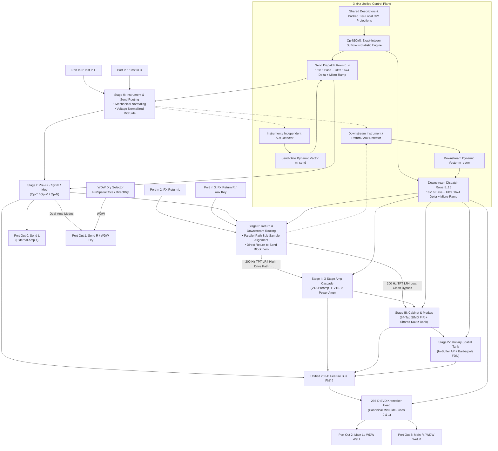

# Stage 0 Router, Canonical Stages Topology & 256-D Mid/Side Head

This specification defines the **Stage 0 8-Port Matrix Router**, the **Four Canonical Physical Stages (Stages I–IV)**, the **Unified 256-D Feature Bus & Canonical Mid/Side Kronecker Output Head**, and **Continuous-Time Zero-Order Hold (ZOH) Sample-Rate Adaptability (`44.1–96 kHz` & `4×` Bounce)** across **Dynamic Neural Audio Modeler (DNAM)** ([`packages/engine/src/engine/`](../../../packages/engine/README.md), [`packages/trainer/src/`](../../../packages/trainer/README.md), [`tora_architecture.md`](../architecture/tora_architecture.md), [`REQ-7.4`](../../requirements/system_goals_and_requirements.md)). For architectural rationales and counterexamples, see [`../../adr/0002-tri-operator-recurrent-architecture.md`](../../adr/0002-tri-operator-recurrent-architecture.md) and [`../../adr/0006-model-declared-delays-and-tank-feedback-guard.md`](../../adr/0006-model-declared-delays-and-tank-feedback-guard.md).

---

## 0. Detailed Signal Flow & Stage Boundaries

`r[dsp.router.signal-flow]`



---

## 1. Stage 0: 8-Port Matrix Router (`REQ-7.4`)

`r[dsp.router.ports]`

| Port Identifier | Signal Variable | Physical & Logical Routing Role |
| :--- | :--- | :--- |
| **`Port In 0 (Inst In L)`** | `x_{inst,L}[n]` | Primary mono or Left instrument input signal. |
| **`Port In 1 (Inst In R)`** | `x_{inst,R}[n]` | Secondary Right instrument input signal; mechanically normaled to `Port In 0` when unplugged. |
| **`Port In 2 (FX Return L)`** | `x_{ret,L}[n]` | External amplifier effects loop return for Amp 1 / Left channel. |
| **`Port In 3 (FX Return R / Aux Key)`** | `x_{ret,R}[n]` or `x_{aux}[n]` | External amplifier effects loop return for Amp 2 / Right channel OR dedicated auxiliary sidechain detector key; mechanically normaled to `Port In 2` when unplugged in stereo return mode. |
| **`Port Out 0 (Send L)`** | `y_{send,L}[n]` | Pre-loop preamp send driving Amp 1 / Left external amplifier front-end (or optional mono send in WDW). |
| **`Port Out 1 (Send R / WDW Dry)`** | `y_{send,R}[n]` or `y_{dry}[n]` | Right external send in dual-amp modes; dedicated center dry output in WDW (`PreSpatialCore` or `DirectDry`). |
| **`Port Out 2 (Main Out L)`** | `y_{out,L}[n]` or `y_{wet,L}[n]` | Main output Left; wet-only Left in WDW. |
| **`Port Out 3 (Main Out R)`** | `y_{out,R}[n]` or `y_{wet,R}[n]` | Main output Right; wet-only Right in WDW. |

#### WDW Dry-Tap and Wet-Output Contract

`r[dsp.router.wdw-contract]`

| `WdwDryTap` Mode | Center Dry on `Port Out 1` | Wet-Only L/R on `Ports Out 2/3` | Default Applicability |
| :--- | :--- | :--- | :--- |
| **`PreSpatialCore`** | Mid contribution `m_c` of Stages I–III core (including allocated head terms) | Stage IV spatial contribution `m_w ± α s_w` | Default for WDW-capable full-rig models |
| **`DirectDry`** | Voltage-normalized Mid `0.5(x_L + x_R)` of instrument input (or active aligned return) | Effect-only model response relative to the selected direct source | Default for standalone wet-effect or external-center-amp rigs |

For `PreSpatialCore`, partition the head's Stages I–III core $(m_c, s_c)$ from its Stage IV spatial contribution $(m_w, s_w)$ with width $\alpha$:
$$y_L = m_c + m_w + \alpha(s_c + s_w), \qquad y_R = m_c + m_w - \alpha(s_c + s_w)$$
$$y_{\text{dry}} = m_c, \qquad y_{\text{wet},L} = m_w + \alpha s_w, \qquad y_{\text{wet},R} = m_w - \alpha s_w$$

#### $4 \times 4$ Scattering Matrix $\mathbf{S}_{\mathrm{router}}$ & Return-to-Send Isolation

`r[dsp.router.return-to-send-isolation]`

```text
                  [ S_00  S_01 |   0     0   ]   [ S_{inst->send}    0_{2x2}    ]
S_router =        [ S_10  S_11 |   0     0   ] = [                              ]
                  [------------+-------------]   [                              ]
                  [ S_20  S_21 | S_22  S_23  ]   [ S_{inst->down}  S_{ret->down}]
                  [ S_30  S_31 | S_32  S_33  ]
```

$$\mathbf{y}_{\mathrm{send}}[n] = \mathbf{S}_{\mathrm{inst} \to \mathrm{send}} \mathbf{x}_{\mathrm{inst}}[n], \qquad \mathbf{u}_{\mathrm{down}}[n] = \mathbf{S}_{\mathrm{inst} \to \mathrm{down}} \mathbf{x}_{\mathrm{inst}}[n] + \mathbf{S}_{\mathrm{ret} \to \mathrm{down}} \mathbf{x}_{\mathrm{ret, aligned}}[n]$$

1. **Direct-Path Isolation:** Enforcing $\mathbf{S}_{\mathrm{ret} \to \mathrm{send}} \equiv \mathbf{0}_{2 \times 2}$ guarantees open-loop return ratio $\mathbf{T}_{\mathrm{loop}}(z) = \mathbf{S}_{\mathrm{ret} \to \mathrm{send}} \mathbf{H}_{\mathrm{amp}}(z) \equiv \mathbf{0}_{2 \times 2}$ and $\det(\mathbf{I} - \mathbf{T}_{\mathrm{loop}}(z)) \equiv 1$.
2. **Send-Safe Control & Detector Partition:** Stage I and router send gains (`θ_0..θ_4`) consume only the send-safe dynamic vector $\mathbf{m}_{\text{send}}$ (derived from instrument inputs and any independent auxiliary key), never return-derived samples or detector histories; downstream stages (`θ_5..θ_15`) consume $\mathbf{m}_{\text{down}}$ ([`parametric_control_bus.md` §3.1](parametric_control_bus.md#31-stage-parameter-dispatch-matrix-mathbfw_textctrl)).

#### Parallel-Path Sub-Sample Alignment

`r[dsp.router.parallel-alignment]`

| `AlignmentMode` | Interpolation Kernel | Host-Rate Centering Offset (`G`) | Selection & Offline Bounce Rule |
| :--- | :--- | :---: | :--- |
| **`FullBand64Tap`** | 64-tap Kaiser-derived windowed sinc (`β = 8.6`) | `31` host samples (`0.65 ms` @ `48 kHz`) | Default for full-band 4CM/WDW, training, certification, and `4×` offline bounce |
| **`LowLatency16Tap`** | 16-tap Kaiser-derived windowed sinc (`β = 6.5`) | `7` host samples (`0.15 ms` @ `48 kHz`) | Selectable low-latency live monitoring mode |
| **`MinLatency4Tap`** | Centered 4-tap Catmull-Rom cubic Hermite | `1` host sample (`0.021 ms` @ `48 kHz`) | Low-band alignment or minimum-latency live monitoring mode |

For $K \in \lbrace 16, 64 \rbrace$ with $G = (K - 2)/2$, $R = K/2$, and $s_k = k - G - \mu$, prepare the normalized zero-ended Kaiser-derived sinc weights on the cold path:
$$w_{\beta}(s) = \frac{I_0\big(\beta\sqrt{1 - (s/R)^2}\big) - 1}{I_0(\beta) - 1} \quad (|s| \le R), \qquad h_k(\mu) = \frac{\mathrm{sinc}(s_k) w_{\beta}(s_k)}{\sum_{j=0}^{K-1}\mathrm{sinc}(s_j) w_{\beta}(s_j)}$$
For oversampling factor $M \in \lbrace 1, 4 \rbrace$, measured effective-rate arrivals $a_i$, $A = \max_i a_i$, and optional common host-sample pad $p \ge 0$, set $\Delta_i = A - a_i + M p$, $J_i = \lfloor \Delta_i \rfloor$, $\mu_i = \Delta_i - J_i$, and $B = (M - 1)G$:
$$y_i[n] = \sum_{k=0}^{K-1} h_k(\mu_i) x_i[n - B - J_i - k], \qquad d_{\mathrm{eff},i} = M G + \Delta_i$$
At `4×` bounce, `FullBand64Tap` applies $B = 93$ plus its `31`-effective-sample center to preserve a `31`-host-sample alignment offset (`43` host samples combined nominal PDC with the `12`-host-sample oversampler; minimum `157` effective-rate samples of ring history per channel). `MinLatency4Tap` ($G = 1$) uses the 4-tap Catmull-Rom basis ($\sum_{k=-1}^2 c_k(\mu) \equiv 1.0$, `0.00 dB` exact DC gain):
$$c_{-1}(\mu) = -0.5\mu(1 - \mu)^2, \quad c_0(\mu) = 1 - 0.5\mu^2(5 - 3\mu), \quad c_1(\mu) = 0.5\mu(1 + 4\mu - 3\mu^2), \quad c_2(\mu) = 0.5\mu^2(\mu - 1)$$

#### Stage 0 LR4 Clean/Drive Crossover

`r[dsp.router.lr4-crossover]`

When parallel sub-bass bypass is active, split the selected downstream source using a 4th-order Linkwitz–Riley (`LR4`, default $f_c = 200\text{ Hz}$) crossover realized as two cascaded 2nd-order Butterworth **trapezoidal state-variable filter (TPT SVF)** sections ($Q = 1/\sqrt{2}$). Prepare cold-path coefficients in `f64` and store as `f32`:
$$g = \tan\left(\frac{\pi f_c}{f_{s,\text{eff}}}\right), \qquad k = \sqrt{2}, \qquad a_1 = \frac{1}{1 + g(g + k)}, \qquad a_2 = g a_1, \qquad a_3 = g a_2$$
Each SVF section updates integrator states $(s_1, s_2)$ without real-time division:
$$v_3 = x - s_2, \qquad v_1 = a_1 s_1 + a_2 v_3, \qquad v_2 = s_2 + a_2 s_1 + a_3 v_3$$
$$\ell = v_2, \qquad h = x - k v_1 - v_2, \qquad s_1' = 2 v_1 - s_1, \qquad s_2' = 2 v_2 - s_2$$
Route $L_4 = L_2^2$ to the Stage III clean bypass and $H_4 = H_2^2$ to Stage II (`|L₄(e^{jω}) + H₄(e^{jω})| ≡ 1`, `-6.02 dB` and equal phase at $f_c$).

---

## 2. Mid/Side Encoding, Output Head & Stereo-Linked Dynamics

### 2.1 Drive-Invariant Voltage-Normalized Mid/Side Input Transformation

`r[dsp.router.mid-side-input]`

To preserve `0.00 dB` drive-threshold parity between mono (`1 → 2`) and centered stereo (`2 → 2`, $x_L = x_R = x$) inputs (`REQ-7.4`), Stage 0 uses **Voltage-Normalized Mid/Side Encoding** rather than orthonormal $1/\sqrt{2}$ power scaling:
$$x_{\mathrm{mid}}[n] = \frac{1}{2}\big(x_L[n] + x_R[n]\big), \qquad x_{\mathrm{side}}[n] = \frac{1}{2}\big(x_L[n] - x_R[n]\big), \qquad x_L[n] = x_{\mathrm{mid}}[n] + x_{\mathrm{side}}[n], \qquad x_R[n] = x_{\mathrm{mid}}[n] - x_{\mathrm{side}}[n]$$

### 2.2 Canonical Mid/Side Output Head Factorization

`r[dsp.head.mid-side-factorization]`

At each `3 kHz` control tick, the $D_h \in \lbrace 4, 8 \rbrace$ SVD head modes collapse into active Mid ($a = \mathrm{mid}$, Slice 0) and Side ($a = \mathrm{side}$, Slice 1) weight vectors over the unified feature bus $\boldsymbol{\Phi}[n] \in \mathbb{R}^D$ ($D \in \lbrace 64, 128, 192, 256 \rbrace$):
$$\mathbf{w}_a[n] = \mathbf{w}_{a,0} + \sum_{d=1}^{D_h} z_{\mathrm{head},d}[n] \mathbf{w}_{a,d}, \qquad b_a[n] = b_{a,0} + \sum_{d=1}^{D_h} z_{\mathrm{head},d}[n] b_{a,d}$$
$$\mathbf{w}_{\mathrm{mid}} \triangleq \frac{1}{2}\big(\mathbf{w}_L + \mathbf{w}_R\big), \qquad \mathbf{w}_{\mathrm{side}} \triangleq \frac{1}{2}\big(\mathbf{w}_L - \mathbf{w}_R\big), \qquad b_{\mathrm{mid}} \triangleq \frac{1}{2}\big(b_L + b_R\big), \qquad b_{\mathrm{side}} \triangleq \frac{1}{2}\big(b_L - b_R\big)$$
$$y_{\mathrm{mid}}[n] = \mathbf{w}_{\mathrm{mid}}^\top \boldsymbol{\Phi}[n] + b_{\mathrm{mid}}, \qquad y_{\mathrm{side}}'[n] = \alpha_{\mathrm{width}}[n] \big(\mathbf{w}_{\mathrm{side}}^\top \boldsymbol{\Phi}[n] + b_{\mathrm{side}}\big)$$
$$y_L[n] = y_{\mathrm{mid}}[n] + y_{\mathrm{side}}'[n], \qquad y_R[n] = y_{\mathrm{mid}}[n] - y_{\mathrm{side}}'[n]$$

1. **Mono (`1 → 1`, `2 → 1`) Execution:** Evaluates only Slice 0 ($y_{\mathrm{mid}}[n]$), preserving dual-mic (`SM57 + R121`) and ping-pong delay sums without dropping the right channel while skipping Slice 1 dot-products.
2. **Mid Reconstruction Bound:** For matching state and features, $|m - \hat{m}| \le 2 \mathrm{ulp}(M) + 2 F_{\min}$ where $M = \max(|y_{\mathrm{mid}}|, |y_{\mathrm{side}}'|)$.
3. **Stereo Width Folding ($\alpha_{\mathrm{width}} \in [0.0, 2.0]$):** When static over a control block, fold $\alpha_{\mathrm{width}}$ into $\tilde{\mathbf{w}}_{\mathrm{side}} = \alpha_{\mathrm{width}}\mathbf{w}_{\mathrm{side}}$ and $\tilde{b}_{\mathrm{side}} = \alpha_{\mathrm{width}}b_{\mathrm{side}}$ at the `3 kHz` boundary (`0` extra audio-rate multiplies); when automated, micro-ramp $\alpha_{\mathrm{width}}[n]$ per sample.

### 2.3 Topology-Adaptive Even/Odd SIMD Lane Partitioning

`r[dsp.router.topology-dispatch]`

| Parameter / Feature | Mono (`1 → 1`) | Stereo-to-Mono (`2 → 1`) | Mono-to-Stereo (`1 → 2`) | True Stereo (`2 → 2`) |
| :--- | :---: | :---: | :---: | :---: |
| **Engine Entrypoint** | `process_mono` | `process_stereo_to_mono` | `process_mono_to_stereo` | `process_stereo` |
| **Stage I & II Execution** | Normaled L/R paths & cross-coupling retained | Full stereo L/R paths & coupling | Normaled L/R paths & cross-coupling retained | Full stereo L/R paths & coupling |
| **Stage III Early FIR & Modals** | Both L/R FIR histories & modal states advance | Both L/R FIR histories & modal states advance | Both L/R FIR histories & modal states advance | Both L/R FIR histories & modal states advance |
| **Output Head Slices** | Slice 0 (`w_mid`) only | Slice 0 (`w_mid`) only | Slices 0 & 1 (`w_mid, w_side'`) | Slices 0 & 1 (`w_mid, w_side'`) |

### 2.4 Programmable Stereo-Linked & Aux-Key Sidechain Envelope Detector

`r[dsp.router.stereo-link-detector]`

The sidechain detector blends peak-linked stereo detection ($\alpha_{\mathrm{link}} \in [0.0, 1.0]$) and external auxiliary keying ($\beta_{\mathrm{key}} \in [0.0, 1.0]$) with zero `-6.02 dB` hard-panned peak loss:
$$e_{\mathrm{link}}[n] = \max\big(|x_L[n]|, |x_R[n]|\big), \qquad e_{\mathrm{key}}[n] = |x_{\mathrm{aux}}[n]|$$
$$e_{\mathrm{det}, c}[n] = (1 - \beta_{\mathrm{key}})\Big((1 - \alpha_{\mathrm{link}})|x_c[n]| + \alpha_{\mathrm{link}} e_{\mathrm{link}}[n]\Big) + \beta_{\mathrm{key}} e_{\mathrm{key}}[n], \qquad c \in \lbrace L, R \rbrace$$
At full link ($\alpha_{\mathrm{link}} = 1.0$) with a shared positive normal gain $G[n] > 0$ and normal finite inputs/products ($u = 2^{-24}$), the stereo image angle error satisfies:
$$\Vert\widehat{\mathbf{y}} - G\mathbf{x}\Vert_2 \le u\Vert G\mathbf{x}\Vert_2, \qquad |\sin(\Delta\theta)| \le \frac{u}{1 - u}, \qquad |\Delta\theta| < 0.00000342^\circ$$
Audio-rate ballistic envelope smoothing prepares $\alpha_{\mathrm{att}} = 1 - \exp(-1/(f_s\tau_{\mathrm{att}}))$ and $\alpha_{\mathrm{rel}} = 1 - \exp(-1/(f_s\tau_{\mathrm{rel}}))$ on the cold path and updates $v_{\mathrm{env},c}[n] = v_{\mathrm{env},c}[n-1] + \mathrm{select}(\Delta e_c[n] > 0, \alpha_{\mathrm{att}}, \alpha_{\mathrm{rel}})\Delta e_c[n]$ branchlessly.

### 2.5 4-Band Asymmetric Ballistic Envelope Bank & Aux Key Detector

`r[dsp.router.ballistic-envelope-bank]`

| Band ID | Frequency Range | Ballistic Attack (`τ_att`) | Ballistic Release (`τ_rel`) | Physical Circuit Role |
| :--- | :--- | :---: | :---: | :--- |
| **Band 0 (Low)** | `< 250 Hz` | `10.0 ms` | `150.0 ms` | Power supply B+ rail sag, cone excursion pumping, transformer saturation. |
| **Band 1 (Mid)** | `250–2000 Hz` | `2.0 ms` | `40.0 ms` | Dynamic auto-wah envelope, speech formant modulation, optical compression. |
| **Band 2 (High)** | `> 2000 Hz` | `0.2 ms` | `15.0 ms` | Pick transient attack detection, noise gate onset, sizzle ducking. |
| **Band 3 (Aux Key)** | Wideband / Sidechain | `0.5 ms` | `50.0 ms` | Driven from `Port In 3 (Aux Key)` or stereo-linked instrument sum. |

---

## 3. Stage I: Pre-FX / Synth / Pitch / Mod (Pre-Bus)

`r[dsp.stage1.pre-bus]`

| Stage I Kernel | State Allocation | Operational Modes & Physical Roles |
| :--- | :--- | :--- |
| **`Op-T[Pre]` (Transport & Pitch)** | Model-declared 64B-aligned delay histories with 4-tap Catmull-Rom ([`op_t_transport.md` §1](op_t_transport.md#11-exact-sized-delay-histories-and-branchless-wrap)) | • **`M = 1`:** Fractional micro-delay and through-zero flanging.<br/>• **`M = 2`:** Centered dual-tap Hermite-Hann pitch shifter (`±24 st`, Family 3).<br/>• **`M = 3`:** Endless barberpole phaser/flanger sweep (Family 6). |
| **`Op-M[Pre]` (Modal, Hilbert & Bistable)** | `4` complex pole channels/tier + `H1` analytic pairs + `T1` DC blocker/tracker states ([`op_m_modal_kautz.md` §2–§3](op_m_modal_kautz.md#2-family-2-hilbert-ssb-lattice--carrier-modulation)) | • **`M-1`:** 6-section `H1` all-pass pair + carrier rotor for SSB/ring mod (Family 2).<br/>• **`M-2`:** `T1` sub-harmonic tracker routed to `Lite` slots `4..11` (Family 1).<br/>• **`M-3`:** High-`Q` auto-wah and resonant phaser sweeps. |
| **`Op-N[Pre]` (Waveshaping, Dynamics & ZOH)** | `C_tier` ballistic envelope & fixed-hertz ZOH quantizer states ([`op_n_commuted_cascade.md` §2.3](op_n_commuted_cascade.md#23-family-5-precomputed-reciprocal-zoh-sample-rate-reducer--bitcrusher)) | • Hysteretic gate / auto-swell / compressor VCA (Family 4).<br/>• Fixed-hertz ZOH reducer + nearest-step bitcrusher (`0 FDIV`, Family 5).<br/>• Pre-drive boost and soft-clipping `PolyADAA`. |

For stereo downstream feed $(x_{0,L}[n], x_{0,R}[n])$ from Stage 0, the 2-bit serial permutation `sel = topology_selector & 0x03` executes with partitioned Left/Right state isolation:
- `sel = 0`: $\mathbf{x}_{\text{s1}}[n] = \mathcal{T}_{\text{pre}}\big(\mathcal{M}_{\text{pre}}\big(\mathcal{N}_{\text{pre}}(\mathbf{x}_0[n])\big)\big)$ (`Drive -> Filter -> Mod`)
- `sel = 1`: $\mathbf{x}_{\text{s1}}[n] = \mathcal{T}_{\text{pre}}\big(\mathcal{N}_{\text{pre}}\big(\mathcal{M}_{\text{pre}}(\mathbf{x}_0[n])\big)\big)$ (`Wah -> Overdrive -> Mod`)
- `sel = 2`: $\mathbf{x}_{\text{s1}}[n] = \mathcal{M}_{\text{pre}}\big(\mathcal{N}_{\text{pre}}\big(\mathcal{T}_{\text{pre}}(\mathbf{x}_0[n])\big)\big)$ (`Mod -> Drive -> Filter`)
- `sel = 3`: $\mathbf{x}_{\text{s1}}[n] = \mathcal{N}_{\text{pre}}\big(\mathcal{M}_{\text{pre}}\big(\mathcal{T}_{\text{pre}}(\mathbf{x}_0[n])\big)\big)$ (`Mod -> Filter -> Drive`)

In parallel, the `T1` tracker branch (`5 Hz` passband-normalized DC blocker $\to$ 12-allpass `H1` analytic pair $\to$ rising-edge $f_0/2, f_0/4$ dividers and half-angle sheet tracker; [`op_m_modal_kautz.md` §3](op_m_modal_kautz.md#3-family-1-sub-harmonic-synthesizers-bistable-dividers--pll-tracking)) processes $(x_{0,L}[n], x_{0,R}[n])$ on every sample and writes the 8 features `[L-cos, L-sin, L-half-sq, L-quarter-sq, R-cos, R-sin, R-half-sq, R-quarter-sq]` directly into `Lite` feature-bus slots `4..11` (§7).

---

## 4. Stage II: 3-Stage LTI-Commuted Nonlinear Cascade

`r[dsp.stage2.commuted-cascade]`

Stage II models the 3-stage amplifier cascade (`V1A Preamp + Tone Stack` $\to$ `V1B Driver + C² Wavefolder` $\to$ `Push-Pull Power Amp + Sag + Hysteresis`) via the Exact LTI Commutativity Theorem (`Theorem 1`), evaluating the multi-drive $d_{\text{bank}} = [0.25\times, 1.0\times, 4.0\times, 16.0\times]$ `PolyADAA` bank and folding $\mathbf{z}_{\text{stage}}$ into $\mathbf{W}_k^{(s)}(\mathbf{z}_{\text{stage}})$ at `3 kHz` ([`op_n_commuted_cascade.md` §3–§4](op_n_commuted_cascade.md#3-exact-lti-basis-commutativity-theorem-theorem-1)):

1. **Sub-Stage 2.1 (`V1A` Preamp):** For stereo Stage I output $(x_{\text{s1},L}[n], x_{\text{s1},R}[n])$ and micro-ramped preamp drive $g_{\text{v1a}}[n]$, evaluate the 4-drive unclamped rail-crossing `PolyADAA` bank $\mathbf{u}_{\text{v1a},c}[n] \in \mathbb{R}^4$ ($c \in \lbrace L, R \rbrace$) and extract primary driver feed $v_{\text{v1a},c}[n] = u_{\text{v1a},c,1}[n]$.
2. **Sub-Stage 2.2 (`V1B` Driver & Degree-7/8 ADAA $C^2$ Wavefolder):** Evaluate the interval-average cubed-envelope $C^2$ wavefolder $A_{\text{odd},3,c}[n]$ on $(v_{\text{v1a},c}[n-1], v_{\text{v1a},c}[n])$ and instantaneous $w_{\text{odd},3}(v_{\text{v1a},c}[n])$, form $x_{\text{v1b},c}[n] = 0.7 v_{\text{v1a},c}[n] + 0.15(A_{\text{odd},3,c}[n] + w_{\text{odd},3}(v_{\text{v1a},c}[n]))$, and step the second 4-drive `PolyADAA` bank $\mathbf{u}_{\text{v1b},c}[n] \in \mathbb{R}^4$.
3. **Sub-Stage 2.3 (Power Amp, Supply Sag, 2D Quadrature Hysteresis & Role A / Role B Cascade Wiring):** Update the 1-pole B+ supply sag envelope $e_{\text{sag}}[n] = R_{\text{sag}} e_{\text{sag}}[n-1] + (1 - R_{\text{sag}}) \cdot \frac{1}{2}(|u_{\text{v1b},L,2}[n]| + |u_{\text{v1b},R,2}[n]|)$, form sag compression $c_{\text{sag}}[n] = \max(0.2, 1 - \alpha_{\text{sag}}[n] e_{\text{sag}}[n])$, evaluate 2D quadrature hysteresis $h_{\text{hyst},c}[n]$ on $(u_{\text{v1b},c,1}[n], u_{\text{v1b},c,2}[n])$, and step the 4-filter tone basis $\boldsymbol{\tau}_c[n] = [\text{Direct}, \text{LPF}_{80}, \text{LPF}_{400}, \text{HPF}_{1200}]^\top$ on $(u_{\text{v1b},c,1}[n] + 0.1 h_{\text{hyst},c}[n]) c_{\text{sag}}[n]$. Within each tier's `stage2_cascade_w` slice (`K_t = 48 / 96 / 144 / 192` 16-`f32` blocks), **Role A (`b = 0`)** applies the `4×4` inter-stage coupling matrix while **Role B (`b = 1..K_t-1`)** folds surjectively via `(b - 1) & 7` into the 8 Stage II feature-bus slots (`40..48` per tier, §7). Emit primary Stage II output $x_{\text{s2},c}[n] = \tau_{c,0}[n]$ into Stage III.

---

## 5. Stage III: 64-Tap Early SIMD FIR + Kautz Modal Cabinet Bank

`r[dsp.stage3.cabinet-bank]`

Stage III executes between Stage II and Stage IV, combining independent L/R early FIR segments (`16 / 32 / 48 / 64` taps/ch) with shared-pole Kautz modal pairs (`4 / 8 / 16 / 32` pairs, driven at $x_a[n-16]$ at `48 kHz`) and independent L/R complex readouts ([`op_m_modal_kautz.md` §4](op_m_modal_kautz.md#4-stage-iii--family-6-shared-kautz-modal-bank)).

`r[dsp.stage3.mirrored-fir-simd]` **Double-Mirrored Reverse-Order FIR History & Contiguous `dot16_stereo` Evaluation ([`ADR-0019`](../../adr/0019-simd-kernel-architecture-and-realtime-execution-optimizations.md)):** To eliminate per-tap modulo index wrapping (`(pos - k) & 63`) and scalar gather loads across the 64-tap early FIR filter, each channel's `Stage3CabinetModals` instance (`stage3` and `stage3_r`) maintains a double-mirrored reverse-order circular buffer `fir_rev_history: [f32; 128]` where each incoming sample is written to both `rev` and `rev + 64` for `rev = (64 - (self.fir_write_ptr & 63)) & 63`. Because `[rev + tap_offset .. rev + tap_offset + 16]` is always contiguous in memory for every 16-tap tier slice (`tap_offset ∈ {0, 16, 32, 48}`), `Stage3Backend::dot16_stereo` loads four contiguous `B::Vec4` vectors per channel (or two 256-bit `__m256` vectors in `avx2_dot16_stereo`) and reduces Left and Right dot products simultaneously via `SimdVec4::horizontal_sum_pair`.

---

## 6. Stage IV: Unitary Spatial / Barberpole Tank (`Op-T[Tank]`)

`r[dsp.stage4.spatial-tank]`

| Stage IV Component | Architectural & Mathematical Specification |
| :--- | :--- |
| **Physical Structure** | `M` delay lines (`M = 4` Lite, `M = 8` Full/Pro, `M = 16` Ultra) with model-declared 64B-aligned `fp16` histories and grouped bounded-history feedback guard ([Op-T §1](op_t_transport.md#11-exact-sized-delay-histories-and-branchless-wrap)). |
| **Partitioned Schroeder All-Pass Diffusers** | Non-overlapping in-buffer segments with rate-converted integer lengths and `∣a_diff,m∣ ≤ 0.75` ([Op-T §3](op_t_transport.md#31-memory-partitioning--rate-aware-capacity)). |
| **`O(M)` Givens + Householder Mixing `U(ψ, v)`** | Block-diagonal `2×2` Givens rotation `R(ψ)` (`∣Δψ∣ ≤ 0.05 rad/tick`) paired with unit-norm Householder reflection `H(v) = I_M - 2vv^T` (`‖U^T U - I‖_∞ < 1e-14` in `f64`, `< 1e-6` in `f32` across `M ∈ {4, 8, 16}`). |
| **Input & Readout DC Conditioning** | Passband-normalized `5 Hz` DC blocker (`0x3F7FD51F` @ `48 kHz`) applied at tank input injection and non-recirculating tank readouts (§6.2). |
| **Blended Feedback Knee & Loop Saturator** | Per-line blended knee `K(u)` (`g_lin ≤ 0.9990`, §6.4) followed by unity-slope cubic saturator (`V_ceil,m ≤ 0.9850`, §6.3). |

### 6.1 Captured Freeze and Modeled Controls

`r[dsp.stage4.captured-freeze]`

Hardware freeze is modeled when present and captured in the training stems ([`capture_and_alignment.md` §1.3](../training/capture_and_alignment.md#freeze-transition-capture)); unobserved freeze options remain clamped under `ref[train.audit.phase1.clamp-switch]`. When a captured Stage IV freeze stops new tank input injection, Stages 0–III continue processing live instrument input for play-over performance, while the Stage IV DC blockers (§6.2) condition the tank input and non-recirculating readouts without damping the held tank state.

### 6.2 Stage IV Passband-Normalized DC Blocker

`r[dsp.stage4.dc-blocker]`

For pole $0 \le R_{\text{dc}} < 1$, the passband-normalized DC blocker is applied at Stage IV tank input injection and non-recirculating tank readouts:
$$H_{\text{dc}}(z) = \frac{\alpha_{\text{dc}}(1 - z^{-1})}{1 - R_{\text{dc}}z^{-1}}, \qquad \alpha_{\text{dc}} = \frac{1 + R_{\text{dc}}}{2}, \qquad R_{\text{dc,ref}}(48\text{ kHz}) = \frac{\cos(2\pi \cdot 5 / 48000)}{1 + \sin(2\pi \cdot 5 / 48000)} \approx \mathtt{0x3F7FD51F}$$
At other effective rates, convert $R_{\text{dc}}(f_{s,\text{eff}}) = R_{\text{dc,ref}}^{\rho_{\text{sr}}}$ on the cold path (§9).

### 6.3 Stage IV Normalized Loop Saturator

`r[dsp.stage4.loop-saturator]`

For finite ceiling $0 < V_{\text{ceil}} \le 0.985$ (`≤ 0x3F7C28F5` in `f32`, since `0x3F7C28F6 ≈ 0.9850000143` exceeds `0.985`), the unity-slope memoryless cubic saturator is:
$$v = \mathrm{clamp}\left(\frac{2u}{3V_{\text{ceil}}},\ -1,\ 1\right), \qquad S(u) = \mathrm{clamp}\Big(V_{\text{ceil}} v(1.5 - 0.5 v^2),\ -V_{\text{ceil}},\ V_{\text{ceil}}\Big)$$
The explicit outer clamp to $\pm V_{\text{ceil}}$ prevents `f32` intermediate rounding (e.g., at `v = 0x3F7FF4D1`) from exceeding `0x3F7C28F5`.

### 6.4 Stage IV Blended Quiet-Feedback Knee

`r[dsp.stage4.quiet-feedback-knee]`

Each tank line applies the blended pre-saturator feedback knee with quiet slope $0 \le g_{\text{lin}} \le 0.9990$ (`≤ 0x3F7FBE76` in `f32`, since `0x3F7FBE77` exceeds `0.9990`), blend factor $\alpha \in [0, 1]$, and knee width $\sigma > 0$:
$$K(u) = g_{\text{lin}} u \left((1 - \alpha) + \frac{\alpha}{1 + (u/\sigma)^2}\right), \qquad K'(0) = g_{\text{lin}}, \qquad |K(u)| \le g_{\text{lin}}|u|$$
At $\alpha = 0$, $K(u) = g_{\text{lin}} u$ is purely linear; at $\alpha = 1$, $K(u)$ is the rational knee. Evaluate $(1 + (u/\sigma)^2)^{-1}$ without audio-loop division via cold-path prepared $1/\sigma$ and 6 exponent-seeded `f64` Newton reciprocal steps (`pre-rounding relative error < 2^-40`).

`r[dsp.stage4.simd-tank-loop]` **4-Lane SIMD Tank Conditioning, Saturation & Orthogonal Mixing ([`ADR-0019`](../../adr/0019-simd-kernel-architecture-and-realtime-execution-optimizations.md)):** `Stage4SpatialTank::step_stereo_with_readouts` (`lines: [[u16; TANK_LINE_CAPACITY]; TANK_LITE_LINES]`, `dc_blockers: [TankDcBlocker; TANK_LITE_LINES]`, `dc_x_prev: [f32; TANK_LITE_LINES]`, `dc_y_prev: [f32; TANK_LITE_LINES]`, `ducking_vca: BallisticDuckingVca`, with multi-tier feature-bus taps extracted via `read_multi_tier_taps_into`) vectorizes the 4-line feedback loop in `B::Vec4` SIMD registers:
1. **4-Lane Passband-Normalized DC Blocker:** Updates the 4-line `dc_x_prev` and `dc_y_prev` states in `B::Vec4` via `y = alpha_dc * (x - x_prev) + r_dc * y_prev` + `flush_recursive_state_vec4`.
2. **4-Lane Blended Knee & Cubic Loop Saturator (`coercive_saturate_4ch`):** Evaluates $(1 + (u \cdot \sigma^{-1})^2)^{-1}$ across all 4 lines in `B::Vec4` using cached `inv_sigma_knee` and 3-step `f32` Newton reciprocal refinement (with 6-step `f64` `coercive_saturate` on the single-line path), followed by 4-lane cubic saturation clamped to $\pm V_{\text{ceil}}$.
3. **4-Lane Givens Rotation & Householder Reflection:** Caches `(cos_psi, sin_psi)` whenever the slewed Givens angle is stationary (`|target_psi - current_psi| <= 1e-7`), applies the $2\times 2$ block-diagonal Givens rotation in a single 4-lane FMA via `SimdVec4::pair_swap_neg([x0, x1, x2, x3]) -> [-x1, x0, -x3, x2]`, and evaluates the 4-channel Householder reflection $y - 2(v^\top y)v$ using `SimdVec4::horizontal_sum` and `SimdVec4::fma`.

---

## 7. Unified 256-D 4-Tier Kronecker Output Head

`r[dsp.head.feature-bus-slots]`

For each 4-mode Kautz block in Stage III, pair-grouped L/R modal readouts expose four features `[y_0L + y_2L, y_1L + y_3L, y_0R + y_2R, y_1R + y_3R]`, and each tier's 16-tap L/R FIR segment exposes two features:

| Tier | Cumulative Bus Width | New Modal Features | New FIR Features | Stage III Delta | Slots Available to Other Stages |
| :--- | :---: | :---: | :---: | :---: | :---: |
| **`Lite`** | `64` | `4` | `2` | `6` | `58` |
| **`Full`** | `128` | `4` | `2` | `6` | `58` |
| **`Pro`** | `192` | `8` | `2` | `10` | `54` |
| **`Ultra`** | `256` | `16` | `2` | `18` | `46` |
| **Total** | `256` | `32` | `8` | `40` | `216` |

```text
STAGE-III-TIER-SLOTS
Tier    New modal groups          Other-stage slots    FIR L, FIR R
Lite      0..3   (block 0)             4..61              62,  63
Full     64..67  (block 1)            68..125            126, 127
Pro     128..135 (blocks 2..3)       136..189            190, 191
Ultra   192..207 (blocks 4..7)       208..253            254, 255
```

Slots `4..11` in the `Lite` block carry the L/R Stage I `T1` sub-harmonic tracker features ([`op_m_modal_kautz.md` §3.2](op_m_modal_kautz.md#32-discrete-toggle--half-angle-sheet)):

```text
STAGE-I-T1-FEATURES
  4 | L-cos
  5 | L-sin
  6 | L-half-square
  7 | L-quarter-square
  8 | R-cos
  9 | R-sin
 10 | R-half-square
 11 | R-quarter-square
```

Within each tier block, the remaining `"Other-stage slots"` (`12..61` in `Lite`, `68..125` in `Full`, `136..189` in `Pro`, and `208..253` in `Ultra`) follow the deterministic producer layout (`ADR-0011`):

```text
CANONICAL-256D-FEATURE-BUS-MAP
Lite (0..63):
  0..3    (4):  Stage III Kautz Modal Block 0 [y_0L+y_2L, y_1L+y_3L, y_0R+y_2R, y_1R+y_3R]
  4..11   (8):  Stage I T1 Sub-Harmonic Tracker [L-cos, L-sin, L-f/2, L-f/4, R-cos, R-sin, R-f/2, R-f/4]
  12..19  (8):  Stage I Pre-FX Stereo [op_t_l, op_t_r, op_m_re_l, op_m_im_l, op_m_re_r, op_m_im_r, ssb_l, ssb_r]
  20..35 (16):  Stage II Sub-Stage 2.1 Tone Basis L/R (8) + V1A 4-Drive PolyADAA L/R (8)
  36..51 (16):  Stage II Sub-Stage 2.2 V1B 4-Drive PolyADAA L/R (8) + Wavefolder/Power/Sag/Hyst L/R (8)
  52..59  (8):  Stage IV Spatial Tank 4-Line Readouts (4) + Ducked Wet L/R (2) + Stage I/II Direct L/R (2)
  60..61  (2):  Stage 0 200 Hz TPT LR4 Clean Sub [clean_sub_l, clean_sub_r]
  62..63  (2):  Stage III Early FIR Segment 0 (taps 0..15) [fir_0_l, fir_0_r]

Full (64..127), Pro (128..191) & Ultra (192..255):
  64..67   (4) / 128..135  (8) / 192..207 (16): Stage III Kautz Modal Blocks 1 / 2..3 / 4..7
  68..83  (16) / 136..151 (16) / 208..223 (16): Stage I Channel Group 1 / 2 / 3 Stereo Features
  84..115 (32) / 152..183 (32) / 224..245 (22): Stage II Channel Group 1 / 2 / 3 Commuted Basis Features
 116..125 (10) / 184..189  (6) / 246..253  (8): Stage IV Delta Tank Lines (4..7 in Full, 8..15 in Ultra) & Cross-Terms
 126..127  (2) / 190..191  (2) / 254..255  (2): Stage III Early FIR Segments 1 / 2 / 3 (taps 16..31 / 32..47 / 48..63)
```

`r[dsp.head.tier-equivalence]` **Effective-Tier Equivalence:** For identical external inputs, control values, initial active-tier state, and backend, a container stripped to tier `T` produces bit-identical Stage II feeds, L/R FIR histories, and retained FIR-segment features to the unstripped container running at effective tier `T` (with all tier `> T` weights and `Ultra` control extensions gated off).

#### Block-Diagonal Lower-Triangular Staging (Refinement 11)

`r[dsp.head.lower-triangular]`

```text
W_head = [ W_lite           0             0             0           ]
         [ W_full,lite     W_full,delta  0             0           ]
         [ W_pro,lite      W_pro,full    W_pro,delta   0           ]
         [ W_ultra,lite    W_ultra,full  W_ultra,pro   W_ultra,delta ]
```

`r[dsp.head.precollapse-and-zerocopy]` **Zero-Copy Feature Bus Packing & Two-Stage Kronecker Output Head Pre-Collapse ([`ADR-0019`](../../adr/0019-simd-kernel-architecture-and-realtime-execution-optimizations.md)):**
1. **In-Place `feature_bus_scratch` Assembly (`0` Intermediate Copies):** Each stage writes its per-tier features directly into pre-allocated `feature_bus_scratch: [f32; 256]` slots (`Stage2CommutedCascade::step_frame_into_feature_bus` for Stage II slots `20..51`, `84..115`, `152..183`, `224..245`; `KautzModalBank<4>::step_4lane_stereo_simd_unscaled` for Stage III Kautz slots `0..3`, `64..67`, `128..135`, `192..207`; and `Stage4SpatialTank::read_multi_tier_taps_into` for Stage IV slots), avoiding temporary `256 × f32` stack array copies per sample.
2. **Load-Time Surjective Role B Folding (`cached_role_b_slices`):** At model load / hot-reload (`DnamEngine::refresh_cached_role_b_slices`), each tier's `stage2_cascade_w` Role B blocks (`b = 1..K_t-1`, up to `191` blocks of `16 × f32` in `Ultra`) are pre-folded via `slot = (b - 1) & 7` into `cached_role_b_slices: [[B::Vec4; 32]; 4]` (`[mid_0..15, side_0..15]`), eliminating `191` block loops per audio sample.
3. **`3 kHz` Dirty-Checked SVD Head Collapse (`collapsed_head_wl` / `collapsed_head_wr`):** At each `3 kHz` control boundary where `z_head != cached_z_head` (or `z_head_ultra != cached_z_head_ultra` / `active_tiers != cached_head_tiers`), `DnamEngine::refresh_collapsed_head_weights` folds `cached_role_b_slices` and the active SVD head modes (`4` modes in `Lite..Pro`, `8` modes in `Ultra`) into `collapsed_head_wl: [[B::Vec4; 16]; 4]`, `collapsed_head_wr: [[B::Vec4; 16]; 4]`, and `collapsed_b_head: [f32; 2]` using `SimdVec4::fma_lane::<0..3>`. At `48 kHz`, `eval_tier_feature_bus_head_dot` reduces to a single 4-way unrolled `B::Vec4` FMA loop + `SimdVec4::horizontal_sum_pair` directly over `collapsed_head_wl/wr` (while `FeatureBusBackend::tile_dot64_stereo` and 256-bit `avx2_tile_dot64_stereo` on `X86Avx2FmaBackend` provide the corresponding `64-D` stereo `[f32; 64]` slice dot primitive), cutting per-sample Output Head work by `4×`–`8×`.

---

## 8. Tier-Aware Static & Dynamic Modulation Routing

### 8.1 Bus Architecture

`r[dsp.router.modulation-bus]`

$$\mathbf{q}_{16}[k] = \big[\mathbf{z}_{\text{ctrl}}^{(8)}[k], \ \mathbf{m}_{\text{dyn}}^{(8)}[k]\big]^\top \in \mathbb{R}^{16}$$

1. **Static Control Latents:** `Lite/Full/Pro` expose `4` head + `4` stage coordinates (`Rank-4` FM); `Ultra` adds `+4` head (`modes 5..8`) + `+4` stage coordinates (`Rank-8` FM) and a `16 × 4` stage-dispatch delta $\mathbf{W}_{\text{ctrl},\Delta}^{\text{Ultra}}$ in `Arena 3` ([`parametric_control_bus.md` §3.1](parametric_control_bus.md#31-stage-parameter-dispatch-matrix-mathbfw_textctrl)).
2. **Autonomous Dynamic Modulators $\mathbf{m}_{\text{dyn}} \in \mathbb{R}^8$ (`float32x4_t[2]`):**
   - $m_0 = z_{\mathrm{re}, \text{lfo0}}[k]$, $m_1 = z_{\mathrm{im}, \text{lfo0}}[k]$ (Quadrature LFO 0 In-Phase & $90^\circ$ rotors).
   - $m_2 = T_{\text{shape}}(z_{\mathrm{re}, \text{lfo0}}[k])$, $m_3 = T_{\text{shape}}(z_{\mathrm{re}, \text{lfo1}}[k])$ (Chebyshev shaped LFO 0 & 1).
   - $m_4 = e_{\text{low}}[k]$ ($< 250\text{ Hz}$), $m_5 = e_{\text{mid}}[k]$ ($250\text{–}2000\text{ Hz}$), $m_6 = e_{\text{high}}[k]$ ($> 2000\text{ Hz}$), $m_7 = e_{\text{aux}}[k]$ (`Port In 3` Aux Key).

---

## 9. Continuous-Time Zero-Order Hold (ZOH) Sample-Rate Adaptability (44.1–96 kHz & 4× Bounce)

Containers store discrete-time parameters anchored at $f_{s,\text{train}} = 48,000\text{ Hz}$. For host rate $f_{s,\text{host}} \in [44,100, 96,000]\text{ Hz}$ and oversampling factor $M_{\text{os}} \in \lbrace 1, 4 \rbrace$, let $f_{s,\text{eff}} = M_{\text{os}} f_{s,\text{host}}$ and $\rho_{\text{sr}} = 48000 / f_{s,\text{eff}}$:

1. `r[dsp.zoh.op-m-poles]` **Stage I (`Op-M[Pre]`) & Stage III (`Op-M[Modal]`) Pole Radii, Angles & `3 kHz` Retuning:**
   $$r_c(f_{s,\text{eff}}) = \big(r_{\text{ref},c}\big)^{\rho_{\text{sr}}} \in \big[0.25^{\rho_{\text{sr}}},\ 0.9995^{\rho_{\text{sr}}}\big], \qquad \theta_c(f_{s,\text{eff}}) = \mathrm{clamp}\Big(\rho_{\text{sr}} \theta_c(f_{s,\text{train}}),\ 10^{-4},\ \pi - 10^{-4}\Big)$$
   At $f_{s,\text{eff}} = 48,000\text{ Hz}$, use the validated serialized coefficients directly. At each `3 kHz` control boundary, Stage I (`theta_2..4`) and Stage III (`theta_9, theta_10`) dynamically retune their effective delays, pre-drive gains, and Kautz modal angles/gates without division or `libm`.
2. `r[dsp.zoh.router-detector]` **Stage 0 Relative Alignment Latency & `Op-M[Ctrl]` Detector Poles:**
   $$\delta_{\text{align},ch}^{\text{samples}}(f_{s,\text{eff}}) = \frac{\delta_{\text{align},ch}^{\text{samples}}(f_{s,\text{train}})}{\rho_{\text{sr}}}, \qquad p_{\text{det},b}(f_{s,\text{eff}}) = \big(p_{\text{det},b}(f_{s,\text{train}})\big)^{\rho_{\text{sr}}}$$
3. `r[dsp.zoh.stage2-op-n]` **Stage II (`Op-N`) Tone-Stack Poles, Sag/Bias Poles, 2D Hysteresis & Family 5 ZOH Phase (`0.999995` Upper Clamp):**
   $$p_{\text{tone},k}(f_{s,\text{eff}}) = \big(p_{\text{tone},k}(f_{s,\text{train}})\big)^{\rho_{\text{sr}}}, \qquad R_{\text{sag},k}(f_{s,\text{eff}}) = \big(R_{\text{sag},k}(f_{s,\text{train}})\big)^{\rho_{\text{sr}}}, \qquad R_{\text{ac}}(f_{s,\text{eff}}) = \big(R_{\text{ac}}(f_{s,\text{train}})\big)^{\rho_{\text{sr}}}$$
   Real poles rescaled via `rescale_real_pole` clamp to $[0.0, 0.999995]$ ($Q \approx 100{,}000$), preserving sub-`5 Hz` AC blockers at $4\times$ oversampling (`192 kHz` / `384 kHz`).
   $$\Delta s_{\text{re}}[n] = \rho_{\text{sr}}^{-1}\big(s_{\text{re}}[n] - s_{\text{re}}[n-1]\big)$$
4. `r[dsp.zoh.op-t-delays]` **Stage I & IV (`Op-T`) Delays, All-Pass Diffusers, Crossfades & DC Blocker:**
   $$\tau_{0,m}^{\text{samples}}(f_{s,\text{eff}}) = \max\left(4.0,\ \frac{\tau_{0,m}^{\text{samples}}(f_{s,\text{train}})}{\rho_{\text{sr}}}\right), \qquad D_{\text{ap},m}(f_{s,\text{eff}}) = \max\left(1,\ \mathrm{round}\left(\frac{D_{\text{ap},m}(f_{s,\text{train}})}{\rho_{\text{sr}}}\right)\right)$$
   $$L_{\text{xfade}}(f_{s,\text{eff}}) = \max\left(16,\ \mathrm{round}\left(\frac{L_{\text{xfade}}(f_{s,\text{train}})}{\rho_{\text{sr}}}\right)\right), \qquad R_{\text{dc}}(f_{s,\text{eff}}) = \big(R_{\text{dc}}(f_{s,\text{train}})\big)^{\rho_{\text{sr}}}$$
5. `r[dsp.zoh.ctrl-stride]` **Control-Bus Decimation Stride $K_{\text{ctrl}}$, Tick Ratio $\rho_{\text{ctrl}}$ & Micro-Ramp Step $\alpha_{\text{ramp}}$:**
   $$K_{\text{ctrl}}(f_{s,\text{eff}}) = \max\left(8,\ \mathrm{round}\left(\frac{f_{s,\text{eff}}}{3000.0}\right)\right), \qquad \rho_{\text{ctrl}} = \frac{f_{s,\text{train}} \cdot K_{\text{ctrl}}(f_{s,\text{eff}})}{f_{s,\text{eff}} \cdot K_{\text{ctrl}}(f_{s,\text{train}})}, \qquad \alpha_{\text{ramp}}(f_{s,\text{eff}}) = \frac{1.0}{K_{\text{ctrl}}(f_{s,\text{eff}})}$$
   $$\Delta\phi_{\text{lfo},j}(f_{s,\text{eff}}) = \rho_{\text{ctrl}} \Delta\phi_{\text{lfo},j}(f_{s,\text{train}}), \qquad R_{\text{env},b}(f_{s,\text{eff}}) = \big(R_{\text{env},b}(f_{s,\text{train}})\big)^{\rho_{\text{ctrl}}}$$
6. `r[dsp.zoh.stage3-fir-onset]` **Stage III FIR & Modal Onset Conversion (`Up to 8 Host Samples` Budget):**
   - **Integer Multiples ($f_{s,\text{eff}} = q \cdot 48000, q \in \lbrace 1, 2, 4, 8 \rbrace$):** Evaluate exact sparse FIR delays $x_a[n - q(16t + j)]$ with integer modal onset $16q$ (`0` added latency; [`op_m_modal_kautz.md` §4.1](op_m_modal_kautz.md#41-stage-iii-architecture--tier-allocation)).
   - **Live `44.1–48 kHz` First-Tap Continuous Difference Family:** With $\lambda = (48000 - f)/3900$ and $\widetilde p_j = \mathrm{RN}_{32}(\lambda p_j)$, evaluate $x[n-1] + \sum_{j=0}^{62} \widetilde p_j (x[n-j] - x[n-j-1])$ (`< 0.0177` ideal complex error through `20 kHz`, exact unit DC gain on constant normal histories).
   - **`4×` Bounce (`176.4–384 kHz`) Six-Point Lagrange Difference Mapping:** For tap $k \ge 1$ with exact integer decomposition $d = k f / 48000 = m + \mu$ ($m = \lfloor d \rfloor \ge 3$, $\mu = r/D$), anchor at $a = 2$ ($\mu \le 1/2$) or $a = 3$ ($\mu > 1/2$) with residual coefficients $p_j = \mathrm{RN}_{32}(\sum_{i=0}^j h_i(\mu) - \mathbf{1}_{j \ge a})$:
     $$y_{\text{tap},k}[n] = x[n - m - a + 2] + \sum_{j=0}^4 p_j \big(x[n - m + 2 - j] - x[n - m + 1 - j]\big)$$
     With integer scales $c_i = (-1, 5, -10, 10, -5, 1)$ at nodes $v_i = (-2, -1, 0, 1, 2, 3)$ and exact integer rate ratio $f = M 2^{e-52}$, $D = 48000 \cdot 2^{52-e}$, $k M = m D + r$:
     $$Q_j = \sum_{i=0}^j c_i \prod_{\ell \ne i}(r - v_\ell D) - 120 D^5 \mathbf{1}_{j \ge a}, \qquad p_j = \mathrm{RN}_{32}\left(\frac{Q_j}{120 D^5}\right)$$
     This causal 6-point kernel has ideal complex error $< 0.00064$ through `20 kHz` ($(5/1024)(2\pi \cdot 20000/176400)^6 + 2^{-23} + 10 \cdot 2^{-150} < 0.00064$), full-band gain $< 1.391$, and max ring history `131 / 251 / 379 / 507` samples/ch across `Lite..Ultra`. Other non-integer effective rates fail fast.
