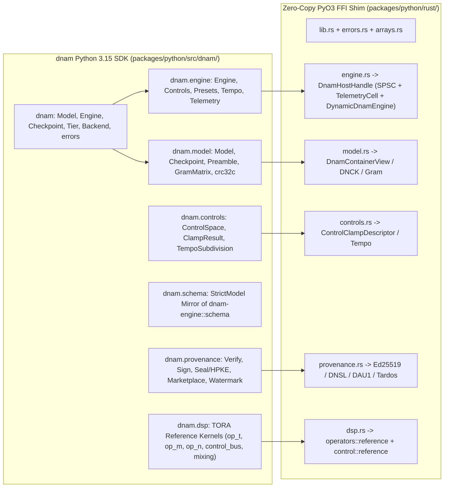

# Python SDK (`dnam`): Idiomatic Python 3.15 Interface, PEP 803 Dual-ABI (`abi3.abi3t`) PyO3 Shim & Parity Contract

This specification defines the normative architecture, module organization, public API semantics, PEP 803 dual-ABI (`cp315-abi3.abi3t`) free-threading invariants, FFI zero-copy rules, and Rust-to-Python parity contracts for **`dnam`** ([`packages/python/`](../../../packages/python/README.md)), the idiomatic Python 3.15 SDK wrapping `packages/engine/` ([`../architecture/tora_architecture.md`](../architecture/tora_architecture.md)). For the design rationale and rejected alternatives, see [`../../adr/0012-python-sdk-architecture-and-idiomatic-api.md`](../../adr/0012-python-sdk-architecture-and-idiomatic-api.md), [`../../adr/0014-python-3-15-free-threading-and-stable-abi-abi3t.md`](../../adr/0014-python-3-15-free-threading-and-stable-abi-abi3t.md), and [`../../adr/0015-realtime-host-concurrency-spsc-and-telemetry-seqlock.md`](../../adr/0015-realtime-host-concurrency-spsc-and-telemetry-seqlock.md).

---

## 1. Package Organization & Public Namespace Contract

### 1.1 Mirrored Domain Subpackage Layout

`r[sdk.python.layout.package-namespace]`

1. **Top-Level Import Name (`import dnam`):** The Python SDK is imported as `dnam` and organized into six domain subpackages (`dnam.model`, `dnam.engine`, `dnam.controls`, `dnam.schema`, `dnam.provenance`, and `dnam.dsp`) plus `dnam.errors`.
2. **Private Implementation Modules & Native Extension:** Internal implementation files inside each subpackage use a leading underscore (`_model.py`, `_engine.py`, `_controls.py`), and the compiled PyO3 extension module resides at `dnam._native`. Neither `dnam._native` nor any `native_*` symbol may be re-exported in any public `__all__`.
3. **1:1 Structural Mirroring Across Python, Rust & Tests:** `packages/python/rust/` (using the modern Rust 2018+ `foo.rs` + `foo/bar.rs` layout with zero `mod.rs` files per `ref[repo.docs.spec-rules-and-adrs]`) and `packages/python/tests/` mirror the six domain subpackages of `packages/python/src/dnam/`.

### 1.2 Curated `__all__` Exports & Static Typing (`pyrefly` Strict)

`r[sdk.python.layout.curated-exports]`

1. **Explicit `__all__` & Docstrings:** Every public module (`dnam`, `dnam.errors`, `dnam.model`, `dnam.engine`, `dnam.controls`, `dnam.schema`, `dnam.provenance`, `dnam.dsp`) declares an explicit `__all__` list, and every symbol exported in `__all__` carries a non-empty docstring.
2. **PEP 561 & Stub Lockstep:** `packages/python/src/dnam/py.typed` and `packages/python/src/dnam/_native.pyi` provide complete static type annotations for all native classes and functions, passing `pyrefly check` with zero `# type: ignore` or `# pyrefly: ignore` suppressions (`ref[repo.code.type-safety-and-imports]`).

### 1.3 Python `>=3.15` Floor, Free-Threaded `3.15t` Dev Runtime & PEP 803 `cp315-abi3.abi3t` Wheel

`r[sdk.python.abi.abi3-abi3t]`

1. **Minimum Interpreter Floor (`>=3.15`) & Free-Threaded Default (`3.15t`):** Both `dnam` (`packages/python/`) and `dnam-trainer` (`packages/trainer/`) require `requires-python = ">=3.15"`, with `3.15t` (`Py_GIL_DISABLED = 1`) as the canonical development interpreter.
2. **Single Dual-ABI Wheel (`cp315-abi3.abi3t`):** `packages/python/Cargo.toml` compiles `dnam._native` with `pyo3` features `["extension-module", "abi3-py315", "abi3t-py315"]` via `maturin >= 1.16`, emitting a single `cp315-abi3.abi3t` wheel containing `_native.abi3t.so` (Unix) or `_native.abi3t.pyd` (Windows) that loads natively on both GIL-enabled Python `3.15+` and free-threaded Python `3.15t+` (`ADR-0014`).
3. **Explicit Free-Threading Declaration (`gil_used = false`):** `packages/python/rust/lib.rs` annotates the root extension with `#[pymodule(gil_used = false)]` (`Py_mod_gil = Py_MOD_GIL_NOT_USED`). Importing `dnam` or `dnam_trainer` on a free-threaded `3.15t` interpreter must never re-enable the GIL (`sys._is_gil_enabled() is False`).

---

## 2. Intuitive SDK Ergonomics, Core Types & Error Hierarchy

### 2.1 Domain-Free Core Types & Removal of Legacy Tri-Physics

`r[sdk.python.api.core-types]`

| Core Type | Canonical Import | Responsibility & Underlying Engine Primitive |
| :--- | :--- | :--- |
| **`Model`** | `dnam.Model` / `dnam.model.Model` | Immutable, validated `.dnam` deployment container (`ref[container.dnam.preamble-directory]`) supporting inspection, in-place header updates, and tier stripping. |
| **`Engine`** | `dnam.Engine` / `dnam.engine.Engine` | Stateful real-time processor (`dnam_engine::host::DnamHostHandle`, `ref[arch.topology.signal-flow]`, `ref[dsp.ctrl.op-m.spsc-ingress]`) executing block audio rendering, offline bounce, and live non-blocking control/preset/tempo mutations. |
| **`Checkpoint`** | `dnam.Checkpoint` / `dnam.model.Checkpoint` | Immutable, validated `.dnam-ckpt` (`DNCK`, `ref[container.ckpt.bundle-framing]`) training container supporting stem/calibration inspection and runtime `Model` export. |

1. **Informative Representations:** `Model.__repr__`, `Engine.__repr__`, and `Checkpoint.__repr__` include the model name, active or available tiers, control count, and verification or sample-rate summary.
2. **Zero Legacy Tri-Physics Symbols:** Superseded Tri-Physics identifiers (`SelectiveRgLru`, `SelectiveRgLruParams`, `ModulatedUfdn`, `MufdnParams`, `Core1Config`, `Core2Config`, `core2_active`) must not exist anywhere in `dnam`.

### 2.2 Facet-Oriented `Engine` API & Scoped Context Managers

`r[sdk.python.api.engine-facets]`

1. **Structured Facets on `Engine`:**
   - `engine.controls` (`Controls`): `MutableMapping[str, float | str]` proxy over the engine's live control bus supporting `engine.controls[id] = value` ($3\text{ kHz}$ slewed `set_control_value`), `engine.controls.snap(**values)` (immediate `set_control_immediate`), `engine.controls.reset()`, `engine.controls.clamped` (`ClampResult`), `engine.controls.to_physical(id, u)`, and `engine.controls.to_normalized(id, val)`.
   - `engine.presets` (`Presets`): `Mapping[str, PresetDef]` proxy over the loaded model's presets supporting `engine.presets.apply(preset_id)` (`ref[dsp.ctrl.switch.conditional-batch]`).
   - `engine.tempo` (`Tempo`): Tempo synchronization controller exposing `engine.tempo.bpm`, `engine.tempo.sync(bpm, subdivision=None, *, fold_octave=False)`, and `engine.tempo.tap(subdivision=None, *, fold_octave=False)` (`ref[dsp.tempo.physical-inversion]`).
   - `engine.telemetry` (`Telemetry`): Wait-free seqlock snapshot (`DnamTelemetrySnapshot` via `TelemetryReader`, `ref[arch.telemetry.seqlock-publication]`) of active tier, bypass/freeze states, `active_clamp_mask`, `max_op_n_drive`, `max_pole_radius`, `max_effective_loop_gain`, `tail_time_ms`, `z_head`, `env_states`, `lfo_harmonics`, `clamped_controls`, and `overflow_or_saturation_flags` (`ref[arch.fp.range-saturation]`).
2. **Exception-Safe State Context Managers:**
   - `with engine.bypassed(trails: bool = True):` enters bypass (`SpilloverTrails` when `trails=True`, `HardBypass` when `trails=False`, `ref[arch.topology.spillover-trails]`) and restores the previous `(bypassed, trails)` state in a `finally` block.
   - `with engine.frozen(amount: float = 1.0):` engages Stage IV captured hardware freeze (`ref[dsp.stage4.captured-freeze]`) if `engine.supports_freeze` is `True` (raising `ControlError` if unsupported) and restores the previous freeze state in a `finally` block.

### 2.3 Flexible Inputs & Canonical Outputs

`r[sdk.python.api.flexible-in-precise-out]`

1. **Flexible Coercion on Input:** Public APIs accept `Tier | str | int` for tiers (`Tier.FULL`, `"full"`, `1`), `Backend | str` for SIMD backends (`Backend.AUTO`, `"neon"`, `"scalar"`), `TempoSubdivision | str` for rhythmic subdivisions, `str | os.PathLike[str]` for filesystem paths, and 1D `(N,)` or 2D `(1, N)` / `(2, N)` `ArrayLike` buffers for audio.
2. **Canonical Output Types:** Audio rendering methods always return C-contiguous `np.ndarray` buffers with `dtype=np.float32`, and metadata/telemetry accessors always return frozen slotted `StrictModel` dataclass instances (`@dataclass(frozen=True, slots=True, kw_only=True)`) rejecting unknown fields.

### 2.4 Typed Exception Hierarchy & Exhaustive Native Tag Mapping

`r[sdk.python.errors.typed-hierarchy]`

| Rust `DnamError` Variant(s) | Native Tag Prefix | Python Exception Subclass (`dnam.errors`) |
| :--- | :---: | :--- |
| `InvalidMagic`, `UnsupportedVersion`, `BufferTooSmall`, `Crc32cMismatch`, `HeaderCapacityExceeded` | `[DNAM-CONTAINER]` | `ContainerError(DnamError)` |
| `InvalidSampleRate` | `[DNAM-SAMPLERATE]` | `SampleRateError(DnamError)` |
| `InvalidControlIndex` (plus unknown control/preset keys in Python) | `[DNAM-CONTROL]` | `ControlError(DnamError, KeyError)` |
| `CryptoVerificationFailed`, `EncryptedArenaRequiresDeviceKey`, `PreviewContainerRejected` | `[DNAM-PROVENANCE]` | `ProvenanceError(DnamError)` |
| `UnalignedOffset`, `InvalidJsonHeader`, `SchemaValidationError` | `[DNAM-VALIDATION]` | `ValidationError(DnamError)` |

1. **Exhaustive Compile-Time Match:** `packages/python/rust/errors.rs` matches `dnam_engine::schema::DnamError` without a wildcard arm so adding any variant in `packages/engine` forces an explicit Python exception mapping.

---

## 3. Real-Time Engine Execution, Zero-Copy Memory & GIL Semantics

### 3.1 Thin Native Shim, Zero-Copy Buffers & GIL Release

`r[sdk.python.engine.zero-copy-and-gil]`

1. **Zero Duplicated Engine Math in `packages/python/rust/`:** `PyEngine` wraps `dnam_engine::host::DnamHostHandle` directly and delegates all sample-rate ZOH rescaling (`ref[dsp.zoh.ctrl-stride]`), control clamping, preset loading, 3-Lane SPSC control ingress (`ref[dsp.ctrl.op-m.spsc-ingress]`), wait-free seqlock telemetry (`ref[arch.telemetry.seqlock-publication]`), and block rendering to `dnam_engine` without re-computing `ZohRescaledParams` or stage parameters in the binding crate.
2. **Zero-Allocation `process_into` & `process_planar` with Checked `rust-numpy` Borrows:** When the caller supplies pre-allocated C-contiguous `float32` input and `out=` buffers (`process(audio, out=...)`, `process_into(audio, out)`, or `process_planar(left, right, out_left=..., out_right=...)`), the SDK borrows the underlying memory slices directly via `rust-numpy`'s checked borrow tracker without allocating intermediate audio arrays or accumulating steady-state Python heap allocations.
3. **Unconditional Runtime Detach (`py.detach`):** Every native audio block call (`process_stereo`, `process_stereo_in_place`, `process_stereo_2d`, `process_mono_to_stereo`, `process_mono_to_stereo_2d`, `process_mono`, and `render_offline_bounce`) detaches from the Python runtime via `py.detach(|| ...)` (releasing the GIL on `3.15` and allowing concurrent stop-the-world cyclic GC on `3.15t`) while draining the 3-Lane SPSC control ring at `64`-frame sub-block boundaries and publishing `TelemetryCell` snapshots at sub-block exits.

### 3.2 `pedalboard`-Compatible Callable & Bit-Identical Rust Parity

`r[sdk.python.engine.pedalboard-call]`

1. **`Engine.__call__` Signature & Topologies:** `engine(audio, sample_rate=None, *, buffer_size=8192, reset=True)` processes 1D `(N,)` mono, 2D `(1, N)` mono, or 2D `(2, N)` stereo inputs across all four model I/O topologies (`1->1`, `2->1`, `1->2`, `2->2`, `ref[arch.topology.signal-flow]`), updating `engine.sample_rate` if `sample_rate` is provided, resetting to analytical DC equilibrium (`ref[dsp.op-n.commuted.dc-equilibrium]`) before rendering when `reset=True`, and streaming in chunks of `buffer_size` frames.
2. **Offline Bounce (`engine.bounce`):** `engine.bounce(audio, *, maximize_tier=True)` executes $4\times$ linear-phase polyphase oversampling with automatic `12`-sample PDC lead-in stripping (`ref[arch.bounce.oversampling]`).
3. **Bit-Identical Parity with Native Rust:** Across all tiers (`Lite`, `Full`, `Pro`, `Ultra`), backends (`Scalar`, `Neon`, `ArmSme`, `X86Simd`), sample rates (`44.1–192 kHz`), topologies, and block sizes, `engine.process(...)` and `engine(audio, sample_rate, reset=...)` produce `float32` samples bit-identical (`0 ULP`) to invoking `DynamicDnamEngine` directly in Rust.

### 3.3 Thread-Safe Frozen `PyEngine`, Non-Blocking SPSC/Seqlock Host & Atomic Reload

`r[sdk.python.engine.free-threading]`

1. **Frozen `#[pyclass(frozen)]` with Decoupled Audio, Control & Wait-Free Telemetry (`DnamHostHandle`, `ADR-0015`):** `PyEngine` is declared `#[pyclass(module = "dnam._native", frozen)]` and wraps `dnam_engine::host::DnamHostHandle`. Audio rendering acquires only the audio-side lock inside `py.detach(|| ...)`, while control/preset/tempo/bypass/freeze/tier mutations acquire only the producer-side `SpscControlRing` + `AcceptedStateShadow` lock (`ref[dsp.ctrl.op-m.spsc-ingress]`) and `engine.telemetry` reads `TelemetryCell` wait-free (`ref[arch.telemetry.seqlock-publication]`) without acquiring any audio or control lock. Concurrent control updates and telemetry reads complete immediately without blocking on an active multi-block `process` or `bounce` render, never raise `PyBorrowMutError`, and never block stop-the-world cyclic garbage collection (`gc.collect()`) on free-threaded `3.15t`.
2. **Atomic `_EngineState` Swap on `Engine.reload`:** The Python `Engine` wrapper bundles its active `Model`, `PyEngine`, `ControlSpace`, preset map, and control caches into a coherent `_EngineState` snapshot swapped atomically under a reentrant lock (`threading.RLock`) during `Engine.reload(...)`, ensuring concurrent reader, control, telemetry, and audio threads never observe torn state (`_model` out of sync with `_native` or control caches).
3. **Detached Heavy Native Operations:** Non-trivial container validation/building, checkpoint verification/export, `uplo='U'` Gram matrix packing/unpacking, 3-Phase control clamping, provenance signing/sealing/verification/watermarking, and vectorized `dnam.dsp` slice kernels execute inside `py.detach(|| ...)` so multi-threaded Python workloads scale across CPU cores without runtime contention.

---

## 4. Containers, Checkpoints, Control Space, Schema, Provenance & DSP Kernels

### 4.1 `.dnam` Models, `.dnam-ckpt` Checkpoints & `uplo='U'` Gram Matrices

`r[sdk.python.model.containers-and-checkpoints]`

1. **Declarative `.dnam` Model Operations (`dnam.Model`):** `Model.load(path)`, `Model.from_bytes(data)`, `Model.reference(...)`, and `Model.build(header, arena_bytes)` validate the 64-byte-aligned v2 `.dnam` container (`ref[container.dnam.load-validation]`, `REQ-8.8`), expose `model.preamble`, `model.header`, `model.tier_arenas`, `model.control_space`, `model.with_header(new_header)` (in-place within the 4 KB page boundary when unsealed), and `model.with_tier_limit(max_tier)` (`strip_container_to_tier`, `ref[container.dnam.tier-prefix]`).
2. **`.dnam-ckpt` Checkpoint Operations (`dnam.Checkpoint`):** `Checkpoint.load(path)` and `Checkpoint.from_bytes(data)` validate `.dnam-ckpt` (`DNCK`, `ref[container.ckpt.bundle-framing]`) containers, verify `Arena 4` stem `CRC32C` and `Arena 5` `DNCA` calibration statistics, and export deployable runtime `Model` instances via `checkpoint.export_model()` (`export_runtime_dnam_from_ckpt`).
3. **Upper-Triangular `GramMatrix` (`uplo='U'`):** `GramMatrix.from_dense(matrix)` and `gram.to_dense()` pack and unpack symmetric positive semi-definite matrices in canonical `uplo='U'` upper-triangular `float64` layout (`ref[container.ckpt.uplo-u]`).

### 4.2 Offline Control Space & Tempo Calibration Inversion

`r[sdk.python.controls.space-and-tempo]`

1. **Vectorized 3-Phase Clamping (`ControlSpace`):** `ControlSpace.from_header(header)` compiles Rust `ControlClampDescriptor` records (`ref[dsp.ctrl.range.normalize-clamp]`) and conditional rules (`ref[train.audit.phase1.clamp-range]`, `ref[train.audit.phase1.clamp-switch]`, `ref[train.audit.phase1.clamp-stability]`), evaluating batch control dictionaries in Rust without Python per-control loops.
2. **Tempo Synchronization & Physical Inversion:** `dnam.controls` exposes `TempoSubdivision`, `control_stride_for_rate(sample_rate_hz)`, `subdivision_phase_q32(beat_q64, subdivision)`, and 32-step binary-search physical calibration inversion `invert_tempo_calibration(...)` (`ref[dsp.tempo.physical-inversion]`).

### 4.3 File-for-File `StrictModel` Schema Mirror & JCS Round-Trip Parity

`r[sdk.python.schema.rust-parity]`

1. **Declarative Frozen Slotted Schema Mirror (Zero Pydantic Dependency):** `dnam.schema` mirrors `packages/engine/src/schema/` using stdlib `@dataclass(frozen=True, slots=True, kw_only=True)` `StrictModel` classes (`.replace(**changes)`, `.to_dict()`, `.to_json()`, `.from_dict()`, `.from_json()`, and `_construct_trusted` hot-path constructors) with `numpy>=2.1.0` as the sole runtime dependency of `dnam` (zero `pydantic` dependency) across `header.py` (`DnamJsonHeader`, `SchemaVersion`, `ModelMetadata`), `io_and_tiers.py` (`IoConfig`, `ModelCapabilities`, `LevelingConfig`, `LevelingMetric`, `BlendMode`, `SlimmableTiersConfig`, `TierProfile`), `stages.py` (`ControlBusConfig`, `RouterConfig`, `Stage1PreFxConfig`, `Stage2CascadeConfig`, `Stage3CabinetKautzConfig`, `Stage4SpatialTankConfig`, `TensorSliceEntry`), `controls.py` (`ControlSchemaDef`, `ControlKind`, `ControlCalibration`, `ControlCalibrationRole`, `PresetDef`, `ConditionalClampRule`), `tempo.py` (`TempoSubdivision`, `TempoSyncResolution`), `ui_hints.py` (`ControlUiHints`), `signatures.py` (`DnamProtectionProfile`, `DistributionPolicy`, `OemDeviceCertificate`, `DatasetProvenance`, `ModelSignatures`, `CreatorSignature`, `MarketplaceReceipt`, `AuthorizedDevice`, `RoyaltySplit`, `WatermarkParams`), and `checkpoint.py` (`StemRegistryEntry`, `StemProvenance`, `ExtractedPhysics`, `AuditReport`).
2. **Zero Duplicated Schema Validation or Calibration Math:** `DnamJsonHeader` validation, default population, `skip_serializing_if` pruning, `SchemaVersion.parse`, `Stage4SpatialTankConfig` all-pass delay normalization, `ControlCalibration` Lobatto inversion/evaluation and conditional tempo-sync resolution, `ControlUiHints` midpoint power-skew mapping, `TempoSubdivision` beat/delay/LFO math, and `DistributionPolicy` profile/OEM matching delegate 100% of their logic to `dnam-engine` via `dnam._native`.
3. **Byte-Identical JCS Round-Trip Parity:** Parsing any Rust-emitted `DnamJsonHeader` (both `default_reference()` and a fully populated header covering all optional fields and enum variants) into `dnam.schema.DnamJsonHeader` and re-serializing via RFC 8785 JCS (`ref[sec.jcs.immutable-header-digest]`) produces byte-identical UTF-8 output and identical `immutable_header_sha256` digests.

### 4.4 Marketplace Provenance, Hardware Sealing & Forensic Watermarking

`r[sdk.python.provenance.v2-security]`

1. **Provenance Verification & Signing (`dnam.provenance`):** Exposes `verify_model(model, ...)`, `enforce_distribution_policy(...)`, `immutable_header_sha256(header)`, `ed25519_public_key(seed)`, `ed25519_sign(seed, msg)`, `x25519_public_key(secret)`, `sign_creator_header(...)`, `sign_marketplace_receipt(...)`, and `sign_oem_certificate(...)` / `verify_oem_certificate(...)` (`ref[sec.sig.prefix-delegation]`, `ref[sec.drm.oem-certificate]`).
2. **Hardware `.dnam-seal` (`DNSL`), `DAU1`/`DME1` & Preview Containment:** Exposes `seal_model(...)` and `unseal_model(...)` (`ref[sec.drm.dnsl-public-framing]`), `wrap_device_cek(...)`, `Dau1Manifest` / `Dme1Header` builders and parsers (`ref[sec.sig.dau1-envelope]`), and preview single-control window / switch validators (`compute_preview_window`, `validate_preview_switch_options`, plus `.dnam-prev` `DNPR` rejection via `ProvenanceError`, `ref[sec.preview.containment]`).
3. **Dual-Mechanism Buyer Watermarking & Structural Hashing:** Exposes `apply_gauge_watermark(...)`, `generate_tardos_code(...)`, `apply_tardos_watermark(...)`, `score_tardos_watermark(...)`, `extract_structural_hash(...)`, and `structural_cosine_similarity(...)` (`ref[sec.watermark.tardos-code]`, `ref[sec.anticlone.stage3-fingerprint]`).

### 4.5 Vectorized TORA Reference DSP Kernels (`dnam.dsp`)

`r[sdk.python.dsp.reference-kernels]`

1. **Operator & Control-Bus Reference Modules:** `dnam.dsp` organizes reference kernels into:
   - `dnam.dsp.op_t`: `catmull_rom_hermite`, `coercive_step`, `tank_slice` (`ref[dsp.op-t.reader.catmull-rom]`).
   - `dnam.dsp.op_m`: `modal_step`, `unit_rotor` (`ref[dsp.op-m.recurrence.symplectic]`, `ref[dsp.op-m.rotor.contractive]`).
   - `dnam.dsp.op_n`: `poly_adaa_algebraic`, `poly_adaa_step`, `poly_adaa_slice` (`ref[dsp.op-n.polyadaa.midpoint]`).
   - `dnam.dsp.control_bus`: `lobatto_basis`, `rank4_fm`, `chebyshev_lfo`, `trust_region_softclip` (`ref[dsp.ctrl.basis.lobatto]`, `ref[dsp.ctrl.op-n.trust-clip]`).
   - `dnam.dsp.mixing`: `cubic_lagrange_weights`, `givens_householder_8ch`, `givens_householder_16ch` (`ref[dsp.stage4.spatial-tank]`).
2. **Zero Per-Sample Python Loops:** All array-accepting functions in `dnam.dsp` execute in compiled Rust slice loops and agree with their scalar single-sample counterparts to `0 ULP`.
