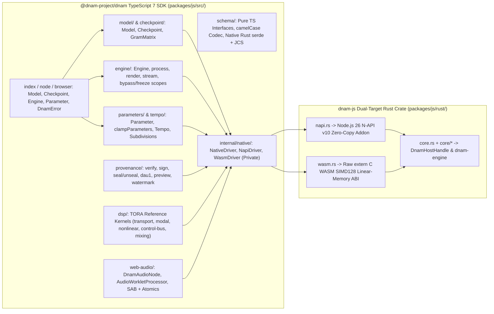

# TypeScript SDK (`@dnam-project/dnam`): Idiomatic TypeScript 7 Interface, Dual-Target N-API v10 + WASM SIMD128 Runtime & WebAudio Contract

This specification defines the normative architecture, feature-module organization, idiomatic TypeScript 7 API semantics, dual-target `N-API v10` + WebAssembly `SIMD128` runtime invariants, WebAudio `AudioWorklet` bridge, and Rust behavioral parity contracts for **`@dnam-project/dnam`** ([`packages/js/`](../../../packages/js/README.md)), wrapping `packages/engine/` ([`../architecture/tora_architecture.md`](../architecture/tora_architecture.md)). For the design rationale and rejected alternatives, see [`../../adr/0013-typescript-sdk-architecture-and-dual-target-runtime.md`](../../adr/0013-typescript-sdk-architecture-and-dual-target-runtime.md) and [`../../adr/0015-realtime-host-concurrency-spsc-and-telemetry-seqlock.md`](../../adr/0015-realtime-host-concurrency-spsc-and-telemetry-seqlock.md).

---

## 1. Feature-Oriented Package Organization & Maintainability Contract

### 1.1 Feature Module Layout & Rust Core Separation

`r[sdk.ts.layout.feature-modules]`

1. **Package Name & Feature Subpaths:** The TypeScript SDK is published as `@dnam-project/dnam` (`packages/js/`) and organized into kebab-case feature directories under `src/`: `model/`, `checkpoint/`, `engine/`, `parameters/`, `tempo/`, `schema/`, `provenance/`, `dsp/`, `web-audio/`, and private `internal/`.
2. **Modern Rust 2018+ Module Layout:** `packages/js/rust/` uses the `foo.rs` + `foo/bar.rs` module layout with zero `mod.rs` files (`ref[repo.docs.spec-rules-and-adrs]`), separating target-agnostic engine logic (`rust/core.rs` + `rust/core/*`) from the thin `cfg(not(target_arch = "wasm32"))` N-API v10 adapter (`rust/napi.rs`) and `cfg(target_arch = "wasm32")` raw `extern "C"` WASM adapter (`rust/wasm.rs`).
3. **Private Native Seam:** `src/internal/` is strictly internal; neither `NativeDriver` nor any raw N-API/WASM handle symbol may be exported from any public subpath.

### 1.2 Curated Subpath Exports & Static Typing (`TypeScript 7` Strict)

`r[sdk.ts.layout.curated-exports]`

1. **Explicit Named Exports Only:** Every public entrypoint (`index.ts`, `node.ts`, `browser.ts`, `parameters/index.ts`, `tempo/index.ts`, `schema/index.ts`, `provenance/index.ts`, `checkpoint/index.ts`, `dsp/index.ts`, `web-audio/index.ts`) uses explicit named exports (`export { ... }`) with zero wildcard re-exports (`export *`) and zero `default` exports.
2. **TypeScript 7 Strictness & Zero `any`:** The package compiles cleanly under TypeScript `7.0+` with `strict: true`, `noUncheckedIndexedAccess: true`, `exactOptionalPropertyTypes: true`, and `verbatimModuleSyntax: true`, with zero `any` types or non-null assertions (`!`, `ref[repo.code.type-safety-and-imports]`).

### 1.3 Enforced Layered Dependency Direction & Runtime Isolation

`r[sdk.ts.layout.dependency-direction]`

1. **Acyclic Feature Layering:** Internal imports follow the strict one-way hierarchy:
   `errors.ts` / `types.ts` $\rightarrow$ `schema/` $\rightarrow$ `internal/` $\rightarrow$ `model/` $\rightarrow$ `parameters/` & `tempo/` $\rightarrow$ `engine/` $\rightarrow$ `web-audio/`, with `checkpoint/` and `provenance/` depending on `model/` and `dsp/` depending only on `internal/` and `errors.ts`.
2. **Zero Runtime Dependencies & Browser / `AudioWorkletGlobalScope` Isolation:** `@dnam-project/dnam` has zero runtime npm dependencies (`"dependencies"` is omitted). `src/browser.ts`, `src/internal/native/wasm.ts`, `src/schema/**/*.ts`, and `src/web-audio/**/*.ts` must never import `node:*` built-in modules, and `src/web-audio/processor.ts` + `src/web-audio/shared-state.ts` must remain 100% self-contained for `AudioWorkletGlobalScope`.

---

## 2. Idiomatic TypeScript API, Resources, Parameters & Error Contract

### 2.1 Plain Frozen CamelCase Data vs. Stateful Native Resources

`r[sdk.ts.api.resources-and-data]`

| Category | Public Types / Classes | Ownership & Immutability Contract |
| :--- | :--- | :--- |
| **Stateful Resources (Classes)** | `Model`, `Checkpoint`, `Engine`, `Parameter` | Wrap native `DnamHostHandle` (`DynamicDnamEngine`) or validated container buffers; expose `.dispose()` and `[Symbol.dispose]()`. |
| **Plain Metadata (Frozen Objects)** | `ModelHeader`, `PreambleInfo`, `ParameterDescriptor`, `Preset`, `TelemetrySnapshot`, `ClampReport`, `VerificationResult` | Deeply `readonly` and `Object.freeze`-d plain camelCase objects with zero prototype methods or hidden native pointers. |

1. **Zero Legacy Tri-Physics Symbols:** Superseded Tri-Physics identifiers (`SelectiveRgLru`, `SelectiveRgLruParams`, `ModulatedUfdn`, `MufdnParams`, `Core1Config`, `Core2Config`, `core2Active`) must not exist anywhere in `@dnam-project/dnam`.

### 2.2 String-Literal Unions, Companion Tuples & Options Objects

`r[sdk.ts.api.literal-unions-and-options]`

1. **String-Literal Unions Over TS `enum`:** Domain enumerations are represented as lowercase string-literal unions paired with `readonly` tuple constants:
   - `Tier = "lite" | "full" | "pro" | "ultra"` and `tiers = ["lite", "full", "pro", "ultra"] as const`.
   - `Backend = "auto" | "scalar" | "neon" | "arm-sme" | "x86-simd" | "wasm-simd128"` and `backends`.
   - `Subdivision = "1/2." | "1/2" | "1/2T" | "1/4." | "1/4" | "1/4T" | "1/8." | "1/8" | "1/8T" | "1/16." | "1/16" | "1/16T"` and `subdivisions`.
2. **Options Objects:** Multi-flag configuration methods (`model.createEngine(options)`, `engine.bypass(options)`, `engine.freeze(options)`, `engine.render(audio, options)`, `param.setValue(value, options)`) accept typed options objects compatible with `exactOptionalPropertyTypes: true`.

### 2.3 Compile-Time Model Parameter Inference

`r[sdk.ts.api.typed-model-inference]`

1. **Typed Parameter Maps (`TParams`):** `Model<TParams>`, `Engine<TParams>`, and `DnamAudioNode<TParams>` accept a compile-time parameter map `TParams extends ParameterValueMap = Record<string, number | string>`, narrowing `engine.parameters.get(id)` to `Parameter<K, TParams[K]>` and `engine.parameters.set(partial)` to `Partial<TParams>`.
2. **Helper Schema Definition (`defineModelTypes`):** `defineModelTypes<const TSchema>()` infers numeric range parameters as `number` and discrete switch parameters as the literal union of their declared options.

### 2.4 Uniform Synchronous API & Optional WASM Pre-Initialization

`r[sdk.ts.api.sync-init]`

1. **Synchronous Core Constructors:** Both `src/node.ts` (synchronous `N-API v10` load with synchronous WASM fallback) and `src/browser.ts` (top-level `await` WASM instantiation) initialize the default `NativeDriver` at module evaluation time so `Model.from(...)`, `Model.reference(...)`, `Checkpoint.from(...)`, `model.createEngine(...)`, and `engine.process(...)` are synchronous across all runtimes.
2. **Explicit `initWasm` Override:** `initWasm(options?: { module?: WebAssembly.Module; bytes?: BufferSource; url?: string | URL }): Promise<WebAssembly.Module>` allows custom CDN hosting, Web Worker pre-compilation, and `AudioWorklet` module sharing.

### 2.5 Dual-Mode Resource Disposal & Exception-Safe State Scopes

`r[sdk.ts.api.disposable-scopes]`

1. **Dual `.dispose()` and `[Symbol.dispose]()`:** `Model`, `Checkpoint`, and `Engine` implement both `.dispose(): void` and `[Symbol.dispose](): void` (idempotent) plus a `FinalizationRegistry` safety net. Entry `.d.ts` files include `/// <reference lib="esnext.disposable" />` so downstream `ES2024`/`ES2025` consumers compile without `tsconfig.json` changes even when `skipLibCheck` is `false`.
2. **Scoped Bypass & Freeze (`bypass` / `withBypass`, `freeze` / `withFreeze`):**
   - `engine.bypass(options?: { trails?: boolean }): StateScope` enters bypass (`SpilloverTrails` when `trails ?? true`, `HardBypass` when `trails === false`, `ref[arch.topology.spillover-trails]`) and returns a `StateScope` with both `.restore(): void` and `[Symbol.dispose](): void`.
   - `engine.withBypass(options, fn)` and `engine.withFreeze(options, fn)` execute `fn` inside a `try / finally` block and restore the prior state on return or throw.
   - `engine.freeze(options?: { amount?: number }): StateScope` engages Stage IV captured hardware freeze (`ref[dsp.stage4.captured-freeze]`) if `engine.supportsFreeze` is `true`, throwing `DnamError` (`code: "ERR_DNAM_PARAMETER"`) if unsupported.

### 2.6 WebAudio `AudioParam`-Aligned `Parameter` & `ParameterMap`

`r[sdk.ts.parameters.audio-param-semantics]`

1. **`Parameter<TId, TValue>` Surface:** `engine.parameters.get(id)` returns a `Parameter` instance exposing:
   - `id: TId`, `name: string`, `kind: "range" | "switch"`, `unit: string | undefined`
   - `value: TValue` (getter returns live clamped value; setter schedules a 3 kHz smoothed transition via `set_control_value`, `ref[dsp.ctrl.range.normalize-clamp]`)
   - `setValue(value: TValue, options?: { immediate?: boolean }): this` (uses `set_control_immediate` when `immediate: true`)
   - `reset(): this`, `defaultValue: TValue`, `minValue: number | undefined`, `maxValue: number | undefined`, `safeRange: readonly [number, number] | undefined`, `options: readonly string[] | undefined`, `activeOptions: readonly string[] | undefined`, `clamped: boolean`
   - `toPhysical(normalizedU: number): number` and `toNormalized(physicalValue: number): number`.
2. **`ParameterMap<TParams>` Collection:** `engine.parameters` implements `Iterable<[keyof TParams, Parameter]>` and exposes `.get(id)`, `.has(id)`, `.set(values: Partial<TParams>, options?: { immediate?: boolean })`, `.resetAll()`, `.values()`, `.toObject()`, and `.clampedReport(): ClampReport`.

### 2.7 Coded `DnamError` & Exhaustive Native Tag Mapping

`r[sdk.ts.errors.coded-error]`

| Rust `DnamError` Variant(s) | Native Tag Prefix | `DnamError.code` (`ErrorCode`) |
| :--- | :---: | :--- |
| `InvalidMagic`, `UnsupportedVersion`, `BufferTooSmall`, `Crc32cMismatch`, `HeaderCapacityExceeded` | `[DNAM-CONTAINER]` | `"ERR_DNAM_CONTAINER"` |
| `InvalidSampleRate` | `[DNAM-SAMPLERATE]` | `"ERR_DNAM_SAMPLE_RATE"` |
| `InvalidControlIndex` (plus unknown parameter/preset IDs or unsupported freeze) | `[DNAM-CONTROL]` | `"ERR_DNAM_PARAMETER"` |
| `CryptoVerificationFailed`, `EncryptedArenaRequiresDeviceKey`, `PreviewContainerRejected` | `[DNAM-PROVENANCE]` | `"ERR_DNAM_PROVENANCE"` |
| `UnalignedOffset`, `InvalidJsonHeader`, `SchemaValidationError` | `[DNAM-VALIDATION]` | `"ERR_DNAM_VALIDATION"` |
| Concurrent audio render / disposal during active `processAsync` or use after `.dispose()` | `[DNAM-BUSY]` / `[DNAM-DISPOSED]` | `"ERR_DNAM_BUSY"` / `"ERR_DNAM_DISPOSED"` |

1. **Exhaustive Rust Match:** `packages/js/rust/error.rs` matches `dnam_engine::schema::DnamError` without a wildcard arm so adding any variant in `packages/engine` forces an explicit error code mapping.
2. **Type Guard:** `isDnamError(err: unknown, code?: ErrorCode)` narrows `err` to `DnamError` (and to the specific `code` when provided).

---

## 3. Dual-Target Runtime, Real-Time Engine & Behavioral Parity

### 3.1 Unified `NativeDriver` Seam (`N-API v10` + Raw `WASM SIMD128`) & Zero Duplicated Logic

`r[sdk.ts.runtime.dual-target-drivers]`

1. **100% Delegation to `dnam-engine` (Zero Duplicated Logic in TypeScript or FFI Adapters):** `packages/js/rust/core/` and `packages/js/src/` must never reimplement any algorithm, validation rule, or domain constant already owned by `packages/engine`. Specifically, all DSP, ZOH rescaling (`ref[dsp.zoh.ctrl-stride]`), 3-Phase control clamping, Lobatto calibration inversion, preset loading, tempo synchronization, `DnamJsonHeader` / `SchemaVersion` validation, RFC 8785 JCS canonicalization and immutable-header projection (`ref[sec.jcs.immutable-header-digest]`), and creator/marketplace tier-prefix signing (`ref[sec.sig.prefix-delegation]`) must execute in Rust via `dnam-engine`. The TypeScript layer is restricted strictly to idiomatic API ergonomics, camelCase/snake_case key translation, input coercion, and memory/handle lifecycle management.
2. **Identical Driver Semantics:** `NapiDriver` and `WasmDriver` implement the exact same `NativeDriver` interface in `src/internal/native/driver.ts`.

### 3.2 Zero-Copy Planar Audio, In-Place Output & Libuv `processAsync`

`r[sdk.ts.engine.zero-copy-and-async]`

1. **Planar `Float32Array` Audio Contract:** `engine.process(input, options?: { output?: Float32Array[] })` accepts a mono `Float32Array` or planar `readonly Float32Array[]` (`[left]` or `[left, right]`) across all four model topologies (`1->1`, `2->1`, `1->2`, `2->2`, `ref[arch.topology.signal-flow]`). When `options.output` is provided with matching channel count and frame length, the SDK writes directly into the caller's `Float32Array` buffers with zero output allocation.
2. **Persistent WASM Linear-Memory Scratch Arena:** `WasmDriver` maintains pre-allocated input/output `f32` scratch buffers inside WASM linear memory and caches typed-array views keyed by `memory.buffer`, refreshing views only when WASM memory grows.
3. **Worker-Pool `processAsync` with Non-Blocking SPSC Control & Wait-Free Telemetry (`DnamHostHandle`, `ADR-0015`):** `engine.processAsync(input, options?: { output?: Float32Array[]; signal?: AbortSignal })` executes on the Node.js libuv worker pool via an `N-API` `AsyncTask` over `dnam_engine::host::DnamHostHandle` (and resolves asynchronously in browsers), honoring `AbortSignal` prior to dispatch. Concurrent audio rendering or `.dispose()` calls while `processAsync` is in flight are rejected with `DnamError` (`"ERR_DNAM_BUSY"`), whereas parameter/preset/tempo/bypass/freeze/tier updates (`ref[dsp.ctrl.op-m.spsc-ingress]`) and `engine.telemetry` reads (`ref[arch.telemetry.seqlock-publication]`) complete synchronously and non-blockingly on the main thread during an active `processAsync` render.

### 3.3 Offline `render` (`4x` Bounce) & Web `TransformStream`

`r[sdk.ts.engine.streaming-and-render]`

1. **One-Shot Offline `engine.render` & `engine.bounce`:**
   - `engine.render(input, options?: { sampleRate?: number; blockSize?: number; reset?: boolean; oversample?: 1 | 4; maxTier?: boolean })` optionally updates `sampleRate`, resets to analytical DC equilibrium (`ref[dsp.op-n.commuted.dc-equilibrium]`) when `reset ?? true`, and renders in chunks of `blockSize` (or executes `4x` linear-phase polyphase oversampling with `12`-sample PDC lead-in stripping when `oversample === 4`, `ref[arch.bounce.oversampling]`).
   - `engine.bounce(input, options?: { maxTier?: boolean })` is a shorthand for `4x` oversampled offline rendering.
2. **WHATWG `TransformStream` (`engine.stream`):** `engine.stream(options?: { blockSize?: number }): TransformStream<Float32Array | readonly Float32Array[], Float32Array[]>` provides a standard Web Streams stage for piping chunked audio through the engine.

### 3.4 Bit-Identical Cross-Driver & Rust Behavioral Parity

`r[sdk.ts.engine.behavioral-parity]`

1. **0-ULP Native Host Parity & Cross-ISA IEEE-754 Parity (`N-API` vs. `WASM` vs. Native Rust):** When instantiated with `backend: "scalar"` on the same host ISA, `NapiDriver` and native Rust `DynamicDnamEngine` produce bit-identical (`0 ULP`) `Float32Array` samples across all tiers (`lite`, `full`, `pro`, `ultra`), sample rates (`44.1–192 kHz`), I/O topologies, and block sizes; `WasmDriver` (`wasm32` IEEE-754 non-fused `f32.mul` + `f32.add`) agrees with host `NapiDriver` (hardware `fmadd`) within `<= 4 ULP` (`< 5e-7`) on `scalar` and `< 1e-5` on `wasm-simd128`.
2. **SIMD Parity:** On default hardware backends (`neon`, `x86-simd`, `wasm-simd128`), `NapiDriver` matches native Rust on the same backend to `0 ULP`, and `WASM SIMD128` agrees with `N-API` within `< 1e-5` max absolute difference across multi-stage nonlinear/modal rendering.

---

## 4. Schema Codec, Containers, Provenance, DSP & WebAudio Worklet

### 4.1 Bijective CamelCase Schema Codec & RFC 8785 JCS Parity

`r[sdk.ts.schema.camel-case-codec-parity]`

1. **Zero-Dependency Native-`serde` Schema Validation & CamelCase Codec (`@dnam-project/dnam/schema`):** Mirrors every struct and enum in `packages/engine/src/schema/` (`ModelHeader`, `IoConfig`, `ModelCapabilities`, `LevelingConfig`, `SlimmableTiersConfig`, `ControlBusConfig`, `RouterConfig`, `Stage1..4*Config`, `TensorSliceEntry`, `ParameterDescriptor`, `Preset`, `ModelSignatures`, `StemRegistryEntry`, `AuditReport`) as pure `readonly` TypeScript interfaces with zero runtime JS dependencies, delegating validation and default population directly to compiled Rust `serde` (`dnam_engine::schema::DnamJsonHeader`) in `decodeHeader(wireJson)` (returning deeply frozen camelCase `ModelHeader`) and `encodeHeader(header)` (emitting canonical snake_case wire JSON).
2. **Byte-Identical RFC 8785 JCS Round-Trip Parity:** Decoding any Rust-emitted `DnamJsonHeader` (both `default_reference()` and a fully populated header exercising every optional field and enum variant) via `decodeHeader` and re-encoding via `encodeHeader` + `canonicalJson` (`ref[sec.jcs.immutable-header-digest]`) produces byte-identical UTF-8 output and identical `immutableHeaderSha256` digests.

### 4.2 `.dnam` Models, `.dnam-ckpt` Checkpoints, `GramMatrix` & Tempo

`r[sdk.ts.model.containers-and-checkpoints]`

1. **`Model` Operations:** `await Model.load(source)` (accepting filesystem path in Node.js, `URL`, `Response`, `Blob`, `ArrayBuffer`, or `Uint8Array`), `Model.from(bytes)`, `Model.reference(options?)`, and `Model.build(header, arenaBytes)` validate the 64-byte-aligned v2 `.dnam` container (`ref[container.dnam.load-validation]`, `REQ-8.8`), expose `model.preamble`, `model.header`, `model.parameters`, `model.presets`, `model.tierArenas`, `model.withHeader(updater)` (in-place within the 4 KB page budget when unsealed), `model.withMaxTier(tier)` (`strip_container_to_tier`, `ref[container.dnam.tier-prefix]`), and `model.createEngine(options?)`.
2. **`Checkpoint` & `GramMatrix` (`@dnam-project/dnam/checkpoint`):** `await Checkpoint.load(source)`, `Checkpoint.from(bytes)`, and `Checkpoint.reference(options?)` validate `.dnam-ckpt` (`DNCK`, `ref[container.ckpt.bundle-framing]`) containers, verify `Arena 4` stem `CRC32C` and `Arena 5` `DNCA` calibration records, and export deployable runtime `Model` instances via `checkpoint.toModel()`. `GramMatrix.fromDense(matrix, dim)` and `gram.toDense()` pack/unpack symmetric matrices in `uplo='U'` upper-triangular `Float64Array` layout (`ref[container.ckpt.uplo-u]`).
3. **Offline Parameter Clamping & Tempo Inversion (`@dnam-project/dnam/parameters`, `@dnam-project/dnam/tempo`):** Exposes `clampParameters(modelOrHeader, values): ClampReport` (`ref[train.audit.phase1.clamp-range]`, `ref[train.audit.phase1.clamp-switch]`, `ref[train.audit.phase1.clamp-stability]`), `computeZoh(...)`, `controlStride(sampleRate)`, `subdivisionPhase(...)`, and 32-step binary-search `invertTempoCalibration(...)` (`ref[dsp.tempo.physical-inversion]`).

### 4.3 Marketplace Provenance, Hardware Sealing & Forensic Watermarking

`r[sdk.ts.provenance.v2-security]`

1. **Verification, Signing & OEM Certificates (`@dnam-project/dnam/provenance`):** Exposes `verify(model, options?)`, `enforcePolicy(header, profile)`, `immutableHeaderSha256(header)`, `ed25519` / `x25519` key utilities, `signCreatorHeader(...)`, `signMarketplaceReceipt(...)`, and `signDeviceCertificate(...)` / `verifyDeviceCertificate(...)` (`ref[sec.sig.prefix-delegation]`, `ref[sec.drm.oem-certificate]`).
2. **Hardware `.dnam-seal` (`DNSL`), `DAU1`/`DME1` & Preview Containment:** Exposes `seal(model, options)` and `unseal(bytes, options)` (`ref[sec.drm.dnsl-public-framing]`), `wrapDeviceCek(...)`, `encodeDau1` / `decodeDau1`, `buildDme1Header` / `parseDme1Plaintext` (`ref[sec.sig.dau1-envelope]`), and preview validators (`computePreviewWindow`, `validatePreviewSwitchOptions`, plus `.dnam-prev` `DNPR` rejection via `"ERR_DNAM_PROVENANCE"`, `ref[sec.preview.containment]`).
3. **Dual-Mechanism Buyer Watermarking & Structural Hashing:** Exposes `applyGaugeWatermark(...)`, `generateTardosCode(...)`, `applyTardosWatermark(...)`, `scoreTardosWatermark(...)`, `extractStructuralHash(...)`, and `structuralCosineSimilarity(...)` (`ref[sec.watermark.tardos-code]`, `ref[sec.anticlone.stage3-fingerprint]`).

### 4.4 Vectorized TORA Reference DSP Kernels (`@dnam-project/dnam/dsp`)

`r[sdk.ts.dsp.reference-kernels]`

1. **Operator & Control-Bus Reference Functions:** Exposes vectorized `Float64Array` slice and scalar reference kernels across:
   - `transport` (`Op-T`): `catmullRomHermite`, `coerciveStep`, `tankSlice` (`ref[dsp.op-t.reader.catmull-rom]`).
   - `modal` (`Op-M`): `modalStep`, `modalSlice`, `unitRotor`, `unitRotorSlice` (`ref[dsp.op-m.recurrence.symplectic]`, `ref[dsp.op-m.rotor.contractive]`).
   - `nonlinear` (`Op-N`): `polyAdaaAlgebraic`, `polyAdaaStep`, `polyAdaaSlice` (`ref[dsp.op-n.polyadaa.midpoint]`).
   - `control-bus`: `lobattoBasis`, `rank4Fm`, `chebyshevLfo`, `trustRegionSoftclip` (`ref[dsp.ctrl.basis.lobatto]`, `ref[dsp.ctrl.op-n.trust-clip]`).
   - `mixing`: `cubicLagrangeWeights`, `givensHouseholder8ch`, `givensHouseholder16ch` (`ref[dsp.stage4.spatial-tank]`).
2. **Zero Per-Sample JS Loops:** All slice-accepting DSP functions execute in compiled Rust loops, support optional `{ output }` pre-allocated `Float64Array` buffers, and agree with their single-sample counterparts to `0 ULP`.

### 4.5 Lock-Free WebAudio `AudioWorklet` Bridge (`@dnam-project/dnam/web-audio`)

`r[sdk.ts.web-audio.realtime-bridge]`

1. **`DnamAudioNode<TParams>` & Worklet Processor:** `DnamAudioNode.create(context, model, options?)` registers the standalone zero-dependency `web-audio-processor.js` module, passes the pre-compiled `WebAssembly.Module` and container bytes via `processorOptions`, and exposes the same `node.parameters.get(id)` `Parameter` API, `node.applyPreset(id)`, `node.tempo`, `node.bypass(...)`, `node.freeze(...)`, and typed `"telemetry"` events.
2. **Lock-Free `SharedArrayBuffer` (`Atomics`) with `MessagePort` Fallback:** When `crossOriginIsolated === true`, parameter updates, transport commands, and telemetry snapshots are exchanged via a lock-free `SharedArrayBuffer` (`Int32Array` / `Float32Array` + `Atomics`) with zero allocations on the audio rendering thread; when `crossOriginIsolated === false`, the bridge transparently falls back to `MessagePort`.

### 4.6 Profiling Methodology & Real-Time FFI Overhead Budgets

`r[sdk.ts.perf.profiling-budgets]`

1. **Symbolicated WASM Profiling & Benchmark Suite (`moon run js:bench`, `moon run js:profile`):**
   - `packages/js/scripts/build_wasm.mjs --profiling` compiles `dnam-js` (`wasm32-unknown-unknown` `+simd128`) with `--profile profiling` (`debug = true`, `strip = "none"`), preserving the WebAssembly `"name"` custom section in `dist/dnam.wasm` and `dist/dnam.profiling.wasm` so V8 `--cpu-prof` (`packages/js/scripts/profile_sdk.mjs`) attributes samples directly to Rust symbols in `dnam-engine`.
   - `packages/js/src/engine/engine.bench.ts` and `packages/js/tests/profile/profile-sdk.test.ts` benchmark and enforce per-block processing latency for both `N-API v10` and `WASM SIMD128` across `lite`, `full`, `pro`, and `ultra` tiers, `ControlSpace.clampNumericInto`, `decodeHeader` / `encodeHeader` / `headerToJcs`, and `crc32c`.
   - `packages/js/tests/integration/parity-and-public-api.test.ts` executes every runnable script in `packages/js/examples/` (`01-quickstart-render.ts` through `06-web-audio-worklet.ts`) and uses `fast-check` property-based tests across all unit and integration suites.
2. **4-Lane `WasmSimd128Backend` Parity & Real-Time Budget:**
   - `WasmSimd128Backend` (`packages/engine/src/math/wasm_simd128.rs`) implements 4-lane `v128` `f32x4_to_fp16x4`, `fp16x4_to_f32x4`, `conv6_taps_1group..4groups`, and `flush_subnormal` (`ref[arch.fp.callback-env]`, `ref[arch.simd.lane-packing]`), paired with 4-lane `SimdVec4` stage kernels across Stages I–IV and the `3 kHz` Control Bus.
   - At `48 kHz` stereo (`128`-frame WebAudio quantum = `2,667 us` real-time budget), both `N-API v10` (`~18–23 us` P50, `117x–143x` real-time) and `WASM SIMD128` (`~25–31 us` P50, `83x–105x` real-time) in-place `engine.process(input, { output })` must execute in `< 250 us/block` (`> 10x` real-time headroom) with zero JS heap allocations on the in-place path and a compiled `.wasm` binary size `< 4 MB` uncompressed (`< 1 MB` gzip-compressed).

