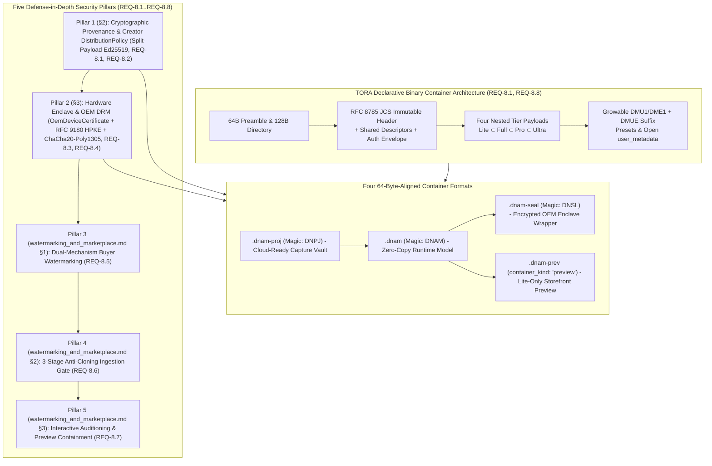
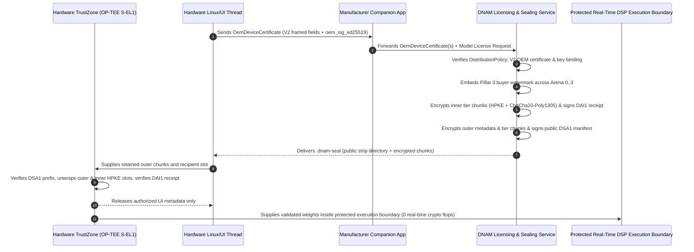

# Cryptographic Provenance (`Ed25519`), `DistributionPolicy`, `OemDeviceCertificate` & `.dnam-seal` (`DNSL`) Hardware DRM

This specification defines **Pillar 1 (Cryptographic Provenance & `DistributionPolicy`)**, **Pillar 2 (Hardware Enclave & OEM DRM via `OemDeviceCertificate` and `.dnam-seal` `b"DNSL"`)**, and the **Three Container Protection Profiles (`DnamProtectionProfile`)** of the DNAM 5-Pillar Security Architecture (paired with Pillars 3–5 in [`watermarking_and_marketplace.md`](watermarking_and_marketplace.md)), fulfilling [`../../requirements/system_goals_and_requirements.md` §9 (`REQ-8.1`–`REQ-8.8`)](../../requirements/system_goals_and_requirements.md#9-goal-8--model-provenance-hardware-drm-forensic-watermarking--marketplace-security). For security design rationales and counterexamples, see [`../../adr/0009-jcs-prefix-signing-hpke-and-preview-containment.md`](../../adr/0009-jcs-prefix-signing-hpke-and-preview-containment.md).

---

## 1. Taxonomy Overview: 5 Security Pillars, 3 Protection Profiles & 4 Container Formats

`r[sec.taxonomy.overview]`



---

## 2. Pillar 1: Cryptographic Provenance (`Ed25519` Split-Payload Chain) & Creator-Signed `DistributionPolicy`

### 2.1 Preset-Safe Canonical Header Digest (RFC 8785 JCS)

`r[sec.jcs.immutable-header-digest]`

To allow user preset edits and storefront catalog tagging without invalidating creator or marketplace signatures, `immutable_header_sha256` hashes the exact **RFC 8785 JSON Canonicalization Scheme (JCS)** UTF-8 byte serialization (UTF-16 code-unit key ordering, ECMAScript `binary64` formatting, exact integers in $[-(2^{53}-1), 2^{53}-1]$) of the logical header after removing only these exact mutable/envelope paths:

```text
presets
user_metadata
metadata.signatures
controls_schema[*].user_metadata
stems_registry[*].user_metadata
slimmable_tiers.{lite,full,pro,ultra}.prefix_crc32c
```

| JSON Header Path | Included in `immutable_header_sha256`? | Security Role |
| :--- | :---: | :--- |
| `version`, `container_kind`, `architecture`, `sample_rate_train_hz` | **Yes (Signed)** | Locks core model architecture and reference sample rate (`48000`) |
| `metadata.{name, author, description, license, created_at, input_reference_dbfs, provenance}` | **Yes (Signed)** | Locks creator attribution, license terms, and PCM dataset provenance |
| **`metadata.distribution_policy`** (`allowed_protection_profiles`, `allowed_oem_vendors`) | **Yes (Signed)** | Locks permitted protection profiles and OEM hardware vendors/models |
| `io_config`, `controls_schema`, `delay_histories`, `tensor_directory`, `slimmable_tiers` | **Yes (Signed)** | Locks safety clamps, delay capacities, tier offsets, and calibration |
| **`presets`** & **`*_user_metadata`** | **No (Mutable Suffix)** | Stored in the growable `DMU1`/`DME1` + `DMUE` suffix |
| **`metadata.signatures`** | **No (Auth Envelope)** | Stored in the `DAU1`/`DAI1`/`DSA1` authentication envelope |

### 2.2 Creator-Signed `DistributionPolicy` & Protection Profile Exclusivity

`r[sec.policy.distribution-policy]`

```json
{
  "metadata": {
    "name": "Darkglass Exclusive B7K Ultra Rig",
    "author": "Darkglass Electronics",
    "distribution_policy": {
      "allowed_protection_profiles": ["enclave_sealed"],
      "allowed_oem_vendors": ["darkglass:anagram_rk3582"]
    }
  }
}
```

1. **Protection Profile Gate (`allowed_protection_profiles`):** Restricts which `DnamProtectionProfile` values (`"open"`, `"device_allowlisted"`, `"enclave_sealed"`) may issue or load the model.
2. **Granular OEM Vendor & Model Matching (`allowed_oem_vendors`):** Supports vendor-wide (`"darkglass"`) and model-specific (`"darkglass:anagram_rk3582"`) rules. Any nonempty OEM restriction requires key-bound `OemDeviceCertificate` attestation for every encrypted recipient (rejecting unverified self-registered keys).

### 2.3 Two-Certificate `Ed25519` Delegation Chain & 4-Tier Cumulative Arena Digests

`r[sec.sig.prefix-delegation]`

Let `F(label, value) = u32le(len(label)) || ASCII(label) || u64le(len(value)) || value` and `L = u8(count) || (u8(tier[0]) || digest[0][32]) || ...` (`count = maximum_tier + 1`, `tier = 0..3` for `Lite..Ultra`):

```text
+---------------------------------------------------------------------------------------------------+
| DOMAIN-SEPARATED PREFIX COMMITMENTS & ED25519 DELEGATION TRANSCRIPTS                              |
+---------------------------------------------------------------------------------------------------+
|  1. Shared Plaintext Framing ("DNAM-PLAINTEXT-SHARED-V1"):                                        |
|     exact_shared_model_bytes = F("domain", ASCII("DNAM-PLAINTEXT-SHARED-V1"))                     |
|       || F("preamble", exact_plaintext_preamble[64])                                              |
|       || F("directory", exact_plaintext_directory[128])                                           |
|       || F("shared_model_binary", exact_immutable_shared_binary)                                  |
+---------------------------------------------------------------------------------------------------+
|  2. Plaintext Prefix Digest (domain = "DNAM-MASTER-PREFIX-V1" or "DNAM-BUYER-PREFIX-V1"):         |
|     SHA256( F("domain", ASCII(domain)) || F("immutable_header_sha256", H_hdr[32])                 |
|             || F("shared_model_data", exact_shared_model_bytes)                                   |
|             || F("tier_lite", exact_lite_bytes)                                                   |
|             [|| F("tier_full", full) || F("tier_pro", pro) || F("tier_ultra", ultra)] )           |
+---------------------------------------------------------------------------------------------------+
|  3. Creator Signing Message ("DNAM-CREATOR-MANIFEST-V1") & Signed Identity:                       |
|     creator_msg = F("domain", ASCII("DNAM-CREATOR-MANIFEST-V1"))                                  |
|       || F("creator_pubkey_ed25519", creator_public_key[32])                                      |
|       || F("immutable_header_sha256", immutable_header_sha256[32])                                |
|       || F("issued_max_tier", u8(maximum_tier)) || F("master_prefix_sha256", L_master)            |
|     creator_signed_manifest_sha256 = SHA256(                                                      |
|       F("domain", ASCII("DNAM-CREATOR-SIGNED-V1"))                                                |
|       || F("creator_manifest", creator_msg) || F("creator_signature", creator_signature[64]))     |
+---------------------------------------------------------------------------------------------------+
|  4. Ciphertext Prefix Digest ("DNAM-CIPHERTEXT-PREFIX-V1"):                                       |
|     SHA256( F("domain", ASCII("DNAM-CIPHERTEXT-PREFIX-V1"))                                       |
|             || F("record_context_sha256", record_context_sha256[32])                              |
|             || F("shared", shared_ct_and_pad) || F("tier_lite", lite_ct_and_pad) [|| ...] )       |
+---------------------------------------------------------------------------------------------------+
|  5. Buyer Receipt Signing Message ("DNAM-BUYER-RECEIPT-V1") & Policy Digest:                      |
|     license_policy_sha256 = SHA256(                                                               |
|       F("domain", ASCII("DNAM-LICENSE-POLICY-V1")) || F("policy", exact_versioned_policy_bytes))  |
|     buyer_msg = F("domain", ASCII("DNAM-BUYER-RECEIPT-V1"))                                       |
|       || F("marketplace_pubkey_ed25519", marketplace_public_key[32])                              |
|       || F("creator_signed_manifest_sha256", creator_signed_manifest_sha256[32])                  |
|       || F("license_policy_sha256", license_policy_sha256[32])                                    |
|       || F("protection_profile", profile[1]) || F("issued_max_tier", u8(maximum_tier))            |
|       || F("buyer_prefix_sha256", L_buyer)                                                        |
|       || F("inner_record_context_sha256", inner_record_context_or_empty)                          |
|       || F("inner_ciphertext_prefix_sha256", L_inner_ct_or_empty)                                 |
+---------------------------------------------------------------------------------------------------+
|  6. Public Outer Manifest ("DNAM-OUTER-PUBLIC-METADATA-V1" & "DNAM-OUTER-MANIFEST-V1"):           |
|     outer_public_metadata_sha256 = SHA256(                                                        |
|       F("domain", ASCII("DNAM-OUTER-PUBLIC-METADATA-V1"))                                         |
|       || F("preamble", public_preamble[64]) || F("directory", public_directory[128])              |
|       || F("public_auxiliary", outer_plan_and_slots_with_padding))                                |
|     outer_msg = F("domain", ASCII("DNAM-OUTER-MANIFEST-V1"))                                      |
|       || F("outer_signer_pubkey_ed25519", outer_signer_public_key[32])                            |
|       || F("outer_public_metadata_sha256", outer_public_metadata_sha256[32])                      |
|       || F("outer_record_context_sha256", outer_record_context_sha256[32])                        |
|       || F("issued_max_tier", u8(maximum_tier)) || F("outer_ciphertext_prefix_sha256", L_outer_ct)|
+---------------------------------------------------------------------------------------------------+
```

`r[sec.sig.dau1-envelope]` **Open `DAU1` Authentication Envelope:** In Open `2.0` containers (`protection_profile = 0`), the authentication region contains `ASCII("DAU1") || u8(auth_kind) || 00 00 00 || creator_pubkey[32] || u8(creator_max_tier) || L_master || creator_sig[64]` (`106 + 33 * N_c` bytes for `auth_kind = 0`), followed when `auth_kind = 1` by `marketplace_pubkey[32] || u32le(P) || policy[P] || u8(buyer_max_tier) || L_buyer || marketplace_sig[64]` (`208 + 33 * N_c + 33 * N_b + P` bytes).

#### Offline Authorization and Future Revocation

`r[sec.sig.offline-auth]`

Once a protected model is authorized and issued to a device, it remains loadable and usable on that device **offline indefinitely** without periodic lease renewal, online checks, or wall-clock expiration while local keys and authorization remain intact (`REQ-8.4`). Revocation applies to future licensing and new issuances rather than retroactively disabling existing offline issuances.

---

## 3. Pillar 2: Hardware Enclave & OEM DRM (`OemDeviceCertificate` Attestation & `.dnam-seal` `b"DNSL"` Wrapper)

### 3.1 Three OEM Hardware Integration & Key Provisioning Paths

`r[sec.drm.oem-certificate]`

| OEM Integration Path | Protection Profile | Factory Assembly-Line Changes? | Key Attestation Mechanism |
| :--- | :--- | :--- | :--- |
| **Path 1: Self-Registered Device Key** | `DeviceAllowlisted` (`.dnam`) | **None** | Device generates `X25519` keypair locally and proves possession via challenge-response during account pairing. |
| **Path 2: Companion-App / OTA Cert Enrollment** | `EnclaveSealed` (`.dnam-seal`, `b"DNSL"`) | **None** (uses hardware root of trust) | Hardware TrustZone / secure element attests key binding to OEM cloud HSM, which issues a signed `OemDeviceCertificate`. |
| **Path 3: Factory-Line HSM Provisioning** | `EnclaveSealed` (`.dnam-seal`, `b"DNSL"`) | **Yes** (factory PCB test rig) | Offline factory HSM verifies device-key binding and writes a signed `OemDeviceCertificate` to non-volatile storage. |

**`OemDeviceCertificate` V2 Signing Input:** Both attested paths sign the length-framed `F` sequence with pure `Ed25519`:

```text
F("domain",                      ASCII("DNAM-OEM-CERT-V2"))
|| F("oem_vendor",               ASCII(canonical_vendor_id))       # 1..32 B, [a-z0-9][a-z0-9._-]*
|| F("model_code",               ASCII(canonical_model_id))        # 1..64 B, [a-z0-9][a-z0-9._-]*
|| F("device_id_hash",           device_id_hash[16])
|| F("public_key_x25519",        pk_device_x25519[32])
|| F("issuer_key_sha256",        SHA256(oem_issuer_pubkey_ed25519[32]))
|| F("assurance",                u8(0x01 = remote_ota, 0x02 = factory_hsm))
|| F("attestation_policy_sha256", policy_sha256[32])
|| F("attestation_evidence_sha256", evidence_sha256[32])
```

For `EnclaveSealed`, decrypted weights and secret-bearing model state remain inside a protected DSP execution boundary inaccessible to normal-world code, debuggers, and unauthorized DMA.

### 3.2 End-to-End `.dnam-seal` (`b"DNSL"`) Sealing & Hardware TrustZone Unsealing Flow

`r[sec.drm.trustzone-flow]`



### 3.3 `.dnam-seal` (`b"DNSL"`) 64-Byte Cache-Line Binary Envelope Specification

1. `r[sec.drm.hpke-record-encryption]` **RFC 9180 HPKE & `ChaCha20-Poly1305` Record Encryption:**
   Uses RFC 9180 Base mode (`DHKEM(X25519, HKDF-SHA256)` `0x0020`, `HKDF-SHA256` `0x0001`, `ChaCha20Poly1305` `0x0003`), rejecting non-contributory all-zero X25519 shared secrets (`x25519_key_validation.rs`):

```text
+---------------------------------------------------------------------------------------------------+
| PRE-WRAP PLAN, RECORD CONTEXT & CHACHA20-POLY1305 AAD TRANSCRIPTS                                 |
+---------------------------------------------------------------------------------------------------+
|  structural_metadata_sha256 = SHA256(                                                             |
|    F("domain", ASCII("DNAM-ENCRYPTED-STRUCTURE-V1")) || F("layer", layer[1])                      |
|    || F("preamble", exact_layer_preamble[64]) || F("directory", exact_layer_directory[128]))      |
|                                                                                                   |
|  Pre-Wrap Plan P ("DNAM-PRE-WRAP-PLAN-V1"):                                                       |
|    F("domain", ASCII("DNAM-PRE-WRAP-PLAN-V1")) || F("issuance_id", issuance_id[16])               |
|    || F("layer", layer[1]) || F("protection_profile", profile[1])                                 |
|    || F("issued_max_tier", maximum_tier[1])                                                       |
|    || F("structural_metadata_sha256", structural_metadata_sha256[32])                             |
|    || F("mutable_offset", u64le(0)) || F("mutable_capacity", u64le(0))                            |
|    || F("hpke_suite", 00 20 00 01 00 03) || F("recipient_key_ids", R) || F("record_descriptors",D)|
|    where R = u32le(N) || recipient_key_sha256[0..N] (lexicographically sorted),                   |
|          S = u32le(N) || (enc[32] || encrypted_cek_and_tag[48])[0..N] (4 + 80*N bytes),           |
|          D = u32le(C) || (u64le(offset[i]) || u64le(ciphertext_length[i]))[0..C] (C = max_t + 2)  |
|                                                                                                   |
|  wrap_plan_sha256 = SHA256(F("domain", ASCII("DNAM-WRAP-PLAN-V1")) || F("plan", P))               |
|  record_context_sha256 = SHA256(                                                                  |
|    F("domain", ASCII("DNAM-RECORD-CONTEXT-V1"))                                                   |
|    || F("wrap_plan_sha256", wrap_plan_sha256) || F("slots", S))                                   |
|                                                                                                   |
|  HPKE Slot i Info / AAD (domain = "DNAM-HPKE-INFO-V1" or "DNAM-HPKE-AAD-V1"):                     |
|    F("domain", ASCII(domain)) || F("wrap_plan_sha256", wrap_plan_sha256)                          |
|    || F("slot_index", u32le(i)) || F("recipient_key_sha256", recipient_key_sha256[i])             |
|                                                                                                   |
|  Record i (0=shared, 1..4=Lite..Ultra, Nonce = u64le(0) || u32le(i)) AAD:                         |
|    F("domain", ASCII("DNAM-RECORD-AAD-V1")) || F("record_context_sha256", record_context_sha256)  |
|    || F("record_index", u32le(i)) || F("record_kind", kind[1])                                    |
|    || F("tier", tier[1]) || F("ciphertext_length", u64le(ciphertext_length))                      |
+---------------------------------------------------------------------------------------------------+
```

#### Sealed Public Framing

`r[sec.drm.dnsl-public-framing]`

An `EnclaveSealed` (`.dnam-seal`) file orders `[preamble][directory][outer plan P][pad][outer slots S][pad][DSA1 manifest][pad][outer shared record][pad][outer Lite..Ultra records][pad][DME1 frame][DMUE footer]`:

```text
DNSL Outer Preamble (64 B):
  0..4: "DNSL" | 4..6: major=2 | 6..8: minor=0 | 8..9: profile=2 | 9..10: max_tier | 10..64: zero

DNSL Outer Directory (128 B):
   0..8:  plan_offset = 192     |  8..16: plan_length
  16..24: slots_offset          | 24..32: slots_length
  32..40: manifest_offset       | 40..48: manifest_length
  48..56: shared_record_offset  | 56..64: shared_ciphertext_length
  64..96: original_tier_ends[4] | 96..128: reserved = zero

DSA1 Public Manifest (105 + 33 * M bytes):
  ASCII("DSA1") || u8(original_maximum_tier) || 00 00 00
  || outer_signer_public_key[32] || outer_ciphertext_prefix_list || outer_signature[64]
```

#### Protected Inner Framing

`r[sec.drm.protected-inner-framing]`

In `DeviceAllowlisted` (`profile = 1`, standalone `.dnam`) and inside the decrypted outer records of `EnclaveSealed` (`profile = 2`), the inner layer orders `[inner preamble][inner directory][DNPL logical metadata prefix][inner plan P][pad][inner slots S][pad][DAI1 envelope][pad][inner shared record][pad][inner Lite..Ultra records][pad]`:

```text
Inner Directory (128 B):
   0..8:  plan_offset           |  8..16: plan_length
  16..24: slots_offset          | 24..32: slots_length
  32..40: authentication_offset | 40..48: authentication_length
  48..56: shared_record_offset  | 56..64: shared_ciphertext_length
  64..96: original_tier_ends[4] | 96..128: logical_metadata_sha256 (DNAM-LOGICAL-METADATA-V1)

DNPL Logical Metadata Prefix (at inner offset 192..plan_offset):
  • 0..64:   DNPL Preamble (magic="DNPL", version=2.0, profile=1|2, buyer_max_tier, SR=48000)
  • 64..192: DNPL Directory (hdr_off=192, hdr_len, shared_off, shared_len, tier_start, ends[4])
  • 192..:   Canonical RFC 8785 JCS Immutable Header + Zero Pad to 64 B

DAI1 Inner Authentication Envelope (209 + 33*N_c + 66*N_b + P bytes):
  ASCII("DAI1") || 00 00 00 00
  || creator_public_key[32] || u8(creator_original_max_tier)
  || creator_master_prefix_list || creator_signature[64]
  || marketplace_public_key[32] || u32le(P) || exact_policy_bytes[P]
  || u8(buyer_original_max_tier)
  || buyer_plaintext_prefix_list || inner_ciphertext_prefix_list || marketplace_signature[64]
```

#### Encrypted Mutable Suffix

`r[sec.drm.dme1-mutable-suffix]`

Both `DeviceAllowlisted` and `EnclaveSealed` containers place a growable `DME1` frame and `16 B` `DMUE` footer immediately after the retained outermost tier boundary:

```text
DME1 Frame Layout:
  0..4: "DME1" | 4..5: profile (1|2) | 5..8: zero | 8..12: u32le(N) | 12..20: u64le(C)
  20 .. 20+80*N: HPKE slots S[0..N]  | 20+80*N .. 20+80*N+C: ChaCha20-Poly1305 ciphertext + tag
  Plaintext = u32le(N) || recipient_public_key[0..N][32] || complete DMU1 frame

DME1 Domain-Separated Transcripts:
  mutable_wrap_sha256 = SHA256(
    F("domain", ASCII("DNAM-MUTABLE-WRAP-V1"))
    || F("record_context_sha256", signed_outermost_record_context_sha256)
    || F("header", exact_20_byte_header) || F("recipient_key_ids", R))
  Slot i Info / AAD (domain = "DNAM-MUTABLE-HPKE-INFO-V1" or "DNAM-MUTABLE-HPKE-AAD-V1"):
    F("domain", ASCII(domain)) || F("mutable_wrap_sha256", mutable_wrap_sha256)
    || F("slot_index", u32le(i)) || F("recipient_key_sha256", recipient_key_sha256[i])
  Content AEAD AAD (nonce = 0x00 * 12, fresh 32-byte cek_mutable per edit):
    F("domain", ASCII("DNAM-MUTABLE-CONTENT-V1"))
    || F("mutable_wrap_sha256", mutable_wrap_sha256) || F("slots", S)
```

---

## 4. Three Container Protection Profiles (`DnamProtectionProfile`) & Loader Auto-Detection

`r[sec.drm.protection-profiles]`

| Protection Profile (`DnamProtectionProfile`) | Container | Metadata | Tier Payloads | Primary Target & Security Posture |
| :--- | :--- | :--- | :--- | :--- |
| **`Open` (`0`, `"open"`)** | `.dnam` (`b"DNAM"`) | Plaintext JCS | Plaintext (`DAU1` signed prefixes) | Community models and open commercial packs |
| **`DeviceAllowlisted` (`1`, `"device_allowlisted"`)** | `.dnam` (`b"DNAM"`) | Plaintext `DNPL` JCS | Encrypted tier chunks (`DAI1` + HPKE) | Desktop/mobile/pedal licenses bound to allowlisted device keys |
| **`EnclaveSealed` (`2`, `"enclave_sealed"`)** | `.dnam-seal` (`b"DNSL"`) | Encrypted (public `DSA1` strip directory) | Nested outer + inner encrypted tier chunks | Attested OEM hardware enclaves with protected DSP execution |
