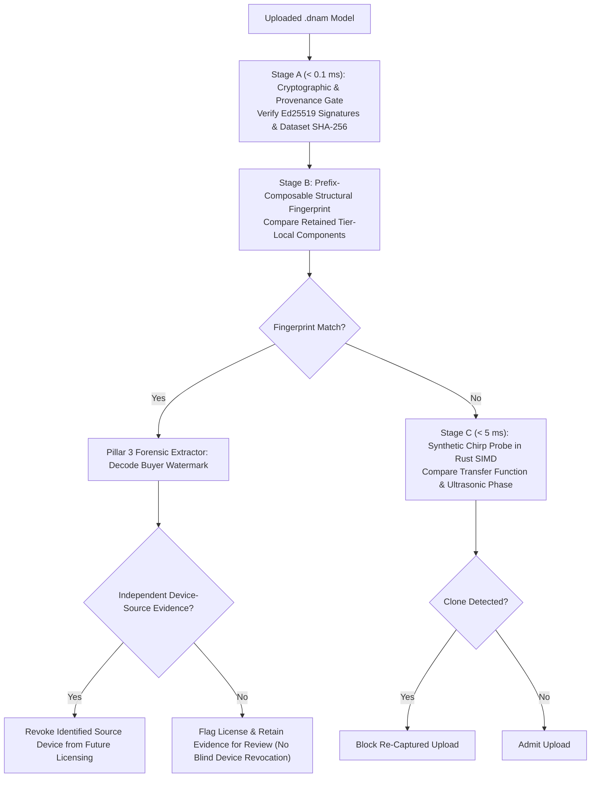
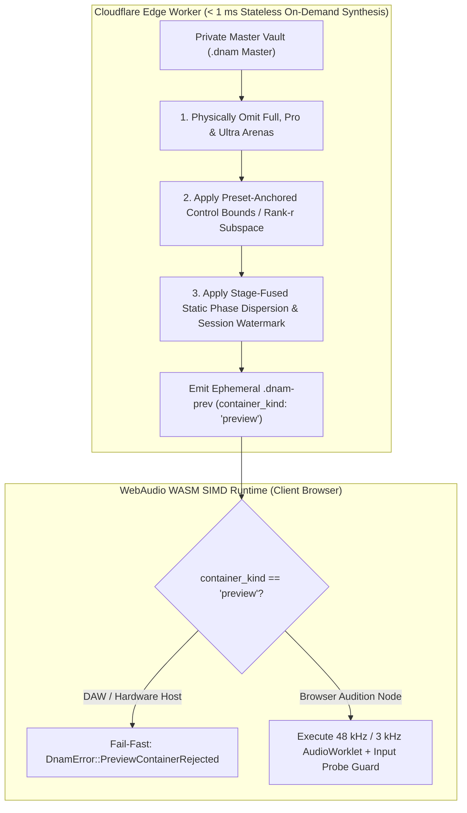
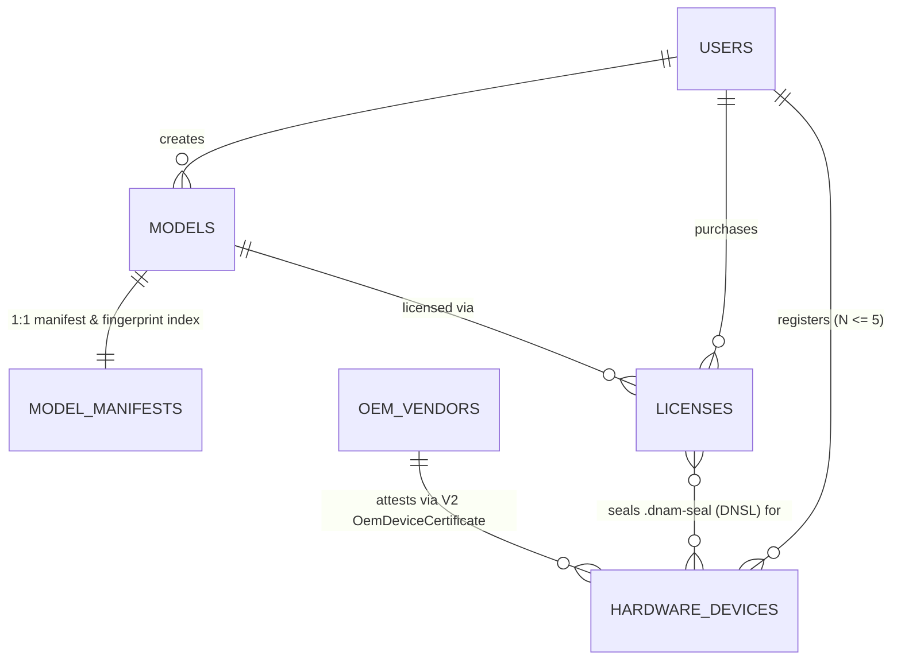

# Forensic Watermarking, 3-Stage Anti-Cloning Gate & Marketplace Edge Infrastructure

Complementing Cryptographic Provenance & Hardware Enclave DRM ([`provenance_and_enclave_drm.md`](provenance_and_enclave_drm.md), [`ADR-0009`](../../adr/0009-jcs-prefix-signing-hpke-and-preview-containment.md)) and fulfilling [`../../requirements/system_goals_and_requirements.md` §9 (`REQ-8.5`–`REQ-8.7`)](../../requirements/system_goals_and_requirements.md#9-goal-8--model-provenance-hardware-drm-forensic-watermarking--marketplace-security), this specification defines **Pillar 3 (Dual-Mechanism Buyer Watermarking)**, **Pillar 4 (3-Stage Anti-Cloning Ingestion Gate)**, the **Commercial Storefront Platform (`.dnam-prev`)**, and the **Cloudflare + TiDB Edge Infrastructure**.

---

## 1. Pillar 3: Forensic Traitor Tracing (`< 0.2 ms` Dual-Mechanism Buyer Watermarking)

### 1.1 Mechanism A — Reciprocal Scaling Gauge (Ideal Real-Arithmetic Invariance)

1. `r[sec.watermark.reciprocal-gauge]` **Per-Mode `Op-M` Reciprocal Scaling Gauge & Layer 1 Cascade-Head Gauge (`apply_cascade_head_gauge`):** For each shared Stage III Kautz mode $m$ ([`../dsp/op_m_modal_kautz.md` §4.1](../dsp/op_m_modal_kautz.md#41-stage-iii-architecture--tier-allocation)), scale the shared input coefficient and reciprocally compensate **both** Left and Right complex readouts within the mode's owning tier slice (`0.5 <= kappa_buyer <= 2.0`):
   $$b_{\gamma,m}^{(\text{buyer})} = \eta_m b_{\gamma,m}^{(\text{master})}, \qquad c_{m,a}^{(\text{buyer})} = \frac{c_{m,a}^{(\text{master})}}{\eta_m}, \qquad a \in \lbrace L, R \rbrace$$
   In parallel, **Layer 1 Cascade-Head Gauge** (`apply_cascade_head_gauge`) adds $\boldsymbol{\delta}_{c,g}$ to the Role B `Vec4` blocks (`b = 1..K_t-1`) mapped surjectively via $s = 16c + g = (4r + q) \bmod 32$ onto Tier $t$'s `32` `Vec4` head slices and reciprocally scales Tier $t$'s `W_head` slices across all $1 + D_h$ modes (`0..5` + `Ultra` `5..9`) by $\mathbf{m}_{\text{before}} / \mathbf{m}_{\text{after}}$, preserving `0.000000 ULP` dyadic forward invariance.
2. `r[sec.watermark.orthogonal-gauge]` **Block-Diagonal SVD Control Subspace Orthogonal Rotation Gauge ($\mathbf{Q}_{\text{buyer}} \in SO(4) \oplus SO(4)$) & Layer 2 Pole-Angle Phase Coding (`apply_phase_coding_watermark`):** Rotates the head-coordinate subspace consistently across the main projections, interaction mixer, and Kronecker output head modes while preserving lower-tier prefixes and Euclidean trust-region norms. Complementing Layer 1, **Layer 2 Kautz & Inter-Stage Pole-Angle Phase Coding** (`PHASE_CODING_MAX_RAD = 8.726646e-4`, `apply_phase_coding_watermark`, `score_phase_coding_arena`, `score_phase_coding_blackbox`) injects a buyer-keyed phase perturbation $\lvert\Delta\theta_m\rvert \le 8.726646 \times 10^{-4}\text{ rad}$ ($\le 0.05^\circ$, `0.00 dB` pole-radius change) via `"DNAM-WM-PHASE-V1"` into each tier's active Stage III Kautz pole angles (`STAGE3_KAUTZ_BASES`) and Stage II lifted inter-stage pole angles (`theta_mid_1` at `4,180`, `theta_mid_2` at `4,212`), surviving black-box re-distillation while remaining `100%` invariant under `quantize_pole_angle_1e2` (`10^{-2} rad` grid).

### 1.2 Mechanism B — Coupled Spread-Spectrum Tardos Watermarking (`Role A = 0` & `EMR` Envelopes)

`r[sec.watermark.tardos-code]`

Embeds a buyer-specific spread-spectrum Tardos codeword (`TardosCodebook7680`) over the Stage II Role B commuted cascade weights (`b = 1..K_t-1`) in each retained tier (`REQ-8.5`), while strictly locking **Role A (`b = 0`, indices `0..16`, `768..784`, `2304..2320`, `4608..4624`) to `0.0`** so upstream nonlinear trajectories remain unperturbed and deriving per-tier Arcsine bias $p_i \in [\delta, 1 - \delta]$ via `HMAC-SHA256(shared_seed, tier_idx)` weighted by `compute_emr_masked_tardos_envelopes`:
$$W_{\text{stage},i}^{(\text{buyer})} = W_{\text{stage},i}^{(\text{master})} + \epsilon \sigma_{W,i} c_i^{(\text{buyer})}$$

### 1.3 License-Scoped Seed Derivation

`r[sec.watermark.seed-derivation]`

Using the length-framed `F` encoding ([`provenance_and_enclave_drm.md` §2.3](provenance_and_enclave_drm.md#23-two-certificate-ed25519-delegation-chain--4-tier-cumulative-arena-digests)) and a 32-byte secret key `K_wm`, derive tier-scoped shared codebook and buyer-specific seeds via `HMAC-SHA256(K_wm, message)` where `owning_tier` (`0..3`) is the tier slice that owns the embedded symbols (so stripping higher tiers never alters retained-tier seeds):

```text
Shared Codebook Seed ("DNAM-WM-SHARED-SEED-V1"):
  F("domain", ASCII("DNAM-WM-SHARED-SEED-V1"))
  || F("marketplace_pubkey_ed25519", marketplace_public_key[32])
  || F("watermark_key_id", watermark_key_id[16])
  || F("creator_signed_manifest_sha256", creator_signed_manifest_sha256[32])
  || F("model_id", model_id[16])
  || F("watermark_profile_sha256", watermark_profile_sha256[32])
  || F("owning_tier", u8(tier))

Buyer Seed ("DNAM-WM-BUYER-SEED-V1"):
  [Shared Codebook Seed fields with domain = "DNAM-WM-BUYER-SEED-V1"]
  || F("license_id", license_id[16])
  || F("buyer_id", buyer_id[16])

Watermark Profile Digest ("DNAM-WM-PROFILE-V1"):
  watermark_profile_sha256 = SHA256(
    F("domain", ASCII("DNAM-WM-PROFILE-V1")) || F("profile", exact_profile_bytes))
```

---

## 2. Pillar 4: 3-Stage Anti-Cloning Ingestion Gate (`< 50 ms` Clone & Re-Capture Prevention)

`r[sec.anticlone.three-stage-gate]`



1. **Stage A — Cryptographic & Provenance Gate (`< 0.1 ms`):** Checks `creator_signature`, `marketplace_receipt`, and `dataset_manifest_sha256`.
2. **Stage B — Prefix-Composable Structural Fingerprint & Evidence-Based Revocation (`REQ-8.6`):** Compares retained-tier structural fingerprints and extracts buyer watermarks. A device is revoked from **future licensing only when independent evidence identifies that device as the leak source**; a buyer watermark or transferred file alone never triggers blind hardware revocation.
3. **Stage C — Synthetic Probe Transfer-Function Check (`< 5 ms`):** Renders a 2-second synthetic chirp probe in Rust SIMD to detect black-box re-captured clones.

### 2.1 Tier-Local Stage III Fingerprint Component

`r[sec.anticlone.stage3-fingerprint]`

For each retained tier (`Lite..Ultra`), form the gauge-invariant Stage III component from that tier's 16 left FIR taps, 16 right FIR taps, and 7 `f64` values per added shared Kautz pole pair (`60 / 120 / 208 / 352` cumulative values across `Lite / Full / Pro / Ultra`, [`dnam_binary_format.md` §2.4](../containers/dnam_binary_format.md#24-tier-local-projection--stage-iii-slice-layout)):

```text
[b_early_L[0..15], b_early_R[0..15], (r_low, dr, theta, b_gamma*c_re_l, b_gamma*c_im_l, b_gamma*c_re_r, b_gamma*c_im_r) x M_tier]
```

Because `b_gamma * c_re` and `b_gamma * c_im` cancel the Mechanism A multiplier $\eta_m$ in exact arithmetic—and `extract_structural_hash_224d` quantizes each Kautz pole angle $\theta_m$ onto a $10^{-2}\text{ rad}$ grid via `quantize_pole_angle_1e2`—this vector is invariant under both reciprocal gauge watermarking and black-box re-capture solver jitter.

---

## 3. Commercial Storefront Platform: Auditioning, Royalty Splits & Storefront Metadata

`r[sec.preview.containment]`



| Protection Layer | Structural & Mathematical Specification (`REQ-8.7`) |
| :--- | :--- |
| **1. Dedicated Preview Type & High-Tier Omission** | Sets `container_kind: "preview"` (rejected by DAW/pedal hosts via `DnamError::PreviewContainerRejected`) and physically omits `Full`, `Pro`, and `Ultra` arenas and projection slices. |
| **2. Bounded Preview Controls & Fixed-Anchor Rank-`r` Containment** | • **Single control (`P = 1`):** Exposes a bounded continuous window `v ∈ [v₀ - δ, v₀ + δ] ∩ [0, 1]` (`0 < δ ≤ 0.15`) or at most one additional observed safe switch option.<br/>• **Multiple controls (`P ≥ 2`):** Fixes a master-scoped reference anchor `a` and rank-`r` (`r < D_cont`) direction matrix `B`, permitting only settings `a + B t` across all published previews while locking discrete switches. |
| **3. Stateless On-Demand Generation (`< 1 ms`)** | Synthesizes `.dnam-prev` payloads at the CDN edge directly from the master's `Lite` prefix with zero per-session storage multiplication. |
| **4. Stage-Fused Static Phase Dispersion** | Perturbs Stage III/IV phase response (`|20 log₁₀ |H_disp(e^{jω})|| ≤ 0.05 dB`, `τ_g^(demo)(ω) ≠ τ_g^(master)(ω)`) while preserving stability bounds. |
| **5. Dynamic Synthetic-Sweep & Impulse Input Guard** | Monitors `3 kHz` crest factor and zero-crossing regularity (`0 FDIV`, `0 FSQRT`), smoothly engaging phase flutter on synthetic probe stimuli while preserving natural musical playing. |
| **6. Black-Box Acoustic Watermarking & Session Binding** | Embeds HMAC-keyed sparse micro-echoes (`y_wm[n] = y[n] + ∑ β_i y[n - d_i]`, `|β_i| ≤ 10^(-42/20)`, `d_i ∈ [120, 800]` samples) alongside session lease metadata. |

$$\gamma_{\text{crest}}[k] = \frac{\max_{n \in [0..15]} |x[16k + n]|}{p_{\text{rms}}[k] + \epsilon}, \qquad \sigma_{\text{zcr}}^2[k] = \frac{1}{M_z} \sum_{i=1}^{M_z} (z_i - \bar{z})^2$$
$$g_{\text{poison}}[k] = g_{\text{poison}}[k-1] + \alpha_{\text{engage}} \big(1.0 - g_{\text{poison}}[k-1]\big), \qquad \Delta\tau_{\text{flutter}}[n] = g_{\text{poison}}[k] \cdot A_{\text{flutter}} \sin(\omega_{\text{flutter}} n + \phi_k)$$
$$y_{\text{wm}}[n] = y[n] + \sum_{i=1}^{K_{\text{wm}}} \beta_i y[n - d_i], \qquad |H_{\text{clone}}(e^{j\omega})|^2 \approx |H_{\text{true}}(e^{j\omega})|^2 \left(1 + 2 \sum_{i=1}^{K_{\text{wm}}} \beta_i \cos(\omega d_i)\right)$$

### 3.2 Standardized `license_tier` Values & Automated Split Royalties (`royalty_splits`)

`r[sec.preview.royalty-splits]`

Inside the marketplace receipt:
- **`license_tier`:** `"free"`, `"personal"`, `"commercial_studio"`, or `"oem_bundle"`.
- **`royalty_splits`:** Array of `{ "recipient_id": str, "role": str, "share_bps": int }` entries summing to `10000` bps (`100%`).

### 3.3 Clean Storefront Taxonomy Isolation via `user_metadata`

`r[sec.preview.storefront-metadata]`

Storefront discovery attributes (`product_slug`, `category`, `gear_modeled`, `tags`, `artwork_url`, `demo_audio_urls`) reside under `user_metadata["dnam.store"]` in the growable `DMU1`/`DME1` suffix.

---

## 4. Cloud Edge Infrastructure, Logical Data Model & Stateless OEM Sealing Service

`r[sec.edge.data-model]`



| Logical Entity | Primary Key & Indexing Strategy | Core Attributes & Cryptographic Invariants |
| :--- | :--- | :--- |
| **`users`** | `id` (`BINARY(16)` UUIDv7), unique `handle` | `handle`, `display_name`, `creator_pubkey` (`32 B` `Ed25519`), `is_verified` |
| **`models`** | `id` (`BINARY(16)`), cursor indices | `slug`, `format_kind`, `category_kind`, `allowed_profiles_mask`, `license_tier`, `price_cents` |
| **`model_manifests`** | `model_id` (`BINARY(16)`) | `r2_master_key`, `immutable_header_sha256`, `dataset_manifest_sha256`, `creator_signature`, `structural_fingerprint`, `allowed_oem_vendors_json` |
| **`oem_vendors`** | `id` (`VARCHAR(32)`, e.g. `'darkglass'`) | `display_name`, `oem_pubkey_ed25519` (`32 B` pinned root key), `api_key_sha256`, `max_devices_per_user` |
| **`hardware_devices`** | `device_id_hash` (`BINARY(16)`) | `oem_vendor`, `model_code`, `owner_user_id`, `pubkey_x25519`, `oem_sig_ed25519`, `assurance`, `status` |
| **`licenses`** | `id` (`BINARY(16)` UUIDv7) | `model_id`, `buyer_id`, `license_tier`, `protection_profile`, `watermark_key_id`, `watermark_profile_sha256` |
| **`credit_wallets` & `training_jobs`** | `user_id` / `id` (`BINARY(16)` UUIDv7) | `balance_credits`, `reserved_credits`, `parent_job_id`, `job_kind`, per-tier `bESR`, `audit_report_json` |
