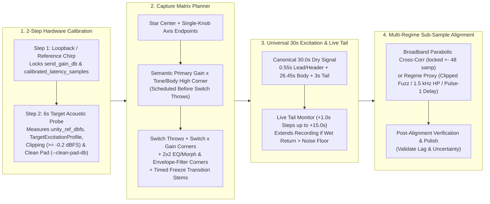
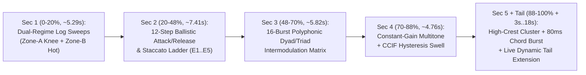

# Hardware Capture, Universal Excitation & Multi-Regime Latency Alignment

This specification defines the **capture-first validation methodology, 2-step hardware calibration, unclipped 32-bit float pad staging (`--clean-pad-db`), Star/Switch/Corner capture matrix planner, heuristic-free 30.0-second universal excitation, and multi-regime sub-sample latency alignment** for **Dynamic Neural Audio Modeler (DNAM)** ([`REQ-1.6`–`REQ-1.8`](../../requirements/system_goals_and_requirements.md#flexible-drywet-stem--excitation-requirements-req-16req-18), [`REQ-7.3`](../../requirements/system_goals_and_requirements.md#8-goal-7--unclipped-32-bit-ieee-754-float-f32-signal-chain-input--output)).

For the Two-Sweep Block-Coordinate Cholesky training pipeline that consumes aligned stems, see [`four_stage_pipeline.md`](four_stage_pipeline.md). For `.dnam-ckpt` iterative stem expansion and calibration caching, see [`iterative_resume_and_caching.md`](iterative_resume_and_caching.md).

---

## 1. End-to-End Capture & Alignment Pipeline

### 1.1 Capture-First Validation Across All Effect Families

`r[train.capture.invariants]`

Every hardware capture session enforces four physical invariants across all effect classes and complex full rigs (`REQ-1.1`–`REQ-1.8` in [`../../requirements/system_goals_and_requirements.md` §2](../../requirements/system_goals_and_requirements.md#2-goal-1--universal-instrument-system--flexible-input-coverage-nonlinear--lti--full-rigs)):
1. **2-Step Reference Calibration:** Locks unclipped `send_gain_db`, `calibrated_latency_samples`, `unity_ref_dbfs`, and `TargetExcitationProfile` without backing off `send_gain_db` when a target device compresses or clips.
2. **Capture Matrix Planning:** Schedules the minimal, physically complete set of `Star` + `Switch` + `2×2 Corner` stems needed to disambiguate coupled controls without relying on control-name heuristics for excitation synthesis.
3. **Independent Dry/Wet Stem Pairing & Sample-Rate Anchoring:** Associates every captured wet target with its actual dry input, channel mapping, control-event timeline, and provenance. Captures at sample rates other than `48 kHz` are converted to aligned `48 kHz` working copies while preserving the unmodified source PCM (`sample_rate_train_hz = 48000`, [`../containers/dnam_binary_format.md` §4](../containers/dnam_binary_format.md#4-training-sample-rate-anchoring--continuous-time-zoh-cross-reference)).
4. **WDW Target Identification:** Advertising `PreSpatialCore` or `DirectDry` requires aligned, separately identified core/direct and wet L/R targets (or a validated per-channel dry residual).

### 1.2 2-Step Hardware Calibration & Clean 32-Bit Float Pad Staging

1. `r[train.capture.calib.loopback]` **Step 1 — Loopback & Reference Latency Calibration:** Measures deterministic round-trip DAC/ADC latency (`calibrated_latency_samples`) and locks unity reference send gain (`send_gain_db`) and `unity_ref_dbfs`.
2. `r[train.capture.calib.clean-pad]` **Step 2 — Target Acoustic Probe & Clean Pad Staging (`--clean-pad-db`):** Plays a 6.0-second probe through the target hardware at default controls while keeping `send_gain_db` locked to Step 1:
   - Inspects the unmodified raw ADC capture per channel before alignment or gain restoration. If the return approaches ADC full scale ($\ge -0.2\text{ dBFS}$), requires a verified linear analog attenuation before the limiting stage or ADC (`--clean-pad-db` records that external attenuation for `f32` makeup scaling $[g_{\min}/\hat g, g_{\max}/\hat g]$; digital gain after the ADC cannot undo analog or ADC clipping).
   - Preserves raw PCM, attenuation metadata, gain uncertainty, and noise-floor provenance.

---

### 1.3 Capture Matrix Planning (`Star`, `Switch` & Coupled-Corner Scheduling)

`r[train.capture.planner.schedule]`

| Stem Schedule Group | Stem Naming Pattern | Physical Purpose & Ordering Rule |
| :--- | :--- | :--- |
| **1. Reference Star Center** | `stem_00_star_center` | Declared default knob and switch settings; auto-unity leveling reference. |
| **2. Single-Knob Axis Sweeps** | `stem_axis_{ctrl}_{min\|max}` | Captures `{min, default, max}` for each continuous `range` control. |
| **3. Primary High-Pair Corner** | `stem_corner_high_pair` | Pairs the primary gain/drive control with the primary tone/body control at maximum (`default` switch state), scheduled **before** any switch throws. |
| **4. Switch Throws & Switch × Gain Corners** | `stem_switch_{sw}_{idx}`, `stem_corner_switch_{sw}_{idx}_{gain}_{min\|max}` | Records switch states and gain endpoints, plus timed engage/hold/release transitions for stateful switches. |
| **5. Specialized Coupled Corners** | `stem_corner_{c1}_{c2}_...` | Schedules `2 × 2` corners for Dual-Engine Morph controls, Parametric Mid-EQ (`Gain × Freq`), and Resonant Envelope Filters. |

#### Freeze Transition Capture

`r[train.capture.planner.freeze-transition]`

For a physical hardware freeze control (`role = "freeze_latch"`), record aligned input and output while audio builds the device's internal state, engage the switch at a recorded frame boundary, capture the held response and play-over input behavior, and release the switch to capture decay recovery ([`../dsp/router_and_stages_topology.md` §6.1](../dsp/router_and_stages_topology.md#61-captured-freeze-and-modeled-controls)). Time-varying switch captures record their initial option and ordered `(frame_index, option_id)` transitions on the aligned `48 kHz` timeline (marking any `[n_earliest, n_latest)` timing-uncertainty interval so uncertain frames never unlock an unobserved option under `[CLAMP-SWITCH]`).

---

### 1.4 Heuristic-Free 30.0-Second 5-Section Universal Excitation & Live Tail Extension

`r[train.capture.excitation.universal-30s]`

At `48 kHz`, the canonical **30.0-second** signal (`1,440,000` samples) comprises `0.10 s` lead silence, a `0.45 s` alignment header, a `26.45 s` five-section body, and a `3.00 s` baseline tail (`~4.126 s` total baseline input silence after the final `80 ms` chord burst):

| Section | Time Span (`%` of Active Body) | Signal Structure | Physical Identification Target |
| :--- | :--- | :--- | :--- |
| **Section 1** | `0–20%` (`~5.29 s`) | Dual-regime logarithmic sweeps (`20 Hz → 20 kHz`): `~2.38 s` Zone-A swell (`knee → sat → knee`), `0.37 s` settling gap, `~2.54 s` Zone-B swell (`sat → 0.98 → sat`) | Linear frequency response, cabinet/room modal poles, and level-dependent resonant filter trajectories |
| **Section 2** | `20–48%` (`~7.41 s`) | 12-step multi-register ballistic attack/release & staccato re-trigger ladder (`-42 dBFS → 0.98`, `41.2 Hz E1 .. 659.3 Hz E5`) with sub/mid/high crossover anchors (`65, 330, 1320 Hz`) | Envelope-filter ballistics, optical/FET compressor attack/release time constants, and fast transient recovery |
| **Section 3** | `48–70%` (`~5.82 s`) | 16-burst polyphonic dyad/triad saturation & intermodulation matrix (`sat → 0.98` across octaves, 5ths, 4ths, major/minor 3rds, tritones) | Multi-stage tube/transistor intermodulation distortion, octave wavefolding, and power-supply sag |
| **Section 4** | `70–88%` (`~4.76 s`) | `~2.285 s` constant-gain harmonic/multitone signal followed by `~2.476 s` multitone/CCIF hysteresis swell | Continuous clipping knees, hysteresis, and modulation evidence |
| **Section 5 + Tail** | `88–100%` (`~3.17 s`) + `3.0 s` Tail (`+0..15 s` Live) | `~1.90 s` high-crest cluster, `~63 ms` input gap, and `80 ms` windowed chord burst followed by `~4.126 s` baseline input silence | Reverb/echo decay `T₆₀` and late modal tail identification |

- `r[train.capture.excitation.live-tail]` **Live Per-Stem Dynamic Reverb Tail Extension (`+0.0 s .. +15.0 s`, `REQ-1.7`):** Extends recording in `1.0 s` silent-input increments (up to `+15.0 s` extra) whenever the wet return at `30.0 s` remains above the pre-roll noise floor.
- `r[train.capture.excitation.user-stems]` **Arbitrary User-Supplied Stems (`REQ-1.8`):** Supports independently paired user-supplied dry/wet stems of any duration or musical content.

---

### 1.5 Multi-Regime Sub-Sample Hardware Latency Alignment

`r[train.capture.alignment.multi-regime]`

| Hardware Regime | Detection Condition | Alignment Proxy & Verification Rule |
| :--- | :--- | :--- |
| **1. Standard Broadband (`Amps, Drives, Cabs`)** | Broadband dry-to-wet linear correlation `> 0.35` within `locked ± 48` samples | Parabolic sub-sample cross-correlation peak around `locked`; post-alignment polish gated on `c_dry > 0.40`. |
| **2. Extreme Gated / Wavefolder Fuzz (`Family 1 / Op-N`)** | Broadband linear correlation `≤ 0.35` with high crest/clipping | Causal clipped-fuzz proxy `tanh(5 x_dry)` cross-correlated against `y_wet` within `locked ± 48` samples. |
| **3. Steep Resonant / High-Pass (`Wah, Phaser, Treble Booster`)** | Low broadband correlation with concentrated upper-band energy | Zero-phase `1.5 kHz` high-pass filtered dry/wet cross-correlation to lock transient leading edges without phase-delay bias. |
| **4. Modulated Delay / Echo / Reverb (`Op-T[Tank]`)** | Strong delayed repeats or kill-dry wet output | `pulse1_onset_window` leading-edge alignment (or `kill_dry_locked` reference latency when dry feedthrough is absent), preserving intentional effect delay `τ_0,m`. |
