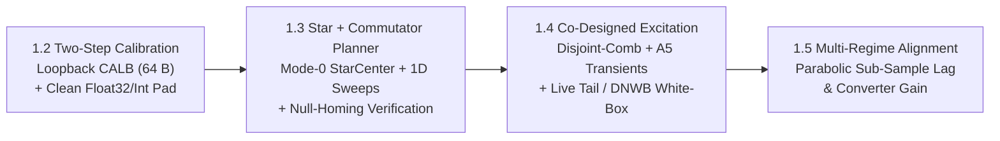

# Hardware Excitation, Multi-Mic Calibration & Router Alignment

This specification defines the **universal hardware excitation schedule, 2-step converter calibration, multi-regime sub-sample latency alignment, and white-box/grey-box distillation contracts** owned by [`packages/capture/`](../../../packages/capture/README.md), fulfilling [`REQ-1.5`–`REQ-1.8`, `REQ-7.2`, `REQ-7.3`](../../requirements/system_goals_and_requirements.md) (see [`../../adr/0002-tri-operator-recurrent-architecture.md`](../../adr/0002-tri-operator-recurrent-architecture.md), [`../../adr/0016-codesigned-disjoint-comb-stimulus-and-null-homing-capture.md`](../../adr/0016-codesigned-disjoint-comb-stimulus-and-null-homing-capture.md), [`../../adr/0018-signal-chain-fixtures-crate-and-whitebox-distillation.md`](../../adr/0018-signal-chain-fixtures-crate-and-whitebox-distillation.md), and [`../../adr/0020-modular-monorepo-and-dnam-proj-container.md`](../../adr/0020-modular-monorepo-and-dnam-proj-container.md)).

---

## 1. Universal Hardware Capture, Calibration & Alignment

### 1.1 Fundamental Capture Invariants

`r[train.capture.invariants]`

All physical hardware captures and programmatic distillations enforce four device-agnostic invariants (`REQ-1.5`–`REQ-1.7`):
1. **Zero Control-Name or Topology Heuristics (`REQ-1.6`):** Excitation synthesis, lag alignment, and solver staging never inspect control labels (`"Gain"`, `"Mix"`, `"Drive"`), UI hints, or device category tags; fixed `0`-control snapshots and multi-pedal + amp + cab + stereo rack rigs execute through the exact same signal-measured pipeline.
2. **Multi-Rate & 5-Bit-Depth Lossless Staging (`REQ-1.7`, `REQ-7.3`):** Capture I/O natively encodes and decodes 5 PCM bit depths (`Int12` left-justified in `16-bit` container, `Int16`, `Int24`, `Int32`, and unclipped IEEE-754 `Float32` `WAVE_FORMAT_IEEE_FLOAT`) across `8..192 kHz`, resampling arbitrary device rates to and from the canonical `48 kHz` identification grid via zero-phase polyphase Kaiser-sinc filtering (`dnam_capture::resampler`).
3. **True-Stereo & Multi-Port Channel Preservation (`REQ-7.2`):** Mono (`1->1`), mono-to-stereo (`1->2`), stereo-to-mono (`2->1`), true-stereo (`2->2`), `4CM`, and `WDW` channel assignments are preserved without mono downmixing prior to Stage 0 routing.

### 1.2 2-Step Hardware Calibration & Clean 32-Bit Float Pad Staging

1. `r[train.capture.calib.loopback]` **Step 1 — Direct Converter Loopback (`CALB`):** Measure round-trip DAC-to-ADC loopback latency $\hat{\tau}_{\text{loop}}$ to sub-sample precision, linear converter gain $g_{\text{conv}}$, and per-band quiescent noise-floor energy $\epsilon_{\text{floor},b,c}^2$, persisting the `64 B` `CALB` chunk inside `.dnam-proj` (`ref[container.proj.preamble-and-directory]`).
2. `r[train.capture.calib.clean-pad]` **Step 2 — Clean Reference Level & Unclipped `Float32` Pad Staging (`REQ-7.3`):** Record a `0 dBu` / instrument-reference calibration burst to lock `input_ref_dbfs`, warn on converter clipping (`>= -0.1 dBFS`), and stage aligned signals in unclipped `32-bit` IEEE-754 floating-point buffers (`±100.0` = `+40 dBFS` linear headroom).

### 1.3 Adaptive Star + Commutator Schedule & Null-Homing Verification

1. `r[train.capture.planner.schedule]` **StarCenter + Triangular Newton 1D Schedule (`ADR-0016`):** Lock `Mode-0` at the declared `StarCenter` reference stem (`s = 0`), sweep each continuous knob across Gauss–Lobatto nodes (`1D` rays) and each discrete switch across observed non-reference options, and schedule targeted `2D` commutator probe bursts only on control pairs whose measured `1D` commutator norm exceeds the noise-qualified interaction gate.
2. `r[train.capture.planner.null-homing]` **Hardware Null-Homing Verification (`REQ-1.7`):** Before committing non-reference knob stems on physical hardware, verify mechanical knob return repeatability back to `StarCenter` against the reference residual envelope so potentiometer backlash or thermal drift is separated from true parametric control variation.

#### Freeze-Transition Capture

`r[train.capture.planner.freeze-transition]`

When a rig exposes a hardware freeze/hold footswitch (`role == "freeze_latch"`), the capture schedule records at least one active sustain-entry transition (`unfrozen -> frozen` while harmonic energy is present, followed by live play-over phrases and `frozen -> unfrozen` release) so Stage IV tank input gating and play-over pass-through are identified directly from signal trajectories (`ref[dsp.stage4.captured-freeze]`).

### 1.4 Co-Designed Disjoint-Comb Excitation, Live Tail Extension & White-Box Distillation

1. `r[train.capture.excitation.codesigned]` **Co-Designed Disjoint-Comb + `A5` Transient Stimulus (`ADR-0016`, `REQ-1.6`):** Synthesize a deterministic, crest-factor-controlled excitation combining odd/even disjoint harmonic combs (separating linear FRF pedestals from even/odd intermodulation sidebands), swept logarithmic chirps, multi-level dynamic steps (`-48 dBFS .. 0 dBFS`), and a `500 ms` `A5` musical transient coreset (`12,000` frames at `48 kHz` stored in `INPC`, `ref[container.proj.inpc-capsule]`).
2. `r[train.capture.excitation.live-tail]` **Automatic Live Decay-Tail Extension:** Monitor the post-stimulus return energy against the calibrated `CALB` noise floor and automatically extend capture recording until reverb, delay, or feedback tails decay within `+1.0 dB` of $\epsilon_{\text{floor}}^2$ (up to the configured maximum tail ceiling).
3. `r[train.capture.whitebox.distillation]` **Unified `DistillationTarget` & Out-of-Process `DNWB` White-Box Runners (`ADR-0018`, `REQ-1.8`):** Programmatic targets implement `DistillationTarget` (`render_stem` batch + `render_frame` closed-loop adaptive probing), while external circuit and DSP simulators (`FaustRunner`, `SpiceRunner` over `ngspice` variable-timestep `PCHIP` + `309`-tap Kaiser-sinc decimation) execute in GPL-isolated subprocesses over `64 B`-header `DNWB` binary stdin/stdout pipes.

### 1.5 Multi-Regime Sub-Sample Hardware Latency Alignment

`r[train.capture.alignment.multi-regime]`

Given dry excitation $x[n]$ and recorded wet return $y[n]$ (after subtracting loopback offset $\hat{\tau}_{\text{loop}}$), `estimate_subsample_lag_and_gain` identifies sub-sample residual hardware/USB jitter $\Delta\tau$ and linear converter gain $\hat{g}$ across clean, high-gain distorting, phase-inverting, and dispersive all-pass regimes:
1. Compute normalized cross-correlation (and broadband Hilbert/envelope cross-correlation fallback when heavy clipping or octave division suppresses fundamental phase coherence) over the causal search window.
2. Fit a 3-point parabolic vertex around the correlation peak $k^\star$ (`|k^\star|` with sign restoration for phase-inverting preamps):
$$\delta = \frac{R[k^\star - 1] - R[k^\star + 1]}{2\big(R[k^\star - 1] - 2 R[k^\star] + R[k^\star + 1]\big)} \in [-0.5, +0.5], \qquad \hat{\tau} = k^\star + \delta$$
achieving `< 0.02` sample accuracy at `48 kHz` (`ref[qual.eval.jitter-floor]`) before resampling the wet stem onto the zero-phase `INPC` grid.
