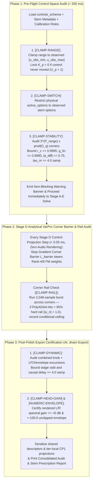

# Non-Stop 3-Phase Control-Space Audit & Automatic Clamping

Because neural audio training runs unattended across multi-stem captures, **DNAM never blocks or pauses training on user confirmation prompts** ([`REQ-2.4`, `REQ-7.1`, `REQ-7.2`](../../requirements/system_goals_and_requirements.md)). The **Non-Stop 3-Phase Control-Space Audit & Automatic Clamping Pipeline** enforces all stability, control-range, and numeric bounds across [`packages/capture/src/audit.rs`](../../../packages/capture/README.md) and [`packages/engine/src/control/bus.rs`](../../../packages/engine/README.md) automatically.



---

## 1. The Non-Stop 3-Phase Control-Space Audit Lifecycle

### 1.1 Phase 1 — Pre-Training Step-0 Audit ($< 200\text{ ms}$ Before Epoch 1)

1. `r[train.audit.phase1.clamp-range]` **`[CLAMP-RANGE]` (Unobserved Range Extrapolation Clamp):** For each continuous `range` control $p$ with `declared_range` $[u_{p,\text{decl-min}}, u_{p,\text{decl-max}}]$ and observed stem span $[u_{p,\text{obs-min}}, u_{p,\text{obs-max}}]$ (`ref[dsp.ctrl.range.normalize-clamp]`):
   $$u_{p,\text{safe-min}} = \max\big(u_{p,\text{decl-min}},\ u_{p,\text{obs-min}}\big), \qquad u_{p,\text{safe-max}} = \min\big(u_{p,\text{decl-max}},\ u_{p,\text{obs-max}}\big)$$
   If $U_p = 1$ (control never moved across stems), lock polynomial degree to $K_p = 0$ (`ref[dsp.ctrl.basis.lobatto]`).
2. `r[train.audit.phase1.clamp-switch]` **`[CLAMP-SWITCH]` (Unobserved Switch Option Masking):** Restrict `active_options` of each discrete `switch` control $q$ to options observed on at least one valid recorded frame (`O_{q,obs}`). Hardware roles (including `stereo_mode` and `freeze_latch`) require observed capture evidence; unobserved options remain masked while the declared default serves as the persistent mathematical reference for `CP1` option projections (`ref[dsp.ctrl.switch.option-contributors]`).
3. `r[train.audit.phase1.clamp-stability]` **`[CLAMP-STABILITY]` (Step-0 Multi-Knob Corner Stability Audit):** Evaluate the Step-0 physical parameter fit across the $3^{P_{\text{range}}} \times \prod_q |\mathcal{O}_{q,\text{obs}}|$ grid of `safe_clamped_range` and `active_options`, applying structured conditional ceilings (`conditional_bounds`, `ref[container.dnam.conditional-rules]`) whenever a corner exceeds a stability bound (`ref[dsp.op-m.recurrence.symplectic]`, `ref[dsp.op-t.reader.catmull-rom]`, `ref[dsp.op-t.diffuser.recurrence]`, `ref[dsp.stage4.quiet-feedback-knee]`).

### 1.2 Phase 2 — During-Training Stop-Gradient Corner Barrier & Periodic Rail-Lockup Check

1. `r[train.audit.phase2.corner-barrier]` **Stop-Gradient Corner Barrier Loss ($\mathcal{L}_{\text{barrier}}$ at Every Optimizer Step):**
   $$\mathcal{L}_{\text{barrier}} = \lambda_{\text{bar}} \sum_{(\mathbf{u}_c, \mathbf{s}_c) \in \mathcal{V}_{\text{corners}}} \mathrm{relu}\Big(\mathrm{sg}\big(\boldsymbol{\theta}_{\text{main}}(\mathbf{u}_c, \mathbf{s}_c)\big) + \Delta\boldsymbol{\theta}_{\text{FM}}(\mathbf{u}_c, \mathbf{s}_c) - \boldsymbol{\theta}_{\text{safe}}\Big)^2$$
2. `r[train.audit.phase2.clamp-rail]` **Periodic Dynamic Rail-Lockup Audit (`[CLAMP-RAIL]`, Every 10 Epochs):** Runs a `2,048`-sample burst through the corners without gradient tracking and records a conditional gain ceiling if cascaded `PolyADAA` stages (`ref[dsp.op-n.polyadaa.clamp]`) exceed `95%` rail occupancy ($|u_n| = 1.0$).

### 1.3 Phase 3 — Post-Training & Post-Polish Export Certification Audit

1. `r[train.audit.phase3.clamp-dynamic]` **`[CLAMP-DYNAMIC]` (Combined Knob + Learned LFO/Envelope Excursion Clamp):**
   $$r_{c,\text{worst}}(\mathbf{u}, \mathbf{s}) = r_{\text{high},c}(\mathbf{u}, \mathbf{s}) + |\mathbf{w}_{r,c}|^\top \mathbf{m}_{\text{max}} \le 0.9995, \qquad \tau_{m,\text{min}}(\mathbf{u}, \mathbf{s}) = \tau_{0,m}(\mathbf{u}, \mathbf{s}) - |\mathbf{w}_{\tau,m}|^\top \mathbf{m}_{\text{max}} \ge 4.0\text{ samples}$$
   Stage III modal poles are bounded by their shared radial gate $g[n] \in [0, 1]$ and validated endpoint $r_{\text{high},m} \le 0.9995$ (`ref[dsp.op-m.stage3.radial-gate]`, [`../dsp/op_m_modal_kautz.md` §4.1](../dsp/op_m_modal_kautz.md#41-stage-iii-architecture--tier-allocation)).
2. `r[train.audit.phase3.clamp-head-gain]` **`[CLAMP-HEAD-GAIN]` (Post-Polish 256-D Mid/Side Kronecker Head Spectral Gain Clamp):** Evaluates the active tier's rendered L/R audio frequency response and feature-to-output gain ($\le +6.0\text{ dB}$) over the permitted head-control and width domains (`ref[dsp.head.mid-side-factorization]`), retaining the tier-specific head radius after tier stripping (`ref[dsp.ctrl.op-n.trust-clip]`).
3. `r[train.audit.phase3.numeric-envelope]` **`[NUMERIC-ENVELOPE]` (Finite-Precision Operating Range Certification):** Verifies the unclipped $\ge \pm 100.0$ (`+40 dBFS` peak) operating envelope simultaneously across all active audio inputs and outputs with zero representational safety saturation (`REQ-7.1`, `ref[arch.fp.range-saturation]`, [`../architecture/tora_architecture.md` §1.2](../architecture/tora_architecture.md#finite-precision-range-and-saturation-policy)).

---

## 2. Consolidated Post-Training Audit & Stem Prescription Report

`r[train.audit.report.prescription]`

```text
================================================================================
DNAM TRAINING COMPLETE — EXPORTED: model.dnam | project.dnam-proj
================================================================================
Active Control Clamps Applied (4):
  1. [CLAMP-RANGE]     'gain': Clamped declared [0.0, 10.0] -> safe [2.0, 8.0]
                       -> Prescription: Add stems at gain=0.0 and gain=10.0
  2. [CLAMP-SWITCH]    'boost': Disabled unobserved option ['ultra'] (active: ['off', 'on'])
                       -> Prescription: Add >= 1 stem with boost='ultra'
  3. [CLAMP-STABILITY] 'feedback': Clamped <= 9.37 when boost='on' (g_lin <= 0.9990)
                       -> Prescription: Add corner stem (feedback=10.0, boost='on')
  4. [CLAMP-DYNAMIC]   'delay_ms': Tightened min 0.00 -> 0.08 (LFO trough >= 4.0 samp)

Refine non-destructively in the Capture Vault by adding these stems to project.dnam-proj.
================================================================================
```
