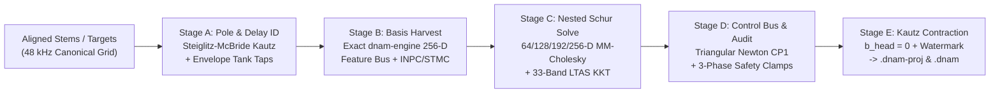

# Five-Stage Analytical Variable-Projection & Cholesky Training Pipeline

This specification defines the **100% pure-Rust (`#![forbid(unsafe_code)]`) 5-Stage (`Stage A`–`Stage E`) Analytical Variable-Projection (`VarPro`), Selective `MM-Cholesky`, and Wide-Significand Gram Contraction Pipeline** in [`packages/capture/`](../../../packages/capture/README.md) (`dnam_capture::solver`), fulfilling [`REQ-1.5`, `REQ-1.8`, `REQ-2.1`, `REQ-4.1`–`REQ-4.3`, `REQ-5.2`](../../requirements/system_goals_and_requirements.md) (see [`../../adr/0008-per-stem-kronecker-statistics-and-wide-gram.md`](../../adr/0008-per-stem-kronecker-statistics-and-wide-gram.md), [`../../adr/0017-pure-rust-analytical-varpro-solver-and-planar-decoupling.md`](../../adr/0017-pure-rust-analytical-varpro-solver-and-planar-decoupling.md), [`../../adr/0018-signal-chain-fixtures-crate-and-whitebox-distillation.md`](../../adr/0018-signal-chain-fixtures-crate-and-whitebox-distillation.md), and [`../../adr/0020-modular-monorepo-and-dnam-proj-container.md`](../../adr/0020-modular-monorepo-and-dnam-proj-container.md)).

---

## 1. Pipeline Overview & Dataflow Topology

`r[train.pipeline.topology]`

`dnam-capture` trains all four nested runtime tiers (`Lite` `64-D` $\subset$ `Full` `128-D` $\subset$ `Pro` `192-D` $\subset$ `Ultra` `256-D`) simultaneously in a **single deterministic analytical pass** (`REQ-4.1`, `REQ-5.2`) without Python, PyTorch, autograd tape allocations, or stochastic gradient descent, staying strictly within `< 64 MiB` working RAM on single-stem/capsule runs (`REQ-4.3`).

---

## 2. Five-Stage Analytical Variable-Projection & Cholesky Solver

### 2.1 Stage A — Steiglitz–McBride Rational Pole & Delay Identification

`r[train.pipeline.stage-a-poles]`

On the aligned `StarCenter` stem (`s = 0`), `Stage A` identifies shared conjugate Kautz modal poles $\lbrace (r_m, \theta_m) \rbrace$ ($r_m \le 0.9995$, `ref[dsp.op-m.stage3.pole-extraction]`) via iterative prefiltered Steiglitz–McBride rational system identification and extracts Stage I / Stage IV fractional delay tap anchors ($\tau_m \ge 4.0$ samples) via coarse-to-fine envelope cross-correlation, clamping every pole and feedback gain into the unconditional BIBO/Lyapunov envelope (`ref[train.audit.phase1.clamp-stability]`).

### 2.2 Stage B — Trajectory Basis Harvesting & Coreset Extraction

`r[train.pipeline.stage-b-harvest]`

Freezing upstream nonlinear/modal recurrences from `Stage A`, `Stage B` steps the **exact** `dnam_engine` operator pipeline (`step_frame_with_feature_bus`) across active stems to harvest the `256-D` physical feature bus $\boldsymbol{\phi}[n] \in \mathbb{R}^{256}$, accumulates tier-ordered `uplo = 'U'` Gram and two-channel cross-correlation statistics, and extracts the `12,000`-frame `fp16` `INPC` dry coreset plus per-stem `STMC` wet coreset, `R <= 36` `16 B` `StmcTrajectoryWindow` records, and `4,096 B` spectral summary (`ref[container.proj.inpc-capsule]`, `ref[container.proj.stmc-capsule]`).

### 2.3 Stage C — Nested 4-Tier Schur-Complement & Selective MM-Cholesky Solve

`r[train.pipeline.stage-c-schur]`

`Stage C` solves the nested `Lite` (`64-D`), `Full` (`128-D`), `Pro` (`192-D`), and `Ultra` (`256-D`) Mid/Side Kronecker output heads simultaneously (`REQ-5.2`, `ADR-0017` Theorems 2 & 5):
1. **Intra-Tier `64-D` Schur-Complement Re-Balancing:** Solves each lower tier's prefix submatrix ($\mathbf{G}_{1:D_T, 1:D_T} + \boldsymbol{\Lambda}_{D_T}$) via `IEEE-754 float64` Cholesky factorization (`solve_uplo_u_cholesky_2ch`) so `Lite`, `Full`, `Pro`, and `Ultra` each independently achieve optimal spectral balance without separate per-tier training jobs.
2. **Psychoacoustic `bESR` + `33`-Band `LTAS` KKT Projection:** Weights normal equations across the 4th-order Bézout `LF`/`MF`/`HF` bands (`ref[qual.besr.bezout-crossover]`) and enforces `33`-band `1/3`-octave `LTAS` tilt bounds (`ref[qual.companion.ltas]`), baking the resulting effective cross-correlation into `STAT` (`ref[container.proj.stat-uplo-u]`).

### 2.4 Stage D — Triangular Newton Control-Bus Projection & Corner Barrier

`r[train.pipeline.stage-d-control]`

Across multi-stem control schedules ($P \ge 1$), `Stage D` fits the `3 kHz` Parametric Control Bus (`CP1` arbitrary-$P$ contributor records, `ref[container.dnam.cp1-profile]`) via exact interpolation on the triangular Newton / Gauss–Lobatto basis (`Mode-0` locked at `StarCenter`), prunes below-floor `2D` interaction terms, and executes the non-stop 3-Phase Control-Space Audit (`[CLAMP-RANGE]`, `[CLAMP-SWITCH]`, `[CLAMP-STABILITY]`, Phase-2 corner barrier & `2,048`-sample `PolyADAA` rail occupancy check, and Phase-3 dynamic/head-gain certification; `ref[train.audit.phase1.clamp-stability]`).

### 2.5 Stage E — Rank-1 Kautz Contraction, Zero-DC Enforcement & Container Packing

`r[train.pipeline.stage-e-pack]`

`Stage E` executes Rank-1 static Kautz readout contraction ($\tilde{\mathbf{G}}_0 = \mathbf{P}_c^\top \mathbf{G}_0 \mathbf{P}_c$, `ADR-0017` Theorem 6), hard-zeroes all output-head DC bias slots (`b_head = 0.0`, `[STAB-ZERO-DC]`), computes exact `tier_gain_trim_lin` loudness matching (`0.00 dB` inter-tier step), applies optional Mechanism A $\to$ Mechanism B watermarking (`ref[sec.watermark.reciprocal-gauge]`), certifies the 4-metric perceptual suite (`bESR`, `MR-IIR`, `LTAS`, `SegESR`), and emits the `64 B`-aligned `v2.0` `.dnam-proj` (`DNPJ`) and runtime `.dnam` (`DNAM`) containers.

---

## 3. Wide-Significand Gram Contraction & Cross-Platform Accuracy

1. `r[train.gram.accuracy-contract]` **`IEEE-754 float64` & Deterministic Contraction Contract (`REQ-4.2`):** Every `uplo = 'U'` Gram matrix $\mathbf{G} = \sum_{n=0}^{N-1} w_n \boldsymbol{\phi}[n]\boldsymbol{\phi}[n]^\top$ and target cross-correlation $\mathbf{C} = \sum_{n=0}^{N-1} w_n \boldsymbol{\phi}[n]\mathbf{y}[n]^\top$ satisfies entrywise error bound $\lvert \hat{g}_{ij} - g_{ij} \rvert \le \gamma_N \sum_{n=0}^{N-1} w_n \lvert \phi_i[n] \phi_j[n] \rvert$ in `IEEE-754 float64` without `float32` normal-equation overflow or subblock underflow, binding the input stream to the `DNAM-GRAM-INPUT-v2` `SHA-256` fingerprint (`compute_gram_input_fingerprint`).
2. `r[train.gram.wide192]` **192-Bit Wide-Significand Exact/Compensated Accumulator (`ADR-0008`):** For high-dynamic-range or multi-million-sample stems where cancellation spans $> 53$ bits of exponent range (e.g. $[1, 2^{-25}, -1]$), wide-significand (`192-bit` integer limb / Priest-compensated) accumulation preserves cross-platform reproducibility across `ARM64`, `x86_64`, and `WASM` workers before rounding once to `float64`.

---

## 4. Engine-Capture Isomorphism, Control Dispatch & Fixture Certification

### 4.1 Zero-ULP Engine-Capture Isomorphism Parity

`r[train.pipeline.isomorphism-parity]`

Because `dnam-capture` links `dnam-engine` directly and harvests features through the runtime's own `DnamEngine` / `StagePipeline` kernels, exporting `WGHT` from `.dnam-proj` via `export_runtime_dnam` and stepping `DnamEngine` reproduces the trainer's predicted waveform to `0 ULP` (on scalar/matched SIMD backends) and `bESR <= -60 dB` on structural `TORA` isomorphism oracles (`Oracle-01..03`).

### 4.2 Closed-Form Control-Dispatch Normal Equations

`r[train.pipeline.dispatch-solve]`

Given per-stem feature Gram matrices $\mathbf{G}_s \in \mathbb{R}^{D \times D}$, cross-correlations $\mathbf{C}_s \in \mathbb{R}^{D \times C_{\text{out}}}$, and evaluated `3 kHz` control-basis vectors $\boldsymbol{\psi}_s \in \mathbb{R}^K$, the joint bilinear Kronecker head normal matrix assembles in closed form without re-streaming audio frames (`ref[train.resume.kronecker-reassembly]`):
$$\mathbf{H}_{\text{kron}} = \sum_{s \in \mathcal{S}_{\text{enabled}}} \big(\boldsymbol{\psi}_s \boldsymbol{\psi}_s^\top\big) \otimes \mathbf{G}_s + \boldsymbol{\Lambda}_{\text{kron}}, \qquad \mathbf{B}_{\text{kron}} = \sum_{s \in \mathcal{S}_{\text{enabled}}} \boldsymbol{\psi}_s \otimes \mathbf{C}_s$$

### 4.3 Four-Tier Signal-Chain Fixture Matrix & White-Box Runners

`r[train.pipeline.fixtures-matrix]`

`packages/capture` verifies end-to-end solver fidelity against [`packages/fixtures/`](../../../packages/fixtures/README.md) (`fixtures <- capture` `[dev-dependencies]` only, `ADR-0018`) across four automated verification tiers:
1. **Tier 1 (`3` Structural Isomorphism Oracles, `Oracle-01..03`):** `256-D` Schur + gauge recovery, arbitrary-$P$ `CP1` (`P = 6`, `P = 16`), and zero-WAV `.dnam-proj` capsule vault editing.
2. **Tier 2 (`12` `4x`-Oversampled Physical Signal-Chain Archetypes, `Chain-01..12`):** Clean preamp, overdrive, fuzz/wavefolder, compressor, zero-latency `4x12` cab, wah/phaser, octave/ring-mod, chorus/TZF, tape/BBD echo, spring/hall reverb, granular shimmer/freeze, and full `4CM`/`WDW` multi-control rigs.
3. **Tier 3 (`14` Composable Hardware Fault Decorators, `Cases #1..#26`):** ADC clipping/pads, converter loopback lag, human knob trajectories, thermal hysteresis, pot tapers, polarity inversion/DC offset, mains hum/hiss, noise gates, spring chirp, digital bit-crush quirks, scratchy pots, idle squeal, and microphone capsule clipping.
4. **Tier 4 (`DNWB` Out-of-Process White-Box Runners & Multi-Rate / 5-Bit-Depth Certification):** `FaustRunner` + `SpiceRunner` subprocess pipes and `32 / 44.1 / 48 / 88.2 / 96 / 192 kHz` $\times$ `Int12 / Int16 / Int24 / Int32 / Float32` 4-metric certification.
