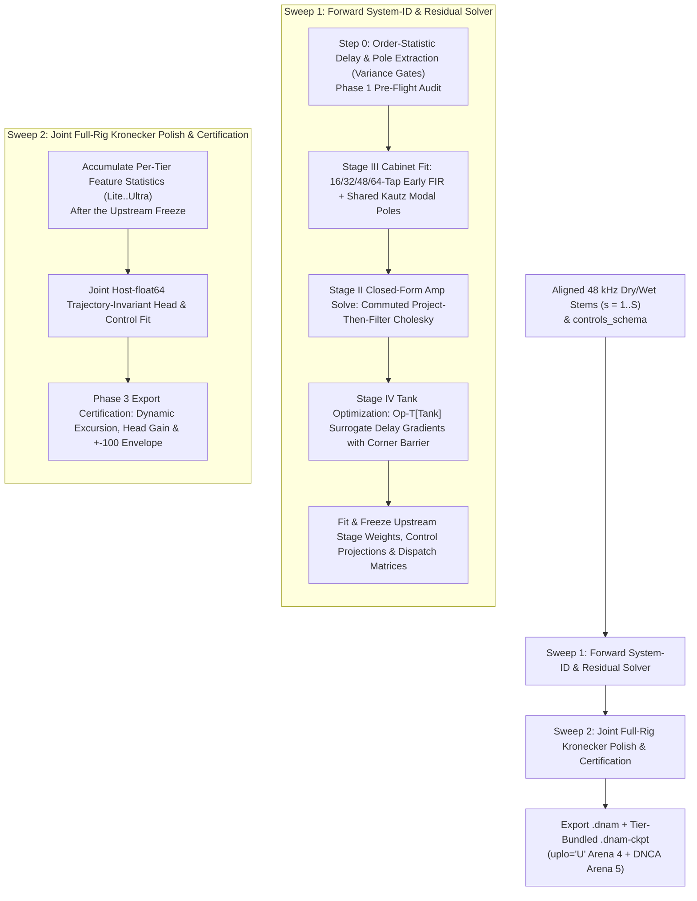
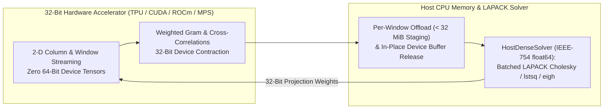

# Two-Sweep Block-Coordinate Cholesky Training Pipeline & Accelerator Numerics

This specification defines the **Two-Sweep Block-Coordinate Cholesky Training Pipeline** and the **Accelerator-First 32-Bit Device Streaming + `float64`-Grade Gram Contraction + Batched Host-`float64` Solver Architecture** of **Dynamic Neural Audio Modeler (DNAM)** ([`packages/engine/`](../../../packages/engine/README.md), [`packages/trainer/src/dnam_trainer/training/`](../../../packages/trainer/README.md), [`tora_architecture.md`](../architecture/tora_architecture.md), [`ADR-0008`](../../adr/0008-per-stem-kronecker-statistics-and-wide-gram.md)).

For hardware capture and sub-sample latency alignment, see [`capture_and_alignment.md`](capture_and_alignment.md). For stem expansion and caching, see [`iterative_resume_and_caching.md`](iterative_resume_and_caching.md). For the Non-Stop 3-Phase Control-Space Audit and registry, see [`control_space_audit.md`](control_space_audit.md).

---

## 1. End-to-End Two-Sweep Pipeline Topology

`r[train.pipeline.topology]`

---

## 2. Two-Sweep Block-Coordinate Cholesky Training Pipeline

### 2.1 Sweep 1 — Forward System-ID & Canonical Residual Solver

`r[train.pipeline.sweep1]`

Sweep 1 operates on aligned `48 kHz` working audio and controls (`sample_rate_train_hz = 48000`, with `FullBand64Tap` parallel alignment and `200 Hz` TPT LR4 crossover where configured):

1. `r[train.pipeline.sweep1-step0]` **Step-0 Observable Extraction & Phase-1 Audit:**
   - Extracts sorted delay times $\tau_{0,1} < \dots < \tau_{0,M}$ and modal pole frequencies across stems.
   - Evaluates Step-0 Physical Variance Gates $\mathbf{G}_p \in \lbrace 0, 1 \rbrace$ and executes Phase 1 of the Non-Stop Control-Space Audit (`[CLAMP-RANGE]`, `[CLAMP-SWITCH]`, `[CLAMP-STABILITY]`).
2. `r[train.pipeline.sweep1-stage3]` **Stage III Cabinet Acoustical Fit (`REQ-1.2`):**
   - Fits independent L/R early FIR taps (`16 / 32 / 48 / 64` taps/ch) and shared Kautz modal poles (`4 / 8 / 16 / 32` pairs starting at sample 16) with independent L/R complex readouts ([`../dsp/op_m_modal_kautz.md` §4.1](../dsp/op_m_modal_kautz.md#41-stage-iii-architecture--tier-allocation)).
3. `r[train.pipeline.sweep1-stage2]` **Stage II Closed-Form Commuted Amp Solve:**
   - Solves each commuted sub-stage projection block `W_k^(s)(z_stage)` using the runtime's exact project-then-filter order ($\sum_{p,r} \mathcal{L}_k(u_p z_r)[n] U_{k,r,p,c}$, [`../dsp/op_n_commuted_cascade.md` §3.3](../dsp/op_n_commuted_cascade.md)).
4. `r[train.pipeline.sweep1-stage4]` **Stage IV Spatial Tank Envelope Optimization:**
   - Optimizes Stage IV delay lengths, blended feedback knees, and Givens/Householder mixing angles using Multi-Scale Gaussian Derivative Envelope Surrogates bounded by the stop-gradient corner barrier $\mathcal{L}_{\text{barrier}}$ (converging fractional delay identification within $< 0.05$ samples).
5. `r[train.pipeline.sweep1-freeze]` **Upstream Stage & Control Freeze:**
   - Fits the `16 × 16` base and `16 × 4` `Ultra` delta stage-dispatch matrices (preferring stage-control coordinates before base head-coordinate columns) and freezes all upstream stage weights and stage-coupled control projections prior to Sweep 2 statistics accumulation.

### 2.2 Sweep 2 — Joint Full-Rig Kronecker Polish & Export Certification

`r[train.pipeline.sweep2]`

1. `r[train.pipeline.sweep2-stats]` **Per-Tier Feature Statistics Accumulation (`Arena 4`):**
   - After the upstream freeze, evaluates each effective tier's trajectory (`Lite` `64-D`, `Full` `128-D`, `Pro` `192-D`, `Ultra` `256-D`) in a single statistics sweep and streams `uplo='U'` Gram and target cross-correlation records ([`../containers/checkpoint_and_cache_format.md` §2](../containers/checkpoint_and_cache_format.md#2-tier-ordered-column-major-upper-triangular-packing-uplou-for-mathbfg_textaudios)).
2. `r[train.pipeline.sweep2-solve]` **Joint Host-`float64` Head & Control Solve:**
   - Solves the block-diagonal lower-triangular Kronecker head weights and biases across all active tiers on the host CPU in `IEEE-754 float64`, preserving upstream trajectory invariance (`< -45 dB` synthetic polish ESR).
3. `r[train.pipeline.sweep2-certify]` **Phase-3 Export Certification:**
   - Audits `[CLAMP-DYNAMIC]` ($\tau_{\min} \ge 4.0\text{ samples}$, $r_c \le 0.9995$), `[CLAMP-HEAD-GAIN]` ($\le +6.0\text{ dB}$), and `[NUMERIC-ENVELOPE]` ($\ge \pm 100.0$ unclipped input/output operating range), plus per-output `bESR` / `MR-STFT` / `LTAS` / `SegESR` and monotone adjacent-tier non-regression ([`../architecture/psychoacoustic_quality_and_tiers.md` §4](../architecture/psychoacoustic_quality_and_tiers.md#4-canonical-4-tier-quality-benchmark-matrix)).

---

## 3. Accelerator-First 32-Bit Execution, Gram Accuracy & Streaming

1. `r[train.gram.device-32bit]` **Zero 64-Bit Device Tensors:** All bulk $O(L)$ filtering, FFT band projections, nonlinear waveshaping, and Gram contractions execute on the accelerator using 32-bit or narrower device tensors (`float32`, `int32`, `bool`, `complex64`).
2. `r[train.gram.window-streaming]` **2-D Column/Window Streaming (`< 32 MiB` Staging, `< 8 GiB` Host Ceiling, `REQ-4.3`):** Streams wide feature designs in bounded windows and column tiles, releasing device buffers immediately after each window offload.

### 3.1 Weighted Gram Accuracy Contract

`r[train.gram.accuracy-contract]`

For selected `binary32` inputs $a_n, b_n$ and nonnegative `binary32` weights $w_n$ ($1 \le N < 2^{53}$, $u = 2^{-53}$, $\gamma_N = Nu/(1 - Nu)$), define the exact contraction $g = \sum_{n=1}^N w_n a_n b_n$ and absolute sum $S = \sum_{n=1}^N |w_n a_n b_n|$. Every nonzero weighted `binary32` product is an integer multiple of $2^{-447}$ with magnitude below $2^{437}$, so it never underflows or overflows `binary64`. The stored host `float64` statistic $\hat g$ must satisfy:
$$|\hat g - g| \le \gamma_N S \quad (\text{binary32 inputs}), \qquad |\hat g - g| \le \gamma_N S + 2^{-1075} \quad (\text{binary64 inputs})$$

### 3.2 Exponent-Aware Gram Accumulation

`r[train.gram.exponent-aware]`

To satisfy §3.1 on 32-bit-only accelerators without subblock-maximum underflow or `int32` symmetry-fold overflow:
- `r[train.gram.radix256]` **Fixed-Anchor Radix-256 Digit Decomposition:** Express `binary32` $a_n w_n$ in units of $2^{-304}$ (at most `70` signed radix-256 digits in `[-255, 255]`) and $b_n$ in units of $2^{-152}$ (at most `35` signed digits), accumulating `128`-row chunks (`< 2^23`) into 16-bit limbs stored in `int32` words (`56` limbs = `896` bits) before a single `RNE` `float64` rounding on the host.
- `r[train.gram.wide192]` **Wide-Significand (`192`-Bit) Streaming & Single-Sweep Range Triage:** Accumulate exact `159`-bit triple products into a signed `192`-bit significand (`8 × 24-bit` limbs in `int32`) plus a `16`-bit exponent (`36 B`/entry, $Q_N = (N-1)2^{-192}/(1 - (N-1)2^{-192}) < 2^{-138}$):
  $$|\hat g - g| \le \big(u + (1 + u)Q_N\big)S + 2^{-1075}, \qquad S_{\mathrm{bound}} = N 2^{e_a + e_b + e_w}, \qquad B = 2N(N-1)2^{e_a + e_b + e_w - 192}$$
  With $I = [g_{\mathrm{wide}} - B, g_{\mathrm{wide}} + B]$, an interval wholly inside $(-T, T)$ ($T = 2^{1024} - 2^{970}$) certifies a finite `binary64` result, while intersection with $(-U, U)$ ($U = 2^{-1022} - 2^{-1075}$) flags potential underflow.
- `r[train.gram.group-merge]` **Disjoint Group Merging & Factor Assembly Bounds:** For $K$ disjoint `binary64`-rounded groups or post-hoc factors $h_i$:
  $$|\hat g - g| \le \gamma_K S + K(1 + \gamma_{K-1})2^{-1075}, \qquad \left|\hat A - \sum_{i=1}^K h_i g_i\right| \le \gamma_{K+1} \sum_{i=1}^K |h_i| S_i$$

---

## 4. Trainer–Engine Isomorphism Protocol & Closed-Form Normal Equations

### 4.1 Trainer–Engine Parity Conditions

`r[train.pipeline.isomorphism-parity]`

By Theorem 1 ([`../dsp/op_n_commuted_cascade.md` §3](../dsp/op_n_commuted_cascade.md#3-exact-lti-basis-commutativity-theorem-theorem-1)), constant projection matrices commute with causal LTI filters in exact arithmetic, while automated controls filter the product columns `L_k(u_p z_r)[n]` to match the runtime's project-then-filter execution order.

### 4.2 Dual-Execution Operation Matrix

`r[train.pipeline.dual-execution-matrix]`

| Stage / Component | PyTorch Training Operation (`packages/trainer/`) | Rust SIMD Inference Operation (`packages/engine/`) |
| :--- | :--- | :--- |
| **Stage I (`Op-T/M/N[Pre]`)** | Forward-faithful `T1` tracker, `H1` Hilbert pair, centered `M=2` grains, and fixed-hertz ZOH bitcrusher with surrogate backward gradients | 4-lane SIMD `Op-T`, `Op-M`, and `Op-N` kernels (`0 FDIV`, `0 FSQRT`, `0 libm`) |
| **Stage II (`Op-N` Cascade)** | Product-column LTI filtering `L_k(u_p z_r)[n]` + host `float64` Cholesky solve | `3 kHz` bilinear matrix fold `W_k^(s)(z_stage)` + per-sample commuted projection `v_k[n] = u_nl[n] W_k[n]` |
| **Stage III (`Op-M` Cabinet)** | Two-step warped Laguerre/Kautz shared-pole extraction + L/R readout solve | Separate 64B-aligned L/R early FIR (`16..64` taps) + 8-vector SoA Kautz modal blocks (`4..32` pairs) |
| **Stage IV (`Op-T` Tank)** | Multi-scale Gaussian envelope delay surrogate + stop-gradient corner barrier | Partitioned `fp16` delay/all-pass rings + Givens/Householder mixing + blended knee & grouped max-tree guard |
| **Output Head (`256-D` Mid/Side)** | Joint tier-aware host `float64` solve over `Arena 4` `uplo='U'` statistics | `3 kHz` SVD mode collapse (`D_h = 4` in `Lite..Pro`, `8` in `Ultra`) + `2 × D` SIMD dot-product |

### 4.3 Host `float64` Fit for Base & Ultra Stage Dispatch (`16 × 20` & `4 × 4`)

`r[train.pipeline.dispatch-solve]`

Before the final Sweep 2 statistics pass, fit the shared `16 × 16` base dispatch matrix $\mathbf{W}_{\text{ctrl}}$ and the `Ultra`-only `16 × 4` delta $\mathbf{W}_{\text{ctrl},\Delta}^{\text{ultra}}$ ([`../dsp/parametric_control_bus.md` §3.1](../dsp/parametric_control_bus.md#31-stage-parameter-dispatch-matrix-mathbfw_textctrl)) in host `float64`. For observation $i$ with effective-tier bus $\mathbf{q}_i \in \mathbb{R}^{16}$, extra `Ultra` stage coordinates $\mathbf{h}_i \in \mathbb{R}^4$ ($\mathbf{h}_i = \mathbf{0}$ for `Lite..Pro`), target $\boldsymbol{\theta}_i \in \mathbb{R}^{16}$, nonnegative weight $w_i$, and positive diagonal regularizer $\mathbf{R} \in \mathbb{R}^{20 \times 20}$:
$$\tilde{\mathbf{q}}_i = \big[\mathbf{q}_i^\top, \mathbf{h}_i^\top\big]^\top \in \mathbb{R}^{20}, \qquad \tilde{\mathbf{W}} = \big[\mathbf{W}_{\text{ctrl}} \quad \mathbf{W}_{\text{ctrl},\Delta}^{\text{ultra}}\big] \in \mathbb{R}^{16 \times 20}$$
$$\mathbf{G} = \sum_i w_i \tilde{\mathbf{q}}_i \tilde{\mathbf{q}}_i^\top + \mathbf{R}, \qquad \mathbf{C} = \sum_i w_i \tilde{\mathbf{q}}_i \boldsymbol{\theta}_i^\top, \qquad \mathbf{G} \tilde{\mathbf{W}}^\top = \mathbf{C}$$
When the base matrix is frozen, fit $\mathbf{W}_{\text{ctrl},\Delta}^{\text{ultra}}$ alone against the residual targets $\boldsymbol{\theta}_i - \mathbf{W}_{\text{ctrl}}\mathbf{q}_i$ using the analogous `4 × 4` regularized Cholesky solve over $\mathbf{h}_i$.
