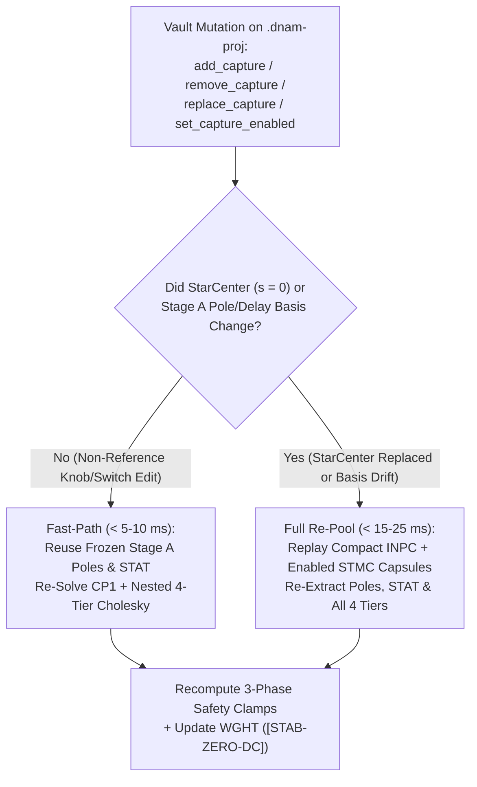

# Capture Vault Editing, Capsule Persistence & Cloud Sync Protocol

This specification defines **non-destructive `.dnam-proj` (`DNPJ`) Capture Vault stem editing (`add_capture`, `remove_capture`, `replace_capture`, `set_capture_enabled`), Two-Path compositional re-solving, compact `INPC`/`STMC` capsule persistence, and `HTTP Range` cloud object-storage synchronization** in [`packages/capture/`](../../../packages/capture/README.md) (`dnam_capture::proj::vault`), fulfilling [`REQ-3.1`–`REQ-3.3`, `REQ-4.3`, `REQ-5.3`](../../requirements/system_goals_and_requirements.md) (see [`../../adr/0008-per-stem-kronecker-statistics-and-wide-gram.md`](../../adr/0008-per-stem-kronecker-statistics-and-wide-gram.md), [`../../adr/0017-pure-rust-analytical-varpro-solver-and-planar-decoupling.md`](../../adr/0017-pure-rust-analytical-varpro-solver-and-planar-decoupling.md), and [`../../adr/0020-modular-monorepo-and-dnam-proj-container.md`](../../adr/0020-modular-monorepo-and-dnam-proj-container.md)).

---

## 1. Single-Project Capture Vault Editing & Compositional Re-Solve

### 1.1 Factored-Kronecker Sufficient-Statistic Reassembly

1. `r[train.resume.kronecker-reassembly]` **Closed-Form Multi-Tier Kronecker Reassembly (`REQ-3.1`, `REQ-5.3`):** By factoring `3 kHz` control-basis coordinates $\boldsymbol{\psi}_s$ from `48 kHz` physical feature statistics (`STAT` + `STMC`, [`../containers/project_container_format.md` §2](../containers/project_container_format.md#2-capture-capsules--compositional-sufficient-statistics)), adding, disabling, removing, or re-recording non-reference control stems updates all active tiers (`Lite` through `Ultra`) in a single invocation via $\sum_{s \in \mathcal{S}_{\text{enabled}}} (\boldsymbol{\psi}_s \boldsymbol{\psi}_s^\top) \otimes \mathbf{G}_{s,T}$ without separate per-tier training jobs.
2. `r[train.resume.constant-factor-records]` **Stationary Control-Setting Stem Records:** Stems recorded at stationary knob and switch coordinates $(\mathbf{u}_s, \boldsymbol{\sigma}_s)$ contract once into tier-ordered `uplo = 'U'` `(G_{s,T}, C_{s,T})` statistics and re-combine algebraically whenever `CP1` Newton/Lobatto control nodes expand (`P -> P + 1` or new Lobatto interior points).
3. `r[train.resume.time-varying-records]` **Time-Varying Trajectory & Transition Stems:** Dynamic sweep, commutator, and freeze-transition stems evaluate $\boldsymbol{\psi}_s[k]$ at the `3 kHz` control stride over the `INPC` coreset and the `R <= 36` `16 B` `StmcTrajectoryWindow` records (`ref[container.proj.stmc-capsule]`) so time-varying modulation and hysteresis are preserved without retaining multi-megabyte raw WAV files.

### 1.2 Two-Path Vault Editing & Dependency Digests

1. `r[train.resume.two-tier-execution]` **Two-Path Compositional Vault Execution (`< 5–10 ms` Fast-Path vs. `< 15–25 ms` Full Re-Pool):**
   - **Path 1 — Fast-Path (`< 5–10 ms`):** When `extracted_physics` (`Stage A` poles and delay taps) and the `StarCenter` reference stem remain valid, `add_capture`, `remove_capture`, `replace_capture`, and `set_capture_enabled` harvest only newly added/replaced stem capsules against the frozen upstream basis, recompute `recompute_vault_phase1_audit_and_clamps` across currently enabled stems, and re-solve `CP1` + nested 4-tier `WGHT` weights in `< 5–10 ms`.
   - **Path 2 — Full Re-Pool (`< 15–25 ms`):** When `StarCenter` is replaced or a new capture invalidates the upstream pole/delay basis, the vault automatically re-runs `Stage A`–`Stage E` directly over the embedded `INPC` and enabled `STMC` capsules in `< 15–25 ms`—never requiring external WAV files.
2. `r[train.resume.dependency-digests]` **Cryptographic Provenance & Dependency Invalidation (`REQ-3.2`):** Every `StemRegistryEntry` binds dry/wet PCM `SHA-256` digests, sample rate, bit depth, sub-sample lag, converter gain, and the `DNAM-GRAM-INPUT-v2` `SHA-256` fingerprint (`ref[container.proj.jcs-manifest]`). Statistics reuse is permitted if and only if upstream stage parameters, filter versions, and dependency digests match identically; any mismatch automatically triggers capsule replay rather than combining stale statistics.
3. `r[train.resume.old-stem-nonregression]` **Unchanged-Stem Non-Regression Guarantee (`REQ-3.1`):** Expanding a `.dnam-proj` vault with additional knob settings or discrete switch positions (with `StarCenter` anchored at `Mode-0`) preserves `StarCenter` and previously captured stem `bESR` within tier certification tolerances without tone drift.

### 1.3 Bounded Windowed Statistics Refresh

`r[train.resume.windowed-refresh]`

When target weighting (`LTAS` / `bESR` crossover parameters) or upstream stage coefficients change during full re-pooling or raw `SPCM` replay, feature streaming executes in bounded windows (`<= 4,096` frames per chunk) keeping transient working memory strictly `< 32 MiB` (`REQ-4.3`) and verifying the replayed `DNAM-GRAM-INPUT-v2` digest before committing updated `STAT` and `WGHT` chunks.

---

## 2. Compact Capsule Vault Persistence

`r[train.cache.proj-vault]`

All reusable calibration (`CALB`), excitation (`INPC`), per-stem response (`STMC`), `StarCenter` statistics (`STAT`), and runtime model (`WGHT`) state resides inside the single `.dnam-proj` (`DNPJ`) file (`ref[container.proj.lifecycle-states]` and `REQ-3.3`):
- Calling `compact_to_capsules` strips raw `SPCM` WAV chunks in `< 1 ms` once `INPC` + `STMC` capsules are verified, reducing typical multi-knob project size by `> 10x` while preserving full non-destructive `add_capture`, `remove_capture`, `replace_capture`, `set_capture_enabled`, and `< 0.2 ms` `export_runtime_dnam` (which strips all training-only `CALB`/`INPC`/`STMC`/`STAT` chunks from the exported `.dnam` runtime file).

---

## 3. Cloud Object-Storage Sync & Remote Job Protocol

`r[train.cloud.job-protocol]`

Because `.dnam-proj` front-loads its `64 B` Preamble, `64 B * N` Chunk Directory (with per-chunk `SHA-256` + `CRC32C`), and RFC 8785 JCS Manifest at byte `0` (`ref[container.proj.preamble-and-directory]`), cloud storage and remote worker coordination (`Cloudflare Workers`, `Durable Objects`, `R2`, and `TiDB`) operate directly on content-addressed chunks without unpacking multi-file archives:
1. **Single-Request Metadata Inspection:** Clients and edge workers issue `HTTP Range: bytes=0-65535` (`parse_proj_manifest_range`) to read project metadata, control schemas, `audit_report`, and the complete `ProjChunkDirEntry` `SHA-256` table in one round-trip.
2. **Delta Chunk Upload / Download & Remote Distillation:** When syncing a vault edit or dispatching heavy `DNWB` white-box SPICE/Faust distillation jobs to remote workers, only chunks whose `sha256` digest is absent on the peer (`STMC`, `STAT`, `WGHT`, `AUTH`) are transferred over `HTTP Range` / multipart object puts, reassembling a verified `64 B`-aligned `.dnam-proj` container at commit time.
