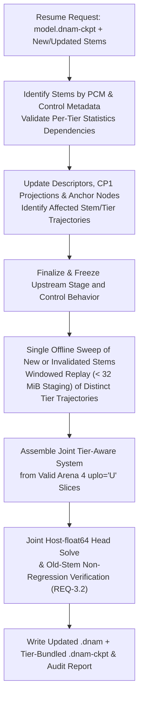
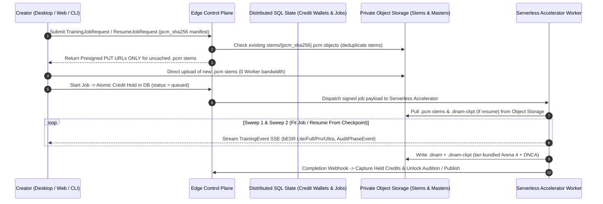

# `.dnam-ckpt` Two-Tier Iterative Stem Expansion, Calibration Caching & Cloud Trainer

This specification defines the **Single-Checkpoint (`.dnam-ckpt`) Two-Tier Iterative Stem Expansion protocol, Two-Tier Calibration Persistence (`Arena 5` `DNCA` + `.dnam-cache` workspace sidecar), and Serverless Cloud Trainer Architecture** of **Dynamic Neural Audio Modeler (DNAM)** ([`REQ-3.1`–`REQ-3.3`](../../requirements/system_goals_and_requirements.md#4-goal-3--progressive-model-refinement--low-memory-caching), [`REQ-5.3`](../../requirements/system_goals_and_requirements.md#6-goal-5--single-run-slimmable-multi-tier-architecture-lite--full--pro--ultra)).

For the binary wire layout of `.dnam-ckpt`, `Arena 4` (`uplo='U'`), and `Arena 5` (`DNCA`), see [`../containers/checkpoint_and_cache_format.md`](../containers/checkpoint_and_cache_format.md). For why pre-summed Kronecker matrices fail on stem additions, see [`../../adr/0008-per-stem-kronecker-statistics-and-wide-gram.md`](../../adr/0008-per-stem-kronecker-statistics-and-wide-gram.md). For the Two-Sweep Block-Coordinate Cholesky training pipeline, see [`four_stage_pipeline.md`](four_stage_pipeline.md).

---

## 1. Single-Checkpoint (`.dnam-ckpt`) Two-Tier Iterative Stem Expansion

`r[train.resume.kronecker-reassembly]`

A single incremental resume invocation updates all active tiers (`Lite` through `t_max`) from one `.dnam-ckpt` checkpoint in a single offline statistics sweep over new or statistics-invalidated stems (`REQ-3.1`, `REQ-5.3`):

By storing per-stem, per-tier statistics $\mathbf{G}_{s,T}$ and $\mathbf{C}_{s,T}$ in `Arena 4` ([`../containers/checkpoint_and_cache_format.md` §2](../containers/checkpoint_and_cache_format.md#2-tier-ordered-column-major-upper-triangular-packing-uplou-for-mathbfg_textaudios)), unchanged stems with constant-per-stem head factors reassemble in closed form without re-evaluating their audio trajectories:
$$\mathbf{G}_{T,\text{updated}} = \sum_{s=1}^{S + S_{\text{new}}} \mathbf{G}_{s,T} \otimes \Big(\tilde{\boldsymbol{\psi}}_{s,T}^{\text{new}} \big(\tilde{\boldsymbol{\psi}}_{s,T}^{\text{new}}\big)^\top\Big), \qquad \mathbf{C}_{T,\text{updated}} = \sum_{s=1}^{S + S_{\text{new}}} \mathbf{C}_{s,T} \otimes \tilde{\boldsymbol{\psi}}_{s,T}^{\text{new}}$$

1. `r[train.resume.constant-factor-records]` **Constant-Factor Objective Records:** For processed design rows $\mathbf{x}_n$, scalar target $y_n$, and nonnegative weights $w_n$, store:
   $$\mathbf{G} = \sum_n w_n \mathbf{x}_n \mathbf{x}_n^\top, \qquad \mathbf{c} = \sum_n w_n \mathbf{x}_n y_n, \qquad e = \sum_n w_n y_n^2$$
   so any candidate head vector $\boldsymbol{\beta}$ has exact quadratic residual $\boldsymbol{\beta}^\top \mathbf{G} \boldsymbol{\beta} - 2\boldsymbol{\beta}^\top \mathbf{c} + e$, folding constant stem control and width factors at solve time.
2. `r[train.resume.time-varying-records]` **Time-Varying Objective Records:** When head controls or stereo width vary within a stem, freeze their trajectories before the statistics sweep and accumulate the processed product design rows $\phi_i[n] z_j[n]$ directly (with linear band filters applied to the complete product time series prior to sample selection).

### 1.1 Two-Tier Resume Execution & Objective Evaluation

`r[train.resume.two-tier-execution]`

1. **Tier 1 — Factorized-Kronecker Control & Head Update:** Freezes upstream stage/control behavior, refreshes only new or invalidated `(stem, tier)` slices in one windowed sweep (§1.3), solves the joint host-`float64` system using the quadratic identity $\Vert \mathbf{\Phi}_{s,T}\mathbf{W} - \mathbf{Y}_s \Vert_F^2 = \mathrm{tr}(\mathbf{W}^\top \mathbf{G}_{s,T}\mathbf{W}) - 2\mathrm{tr}(\mathbf{W}^\top \mathbf{C}_{s,T}) + \Vert \mathbf{Y}_s \Vert_F^2$, and verifies old-stem non-regression (`REQ-3.2`).
2. **Tier 2 — Warm-Started Backbone Fine-Tuning:** When upstream stage weights are warm-started and refined before the statistics sweep, refreshes the affected `(stem, tier)` statistics during that single sweep and polishes the joint head.

### 1.2 Conditions for Old-Stem Trajectory & Arena 4 Gram Reuse on Stem Resume (`REQ-3`)

`r[train.resume.dependency-digests]`

Each `(stem, tier)` entry in `stems_registry` tracks three separate dependency digests (excluding any tier $> T$ data so higher-tier updates never invalidate lower tiers):
1. **Trajectory Dependencies:** Input PCM, aligned control/switch event timelines, initial state, sample rate, effective tier, routing (`FullBand64Tap` alignment, `LR4` crossover, send-safe/downstream partition), `Stage I` `H1`/`T1` histories, upstream stage weights, and dispatched stage parameters `θ_0..θ_14`.
2. **Gram Dependencies:** Trajectory digest + feature preprocessing, sample selection/weights, Gram accumulation semantics, and the streaming SHA-256 **Gram-input fingerprint** ([`../containers/checkpoint_and_cache_format.md` §3.1](../containers/checkpoint_and_cache_format.md#31-gram-input-fingerprint)).
3. **Cross-Correlation & Certificate Dependencies:** Gram dependencies + target PCM identity, target alignment/preprocessing, and matched noise-floor evidence (`bESR`, `MR-STFT`, `LTAS`, `SegESR`).

`r[train.resume.old-stem-nonregression]` **Old-Stem Non-Regression Verification (`REQ-3.2`):** If a candidate update is not proven bit-identical on an old stem, run a bounded validation-only render (without accumulating a second statistics sweep) and verify zero regression across raw composite/per-band `bESR`, `MR-STFT`, maximum absolute noise-adjusted `LTAS`, excluded-band `LTAS` residuals, and linear `SegESR`.

### 1.3 Windowed Statistics Refresh

`r[train.resume.windowed-refresh]`

Invalidated `(stem, tier)` statistics are refreshed by streaming the stem's input PCM through the frozen effective-tier backbone in bounded windows (`< 32 MiB` staging; full-length feature trajectories are never persisted in `.dnam-ckpt` or `.dnam-cache`):

| Change for `(stem, tier)` | Cached Gram `G` | Cross-Correlation `C` | Refresh Action |
| :--- | :---: | :---: | :--- |
| **Target only** (trajectory, alignment, preprocessing, selection & weights unchanged) | Valid (`Reuse`) | Invalid | Replay trajectory in windows, verify matching SHA-256 Gram-input fingerprint, and accumulate only `C` (`O(L · D)`) + target energies. |
| **Trajectory, alignment, preprocessing, selection, or weights changed** | Invalid | Invalid | Replay trajectory in windows and accumulate both `G` (`O(L · D²)`) and `C`, recording the new Gram-input fingerprint. |
| **All trajectory, target, and weight dependencies unchanged** | Valid (`Reuse`) | Valid (`Reuse`) | Zero replay. |

---

## 2. Two-Tier Calibration Persistence (`Arena 5` `DNCA` & Workspace `.dnam-cache`)

1. `r[train.cache.arena5-dnca]` **Portable Checkpoint `Arena 5` (`DNCA`, `HAS_CALIB_STATS`):** Stores tier-independent calibration records in the shared checkpoint region and tier-dependent records (`INPC` input segmentation/basis Grams and `STMC` alignment, noise-floor, and Stage III FIR/modal extractions) inside their owning tier bundles; stripped automatically on `.dnam` runtime export.
2. `r[train.cache.workspace-sidecar]` **Local Workspace Cache (`models/<id>/.dnam-cache/*.dnce`):** Gitignored, 64-byte-aligned memory-mappable sidecar cache governed by a disk-read vs. compute-regeneration cost model (`16 GB` default quota, `~3 GB` floor).

---

## 3. Serverless Cloud Trainer Architecture

`r[train.cloud.job-protocol]`

| Job Kind (`job_kind`) | Execution Target | Key Architectural Mechanism |
| :--- | :---: | :--- |
| **0. Pre-Flight Phase-1 Control Audit** (`audit_only=True`) | Control-Plane CPU (`< 200 ms`) | Verifies stem coverage & previews `[CLAMP-*]` rules before training |
| **1. Static Snapshot Rig** (`1` Stem, `0` Controls, `Lite..Ultra`) | Hardware Accelerator | Sweep-1 Stage III/II/IV closed-form + residual solve + Sweep-2 `float64` Cholesky polish |
| **2. Full Parametric Multi-Stem Rig** (`Range` & `Switch` Controls) | Hardware Accelerator | Jointly trains all 4 slimmable tiers (`Lite..Ultra`) and populates tier-bundled `Arena 4` statistics |
| **3. Tier-1 `.dnam-ckpt` Stem Expansion** ([§1.1](#11-two-tier-resume-execution--objective-evaluation)) | Hardware Accelerator | Reuses valid per-tier `Arena 4` slices; replays only new/invalidated stems and verifies old-stem non-regression |
| **4. Tier-2 `.dnam-ckpt` Backbone Fine-Tune** | Hardware Accelerator | Warm-starts backbone from `.dnam-ckpt`, refreshes affected statistics in one sweep, and polishes the joint head |
