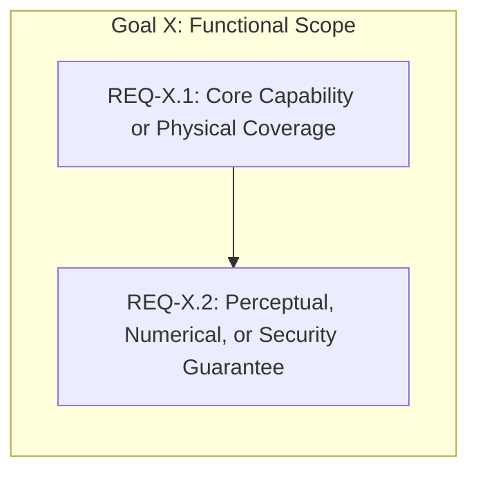

# Requirement Document Template (`docs/requirements/`)

Use this template when authoring or extending implementation-agnostic system goals and functional requirements (`REQ-X.Y`) in [`../requirements/system_goals_and_requirements.md`](../requirements/system_goals_and_requirements.md). See [`../CONTRIBUTING.md`](../CONTRIBUTING.md) for full authoring rules.

> [!IMPORTANT]
> **Implementation-Agnostic Boundary (`ref[repo.docs.requirements-layer]`):**
> Requirements define **what** the system must achieve—never **how** the TORA architecture implements it. Never place container extensions, internal JSON field names, or clamp IDs in requirement prose outside Markdown link targets `](...)`.

---

## Goal X — `<High-Level System Goal Title>` (`REQ-X.1`–`REQ-X.N`)

| Requirement ID | Requirement | Specification |
| :--- | :--- | :--- |
| **`REQ-X.1`** | **`<Short Capability Title>`** | State the observable capability, physical system coverage, accuracy threshold, hardware budget, or security guarantee in implementation-agnostic terms ([`../specs/architecture/tora_architecture.md`](../specs/architecture/tora_architecture.md)). |
| **`REQ-X.2`** | **`<Short Constraint or Boundary Title>`** | Specify measurable acceptance bounds, edge-case behavior, and failure-reporting requirements without referencing internal struct names or file extensions ([`../specs/architecture/project_and_documentation_quality.md`](../specs/architecture/project_and_documentation_quality.md)). |
