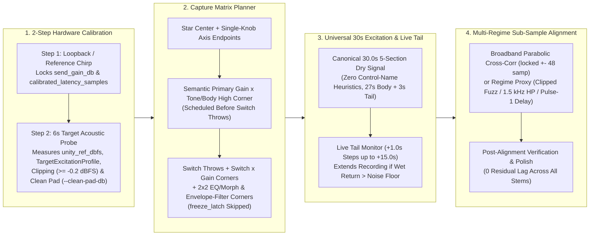
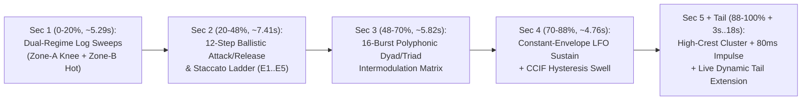

# Hardware Capture, Universal Excitation & Multi-Regime Latency Alignment

This specification defines the **capture-first validation methodology, 2-step hardware calibration, unclipped 32-bit float pad staging, Star/Switch/Corner capture matrix planner, heuristic-free 30.0-second universal excitation, and multi-regime sub-sample latency alignment** for **Dynamic Neural Audio Modeler (DNAM)**.

For the 4-stage training pipeline that consumes aligned stems, see [`four_stage_pipeline.md`](four_stage_pipeline.md). For `.dnam-ckpt` iterative stem expansion and calibration caching, see [`iterative_resume_and_caching.md`](iterative_resume_and_caching.md).

---

## 1. End-to-End Capture & Alignment Pipeline

### 1.1 Capture-First Validation Across All Effect Families

Before running neural model optimization, every hardware capture session validates four physical invariants across all effect classes and complex full rigs (`REQ-1.1`–`REQ-1.8` in [`../overview/system_goals_and_requirements.md` §2](../overview/system_goals_and_requirements.md#2-goal-1--universal-instrument-system--flexible-input-coverage-nonlinear--lti--full-rigs): Nonlinear Preamps/Amps, Wavefolder Fuzzes, LTI Cabinets/Rooms, Resonant Envelope Filters, Delays, Chorus/Flanger Modulation, Multi-Band Crossover Compressors, Diffusive Reverbs, Granular/Shimmer/Freeze, and End-to-End Multi-Block Full Rigs):
1. **2-Step Reference Calibration** locks unclipped `send_gain_db`, `calibrated_latency_samples`, `unity_ref_dbfs`, and `TargetExcitationProfile` without manual guesswork and without artificially backing off `send_gain_db` when a target device compresses or clips.
2. **Capture Matrix Planning** schedules the minimal, physically complete set of `Star` + `Switch` + `2×2 Corner` stems needed to disambiguate coupled controls without relying on control-name heuristics for excitation synthesis.
3. **Universal Excitation & 32-Bit Float Pad Staging (`--clean-pad-db`)** excite the full dynamic, spectral, and temporal range of the circuit with zero ADC return clipping and optimal USB SNR (`-3 dBFS` to `-12 dBFS` raw USB peak).
4. **Multi-Regime Latency Alignment** achieves **`0` residual lag** across all stems (`LP`/`BP`/`HP` filters, comparator fuzzes, bass-boosted amps, slapback/high-feedback/kill-dry delays, and phase-shifted modulation/reverbs).

---

### 1.2 2-Step Hardware Calibration & Clean 32-Bit Float Pad Staging

1. **Step 1 — Loopback & Reference Latency Calibration:**
   Measures the audio interface's deterministic round-trip DAC/ADC latency (`calibrated_latency_samples`) and locks unity reference send gain (`send_gain_db`) and `unity_ref_dbfs`.
2. **Step 2 — Target Acoustic Probe & Unclipped 32-Bit Float Pad Staging (`--clean-pad-db`):**
   Plays a 6.0-second probe through the target hardware at default controls to extract the empirical `TargetExcitationProfile` (decay tail duration, resonant peak $Q$, soft-clipping knee, and autonomous LFO rate) while keeping `send_gain_db` locked to Step 1 so 100% of the device's true gain, compression, and saturation are preserved.
   - If the hardware return approaches ADC full scale ($\ge -0.2\text{ dBFS}$), the calibration workflow alerts the operator with an interactive retry prompt to attenuate the analog return or apply clean digital pad staging (`--clean-pad-db`), restoring the exact inverse gain in 32-bit IEEE-754 float (`f32`) so ultra-hot self-oscillating filter or preamp peaks (e.g., $+20\text{ dBFS}$) are captured with zero ADC clipping.

---

### 1.3 Capture Matrix Planning (`Star`, `Switch` & Coupled-Corner Scheduling)

To disambiguate coupled controls with the minimum number of recordings—and without requiring the operator to flip physical hardware switches back and forth during a session—the capture planner schedules stems in the following deterministic order:

| Stem Schedule Group | Stem Naming Pattern | Physical Purpose & Ordering Rule |
| :--- | :--- | :--- |
| **1. Reference Star Center** | `stem_00_star_center` | Default knob and switch anchor (`u = 0`, auto-unity reference) |
| **2. Single-Knob Axis Sweeps** | `stem_axis_{ctrl}_{min\|max}` | Captures 3-node Lobatto main effects (`{min, default, max}`) for each continuous `range` control |
| **3. Primary High-Pair Corner** | `stem_corner_high_pair` | Pairs the primary gain/drive control with the primary tone/body control at maximum (`default` switch state), scheduled **before** any switch throws |
| **4. Switch Throws & Switch × Gain Corners** | `stem_switch_{sw}_{idx}`, `stem_corner_switch_{sw}_{idx}_{gain}_{min\|max}` | Records each non-default switch state followed immediately by its primary-gain `min`/`max` endpoints so each switch throw has a complete 3-node drive curve (`role = "freeze_latch"` is skipped) |
| **5. Specialized Coupled Corners** | `stem_corner_{c1}_{c2}_...` | Schedules `2 × 2` corners for Dual-Engine Morph controls, Parametric Mid-EQ (`Gain × Freq`), and Resonant Envelope Filters (`Attack × Release`, `Velocity × Cutoff`, and `Mode=BP/HP × Cutoff=min / Resonance=max`) |

---

### 1.4 Heuristic-Free 30.0-Second 5-Section Universal Excitation & Live Tail Extension

Per `REQ-1.6`–`REQ-1.8`, capture excitation synthesis **never** uses control-name or manifest heuristics to branch or alter the dry test signal, ensuring knobless rigs and complex end-to-end multi-block chains (`REQ-1.5`) are excited identically. The canonical **30.0-second (`1,440,000`-sample @ $48\text{ kHz}$, `27.0s` active body + `3.0s` baseline tail)** excitation signal comprises five physical regimes:

| Section | Time Span (`%` of Active Body) | Signal Structure | Physical Identification Target |
| :--- | :---: | :--- | :--- |
| **Section 1** | `0–20%` (`~5.29 s`) | Dual-regime logarithmic sweeps (`20 Hz → 20 kHz`): `~2.38 s` Zone-A (`knee → sat`), `0.37 s` settling gap, `~2.54 s` Zone-B (`sat → 0.98`) hot sweep | Linear frequency response, cabinet/room modal poles, and level-dependent resonant filter trajectories |
| **Section 2** | `20–48%` (`~7.41 s`) | 12-step multi-register ballistic attack/release & staccato re-trigger ladder (`-42 dBFS → 0.98`, `41.2 Hz E1 .. 659.3 Hz E5`) with sub/mid/high crossover anchors (`65, 330, 1320 Hz`), 12-tone Schroeder cluster, rapid double-plucks, and `-46 dBFS` release probes | Envelope-filter ballistics, optical/FET compressor attack/release time constants, and fast transient recovery |
| **Section 3** | `48–70%` (`~5.82 s`) | 16-burst polyphonic dyad/triad saturation & intermodulation matrix (`sat → 0.98` across octaves, 5ths, 4ths, major/minor 3rds, tritones) | Multi-stage tube/transistor intermodulation distortion, octave wavefolding, and power-supply sag |
| **Section 4** | `70–88%` (`~4.76 s`) | `~2.28 s` strictly constant-envelope sustain (`ė_in[n] ≡ 0`) followed by `~2.48 s` dual-regime multitone/CCIF dynamic hysteresis swell (`-48 dBFS → 0.98 → -48 dBFS`) | Isolates autonomous `0.25–10 Hz` Chorus/Flanger/Phaser/Tremolo LFOs from envelope followers, then maps continuous clipping knees |
| **Section 5 + Tail** | `88–100%` (`~3.17 s`) + `3.0 s` Tail (`+0..15 s` Live) | `~1.90 s` broadband high-crest cluster + `80 ms` isolated full-scale (`0.98`) transient impulse followed by `~4.02 s` decay silence | Impulse response, reverb/echo decay `T₆₀`, and stationary per-band silent noise floor measurement |

- **Live Per-Stem Dynamic Reverb Tail Extension (`+0.0 s .. +15.0 s`, `REQ-1.7`):** If a stem's wet return at $30.0\text{ s}$ is still decaying above the pre-roll noise floor, the capture engine automatically extends recording in $1.0\text{ s}$ silent-input increments (up to $+15.0\text{ s}$ extra = $\sim 19.0\text{ s}$ total post-impulse decay) and zero-pads the dry reference in memory to match.
- **Arbitrary User-Supplied Stems (`REQ-1.8`):** The trainer also accepts user-provided dry/wet stems of any duration or musical content, using dynamic-programming regime segmentation ([`four_stage_pipeline.md` §2.3](four_stage_pipeline.md#23-stage-3a--analytical-lti--multi-stage-causal-selective--orthogonal-fft-cascade-core2_active--false)) instead of fixed section offsets.

---

### 1.5 Multi-Regime Sub-Sample Hardware Latency Alignment

Full-duplex USB audio streams can exhibit small per-stem startup jitter ($\pm 1\text{–}48$ samples) around `calibrated_latency_samples`, while extreme fuzz clipping, steep resonant band/high-pass filtering, or loud delay repeats can degrade raw dry-to-wet linear cross-correlation. Alignment resolves exact integer and parabolic sub-sample lag across four physical regimes:

| Hardware Regime | Detection Condition | Alignment Proxy & Verification Rule |
| :--- | :--- | :--- |
| **1. Standard Broadband (`Amps, Drives, Cabs`)** | Broadband dry-to-wet linear correlation `> 0.35` within `locked ± 48` samples | Parabolic sub-sample cross-correlation peak around `locked`; low-pass proxies are excluded so heavy bass boost never locks onto late bass group-delay sidelobes; post-alignment polish is gated on `c_dry > 0.40` so tone-stack phase shifts never move true hardware latency |
| **2. Extreme Gated / Wavefolder Fuzz** | Broadband linear correlation `≤ 0.35` due to comparator squaring or full-wave folding | Falls back to a causal clipped fuzz proxy `LPF_800(tanh(10 * HPF_80(x_dry)))` matching analog fuzz tone-stack group delay (`~9 samples`) |
| **3. Resonant `BP` / `HP` Envelope Filters** | Steep low-frequency rejection or swept high-`Q` passband | Evaluates zero-phase `1.5 kHz` high-pass proxy (`dry_hp` / `burst_dry_hp`) with monotonic boundary slope-following (`1..=16` steps) and polishes residual lag against `star_center` and same-switch reference stems |
| **4. Slapback, High-Feedback & Kill-Dry Delays** | Late echo taps stronger than direct signal, or `100% Mix` kill-dry (`wet_p1_rms < 0.015 * wet_full_rms`) | Locks sub-sample USB jitter on the isolated first alignment chirp onset (`pulse1_onset_window`, `< 12 ms`) before any echo tap arrives; preserves `locked_lag` untouched on `100% Mix` kill-dry stems |
