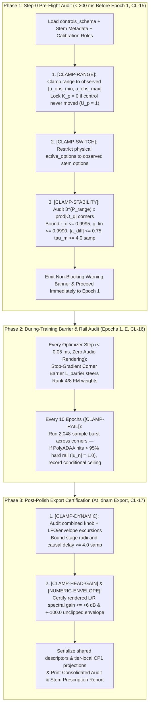

# Non-Stop 3-Phase Control-Space Audit & Clamp Registry (`CL-01`..`CL-20`)

Because neural audio training runs unattended across multi-stem captures, **DNAM never blocks or pauses training on user confirmation prompts**. The **Non-Stop 3-Phase Control-Space Audit & Automatic Clamping Pipeline** enforces all 20 registered stability, control-range, and numeric bounds (`CL-01`–`CL-20`) automatically.



---

## 1. The Non-Stop 3-Phase Control-Space Audit Lifecycle

### 1.1 Phase 1 — Pre-Training Step-0 Audit ($< 200\text{ ms}$ Before Epoch 1, `CL-15`)

1. **`[CLAMP-RANGE]` (Unobserved Range Extrapolation Clamp):** For each continuous `range` control $p$ with `declared_range` $[u_{p,\text{decl-min}}, u_{p,\text{decl-max}}]$ and observed stem span $[u_{p,\text{obs-min}}, u_{p,\text{obs-max}}]$:
   $$u_{p,\text{safe-min}} = \max\big(u_{p,\text{decl-min}},\ u_{p,\text{obs-min}}\big), \qquad u_{p,\text{safe-max}} = \min\big(u_{p,\text{decl-max}},\ u_{p,\text{obs-max}}\big)$$
   If $U_p = 1$ (control never moved across stems), lock polynomial degree to $K_p = 0$.
2. **`[CLAMP-SWITCH]` (Unobserved Switch Option Masking):** Restrict `active_options` of each discrete `switch` control $q$ to options observed on at least one valid recorded frame (`O_{q,obs}`). Hardware roles (including `stereo_mode` and `freeze_latch`) require observed capture evidence; unobserved options remain masked while the declared default serves as the persistent mathematical reference for `CP1` option projections.
3. **`[CLAMP-STABILITY]` (Step-0 Multi-Knob Corner Stability Audit):** Evaluate the Step-0 physical parameter fit across the $3^{P_{\text{range}}} \times \prod_q |\mathcal{O}_{q,\text{obs}}|$ grid of `safe_clamped_range` and `active_options`, applying structured conditional ceilings (`conditional_bounds`) whenever a corner exceeds a stability bound.

### 1.2 Phase 2 — During-Training Stop-Gradient Corner Barrier & Periodic Rail-Lockup Check (`CL-16`)

1. **Stop-Gradient Corner Barrier Loss ($\mathcal{L}_{\text{barrier}}$ at Every Optimizer Step, `CL-16`):**
   $$\mathcal{L}_{\text{barrier}} = \lambda_{\text{bar}} \sum_{(\mathbf{u}_c, \mathbf{s}_c) \in \mathcal{V}_{\text{corners}}} \mathrm{relu}\Big(\mathrm{sg}\big(\boldsymbol{\theta}_{\text{main}}(\mathbf{u}_c, \mathbf{s}_c)\big) + \Delta\boldsymbol{\theta}_{\text{FM}}(\mathbf{u}_c, \mathbf{s}_c) - \boldsymbol{\theta}_{\text{safe}}\Big)^2$$
2. **Periodic Dynamic Rail-Lockup Audit (`[CLAMP-RAIL]`, Every 10 Epochs):** Runs a `2,048`-sample burst through the corners without gradient tracking and records a conditional gain ceiling if cascaded `PolyADAA` stages exceed `95%` rail occupancy ($|u_n| = 1.0$).

### 1.3 Phase 3 — Post-Training & Post-Polish Export Certification Audit (`CL-17`)

1. **`[CLAMP-DYNAMIC]` (Combined Knob + Learned LFO/Envelope Excursion Clamp, `CL-17`):**
   $$r_{c,\text{worst}}(\mathbf{u}, \mathbf{s}) = r_{\text{high},c}(\mathbf{u}, \mathbf{s}) + |\mathbf{w}_{r,c}|^\top \mathbf{m}_{\text{max}} \le 0.9995, \qquad \tau_{m,\text{min}}(\mathbf{u}, \mathbf{s}) = \tau_{0,m}(\mathbf{u}, \mathbf{s}) - |\mathbf{w}_{\tau,m}|^\top \mathbf{m}_{\text{max}} \ge 4.0\text{ samples}$$
   Stage III modal poles are bounded by their shared radial gate $g[n] \in [0, 1]$ and validated endpoint $r_{\text{high},m} \le 0.9995$ ([`../dsp/op_m_modal_kautz.md` §4.1](../dsp/op_m_modal_kautz.md#41-stage-iii-architecture--tier-allocation)).
2. **`[CLAMP-HEAD-GAIN]` (Post-Polish 256-D Mid/Side Kronecker Head Spectral Gain Clamp, `CL-17`):** Evaluates the active tier's rendered L/R audio frequency response and feature-to-output gain ($\le +6.0\text{ dB}$) over the permitted head-control and width domains, retaining the tier-specific head radius after tier stripping.
3. **`[NUMERIC-ENVELOPE]` (Finite-Precision Operating Range Certification, `CL-17`):** Verifies the unclipped $\ge \pm 100.0$ (`+40 dBFS` peak) operating envelope simultaneously across all active audio inputs and outputs with zero representational safety saturation (`REQ-7.1`, [`../overview/tora_architecture.md` §1.2](../overview/tora_architecture.md#finite-precision-range-and-saturation-policy)).

---

## 2. Consolidated Post-Training Audit & Stem Prescription Report

```text
================================================================================
DNAM TRAINING COMPLETE — EXPORTED: model.dnam | model.dnam-ckpt
================================================================================
Active Control Clamps Applied (4):
  1. [CLAMP-RANGE]     'gain': Clamped declared [0.0, 10.0] -> safe [2.0, 8.0]
                       -> Prescription: Add stems at gain=0.0 and gain=10.0
  2. [CLAMP-SWITCH]    'boost': Disabled unobserved option ['ultra'] (active: ['off', 'on'])
                       -> Prescription: Add >= 1 stem with boost='ultra'
  3. [CLAMP-STABILITY] 'feedback': Clamped <= 9.37 when boost='on' (g_lin <= 0.9990)
                       -> Prescription: Add corner stem (feedback=10.0, boost='on')
  4. [CLAMP-DYNAMIC]   'delay_ms': Tightened min 0.00 -> 0.08 (LFO trough >= 4.0 samp)

To refine with these additional stems, run:
  moon run trainer:cli -- --resume model.dnam-ckpt --add-stems stems_extra.json
================================================================================
```

---

## 3. Canonical Clamp & Limit Registry (`CL-01`..`CL-20`)

| Clamp ID | Subsystem & Variable | Mathematical Bound / Law | TORA Realization & Target Modules | Physical / Numerical Purpose |
| :--- | :--- | :--- | :--- | :--- |
| **`CL-01`** | Op-N `PolyADAA` Pre-Activation Input `u_n` | `u_n = clamp((2/3) d x_c[n], -1.0, +1.0)` | Entry of each `Op-N` stage (Stage I Pre-Drive, Stage 2.1–2.3 Nonlinear Cascade); `packages/engine/src/operators/op_n.rs`, `packages/trainer/src/dnam_trainer/dsp/op_n.py` | Bounds cubic/quartic polynomial domain to its monotonic soft-clipping interval `[-1, +1]` with 6-step division-free rail crossing |
| **`CL-02`** | Op-N Passive 1× B-Spline ADAA Blend & AC Coupling | `ỹ_nl = 0.875 A[n] + 0.125 A[n-1]`, `R_ac = 0.9993` | `Op-N` nonlinear basis primitives and inter-stage AC coupling; `packages/engine/src/operators/op_n.rs`, `packages/trainer/src/dnam_trainer/dsp/op_n.py` | Un-delayed linear path + passive B-spline blend and `5.35 Hz` AC coupling (`0 FDIV`) |
| **`CL-03`** | Op-M 3 kHz Algebraic Rotor `u_{rot,c}` | `‖u_{rot,c}‖₂ ≤ 1.0`; zero LFO increment holds state | Quadrant-reduced contractive rotor ([Op-M §1.2](../dsp/op_m_modal_kautz.md#12-contractive-finite-precision-rotor-cl-03)); `packages/engine/src/operators/op_m.rs`, `packages/trainer/src/dnam_trainer/dsp/op_m.py` | Enforces unit-disk contractivity (`< 2.3e-7 rad` error) in `f32` with `0 libm`, `0 FDIV`, `0 FSQRT` |
| **`CL-04`** | Op-M Modal Pole Radii & State Normalization | Stage I `r ∈ [0.25, 0.9995]`; Stage III `0.85 ≤ r_low ≤ r_high ≤ 0.9995`, `γ = √(1 - r_high²)`, `0.5 ≤ b_gamma/γ ≤ 2` | Op-M complex resonant poles ([`op_m_modal_kautz.md` §4.1](../dsp/op_m_modal_kautz.md#41-stage-iii-architecture--tier-allocation)); `packages/engine/src/operators/op_m.rs`, `packages/trainer/src/dnam_trainer/dsp/op_m.py` | Bounds modal decay and normalizes per-impulse state energy outside the real-time loop |
| **`CL-05`** | Op-M Radial Gate `g[n]` | Stage I `g_c = clamp(0.5 + w_sel,c x_c, 0, 1)`; Stage III shared `g = clamp(0.5 + θ_10, 0, 1)` | Convex radial interpolation in Op-M ([`op_m_modal_kautz.md` §4](../dsp/op_m_modal_kautz.md#4-stage-iii--family-6-shared-kautz-modal-bank)); `packages/engine/src/operators/op_m.rs`, `packages/trainer/src/dnam_trainer/dsp/op_m.py` | Bounds gated pole radius within `[r_low, r_high]` prior to optional sweep contraction |
| **`CL-06`** | Op-T Causal Delay Floor & Base-Delay `Range` Slew | Every reader: `τ_m[n] ≥ 4.0 samp` and admitted upper bound; continuous base-delay slew: `∣Δτ_base∣ ≤ 0.25` samp/samp | Integer-plus-`Q0.32` delay reader ([Op-T §1–§2](../dsp/op_t_transport.md#1-model-declared-ring-buffer-addressing--stateless-catmull-rom-reader)); `packages/engine/src/operators/op_t.rs`, `packages/trainer/src/dnam_trainer/dsp/op_t.py` | Preserves 4-tap Catmull-Rom causal margin and bounds continuous base-delay Doppler glide |
| **`CL-07`** | Op-T / Stage IV Discrete `Switch` Dual-Pointer Crossfade `w[k]` | `w[k] = k / (L_xfade - 1)`, `k = 0..L_xfade-1`, `α_xf = 0.5(1 - cos(π w))` | Dual-pointer switch crossfade (`L_xfade = 128` at `48 kHz`, [Op-T §1.3](../dsp/op_t_transport.md#13-dual-mode-runtime-delay-transitions-range-slew-vs-switch-crossfade-cl-06-cl-07)); `packages/engine/src/operators/op_t.rs`, `packages/trainer/src/dnam_trainer/dsp/op_t.py` | Click-free discrete delay switching with exact `0.0` and `1.0` endpoints and pending-target coalescing |
| **`CL-08`** | Op-T / Stage IV In-Buffer Schroeder All-Pass Coefficient `a_{diff,m}` | `a_{diff,m} ∈ [-0.75, +0.75]` | Partitioned in-buffer Schroeder diffusers ([Op-T §3](../dsp/op_t_transport.md#31-memory-partitioning--rate-aware-capacity)); `packages/engine/src/operators/op_t.rs`, `packages/trainer/src/dnam_trainer/dsp/op_t.py` | Enforces all-pass pole stability (`1 + 2|a| ≤ 2.5` peak gain, `≤ 4×` internal state bound) |
| **`CL-09`** | Stage IV Passband-Normalized DC Blocker `α_dc` | `α_dc = (1 + R_dc) / 2`; `5 Hz` reference pole `R_dc = 0x3F7FD51F` (`0.99934572`) at `48 kHz` | Stage IV input injection and non-recirculating readouts ([§3.1](#31-stage-iv-dc-blocker-cl-09)); `packages/engine/src/operators/op_t.rs`, `packages/trainer/src/dnam_trainer/dsp/stage4_tank.py` | Exact `0.0` DC gain and `≤ 1.0` passband gain without damping held freeze state |
| **`CL-10`** | Stage IV Quiet Decay, Blended Knee & Router DAG Isolation `S_{ret->send}` | `g_{lin,m} ∈ [0.0, 0.9990]` (`≤ 0x3F7FBE76`), `S_{ret->send} ≡ 0_{2×2} ⟹ T_{loop}(z) ≡ 0_{2×2}` | Stage 0 router & Stage IV loop ([§3.3](#33-stage-iv-quiet-feedback-gain-cl-10)); `packages/engine/src/operators/op_t.rs`, `packages/trainer/src/dnam_trainer/dsp/router.py` | Bounds small-signal loop slope and isolates external sends from return-derived feedback |
| **`CL-11`** | Stage IV Unity-Slope Normalized Cubic Loop Saturator | `0 < V_{ceil,m} ≤ 0.985` (`≤ 0x3F7C28F5`), `S(u) = V_ceil v (1.5 - 0.5 v²)` | Stage IV feedback loop ([§3.2](#32-stage-iv-normalized-loop-saturator-cl-11)); `packages/engine/src/operators/op_t.rs`, `packages/trainer/src/dnam_trainer/dsp/stage4_tank.py` | Exact unity origin slope `S'(0) = 1`, `1`-Lipschitz passivity, and hard output ceiling `≤ V_ceil` |
| **`CL-12`** | Control Bus Fixed Declared-Range Safe Clamp `x_{p,clamped}` | `x_p ← clamp(x_p, u_{p,safe_min}, u_{p,safe_max})`, `u_p ∈ [-1, +1]` | Binary64 declared-range normalization & inward `f32` rank bounds ([control bus §2.2](../dsp/parametric_control_bus.md#22-fixed-declared-range-coordinate-system--safe-interval-clamping-cl-12)); `packages/engine/src/control/bus.rs`, `packages/trainer/src/dnam_trainer/control/basis.py` | Prevents control extrapolation outside observed safe intervals (`< 2^-24` normalization error) |
| **`CL-13`** | Control Bus Cardinality-Bounded Newton/Lobatto Degree `K_p` | `K_p = min(max(U_p - 1, 0), 3) ∈ {0, 1, 2, 3}`, `ψ_{p,k}(u_p) = Π (u_p - a_{p,j})` | Node-anchored Newton/Lobatto basis ([control bus §2.3](../dsp/parametric_control_bus.md#23-cardinality-bounded-node-anchored-newtonlobatto-basis-cl-13)); `packages/engine/src/control/bus.rs`, `packages/trainer/src/dnam_trainer/control/basis.py` | Prevents Runge oscillation on sparse control captures |
| **`CL-14`** | Control Bus Step-0 Physical Variance Gate `G_p` | `G_{p,i} = I(Sens_{p,i} > 0.5) ∈ {0.0, 1.0}` | Step-0 `W_ctrl` sparsity gate; `packages/trainer/src/dnam_trainer/control/basis.py`, `packages/trainer/src/dnam_trainer/training/step0_sysid.py` | Hard-locks invariant delay/LFO modulation paths to `0.0` (zero parasitic knob coupling) |
| **`CL-15`** | Audit Phase-1 Pre-Flight Range, Switch, Corner & Trust-Region Clamps | `[CLAMP-RANGE]`, `[CLAMP-SWITCH]`, `[CLAMP-STABILITY]`, outward-checked `‖z_head‖₂ ≤ ρ_h`, `‖z_stage‖₂ ≤ ρ_s` | Step-0 preflight audit & `Op-N[Ctrl]` trust clip ([control bus §1.2](../dsp/parametric_control_bus.md#outward-checked-trust-region-clip)); `packages/engine/src/control/bus.rs`, `packages/trainer/src/dnam_trainer/control/audit.py` | Bounds multi-knob corners and enforces Euclidean trust-region balls in `f32` |
| **`CL-16`** | Audit Phase-2 Stop-Gradient Corner Barrier `L_barrier` | `relu(sg(θ_main) + Δθ_FM - θ_safe)²` | Evaluated during training on 2nd-order FM interaction terms; `packages/trainer/src/dnam_trainer/control/audit.py` | Steers Rank-4/8 FM weights away from unstable multi-knob corners (`< 0.05 ms`/step) |
| **`CL-17`** | Audit Phase-3 Dynamic, Head Gain & Numeric Envelope Certification | `[CLAMP-DYNAMIC]` (`τ_min ≥ 4.0`), `[CLAMP-HEAD-GAIN]` (`≤ +6 dB`), `[NUMERIC-ENVELOPE]` (`±100.0`) | Post-polish export certification; `packages/engine/src/control/bus.rs`, `packages/trainer/src/dnam_trainer/control/audit.py` | Certifies worst-case dynamic excursions, head spectral gain, and `+40 dBFS` unclipped headroom |
| **`CL-18`** | Trainer Device Gram Accuracy & Batched Host `float64` Solve | `|ĝ - g| ≤ γ_N S` (`binary32`), `σ_k > 10⁻⁴`, `λ_init = 10⁻³ τ̄`, `λ_polish = 10⁻⁶ τ̄` | Weighted Gram contraction & host `float64` solver ([`four_stage_pipeline.md` §3.1](four_stage_pipeline.md#31-weighted-gram-accuracy-contract)); `packages/trainer/src/dnam_trainer/training/numerics.py` | Enforces `float64`-grade normal-equation accuracy from 32-bit accelerator streaming |
| **`CL-19`** | Plugin `max_supported_tier` Ceiling & Zero-Re-Sign Stripping | `tier_eff = min(tier_req, tier_max_supported, tier_max_avail)` | Container loader & tier stripper; `packages/engine/src/container.rs`, `packages/python/src/dnam_engine/container.py` | Caps embedded/plugin arena & delay memory and verifies stripped prefix commitments |
| **`CL-20`** | Offline Bounce 4× ZOH Polyphase Oversampling & Alignment | `f_{s,bounce} = 4 f_s`, `L_OS = 12` host samples, active alignment promoted to `FullBand64Tap` (`31` host samples) | Offline DAW bounce & alignment promotion ([router §1](../dsp/router_and_stages_topology.md#parallel-path-sub-sample-alignment)); `packages/engine/src/engine.rs`, `packages/python/src/dnam_engine/engine.py` | 2-stage linear-phase half-band oversampling (`> 95 dB` stopband) + `FullBand64Tap` alignment |

---

### 3.1 Stage IV DC Blocker (`CL-09`)

For pole $0 \le R_{\text{dc}} < 1$, the passband-normalized DC blocker is applied at Stage IV tank input injection and non-recirculating tank readouts:
$$H_{\text{dc}}(z) = \frac{\alpha_{\text{dc}}(1 - z^{-1})}{1 - R_{\text{dc}}z^{-1}}, \qquad \alpha_{\text{dc}} = \frac{1 + R_{\text{dc}}}{2}, \qquad R_{\text{dc,ref}}(48\text{ kHz}) = \frac{\cos(2\pi \cdot 5 / 48000)}{1 + \sin(2\pi \cdot 5 / 48000)} \approx \mathtt{0x3F7FD51F}$$
At other effective rates, convert $R_{\text{dc}}(f_{s,\text{eff}}) = R_{\text{dc,ref}}^{\rho_{\text{sr}}}$ on the cold path ([router §9](../dsp/router_and_stages_topology.md#9-continuous-time-zero-order-hold-zoh-sample-rate-adaptability-44196-khz--cl-20-4-bounce)).

### 3.2 Stage IV Normalized Loop Saturator (`CL-11`)

For finite ceiling $0 < V_{\text{ceil}} \le 0.985$ (`≤ 0x3F7C28F5` in `f32`, since `0x3F7C28F6 ≈ 0.9850000143` exceeds `0.985`), the unity-slope memoryless cubic saturator is:
$$v = \mathrm{clamp}\left(\frac{2u}{3V_{\text{ceil}}},\ -1,\ 1\right), \qquad S(u) = \mathrm{clamp}\Big(V_{\text{ceil}} v(1.5 - 0.5 v^2),\ -V_{\text{ceil}},\ V_{\text{ceil}}\Big)$$
The explicit outer clamp to $\pm V_{\text{ceil}}$ prevents `f32` intermediate rounding (e.g., at `v = 0x3F7FF4D1`) from exceeding `0x3F7C28F5` ([`test_captured_freeze_spec_references.py`](../../tests/test_captured_freeze_spec_references.py)).

### 3.3 Stage IV Quiet-Feedback Gain (`CL-10`)

Each tank line applies the blended pre-saturator feedback knee with quiet slope $0 \le g_{\text{lin}} \le 0.9990$ (`≤ 0x3F7FBE76` in `f32`, since `0x3F7FBE77` exceeds `0.9990`), blend factor $\alpha \in [0, 1]$, and knee width $\sigma > 0$ ([`test_feedback_knee_spec_references.py`](../../tests/test_feedback_knee_spec_references.py)):
$$K(u) = g_{\text{lin}} u \left((1 - \alpha) + \frac{\alpha}{1 + (u/\sigma)^2}\right), \qquad K'(0) = g_{\text{lin}}, \qquad |K(u)| \le g_{\text{lin}}|u|$$
At $\alpha = 0$, $K(u) = g_{\text{lin}} u$ is purely linear; at $\alpha = 1$, $K(u)$ is the rational knee. Evaluate $(1 + (u/\sigma)^2)^{-1}$ without audio-loop division via cold-path prepared $1/\sigma$ and 6 exponent-seeded `f64` Newton reciprocal steps (`pre-rounding relative error < 2^-40`).
