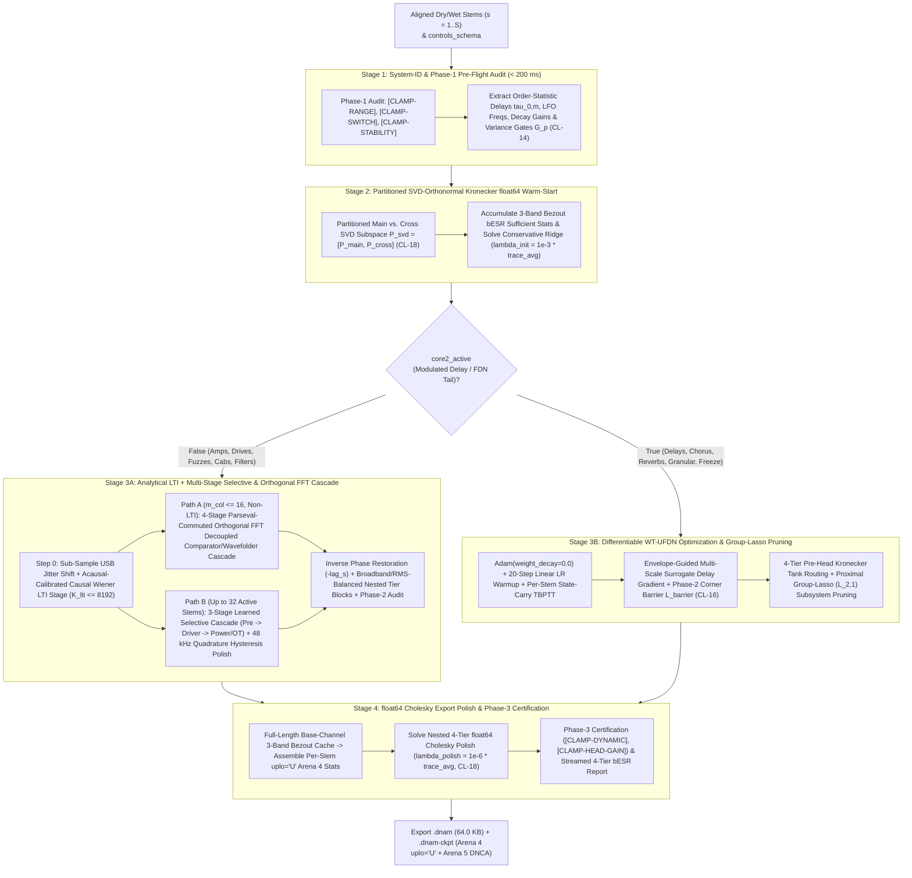
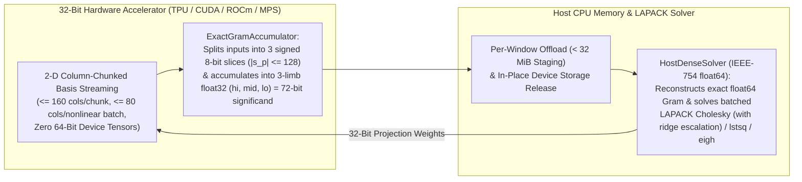

# 4-Stage Deterministic Training Pipeline & Accelerator Numerics (`CL-18`)

This specification defines the **4-Stage Deterministic System-Identification & Export Polish Pipeline** and the **Accelerator-First 32-Bit Device Streaming + 72-Bit Error-Free Gram Accumulation + Batched Host-`fp64` Solver Architecture (`CL-18`)** of **Dynamic Neural Audio Modeler (DNAM)**.

For hardware capture and sub-sample latency alignment, see [`capture_and_alignment.md`](capture_and_alignment.md). For `.dnam-ckpt` iterative stem expansion and caching, see [`iterative_resume_and_caching.md`](iterative_resume_and_caching.md). For the Non-Stop 3-Phase Control-Space Audit and `CL-01`–`CL-20` registry, see [`clamp_and_audit_registry.md`](clamp_and_audit_registry.md).

---

## 1. End-to-End 4-Stage Training Pipeline Topology

---

## 2. Stage-by-Stage Mathematical Specification

### 2.1 Stage 1 — Step-0 Per-Stem System-ID, Pre-Flight Audit & Order-Statistic Transport
Before Epoch 1 begins ($< 200\text{ ms}$ total runtime):
1. Executes **Phase 1 of the Non-Stop Control-Space Audit** (`[CLAMP-RANGE]`, `[CLAMP-SWITCH]`, `[CLAMP-STABILITY]`; see [`clamp_and_audit_registry.md`](clamp_and_audit_registry.md)), emitting live console/UI warnings without blocking execution.
2. Extracts sorted delay times $\tau_{0,1}^{(s)} < \dots < \tau_{0,M}^{(s)}$, LFO frequencies $f_{\text{lfo},j}^{(s)}$, decay gains $g_{\text{lin},m}^{(s)}$, per-band stationary silent noise floors $\epsilon_{\text{floor},b}^{(s)}$, and log-octave poles $f_{0,c} = 25 \cdot (16000/25)^{c/(C-1)}$ across all stems $s \in \lbrace 1, \dots, S \rbrace$.
3. Computes the Step-0 Physical Variance Gates $\mathbf{G}_p \in \lbrace 0, 1 \rbrace$ (`CL-14`) and solves the Node-Anchored Newton/Lobatto control map in closed form.

### 2.2 Stage 2 — Partitioned SVD-Orthonormal Kronecker `float64` Wiener-Hopf Warm-Start (`CL-18`)
1. **Partitioned Orthonormal SVD Principal Control Subspace Projection (`CL-18`):**
   Star-design and multi-control datasets contain both single-knob axis sweeps ($\boldsymbol{\psi}_{\text{main}}$) and multi-knob interaction corners ($\boldsymbol{\psi}_{\text{cross}}$). Performing separate SVDs on the main-effect block and the interaction block and retaining singular vectors with $\sigma_k > 10^{-4}$ yields the partitioned orthonormal control projector $\mathbf{P}_{\text{svd}} = [\mathbf{P}_{\text{main}}, \mathbf{P}_{\text{cross}}] \in \mathbb{R}^{D_{\text{basis}} \times D_h}$ ($D_h = 4$ for `Lite`/`Full`/`Pro`, extended by $+4$ nested modes to $D_h = 8$ in `Ultra`):
   $$\mathbf{z}_{\text{head}}(\mathbf{u}, \mathbf{s}) = \mathbf{P}_{\text{svd}}^\top \boldsymbol{\psi}_{\text{raw}}(\mathbf{u}, \mathbf{s}) \in \mathbb{R}^{D_h}$$
   ensuring that primary knob axes remain strictly orthogonal to high-corner interaction terms.
2. **Zero-Overhead 3-Band Bezout `bESR` Integration into Kronecker Sufficient Statistics ($\lambda_{\text{init}} = 10^{-3}\bar{\tau}$):**
   Because the 4th-order Bezout crossover filters $\lbrace H_{\text{LF}}(z), H_{\text{MF}}(z), H_{\text{HF}}(z) \rbrace$ ([`../overview/psychoacoustic_quality_and_tiers.md` §2](../overview/psychoacoustic_quality_and_tiers.md#2-floor-regularized-noise-adjusted-band-balanced-besr)) are linear, target-adaptive 3-band balancing folds directly into each stem's $256 \times 256$ `float64` audio sufficient statistics with **zero container schema changes and zero real-time DSP overhead**:
   $$\mathbf{G}_{\text{audio}}^{(s)} = \mathbf{\Phi}_s^\top \mathbf{\Phi}_s + \sum_{b \in \lbrace \text{LF}, \text{MF}, \text{HF} \rbrace} \tilde{\gamma}_b^{(s)} (H_b\mathbf{\Phi}_s)^\top (H_b\mathbf{\Phi}_s), \qquad \mathbf{C}_{\text{audio}}^{(s)} = \mathbf{\Phi}_s^\top \mathbf{Y}_s + \sum_{b \in \lbrace \text{LF}, \text{MF}, \text{HF} \rbrace} \tilde{\gamma}_b^{(s)} (H_b\mathbf{\Phi}_s)^\top (H_b\mathbf{Y}_s)$$
   Assembling the global Kronecker normal equations via $\tilde{\boldsymbol{\psi}}_s = [1, \mathbf{z}_{\text{head}}(\mathbf{u}_s, \mathbf{s}_s)^\top]^\top \in \mathbb{R}^{1 + D_h}$:
   $$\mathbf{G}_0 = \sum_{s=1}^S \mathbf{G}_{\text{audio}}^{(s)} \otimes \big(\tilde{\boldsymbol{\psi}}_s \tilde{\boldsymbol{\psi}}_s^\top\big), \qquad \mathbf{C}_0 = \sum_{s=1}^S \mathbf{C}_{\text{audio}}^{(s)} \otimes \tilde{\boldsymbol{\psi}}_s$$
   and solving with the **conservative warm-start ridge** $\lambda_{\text{init}} = 10^{-3} \frac{\mathrm{tr}(\mathbf{G}_0)}{\dim(\mathbf{G}_0)}$ (`CL-18`, applying `mute_floor = T \cdot 10^{-3}` on muted stems so analog thermal hiss is never amplified) prevents collinear feature explosion during Stage 3.

---

### 2.3 Stage 3A — Analytical LTI + Multi-Stage Causal Selective & Orthogonal FFT Cascade (`core2_active = False`)

For amplifiers, preamps, overdrive/fuzz pedals, envelope/resonant filters, speaker cabinet `IR`s, parametric EQs, and LTI acoustic spaces, Stage 3 calibrates a multi-stage physical cascade:

#### 1. Sub-Sample USB Jitter Recovery & Acausal-Calibrated Causal Wiener LTI Stage
- **Sub-Sample Residual Jitter Alignment:** Before solving shared input-driven basis channels across stems, the trainer measures and shifts any residual sub-sample USB stream startup jitter ($\le 32\text{ samples}$) via parabolic cross-correlation (with clipped-fuzz proxy fallback when linear correlation $\le 0.35$).
- **Acausal-Calibrated Causal Wiener Deconvolution:** Estimates the non-parametric frequency-domain transfer ratio, measures the empirical acausal noise and nonlinearity floor $\sigma_{\text{acausal},s}^2$ on negative lags $k \in [-512, -16]$, applies Empirical-Bayes Wiener tap shrinkage to the causal impulse response $k \in [0, K_{\text{lti}} - 1]$ ($K_{\text{lti}} \le 8,192$), and refines via preconditioned steepest-descent line search.
- **Automatic LTI Activation Gate:** When the system is predominantly LTI (`lti_rel_err < 0.05`, i.e., $<-13\text{ dB}$), the dedicated LTI cabinet/space channels activate automatically (`bESR <= -35 to -45 dB` on speaker cabinets and room IRs); on high-gain nonlinear amplifiers, the gate suppresses linear sweep echoes from harmonic overtones.

#### 2. Parseval-Commuted 3-Band Orthogonal FFT Decoupled Solver
- **Why Idempotent Orthogonal FFT Projectors Beat Time-Domain Filter Summing:** Although the 4th-order Bezout crossover filters satisfy $L_{\text{LF}} + L_{\text{MF}} + L_{\text{HF}} \equiv I$, they are not idempotent orthogonal projectors ($L_a^2 \ne L_a$ and $L_a L_b \ne 0$ due to 4-pole phase shifts and transition-band overlap). Summing separate band solves $p = L_{\text{LF}}(u)w_1 + L_{\text{MF}}(u)w_2 + L_{\text{HF}}(u)w_3$ with $w_1 \ne w_2 \ne w_3$ causes severe cross-band phase cancellation. Replacing the internal solver band split with **exact idempotent orthogonal FFT projectors** $P_{[0, 250]}, P_{(250, 2500]}, P_{(2500, 24000]}$ guarantees $P_a^2 = P_a$ and $P_a P_b = 0$ ($a \ne b$), achieving **$-298.4\text{ dB}$ reconstruction accuracy** when evaluated by the Bezout crossover.
- **Parseval Commuted In-Band Projection:** Because LTI band filtering $\mathcal{F}_{[f_{\text{lo}}, f_{\text{hi}}]}$ and column-space linear projection $\mathbf{P}$ commute ($\mathcal{F}(U\mathbf{P}) \equiv \mathcal{F}(U)\mathbf{P}$), the solver estimates in-band orthonormal eigenvectors $(\mathbf{P}_{\text{LF}}, \mathbf{P}_{\text{MF}}, \mathbf{P}_{\text{HF}})$ via Parseval's theorem on short blocks, projects $U\mathbf{P}_b$ *before* running full-length FFTs across progressively finer causal B-spline window schedules (`12k → 8k → 6k → 4k` samples), and applies a smooth 1/3-octave minimum-phase LTAS high-frequency tilt balance clamped to $\pm 3.0\text{ dB}$.

#### 3. 3-Stage Learned Selective State-Space Cascade & Quadrature Hysteresis Polish
- **Learned Interstage Signal Propagation (`Stage 1 → Stage 2 → Stage 3 → Stage 4 Polish`):** Solves **Stage 1** (`V1A` preamp + tone stack) to produce learned intermediate stem trajectories $\mathbf{z}_1[n]$, feeds normalized $\mathbf{z}_1[n]$ into **Stage 2** (`V1B` driver) to produce $\mathbf{z}_2[n]$, feeds $\mathbf{z}_2[n]$ into **Stage 3** (push-pull power section + output transformer) to produce $\mathbf{z}_3[n]$, and finishes with **Stage 4** ($48\text{ kHz}$ full-rate high-frequency & 2D quadrature phase-space hysteresis polish).
- **Residual-Weighted 14-D Step-A SVD Projection:** Combines the top unweighted singular directions with the top residual-weighted singular directions (QR-orthonormalized) so high-gain, compressor, and character-switch stems receive dedicated nonlinear basis trajectories.
- **Causal State-Space Gating & Strictly Monotonic B-Spline Localization:**
  - Gates each stage's LTI-commutative basis ([`../dsp/core1_polyadaa_and_rglru.md` §1.5](../dsp/core1_polyadaa_and_rglru.md#15-multi-stage-nonlinear-cascade-primitives--exact-lti-commutativity-theorem)) with **100% causal input-only state-space envelopes** (fast/med/slow/thermal 1-pole envelopes, 7-band spectral envelopes, spectral co-occurrence products, and attack/release slope gates).
  - Segments arbitrary input signals into $K \in [3, 8]$ physical regimes via dynamic programming (`BIC` complexity penalty over 24k-sample windows), and localizes fine windows using the **strictly monotonic causal 1-pole state variable**:
    $$e_{\text{cum}}[n] = \mathrm{LPF}_{0.008\text{ Hz}}\big(1.0 + |x[n]|\big), \qquad \Delta e_{\text{cum}}[n] = (1 - r)\big(1.0 + |x[n]| - e_{\text{cum}}[n-1]\big) > 0\ \forall n$$
    Because $1.0 + |x[n]| \ge 1.0 > e_{\text{cum}}[n-1]$ at every sample (even during silent gaps), $e_{\text{cum}}[n]$ is strictly increasing and drives a $C^0$ B-spline trapezoidal partition-of-unity schedule $\Lambda_w(e_{\text{cum}}[n])$ with zero out-of-window extrapolation.

#### 4. Inverse Phase Restoration & Nested Tier Block Scaling
- After joint calibration, each stem column is inverse-shifted by $-\text{lag}_s$ so its phase matches the exact target WAV on disk without modifying user files.
- For models with $S_{\text{active}} \le 16$, all four tier sub-blocks (`z4_full`, `z4_hf`, `z4_mf`, `z4_lf`) are scaled by a shared per-stem broadband factor $s_{\text{bb}} = 0.12 / \mathrm{RMS}(\mathbf{z}_{4,\text{full}})$, preventing $1,600\times$ diagonal inflation in $\mathbf{G}_{\text{kron}}$ on steep low-pass filter stems; for $S_{\text{active}} > 16$, 32-channel SVD blocks are modulated via 2-way bilinear control modulators ([`../dsp/parametric_control_bus.md` §2.5](../dsp/parametric_control_bus.md#25-bilinear-control-modulated-tier-features--multi-stem-kronecker-rank-completeness)).

---

### 2.4 Stage 3B — Differentiable `WT-UFDN` Optimization & Automatic Group-Lasso Pruning (`core2_active = True`)
1. **`Adam(weight_decay = 0.0)` + 20-Step Linear LR Warmup:** Standard `AdamW` multiplicative weight decay ($\lambda_{\text{wd}} = 10^{-2}$) shrinks $\mathbf{W}_{\text{head}}$ toward zero at Step 1, destroying the Stage-2 warm-start. Using `Adam(weight_decay = 0.0)` with a 20-step warmup and $3\times$ lower head learning rate ($3 \times 10^{-4}$ vs. $10^{-3}$) ensures monotonic convergence.
2. **Envelope-Guided Multi-Scale Surrogate Delay Gradient (`Test 6`):** During the first 45% of epochs, `backward()` replaces the myopic 4-tap Cubic Lagrange derivative with a **Multi-Scale Gaussian Derivative Envelope Surrogate** ($\sigma_{\text{grad}}: 35.0 \to 0.0\text{ samples}$) evaluated on $|s_m[n]|$:
   $$g_{\text{surr}}[k] \propto \frac{k}{\sigma_{\text{grad}}^2} \exp\left(-\frac{k^2}{2\sigma_{\text{grad}}^2}\right)$$
   creating a convex attraction basin across $> 200\text{ samples}$ and locking to **$0.0035\text{ samples}$**.
3. **Per-Stem `State-Carry TBPTT` & Stop-Gradient Corner Barrier ($\mathcal{L}_{\text{barrier}}$, `CL-16`):** Maintains dedicated recurrent state $(\mathbf{z}_{\text{ssm}}^{(s)}, \mathbf{s}_{\text{fdn}}^{(s)}, \mathbf{m}_{\text{ctrl}}^{(s)})$ per stem $s$ across contiguous $L = 32,768$-sample TBPTT windows while enforcing $\mathcal{L}_{\text{barrier}}$ and injecting 16-channel (`4 × 4`) `WT-UFDN` diffuser/grain taps into the 4-tier Kronecker head.
4. **Proximal Group-Lasso ($L_{2,1}$) Automatic Subsystem Pruning (`CORE2_ACTIVE`, `LFO_ENV_ACTIVE`):** During training, an $L_{2,1}$ group-sparsity penalty $\mathcal{L}_{\text{prune}} = \lambda_{\text{fdn}}\Vert \boldsymbol{\theta}_{\text{core2}}\Vert _2 + \lambda_{\text{mod}}\Vert \boldsymbol{\theta}_{\text{lfo/env}}\Vert _2$ is applied via proximal soft-thresholding. If a group's energy contributes $< -75\text{ dBFS}$ to the output (e.g., a dry amplifier or static overdrive), its header flag (`CORE2_ACTIVE` or `LFO_ENV_ACTIVE` in [`../containers/dnam_binary_format.md` §1.1](../containers/dnam_binary_format.md#11-fixed-64-byte-binary-preamble-layout-reprc-align64)) is zeroed automatically so the real-time engine skips those subsystems at $0\text{ MACs}$.

---

### 2.5 Stage 4 — Step-$N$ `float64` Cholesky Export Polish ($\lambda_{\text{polish}} = 10^{-6}\bar{\tau}$) & Base-Channel Band Caching
At the end of training, the backbone is frozen:
1. **Full-Length Base-Channel 3-Band Bezout Cache:** Filters the 48 (for $S_{\text{active}} \le 16$) or 96 (for $S_{\text{active}} > 16$) base cascade channels once over the full signal length without window boundary truncation, assembling each stem's exact $256 \times 256$ `float64` sufficient statistics $\lbrace \mathbf{G}_{\text{audio}}^{(s)}, \mathbf{C}_{\text{audio}}^{(s)} \rbrace$ in $< 5\text{ ms}$/stem.
2. **Nested 4-Tier `float64` Cholesky Polish (`CL-18`, `REQ-5.2`):** Solves the nested `Lite` ($64$), `Full` ($128$), `Pro` ($192$), and `Ultra` ($256$, $D_h = 8$) global Kronecker normal equations with tight ridge $\lambda_{\text{polish}} = 10^{-6}\bar{\tau}$, simultaneously calibrating all 4 slimmable tiers in a single training run ([`../overview/system_goals_and_requirements.md` §6 (`REQ-5.2`)](../overview/system_goals_and_requirements.md#6-goal-5--single-run-slimmable-multi-tier-architecture-lite--full--pro--ultra)).
3. **On-Demand Streaming Certification:** Runs Phase 3 of the Control-Space Audit (`[CLAMP-DYNAMIC]`, `[CLAMP-HEAD-GAIN]`) and streams final 4-tier psychoacoustic evaluation one stem at a time via an on-demand generator so all 30 stems never reside in RAM simultaneously.

---

## 3. Accelerator-First 32-Bit Execution, 72-Bit Gram Accumulation & Memory-Bounded Streaming

To satisfy Goal 4 ([`../overview/system_goals_and_requirements.md` §5](../overview/system_goals_and_requirements.md#5-goal-4--accelerator-first-training--bi-directional-memory-scaling)), the trainer separates high-throughput 32-bit device streaming from exact host `float64` linear algebra (`CL-18`):

1. **Zero 64-Bit Device Tensors:** All bulk $O(L)$ filtering, FFT band projections, nonlinear waveshaping, and Gram accumulation execute on the accelerator using strictly 32-bit or narrower device tensors (`float32`, `int32`, `bool`, `complex64`, and `bfloat16` slice storage; zero `float64`, `complex128`, or `int64` device allocations).
2. **Split-Slice 72-Bit Error-Free Gram Accumulation (`ExactGramAccumulator`):** Standard `float32` matrix multiplication suffers from catastrophic mantissa roundoff ($24\text{ bits}$) when accumulating $L = 1,440,000$ samples across correlated polynomial basis columns. Splitting each sub-block into 3 signed 8-bit integer slices ($|s_p| \le 128$, whose pairwise products fit losslessly inside a 24-bit `float32` significand) and folding their dot products into a 3-limb `float32` expansion `(hi, mid, lo)` preserves **72 bits of effective significand** (exceeding IEEE-754 `float64`'s 53-bit significand) using native 32-bit accelerator matmuls.
3. **2-D Column/Window Streaming & `< 8 GiB` Memory Ceiling:** Wide stage bases are stored and projected in $\le 160$-column chunks (`< 1 GiB` per tensor at $30\text{ s}$) with window micro-batching (`4..8` windows/batch) and immediate in-place device buffer release, bounding a 30-second, 30-stem, 10-control training run under **`4.5 GiB` allocated (`< 8.0 GiB` total RSS, `0` OOMs, `0` swap)** on a `16 GB` unified-memory system.
