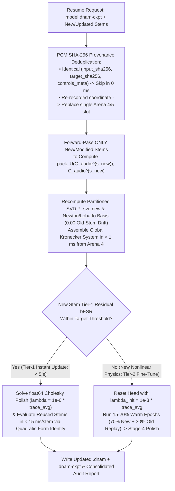
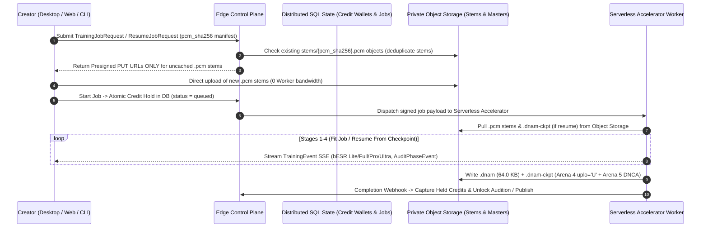

# `.dnam-ckpt` Two-Tier Iterative Stem Expansion, Calibration Caching & Cloud Trainer

This specification defines the **Single-Checkpoint (`.dnam-ckpt`) Two-Tier Iterative Stem Expansion protocol, Two-Tier Calibration Persistence (`Arena 5` `DNCA` + `.dnam-cache` workspace sidecar), and Serverless Cloud Trainer Architecture** of **Dynamic Neural Audio Modeler (DNAM)**.

For the binary wire layout of `.dnam-ckpt`, `Arena 4` (`uplo='U'`), and `Arena 5` (`DNCA`), see [`../containers/checkpoint_and_cache_format.md`](../containers/checkpoint_and_cache_format.md). For the 4-stage training pipeline, see [`four_stage_pipeline.md`](four_stage_pipeline.md).

---

## 1. Single-Checkpoint (`.dnam-ckpt`) Two-Tier Iterative Stem Expansion

### 1.1 Mathematical Proof: Why Pre-Summed Kronecker Matrices Fail on Stem Additions

If `.dnam-ckpt` stored only the pre-collapsed sum $\mathbf{G}_{\text{old}} = \sum_{s=1}^S \mathbf{G}_{\text{audio}}^{(s)} \otimes (\tilde{\boldsymbol{\psi}}_s \tilde{\boldsymbol{\psi}}_s^\top)$, then adding a new stem $s_{\text{new}}$ that:
- increases a knob's polynomial degree $K_p$ (e.g., $1 \to 2$ or $2 \to 3$),
- unlocks a previously unobserved `switch` option, or
- rotates the SVD principal control subspace projector $\mathbf{P}_{\text{svd}} \to \mathbf{P}_{\text{svd,new}}$
would **invalidate $\mathbf{G}_{\text{old}}$** because the old control vectors $\tilde{\boldsymbol{\psi}}_s$ were already multiplied and summed inside $\mathbf{G}_{\text{old}}$.

By storing the **un-entangled, tier-ordered Column-Major Upper-Triangular (`uplo='U'`) audio-only matrices** $\lbrace \mathrm{pack}_{\text{U}}(\mathbf{G}_{\text{audio}}^{(s)}), \mathbf{C}_{\text{audio}}^{(s)} \rbrace$ per stem $s$ in `Arena 4` ([`../containers/checkpoint_and_cache_format.md` §2](../containers/checkpoint_and_cache_format.md#2-tier-ordered-column-major-upper-triangular-packing-uplou-for-mathbfg_textaudios)), the trainer recomputes $\mathbf{P}_{\text{svd,new}}$ and updated control vectors $\tilde{\boldsymbol{\psi}}_s^{\text{new}}$ for all old and new stems in microseconds and assembles the exact updated global Kronecker system in **$< 1\text{ ms}$ with zero audio re-evaluation of old stems**:
$$\mathbf{G}_{\text{updated}} = \sum_{s=1}^{S + S_{\text{new}}} \mathbf{G}_{\text{audio}}^{(s)} \otimes \Big(\tilde{\boldsymbol{\psi}}_s^{\text{new}} \big(\tilde{\boldsymbol{\psi}}_s^{\text{new}}\big)^\top\Big), \qquad \mathbf{C}_{\text{updated}} = \sum_{s=1}^{S + S_{\text{new}}} \mathbf{C}_{\text{audio}}^{(s)} \otimes \tilde{\boldsymbol{\psi}}_s^{\text{new}}$$

### 1.2 Two-Tier Resume Execution & Exact Quadratic-Form `bESR` Evaluation

1. **Tier 1 — Instant Factorized-Kronecker Control & Head Update ($< 5\text{ seconds}$, $100\times$ Faster):**
   - Evaluates only the newly added or modified stem(s), updates the Node-Anchored Newton/Lobatto basis (`0.00` perturbation on old anchors) and SVD projectors, and solves the Stage-4 Cholesky polish.
   - Evaluates 4-tier `Lite`/`Full`/`Pro`/`Ultra` `bESR` on all reused `Arena 4` stems in **$< 15\text{ ms}$/stem** without re-generating audio features by expanding the exact quadratic residual identity:
     $$\big\Vert \mathbf{\Phi}_s \mathbf{W} - \mathbf{Y}_s\big\Vert _F^2 = \mathrm{tr}\big(\mathbf{W}^\top \mathbf{G}_s \mathbf{W}\big) - 2\mathrm{tr}\big(\mathbf{W}^\top \mathbf{C}_s\big) + \big\Vert \mathbf{Y}_s\big\Vert _F^2$$
2. **Tier 2 — Warm-Started Backbone Fine-Tuning (~`15–20%` Epochs, $4\times\text{–}6\times$ Faster):**
   - Triggered only if the Tier-1 residual `bESR` on newly added stem(s) exceeds the tier target (e.g., adding a high-gain fuzz stem to a clean-only checkpoint).
   - Resets the head using conservative ridge $\lambda_{\text{init}} = 10^{-3}\bar{\tau}$, runs warm backbone refinement, and re-runs the Stage-4 Cholesky polish.

---

## 2. Two-Tier Calibration Persistence (`Arena 5` `DNCA` & Workspace `.dnam-cache`)

To avoid recalculating expensive input segmentation Grams, Stage-1 projections, and 8,192-tap causal Wiener LTI impulse responses across iterative runs or after process interruptions:

1. **Portable Checkpoint `Arena 5` (`DNCA`, `HAS_CALIB_STATS` Bit 12):**
   - Embedded inside `.dnam-ckpt` v1.1 (`~3.6 MB` for 30 stems $\times$ 30 s; see [`../containers/checkpoint_and_cache_format.md` §4](../containers/checkpoint_and_cache_format.md#4-arena-5-dnca-has_calib_stats-bit-12--workspace-dnam-cache-sidecar)) and stripped automatically when exporting runtime `.dnam` files.
2. **Local Workspace Cache (`models/<id>/.dnam-cache/*.dnce`):**
   - A gitignored, 64-byte aligned memory-mappable sidecar cache governed by an empirical disk-read vs. compute-regeneration bandwidth cost model, enforcing a configurable workspace quota (`16 GB` default, `~3 GB` floor) and automatically pruning intermediate stage files upon training completion.

---

## 3. Serverless Cloud Trainer Architecture

In addition to local execution, the training pipeline supports scale-to-zero cloud execution via content-addressed PCM stem deduplication (`stems/{pcm_sha256}.pcm`) and `.dnam-ckpt` incremental resume:

1. **Content-Addressed PCM Stem Deduplication (`0 MB` Old-Stem Upload on Resume):** Stems are stored in private object storage under `stems/{pcm_sha256}.pcm`. Because a $30\text{ s}$ dry test sweep is identical across stems and sessions, it is uploaded once; during a `.dnam-ckpt` resume (`Job Kind 3` or `4`), only newly recorded target `.pcm` files are uploaded (`0` old stems re-uploaded or re-rendered).
2. **`< 1.5 s` Cold Starts via Zero Base-Model Weights:** Unlike generative audio foundation models that must load gigabytes of pre-trained weights at container startup, DNAM calibrates each circuit from its physical system-ID equations (`0 MB` pre-trained base weights), enabling scale-to-zero accelerator workers to cold-boot from memory snapshots in $< 1.5\text{ seconds}$.

| Job Kind (`job_kind`) | Execution Target & Typical Duration | Key Architectural Mechanism |
| :--- | :---: | :--- |
| **0. Pre-Flight Phase-1 Control Audit** (`audit_only=True`) | Control-Plane CPU (`< 200 ms`) | Verifies stem coverage & previews `[CLAMP-*]` rules before training |
| **1. Static Snapshot Rig** (`1` Stem, `0` Controls, `Lite`+`Full`+`Pro`+`Ultra`) | Hardware Accelerator (`~10–18 s`) | Stage-2 `float64` Wiener-Hopf warm-start + Stage-3 cascade + Stage-4 polish |
| **2. Full Parametric Multi-Stem Rig** (`Range` & `Switch` Controls) | Hardware Accelerator (`~25–55 s`) | Calibrates all 4 slimmable tiers (`Lite`, `Full`, `Pro`, `Ultra`) in one pass + writes `.dnam-ckpt` |
| **3. Tier-1 `.dnam-ckpt` Stem Expansion** ([§1.2](#12-two-tier-resume-execution--exact-quadratic-form-besr-evaluation)) | Hardware Accelerator (`< 5 s`) | Reuses `Arena 4` `uplo='U'` Gram matrices (`0` old-stem audio passes) |
| **4. Tier-2 `.dnam-ckpt` Backbone Fine-Tune** (`15–20%` Warm Epochs) | Hardware Accelerator (`~12–20 s`) | Warm-started from `.dnam-ckpt` + Stage-4 Cholesky Polish |
